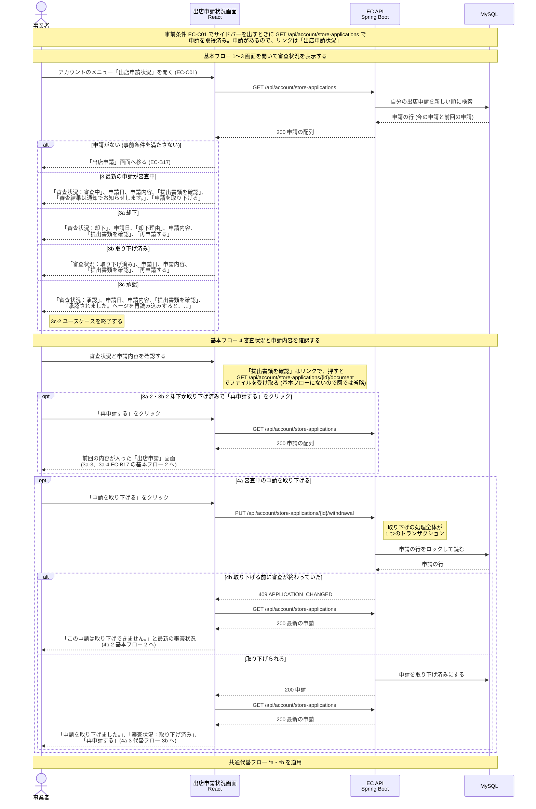
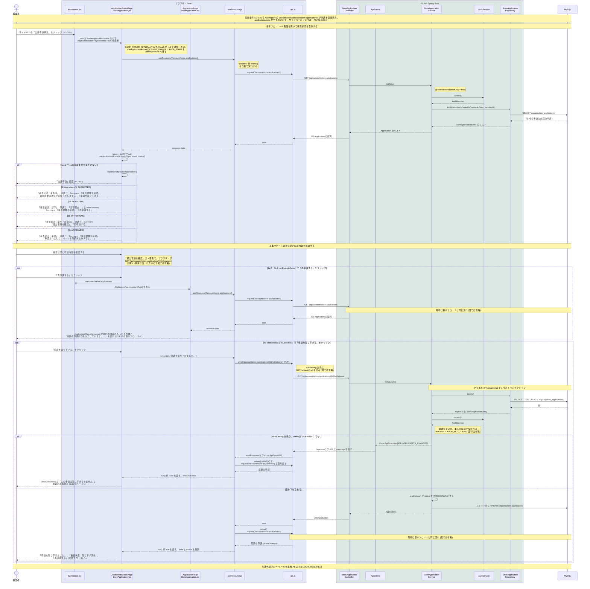

# EC-B18 出店申請状況を確認する

- ユースケース記述: [EC-B18_出店申請状況を確認する](<../../アーカイブ/ユースケース/kusakari-ec/EC-B18_出店申請状況を確認する.md>)
- 対象のコード: kusakari-ec の main（19a2be3、2026-11-20 時点）

## 概要図

## 詳細図

## ユースケース記述との差

- 「申請日」「申請内容」「提出書類を確認」は、審査中だけでなく、却下・取り下げ済み・承認のときも表示します（`ApplicationStatusPage` で状態の条件の外にあるため）。記述の 3a・3b には「申請日」と「提出書類を確認」がなく、3c には審査状況とメッセージしかありません。
- 申請を取り下げても、通知は送りません。サイドバーの申請の一覧も取り直しません（リンクは「出店申請状況」のままです）。
- 4b の 409 は、申請が「今の申請」でない場合（`isLatest()` が偽）にも返します。記述は審査が終わった場合だけを書いています。
- 404 `APPLICATION_NOT_FOUND`「申請が見つかりません。」は記述にありません。画面は自分の最新の申請の ID を送るので、画面の操作ではふつう起きません。
- 関連情報の「未ログインならログイン画面へ」は、URL を変えずに、その場でログインの欄（`AuthPanel`）を表示します（`Workspace.jsx`）。

## 参照したコード

- [frontend/src/workspace/StoreApplication.jsx](https://github.com/abeouga/kusakari-ec/blob/19a2be307ee71a2cd87e538236c3c8c42929c5b3/frontend/src/workspace/StoreApplication.jsx): `ApplicationStatusPage`、`ApplicationPage`、`useApplicationRoute()`、`canReapply()`、`statusLabels`
- [frontend/src/workspace/ApplicationWizard.jsx](https://github.com/abeouga/kusakari-ec/blob/19a2be307ee71a2cd87e538236c3c8c42929c5b3/frontend/src/workspace/ApplicationWizard.jsx): `Summary`、`ApplicationWizard` の `previous`
- [frontend/src/workspace/Workspace.jsx](https://github.com/abeouga/kusakari-ec/blob/19a2be307ee71a2cd87e538236c3c8c42929c5b3/frontend/src/workspace/Workspace.jsx): サイドバーの `applicationLink`、`ApplicationStatusPage` の表示、未ログインの `AuthPanel`
- [frontend/src/workspace/navigation.js](https://github.com/abeouga/kusakari-ec/blob/19a2be307ee71a2cd87e538236c3c8c42929c5b3/frontend/src/workspace/navigation.js): `navigate()`
- [frontend/src/workspace/useResource.js](https://github.com/abeouga/kusakari-ec/blob/19a2be307ee71a2cd87e538236c3c8c42929c5b3/frontend/src/workspace/useResource.js): `useResource()`、`run()`、`reload()`、`write()`
- [frontend/src/workspace/ResourceView.jsx](https://github.com/abeouga/kusakari-ec/blob/19a2be307ee71a2cd87e538236c3c8c42929c5b3/frontend/src/workspace/ResourceView.jsx): `ResourceStatus`
- [frontend/src/api.js](https://github.com/abeouga/kusakari-ec/blob/19a2be307ee71a2cd87e538236c3c8c42929c5b3/frontend/src/api.js): `request()`、`readResponse()`
- [frontend/src/auth.js](https://github.com/abeouga/kusakari-ec/blob/19a2be307ee71a2cd87e538236c3c8c42929c5b3/frontend/src/auth.js): `authFetch()`
- [backend/src/main/java/jp/kusakari/ec/store/controller/StoreApplicationController.java](https://github.com/abeouga/kusakari-ec/blob/19a2be307ee71a2cd87e538236c3c8c42929c5b3/backend/src/main/java/jp/kusakari/ec/store/controller/StoreApplicationController.java): `mine()`、`withdraw()`、`file()`
- [backend/src/main/java/jp/kusakari/ec/store/service/StoreApplicationService.java](https://github.com/abeouga/kusakari-ec/blob/19a2be307ee71a2cd87e538236c3c8c42929c5b3/backend/src/main/java/jp/kusakari/ec/store/service/StoreApplicationService.java): `list()`、`withdraw()`、`document()`、`missing()`
- [backend/src/main/java/jp/kusakari/ec/store/persistence/repository/StoreApplicationRepository.java](https://github.com/abeouga/kusakari-ec/blob/19a2be307ee71a2cd87e538236c3c8c42929c5b3/backend/src/main/java/jp/kusakari/ec/store/persistence/repository/StoreApplicationRepository.java): `findByMemberIdOrderByCreatedAtDesc()`、`lock()`（`@Lock(PESSIMISTIC_WRITE)`）
- [backend/src/main/java/jp/kusakari/ec/store/persistence/entity/StoreApplicationEntity.java](https://github.com/abeouga/kusakari-ec/blob/19a2be307ee71a2cd87e538236c3c8c42929c5b3/backend/src/main/java/jp/kusakari/ec/store/persistence/entity/StoreApplicationEntity.java): `withdraw()`、`isLatest()`
- [backend/src/main/java/jp/kusakari/ec/auth/AuthService.java](https://github.com/abeouga/kusakari-ec/blob/19a2be307ee71a2cd87e538236c3c8c42929c5b3/backend/src/main/java/jp/kusakari/ec/auth/AuthService.java): `current()`
- [backend/src/main/java/jp/kusakari/ec/common/web/ApiErrors.java](https://github.com/abeouga/kusakari-ec/blob/19a2be307ee71a2cd87e538236c3c8c42929c5b3/backend/src/main/java/jp/kusakari/ec/common/web/ApiErrors.java): `business()`
