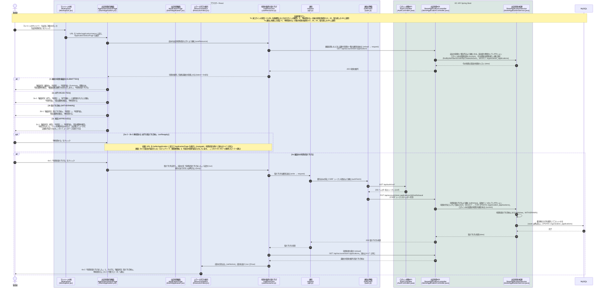
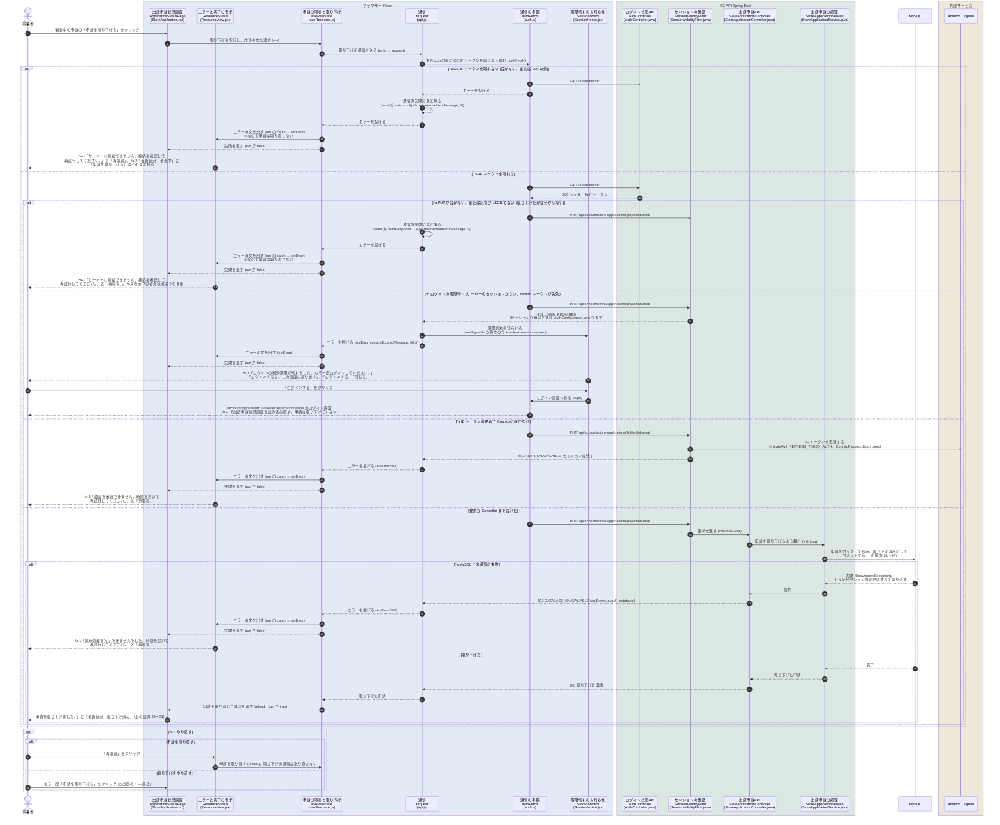

# EC-B18 出店申請状況を確認する

- ユースケース記述: [EC-B18_出店申請状況を確認する](<../../アーカイブ/ユースケース/kusakari-ec/EC-B18_出店申請状況を確認する.md>)
- 共通代替フロー: [00_全ユースケース共通の代替フロー](<00_全ユースケース共通の代替フロー.md>)
- 対象のコード: kusakari-ec の main（6bad7e3、2026-11-24 時点）

## シーケンス図

参加者は、上から「画面や役割の名前」「コンポーネント・クラスの名前」「ファイル名（かっこ付き）」の順に書いています。
図は、EC-C01 でマイページを開いた後から始まります。マイページを開いたときに `Workspace` がサイドバー用に `GET /api/account/store-applications` で申請を読み、申請があるので、リンクは「出店申請状況」になっています。共通代替フローの中身は、00 の図か、下の「共通代替フローを直接書いた図」を見てください。
エラーの代替フローは図に描かず、図の下に並べています。EC-B17 の出店申請画面へ進む「再申請する」（3a-2・3b-2）は、クリックの矢印 1 本と Note にしています。そこでしか起きない取り下げの通信（4a）だけを矢印で描いています。

図に描いていない代替フロー：4b（取り下げる前に審査が終わっていた）

## 共通代替フローを直接書いた図

上の図の取り下げの通信（CSRF トークンの取得と `PUT /api/account/store-applications/{id}/withdrawal`）に、この画面で起こる共通代替フロー（\*a、\*b）を書き込んだ図です。画面を開いて申請を取る通信（上の図の 4）と「再申請する」の後の通信（上の図の 13 の後）の \*a・\*b は、[EC-B17](<EC-B17_出店の申請をする.md>) の「画面を開いて申請を取るとき」の図と同じなので省いています（`ApplicationPage` を `ApplicationStatusPage` に読み替え、失敗したときは審査状況の代わりにエラーの文と「再取得」だけが出ます）。

## ユースケース記述との差

- 関連情報は共通代替フロー \*b だけを挙げていますが、画面を開くときと取り下げのときの通信には \*a も起こります。取り下げの通信が届かなかったときは、取り下げたかどうかが分からないまま、表示中の審査状況が残ります。「再取得」は申請を取り直すだけで、取り下げの通信は送り直しません。
- 「申請日」「申請内容」「提出書類を確認」は、審査中だけでなく、却下・取り下げ済み・承認のときも表示します（`ApplicationStatusPage` で状態の条件の外にあるため）。記述の 3a・3b には「申請日」と「提出書類を確認」がなく、3c には審査状況とメッセージしかありません。
- 「提出書類を確認」はリンク（`a` 要素）で、押すとブラウザーが `GET /api/account/store-applications/{id}/document` を開き、書類をダウンロードします（`Content-Disposition: attachment`）。基本フローに押す操作がないので、図には書いていません。
- 3c の後は画面を再読み込みするまで、アカウントの種類は出店申請用のままです（`useAuth` のログイン状態を読み直さないため）。再読み込みすると、オーナーのアカウントとして `useApplicationRoute()` が「商品管理」画面（`/seller/products`）に置き換え、サイドバーの「出店をご検討の方」も出なくなります。
- 申請を取り下げても、通知は送りません。サイドバーの申請の一覧も取り直しません（リンクは「出店申請状況」のままで、関連情報のとおりです）。
- 4b の 409 は、申請が「今の申請」でない場合（`isLatest()` が偽）にも返します。記述は審査が終わった場合だけを書いています。4b-1 の文の横には「再取得」ボタンも出ます。
- 404 `APPLICATION_NOT_FOUND`「申請が見つかりません。」は記述にありません。申請がないか本人の申請でないときに返しますが、画面は自分の最新の申請の ID を送るので、画面の操作では起こりません。図には書いていません。
- 関連情報の「『出店申請状況』画面の URL に直接アクセスした場合」: 未ログインなら、URL を変えずに、その場でログインの入力欄（`AuthPanel`）を出します（`Workspace.jsx`）。申請がない出店申請用アカウントなら、`useApplicationRoute()` が履歴を増やさずに「出店申請」画面（`/seller/application`）に置き換えます。事前条件（出店申請をしている）で外したので、図には書いていません。

## 参照したコード

- [frontend/src/workspace/Workspace.jsx](https://github.com/abeouga/kusakari-ec/blob/6bad7e37c4135034fbe97e30309772fbe872e675/frontend/src/workspace/Workspace.jsx): `Workspace`（サイドバーの `applicationLink`、`ApplicationStatusPage` と `ApplicationPage` の表示、未ログインの `AuthPanel`）
- [frontend/src/workspace/WorkspaceSidebar.jsx](https://github.com/abeouga/kusakari-ec/blob/6bad7e37c4135034fbe97e30309772fbe872e675/frontend/src/workspace/WorkspaceSidebar.jsx): `MenuLink`
- [frontend/src/workspace/Common.jsx](https://github.com/abeouga/kusakari-ec/blob/6bad7e37c4135034fbe97e30309772fbe872e675/frontend/src/workspace/Common.jsx): `PageLink`
- [frontend/src/workspace/StoreApplication.jsx](https://github.com/abeouga/kusakari-ec/blob/6bad7e37c4135034fbe97e30309772fbe872e675/frontend/src/workspace/StoreApplication.jsx): `ApplicationStatusPage`、`ApplicationPage`、`useApplicationRoute`、`canReapply`、`statusLabels`
- [frontend/src/workspace/ApplicationWizard.jsx](https://github.com/abeouga/kusakari-ec/blob/6bad7e37c4135034fbe97e30309772fbe872e675/frontend/src/workspace/ApplicationWizard.jsx): `Summary`、`ApplicationWizard` の `previous`
- [frontend/src/workspace/navigation.js](https://github.com/abeouga/kusakari-ec/blob/6bad7e37c4135034fbe97e30309772fbe872e675/frontend/src/workspace/navigation.js): `navigate`
- [frontend/src/workspace/useResource.js](https://github.com/abeouga/kusakari-ec/blob/6bad7e37c4135034fbe97e30309772fbe872e675/frontend/src/workspace/useResource.js): `useResource`、`reload`、`run`、`write`
- [frontend/src/workspace/ResourceView.jsx](https://github.com/abeouga/kusakari-ec/blob/6bad7e37c4135034fbe97e30309772fbe872e675/frontend/src/workspace/ResourceView.jsx): `ResourceStatus`（エラーの文と「再取得」、完了の文）
- [frontend/src/api.js](https://github.com/abeouga/kusakari-ec/blob/6bad7e37c4135034fbe97e30309772fbe872e675/frontend/src/api.js): `request`、`send`、`readResponse`、`ApiError`、`networkErrorMessage`、`sessionExpiredMessage`
- [frontend/src/auth.js](https://github.com/abeouga/kusakari-ec/blob/6bad7e37c4135034fbe97e30309772fbe872e675/frontend/src/auth.js): `authFetch`（`GET /api/auth/csrf`）、`wasSignedIn`、`login`
- [frontend/src/components/SessionNotice.jsx](https://github.com/abeouga/kusakari-ec/blob/6bad7e37c4135034fbe97e30309772fbe872e675/frontend/src/components/SessionNotice.jsx): 期限切れのお知らせ
- [backend/src/main/java/jp/kusakari/ec/store/controller/StoreApplicationController.java](https://github.com/abeouga/kusakari-ec/blob/6bad7e37c4135034fbe97e30309772fbe872e675/backend/src/main/java/jp/kusakari/ec/store/controller/StoreApplicationController.java): `mine`、`withdraw`、`file`
- [backend/src/main/java/jp/kusakari/ec/store/service/StoreApplicationService.java](https://github.com/abeouga/kusakari-ec/blob/6bad7e37c4135034fbe97e30309772fbe872e675/backend/src/main/java/jp/kusakari/ec/store/service/StoreApplicationService.java): `list`、`withdraw`、`document`、`missing`
- [backend/src/main/java/jp/kusakari/ec/store/persistence/repository/StoreApplicationRepository.java](https://github.com/abeouga/kusakari-ec/blob/6bad7e37c4135034fbe97e30309772fbe872e675/backend/src/main/java/jp/kusakari/ec/store/persistence/repository/StoreApplicationRepository.java): `findByMemberIdOrderByCreatedAtDesc`、`lock`（`@Lock(PESSIMISTIC_WRITE)`）
- [backend/src/main/java/jp/kusakari/ec/store/persistence/entity/StoreApplicationEntity.java](https://github.com/abeouga/kusakari-ec/blob/6bad7e37c4135034fbe97e30309772fbe872e675/backend/src/main/java/jp/kusakari/ec/store/persistence/entity/StoreApplicationEntity.java): `withdraw`、`isLatest`
- [backend/src/main/java/jp/kusakari/ec/auth/AuthService.java](https://github.com/abeouga/kusakari-ec/blob/6bad7e37c4135034fbe97e30309772fbe872e675/backend/src/main/java/jp/kusakari/ec/auth/AuthService.java): `current`
- [backend/src/main/java/jp/kusakari/ec/auth/AuthController.java](https://github.com/abeouga/kusakari-ec/blob/6bad7e37c4135034fbe97e30309772fbe872e675/backend/src/main/java/jp/kusakari/ec/auth/AuthController.java): `csrf`
- [backend/src/main/java/jp/kusakari/ec/auth/SessionValidityFilter.java](https://github.com/abeouga/kusakari-ec/blob/6bad7e37c4135034fbe97e30309772fbe872e675/backend/src/main/java/jp/kusakari/ec/auth/SessionValidityFilter.java): `doFilterInternal`（ID トークンの更新、401、503 のときはセッションを残す）
- [backend/src/main/java/jp/kusakari/ec/auth/CognitoPasswordLogin.java](https://github.com/abeouga/kusakari-ec/blob/6bad7e37c4135034fbe97e30309772fbe872e675/backend/src/main/java/jp/kusakari/ec/auth/CognitoPasswordLogin.java): ID トークンの更新、503 `AUTH_UNAVAILABLE`
- [backend/src/main/java/jp/kusakari/ec/auth/AuthConfiguration.java](https://github.com/abeouga/kusakari-ec/blob/6bad7e37c4135034fbe97e30309772fbe872e675/backend/src/main/java/jp/kusakari/ec/auth/AuthConfiguration.java): `authenticationEntryPoint`（401 `LOGIN_REQUIRED`）
- [backend/src/main/java/jp/kusakari/ec/common/web/ApiErrors.java](https://github.com/abeouga/kusakari-ec/blob/6bad7e37c4135034fbe97e30309772fbe872e675/backend/src/main/java/jp/kusakari/ec/common/web/ApiErrors.java): `business`、`database`
