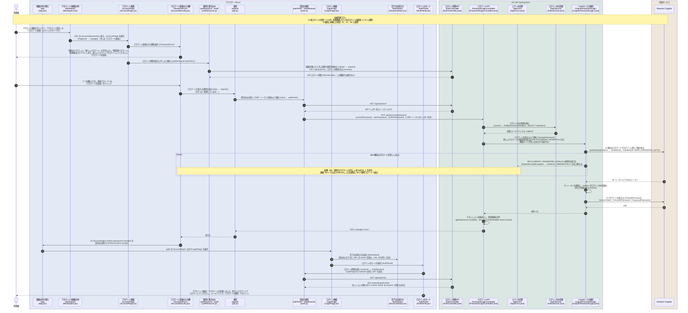
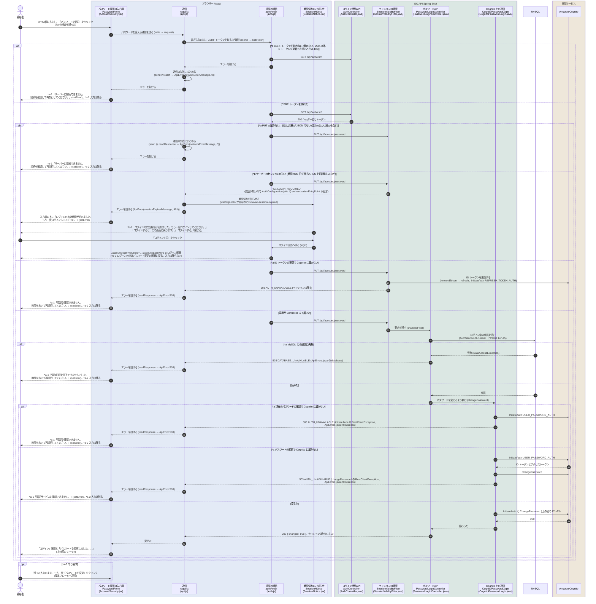

# EC-B19 パスワードを変更する

- ユースケース記述: [EC-B19_パスワードを変更する](<../../アーカイブ/ユースケース/kusakari-ec/EC-B19_パスワードを変更する.md>)
- 共通代替フロー: [00_全ユースケース共通の代替フロー](<00_全ユースケース共通の代替フロー.md>)
- 対象のコード: kusakari-ec の main（6bad7e3、2026-11-24 時点）

## シーケンス図

参加者は、上から「画面や役割の名前」「コンポーネント・クラスの名前」「ファイル名（かっこ付き）」の順に書いています。
EC API が Amazon Cognito を 2 回呼び（現在のパスワードでのログインと、パスワードの変更）、ブラウザーは Cognito と直接通信しません。共通代替フローの中身は、00 の図か、下の「共通代替フローを直接書いた図」を見てください。
エラーは最重要の 8a（現在のパスワードが正しくない）だけを描き、ほかの代替フローは図の下に並べています。

図に描いていない代替フロー：7a（不一致または短すぎる）、（記述なし）の分岐

## 共通代替フローを直接書いた図

上の図の変更の通信（CSRF トークンの取得と `PUT /api/account/password`）に、この画面で起こる共通代替フロー（\*a、\*b）を書き込んだ図です。URL を直接開いたときのログインの確認（\*b）は、[EC-A01](<EC-A01_会員を検索・確認する.md>) の図と同じく `Workspace` がその場に `AuthPanel` のログインの入力欄を出すので省いています。画面を開いたときの `GET /api/auth/me`（上の図の 6）は、失敗しても画面に何も出ないので書いていません（「ユースケース記述との差」を見てください）。

## ユースケース記述との差

- 7: 検証は、サーバーへ送る前にブラウザーの `PasswordForm` の `submit()` が行います。8 文字未満を先に確かめ、次に一致を確かめます。サーバーも `PasswordRequest` の `@Size(min = 8)` と 400 `PASSWORD_MISMATCH` の確かめを持ちますが、画面から送る値はブラウザーで止まるため、これらには届きません。
- 記述にない入力の誤りがあります。`form` は `noValidate` で、`submit()` は「現在のパスワード」を確かめません。「現在のパスワード」が空のとき、または新しいパスワードが空白だけのときは、サーバーの `@NotBlank` が 400 `INVALID_INPUT`「入力内容・文字数・数値の範囲を確認してください。」を返します。
- 8: 「現在のパスワードが正しいか確認する」は、Cognito の `InitiateAuth`（`USER_PASSWORD_AUTH`）でログインし直して確かめます。記述にない応答として、試行が多すぎるとき 429 `AUTH_RATE_LIMITED`、追加の確認が要るとき 409 `AUTH_CHALLENGE_REQUIRED` があります。得た ID トークンの `subject` がログイン中の会員と違うときは 403 `FORBIDDEN`「本人確認に失敗しました。」です。
- 9: Cognito の `ChangePassword` が新しいパスワードを受け付けないときは 400 `PASSWORD_REJECTED`「パスワードを変更できません。パスワードの条件または試行間隔を確認してください。」です。記述にない枝です。画面は 8 文字以上だけを確かめるので、Cognito のパスワードの条件に合わない値はここで止まります。
- 9: 「ログアウト状態にする」は、EC API が変更を送ったブラウザーのセッションを `invalidate()` することです。Cognito の `GlobalSignOut` などは呼びません。
- 共通代替フロー \*a: Cognito に届かないときの文は、呼ぶ所で違います。ID トークンの更新と現在のパスワードの確認では「認証を確認できません。時間をおいて再試行してください。」、パスワードの変更（`ChangePassword`）では「認証サービスに接続できません。」です。`ChangePassword` が読み取りの時間切れになったときは、Cognito でパスワードが変わったかは分かりません。
- 共通代替フロー \*b: ID トークンの期限が切れていて、更新もできないとき（refresh トークンの失効など）は、`PUT` より先の `GET /api/auth/csrf` が `SessionValidityFilter` で 401 になり、セッションも無効になります。`auth.js` の `authFetch()` が例外を投げ、`api.js` の `send()` が status 0 の通信の失敗に言い換えるので、画面には \*a の「サーバーに接続できません。…」が出て、`SessionNotice` のお知らせは出ません。もう一度押すと、`GET /api/auth/csrf` は新しいセッションで通り、`PUT` が 401 になって \*b のお知らせが出ます。図の \*b はこの 2 回目と、サーバーのセッションそのものが無いときです。
- 共通代替フロー \*b: 期限切れのときは、`PasswordForm` の入力欄の上と、ヘッダーの `SessionNotice` の 2 か所に「ログインの有効期限が切れました。もう一度ログインしてください。」が出ます。「ログインする」で `/account/login` へ移るので、入力は残りません。
- コードにあって記述にない処理として、画面を開いたときに `AccountPage` の `useResource('/auth/me')` が `GET /api/auth/me` を送ります。「パスワード変更」の画面はこの結果を使わず、`ResourceStatus` も出さないので、この通信が失敗しても画面には何も出ません。
- 利用停止・除名された会員が押したときは、`GET /api/auth/csrf` が `SessionValidityFilter` で 403 になり、画面には「サーバーに接続できません。…」が出ます。事前条件がログイン状態なので、図には書いていません。

## 確かめられなかったこと

- Cognito が `ChangePassword` を拒む条件（パスワードの長さ・文字の種類の決まり、試行の間隔）と、`ChallengeName` を返す条件は、User Pool の設定で決まります。実際の User Pool は kusakari-terraform で管理しており、その設定は確かめていません。
- パスワードを変えたあと、ほかのブラウザーで続いている EC のセッションと、その refresh トークンを Cognito がどう扱うかは、EC のコードでは確かめられません。EC のコードが無効にするのは、変更を送ったブラウザーのセッションだけです。
- MySQL にまったく接続できないときは、`PasswordLoginController` より先に `SessionValidityFilter` の `members.current()` が DB を読みます。そこでの例外は `@RestControllerAdvice` の外で起きるため、`ApiErrors.database()` の 503 にならない可能性があります（00 の「確かめられなかったこと」と同じ）。図の MySQL の枝は、`ApiErrors.database()` を通ったときの形です。
- GitHub と Obsidian での図の見た目は確かめていません。

## 参照したコード

- [frontend/src/workspace/Workspace.jsx](https://github.com/abeouga/kusakari-ec/blob/6bad7e37c4135034fbe97e30309772fbe872e675/frontend/src/workspace/Workspace.jsx): `Workspace`（未ログインのときの `AuthPanel`、`accountSettings`、`accountActions` で `AccountPage` を選ぶところ）
- [frontend/src/workspace/WorkspaceSidebar.jsx](https://github.com/abeouga/kusakari-ec/blob/6bad7e37c4135034fbe97e30309772fbe872e675/frontend/src/workspace/WorkspaceSidebar.jsx): `WorkspaceSidebar`、`MenuLink`
- [frontend/src/workspace/Common.jsx](https://github.com/abeouga/kusakari-ec/blob/6bad7e37c4135034fbe97e30309772fbe872e675/frontend/src/workspace/Common.jsx): `PageLink`
- [frontend/src/workspace/navigation.js](https://github.com/abeouga/kusakari-ec/blob/6bad7e37c4135034fbe97e30309772fbe872e675/frontend/src/workspace/navigation.js): `navigate`、`usePath`
- [frontend/src/workspace/AccountPage.jsx](https://github.com/abeouga/kusakari-ec/blob/6bad7e37c4135034fbe97e30309772fbe872e675/frontend/src/workspace/AccountPage.jsx): `accountActions`、`AccountPage`（`useResource('/auth/me')`）
- [frontend/src/workspace/AccountSecurity.jsx](https://github.com/abeouga/kusakari-ec/blob/6bad7e37c4135034fbe97e30309772fbe872e675/frontend/src/workspace/AccountSecurity.jsx): `PasswordForm`、`submit`、`messageOf`
- [frontend/src/workspace/useResource.js](https://github.com/abeouga/kusakari-ec/blob/6bad7e37c4135034fbe97e30309772fbe872e675/frontend/src/workspace/useResource.js): `useResource`、`reload`、`write`
- [frontend/src/api.js](https://github.com/abeouga/kusakari-ec/blob/6bad7e37c4135034fbe97e30309772fbe872e675/frontend/src/api.js): `request`、`send`、`readResponse`、`ApiError`、`networkErrorMessage`、`sessionExpiredMessage`、`sessionExpiredEvent`
- [frontend/src/auth.js](https://github.com/abeouga/kusakari-ec/blob/6bad7e37c4135034fbe97e30309772fbe872e675/frontend/src/auth.js): `authFetch`（`GET /api/auth/csrf`）、`readSession`、`wasSignedIn`、`login`
- [frontend/src/useAuth.js](https://github.com/abeouga/kusakari-ec/blob/6bad7e37c4135034fbe97e30309772fbe872e675/frontend/src/useAuth.js): `useAuth`
- [frontend/src/App.jsx](https://github.com/abeouga/kusakari-ec/blob/6bad7e37c4135034fbe97e30309772fbe872e675/frontend/src/App.jsx): `/account/login` で `LoginPage` を返すところ
- [frontend/src/components/LoginPage.jsx](https://github.com/abeouga/kusakari-ec/blob/6bad7e37c4135034fbe97e30309772fbe872e675/frontend/src/components/LoginPage.jsx): `LoginPage`（`flashNotice` の表示）
- [frontend/src/components/AuthPanel.jsx](https://github.com/abeouga/kusakari-ec/blob/6bad7e37c4135034fbe97e30309772fbe872e675/frontend/src/components/AuthPanel.jsx): `AuthPanel`
- [frontend/src/components/SessionNotice.jsx](https://github.com/abeouga/kusakari-ec/blob/6bad7e37c4135034fbe97e30309772fbe872e675/frontend/src/components/SessionNotice.jsx): `SessionNotice`、`flashMessages`、`flashNotice`
- [backend/src/main/java/jp/kusakari/ec/auth/AuthController.java](https://github.com/abeouga/kusakari-ec/blob/6bad7e37c4135034fbe97e30309772fbe872e675/backend/src/main/java/jp/kusakari/ec/auth/AuthController.java): `me`、`csrf`
- [backend/src/main/java/jp/kusakari/ec/auth/PasswordLoginController.java](https://github.com/abeouga/kusakari-ec/blob/6bad7e37c4135034fbe97e30309772fbe872e675/backend/src/main/java/jp/kusakari/ec/auth/PasswordLoginController.java): `changePassword`、`PasswordRequest`
- [backend/src/main/java/jp/kusakari/ec/auth/CognitoPasswordLogin.java](https://github.com/abeouga/kusakari-ec/blob/6bad7e37c4135034fbe97e30309772fbe872e675/backend/src/main/java/jp/kusakari/ec/auth/CognitoPasswordLogin.java): `changePassword`、`authenticateTokens`、`initiateAuth`、`toUser`、`refresh`
- [backend/src/main/java/jp/kusakari/ec/auth/AuthService.java](https://github.com/abeouga/kusakari-ec/blob/6bad7e37c4135034fbe97e30309772fbe872e675/backend/src/main/java/jp/kusakari/ec/auth/AuthService.java): `current`、`session`
- [backend/src/main/java/jp/kusakari/ec/auth/AuthMemberRepository.java](https://github.com/abeouga/kusakari-ec/blob/6bad7e37c4135034fbe97e30309772fbe872e675/backend/src/main/java/jp/kusakari/ec/auth/AuthMemberRepository.java): `findByIssuerAndSubject`
- [backend/src/main/java/jp/kusakari/ec/auth/SessionValidityFilter.java](https://github.com/abeouga/kusakari-ec/blob/6bad7e37c4135034fbe97e30309772fbe872e675/backend/src/main/java/jp/kusakari/ec/auth/SessionValidityFilter.java): `doFilterInternal`、`renewIdToken`
- [backend/src/main/java/jp/kusakari/ec/auth/AuthConfiguration.java](https://github.com/abeouga/kusakari-ec/blob/6bad7e37c4135034fbe97e30309772fbe872e675/backend/src/main/java/jp/kusakari/ec/auth/AuthConfiguration.java): `authorizeHttpRequests`（`/api/auth/csrf` は誰でも）、`authenticationEntryPoint`（401 `LOGIN_REQUIRED`）
- [backend/src/main/java/jp/kusakari/ec/common/web/ApiErrors.java](https://github.com/abeouga/kusakari-ec/blob/6bad7e37c4135034fbe97e30309772fbe872e675/backend/src/main/java/jp/kusakari/ec/common/web/ApiErrors.java): `business`、`invalid`、`database`
