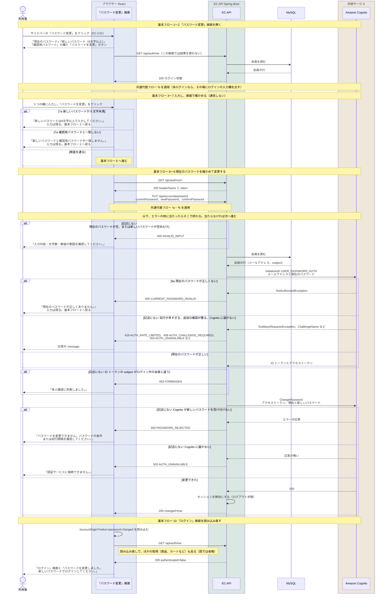
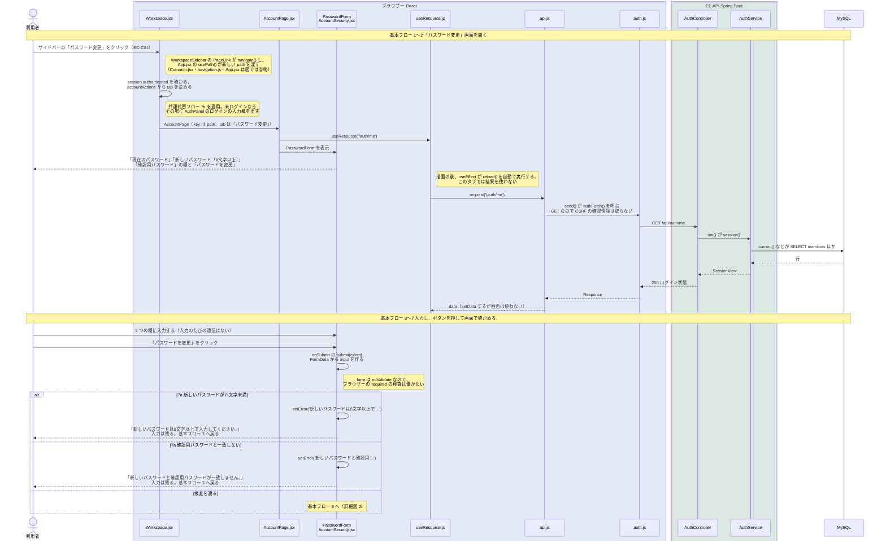
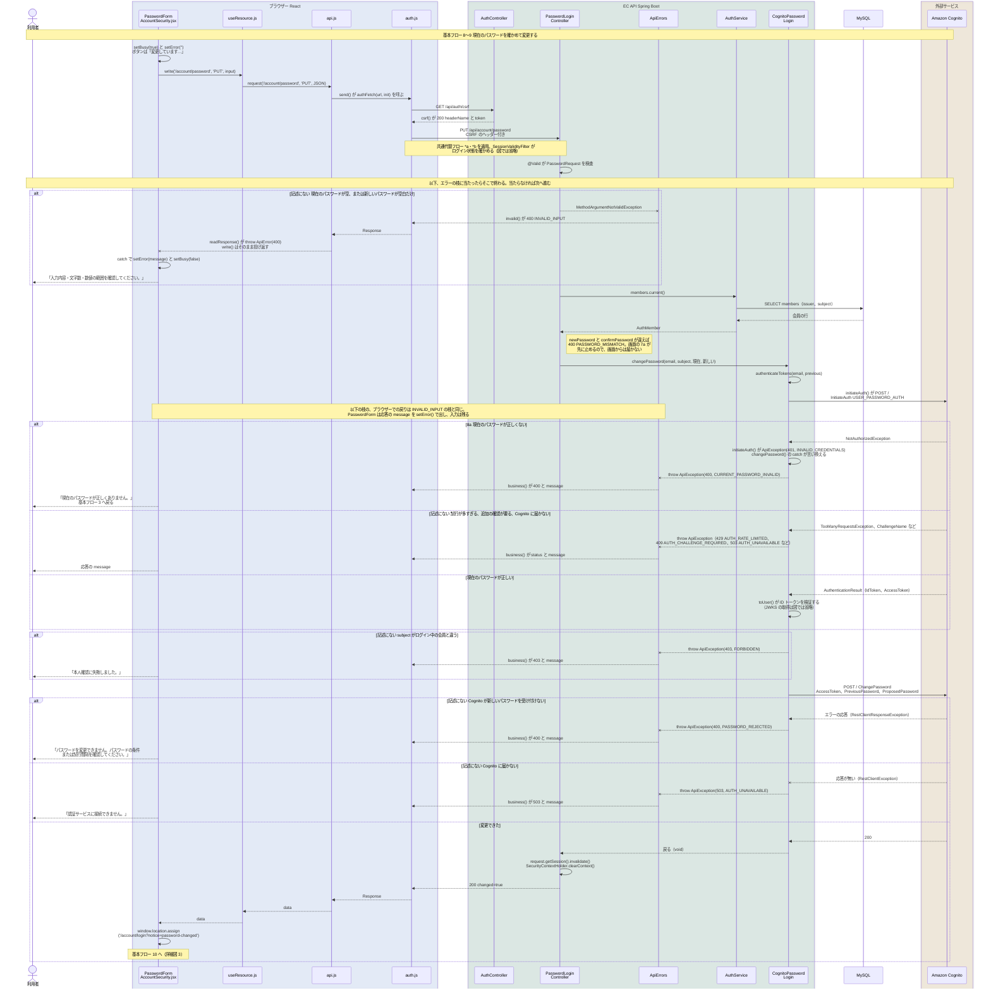
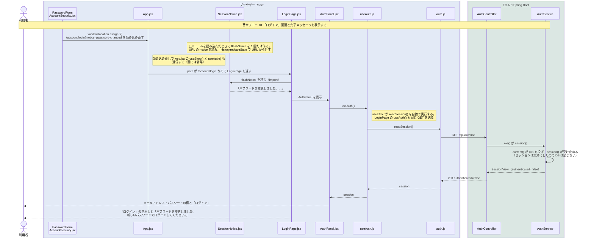

# EC-B19 パスワードを変更する

- ユースケース記述: [EC-B19_パスワードを変更する](<../../アーカイブ/ユースケース/kusakari-ec/EC-B19_パスワードを変更する.md>)
- 対象のコード: kusakari-ec の main（19a2be3、2026-11-20 時点）

パスワードの変更は、EC API が Amazon Cognito を 2 回呼んで行います。1 回目の `InitiateAuth`（`USER_PASSWORD_AUTH`）で現在のパスワードを確かめ、2 回目の `ChangePassword` で新しいパスワードに変えます。ブラウザーは Cognito と直接通信しません。変更できたら EC API がセッションを無効にし、画面は `/account/login?notice=password-changed` を読み込み直します。

## 概要図

## 詳細図

### 詳細図 1 基本フロー 1〜7 画面を開いて入力を確かめる

### 詳細図 2 基本フロー 8〜9 現在のパスワードを確かめて変更する

### 詳細図 3 基本フロー 10 「ログイン」画面と完了メッセージを表示する

## ユースケース記述との差

- 7: 検証は、サーバーへ送る前にブラウザーの `PasswordForm` の `submit()` が行います。8 文字未満を先に確かめ、次に一致を確かめます。サーバーも `PasswordRequest` の `@Size(min = 8)` と 400 `PASSWORD_MISMATCH` の確かめを持ちますが、画面から送る値はブラウザーで止まるため、これらには届きません。
- 記述にない入力の誤りがあります。`form` は `noValidate` で、`submit()` は「現在のパスワード」を確かめません。「現在のパスワード」が空のとき、または新しいパスワードが空白だけのときは、サーバーの `@NotBlank` が 400 `INVALID_INPUT` を返し、「入力内容・文字数・数値の範囲を確認してください。」と出ます。
- 8: 「現在のパスワードが正しいか確認する」は、Cognito の `InitiateAuth`（`USER_PASSWORD_AUTH`）でログインし直して確かめます。記述にない応答として、試行が多すぎるとき 429 `AUTH_RATE_LIMITED`「試行回数が多すぎます。時間をおいて再試行してください。」、追加の確認が要るとき 409 `AUTH_CHALLENGE_REQUIRED`、Cognito に届かないとき 503 `AUTH_UNAVAILABLE` があります。得た ID トークンの `subject` がログイン中の会員と違うときは 403 `FORBIDDEN`「本人確認に失敗しました。」です。
- 9: 記述にない応答として、Cognito の `ChangePassword` が新しいパスワードを受け付けないとき 400 `PASSWORD_REJECTED`「パスワードを変更できません。パスワードの条件または試行間隔を確認してください。」、Cognito に届かないとき 503 `AUTH_UNAVAILABLE`「認証サービスに接続できません。」があります。画面は 8 文字以上だけを確かめるので、Cognito のパスワードの条件に合わない値はここで止まります。
- 共通代替フロー *b: ID トークンを更新できないとき（更新トークンの失効など）は、最初の `GET /api/auth/csrf` が `SessionValidityFilter` で 401 になり、セッションも無効になります。`auth.js` の `authFetch()` が例外を投げ、`api.js` の `send()` が status 0 の通信エラーに言い換えるため、画面には「サーバーに接続できません。接続を確認して再試行してください。」が出て、`SessionNotice` のログインの案内は出ません。もう一度押すと `PUT` が 401 になり、*b の案内が出ます。サーバーのセッションそのものが無いとき（EC の再起動など）は、1 回目から `PUT` が 401 になり、*b の案内が出ます。
- コードにあって記述にない処理として、画面を開いたときに `AccountPage` の `useResource('/auth/me')` が `GET /api/auth/me` を送ります。「パスワード変更」の画面はこの結果を使いません。

## 確かめられなかったこと

- Cognito が `ChangePassword` を拒む条件（パスワードの長さ・文字の種類の決まり、試行の間隔）と、`ChallengeName` を返す条件は、User Pool の設定で決まります。EC の `infra/cognito/kusakari-ec-terraform/main.tf` のパスワードの条件は 8 文字以上で文字の種類を問いませんが、実際の User Pool は kusakari-terraform で管理しており、その設定は確かめていません。
- パスワードを変えたあと、ほかのブラウザーで続いている EC のセッションと、その更新トークンを Cognito がどう扱うかは、EC のコードでは確かめられません。EC のコードが無効にするのは、変更を送ったブラウザーのセッションだけです。

## 参照したコード

- [frontend/src/workspace/Workspace.jsx](https://github.com/abeouga/kusakari-ec/blob/19a2be307ee71a2cd87e538236c3c8c42929c5b3/frontend/src/workspace/Workspace.jsx): `Workspace`（未ログインのときの `AuthPanel`、`accountActions` で `AccountPage` を選ぶところ）、`accountSettings`
- [frontend/src/workspace/AccountPage.jsx](https://github.com/abeouga/kusakari-ec/blob/19a2be307ee71a2cd87e538236c3c8c42929c5b3/frontend/src/workspace/AccountPage.jsx): `accountActions`、`AccountPage`、`useResource('/auth/me')`
- [frontend/src/workspace/AccountSecurity.jsx](https://github.com/abeouga/kusakari-ec/blob/19a2be307ee71a2cd87e538236c3c8c42929c5b3/frontend/src/workspace/AccountSecurity.jsx): `PasswordForm`、`submit()`、`messageOf()`
- [frontend/src/workspace/useResource.js](https://github.com/abeouga/kusakari-ec/blob/19a2be307ee71a2cd87e538236c3c8c42929c5b3/frontend/src/workspace/useResource.js): `useResource()`、`reload()`、`write()`
- [frontend/src/api.js](https://github.com/abeouga/kusakari-ec/blob/19a2be307ee71a2cd87e538236c3c8c42929c5b3/frontend/src/api.js): `request()`、`send()`、`readResponse()`、`networkErrorMessage`、`sessionExpiredEvent`
- [frontend/src/auth.js](https://github.com/abeouga/kusakari-ec/blob/19a2be307ee71a2cd87e538236c3c8c42929c5b3/frontend/src/auth.js): `authFetch()`、`readSession()`
- [frontend/src/useAuth.js](https://github.com/abeouga/kusakari-ec/blob/19a2be307ee71a2cd87e538236c3c8c42929c5b3/frontend/src/useAuth.js): `useAuth()`
- [frontend/src/App.jsx](https://github.com/abeouga/kusakari-ec/blob/19a2be307ee71a2cd87e538236c3c8c42929c5b3/frontend/src/App.jsx): `/account/login` で `LoginPage` を返す条件
- [frontend/src/components/LoginPage.jsx](https://github.com/abeouga/kusakari-ec/blob/19a2be307ee71a2cd87e538236c3c8c42929c5b3/frontend/src/components/LoginPage.jsx): `LoginPage`（`flashNotice` の表示）
- [frontend/src/components/AuthPanel.jsx](https://github.com/abeouga/kusakari-ec/blob/19a2be307ee71a2cd87e538236c3c8c42929c5b3/frontend/src/components/AuthPanel.jsx): `AuthPanel`
- [frontend/src/components/SessionNotice.jsx](https://github.com/abeouga/kusakari-ec/blob/19a2be307ee71a2cd87e538236c3c8c42929c5b3/frontend/src/components/SessionNotice.jsx): `flashNotice`、`flashMessages`、`SessionNotice`
- [backend/src/main/java/jp/kusakari/ec/auth/PasswordLoginController.java](https://github.com/abeouga/kusakari-ec/blob/19a2be307ee71a2cd87e538236c3c8c42929c5b3/backend/src/main/java/jp/kusakari/ec/auth/PasswordLoginController.java): `changePassword()`、`PasswordRequest`
- [backend/src/main/java/jp/kusakari/ec/auth/CognitoPasswordLogin.java](https://github.com/abeouga/kusakari-ec/blob/19a2be307ee71a2cd87e538236c3c8c42929c5b3/backend/src/main/java/jp/kusakari/ec/auth/CognitoPasswordLogin.java): `changePassword()`、`authenticateTokens()`、`initiateAuth()`、`toUser()`
- [backend/src/main/java/jp/kusakari/ec/auth/AuthController.java](https://github.com/abeouga/kusakari-ec/blob/19a2be307ee71a2cd87e538236c3c8c42929c5b3/backend/src/main/java/jp/kusakari/ec/auth/AuthController.java): `me()`、`csrf()`
- [backend/src/main/java/jp/kusakari/ec/auth/AuthService.java](https://github.com/abeouga/kusakari-ec/blob/19a2be307ee71a2cd87e538236c3c8c42929c5b3/backend/src/main/java/jp/kusakari/ec/auth/AuthService.java): `current()`、`session()`
- [backend/src/main/java/jp/kusakari/ec/auth/SessionValidityFilter.java](https://github.com/abeouga/kusakari-ec/blob/19a2be307ee71a2cd87e538236c3c8c42929c5b3/backend/src/main/java/jp/kusakari/ec/auth/SessionValidityFilter.java): `doFilterInternal()`、`renewIdToken()`
- [backend/src/main/java/jp/kusakari/ec/common/web/ApiErrors.java](https://github.com/abeouga/kusakari-ec/blob/19a2be307ee71a2cd87e538236c3c8c42929c5b3/backend/src/main/java/jp/kusakari/ec/common/web/ApiErrors.java): `business()`、`invalid()`
- [infra/cognito/kusakari-ec-terraform/main.tf](https://github.com/abeouga/kusakari-ec/blob/19a2be307ee71a2cd87e538236c3c8c42929c5b3/infra/cognito/kusakari-ec-terraform/main.tf): `password_policy`
- [docs/decisions/2026-10-28-buyer-account-use-cases.md](https://github.com/abeouga/kusakari-ec/blob/19a2be307ee71a2cd87e538236c3c8c42929c5b3/docs/decisions/2026-10-28-buyer-account-use-cases.md): EC-B19 の決定（`confirmPassword`、400 `CURRENT_PASSWORD_INVALID`）
