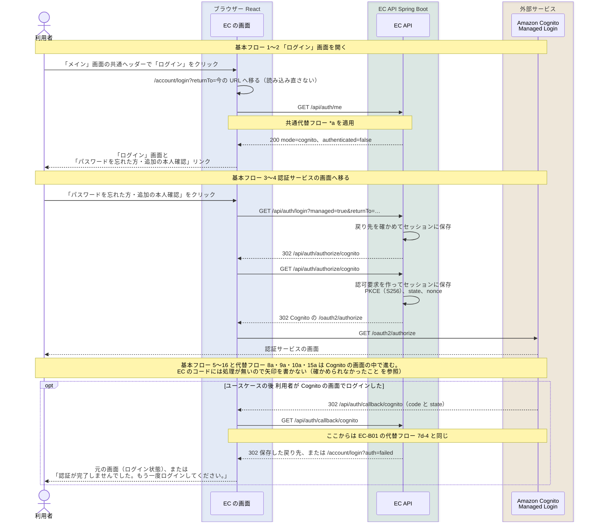
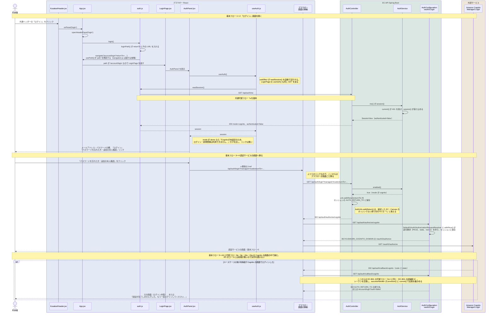

# EC-B20 パスワードを再設定する

- ユースケース記述: [EC-B20_パスワードを再設定する](<../../アーカイブ/ユースケース/kusakari-ec/EC-B20_パスワードを再設定する.md>)
- 対象のコード: kusakari-ec の main（19a2be3、2026-11-20 時点）

パスワードの再設定は、Amazon Cognito の Managed Login の画面で行います。EC のコードが受け持つのは、「ログイン」画面のリンクから Cognito の認可の画面（`/oauth2/authorize`）へ送り出すところまでです。メールアドレスの入力、確認コードの送信と照合、新しいパスワードの保存は Cognito の中の処理で、EC のコードには呼び出しがありません。図では、その部分を Note だけにしています。

## 概要図

## 詳細図

### 詳細図 1 基本フロー 1〜16

## ユースケース記述との差

- 4〜16: 再設定の画面と処理はすべて Cognito の Managed Login にあり、EC のコードには呼び出しがありません。図はこの部分を Note だけにしています。代替フロー 8a・9a・10a・15a も同じです。
- 3〜4: リンクの先は Cognito の認可の画面（`/oauth2/authorize`）で、再設定の画面へ直接は移りません。このリンクは EC-B01 の代替フロー 7d（追加の本人確認）と同じものです。記述の 5 のとおり、利用者が Cognito の画面で再設定へ進みます。
- コードにあって記述にない入口が 2 つあります。どちらも同じ Managed Login へ移ります。
  - `/account/reset` の画面の「Cognitoでパスワードを再設定」リンク（`returnTo` は `/account`）。未ログインでも開けますが、サイドバーには出ません（`Workspace.jsx` の `accountSettings` が外しています）。
  - `GET /api/auth/reset`。`/api/auth/login?managed=true` へ転送します（`returnTo` が無いので、戻り先は EC の「/」）。この URL を開く画面はありません。
- コードにあって記述にない続きがあります。再設定のあと Cognito の画面でログインすると、`/api/auth/callback/cognito` に戻り、EC のセッションを作って、ヘッダーの「ログイン」を押した画面（`AUTH_RETURN_TO`）へ戻ります。失敗すると `/account/login?auth=failed` で「認証が完了しませんでした。もう一度ログインしてください。」と出ます。記述は 16 で終わります。流れは [EC-B01 ログインする](<EC-B01_ログインする.md>) の詳細図 4 と同じです。

## 確かめられなかったこと

- 基本フロー 5〜16 の画面の動きと文言は、Cognito の Managed Login と User Pool の設定で決まり、EC のコードでは確かめられません。EC の `docs/functional-requirements.md` も、パスワードリセットを「認証画面へ誘導・メール受信を含む成功系未検証」としています。
- EC の `infra/cognito/kusakari-ec-terraform/main.tf` には、メールでの回復（`account_recovery_setting` の `verified_email`）、存在しない利用者のエラーを隠す設定（`prevent_user_existence_errors = "ENABLED"`）、8 文字以上で文字の種類を問わないパスワードの条件、`managed_login_version = 2` が書かれています。ただし実際の User Pool は kusakari-terraform で管理しており、その設定は確かめていません。9a（登録されていないメールアドレスでも同じ確認コードの入力画面を出す）と 15a（パスワードの条件）が記述どおりになるかは、この設定によります。
- 10a の確認コードの有効期限と文言は、Cognito の仕様によります。確かめていません。
- 16 のあと、Cognito がログインの画面と完了メッセージを出すのか、そのままログインして EC へ戻すのかは、確かめていません。
- コールバックで Spring Security が Cognito の `/oauth2/userInfo` を呼ぶかどうかは、Spring Security の中の処理で、確かめていません（`AuthConfiguration` は `userInfoUri` を設定しています）。

## 参照したコード

- [packages/site-header/KusakariHeader.jsx](https://github.com/abeouga/kusakari-ec/blob/19a2be307ee71a2cd87e538236c3c8c42929c5b3/packages/site-header/KusakariHeader.jsx): 未ログインのときの「ログイン」ボタン（`panelAction('login', …)`）
- [frontend/src/App.jsx](https://github.com/abeouga/kusakari-ec/blob/19a2be307ee71a2cd87e538236c3c8c42929c5b3/frontend/src/App.jsx): `openHeaderPanel()`、`/account/login` で `LoginPage` を返す条件
- [frontend/src/auth.js](https://github.com/abeouga/kusakari-ec/blob/19a2be307ee71a2cd87e538236c3c8c42929c5b3/frontend/src/auth.js): `login()`、`loginPath()`、`readSession()`
- [frontend/src/workspace/navigation.js](https://github.com/abeouga/kusakari-ec/blob/19a2be307ee71a2cd87e538236c3c8c42929c5b3/frontend/src/workspace/navigation.js): `navigate()`、`usePath()`
- [frontend/src/useAuth.js](https://github.com/abeouga/kusakari-ec/blob/19a2be307ee71a2cd87e538236c3c8c42929c5b3/frontend/src/useAuth.js): `useAuth()`
- [frontend/src/components/LoginPage.jsx](https://github.com/abeouga/kusakari-ec/blob/19a2be307ee71a2cd87e538236c3c8c42929c5b3/frontend/src/components/LoginPage.jsx): `LoginPage`
- [frontend/src/components/AuthPanel.jsx](https://github.com/abeouga/kusakari-ec/blob/19a2be307ee71a2cd87e538236c3c8c42929c5b3/frontend/src/components/AuthPanel.jsx): `returnTo`、「パスワードを忘れた方・追加の本人確認」のリンク、`mode` が `demo` のときの表示、`auth=failed` の表示
- [frontend/src/workspace/AccountPage.jsx](https://github.com/abeouga/kusakari-ec/blob/19a2be307ee71a2cd87e538236c3c8c42929c5b3/frontend/src/workspace/AccountPage.jsx): `/account/reset` の「Cognitoでパスワードを再設定」
- [frontend/src/workspace/Workspace.jsx](https://github.com/abeouga/kusakari-ec/blob/19a2be307ee71a2cd87e538236c3c8c42929c5b3/frontend/src/workspace/Workspace.jsx): `accountSettings`、未ログインでも開ける `/account/reset`
- [backend/src/main/java/jp/kusakari/ec/auth/AuthController.java](https://github.com/abeouga/kusakari-ec/blob/19a2be307ee71a2cd87e538236c3c8c42929c5b3/backend/src/main/java/jp/kusakari/ec/auth/AuthController.java): `me()`、`login()`（`managed=true`）、`reset()`
- [backend/src/main/java/jp/kusakari/ec/auth/AuthService.java](https://github.com/abeouga/kusakari-ec/blob/19a2be307ee71a2cd87e538236c3c8c42929c5b3/backend/src/main/java/jp/kusakari/ec/auth/AuthService.java): `enabled()`、`session()`、`current()`
- [backend/src/main/java/jp/kusakari/ec/auth/AuthUrls.java](https://github.com/abeouga/kusakari-ec/blob/19a2be307ee71a2cd87e538236c3c8c42929c5b3/backend/src/main/java/jp/kusakari/ec/auth/AuthUrls.java): `safeReturn()`
- [backend/src/main/java/jp/kusakari/ec/auth/AuthConfiguration.java](https://github.com/abeouga/kusakari-ec/blob/19a2be307ee71a2cd87e538236c3c8c42929c5b3/backend/src/main/java/jp/kusakari/ec/auth/AuthConfiguration.java): `cognitoClients()`（`authorizationUri`、`redirectUri`、`userInfoUri`）、`cognitoSecurity()`（`withPkce()`、`successHandler`、`failureHandler`）
- [infra/cognito/kusakari-ec-terraform/main.tf](https://github.com/abeouga/kusakari-ec/blob/19a2be307ee71a2cd87e538236c3c8c42929c5b3/infra/cognito/kusakari-ec-terraform/main.tf): `password_policy`、`account_recovery_setting`、`prevent_user_existence_errors`、`managed_login_version`
- [docs/cognito-auth.md](https://github.com/abeouga/kusakari-ec/blob/19a2be307ee71a2cd87e538236c3c8c42929c5b3/docs/cognito-auth.md): パスワードの再設定に Managed Login を使う決定（PKCE、state、nonce）
- [docs/functional-requirements.md](https://github.com/abeouga/kusakari-ec/blob/19a2be307ee71a2cd87e538236c3c8c42929c5b3/docs/functional-requirements.md): パスワードリセットの検証の状況
