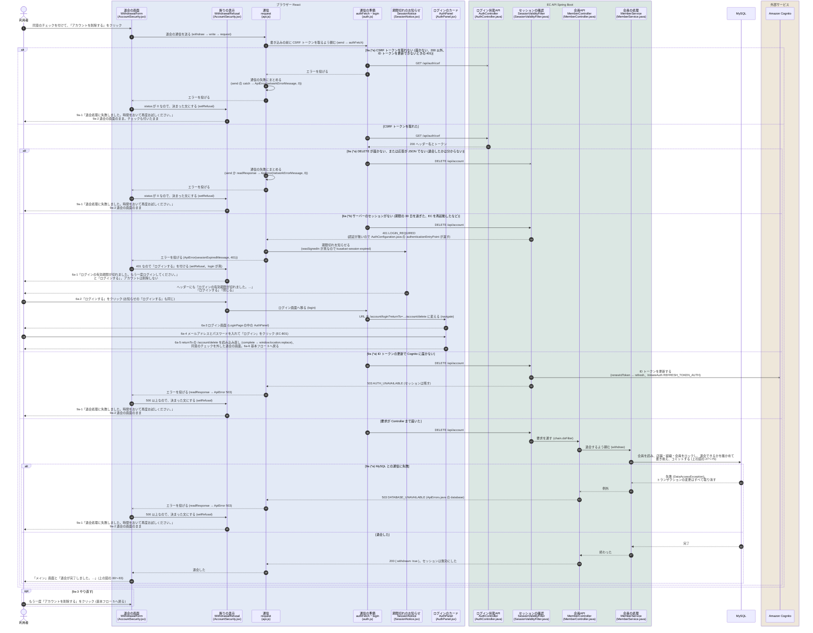

# EC-B21 アカウントを退会する

- ユースケース記述: [EC-B21_アカウントを退会する](<../../アーカイブ/ユースケース/kusakari-ec/EC-B21_アカウントを退会する.md>)
- 共通代替フロー: [00_全ユースケース共通の代替フロー](<00_全ユースケース共通の代替フロー.md>)
- 対象のコード: kusakari-ec の main（6bad7e3、2026-11-24 時点）

## シーケンス図

参加者は、上から「画面や役割の名前」「コンポーネント・クラスの名前」「ファイル名（かっこ付き）」の順に書いています。
代替フローの 6a（セッションが切れている）は共通代替フロー \*b に、9a（通信に失敗した）は \*a に当たるので、下の「共通代替フローを直接書いた図」に書いています。

```mermaid
sequenceDiagram
    autonumber
    actor User as 利用者
    box rgba(47,111,219,0.10) ブラウザー React
        participant App as 画面の切り替え<br/>App<br/>(App.jsx)
        participant Flash as 完了のお知らせ<br/>flashNotice<br/>(SessionNotice.jsx)
        participant Work as アカウントの画面の枠<br/>Workspace<br/>(Workspace.jsx)
        participant Acct as アカウント画面<br/>AccountPage<br/>(AccountPage.jsx)
        participant Form as 退会の画面<br/>WithdrawalForm<br/>(AccountSecurity.jsx)
        participant Refusal as 断りの表示<br/>WithdrawalRefusal<br/>(AccountSecurity.jsx)
        participant Nav as 画面の移動<br/>goBack<br/>(navigation.js)
        participant Hook as 取得と書き込み<br/>useResource・write<br/>(useResource.js)
        participant Http as 通信<br/>request<br/>(api.js)
        participant AuthJs as 通信の準備<br/>authFetch<br/>(auth.js)
    end
    box rgba(27,127,92,0.12) EC API Spring Boot
        participant AuthCtrl as ログイン状態API<br/>AuthController<br/>(AuthController.java)
        participant Ctrl as 会員API<br/>MemberController<br/>(MemberController.java)
        participant Errs as エラーの応答<br/>ApiErrors<br/>(ApiErrors.java)
        participant Svc as 会員の処理<br/>MemberService<br/>(MemberService.java)
        participant Auth as ログイン中の会員<br/>AuthService<br/>(AuthService.java)
        participant StoreRepo as 店舗の読み書き<br/>StoreRepository<br/>(StoreRepository.java)
        participant Pend as オーナーの譲渡の申し出<br/>PendingOwnerSuccession<br/>(PendingOwnerSuccession.java)
        participant Notices as 譲渡の通知<br/>OwnerSuccessionNotices<br/>(OwnerSuccessionNotices.java)
        participant Guard as 退会できるかの確認<br/>WithdrawalGuard<br/>(WithdrawalGuard.java)
        participant Repo as 会員の読み書き<br/>AuthMemberRepository<br/>(AuthMemberRepository.java)
    end
    participant Db as MySQL

    Note over User,Db: 共通代替フロー<br/>*b 未ログインの場合 (6a): 2 (URL を直接開いたときのログインの確認) と 25 に適用<br/>*a 通信に失敗した場合 (9a): 23 と 25 に適用

    User->>Work: アカウント画面のサイドバー「アカウント設定」の<br/>「退会」をクリック (EC-C01)
    Work->>Acct: URL を /account/delete に変え、AccountPage を表示<br/>(PageLink → navigate、tab は「退会」)
    Acct->>Hook: ログイン状態を取りに行くよう頼む (useResource('/auth/me'))
    Acct->>Form: 退会の画面を表示 (WithdrawalForm、同意は外れた状態)
    Form-->>User: 「退会の前にご確認ください」と注意事項 4 つ、<br/>「注意事項を確認し、退会することに同意します」、<br/>「戻る」と押せない「アカウントを削除する」
    Hook->>Http: 画面を開いたときに自動で通信を始める (reload → request)
    Http->>AuthCtrl: GET /api/auth/me
    AuthCtrl->>Auth: ログイン状態を作るよう頼む (session)
    Auth-->>AuthCtrl: ログイン状態 (SessionView)
    AuthCtrl-->>Http: 200 ログイン状態
    Http-->>Hook: ログイン状態 (この画面では使わない)

    alt 3a 退会をやめる
        User->>Form: 3a-1「戻る」をクリック
        Form->>Nav: 前の画面へ戻るよう頼む (goBack)
        Nav-->>User: 3a-2 Kusakari の中から来たときは前の画面 (history.back)、<br/>URL を直接開いたときは「メイン」画面 (navigate('/'))。<br/>退会の通信はしない。3a-3 終了
    else 退会する
        User->>Form: 3 「注意事項を確認し、退会することに同意します」にチェックを付ける
        Form-->>User: 4 「アカウントを削除する」を押せるようにする (setAgreed(true))
        opt 4a チェックを外した
            User->>Form: 4a チェックを外す
            Form-->>User: 4a-1 「アカウントを削除する」を押せなくする (setAgreed(false))
            User->>Form: 4a-2 もう一度チェックを付ける (基本フロー 3 へ戻る)
        end
        User->>Form: 5 「アカウントを削除する」をクリック
        Form->>Http: 退会の通信を送る (withdraw → write → request)<br/>ボタンは「退会処理中…」、チェックと「戻る」も押せない
        Http->>AuthJs: 書き込みの前に CSRF トークンを取るよう頼む (send → authFetch)
        AuthJs->>AuthCtrl: GET /api/auth/csrf
        AuthCtrl-->>AuthJs: 200 ヘッダー名とトークン (csrf)
        AuthJs->>Ctrl: DELETE /api/account (CSRF トークンのヘッダー付き)
        Ctrl->>Svc: 退会するよう頼む (withdraw)<br/>withdraw 全体が 1 つのトランザクション
        Svc->>Auth: 6 ログイン中の会員を読む (current)
        Auth->>Repo: 会員を読む (findByIssuerAndSubject)
        Repo->>Db: SELECT members
        Db-->>Repo: 会員の行
        Repo-->>Auth: 会員
        Auth-->>Svc: 会員 (ロックせずに読んだ種類)
        opt オーナー (SHOP_OWNER) のとき
            Svc->>Auth: 組織の店舗を調べる (storeIdsOf)
            Auth-->>Svc: 店舗 ID の一覧 (ID の小さい順)
            loop 店舗ごと
                Svc->>StoreRepo: 店舗の行をロックする (lock)
                StoreRepo->>Db: SELECT ... FOR UPDATE stores
                Db-->>StoreRepo: ロックした店舗の行
                StoreRepo-->>Svc: 店舗
            end
        end
        Svc->>Pend: 会員が属する組織をロックするよう頼む (lockOrganizationOf)
        Pend->>Db: オーナーか担当者として属する組織を探し、<br/>あればロックして読み直す (SELECT ... FOR UPDATE organizations)
        Db-->>Pend: ロックした組織の行
        Pend-->>Svc: 組織 (購入者などは組織なし)
        Svc->>Repo: 会員を読む (findById)
        Repo->>Db: SELECT members
        Db-->>Repo: 会員の行
        Repo-->>Svc: 会員
        Svc->>Db: 会員の行をロックして読み直す<br/>(lockMember、SELECT ... FOR UPDATE members)
        Db-->>Svc: ロックした会員の行
        alt 記述なし 運営者アカウント (isAdmin)
            Svc--xErrs: 409 ADMIN_REQUIRED の例外を投げる (ApiException)
            Errs-->>Http: 409「管理者はこの画面から退会できません。」(business)
            Http--xForm: エラーを投げる (readResponse → ApiError)
            Form->>Refusal: 断りの文を出す (setRefusal)
            Refusal-->>User: 「管理者はこの画面から退会できません。」
        else 記述なし ロックを待つ間に、譲渡の承認で担当者からオーナーになった
            Svc--xErrs: 409 WITHDRAWAL_ACCOUNT_CHANGED の例外を投げる
            Errs-->>Http: 409「退会の手続きの間にアカウントの種類が変わりました。<br/>画面を読み込み直してから、もう一度お試しください。」(business)
            Http--xForm: エラーを投げる (readResponse → ApiError)
            Form->>Refusal: 断りの文を出す (setRefusal)
            Refusal-->>User: 応答の文
        else 続けられる
            Svc->>Guard: 7 自分の未完了の注文を読む (openPurchases)
            Guard->>Db: 注文を読む (SELECT orders。status が ACCEPTED か READY、<br/>またはキャンセル申請が PENDING。注文履歴で非表示にした注文も含む)
            Db-->>Guard: 注文の行
            Guard-->>Svc: 注文番号と状態の一覧 (なければ空)
            alt 7a 未完了の注文がある
                Svc--xCtrl: 409 WITHDRAWAL_OPEN_ORDERS の例外を、<br/>注文の一覧と一緒に投げる (WithdrawalBlockedException)
                Ctrl-->>Http: 409 code、message、orders (withdrawalBlocked)
                Http--xForm: エラーを投げる (readResponse → ApiError、body に orders)
                Form->>Refusal: 断りの文と注文を出す (setRefusal)
                Refusal-->>User: 7a-1「受け渡しが完了していない注文があるため退会できません。」<br/>7a-2「注文番号 {id}（注文受付）」か「（受取準備完了）」と<br/>「注文履歴を確認する」(/purchases)。7a-3 終了
            else オーナー以外 (購入者、担当者、出店申請用アカウント)、または店舗のないオーナー
                Svc->>Svc: 9 会員を退会状態にする<br/>(AuthMember の withdraw。enabled を偽、withdrawnAt に今の時刻)
                opt 組織をロックした
                    Svc->>Pend: 承認待ちの譲渡の当事者なら、申し出を<br/>無効にするよう頼む (invalidateFor、invalidateForOwner)
                    opt 承認待ちの譲渡先か、申し出たオーナー本人
                        Pend->>Db: 承認待ちを空にし、履歴を保存する<br/>(clearOwnerSuccession、organization_member_events)
                        Pend->>Notices: オーナーと譲渡先に知らせるよう頼む (invalidated)
                        Notices->>Db: 「オーナーの譲渡の申し出が無効になりました」の<br/>通知を 2 件保存する
                    end
                    Pend-->>Svc: 終わった
                end
                Svc->>Db: 書き換えた行を保存してコミットする<br/>(save は呼ばない。UPDATE members ほか)
                Db-->>Svc: 完了
                Svc-->>Ctrl: 終わった
                Ctrl->>Ctrl: 9 セッションを無効にし、認証情報を消す<br/>(getSession().invalidate、SecurityContextHolder.clearContext)
                Ctrl-->>Http: 200 { withdrawn: true }
                Http-->>Form: 退会した
                Form->>App: 10 「メイン」画面 /?notice=withdrawn を<br/>読み込み直す (window.location.assign)
                App->>Flash: 完了のお知らせを読む (useState(flashNotice))<br/>読み込んだときに URL の notice を読み、URL から外してある
                Flash-->>App: 「退会が完了しました。ご利用ありがとうございました。」
                App-->>User: ログインしていない「メイン」画面と、「退会が完了しました。<br/>ご利用ありがとうございました。」「閉じる」
            else オーナーで、組織に店舗がある
                Svc->>Guard: 8 店舗に出品中の商品があるかを確かめる (hasListedProducts)
                Guard->>Db: 公開中の在庫を数える<br/>(SELECT count inventory・products、publicationStatus が PUBLISHED)
                Db-->>Guard: 件数
                Guard-->>Svc: あるか
                alt 8a 出品中の商品がある
                    Svc--xCtrl: 409 WITHDRAWAL_LISTED_PRODUCTS の例外を投げる<br/>(WithdrawalBlockedException、注文は空)
                    Ctrl-->>Http: 409 code と message (withdrawalBlocked)
                    Http--xForm: エラーを投げる (readResponse → ApiError)
                    Form->>Refusal: 断りの文を出す (setRefusal)
                    Refusal-->>User: 8a-1「出品中の商品があるため退会できません。すべての商品を<br/>販売停止にしてから再度お試しください。」<br/>8a-2「商品一覧を確認する」(/seller/products)。8a-3 終了
                else 出品中の商品はない
                    Svc->>Guard: 8 店舗の未完了の注文か、未処理のキャンセル申請が<br/>あるかを確かめる (hasOpenStoreOrders)
                    Guard->>Db: 注文を数える (SELECT count orders。status が ACCEPTED か READY、<br/>またはキャンセル申請が PENDING)
                    Db-->>Guard: 件数
                    Guard-->>Svc: あるか
                    alt 8b ある
                        Svc--xCtrl: 409 WITHDRAWAL_STORE_ORDERS の例外を投げる<br/>(WithdrawalBlockedException、注文は空)
                        Ctrl-->>Http: 409 code と message (withdrawalBlocked)
                        Http--xForm: エラーを投げる (readResponse → ApiError)
                        Form->>Refusal: 断りの文を出す (setRefusal)
                        Refusal-->>User: 8b-1「引き渡しが完了していない注文、または処理していない<br/>キャンセル申請があるため退会できません。」<br/>8b-2「注文一覧・キャンセル申請を確認する」(/seller/orders)。8b-3 終了
                    else ない
                        Svc->>Db: 退会状態にし、譲渡の申し出を無効にして、<br/>セッションを無効にする (流れは 68〜78 と同じ)
                        Http-->>Form: 退会した
                        Form-->>User: 「メイン」画面と「退会が完了しました。…」(流れは 80〜83 と同じ)
                    end
                end
            end
        end
    end
```

## 共通代替フローを直接書いた図

上の図の退会の通信（CSRF トークンの取得と `DELETE /api/account`）に、この画面で起こる共通代替フロー（\*a、\*b）を書き込んだ図です。この画面では、\*a はユースケース記述の 9a、\*b は 6a に当たります。URL を直接開いたときのログインの確認（\*b）は、[EC-A01](<EC-A01_会員を検索・確認する.md>) の図と同じく `Workspace` がその場に `AuthPanel` のログインの入力欄を出すので省いています。画面を開いたときの `GET /api/auth/me`（上の図の 7）は、失敗しても画面に何も出ないので書いていません。

## ユースケース記述との差

- 7・8b の「未完了の注文」: `WithdrawalGuard` は、`status` が `ACCEPTED`（注文受付）・`READY`（受取準備完了）の注文と、キャンセル申請が未処理（`cancellationStatus` が `PENDING`）の注文を数えます。カード払いの支払い待ち（`PENDING_PAYMENT`）の注文は「引き渡し完了」「キャンセル済み」のどちらでもありませんが、退会を止めません。店舗の閉鎖と組織の停止で使う `OpenOrders.BLOCKING` は `PENDING_PAYMENT` も止めるので、判定がそろっていません。
- 7a-2: 注文の状態は `openOrderLabels` で「注文受付」「受取準備完了」と出します。キャンセル申請だけが未処理の注文で、状態がそのどちらでもないときは、状態のコードがそのまま出ます。
- 8: 店舗のロック（`StoreRepository.lock`）は、退会の確かめの間に新しい注文が入らないようにするためのもので、記述にない処理です。ロックの順は「店舗 → 組織 → 会員」です。
- 運営者アカウント: 関連情報に「この画面から退会できない」とありますが、代替フローの番号がありません。コードでは、運営者にもサイドバーに「退会」が出て、押すと 409 `ADMIN_REQUIRED`「管理者はこの画面から退会できません。」と出ます。
- 記述にない枝: ロックを待つ間に、オーナーの譲渡の承認で担当者からオーナーになったときは、409 `WITHDRAWAL_ACCOUNT_CHANGED` で断ります。逆にオーナーから担当者になっていたときは、ロックした店舗の行は使わず、担当者として自分の注文だけを確かめます。
- 記述にない処理: 退会する人が、承認待ちのオーナーの譲渡の譲渡先か、申し出たオーナー本人のときは、同じトランザクションで申し出を無効にします。`organization_member_events` に記録し、オーナーと譲渡先に「オーナーの譲渡の申し出が無効になりました」の通知を保存します。
- 6a（\*b）: 案内が出るのは、主にサーバーのセッションそのものが無いとき（EC の再起動など）です。ID トークンの期限が切れていて更新もできないとき（refresh トークンの失効など）は、先に `GET /api/auth/csrf` が `SessionValidityFilter` で 401 になり、`auth.js` の `authFetch()` の例外を `api.js` の `send()` が status 0 に言い換えるので、画面は 9a の「退会処理に失敗しました。…」を出します。このときセッションも無効になるので、もう一度押すと 6a の案内が出ます。
- 6a-1: 「ログインの有効期限が切れました。もう一度ログインしてください。」と「ログインする」は、`WithdrawalRefusal` とヘッダーの `SessionNotice` の 2 か所に出ます。
- 9a（\*a）: `WithdrawalForm` は、status が 0 か 500 以上のエラーを、どれも「退会処理に失敗しました。時間をおいて再度お試しください。」に置き換えます。00 の \*a-1 の文（「サーバーに接続できません。…」「認証を確認できません。…」「保存処理を完了できませんでした。…」）は出ません。「再取得」のボタンもなく、\*a-3 はもう一度「アカウントを削除する」を押すことです。
- 関連情報「URLに直接アクセスした場合は、ログイン画面へ誘導する」: `/account/login` へは移らず、`Workspace` がその場に `AuthPanel` のログインの入力欄を出します。ログインすると同じ URL を読み込み直します。
- 3a-2: 「元の画面を表示する」は、Kusakari の中から来たときだけです。URL を直接開いたときは、`goBack()` が `navigate('/')` で「メイン」画面を出します。3a-1 の「「退会」画面から移動する」（サイドバーなど）は、ほかの画面を開くだけで、退会の通信はしません。
- 事後条件「利用できなくなる」: Cognito のユーザーは消さないので、Cognito での認証は通ります。そのあと `AuthService.current()` が `enabled` の偽の会員を 403 `ACCOUNT_DISABLED`「このアカウントは利用できません。」で止めます。
- 利用停止・除名された会員が押したときは、`GET /api/auth/csrf` が `SessionValidityFilter` で 403 になり、画面は 9a の文を出します。事前条件がログイン状態なので、図には書いていません。
- コードにあって記述にない処理として、画面を開いたときに `AccountPage` の `useResource('/auth/me')` が `GET /api/auth/me` を送ります。退会の画面はこの結果を使わず、失敗しても何も出ません。

## 確かめられなかったこと

- コミットでの失敗が `DataAccessException` にならないとき（`TransactionSystemException` など）や、`SessionValidityFilter` の `members.current()` で MySQL に届かないときの応答の形は、動かして確かめていません。`ApiErrors.database()` を通らない可能性があります。画面は 5xx ならどれも 9a の文を出します。
- GitHub と Obsidian での図の見た目は確かめていません。

## 参照したコード

- [frontend/src/workspace/Workspace.jsx](https://github.com/abeouga/kusakari-ec/blob/6bad7e37c4135034fbe97e30309772fbe872e675/frontend/src/workspace/Workspace.jsx): `Workspace`（未ログインのときの `AuthPanel`、`accountSettings`、`accountActions` で `AccountPage` を選ぶところ）
- [frontend/src/workspace/WorkspaceSidebar.jsx](https://github.com/abeouga/kusakari-ec/blob/6bad7e37c4135034fbe97e30309772fbe872e675/frontend/src/workspace/WorkspaceSidebar.jsx): `WorkspaceSidebar`、`MenuLink`
- [frontend/src/workspace/Common.jsx](https://github.com/abeouga/kusakari-ec/blob/6bad7e37c4135034fbe97e30309772fbe872e675/frontend/src/workspace/Common.jsx): `PageLink`
- [frontend/src/workspace/AccountPage.jsx](https://github.com/abeouga/kusakari-ec/blob/6bad7e37c4135034fbe97e30309772fbe872e675/frontend/src/workspace/AccountPage.jsx): `accountActions`、`AccountPage`（`useResource('/auth/me')`）
- [frontend/src/workspace/AccountSecurity.jsx](https://github.com/abeouga/kusakari-ec/blob/6bad7e37c4135034fbe97e30309772fbe872e675/frontend/src/workspace/AccountSecurity.jsx): `WithdrawalForm`、`withdraw`、`WithdrawalRefusal`、`openOrderLabels`
- [frontend/src/workspace/navigation.js](https://github.com/abeouga/kusakari-ec/blob/6bad7e37c4135034fbe97e30309772fbe872e675/frontend/src/workspace/navigation.js): `goBack`、`navigate`
- [frontend/src/workspace/useResource.js](https://github.com/abeouga/kusakari-ec/blob/6bad7e37c4135034fbe97e30309772fbe872e675/frontend/src/workspace/useResource.js): `useResource`、`reload`、`write`
- [frontend/src/api.js](https://github.com/abeouga/kusakari-ec/blob/6bad7e37c4135034fbe97e30309772fbe872e675/frontend/src/api.js): `request`、`send`、`readResponse`、`ApiError`、`networkErrorMessage`、`sessionExpiredMessage`、`sessionExpiredEvent`
- [frontend/src/auth.js](https://github.com/abeouga/kusakari-ec/blob/6bad7e37c4135034fbe97e30309772fbe872e675/frontend/src/auth.js): `authFetch`、`login`、`wasSignedIn`
- [frontend/src/components/SessionNotice.jsx](https://github.com/abeouga/kusakari-ec/blob/6bad7e37c4135034fbe97e30309772fbe872e675/frontend/src/components/SessionNotice.jsx): `SessionNotice`、`flashMessages`、`flashNotice`
- [frontend/src/components/AuthPanel.jsx](https://github.com/abeouga/kusakari-ec/blob/6bad7e37c4135034fbe97e30309772fbe872e675/frontend/src/components/AuthPanel.jsx): `submit`、`complete`、`returnTo`
- [frontend/src/App.jsx](https://github.com/abeouga/kusakari-ec/blob/6bad7e37c4135034fbe97e30309772fbe872e675/frontend/src/App.jsx): `flash`（`useState(flashNotice)`）の表示、`/account/login` で `LoginPage` を返すところ
- [backend/src/main/java/jp/kusakari/ec/member/controller/MemberController.java](https://github.com/abeouga/kusakari-ec/blob/6bad7e37c4135034fbe97e30309772fbe872e675/backend/src/main/java/jp/kusakari/ec/member/controller/MemberController.java): `withdraw`、`withdrawalBlocked`、`WithdrawalBlockedView`
- [backend/src/main/java/jp/kusakari/ec/member/service/MemberService.java](https://github.com/abeouga/kusakari-ec/blob/6bad7e37c4135034fbe97e30309772fbe872e675/backend/src/main/java/jp/kusakari/ec/member/service/MemberService.java): `withdraw`、`lockMember`
- [backend/src/main/java/jp/kusakari/ec/member/service/WithdrawalGuard.java](https://github.com/abeouga/kusakari-ec/blob/6bad7e37c4135034fbe97e30309772fbe872e675/backend/src/main/java/jp/kusakari/ec/member/service/WithdrawalGuard.java): `OPEN_STATUSES`、`openPurchases`、`hasListedProducts`、`hasOpenStoreOrders`
- [backend/src/main/java/jp/kusakari/ec/member/service/WithdrawalBlockedException.java](https://github.com/abeouga/kusakari-ec/blob/6bad7e37c4135034fbe97e30309772fbe872e675/backend/src/main/java/jp/kusakari/ec/member/service/WithdrawalBlockedException.java): `BlockingOrder`、`orders`
- [backend/src/main/java/jp/kusakari/ec/auth/AuthService.java](https://github.com/abeouga/kusakari-ec/blob/6bad7e37c4135034fbe97e30309772fbe872e675/backend/src/main/java/jp/kusakari/ec/auth/AuthService.java): `current`、`session`、`storeIdsOf`
- [backend/src/main/java/jp/kusakari/ec/auth/AuthMember.java](https://github.com/abeouga/kusakari-ec/blob/6bad7e37c4135034fbe97e30309772fbe872e675/backend/src/main/java/jp/kusakari/ec/auth/AuthMember.java): `withdraw`、`isAdmin`
- [backend/src/main/java/jp/kusakari/ec/auth/AuthMemberRepository.java](https://github.com/abeouga/kusakari-ec/blob/6bad7e37c4135034fbe97e30309772fbe872e675/backend/src/main/java/jp/kusakari/ec/auth/AuthMemberRepository.java): `findByIssuerAndSubject`、`findById`（JpaRepository）
- [backend/src/main/java/jp/kusakari/ec/catalog/persistence/repository/StoreRepository.java](https://github.com/abeouga/kusakari-ec/blob/6bad7e37c4135034fbe97e30309772fbe872e675/backend/src/main/java/jp/kusakari/ec/catalog/persistence/repository/StoreRepository.java): `lock`（`@Lock(PESSIMISTIC_WRITE)`）
- [backend/src/main/java/jp/kusakari/ec/store/service/PendingOwnerSuccession.java](https://github.com/abeouga/kusakari-ec/blob/6bad7e37c4135034fbe97e30309772fbe872e675/backend/src/main/java/jp/kusakari/ec/store/service/PendingOwnerSuccession.java): `lockOrganizationOf`、`invalidateFor`、`invalidateForOwner`、`invalidate`
- [backend/src/main/java/jp/kusakari/ec/store/service/OwnerSuccessionNotices.java](https://github.com/abeouga/kusakari-ec/blob/6bad7e37c4135034fbe97e30309772fbe872e675/backend/src/main/java/jp/kusakari/ec/store/service/OwnerSuccessionNotices.java): `invalidated`
- [backend/src/main/java/jp/kusakari/ec/store/service/OpenOrders.java](https://github.com/abeouga/kusakari-ec/blob/6bad7e37c4135034fbe97e30309772fbe872e675/backend/src/main/java/jp/kusakari/ec/store/service/OpenOrders.java): `BLOCKING`
- [backend/src/main/java/jp/kusakari/ec/auth/AuthController.java](https://github.com/abeouga/kusakari-ec/blob/6bad7e37c4135034fbe97e30309772fbe872e675/backend/src/main/java/jp/kusakari/ec/auth/AuthController.java): `me`、`csrf`
- [backend/src/main/java/jp/kusakari/ec/auth/SessionValidityFilter.java](https://github.com/abeouga/kusakari-ec/blob/6bad7e37c4135034fbe97e30309772fbe872e675/backend/src/main/java/jp/kusakari/ec/auth/SessionValidityFilter.java): `doFilterInternal`、`renewIdToken`
- [backend/src/main/java/jp/kusakari/ec/auth/CognitoPasswordLogin.java](https://github.com/abeouga/kusakari-ec/blob/6bad7e37c4135034fbe97e30309772fbe872e675/backend/src/main/java/jp/kusakari/ec/auth/CognitoPasswordLogin.java): `refresh`（ID トークンの更新、503 `AUTH_UNAVAILABLE`）
- [backend/src/main/java/jp/kusakari/ec/auth/AuthConfiguration.java](https://github.com/abeouga/kusakari-ec/blob/6bad7e37c4135034fbe97e30309772fbe872e675/backend/src/main/java/jp/kusakari/ec/auth/AuthConfiguration.java): `authenticationEntryPoint`（401 `LOGIN_REQUIRED`）
- [backend/src/main/java/jp/kusakari/ec/common/web/ApiErrors.java](https://github.com/abeouga/kusakari-ec/blob/6bad7e37c4135034fbe97e30309772fbe872e675/backend/src/main/java/jp/kusakari/ec/common/web/ApiErrors.java): `business`、`database`
