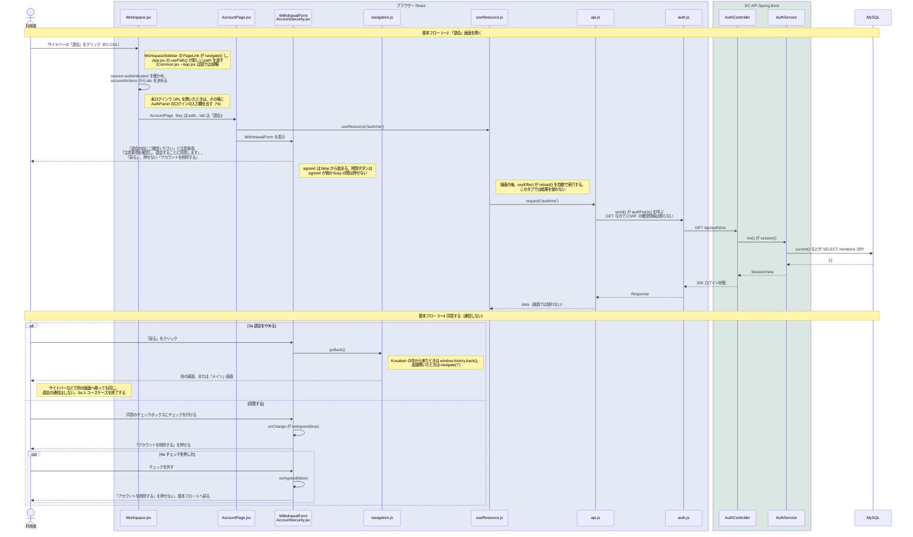
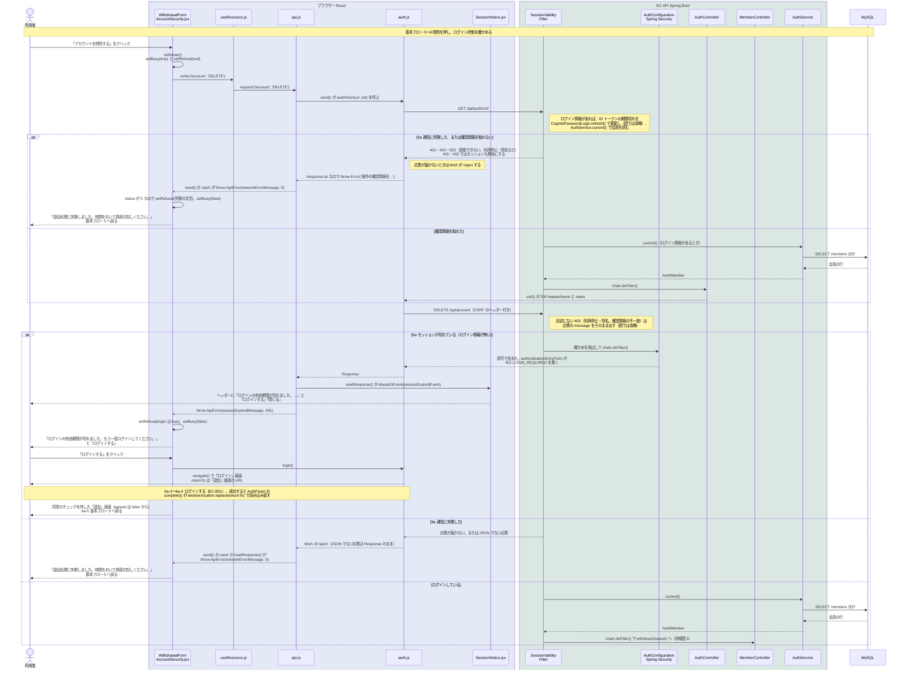
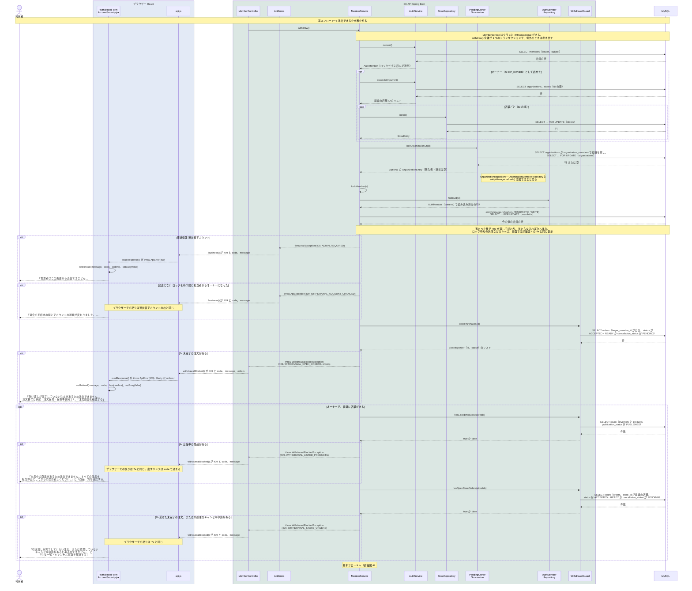
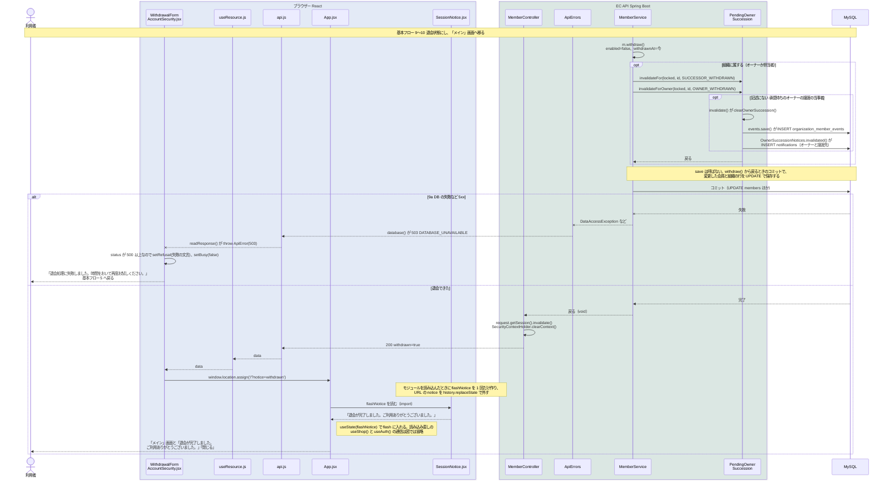

# EC-B21 アカウントを退会する

- ユースケース記述: [EC-B21_アカウントを退会する](<../../アーカイブ/ユースケース/kusakari-ec/EC-B21_アカウントを退会する.md>)
- 対象のコード: kusakari-ec の main（19a2be3、2026-11-20 時点）

退会できるかどうかは、「アカウントを削除する」を押したときに EC API の `MemberService.withdraw()` が 1 つのトランザクションの中で決めます。店舗・組織・会員の行を順にロックしてから、未完了の注文と出品中の商品を確かめ、当たれば 409 で断ります。退会しても会員の行は消さず、`members.enabled` を偽にして `withdrawn_at` を入れます。Amazon Cognito のユーザーも消しません。

## 概要図

```mermaid
sequenceDiagram
    actor User as 利用者
    box rgba(47,111,219,0.10) ブラウザー React
        participant Page as 「退会」画面
    end
    box rgba(27,127,92,0.12) EC API Spring Boot
        participant Api as EC API
    end
    participant Db as MySQL

    Note over User,Db: 基本フロー 1〜2 「退会」画面を開く
    User->>Page: サイドバーの「退会」をクリック（EC-C01）
    Page-->>User: 「退会の前にご確認ください」と注意事項、同意のチェックボックス、<br/>「戻る」、押せない「アカウントを削除する」
    Page->>Api: GET /api/auth/me（この画面では結果を使わない）
    Api->>Db: 会員を読む
    Db-->>Api: 会員の行
    Api-->>Page: 200 ログイン状態
    Note over User,Db: 未ログインで URL を開いたときは、その場にログインの入力欄を出す（共通代替フロー *b）

    Note over User,Db: 基本フロー 3〜4 同意する（通信しない）
    alt 3a 退会をやめる
        User->>Page: 「戻る」をクリック、または別の画面へ移る
        Page-->>User: 前の画面（直接開いたときは「メイン」画面）<br/>3a-3 ユースケースを終了する
    else 同意する
        User->>Page: 同意のチェックボックスにチェックを付ける
        Page-->>User: 「アカウントを削除する」を押せる
        opt 4a チェックを外した
            User->>Page: チェックを外す
            Page-->>User: 「アカウントを削除する」を押せない<br/>基本フロー 3 へ戻る
        end
    end

    Note over User,Db: 基本フロー 5〜6 削除を押し、ログイン状態を確かめる
    User->>Page: 「アカウントを削除する」をクリック
    Page->>Api: GET /api/auth/csrf
    Note over Api: ログイン状態を確かめる。ID トークンの期限切れは<br/>Cognito の更新トークンで更新する（図では省略）
    alt 9a 通信に失敗した、または確認情報を取れない
        Api-->>Page: 応答が無い、または 401・403・503
        Page-->>User: 「退会処理に失敗しました。時間をおいて再度お試しください。」<br/>基本フロー 5 へ戻る
    else 確認情報を取れた
        Api-->>Page: 200 headerName と token
    end
    Page->>Api: DELETE /api/account（CSRF のヘッダー付き）
    Note over Page,Api: 記述にない 403（利用停止・除名、確認情報の不一致）は<br/>応答の message をそのまま出す（図では省略）
    alt 6a セッションが切れている
        Api-->>Page: 401 LOGIN_REQUIRED
        Page-->>User: 「ログインの有効期限が切れました。もう一度ログインしてください。」<br/>と「ログインする」（ヘッダーにも同じ案内）
        User->>Page: 「ログインする」をクリック
        Page-->>User: 「ログイン」画面（戻り先は「退会」画面）
        Note over User,Page: 6a-4 ログインする（EC-B01）
        Page-->>User: 同意のチェックを外した「退会」画面<br/>6a-5 基本フロー 3 へ戻る
    else 9a 通信に失敗した
        Api--xPage: 応答が無い、または JSON でない応答
        Page-->>User: 「退会処理に失敗しました。時間をおいて再度お試しください。」<br/>基本フロー 5 へ戻る
    else ログインしている
        Api->>Db: 会員を読む（利用停止・除名でないか）
        Db-->>Api: 会員の行
    end

    Note over User,Db: 基本フロー 7〜8 退会できるかを確かめる
    Note over Api,Db: ここから基本フロー 9 のコミットまでが 1 つのトランザクション。<br/>当たった枝で 409 を返して終わり、当たらなければ次へ進む
    opt オーナー（SHOP_OWNER）
        Api->>Db: 組織の店舗の行を ID の順にロック（SELECT … FOR UPDATE）
    end
    Api->>Db: 組織の行をロック（オーナーか担当者のとき）
    Api->>Db: 会員の行をロックして読み直す
    Db-->>Api: 会員の行
    alt 関連情報 運営者アカウント
        Api-->>Page: 409 ADMIN_REQUIRED
        Page-->>User: 「管理者はこの画面から退会できません。」
    end
    alt 記述にない ロックを待つ間にオーナーになった
        Api-->>Page: 409 WITHDRAWAL_ACCOUNT_CHANGED
        Page-->>User: 「退会の手続きの間にアカウントの種類が変わりました。<br/>画面を読み込み直してから、もう一度お試しください。」
    end
    Api->>Db: 自分が買った未完了の注文を読む
    Db-->>Api: 注文番号と状態
    alt 7a 未完了の注文がある
        Api-->>Page: 409 WITHDRAWAL_OPEN_ORDERS と orders
        Page-->>User: 「受け渡しが完了していない注文があるため退会できません。」<br/>注文番号と状態、「注文履歴を確認する」
    end
    opt オーナーで、組織に店舗がある
        Api->>Db: 組織の店舗の出品中の商品を数える
        Db-->>Api: 件数
        alt 8a 出品中の商品がある
            Api-->>Page: 409 WITHDRAWAL_LISTED_PRODUCTS
            Page-->>User: 「出品中の商品があるため退会できません。…」<br/>「商品一覧を確認する」
        end
        Api->>Db: 組織の店舗が受けた未完了の注文を数える
        Db-->>Api: 件数
        alt 8b 受けた未完了の注文、または未処理のキャンセル申請がある
            Api-->>Page: 409 WITHDRAWAL_STORE_ORDERS
            Page-->>User: 「引き渡しが完了していない注文、または処理していない<br/>キャンセル申請があるため退会できません。」<br/>「注文一覧・キャンセル申請を確認する」
        end
    end

    Note over User,Db: 基本フロー 9〜10 退会状態にし、「メイン」画面へ移る
    Api->>Api: 会員を退会状態にする（enabled=false、withdrawn_at）
    opt 組織に属する（オーナーか担当者）
        Api->>Api: 承認待ちのオーナーの譲渡を確かめる
        opt 記述にない 承認待ちのオーナーの譲渡の当事者
            Api->>Api: 譲渡の申し出を無効にし、履歴と通知を作る
        end
    end
    Api->>Db: コミット（UPDATE members ほか）
    alt 9a DB の失敗など 5xx
        Db--xApi: 失敗
        Api-->>Page: 503 など
        Page-->>User: 「退会処理に失敗しました。時間をおいて再度お試しください。」<br/>基本フロー 5 へ戻る
    else 退会できた
        Db-->>Api: 完了
        Api->>Api: セッションを無効にする（ログアウト状態）
        Api-->>Page: 200 withdrawn=true
        Page->>Page: /?notice=withdrawn を読み込み直す
        Note right of Page: 読み込み直しで、ほかの取得（商品、ログイン状態など）も走る（図では省略）
        Page-->>User: 「メイン」画面と「退会が完了しました。<br/>ご利用ありがとうございました。」
    end
```

## 詳細図

### 詳細図 1 基本フロー 1〜4 画面を開いて同意する

### 詳細図 2 基本フロー 5〜6 削除を押し、ログイン状態を確かめる

### 詳細図 3 基本フロー 6〜8 退会できるかを確かめる

### 詳細図 4 基本フロー 9〜10 退会状態にし、「メイン」画面へ移る

## ユースケース記述との差

- 7・8b の「未完了の注文」: `WithdrawalGuard` は、`status` が `ACCEPTED`（注文受付）・`READY`（受取準備完了）の注文と、キャンセル申請が未処理（`cancellation_status` が `PENDING`）の注文だけを数えます。カード払いの支払い待ち（`PENDING_PAYMENT`）の注文は「引き渡し完了」「キャンセル済み」のどちらでもありませんが、退会を止めません。店舗の閉鎖と組織の停止で使う `OpenOrders.BLOCKING` は `PENDING_PAYMENT` も止めるので、判定がそろっていません。
- 運営者アカウント: 関連情報に「この画面から退会できない」とありますが、代替フローの番号がありません。コードでは、運営者にもサイドバーに「退会」が出て、押すと 409 `ADMIN_REQUIRED`「管理者はこの画面から退会できません。」と出ます。
- 記述にない枝: ロックを待つ間に、オーナーの譲渡の承認で担当者からオーナーになったときは、409 `WITHDRAWAL_ACCOUNT_CHANGED`「退会の手続きの間にアカウントの種類が変わりました。画面を読み込み直してから、もう一度お試しください。」で断ります。
- 記述にない処理: 退会する人が、承認待ちのオーナーの譲渡の譲渡先か、申し出たオーナー本人のときは、同じトランザクションで申し出を無効にします。`organization_member_events` に記録し、オーナーと譲渡先に通知（`notifications`）を作ります。
- 6a: 案内が出るのは、主にサーバーのセッションそのものが無いとき（EC の再起動など）です。このとき `GET /api/auth/csrf` は新しいセッションで通り、`DELETE` が 401 になります。ID トークンを更新できないとき（更新トークンの失効など）は、先に `GET /api/auth/csrf` が `SessionValidityFilter` で 401 になり、`auth.js` の `authFetch()` の例外を `api.js` の `send()` が status 0 に言い換えるので、画面は 9a の「退会処理に失敗しました。時間をおいて再度お試しください。」を出します。このときセッションも無効になるので、もう一度押すと 6a の案内が出ます。利用停止・除名で `GET /api/auth/csrf` が 403 になったときも、同じく 9a の文言です。
- 6a-1: 「ログインの有効期限が切れました。もう一度ログインしてください。」と「ログインする」は、`WithdrawalRefusal` とヘッダーの `SessionNotice` の 2 か所に出ます。
- 関連情報「URLに直接アクセスした場合は、ログイン画面へ誘導する」: `/account/login` へは移らず、`Workspace` がその場に `AuthPanel` のログインの入力欄を出します。ログインすると同じ URL を読み込み直します。
- 3a-2: 「元の画面を表示する」は、Kusakari の中から来たときだけです。URL を直接開いたときは、`goBack()` が `navigate('/')` で「メイン」画面を出します。
- 事後条件「利用できなくなる」: Cognito のユーザーは消さないので、Cognito での認証は通ります。そのあと `AuthService.current()` が `enabled` の偽の会員を 403 `ACCOUNT_DISABLED`「このアカウントは利用できません。」で止めます。

## 確かめられなかったこと

- コミットでの失敗が `DataAccessException` にならないとき（`TransactionSystemException` など）の応答の形は、動かして確かめていません。`ApiErrors.database()` を通らない可能性があります。画面は 5xx ならどれも 9a の文言を出します。

## 参照したコード

- [frontend/src/workspace/Workspace.jsx](https://github.com/abeouga/kusakari-ec/blob/19a2be307ee71a2cd87e538236c3c8c42929c5b3/frontend/src/workspace/Workspace.jsx): `Workspace`（未ログインのときの `AuthPanel`、`accountSettings`、`accountActions` で `AccountPage` を選ぶところ）
- [frontend/src/workspace/AccountPage.jsx](https://github.com/abeouga/kusakari-ec/blob/19a2be307ee71a2cd87e538236c3c8c42929c5b3/frontend/src/workspace/AccountPage.jsx): `accountActions`、`AccountPage`、`useResource('/auth/me')`
- [frontend/src/workspace/AccountSecurity.jsx](https://github.com/abeouga/kusakari-ec/blob/19a2be307ee71a2cd87e538236c3c8c42929c5b3/frontend/src/workspace/AccountSecurity.jsx): `WithdrawalForm`、`withdraw()`、`WithdrawalRefusal`、`openOrderLabels`
- [frontend/src/workspace/navigation.js](https://github.com/abeouga/kusakari-ec/blob/19a2be307ee71a2cd87e538236c3c8c42929c5b3/frontend/src/workspace/navigation.js): `goBack()`、`navigate()`
- [frontend/src/workspace/useResource.js](https://github.com/abeouga/kusakari-ec/blob/19a2be307ee71a2cd87e538236c3c8c42929c5b3/frontend/src/workspace/useResource.js): `useResource()`、`reload()`、`write()`
- [frontend/src/api.js](https://github.com/abeouga/kusakari-ec/blob/19a2be307ee71a2cd87e538236c3c8c42929c5b3/frontend/src/api.js): `request()`、`send()`、`readResponse()`、`networkErrorMessage`、`sessionExpiredMessage`、`sessionExpiredEvent`
- [frontend/src/auth.js](https://github.com/abeouga/kusakari-ec/blob/19a2be307ee71a2cd87e538236c3c8c42929c5b3/frontend/src/auth.js): `authFetch()`、`login()`、`loginPath()`、`wasSignedIn()`
- [frontend/src/components/SessionNotice.jsx](https://github.com/abeouga/kusakari-ec/blob/19a2be307ee71a2cd87e538236c3c8c42929c5b3/frontend/src/components/SessionNotice.jsx): `SessionNotice`、`flashNotice`、`flashMessages`
- [frontend/src/components/AuthPanel.jsx](https://github.com/abeouga/kusakari-ec/blob/19a2be307ee71a2cd87e538236c3c8c42929c5b3/frontend/src/components/AuthPanel.jsx): `complete()`、`returnTo`
- [frontend/src/App.jsx](https://github.com/abeouga/kusakari-ec/blob/19a2be307ee71a2cd87e538236c3c8c42929c5b3/frontend/src/App.jsx): `flash`（`useState(flashNotice)`）の表示
- [backend/src/main/java/jp/kusakari/ec/member/controller/MemberController.java](https://github.com/abeouga/kusakari-ec/blob/19a2be307ee71a2cd87e538236c3c8c42929c5b3/backend/src/main/java/jp/kusakari/ec/member/controller/MemberController.java): `withdraw()`、`withdrawalBlocked()`、`WithdrawalBlockedView`
- [backend/src/main/java/jp/kusakari/ec/member/service/MemberService.java](https://github.com/abeouga/kusakari-ec/blob/19a2be307ee71a2cd87e538236c3c8c42929c5b3/backend/src/main/java/jp/kusakari/ec/member/service/MemberService.java): `withdraw()`、`lockMember()`
- [backend/src/main/java/jp/kusakari/ec/member/service/WithdrawalGuard.java](https://github.com/abeouga/kusakari-ec/blob/19a2be307ee71a2cd87e538236c3c8c42929c5b3/backend/src/main/java/jp/kusakari/ec/member/service/WithdrawalGuard.java): `OPEN_STATUSES`、`openPurchases()`、`hasListedProducts()`、`hasOpenStoreOrders()`
- [backend/src/main/java/jp/kusakari/ec/member/service/WithdrawalBlockedException.java](https://github.com/abeouga/kusakari-ec/blob/19a2be307ee71a2cd87e538236c3c8c42929c5b3/backend/src/main/java/jp/kusakari/ec/member/service/WithdrawalBlockedException.java): `BlockingOrder`、`orders()`
- [backend/src/main/java/jp/kusakari/ec/auth/AuthService.java](https://github.com/abeouga/kusakari-ec/blob/19a2be307ee71a2cd87e538236c3c8c42929c5b3/backend/src/main/java/jp/kusakari/ec/auth/AuthService.java): `current()`、`session()`、`storeIdsOf()`
- [backend/src/main/java/jp/kusakari/ec/auth/AuthMember.java](https://github.com/abeouga/kusakari-ec/blob/19a2be307ee71a2cd87e538236c3c8c42929c5b3/backend/src/main/java/jp/kusakari/ec/auth/AuthMember.java): `withdraw()`、`isAdmin()`
- [backend/src/main/java/jp/kusakari/ec/auth/AuthMemberRepository.java](https://github.com/abeouga/kusakari-ec/blob/19a2be307ee71a2cd87e538236c3c8c42929c5b3/backend/src/main/java/jp/kusakari/ec/auth/AuthMemberRepository.java): `findById()`（`JpaRepository`）
- [backend/src/main/java/jp/kusakari/ec/catalog/persistence/repository/StoreRepository.java](https://github.com/abeouga/kusakari-ec/blob/19a2be307ee71a2cd87e538236c3c8c42929c5b3/backend/src/main/java/jp/kusakari/ec/catalog/persistence/repository/StoreRepository.java): `lock()`（`@Lock(PESSIMISTIC_WRITE)`）
- [backend/src/main/java/jp/kusakari/ec/store/service/PendingOwnerSuccession.java](https://github.com/abeouga/kusakari-ec/blob/19a2be307ee71a2cd87e538236c3c8c42929c5b3/backend/src/main/java/jp/kusakari/ec/store/service/PendingOwnerSuccession.java): `lockOrganizationOf()`、`lock()`、`invalidateFor()`、`invalidateForOwner()`、`invalidate()`
- [backend/src/main/java/jp/kusakari/ec/store/service/OwnerSuccessionNotices.java](https://github.com/abeouga/kusakari-ec/blob/19a2be307ee71a2cd87e538236c3c8c42929c5b3/backend/src/main/java/jp/kusakari/ec/store/service/OwnerSuccessionNotices.java): `invalidated()`、`send()`
- [backend/src/main/java/jp/kusakari/ec/store/service/OpenOrders.java](https://github.com/abeouga/kusakari-ec/blob/19a2be307ee71a2cd87e538236c3c8c42929c5b3/backend/src/main/java/jp/kusakari/ec/store/service/OpenOrders.java): `BLOCKING`
- [backend/src/main/java/jp/kusakari/ec/auth/SessionValidityFilter.java](https://github.com/abeouga/kusakari-ec/blob/19a2be307ee71a2cd87e538236c3c8c42929c5b3/backend/src/main/java/jp/kusakari/ec/auth/SessionValidityFilter.java): `doFilterInternal()`、`renewIdToken()`
- [backend/src/main/java/jp/kusakari/ec/auth/AuthConfiguration.java](https://github.com/abeouga/kusakari-ec/blob/19a2be307ee71a2cd87e538236c3c8c42929c5b3/backend/src/main/java/jp/kusakari/ec/auth/AuthConfiguration.java): `cognitoSecurity()`（`addFilterBefore`、`authenticationEntryPoint`、`accessDeniedHandler`）
- [backend/src/main/java/jp/kusakari/ec/auth/AuthController.java](https://github.com/abeouga/kusakari-ec/blob/19a2be307ee71a2cd87e538236c3c8c42929c5b3/backend/src/main/java/jp/kusakari/ec/auth/AuthController.java): `me()`、`csrf()`
- [backend/src/main/java/jp/kusakari/ec/common/web/ApiErrors.java](https://github.com/abeouga/kusakari-ec/blob/19a2be307ee71a2cd87e538236c3c8c42929c5b3/backend/src/main/java/jp/kusakari/ec/common/web/ApiErrors.java): `business()`、`database()`
- [backend/src/main/resources/db/migration/V1__schema.sql](https://github.com/abeouga/kusakari-ec/blob/19a2be307ee71a2cd87e538236c3c8c42929c5b3/backend/src/main/resources/db/migration/V1__schema.sql): `ck_orders_status`、`ck_orders_cancellation_status`、`ck_inventory_status`
- [docs/decisions/2026-10-28-buyer-account-use-cases.md](https://github.com/abeouga/kusakari-ec/blob/19a2be307ee71a2cd87e538236c3c8c42929c5b3/docs/decisions/2026-10-28-buyer-account-use-cases.md): EC-B21 の決定（判定は削除ボタンを押したとき、データは残す）
