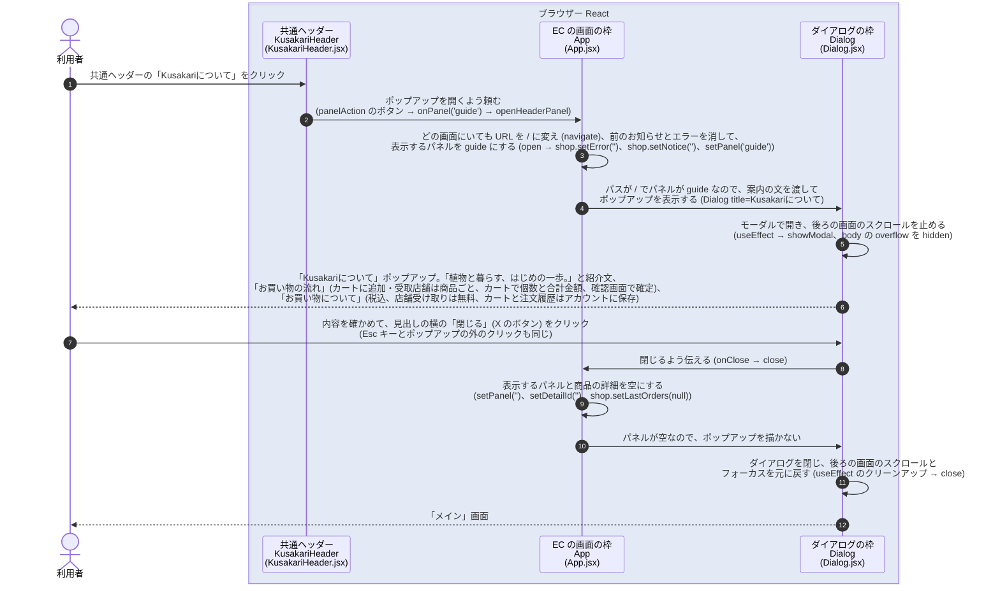

# EC-B23 利用ガイド・利用方法を確認する

- ユースケース記述: [EC-B23_利用ガイド・利用方法を確認する](<../../アーカイブ/ユースケース/kusakari-ec/EC-B23_利用ガイド・利用方法を確認する.md>)
- 共通代替フロー: [00_全ユースケース共通の代替フロー](<00_全ユースケース共通の代替フロー.md>)
- 対象のコード: kusakari-ec の main（6bad7e3、2026-11-24 時点）。Canvas の共通ヘッダーは kusakari-canvas の main（7e9a8dd、2026-11-24 時点）

## シーケンス図

参加者は、上から「画面や役割の名前」「コンポーネント・クラスの名前」「ファイル名（かっこ付き）」の順に書いています。
「Kusakariについて」ポップアップの案内の文は `App.jsx` に直接書かれていて、開くときも閉じるときも EC API とは通信しません。そのため、共通代替フロー \*a・\*b は起こらず、図の最上部に共通代替フローの行も置いていません。「共通代替フローを直接書いた図」も省いています。

## ユースケース記述との差

- 「閉じる」は、文字のない X のアイコンのボタンです。「閉じる」は `aria-label` にあります。Esc キー（`onCancel`）とポップアップの外のクリック（`onClick`）でも閉じます。
- 記述にない処理です。共通ヘッダーから開くと、どの画面にいても `navigate('/')` で「メイン」画面へ切り替えます。このときブラウザーの履歴が 1 つ増え、ページの先頭までスクロールします。「メイン」画面の「Kusakariについて」とフッターの「ご利用ガイド」から開くときは、`open('guide')` を直接呼び、URL を変えません。
- 記述にない入口です。Kusakari Canvas の画面の共通ヘッダー（`SiteHeader.jsx`）は同じ部品（`KusakariHeader`）を使いますが、`onPanel` を渡さないので「Kusakariについて」は EC の `/?panel=guide` へのリンクになります。EC のページを読み込むと、`App.jsx` の `requestedPanel()` が最初から `guide` にしてポップアップを開きます。このときはページを読み込んだときの取得（EC-B03 の図の事前条件）も走り、その通信には共通代替フロー \*a が起こり得ます。閉じても URL の `?panel=guide` は残ります。
- 記述にない内容です。ポップアップの先頭に「PLANTS FOR EVERYDAY LIVING」「植物と暮らす、はじめの一歩。」と、Kusakari が庭木・草花・ハーブ・観葉植物を探して店舗ごとの価格と在庫を確かめられる EC サイトであることの紹介文があります。「お買い物の流れ」と「お買い物について」の内容は、記述の関連情報と同じです。
- 閉じるときの `close()` は、ポップアップだけでなく「植物について」ダイアログ（`detailId`）と注文の結果（`lastOrders`）も空にします。この画面では見た目に変わりはありません。

## 参照したコード

- [packages/site-header/KusakariHeader.jsx](https://github.com/abeouga/kusakari-ec/blob/6bad7e37c4135034fbe97e30309772fbe872e675/packages/site-header/KusakariHeader.jsx): `panelAction`、「Kusakariについて」、`shopUrl`
- [frontend/src/App.jsx](https://github.com/abeouga/kusakari-ec/blob/6bad7e37c4135034fbe97e30309772fbe872e675/frontend/src/App.jsx): `openHeaderPanel`、`open`、`close`、`requestedPanel`、案内の文、フッターの「ご利用ガイド」
- [frontend/src/workspace/navigation.js](https://github.com/abeouga/kusakari-ec/blob/6bad7e37c4135034fbe97e30309772fbe872e675/frontend/src/workspace/navigation.js): `navigate`、`usePath`
- [frontend/src/components/Dialog.jsx](https://github.com/abeouga/kusakari-ec/blob/6bad7e37c4135034fbe97e30309772fbe872e675/frontend/src/components/Dialog.jsx): `showModal`、クリーンアップ、`onCancel`、`onClick`、閉じるボタン
- [kusakari-canvas の frontend/src/components/SiteHeader.jsx](https://github.com/abeouga/kusakari-canvas/blob/7e9a8dd0a40f2b212ca20b3aa94f2dc984b00b7a/frontend/src/components/SiteHeader.jsx): Canvas の画面の共通ヘッダー（`onPanel` を渡さない）
