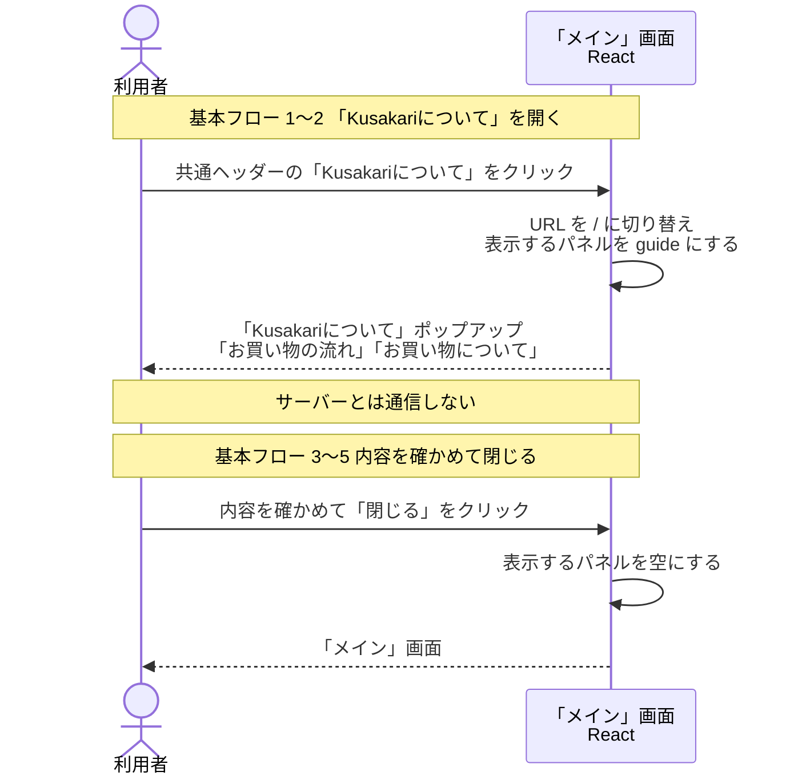
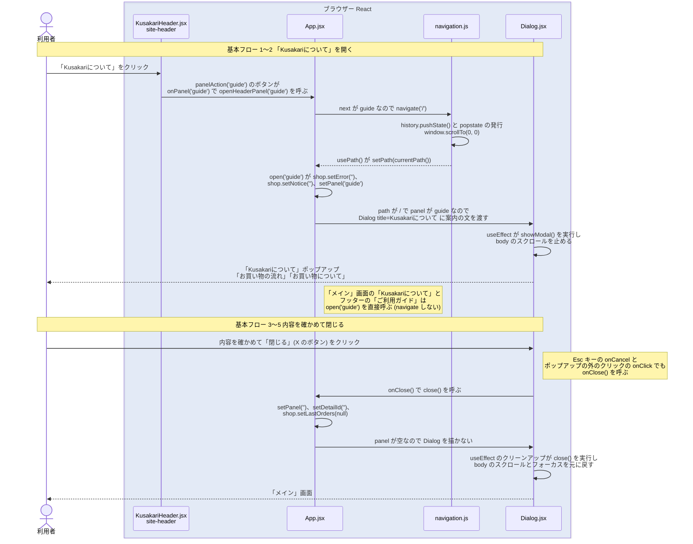

# EC-B23 利用ガイド・利用方法を確認する

- ユースケース記述: [EC-B23_利用ガイド・利用方法を確認する](<../../アーカイブ/ユースケース/kusakari-ec/EC-B23_利用ガイド・利用方法を確認する.md>)
- 対象のコード: kusakari-ec の main（19a2be3、2026-11-20 時点）

「Kusakariについて」ポップアップの案内の文は、`App.jsx` に直接書かれています。開くときも閉じるときも、サーバーとは通信しません。そのため、共通代替フロー *a・*b を適用する場所はありません。

## 概要図

## 詳細図

## ユースケース記述との差

- 「閉じる」は、文字のない X のアイコンのボタンです。「閉じる」は `aria-label` にあります。
- 記述にない処理です。共通ヘッダーから開くと、どの画面にいても `navigate('/')` で「メイン」画面へ切り替えます。このときブラウザーの履歴が 1 つ増え、ページの先頭までスクロールします。「メイン」画面の「Kusakariについて」とフッターの「ご利用ガイド」から開くときは、URL を変えません。
- 記述にない入口です。Kusakari Canvas の画面の共通ヘッダーは同じ部品（`KusakariHeader`）を使いますが、`onPanel` を渡さないので「Kusakariについて」は EC の `/?panel=guide` へのリンクになります。EC のページを読み込むと、`App.jsx` の `requestedPanel()` が最初から `guide` にしてポップアップを開きます。このときはページを読み込んだときの取得（EC-B03 の事前条件）も走ります。閉じても URL の `?panel=guide` は残ります。
- 記述にない内容です。ポップアップの先頭に、Kusakari が庭木・草花・ハーブ・観葉植物を探して店舗ごとの価格と在庫を確かめられる EC サイトであることの紹介文があります。

## 参照したコード

- [packages/site-header/KusakariHeader.jsx](https://github.com/abeouga/kusakari-ec/blob/19a2be307ee71a2cd87e538236c3c8c42929c5b3/packages/site-header/KusakariHeader.jsx): `panelAction()`、「Kusakariについて」、`shopUrl()`
- [frontend/src/App.jsx](https://github.com/abeouga/kusakari-ec/blob/19a2be307ee71a2cd87e538236c3c8c42929c5b3/frontend/src/App.jsx): `openHeaderPanel()`、`open()`、`close()`、`requestedPanel()`、案内の文、フッターの「ご利用ガイド」
- [frontend/src/workspace/navigation.js](https://github.com/abeouga/kusakari-ec/blob/19a2be307ee71a2cd87e538236c3c8c42929c5b3/frontend/src/workspace/navigation.js): `navigate()`、`usePath()`
- [frontend/src/components/Dialog.jsx](https://github.com/abeouga/kusakari-ec/blob/19a2be307ee71a2cd87e538236c3c8c42929c5b3/frontend/src/components/Dialog.jsx): `showModal()`、クリーンアップ、`onCancel`、`onClick`、閉じるボタン
- [kusakari-canvas の frontend/src/components/SiteHeader.jsx](https://github.com/abeouga/kusakari-canvas/blob/c19d497dfef15b119f9bce8ecb5c886a36da6b7d/frontend/src/components/SiteHeader.jsx): Canvas の画面の共通ヘッダー（`onPanel` を渡さない）
