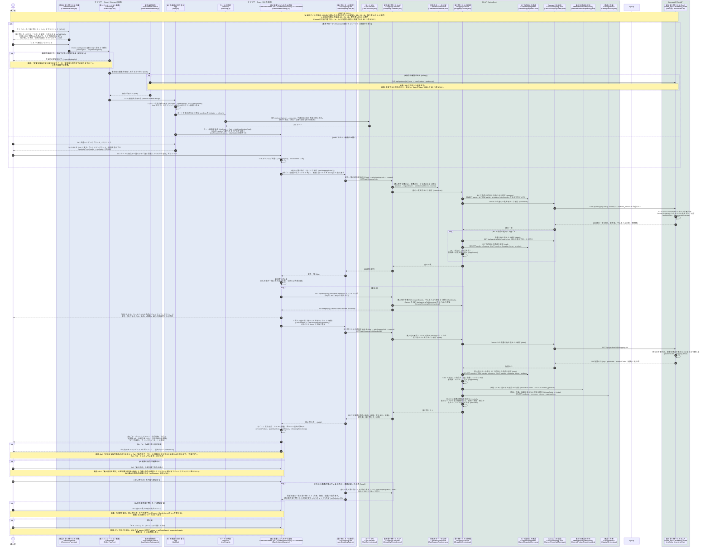
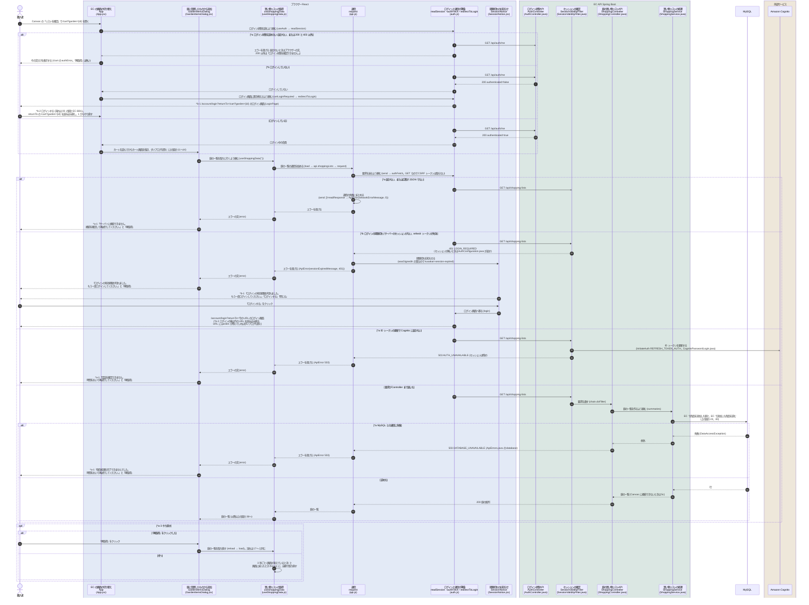

# EC-B24 買い物リストを確認する(EC)

- ユースケース記述: [EC-B24_買い物リストを確認する(EC)](<../../アーカイブ/ユースケース/kusakari-ec/EC-B24_買い物リストを確認する(EC).md>)
- 共通代替フロー: [00_全ユースケース共通の代替フロー](<00_全ユースケース共通の代替フロー.md>)
- 対象のコード: kusakari-ec の main（6bad7e3、2026-11-24 時点）。基本フロー 1〜3 と Canvas API は kusakari-canvas の main（7e9a8dd、2026-11-24 時点）

## シーケンス図

参加者は、上から「画面や役割の名前」「コンポーネント・クラスの名前」「ファイル名（かっこ付き）」の順に書いています。
基本フロー 1〜3 は Canvas の画面で、4 からは EC の「ショッピングカート」画面です。EC の画面は Canvas の買い物リストを直接読まず、EC API がサーバーから Canvas API を呼びます。
共通代替フローの中身は、00 の図か、下の「共通代替フローを直接書いた図」を見てください。
エラーの代替フローは描かず、図の下に並べています。選べない理由や選択欄を出すだけのもの（6a・6b・7a・7b）と、画面の中だけで終わるもの（4b、閉じる）は、分かれる所だけを描き、結果と画面は Note に文で書いています。

-1.png>)

図に描いていない代替フロー：4a（庭がない）、5a（行がない）、5b（庭が見つからない）、5c（Canvas に接続できない）

## 共通代替フローを直接書いた図

上の図の、Canvas から `/cart?garden={id}` を開いたときのログインの確認と、ダイアログの `GET /api/shopping-lists` に、この画面で起こる共通代替フロー（\*a、\*b）を書き込んだ図です。選んだ庭の `GET /api/shopping-lists/{gardenId}` も同じように失敗しますが、そちらにはエラーの文だけが出て「再取得」が出ません（3 秒ごとの取り直しを待ちます）。カートの `GET /api/cart` の \*a・\*b は [EC-B08](<EC-B08_カートを確認する.md>) の図、Canvas の保存の \*a・\*b は Canvas の図のとおりなので省いています。サムネイルの画像は `api.js` を通らないので、失敗すると画像が出ないだけで、文は出ません。

-2.png>)

## ユースケース記述との差

- 基本フロー 2: Canvas の買い物リストのタブには「(庭の名前)の買い物リスト」の見出しがありません。タブ（「買い物リスト（n）」）の中に行と「リストを確認」が出るだけです。行が無いときは「植物が設置されていません」が出て、「リストを確認」は出ません。
- 基本フロー 3: Canvas の「リストを確認」は、未保存の編集を `PUT /api/gardens/{id}` で保存してから EC を開きます。輪郭の描画中と、輪郭が確定していない写真があるときは、移る前に確認ダイアログを出します。どちらも記述にありません。保存に失敗すると EC へ移りません。
- 基本フロー 4: ダイアログ（`AddFromGardenCard`）は、カートの読み込みが終わってから描かれます（`Cart.jsx` はカートが無い間は「カートを読み込んでいます。」だけを出す）。`GET /api/cart` に失敗すると、`?garden=` を付けて開いてもダイアログは開きません。
- 基本フロー 4: 庭の一覧は Canvas の持ち主の庭すべてです（`shopping.summaries`）。EC で商品を追加した庭だけは、EC が庭ごとに `GET /api/gardens/{id}/shopping-list` を呼び、EC で追加した商品を足して種類数を数え直します。庭が多いと Canvas への通信がその数だけ増えます。
- Canvas API は、EC から届いた要求のたびに、Cookie の `KUSAKARI_SESSION` で EC の `GET /api/auth/me` を呼んで持ち主を確かめます（`auth.py` の `authenticate`）。図では Canvas API の自分への矢印にまとめました。Canvas がこの確認に失敗して 401・503 を返したときも、EC は 404 以外をすべて 503 `SHOPPING_LIST_UNAVAILABLE`（5c）にします。
- 5b: URL で指定した庭が庭の一覧に無いとき（削除済み、ほかの購入者の庭など）、コードは「庭が見つかりません。」を出さず、一覧の先頭の庭を選びます（`GardenItemsDialog` の `gardenId` の決め方）。「庭が見つかりません。」は、選んだ庭の `GET /api/shopping-lists/{gardenId}` が 404 になったときだけ出ます。このとき、その庭の取り直しを止めます。
- 5c: 「再取得」ボタンが出るのは、庭の一覧（`GET /api/shopping-lists`）の取得に失敗したときだけです。選んだ庭の買い物リストの取得に失敗したときは文だけを出し、3 秒ごとの取り直しを待ちます。記述の 5c-3 は「基本フロー 5 へ戻る」ですが、「再取得」で取り直すのは庭の一覧（基本フロー 4）です。
- 6a・候補の商品: 素材コードから候補を選ぶ行では、削除・閉店・店舗の停止・組織の停止で買えなくなった商品を候補から外します（`ShoppingService.resolve` の `removed`、`CatalogService.REMOVED_REASONS`）。そのため、候補がすべてそうした商品なら 7a の「販売終了」ではなく 6a の「対応する販売商品がありません」になります。商品を指定した行（`productId` のある行）は、理由を出すために候補に残すので「販売終了」になります。
- 関連情報の「3秒ごとと画面に戻ったときに、在庫・カートの内容・庭プロジェクトの変更を反映する」: 3 秒ごとと `focus` で取り直すのは、庭の一覧と買い物リスト（在庫、価格、配置を含む）だけです。カート（`shop.cart`）は取り直さないので、別の画面でカートを変えても「カートに入っています」の表示はすぐには変わりません。カートは、カートへの追加が 409 になったときに取り直します（[EC-B25 の図](<EC-B25_買い物リストから商品をカートに追加する.md>)）。
- 7a: カートにある商品は 7b で選べないので、画面はカートの数量を 0 として判定します（`lineReason(line, product, 0)`）。「カートの数量と合わせると上限99点を超えます」が出るのは、必要数だけで 99 点を超えるときです。
- 庭の版か買い物リストの版が変わると、3 秒ごとの取り直しでチェックがすべて外れます（`GardenItems` の `useEffect`）。記述にない動きです。
- 関連情報の「店舗側のアカウントと出店申請用アカウントでは使えない」: 画面は `CartPage` で `buyerOnlyMessage` を出してカートとダイアログを描かず、API も `requireBuyer()` で 403 `BUYER_REQUIRED` を返します。事前条件が購入者のログインなので、図には書いていません。

## 参照したコード

kusakari-ec

- [frontend/src/components/GardenItemsDialog.jsx](https://github.com/abeouga/kusakari-ec/blob/6bad7e37c4135034fbe97e30309772fbe872e675/frontend/src/components/GardenItemsDialog.jsx): `useRequestedGarden`、`AddFromGardenCard`（`close`）、`GardenItemsDialog`（`gardenId` の決め方、「再取得」）、`GardenItems`（選択を外す `useEffect`、行の表示）
- [frontend/src/components/useShoppingData.js](https://github.com/abeouga/kusakari-ec/blob/6bad7e37c4135034fbe97e30309772fbe872e675/frontend/src/components/useShoppingData.js): `useShoppingData`（`load`、3 秒ごとの `setInterval`、`focus`、404 のときの `removed`、`reload`）
- [frontend/src/shoppingSelection.js](https://github.com/abeouga/kusakari-ec/blob/6bad7e37c4135034fbe97e30309772fbe872e675/frontend/src/shoppingSelection.js): `chosenProduct`、`quantityInCart`、`lineReason`、`unavailableReason`
- [frontend/src/api.js](https://github.com/abeouga/kusakari-ec/blob/6bad7e37c4135034fbe97e30309772fbe872e675/frontend/src/api.js): `request`、`send`、`readResponse`、`api.shoppingLists`、`api.shoppingList`、`api.cart`、`networkErrorMessage`、`sessionExpiredMessage`
- [frontend/src/auth.js](https://github.com/abeouga/kusakari-ec/blob/6bad7e37c4135034fbe97e30309772fbe872e675/frontend/src/auth.js): `readSession`、`authFetch`、`wasSignedIn`、`login`、`redirectToLogin`
- [frontend/src/useAuth.js](https://github.com/abeouga/kusakari-ec/blob/6bad7e37c4135034fbe97e30309772fbe872e675/frontend/src/useAuth.js): `useAuth`
- [frontend/src/useShop.js](https://github.com/abeouga/kusakari-ec/blob/6bad7e37c4135034fbe97e30309772fbe872e675/frontend/src/useShop.js): `initialize`、`refresh`
- [frontend/src/App.jsx](https://github.com/abeouga/kusakari-ec/blob/6bad7e37c4135034fbe97e30309772fbe872e675/frontend/src/App.jsx): `navigateFromHeader`、`cartLoginRequired` と `redirectToLogin`、`/cart` の `authError` と `CartPage`
- [frontend/src/components/CartPage.jsx](https://github.com/abeouga/kusakari-ec/blob/6bad7e37c4135034fbe97e30309772fbe872e675/frontend/src/components/CartPage.jsx): `CartPage`（店舗側のアカウントの案内）
- [frontend/src/components/Cart.jsx](https://github.com/abeouga/kusakari-ec/blob/6bad7e37c4135034fbe97e30309772fbe872e675/frontend/src/components/Cart.jsx): `AddFromGardenCard` を描く場所、カートの読み込み中の表示
- [frontend/src/components/SessionNotice.jsx](https://github.com/abeouga/kusakari-ec/blob/6bad7e37c4135034fbe97e30309772fbe872e675/frontend/src/components/SessionNotice.jsx): 期限切れのお知らせ
- [frontend/src/workspace/navigation.js](https://github.com/abeouga/kusakari-ec/blob/6bad7e37c4135034fbe97e30309772fbe872e675/frontend/src/workspace/navigation.js): `navigate`、`redirect`
- [backend/src/main/java/jp/kusakari/ec/shopping/ShoppingController.java](https://github.com/abeouga/kusakari-ec/blob/6bad7e37c4135034fbe97e30309772fbe872e675/backend/src/main/java/jp/kusakari/ec/shopping/ShoppingController.java): `summaries`、`detail`、`thumbnail`
- [backend/src/main/java/jp/kusakari/ec/shopping/ShoppingService.java](https://github.com/abeouga/kusakari-ec/blob/6bad7e37c4135034fbe97e30309772fbe872e675/backend/src/main/java/jp/kusakari/ec/shopping/ShoppingService.java): `summaries`、`detail`、`thumbnail`、`supplement`、`resolve`、`removed`
- [backend/src/main/java/jp/kusakari/ec/shopping/SavedShoppingItems.java](https://github.com/abeouga/kusakari-ec/blob/6bad7e37c4135034fbe97e30309772fbe872e675/backend/src/main/java/jp/kusakari/ec/shopping/SavedShoppingItems.java): `read`、`gardens`
- [backend/src/main/java/jp/kusakari/ec/shopping/CanvasShoppingClient.java](https://github.com/abeouga/kusakari-ec/blob/6bad7e37c4135034fbe97e30309772fbe872e675/backend/src/main/java/jp/kusakari/ec/shopping/CanvasShoppingClient.java): `summaries`、`detail`、`thumbnail`、`unavailable`
- [backend/src/main/java/jp/kusakari/ec/commerce/session/CartSessionResolver.java](https://github.com/abeouga/kusakari-ec/blob/6bad7e37c4135034fbe97e30309772fbe872e675/backend/src/main/java/jp/kusakari/ec/commerce/session/CartSessionResolver.java): `resolve`
- [backend/src/main/java/jp/kusakari/ec/auth/MemberCartService.java](https://github.com/abeouga/kusakari-ec/blob/6bad7e37c4135034fbe97e30309772fbe872e675/backend/src/main/java/jp/kusakari/ec/auth/MemberCartService.java): `resolve`
- [backend/src/main/java/jp/kusakari/ec/commerce/controller/CartController.java](https://github.com/abeouga/kusakari-ec/blob/6bad7e37c4135034fbe97e30309772fbe872e675/backend/src/main/java/jp/kusakari/ec/commerce/controller/CartController.java): `get`
- [backend/src/main/java/jp/kusakari/ec/catalog/persistence/repository/MaterialProductRepository.java](https://github.com/abeouga/kusakari-ec/blob/6bad7e37c4135034fbe97e30309772fbe872e675/backend/src/main/java/jp/kusakari/ec/catalog/persistence/repository/MaterialProductRepository.java): `findAllForCodes`
- [backend/src/main/java/jp/kusakari/ec/catalog/service/CatalogService.java](https://github.com/abeouga/kusakari-ec/blob/6bad7e37c4135034fbe97e30309772fbe872e675/backend/src/main/java/jp/kusakari/ec/catalog/service/CatalogService.java): `listingsByIds`、`REMOVED_REASONS`、`Listing.purchasable`
- [backend/src/main/java/jp/kusakari/ec/auth/AuthService.java](https://github.com/abeouga/kusakari-ec/blob/6bad7e37c4135034fbe97e30309772fbe872e675/backend/src/main/java/jp/kusakari/ec/auth/AuthService.java): `requireBuyer`
- [backend/src/main/java/jp/kusakari/ec/auth/AuthController.java](https://github.com/abeouga/kusakari-ec/blob/6bad7e37c4135034fbe97e30309772fbe872e675/backend/src/main/java/jp/kusakari/ec/auth/AuthController.java): `GET /api/auth/me`
- [backend/src/main/java/jp/kusakari/ec/auth/SessionValidityFilter.java](https://github.com/abeouga/kusakari-ec/blob/6bad7e37c4135034fbe97e30309772fbe872e675/backend/src/main/java/jp/kusakari/ec/auth/SessionValidityFilter.java): `doFilterInternal`、`renewIdToken`（ID トークンの更新、401）
- [backend/src/main/java/jp/kusakari/ec/auth/CognitoPasswordLogin.java](https://github.com/abeouga/kusakari-ec/blob/6bad7e37c4135034fbe97e30309772fbe872e675/backend/src/main/java/jp/kusakari/ec/auth/CognitoPasswordLogin.java): ID トークンの更新、503 `AUTH_UNAVAILABLE`
- [backend/src/main/java/jp/kusakari/ec/auth/AuthConfiguration.java](https://github.com/abeouga/kusakari-ec/blob/6bad7e37c4135034fbe97e30309772fbe872e675/backend/src/main/java/jp/kusakari/ec/auth/AuthConfiguration.java): `authenticationEntryPoint`（401 `LOGIN_REQUIRED`）
- [backend/src/main/java/jp/kusakari/ec/common/web/ApiErrors.java](https://github.com/abeouga/kusakari-ec/blob/6bad7e37c4135034fbe97e30309772fbe872e675/backend/src/main/java/jp/kusakari/ec/common/web/ApiErrors.java): `business`、`database`

kusakari-canvas

- [frontend/src/components/CommercePanel.jsx](https://github.com/abeouga/kusakari-canvas/blob/7e9a8dd0a40f2b212ca20b3aa94f2dc984b00b7a/frontend/src/components/CommercePanel.jsx): `CommercePanel`（タブ、「植物が設置されていません」、「リストを確認」）
- [frontend/src/pages/EditorPage.jsx](https://github.com/abeouga/kusakari-canvas/blob/7e9a8dd0a40f2b212ca20b3aa94f2dc984b00b7a/frontend/src/pages/EditorPage.jsx): `requestNavigation`、移る前の確認ダイアログ
- [frontend/src/hooks/useGardenAutosave.js](https://github.com/abeouga/kusakari-canvas/blob/7e9a8dd0a40f2b212ca20b3aa94f2dc984b00b7a/frontend/src/hooks/useGardenAutosave.js): `save`、`flush`
- [frontend/src/api/gardens.js](https://github.com/abeouga/kusakari-canvas/blob/7e9a8dd0a40f2b212ca20b3aa94f2dc984b00b7a/frontend/src/api/gardens.js): `saveGarden`
- [backend/kusakari_canvas_api/main.py](https://github.com/abeouga/kusakari-canvas/blob/7e9a8dd0a40f2b212ca20b3aa94f2dc984b00b7a/backend/kusakari_canvas_api/main.py): `create_app` の `shopping_lists`、`shopping_list`、`update`
- [backend/kusakari_canvas_api/shopping.py](https://github.com/abeouga/kusakari-canvas/blob/7e9a8dd0a40f2b212ca20b3aa94f2dc984b00b7a/backend/kusakari_canvas_api/shopping.py): `summaries`、`detail`
- [backend/kusakari_canvas_api/thumbnails.py](https://github.com/abeouga/kusakari-canvas/blob/7e9a8dd0a40f2b212ca20b3aa94f2dc984b00b7a/backend/kusakari_canvas_api/thumbnails.py): `thumbnail_router` の `get`
- [backend/kusakari_canvas_api/auth.py](https://github.com/abeouga/kusakari-canvas/blob/7e9a8dd0a40f2b212ca20b3aa94f2dc984b00b7a/backend/kusakari_canvas_api/auth.py): `authenticate`（EC の `GET /api/auth/me` で持ち主を決める）
