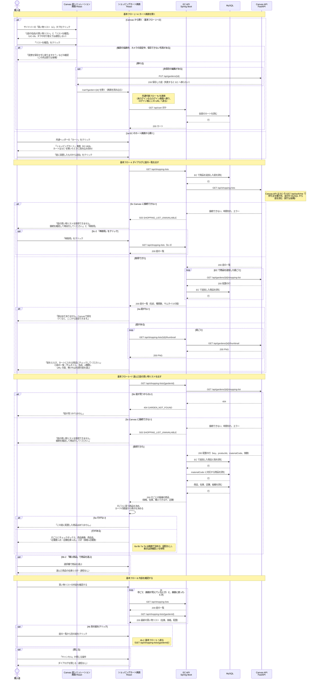
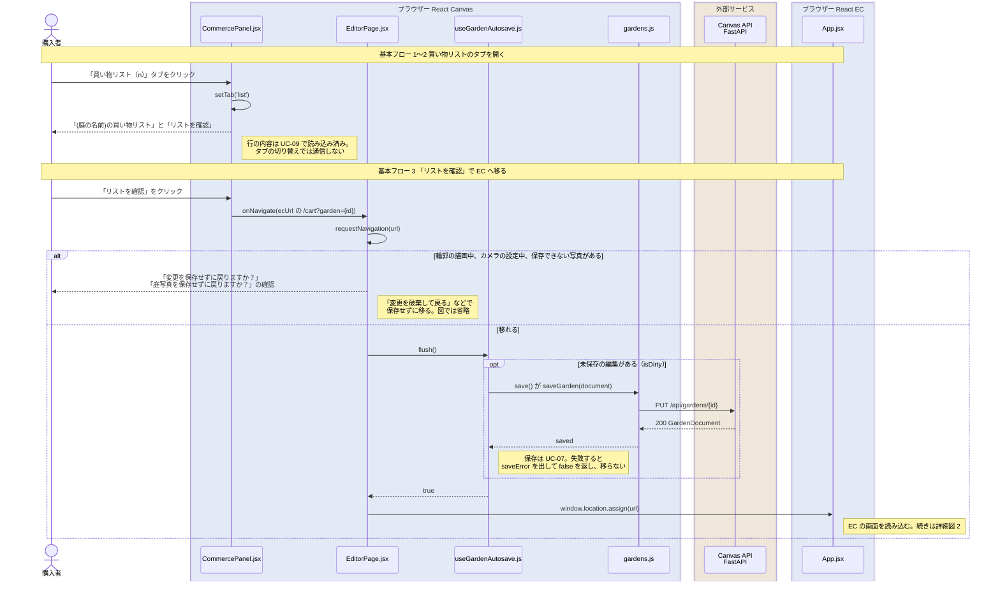
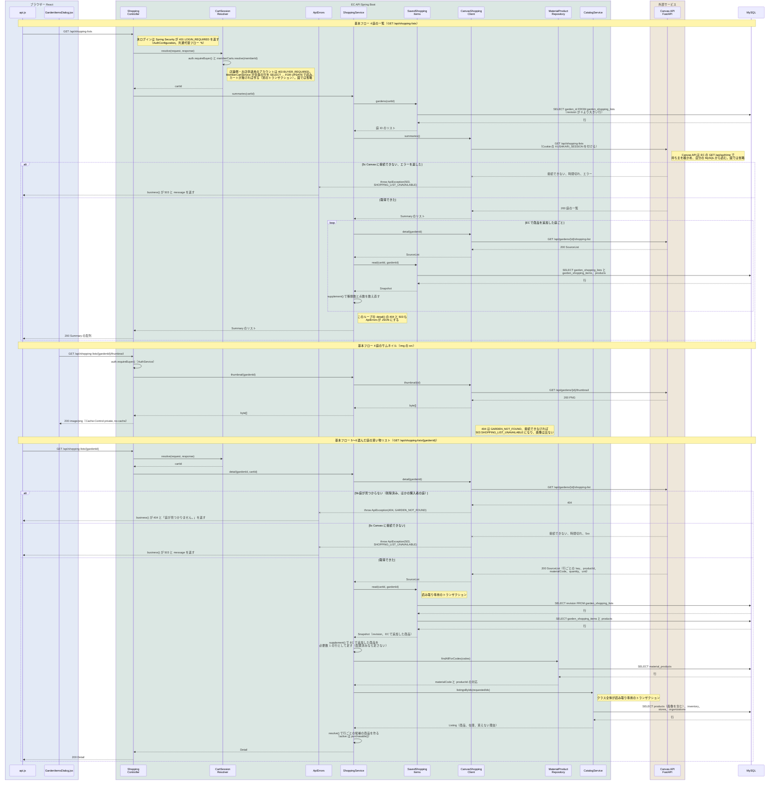

# EC-B24 買い物リストを確認する(EC)

- ユースケース記述: [EC-B24_買い物リストを確認する(EC)](<../../アーカイブ/ユースケース/kusakari-ec/EC-B24_買い物リストを確認する(EC).md>)
- 対象のコード: kusakari-ec の main（19a2be3、2026-11-20 時点）。基本フロー 1〜3 は kusakari-canvas の main（c19d497、2026-11-20 時点）

基本フロー 1〜3 は Canvas の画面で、4 からは EC の「ショッピングカート」画面です。EC の画面は Canvas の買い物リストを直接読まず、EC API がサーバーから Canvas API を呼びます。EC から見ると Canvas API は外部システムなので、図では外部サービスとして書きます。詳細図は、Canvas の画面（詳細図 1）、EC のブラウザー（詳細図 2）、EC のサーバー（詳細図 3）に分けました。

## 概要図

## 詳細図 1 基本フロー 1〜3 Canvas の画面から EC へ移る

## 詳細図 2 基本フロー 4〜8 EC のブラウザー

```mermaid
sequenceDiagram
    actor User as 購入者
    box rgba(47,111,219,0.10) ブラウザー React
        participant App as App.jsx
        participant Shop as useShop.js
        participant Dlg as GardenItemsDialog.jsx
        participant Data as useShoppingData.js
        participant Sel as shoppingSelection.js
        participant Http as api.js
    end
    box rgba(27,127,92,0.12) EC API Spring Boot
        participant CartCtrl as CartController
        participant Ctrl as ShoppingController<br/>（詳細図 3）
    end

    Note over User,Ctrl: 基本フロー 4 カート画面を開く
    alt Canvas から /cart?garden={id} を開いた（画面の読み込み）
        Note right of App: useAuth() が GET /api/auth/me でログイン状態を読む。<br/>未ログインなら redirectToLogin() でログイン画面へ移る<br/>（共通代替フロー *b）
        App->>Shop: useShop() の useEffect が initialize()
        Shop->>Http: refresh() が api.cart()
        Http->>CartCtrl: GET /api/cart
        Note right of CartCtrl: CartService.read() でカートを読む。<br/>流れは EC-B08。図では省略
        CartCtrl-->>Http: 200 Cart
        Http-->>Shop: cart
        Note right of Shop: 続けて GET /api/products、GET /api/orders、<br/>GET /api/stores を送る。図では省略
        Shop-->>App: shop.cart
        App->>Dlg: CartPage と Cart を経て AddFromGardenCard を描く<br/>（Cart はカートの読み込み後に描く）
        Dlg->>Dlg: useRequestedGarden() が ?garden= を読み、<br/>GardenItemsDialog を開く（initialGarden は庭の ID）
    else 1a EC のカート画面から開く
        User->>App: 共通ヘッダーの「カート」をクリック
        App->>App: navigateFromHeader() が navigate('/cart')
        App-->>User: 「ショッピングカート」画面（EC-B08）
        User->>Dlg: 「庭に設置したものから追加」をクリック
        Dlg->>Dlg: setOpen(true) で GardenItemsDialog を開く<br/>（initialGarden は空）
    end

    Note over User,Ctrl: 基本フロー 4 庭の一覧を出す
    Dlg->>Data: useShoppingData('')
    Note right of Data: useEffect が load() を実行する。<br/>3 秒ごと（document.hidden でないとき）と<br/>window の focus でも load() する
    Data->>Http: api.shoppingLists()
    Http->>Ctrl: GET /api/shopping-lists
    alt 5c Canvas に接続できない
        Ctrl-->>Http: 503 SHOPPING_LIST_UNAVAILABLE
        Http--xData: readResponse() が throw ApiError(503)
        Data-->>Dlg: data.error
        Dlg-->>User: 「庭の買い物リストを取得できません。<br/>接続を確認して再試行してください。」と「再取得」
        opt 5c-2 「再取得」をクリック
            User->>Dlg: 「再取得」をクリック
            Dlg->>Data: data.reload()
            Data->>Http: load() が api.shoppingLists()
            Http->>Ctrl: GET /api/shopping-lists（5c-3）
            Ctrl-->>Http: 200 Summary の配列
            Http-->>Data: lists
        end
    else 取得できた
        Ctrl-->>Http: 200 Summary の配列
        Http-->>Data: lists
        Data-->>Dlg: data.lists
        alt 4a 庭がない
            Dlg-->>User: 「庭はまだありません。Canvasで庭を<br/>つくると、ここから追加できます。」
        else 庭がある
            Dlg->>Dlg: chosen が一覧にあればその庭、<br/>無ければ先頭の庭を gardenId にする
            loop 庭ごと
                Dlg->>Ctrl: img の src が<br/>GET /api/shopping-lists/{id}/thumbnail?v=…
                Ctrl-->>Dlg: 200 image/png
            end
            Dlg-->>User: 「庭をえらび、カートに入れる商品にチェックしてください。」<br/>と庭の一覧（サムネイル、名前、n種類）
        end
    end

    Note over User,Ctrl: 基本フロー 5〜7 選んだ庭の買い物リストを出す
    Dlg->>Dlg: GardenItems を表示（key は gardenId）
    Dlg->>Data: useShoppingData(gardenId)
    Data->>Http: api.shoppingList(gardenId)
    Http->>Ctrl: GET /api/shopping-lists/{gardenId}
    alt 5b 庭が見つからない
        Ctrl-->>Http: 404 GARDEN_NOT_FOUND
        Http--xData: throw ApiError(404)
        Data->>Data: removed を true にし detail を null にする<br/>（この庭の load() を止める）
        Data-->>Dlg: data.error
        Dlg-->>User: 「庭が見つかりません。」
    else 5c Canvas に接続できない
        Ctrl-->>Http: 503 SHOPPING_LIST_UNAVAILABLE
        Http--xData: throw ApiError(503)
        Data-->>Dlg: data.error
        Dlg-->>User: 「庭の買い物リストを取得できません。<br/>接続を確認して再試行してください。」
        Note right of Dlg: ここには「再取得」ボタンがない。<br/>3 秒ごとの load() で取り直す
    else 取得できた
        Ctrl-->>Http: 200 Detail（行と候補の商品、revision、listRevision）
        Http-->>Data: detail
        Data-->>Dlg: data.detail
        loop 行ごと
            Dlg->>Sel: chosenProduct(line, choices[line.key])
            Sel-->>Dlg: 候補が 1 つならその商品、<br/>複数なら選んだ商品か null
            Dlg->>Sel: quantityInCart(shop.cart, product.id)
            Sel-->>Dlg: カートの数量
            Dlg->>Sel: lineReason(line, product, 0)
            Sel-->>Dlg: 選べない理由（無ければ空）
        end
        alt 5a 行がない
            Dlg-->>User: 「この庭に配置した商品はありません。」
        else 行がある
            Dlg-->>User: 行ごとにチェックボックス、商品画像、商品名、<br/>「必要数 n点・店舗在庫 n点」、小計（priceYen×quantity）
            Note right of Dlg: 6a 候補がない「対応する販売商品がありません」<br/>6b 候補が複数「購入商品を選択」の選択欄と<br/>「購入商品を選択してください」<br/>7a「販売終了」「在庫不足」<br/>「カートの数量と合わせると上限99点を超えます」<br/>7b「カートに入っています」<br/>どれもチェックボックスを選べない
        end
    end
    opt 6b-2 「購入商品」で商品を選ぶ
        User->>Dlg: 選択欄で商品を選ぶ
        Dlg->>Dlg: setChoices() と、その行の選択を外す
        Dlg-->>User: 選んだ商品の在庫、小計、チェックボックス
    end

    Note over User,Ctrl: 基本フロー 8 内容を確認する
    User->>Dlg: 買い物リストの内容を確認する
    loop 3 秒ごと（document.hidden でないとき）と focus のとき
        Data->>Http: 2 つの useShoppingData が<br/>api.shoppingLists() と api.shoppingList(gardenId)
        Http->>Ctrl: GET /api/shopping-lists と<br/>GET /api/shopping-lists/{gardenId}
        Ctrl-->>Http: 200 最新の一覧と買い物リスト
        Http-->>Data: lists と detail
        Data-->>Dlg: 描き直す。revision か listRevision が<br/>変わったら setSelection({}) で選択を外す
    end
    opt 4b 別の庭をクリック
        User->>Dlg: 庭の一覧から別の庭をクリック
        Dlg->>Dlg: setChosen(gardenId)
        Note right of Dlg: 4b-2 GardenItems を作り直し、<br/>基本フロー 5 へ戻る
    end
    opt 閉じる
        User->>Dlg: 「キャンセル」か閉じる操作
        Dlg->>Dlg: close() が setOpen(false) と<br/>requested.clear()（URL から garden を外す）
        Dlg-->>User: ダイアログを閉じる
    end
```

## 詳細図 3 基本フロー 4〜6 EC のサーバー

## ユースケース記述との差

- 5b：URL で指定した庭が庭の一覧に無いとき（削除済み、ほかの購入者の庭など）、コードは「庭が見つかりません。」を出さず、一覧の先頭の庭を選びます（`GardenItemsDialog` の `gardenId` の決め方）。「庭が見つかりません。」は、庭の一覧を取ったあとで、選んだ庭の `GET /api/shopping-lists/{gardenId}` が 404 になったときだけ出ます。
- 5c：「再取得」ボタンが出るのは、庭の一覧（`GET /api/shopping-lists`）の取得に失敗したときだけです。選んだ庭の買い物リストの取得に失敗したときはメッセージだけを出し、3 秒ごとの取り直しを待ちます。
- 関連情報の「3秒ごとと画面に戻ったときに、在庫・カートの内容・庭プロジェクトの変更を反映する」：3 秒ごとと `focus` で取り直すのは、庭の一覧と買い物リスト（在庫、価格、配置を含む）だけです。カート（`shop.cart`）は取り直さないので、別の画面でカートを変えても「カートに入っています」の表示はすぐには変わりません。カートは、カートへの追加が 409 になったときに取り直します（[EC-B25 の図](<EC-B25_買い物リストから商品をカートに追加する.md>)）。
- 7a：カートにある商品は 7b で選べないので、画面はカートの数量を 0 として判定します（`lineReason(line, product, 0)`）。「カートの数量と合わせると上限99点を超えます」が出るのは、必要数だけで 99 点を超えるときです。
- 基本フロー 3：Canvas の「リストを確認」は、未保存の編集を `PUT /api/gardens/{id}` で保存してから EC を開きます。輪郭の描画中、カメラの設定中、保存できない写真があるときは、移る前に確認ダイアログを出します。どちらもユースケース記述にありません。
- 基本フロー 4：ダイアログ（`AddFromGardenCard`）は、カートの読み込みが終わってから描かれます。`GET /api/cart` に失敗すると、`?garden=` を付けて開いてもダイアログは開きません。

## 参照したコード

kusakari-ec

- [frontend/src/components/GardenItemsDialog.jsx](https://github.com/abeouga/kusakari-ec/blob/19a2be307ee71a2cd87e538236c3c8c42929c5b3/frontend/src/components/GardenItemsDialog.jsx): `useRequestedGarden`、`AddFromGardenCard`、`GardenItemsDialog`、`GardenItems`
- [frontend/src/components/useShoppingData.js](https://github.com/abeouga/kusakari-ec/blob/19a2be307ee71a2cd87e538236c3c8c42929c5b3/frontend/src/components/useShoppingData.js): `useShoppingData`（`load`、3 秒ごとの `setInterval`、`focus`、404 のときの `removed`）
- [frontend/src/shoppingSelection.js](https://github.com/abeouga/kusakari-ec/blob/19a2be307ee71a2cd87e538236c3c8c42929c5b3/frontend/src/shoppingSelection.js): `chosenProduct`、`quantityInCart`、`lineReason`、`unavailableReason`
- [frontend/src/api.js](https://github.com/abeouga/kusakari-ec/blob/19a2be307ee71a2cd87e538236c3c8c42929c5b3/frontend/src/api.js): `request`、`readResponse`、`api.shoppingLists`、`api.shoppingList`、`api.cart`
- [frontend/src/useShop.js](https://github.com/abeouga/kusakari-ec/blob/19a2be307ee71a2cd87e538236c3c8c42929c5b3/frontend/src/useShop.js): `initialize`、`refresh`
- [frontend/src/App.jsx](https://github.com/abeouga/kusakari-ec/blob/19a2be307ee71a2cd87e538236c3c8c42929c5b3/frontend/src/App.jsx): `navigateFromHeader`、`cartLoginRequired` と `redirectToLogin`、`/cart` の `CartPage`
- [frontend/src/components/CartPage.jsx](https://github.com/abeouga/kusakari-ec/blob/19a2be307ee71a2cd87e538236c3c8c42929c5b3/frontend/src/components/CartPage.jsx): `CartPage`（店舗側のアカウントの案内）
- [frontend/src/components/Cart.jsx](https://github.com/abeouga/kusakari-ec/blob/19a2be307ee71a2cd87e538236c3c8c42929c5b3/frontend/src/components/Cart.jsx): `AddFromGardenCard` を描く場所
- [frontend/src/workspace/navigation.js](https://github.com/abeouga/kusakari-ec/blob/19a2be307ee71a2cd87e538236c3c8c42929c5b3/frontend/src/workspace/navigation.js): `navigate`
- [backend/src/main/java/jp/kusakari/ec/shopping/ShoppingController.java](https://github.com/abeouga/kusakari-ec/blob/19a2be307ee71a2cd87e538236c3c8c42929c5b3/backend/src/main/java/jp/kusakari/ec/shopping/ShoppingController.java): `summaries`、`detail`、`thumbnail`
- [backend/src/main/java/jp/kusakari/ec/shopping/ShoppingService.java](https://github.com/abeouga/kusakari-ec/blob/19a2be307ee71a2cd87e538236c3c8c42929c5b3/backend/src/main/java/jp/kusakari/ec/shopping/ShoppingService.java): `summaries`、`detail`、`thumbnail`、`supplement`、`resolve`
- [backend/src/main/java/jp/kusakari/ec/shopping/SavedShoppingItems.java](https://github.com/abeouga/kusakari-ec/blob/19a2be307ee71a2cd87e538236c3c8c42929c5b3/backend/src/main/java/jp/kusakari/ec/shopping/SavedShoppingItems.java): `read`、`gardens`
- [backend/src/main/java/jp/kusakari/ec/shopping/CanvasShoppingClient.java](https://github.com/abeouga/kusakari-ec/blob/19a2be307ee71a2cd87e538236c3c8c42929c5b3/backend/src/main/java/jp/kusakari/ec/shopping/CanvasShoppingClient.java): `summaries`、`detail`、`thumbnail`、`unavailable`
- [backend/src/main/java/jp/kusakari/ec/common/CanvasClientConfiguration.java](https://github.com/abeouga/kusakari-ec/blob/19a2be307ee71a2cd87e538236c3c8c42929c5b3/backend/src/main/java/jp/kusakari/ec/common/CanvasClientConfiguration.java): `canvasClient`（Cookie の受け渡し、時間切れ）
- [backend/src/main/java/jp/kusakari/ec/commerce/session/CartSessionResolver.java](https://github.com/abeouga/kusakari-ec/blob/19a2be307ee71a2cd87e538236c3c8c42929c5b3/backend/src/main/java/jp/kusakari/ec/commerce/session/CartSessionResolver.java): `resolve`
- [backend/src/main/java/jp/kusakari/ec/auth/MemberCartService.java](https://github.com/abeouga/kusakari-ec/blob/19a2be307ee71a2cd87e538236c3c8c42929c5b3/backend/src/main/java/jp/kusakari/ec/auth/MemberCartService.java): `resolve`
- [backend/src/main/java/jp/kusakari/ec/auth/AuthService.java](https://github.com/abeouga/kusakari-ec/blob/19a2be307ee71a2cd87e538236c3c8c42929c5b3/backend/src/main/java/jp/kusakari/ec/auth/AuthService.java): `requireBuyer`
- [backend/src/main/java/jp/kusakari/ec/auth/AuthConfiguration.java](https://github.com/abeouga/kusakari-ec/blob/19a2be307ee71a2cd87e538236c3c8c42929c5b3/backend/src/main/java/jp/kusakari/ec/auth/AuthConfiguration.java): 未ログインの 401（`authenticationEntryPoint`）
- [backend/src/main/java/jp/kusakari/ec/catalog/persistence/repository/MaterialProductRepository.java](https://github.com/abeouga/kusakari-ec/blob/19a2be307ee71a2cd87e538236c3c8c42929c5b3/backend/src/main/java/jp/kusakari/ec/catalog/persistence/repository/MaterialProductRepository.java): `findAllForCodes`
- [backend/src/main/java/jp/kusakari/ec/catalog/service/CatalogService.java](https://github.com/abeouga/kusakari-ec/blob/19a2be307ee71a2cd87e538236c3c8c42929c5b3/backend/src/main/java/jp/kusakari/ec/catalog/service/CatalogService.java): `listingsByIds`、`Listing.purchasable`
- [backend/src/main/java/jp/kusakari/ec/common/web/ApiErrors.java](https://github.com/abeouga/kusakari-ec/blob/19a2be307ee71a2cd87e538236c3c8c42929c5b3/backend/src/main/java/jp/kusakari/ec/common/web/ApiErrors.java): `business`

kusakari-canvas

- [frontend/src/components/CommercePanel.jsx](https://github.com/abeouga/kusakari-canvas/blob/c19d497dfef15b119f9bce8ecb5c886a36da6b7d/frontend/src/components/CommercePanel.jsx): `CommercePanel`（タブ、「リストを確認」）
- [frontend/src/pages/EditorPage.jsx](https://github.com/abeouga/kusakari-canvas/blob/c19d497dfef15b119f9bce8ecb5c886a36da6b7d/frontend/src/pages/EditorPage.jsx): `requestNavigation`、移る前の確認ダイアログ
- [frontend/src/hooks/useGardenAutosave.js](https://github.com/abeouga/kusakari-canvas/blob/c19d497dfef15b119f9bce8ecb5c886a36da6b7d/frontend/src/hooks/useGardenAutosave.js): `save`、`flush`
- [frontend/src/api/gardens.js](https://github.com/abeouga/kusakari-canvas/blob/c19d497dfef15b119f9bce8ecb5c886a36da6b7d/frontend/src/api/gardens.js): `saveGarden`
- [backend/kusakari_canvas_api/main.py](https://github.com/abeouga/kusakari-canvas/blob/c19d497dfef15b119f9bce8ecb5c886a36da6b7d/backend/kusakari_canvas_api/main.py): `shopping_lists`、`shopping_list`、`update`、`backend_identity`
- [backend/kusakari_canvas_api/shopping.py](https://github.com/abeouga/kusakari-canvas/blob/c19d497dfef15b119f9bce8ecb5c886a36da6b7d/backend/kusakari_canvas_api/shopping.py): `summaries`、`detail`
- [backend/kusakari_canvas_api/thumbnails.py](https://github.com/abeouga/kusakari-canvas/blob/c19d497dfef15b119f9bce8ecb5c886a36da6b7d/backend/kusakari_canvas_api/thumbnails.py): `thumbnail_router` の `get`
- [backend/kusakari_canvas_api/auth.py](https://github.com/abeouga/kusakari-canvas/blob/c19d497dfef15b119f9bce8ecb5c886a36da6b7d/backend/kusakari_canvas_api/auth.py): `authenticate`（EC の `GET /api/auth/me` で持ち主を決める）
