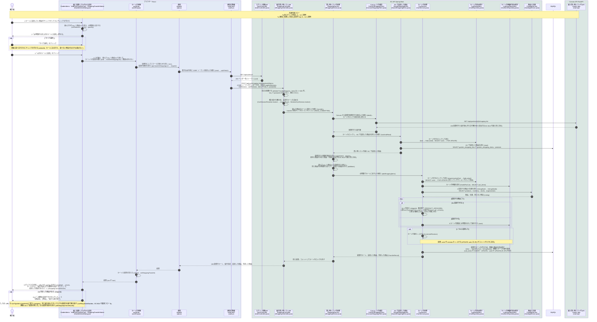
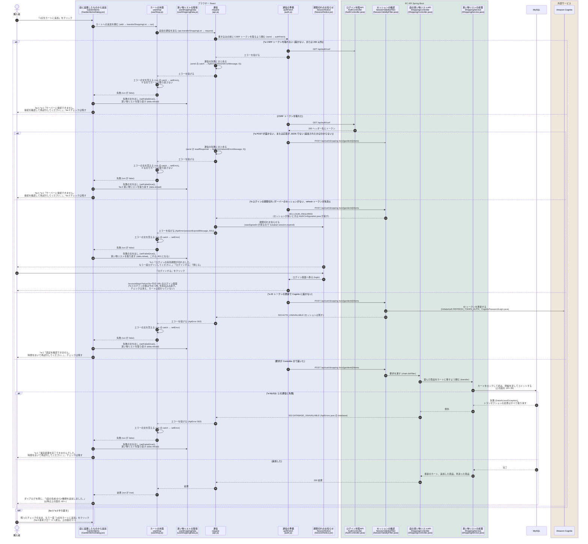

# EC-B25 買い物リストから商品をカートに追加する

- ユースケース記述: [EC-B25_買い物リストから商品をカートに追加する](<../../アーカイブ/ユースケース/kusakari-ec/EC-B25_買い物リストから商品をカートに追加する.md>)
- 共通代替フロー: [00_全ユースケース共通の代替フロー](<00_全ユースケース共通の代替フロー.md>)
- 対象のコード: kusakari-ec の main（6bad7e3、2026-11-24 時点）。Canvas API は kusakari-canvas の main（7e9a8dd、2026-11-24 時点）

## シーケンス図

参加者は、上から「画面や役割の名前」「コンポーネント・クラスの名前」「ファイル名（かっこ付き）」の順に書いています。
ダイアログを開いて買い物リストを表示するまでは [EC-B24 の図](<EC-B24_買い物リストを確認する(EC).md>) にあります。カートへの追加は `POST /api/cart/shopping-lists/{gardenId}/items` の 1 回です。画面は数量を送らず、行の key と商品 ID と 3 つの版（庭、買い物リスト、カート）だけを送ります。必要数はサーバーが Canvas から取り直します。
共通代替フローの中身は、00 の図か、下の「共通代替フローを直接書いた図」を見てください。
エラーの代替フローは描かず、図の下に並べています。4a の見送りは表示の分かれ道として描き、見送ったときの表示と「すべて選択」は Note にまとめています。

図に描いていない代替フロー：2a（1 つも選んでいない）、4b（庭・買い物リスト・カートの版が違う）、（記述なし）の分岐

## 共通代替フローを直接書いた図

上の図の追加の通信（CSRF トークンの取得と `POST /api/cart/shopping-lists/{gardenId}/items`）に、この画面で起こる共通代替フロー（\*a、\*b）を書き込んだ図です。記述の 5a（通信に失敗した場合）は、この図の \*a に当たります。失敗のあとの `GET /api/shopping-lists/{gardenId}` の取り直しの \*a・\*b は [EC-B24](<EC-B24_買い物リストを確認する(EC).md>) の「共通代替フローを直接書いた図」と同じなので省いています。

## ユースケース記述との差

- コードにあって記述にない分岐が 3 つあります。入力の検査で止まる 400 `INVALID_INPUT`、選んだ key と商品 ID が最新の行と合わない 400 `INVALID_SELECTION`、カートへの追加の途中で Canvas から庭を取り直せない 404 `GARDEN_NOT_FOUND` と 503 `SHOPPING_LIST_UNAVAILABLE` です。画面はどれもエラーの文を出し、チェックを残したまま買い物リストを取り直します。404 のときは取り直しも 404 になり、「庭が見つかりません。」が出ます。
- 4b-2: 409 のうち `CART_CHANGED` では、画面はカートを取り直しますが、庭と買い物リストの版は変わらないのでチェックは残ります。記述の「庭プロジェクトか買い物リストが変わっていた場合は、選択を解除する」と同じ動きです。
- 4a: すべての商品を見送ったときも 200 で、ダイアログを閉じて「(庭の名前)から0種類を追加しました。」を出します。このときカートの版は上がりません。
- 4a: 見送りの判定は「販売終了（`PRODUCT_ARCHIVED`）→ 上限 99 点 → 在庫不足 → 上限 50 種類」の順です。在庫の判定は「カートの数量＋必要数」が在庫を超えるかです。
- 5a-1: 「選択した商品はカートに追加されていません。」が出るのは、`useShop` の `run()` がほかの操作の実行中で何もしなかったとき（エラーの文が空のとき）だけです。通信の失敗では、`api.js` の「サーバーに接続できません。接続を確認して再試行してください。」が出ます。
- 5a: 応答が届かなかったときは、サーバーで追加が済んだかが分かりません。済んでいた場合、やり直すとカートの版が変わっているので 409 `CART_CHANGED` になり、画面がカートを取り直します。同じ商品が二重に足されることはありません。
- 5a: CSRF トークンを取れないとき、`authFetch` は「操作の確認情報を取得できません。画面を再読み込みしてください。」のエラーを投げますが、`api.js` の `send()` がすべての例外を「サーバーに接続できません。…」に置き換えるので、この文は画面に出ません。
- 「結果を閉じる」は、見送りが無いときも出ます（`ShoppingTransferNotice`）。
- 関連情報の「受取店舗は商品が属する店舗」: 在庫は商品の店舗のもので判定します（`CatalogService.listingsByIds`）。

## 確かめられなかったこと

- `CartService.addShoppingItems()` の `items.save(item)` と `cart.incrementRevision()` の変更を MySQL へ送る時点（`view(cart)` の中の `findAllForCart()` の前の自動の flush か、コミットのときか）は、実行して確かめていません。図では「JPA が送る」とだけ書きました。

## 参照したコード

kusakari-ec

- [frontend/src/components/GardenItemsDialog.jsx](https://github.com/abeouga/kusakari-ec/blob/6bad7e37c4135034fbe97e30309772fbe872e675/frontend/src/components/GardenItemsDialog.jsx): `GardenItems` の `add`、`selectAll`、選択を外す `useEffect`、失敗の文、`ShoppingTransferNotice`、`AddFromGardenCard` の `close`、`useRequestedGarden`
- [frontend/src/useShop.js](https://github.com/abeouga/kusakari-ec/blob/6bad7e37c4135034fbe97e30309772fbe872e675/frontend/src/useShop.js): `transferShoppingList`、`run`、`refresh`、`setShoppingTransfer`
- [frontend/src/components/useShoppingData.js](https://github.com/abeouga/kusakari-ec/blob/6bad7e37c4135034fbe97e30309772fbe872e675/frontend/src/components/useShoppingData.js): `reload`、`load`
- [frontend/src/api.js](https://github.com/abeouga/kusakari-ec/blob/6bad7e37c4135034fbe97e30309772fbe872e675/frontend/src/api.js): `api.transferShoppingList`、`api.cart`、`api.shoppingList`、`request`、`send`、`readResponse`、`networkErrorMessage`、`sessionExpiredMessage`
- [frontend/src/auth.js](https://github.com/abeouga/kusakari-ec/blob/6bad7e37c4135034fbe97e30309772fbe872e675/frontend/src/auth.js): `authFetch`（`GET /api/auth/csrf`）、`wasSignedIn`、`login`
- [frontend/src/components/SessionNotice.jsx](https://github.com/abeouga/kusakari-ec/blob/6bad7e37c4135034fbe97e30309772fbe872e675/frontend/src/components/SessionNotice.jsx): 期限切れのお知らせ
- [frontend/src/workspace/navigation.js](https://github.com/abeouga/kusakari-ec/blob/6bad7e37c4135034fbe97e30309772fbe872e675/frontend/src/workspace/navigation.js): `navigate`
- [backend/src/main/java/jp/kusakari/ec/auth/AuthController.java](https://github.com/abeouga/kusakari-ec/blob/6bad7e37c4135034fbe97e30309772fbe872e675/backend/src/main/java/jp/kusakari/ec/auth/AuthController.java): `csrf`
- [backend/src/main/java/jp/kusakari/ec/shopping/ShoppingController.java](https://github.com/abeouga/kusakari-ec/blob/6bad7e37c4135034fbe97e30309772fbe872e675/backend/src/main/java/jp/kusakari/ec/shopping/ShoppingController.java): `transfer`、`detail`
- [backend/src/main/java/jp/kusakari/ec/shopping/ShoppingDtos.java](https://github.com/abeouga/kusakari-ec/blob/6bad7e37c4135034fbe97e30309772fbe872e675/backend/src/main/java/jp/kusakari/ec/shopping/ShoppingDtos.java): `TransferRequest`、`Selection` の検査
- [backend/src/main/java/jp/kusakari/ec/shopping/ShoppingService.java](https://github.com/abeouga/kusakari-ec/blob/6bad7e37c4135034fbe97e30309772fbe872e675/backend/src/main/java/jp/kusakari/ec/shopping/ShoppingService.java): `transfer`、`supplement`、`resolve`、`invalidSelection`
- [backend/src/main/java/jp/kusakari/ec/shopping/SavedShoppingItems.java](https://github.com/abeouga/kusakari-ec/blob/6bad7e37c4135034fbe97e30309772fbe872e675/backend/src/main/java/jp/kusakari/ec/shopping/SavedShoppingItems.java): `lockAndRead`、`lock`、`read`
- [backend/src/main/java/jp/kusakari/ec/shopping/CanvasShoppingClient.java](https://github.com/abeouga/kusakari-ec/blob/6bad7e37c4135034fbe97e30309772fbe872e675/backend/src/main/java/jp/kusakari/ec/shopping/CanvasShoppingClient.java): `detail`、`unavailable`
- [backend/src/main/java/jp/kusakari/ec/commerce/service/CartService.java](https://github.com/abeouga/kusakari-ec/blob/6bad7e37c4135034fbe97e30309772fbe872e675/backend/src/main/java/jp/kusakari/ec/commerce/service/CartService.java): `addShoppingItems`、`requireLockedCart`、`checkRevision`、`listingsById`、`view`
- [backend/src/main/java/jp/kusakari/ec/commerce/persistence/repository/CartRepository.java](https://github.com/abeouga/kusakari-ec/blob/6bad7e37c4135034fbe97e30309772fbe872e675/backend/src/main/java/jp/kusakari/ec/commerce/persistence/repository/CartRepository.java): `findLocked`（`PESSIMISTIC_WRITE`）
- [backend/src/main/java/jp/kusakari/ec/commerce/persistence/repository/CartItemRepository.java](https://github.com/abeouga/kusakari-ec/blob/6bad7e37c4135034fbe97e30309772fbe872e675/backend/src/main/java/jp/kusakari/ec/commerce/persistence/repository/CartItemRepository.java): `findAllForCart`
- [backend/src/main/java/jp/kusakari/ec/catalog/service/CatalogService.java](https://github.com/abeouga/kusakari-ec/blob/6bad7e37c4135034fbe97e30309772fbe872e675/backend/src/main/java/jp/kusakari/ec/catalog/service/CatalogService.java): `listingsByIds`
- [backend/src/main/java/jp/kusakari/ec/commerce/session/CartSessionResolver.java](https://github.com/abeouga/kusakari-ec/blob/6bad7e37c4135034fbe97e30309772fbe872e675/backend/src/main/java/jp/kusakari/ec/commerce/session/CartSessionResolver.java): `resolve`
- [backend/src/main/java/jp/kusakari/ec/commerce/controller/CartController.java](https://github.com/abeouga/kusakari-ec/blob/6bad7e37c4135034fbe97e30309772fbe872e675/backend/src/main/java/jp/kusakari/ec/commerce/controller/CartController.java): `get`
- [backend/src/main/java/jp/kusakari/ec/auth/SessionValidityFilter.java](https://github.com/abeouga/kusakari-ec/blob/6bad7e37c4135034fbe97e30309772fbe872e675/backend/src/main/java/jp/kusakari/ec/auth/SessionValidityFilter.java): `doFilterInternal`、`renewIdToken`
- [backend/src/main/java/jp/kusakari/ec/auth/CognitoPasswordLogin.java](https://github.com/abeouga/kusakari-ec/blob/6bad7e37c4135034fbe97e30309772fbe872e675/backend/src/main/java/jp/kusakari/ec/auth/CognitoPasswordLogin.java): ID トークンの更新、503 `AUTH_UNAVAILABLE`
- [backend/src/main/java/jp/kusakari/ec/auth/AuthConfiguration.java](https://github.com/abeouga/kusakari-ec/blob/6bad7e37c4135034fbe97e30309772fbe872e675/backend/src/main/java/jp/kusakari/ec/auth/AuthConfiguration.java): `authenticationEntryPoint`（401 `LOGIN_REQUIRED`）、CSRF の検査
- [backend/src/main/java/jp/kusakari/ec/common/web/ApiErrors.java](https://github.com/abeouga/kusakari-ec/blob/6bad7e37c4135034fbe97e30309772fbe872e675/backend/src/main/java/jp/kusakari/ec/common/web/ApiErrors.java): `business`、`invalid`、`database`

kusakari-canvas

- [backend/kusakari_canvas_api/main.py](https://github.com/abeouga/kusakari-canvas/blob/7e9a8dd0a40f2b212ca20b3aa94f2dc984b00b7a/backend/kusakari_canvas_api/main.py): `create_app` の `shopping_list`
- [backend/kusakari_canvas_api/shopping.py](https://github.com/abeouga/kusakari-canvas/blob/7e9a8dd0a40f2b212ca20b3aa94f2dc984b00b7a/backend/kusakari_canvas_api/shopping.py): `detail`
