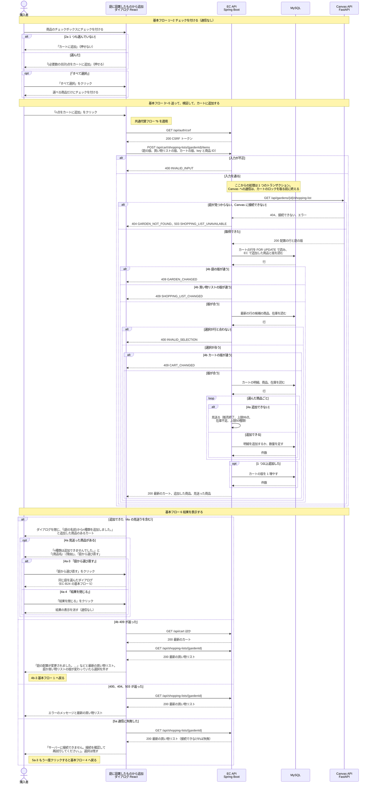
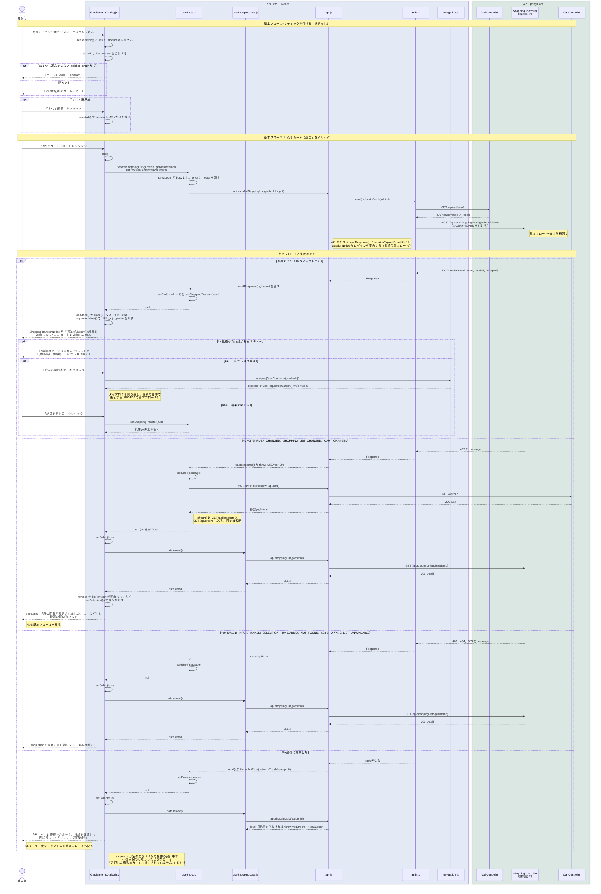
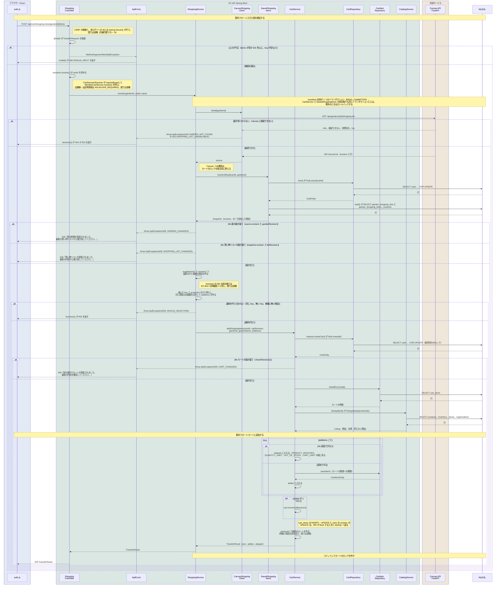

# EC-B25 買い物リストから商品をカートに追加する

- ユースケース記述: [EC-B25_買い物リストから商品をカートに追加する](<../../アーカイブ/ユースケース/kusakari-ec/EC-B25_買い物リストから商品をカートに追加する.md>)
- 対象のコード: kusakari-ec の main（19a2be3、2026-11-20 時点）

ダイアログを開いて買い物リストを表示するまでは [EC-B24 の図](<EC-B24_買い物リストを確認する(EC).md>) にあります。カートへの追加は `POST /api/cart/shopping-lists/{gardenId}/items` の 1 回です。画面は数量を送らず、行の key と商品 ID と 3 つの版（庭、買い物リスト、カート）だけを送ります。必要数はサーバーが Canvas から取り直します。詳細図は、ブラウザー（詳細図 1）とサーバー（詳細図 2）に分けました。

## 概要図

## 詳細図 1 基本フロー 1〜3、6 ブラウザー

## 詳細図 2 基本フロー 4〜5 サーバー

## ユースケース記述との差

- コードにあって記述にない分岐が 3 つあります。入力の検査で止まる 400 `INVALID_INPUT`、選んだ key と商品 ID が最新の行と合わない 400 `INVALID_SELECTION`、カートへの追加の途中で Canvas から庭を取り直せない 404 `GARDEN_NOT_FOUND` と 503 `SHOPPING_LIST_UNAVAILABLE` です。画面はどれもエラーのメッセージを出し、選択を残したまま買い物リストを取り直します。
- 4b-2：409 のうち `CART_CHANGED` では、画面はカートを取り直しますが、庭と買い物リストの版は変わらないので選択は残ります。記述の「庭プロジェクトか買い物リストが変わっていた場合は、選択を解除する」と同じ動きです。
- 4a：すべての商品を見送ったときも 200 で、ダイアログを閉じて「(庭の名前)から0種類を追加しました。」を出します。このときカートの版は上がりません。
- 「結果を閉じる」は、見送りが無いときも出ます（`ShoppingTransferNotice`）。

## 確かめられなかったこと

- `CartService.addShoppingItems()` の `items.save(item)` と `cart.incrementRevision()` の変更を MySQL へ送る時点（`view(cart)` の中の `findAllForCart()` の前の自動の flush か、コミットのときか）は、実行して確かめていません。図では flush のときとだけ書きました。

## 参照したコード

- [frontend/src/components/GardenItemsDialog.jsx](https://github.com/abeouga/kusakari-ec/blob/19a2be307ee71a2cd87e538236c3c8c42929c5b3/frontend/src/components/GardenItemsDialog.jsx): `GardenItems` の `add`、`selectAll`、選択を外す `useEffect`、`ShoppingTransferNotice`、`AddFromGardenCard` の `close`
- [frontend/src/useShop.js](https://github.com/abeouga/kusakari-ec/blob/19a2be307ee71a2cd87e538236c3c8c42929c5b3/frontend/src/useShop.js): `transferShoppingList`、`run`、`refresh`、`setShoppingTransfer`
- [frontend/src/components/useShoppingData.js](https://github.com/abeouga/kusakari-ec/blob/19a2be307ee71a2cd87e538236c3c8c42929c5b3/frontend/src/components/useShoppingData.js): `reload`
- [frontend/src/api.js](https://github.com/abeouga/kusakari-ec/blob/19a2be307ee71a2cd87e538236c3c8c42929c5b3/frontend/src/api.js): `api.transferShoppingList`、`request`、`send`、`readResponse`、`networkErrorMessage`
- [frontend/src/auth.js](https://github.com/abeouga/kusakari-ec/blob/19a2be307ee71a2cd87e538236c3c8c42929c5b3/frontend/src/auth.js): `authFetch`（`GET /api/auth/csrf`）
- [frontend/src/workspace/navigation.js](https://github.com/abeouga/kusakari-ec/blob/19a2be307ee71a2cd87e538236c3c8c42929c5b3/frontend/src/workspace/navigation.js): `navigate`
- [backend/src/main/java/jp/kusakari/ec/auth/AuthController.java](https://github.com/abeouga/kusakari-ec/blob/19a2be307ee71a2cd87e538236c3c8c42929c5b3/backend/src/main/java/jp/kusakari/ec/auth/AuthController.java): `csrf`
- [backend/src/main/java/jp/kusakari/ec/shopping/ShoppingController.java](https://github.com/abeouga/kusakari-ec/blob/19a2be307ee71a2cd87e538236c3c8c42929c5b3/backend/src/main/java/jp/kusakari/ec/shopping/ShoppingController.java): `transfer`
- [backend/src/main/java/jp/kusakari/ec/shopping/ShoppingDtos.java](https://github.com/abeouga/kusakari-ec/blob/19a2be307ee71a2cd87e538236c3c8c42929c5b3/backend/src/main/java/jp/kusakari/ec/shopping/ShoppingDtos.java): `TransferRequest`、`Selection` の検査
- [backend/src/main/java/jp/kusakari/ec/shopping/ShoppingService.java](https://github.com/abeouga/kusakari-ec/blob/19a2be307ee71a2cd87e538236c3c8c42929c5b3/backend/src/main/java/jp/kusakari/ec/shopping/ShoppingService.java): `transfer`、`invalidSelection`
- [backend/src/main/java/jp/kusakari/ec/shopping/SavedShoppingItems.java](https://github.com/abeouga/kusakari-ec/blob/19a2be307ee71a2cd87e538236c3c8c42929c5b3/backend/src/main/java/jp/kusakari/ec/shopping/SavedShoppingItems.java): `lockAndRead`、`lock`、`read`
- [backend/src/main/java/jp/kusakari/ec/shopping/CanvasShoppingClient.java](https://github.com/abeouga/kusakari-ec/blob/19a2be307ee71a2cd87e538236c3c8c42929c5b3/backend/src/main/java/jp/kusakari/ec/shopping/CanvasShoppingClient.java): `detail`
- [backend/src/main/java/jp/kusakari/ec/commerce/service/CartService.java](https://github.com/abeouga/kusakari-ec/blob/19a2be307ee71a2cd87e538236c3c8c42929c5b3/backend/src/main/java/jp/kusakari/ec/commerce/service/CartService.java): `addShoppingItems`、`requireLockedCart`、`checkRevision`、`view`
- [backend/src/main/java/jp/kusakari/ec/commerce/persistence/repository/CartRepository.java](https://github.com/abeouga/kusakari-ec/blob/19a2be307ee71a2cd87e538236c3c8c42929c5b3/backend/src/main/java/jp/kusakari/ec/commerce/persistence/repository/CartRepository.java): `findLocked`（`PESSIMISTIC_WRITE`）
- [backend/src/main/java/jp/kusakari/ec/commerce/persistence/repository/CartItemRepository.java](https://github.com/abeouga/kusakari-ec/blob/19a2be307ee71a2cd87e538236c3c8c42929c5b3/backend/src/main/java/jp/kusakari/ec/commerce/persistence/repository/CartItemRepository.java): `findAllForCart`
- [backend/src/main/java/jp/kusakari/ec/catalog/service/CatalogService.java](https://github.com/abeouga/kusakari-ec/blob/19a2be307ee71a2cd87e538236c3c8c42929c5b3/backend/src/main/java/jp/kusakari/ec/catalog/service/CatalogService.java): `listingsByIds`
- [backend/src/main/java/jp/kusakari/ec/commerce/session/CartSessionResolver.java](https://github.com/abeouga/kusakari-ec/blob/19a2be307ee71a2cd87e538236c3c8c42929c5b3/backend/src/main/java/jp/kusakari/ec/commerce/session/CartSessionResolver.java): `resolve`
- [backend/src/main/java/jp/kusakari/ec/common/web/ApiErrors.java](https://github.com/abeouga/kusakari-ec/blob/19a2be307ee71a2cd87e538236c3c8c42929c5b3/backend/src/main/java/jp/kusakari/ec/common/web/ApiErrors.java): `business`、`invalid`
