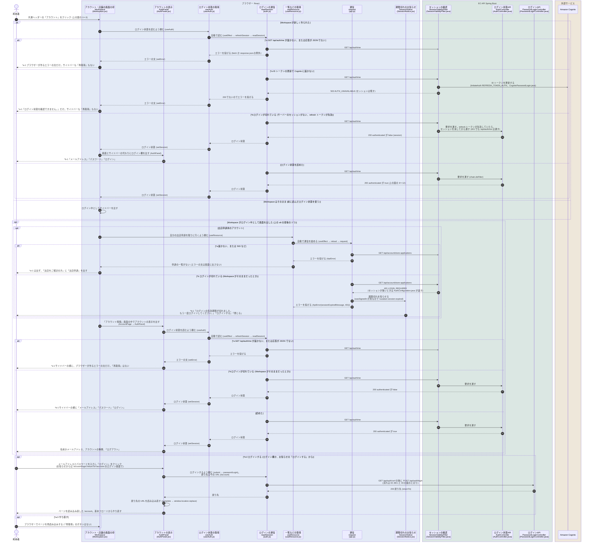

# EC-C01 アカウントのメニューを開く

```mermaid
sequenceDiagram
    autonumber
    actor User as 利用者
    box rgba(47,111,219,0.10) ブラウザー React
        participant Header as 共通ヘッダー<br/>KusakariHeader<br/>(KusakariHeader.jsx)
        participant App as EC の画面の枠<br/>App<br/>(App.jsx)
        participant Work as アカウント・店舗の画面の枠<br/>Workspace<br/>(Workspace.jsx)
        participant Side as サイドバー<br/>WorkspaceSidebar<br/>(WorkspaceSidebar.jsx)
        participant Acc as 「アカウント情報」画面<br/>AccountPage<br/>(AccountPage.jsx)
        participant Panel as アカウントの表示<br/>AuthPanel<br/>(AuthPanel.jsx)
        participant UseAuth as ログイン状態の取得<br/>useAuth<br/>(useAuth.js)
        participant AuthJs as ログインの通信<br/>readSession<br/>(auth.js)
        participant Res as 一覧などの取得<br/>useResource<br/>(useResource.js)
        participant Http as 通信<br/>request<br/>(api.js)
    end
    box rgba(27,127,92,0.12) EC API Spring Boot
        participant Filter as セッションの確認<br/>SessionValidityFilter<br/>(SessionValidityFilter.java)
        participant AuthCtrl as ログイン状態API<br/>AuthController<br/>(AuthController.java)
        participant AppCtrl as 出店申請API<br/>StoreApplicationController<br/>(StoreApplicationController.java)
        participant AuthSvc as ログイン中の会員<br/>AuthService<br/>(AuthService.java)
    end
    participant Db as MySQL

    Note over User,Db: 共通代替フロー<br/>*b 未ログインの場合: 7、17、30 に適用<br/>*a 通信に失敗した場合: 7、17、30 に適用

    User->>Header: 共通ヘッダーの「アカウント」をクリック<br/>(ログインしているときだけ出る)
    Header->>App: 移動先の URL を渡す (follow → onNavigate → navigateFromHeader)
    App->>Work: URL を /account に変え (navigate)、パスが / でも /cart でもないので<br/>Workspace を表示する (usePath)
    alt 「メイン」画面やカート画面から開いた (Workspace が新しく作られる)
        Work->>UseAuth: ログイン状態を読むよう頼む (useAuth)
        Work-->>User: 読み終わるまで「ログイン状態を確認しています。」
        UseAuth->>AuthJs: 画面を開いたときに自動で読む<br/>(useEffect → refreshSession → readSession)
        AuthJs->>Filter: GET /api/auth/me
        Filter->>AuthSvc: ログイン中の会員が使えるかを確かめる (current)<br/>会員を読み (findByIssuerAndSubject、SELECT members)、<br/>担当者なら組織の所属も読む (findForMember、SELECT organization_members)
        Filter->>AuthCtrl: 要求を通す (chain.doFilter)
        AuthCtrl->>AuthSvc: ログイン状態を作るよう頼む (session)<br/>会員、組織、組織の所属、店舗、店舗の担当を読む<br/>(current、organizationIdOf、organizationRoleOf、storeIdsOf)
        AuthSvc-->>AuthCtrl: ログイン状態 (SessionView。id、email、name、accountType、<br/>organizationId、organizationRole、storeIds)
        AuthCtrl-->>AuthJs: 200 ログイン状態 (authenticated が true)
        AuthJs-->>UseAuth: ログイン状態 (ログインを確かめたことを覚える。signedIn)
        UseAuth-->>Work: ログイン状態 (setSession)
    else アカウント・出店者などの画面から開いた (Workspace はそのまま)
        Work->>Work: 前に読んだログイン状態をそのまま使う (読み直さない)
    end

    Work->>Work: 出店申請用のアカウントかを確かめる<br/>(applicant は accountType が SHOP_OWNER_APPLICANT か)
    opt 出店申請用のアカウント
        Work->>AppCtrl: 自分の出店申請を取りに行く<br/>(useResource('/account/store-applications') → reload → request)<br/>GET /api/account/store-applications
        Note over Work,Db: 結果: ログイン中の会員の申請を新しい順に読み (list(false)、findByMemberIdOrderByCreatedAtDesc、SELECT organization_applications)、200 申請の配列を返す。<br/>画面: 申請があればメニューを「出店申請状況」、なければ「出店申請」にする (applications.data)
    end
    Work->>Work: サイドバーのメニューを作る。「マイページ」(buyerMenu)、「アカウント設定」(accountSettings)、<br/>出店申請用は「出店をご検討の方」(申請があれば「出店申請状況」、なければ「出店申請」)
    Work->>Side: 今のパスとメニューを渡す (WorkspaceSidebar path groups)
    Side-->>User: 「商品一覧へ戻る」、「マイページ」(「アカウント情報」「注文履歴」「通知一覧」)、<br/>「アカウント設定」(「受取連絡先」「パスワード変更」「退会」)、出店申請用は「出店をご検討の方」。<br/>「アカウント情報」を今の画面として示す
    Work->>Acc: 見出しを「アカウント情報」にし、「アカウント情報」画面を表示する<br/>(AccountPage tab='アカウント情報'、key はパス)
    Acc->>Res: ログイン状態も取りに行くよう頼む (useResource('/auth/me'))
    Res->>Http: 自動で通信を始める (useEffect → reload → request)
    Http->>AuthCtrl: GET /api/auth/me
    AuthCtrl-->>Http: 200 ログイン状態 (流れは 8〜12 と同じ)
    Http-->>Res: ログイン状態 (この画面では使わない)
    Acc->>Panel: アカウントの表示を出す (AuthPanel)
    Panel->>UseAuth: ログイン状態を読むよう頼む (useAuth)
    UseAuth->>AuthJs: 自動で読む (useEffect → refreshSession → readSession)
    AuthJs->>AuthCtrl: GET /api/auth/me
    AuthCtrl-->>AuthJs: 200 ログイン状態 (流れは 8〜12 と同じ)
    AuthJs-->>UseAuth: ログイン状態
    UseAuth-->>Panel: ログイン状態 (読み終わるまでは「ログイン状態を確認しています。」)
    Panel-->>User: 名前 (なければメールアドレス)、アカウントの種類 (accountLabels。<br/>「管理者」「出店者（オーナー）」「出店者（スタッフ）」「出店申請用アカウント」、ほかは「利用者」)、「ログアウト」

    opt 3 指定のメニューが「アカウント情報」以外
        User->>Side: サイドバーの対象のメニューをクリック<br/>(「通知一覧」「パスワード変更」「退会」「出店申請」「出店申請状況」など)
        Note over User,Side: 結果: URL をメニューの URL に変え (MenuLink の PageLink → follow → navigate)、Workspace に新しいパスを渡す (usePath)。作り直さず、ログイン状態は読み直さない。<br/>画面: パスに合う画面 (Notices、BuyerOrders、AccountPage の別の tab など。中身は呼び出し元のユースケースの次のステップ)
    end
```

- ユースケース記述: [EC-C01_アカウントのメニューを開く](<../../アーカイブ/ユースケース/kusakari-ec/EC-C01_アカウントのメニューを開く.md>)
- 共通代替フロー: [00_全ユースケース共通の代替フロー](<00_全ユースケース共通の代替フロー.md>)
- 対象のコード: kusakari-ec の main（6bad7e3、2026-11-24 時点）

## シーケンス図

参加者は、上から「画面や役割の名前」「コンポーネント・クラスの名前」「ファイル名（かっこ付き）」の順に書いています。
EC の画面は 1 つの React アプリです。共通ヘッダーの「アカウント」をクリックしても画面は読み込み直さず、URL を `/account` に変えて `Workspace` に切り替えます。`useAuth()` を使うコンポーネントは、作られるたびに `GET /api/auth/me` を送ります。そのため、「メイン」画面などから移ったときは `Workspace` と `AuthPanel` の 2 か所が送り、アカウント・出店者などの画面（`Workspace` の画面）から移ったときは `AuthPanel` だけが送ります。
共通代替フローの中身は、00 の図か、下の「共通代替フローを直接書いた図」を見てください。
エラーの代替フローは描かず、図の下に並べています。出店申請用のアカウントの申請の取得と、3（「アカウント情報」以外のメニュー）は、頼む矢印 1 本と Note にまとめています。

図に描いていない代替フロー：（記述なし）の分岐

## 共通代替フローを直接書いた図

上の図のログイン状態の確認（`Workspace` と `AuthPanel` の `GET /api/auth/me`）と出店申請の一覧の取得（`GET /api/account/store-applications`）に、この画面で起こる共通代替フロー（\*a、\*b）を書き込んだ図です。ログイン状態の確認は `api.js` を通らないので、失敗したときの文と、やり直しの方法が \*a の決まりと違います。`AccountPage` の `useResource('/auth/me')` は、失敗しても画面に何も出さないので省いています。

## ユースケース記述との差

- 関連情報では「アカウント情報」画面にメールアドレスを表示するとしています。コードは `session.name || session.email`（名前、無ければメールアドレス）を表示します。
- アカウントの種類の表示は、出店者（オーナー）、出店者（スタッフ）、出店申請用アカウント、管理者の 4 つです（`accountLabels`）。購入者（`USER`）は「利用者」と表示します。
- サイドバーの先頭に「商品一覧へ戻る」があります。記述にありません。
- `AccountPage` は「アカウント情報」のときも `useResource('/auth/me')` で `GET /api/auth/me` を送りますが、結果を使いません。記述にない通信です。失敗しても画面には何も出ません。
- 停止・除名されたアカウントは、`GET /api/auth/me` が 403 になり、画面にそのメッセージだけを出します。記述にない分岐です。
- \*b: 記述は「共通代替フロー \*b を適用する」としています。`GET /api/auth/me` はログインが切れていても 401 ではなく 200（`authenticated` が false）を返すので、`SessionNotice` のお知らせは出ず、ログイン欄（`AuthPanel`）が出ます。お知らせが出るのは、出店申請用のアカウントで、アカウント・出店者などの画面から移ったときの `GET /api/account/store-applications` の 401 だけです。
- \*b: アカウント・出店者などの画面から移ったときは、`Workspace` がログイン状態を読み直さないので、ログインが切れていてもサイドバーはログイン中のまま出て、「アカウント情報」の中だけがログイン欄になります。
- \*a: ログイン状態の確認（`readSession()`）は `api.js` を通らないので、失敗の文は「ログイン状態を確認できません。」かブラウザーが作る文になり、「再取得」もありません。出店申請の一覧の取得の失敗は、画面に文を出さず、「出店申請」のリンクを出します（申請がある人にも「出店申請」が出ます）。
- 記述にない入口です。Kusakari Canvas の画面の共通ヘッダーの「アカウント」は、EC の `/account` へのふつうのリンクなので、EC のページを読み込み直します。このときは「メイン」画面から開いたときと同じ流れで、さらにページを読み込んだときの取得（EC-B03 の図の事前条件）も走ります。

## 確かめられなかったこと

- MySQL に接続できないときの `GET /api/auth/me` の応答は確かめていません。ログイン中は `SessionValidityFilter` の `members.current()` で最初に DB を読み、ここでの例外は `ApiErrors.database()` を通らない可能性があります（00 の「確かめられなかったこと」と同じ）。そのため、図の \*a に MySQL の失敗を書いていません。
- \*b-2 のログインの後は `/account` を読み込み直すとコード（`AuthPanel.jsx` の `returnTo`、`complete`）からは読めますが、画面では確かめていません。

## 参照したコード

- [packages/site-header/KusakariHeader.jsx](https://github.com/abeouga/kusakari-ec/blob/6bad7e37c4135034fbe97e30309772fbe872e675/packages/site-header/KusakariHeader.jsx): `KusakariHeader`、`follow`（「アカウント」は `authenticated` のときだけ）
- [frontend/src/App.jsx](https://github.com/abeouga/kusakari-ec/blob/6bad7e37c4135034fbe97e30309772fbe872e675/frontend/src/App.jsx): `navigateFromHeader`、`workspace` の判定と `Workspace`
- [frontend/src/workspace/navigation.js](https://github.com/abeouga/kusakari-ec/blob/6bad7e37c4135034fbe97e30309772fbe872e675/frontend/src/workspace/navigation.js): `navigate`、`usePath`
- [frontend/src/workspace/Workspace.jsx](https://github.com/abeouga/kusakari-ec/blob/6bad7e37c4135034fbe97e30309772fbe872e675/frontend/src/workspace/Workspace.jsx): `Workspace`（`buyerMenu`、`accountSettings`、`applicationLink`、`error` の表示、未ログインの `AuthPanel`）
- [frontend/src/workspace/WorkspaceSidebar.jsx](https://github.com/abeouga/kusakari-ec/blob/6bad7e37c4135034fbe97e30309772fbe872e675/frontend/src/workspace/WorkspaceSidebar.jsx): `WorkspaceSidebar`、`MenuLink`
- [frontend/src/workspace/Common.jsx](https://github.com/abeouga/kusakari-ec/blob/6bad7e37c4135034fbe97e30309772fbe872e675/frontend/src/workspace/Common.jsx): `PageLink`
- [frontend/src/workspace/AccountPage.jsx](https://github.com/abeouga/kusakari-ec/blob/6bad7e37c4135034fbe97e30309772fbe872e675/frontend/src/workspace/AccountPage.jsx): `AccountPage`、`accountActions`
- [frontend/src/components/AuthPanel.jsx](https://github.com/abeouga/kusakari-ec/blob/6bad7e37c4135034fbe97e30309772fbe872e675/frontend/src/components/AuthPanel.jsx): `AuthPanel`、`accountLabels`、`submit`、`complete`、`returnTo`
- [frontend/src/useAuth.js](https://github.com/abeouga/kusakari-ec/blob/6bad7e37c4135034fbe97e30309772fbe872e675/frontend/src/useAuth.js): `useAuth`
- [frontend/src/auth.js](https://github.com/abeouga/kusakari-ec/blob/6bad7e37c4135034fbe97e30309772fbe872e675/frontend/src/auth.js): `readSession`、`wasSignedIn`、`passwordLogin`、`login`
- [frontend/src/workspace/useResource.js](https://github.com/abeouga/kusakari-ec/blob/6bad7e37c4135034fbe97e30309772fbe872e675/frontend/src/workspace/useResource.js): `useResource`、`reload`
- [frontend/src/api.js](https://github.com/abeouga/kusakari-ec/blob/6bad7e37c4135034fbe97e30309772fbe872e675/frontend/src/api.js): `request`、`readResponse`、`sessionExpiredMessage`
- [frontend/src/components/SessionNotice.jsx](https://github.com/abeouga/kusakari-ec/blob/6bad7e37c4135034fbe97e30309772fbe872e675/frontend/src/components/SessionNotice.jsx): 期限切れのお知らせ
- [frontend/src/workspace/StoreApplication.jsx](https://github.com/abeouga/kusakari-ec/blob/6bad7e37c4135034fbe97e30309772fbe872e675/frontend/src/workspace/StoreApplication.jsx): `applicationPaths`
- [backend/src/main/java/jp/kusakari/ec/auth/SessionValidityFilter.java](https://github.com/abeouga/kusakari-ec/blob/6bad7e37c4135034fbe97e30309772fbe872e675/backend/src/main/java/jp/kusakari/ec/auth/SessionValidityFilter.java): `doFilterInternal`、`renewIdToken`
- [backend/src/main/java/jp/kusakari/ec/auth/CognitoPasswordLogin.java](https://github.com/abeouga/kusakari-ec/blob/6bad7e37c4135034fbe97e30309772fbe872e675/backend/src/main/java/jp/kusakari/ec/auth/CognitoPasswordLogin.java): ID トークンの更新、503 `AUTH_UNAVAILABLE`
- [backend/src/main/java/jp/kusakari/ec/auth/AuthConfiguration.java](https://github.com/abeouga/kusakari-ec/blob/6bad7e37c4135034fbe97e30309772fbe872e675/backend/src/main/java/jp/kusakari/ec/auth/AuthConfiguration.java): `authenticationEntryPoint`（401 `LOGIN_REQUIRED`）
- [backend/src/main/java/jp/kusakari/ec/auth/AuthController.java](https://github.com/abeouga/kusakari-ec/blob/6bad7e37c4135034fbe97e30309772fbe872e675/backend/src/main/java/jp/kusakari/ec/auth/AuthController.java): `me`
- [backend/src/main/java/jp/kusakari/ec/auth/PasswordLoginController.java](https://github.com/abeouga/kusakari-ec/blob/6bad7e37c4135034fbe97e30309772fbe872e675/backend/src/main/java/jp/kusakari/ec/auth/PasswordLoginController.java): `POST /api/auth/login`
- [backend/src/main/java/jp/kusakari/ec/auth/AuthService.java](https://github.com/abeouga/kusakari-ec/blob/6bad7e37c4135034fbe97e30309772fbe872e675/backend/src/main/java/jp/kusakari/ec/auth/AuthService.java): `session`、`current`、`organizationIdOf`、`organizationRoleOf`、`storeIdsOf`
- [backend/src/main/java/jp/kusakari/ec/store/controller/StoreApplicationController.java](https://github.com/abeouga/kusakari-ec/blob/6bad7e37c4135034fbe97e30309772fbe872e675/backend/src/main/java/jp/kusakari/ec/store/controller/StoreApplicationController.java): `mine`
- [backend/src/main/java/jp/kusakari/ec/store/service/StoreApplicationService.java](https://github.com/abeouga/kusakari-ec/blob/6bad7e37c4135034fbe97e30309772fbe872e675/backend/src/main/java/jp/kusakari/ec/store/service/StoreApplicationService.java): `list`
