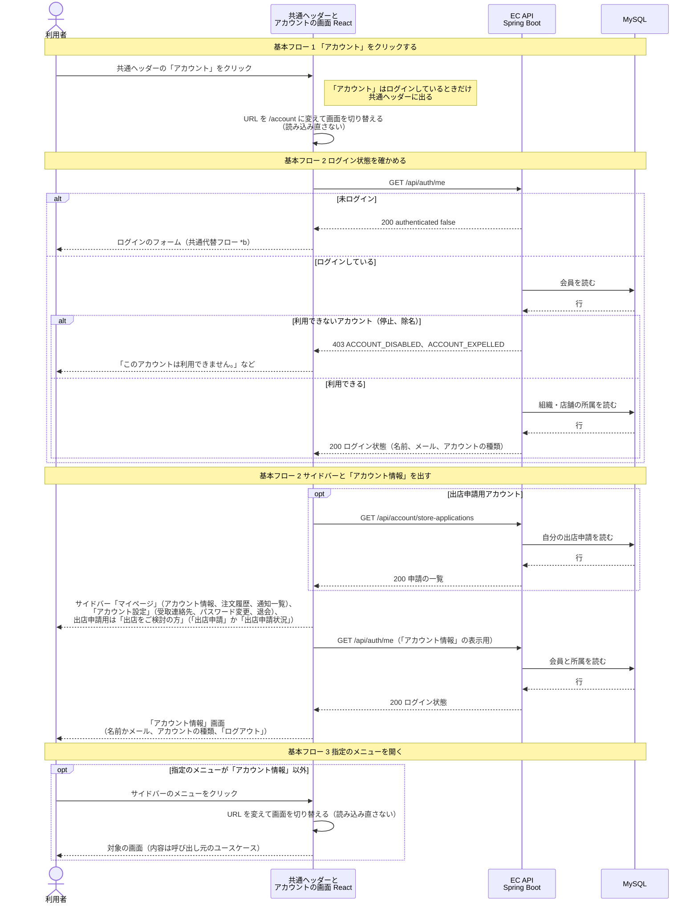
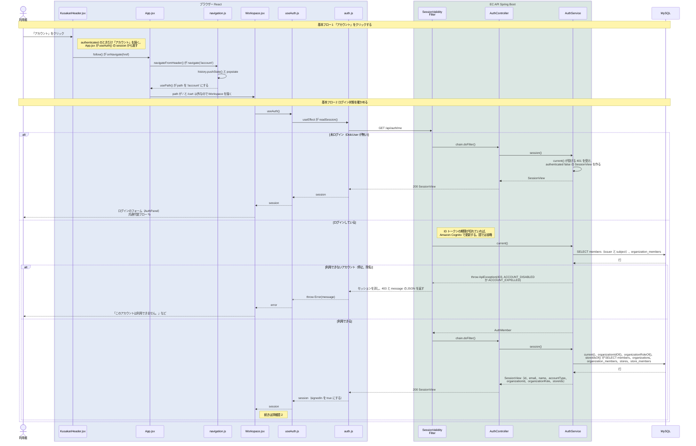
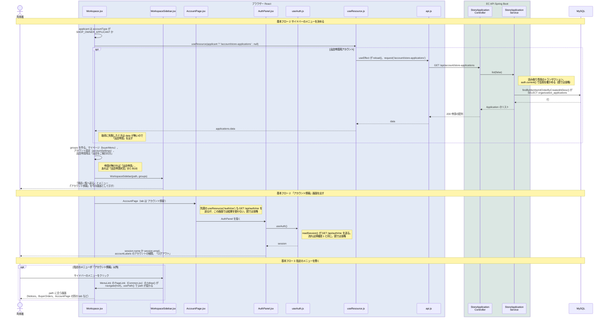

# EC-C01 アカウントのメニューを開く

- ユースケース記述: [EC-C01_アカウントのメニューを開く](<../../アーカイブ/ユースケース/kusakari-ec/EC-C01_アカウントのメニューを開く.md>)
- 対象のコード: kusakari-ec の main（19a2be3、2026-11-20 時点）

EC の画面は 1 つの React アプリです。共通ヘッダーの「アカウント」をクリックしても画面は読み込み直さず、URL を `/account` に変えて `Workspace` に切り替えます。`useAuth()` を使うコンポーネントは、作られるたびに `GET /api/auth/me` を送ります。メイン画面から移ったときは `Workspace` と `AuthPanel` が新しく作られるので、この 2 か所が送ります。詳細図は、画面の切り替えとログイン状態の確認（詳細図 1）と、メニューと「アカウント情報」の表示（詳細図 2）に分けました。

## 概要図

## 詳細図 1 基本フロー 1〜2 画面を切り替え、ログイン状態を確かめる

## 詳細図 2 基本フロー 2〜3 サイドバーと「アカウント情報」を出す

## ユースケース記述との差

- 関連情報では「アカウント情報」画面にメールアドレスを表示するとしています。コードは `session.name || session.email`（名前、無ければメールアドレス）を表示します。
- アカウントの種類の表示は、出店者（オーナー）、出店者（スタッフ）、出店申請用アカウント、管理者の 4 つです（`accountLabels`）。購入者（`USER`）は「利用者」と表示します。
- サイドバーの先頭に「商品一覧へ戻る」があります。記述にありません。
- `AccountPage` は「アカウント情報」のときも `useResource('/auth/me')` で `GET /api/auth/me` を送りますが、結果を使いません。記述にない通信です。
- 停止・除名されたアカウントは、`GET /api/auth/me` が 403 になり、画面にそのメッセージを出します。記述にない分岐です。

## 参照したコード

- [packages/site-header/KusakariHeader.jsx](https://github.com/abeouga/kusakari-ec/blob/19a2be307ee71a2cd87e538236c3c8c42929c5b3/packages/site-header/KusakariHeader.jsx): `KusakariHeader`、`follow`（「アカウント」は `authenticated` のときだけ）
- [frontend/src/App.jsx](https://github.com/abeouga/kusakari-ec/blob/19a2be307ee71a2cd87e538236c3c8c42929c5b3/frontend/src/App.jsx): `navigateFromHeader`、`workspace` の判定と `Workspace`
- [frontend/src/workspace/navigation.js](https://github.com/abeouga/kusakari-ec/blob/19a2be307ee71a2cd87e538236c3c8c42929c5b3/frontend/src/workspace/navigation.js): `navigate`、`usePath`、`currentPath`
- [frontend/src/workspace/Workspace.jsx](https://github.com/abeouga/kusakari-ec/blob/19a2be307ee71a2cd87e538236c3c8c42929c5b3/frontend/src/workspace/Workspace.jsx): `Workspace`（`buyerMenu`、`accountSettings`、`applicationLink`、未ログインの `AuthPanel`）
- [frontend/src/workspace/WorkspaceSidebar.jsx](https://github.com/abeouga/kusakari-ec/blob/19a2be307ee71a2cd87e538236c3c8c42929c5b3/frontend/src/workspace/WorkspaceSidebar.jsx): `WorkspaceSidebar`、`MenuLink`
- [frontend/src/workspace/Common.jsx](https://github.com/abeouga/kusakari-ec/blob/19a2be307ee71a2cd87e538236c3c8c42929c5b3/frontend/src/workspace/Common.jsx): `PageLink`
- [frontend/src/workspace/AccountPage.jsx](https://github.com/abeouga/kusakari-ec/blob/19a2be307ee71a2cd87e538236c3c8c42929c5b3/frontend/src/workspace/AccountPage.jsx): `AccountPage`、`accountActions`
- [frontend/src/components/AuthPanel.jsx](https://github.com/abeouga/kusakari-ec/blob/19a2be307ee71a2cd87e538236c3c8c42929c5b3/frontend/src/components/AuthPanel.jsx): `AuthPanel`、`accountLabels`
- [frontend/src/useAuth.js](https://github.com/abeouga/kusakari-ec/blob/19a2be307ee71a2cd87e538236c3c8c42929c5b3/frontend/src/useAuth.js): `useAuth`
- [frontend/src/auth.js](https://github.com/abeouga/kusakari-ec/blob/19a2be307ee71a2cd87e538236c3c8c42929c5b3/frontend/src/auth.js): `readSession`
- [frontend/src/workspace/useResource.js](https://github.com/abeouga/kusakari-ec/blob/19a2be307ee71a2cd87e538236c3c8c42929c5b3/frontend/src/workspace/useResource.js): `useResource`、`reload`
- [frontend/src/api.js](https://github.com/abeouga/kusakari-ec/blob/19a2be307ee71a2cd87e538236c3c8c42929c5b3/frontend/src/api.js): `request`
- [frontend/src/workspace/StoreApplication.jsx](https://github.com/abeouga/kusakari-ec/blob/19a2be307ee71a2cd87e538236c3c8c42929c5b3/frontend/src/workspace/StoreApplication.jsx): `applicationPaths`
- [backend/src/main/java/jp/kusakari/ec/auth/SessionValidityFilter.java](https://github.com/abeouga/kusakari-ec/blob/19a2be307ee71a2cd87e538236c3c8c42929c5b3/backend/src/main/java/jp/kusakari/ec/auth/SessionValidityFilter.java): `doFilterInternal`、`renewIdToken`
- [backend/src/main/java/jp/kusakari/ec/auth/AuthController.java](https://github.com/abeouga/kusakari-ec/blob/19a2be307ee71a2cd87e538236c3c8c42929c5b3/backend/src/main/java/jp/kusakari/ec/auth/AuthController.java): `me`
- [backend/src/main/java/jp/kusakari/ec/auth/AuthService.java](https://github.com/abeouga/kusakari-ec/blob/19a2be307ee71a2cd87e538236c3c8c42929c5b3/backend/src/main/java/jp/kusakari/ec/auth/AuthService.java): `session`、`current`、`organizationIdOf`、`organizationRoleOf`、`storeIdsOf`
- [backend/src/main/java/jp/kusakari/ec/store/controller/StoreApplicationController.java](https://github.com/abeouga/kusakari-ec/blob/19a2be307ee71a2cd87e538236c3c8c42929c5b3/backend/src/main/java/jp/kusakari/ec/store/controller/StoreApplicationController.java): `mine`
- [backend/src/main/java/jp/kusakari/ec/store/service/StoreApplicationService.java](https://github.com/abeouga/kusakari-ec/blob/19a2be307ee71a2cd87e538236c3c8c42929c5b3/backend/src/main/java/jp/kusakari/ec/store/service/StoreApplicationService.java): `list`
