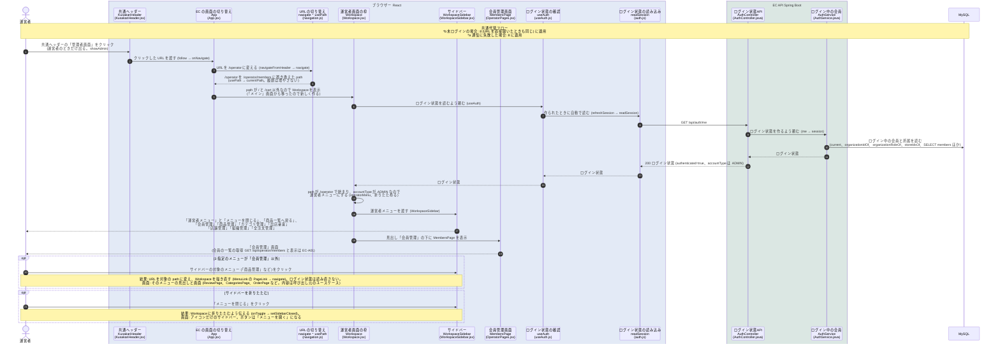
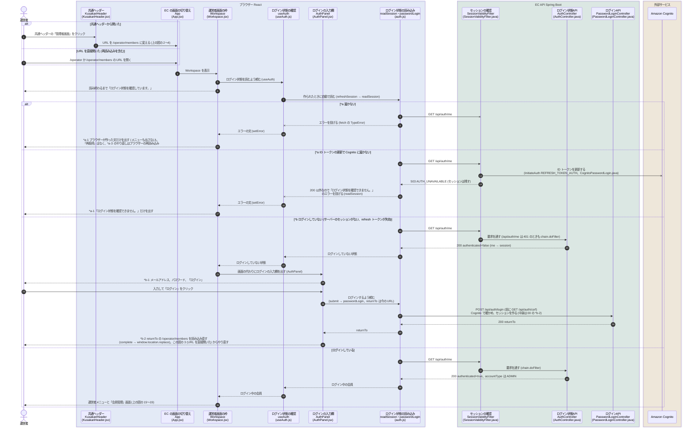

# EC-C02 管理者画面のメニューを開く

- ユースケース記述: [EC-C02_管理者画面のメニューを開く](<../../アーカイブ/ユースケース/kusakari-ec/EC-C02_管理者画面のメニューを開く.md>)
- 共通代替フロー: [00_全ユースケース共通の代替フロー](<00_全ユースケース共通の代替フロー.md>)
- 対象のコード: kusakari-ec の main（6bad7e3、2026-11-24 時点）

## シーケンス図

参加者は、上から「画面や役割の名前」「コンポーネント・クラスの名前」「ファイル名（かっこ付き）」の順に書いています。
EC の画面は 1 つの React アプリで、「管理者画面」をクリックしても読み込み直しません。「メイン」画面から移ると `Workspace` が新しく作られるので、その `useAuth` がログイン状態を `GET /api/auth/me` で読み直します。共通代替フローの中身は、00 の図か、下の「共通代替フローを直接書いた図」を見てください。
代替フローのうち、画面の中だけで終わるもの（3 の「会員管理」以外のメニュー、サイドバーの折りたたみ）は、クリックの矢印 1 本だけを描き、結果と画面は Note に文で書いています。

## 共通代替フローを直接書いた図

上の図の `GET /api/auth/me`（上の図の 8）に、この画面で起こる共通代替フロー（\*a、\*b）を書き込んだ図です。URL（`/operator` や `/operator/members`）を直接開いたときも、`Workspace` が作られて同じ流れになります。サイドバーのメニューのクリックと折りたたみは通信しないので、共通代替フローは起こりません。会員の一覧の通信（`GET /api/operator/members`）の \*a・\*b は EC-A01 で扱うので省いています。

## ユースケース記述との差

- 関連情報は共通代替フロー \*b だけを挙げていますが、`GET /api/auth/me` には \*a も起こります。このときは `api.js` を通らないので、\*a-1 の共通の文（「サーバーに接続できません。…」）にはならず、ブラウザーが作った文か「ログイン状態を確認できません。」だけが出ます。「再取得」のボタンはなく、やり直すにはブラウザーで再読み込みします。
- サイドバーの先頭に「商品一覧へ戻る」があります。記述にありません。
- 基本フロー 2: `navigation.js` の `currentPath()` が `/operator` を `/operator/members` に置き換えるので、最初に「会員管理」画面が出ます。履歴は増やさないので、ブラウザーの「戻る」で `/operator` には戻りません。
- 運営者以外が運営者画面の URL を開いたときの「この画面を利用する権限がありません。」は、画面（`Workspace`）が `accountType` で決めます。このとき運営者用の API は送りません。事前条件が運営者のログインなので、図には書いていません。
- 「管理者画面」を、マイページなど `Workspace` の画面から押したときは、`Workspace` が作り直されないので、`GET /api/auth/me` を送りません。記述の事前条件（「メイン」画面など）に合わせて、図は「メイン」画面から押したときを書いています。
- 停止・除名されたアカウントで `GET /api/auth/me` が 403 になったときは、`readSession()` がその文（「このアカウントは利用できません。」など）を投げ、`Workspace` がその文だけを出します。共通代替フローではないので、図には書いていません。

## 参照したコード

- [packages/site-header/KusakariHeader.jsx](https://github.com/abeouga/kusakari-ec/blob/6bad7e37c4135034fbe97e30309772fbe872e675/packages/site-header/KusakariHeader.jsx): `KusakariHeader`、`follow`（「管理者画面」は `showAdmin` のときだけ）
- [frontend/src/App.jsx](https://github.com/abeouga/kusakari-ec/blob/6bad7e37c4135034fbe97e30309772fbe872e675/frontend/src/App.jsx): `navigateFromHeader`、`showAdmin` の判定、`Workspace` の表示
- [frontend/src/workspace/navigation.js](https://github.com/abeouga/kusakari-ec/blob/6bad7e37c4135034fbe97e30309772fbe872e675/frontend/src/workspace/navigation.js): `navigate`、`usePath`、`currentPath`（`/operator` の置き換え）
- [frontend/src/workspace/Workspace.jsx](https://github.com/abeouga/kusakari-ec/blob/6bad7e37c4135034fbe97e30309772fbe872e675/frontend/src/workspace/Workspace.jsx): `Workspace`（`operatorMenu`、権限の判定、未ログインの `AuthPanel`、`error` の表示、`setSidebarClosed`、`title`）
- [frontend/src/workspace/WorkspaceSidebar.jsx](https://github.com/abeouga/kusakari-ec/blob/6bad7e37c4135034fbe97e30309772fbe872e675/frontend/src/workspace/WorkspaceSidebar.jsx): `WorkspaceSidebar`、`MenuLink`、`onToggle`
- [frontend/src/workspace/Common.jsx](https://github.com/abeouga/kusakari-ec/blob/6bad7e37c4135034fbe97e30309772fbe872e675/frontend/src/workspace/Common.jsx): `PageLink`
- [frontend/src/workspace/OperatorPages.jsx](https://github.com/abeouga/kusakari-ec/blob/6bad7e37c4135034fbe97e30309772fbe872e675/frontend/src/workspace/OperatorPages.jsx): `MembersPage`
- [frontend/src/useAuth.js](https://github.com/abeouga/kusakari-ec/blob/6bad7e37c4135034fbe97e30309772fbe872e675/frontend/src/useAuth.js): `useAuth`（`refreshSession`）
- [frontend/src/auth.js](https://github.com/abeouga/kusakari-ec/blob/6bad7e37c4135034fbe97e30309772fbe872e675/frontend/src/auth.js): `readSession`、`passwordLogin`
- [frontend/src/components/AuthPanel.jsx](https://github.com/abeouga/kusakari-ec/blob/6bad7e37c4135034fbe97e30309772fbe872e675/frontend/src/components/AuthPanel.jsx): `AuthPanel`（`submit`、`complete`）
- [backend/src/main/java/jp/kusakari/ec/auth/AuthController.java](https://github.com/abeouga/kusakari-ec/blob/6bad7e37c4135034fbe97e30309772fbe872e675/backend/src/main/java/jp/kusakari/ec/auth/AuthController.java): `me`
- [backend/src/main/java/jp/kusakari/ec/auth/AuthService.java](https://github.com/abeouga/kusakari-ec/blob/6bad7e37c4135034fbe97e30309772fbe872e675/backend/src/main/java/jp/kusakari/ec/auth/AuthService.java): `session`、`current`、`organizationIdOf`、`organizationRoleOf`、`storeIdsOf`
- [backend/src/main/java/jp/kusakari/ec/auth/PasswordLoginController.java](https://github.com/abeouga/kusakari-ec/blob/6bad7e37c4135034fbe97e30309772fbe872e675/backend/src/main/java/jp/kusakari/ec/auth/PasswordLoginController.java): `POST /api/auth/login`
- [backend/src/main/java/jp/kusakari/ec/auth/SessionValidityFilter.java](https://github.com/abeouga/kusakari-ec/blob/6bad7e37c4135034fbe97e30309772fbe872e675/backend/src/main/java/jp/kusakari/ec/auth/SessionValidityFilter.java): `doFilterInternal`（ID トークンの更新、`/api/auth/me` は 401 でも通す、503 のときはセッションを残す）
- [backend/src/main/java/jp/kusakari/ec/auth/CognitoPasswordLogin.java](https://github.com/abeouga/kusakari-ec/blob/6bad7e37c4135034fbe97e30309772fbe872e675/backend/src/main/java/jp/kusakari/ec/auth/CognitoPasswordLogin.java): ID トークンの更新、503 `AUTH_UNAVAILABLE`
