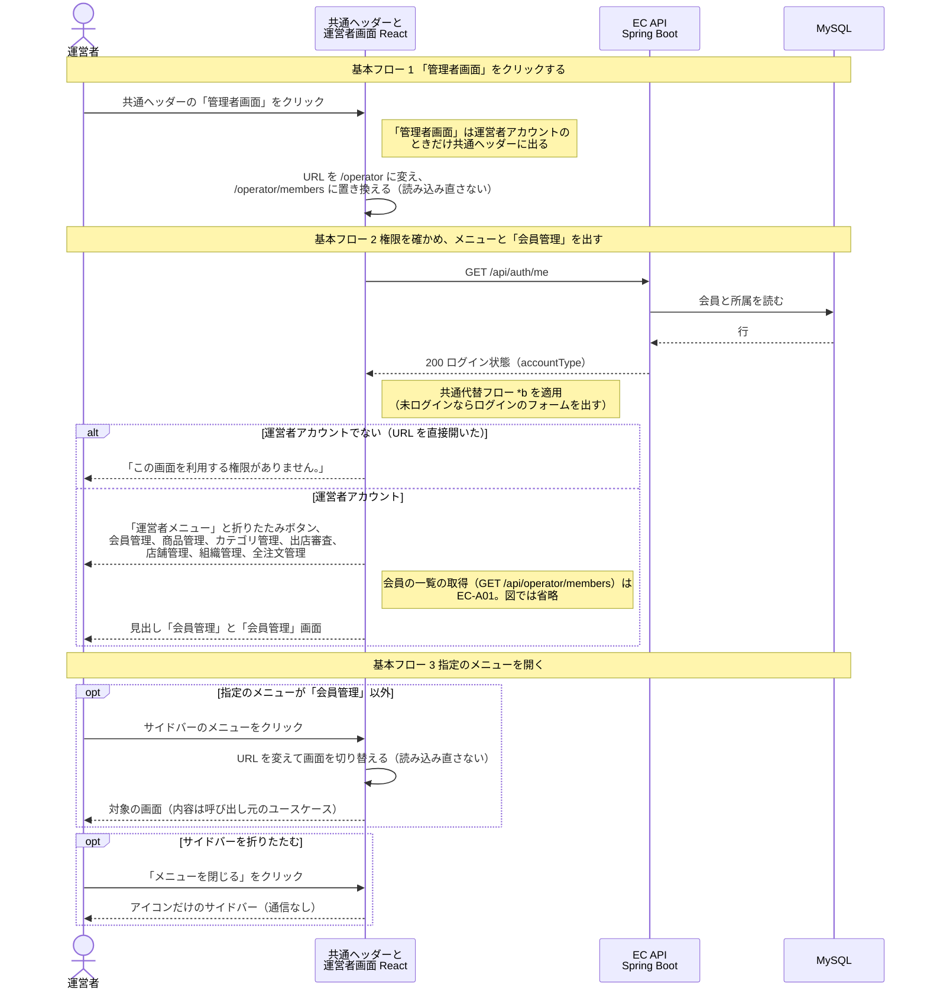
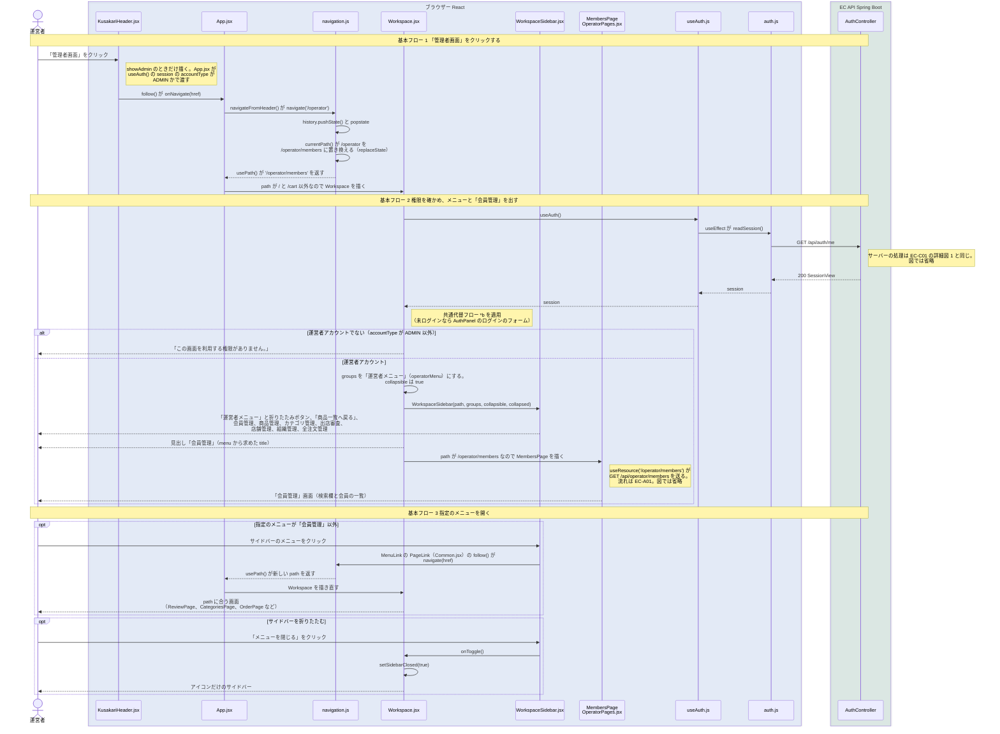

# EC-C02 管理者画面のメニューを開く

- ユースケース記述: [EC-C02_管理者画面のメニューを開く](<../../アーカイブ/ユースケース/kusakari-ec/EC-C02_管理者画面のメニューを開く.md>)
- 対象のコード: kusakari-ec の main（19a2be3、2026-11-20 時点）

共通ヘッダーの「管理者画面」は `/operator` を開きます。`navigation.js` の `currentPath()` が、履歴を増やさずに `/operator` を `/operator/members` に置き換えるので、最初に「会員管理」画面が出ます。画面は読み込み直さず、`Workspace` が運営者かどうかを確かめてメニューを出します。`GET /api/auth/me` のサーバーの処理は [EC-C01 の詳細図 1](<EC-C01_アカウントのメニューを開く.md>) と同じなので、この図では省略します。

## 概要図

## 詳細図

## ユースケース記述との差

- サイドバーの先頭に「商品一覧へ戻る」があります。記述にありません。
- 運営者以外が運営者画面の URL を開いたときの「この画面を利用する権限がありません。」は、画面（`Workspace`）が `accountType` で判断します。このときサーバーには運営者用の API を送りません。

## 参照したコード

- [packages/site-header/KusakariHeader.jsx](https://github.com/abeouga/kusakari-ec/blob/19a2be307ee71a2cd87e538236c3c8c42929c5b3/packages/site-header/KusakariHeader.jsx): `KusakariHeader`、`follow`（「管理者画面」は `showAdmin` のときだけ）
- [frontend/src/App.jsx](https://github.com/abeouga/kusakari-ec/blob/19a2be307ee71a2cd87e538236c3c8c42929c5b3/frontend/src/App.jsx): `navigateFromHeader`、`showAdmin` の判定、`Workspace`
- [frontend/src/workspace/navigation.js](https://github.com/abeouga/kusakari-ec/blob/19a2be307ee71a2cd87e538236c3c8c42929c5b3/frontend/src/workspace/navigation.js): `navigate`、`usePath`、`currentPath`（`/operator` の置き換え）
- [frontend/src/workspace/Workspace.jsx](https://github.com/abeouga/kusakari-ec/blob/19a2be307ee71a2cd87e538236c3c8c42929c5b3/frontend/src/workspace/Workspace.jsx): `Workspace`（`operatorMenu`、権限の判定、`setSidebarClosed`）
- [frontend/src/workspace/WorkspaceSidebar.jsx](https://github.com/abeouga/kusakari-ec/blob/19a2be307ee71a2cd87e538236c3c8c42929c5b3/frontend/src/workspace/WorkspaceSidebar.jsx): `WorkspaceSidebar`、`MenuLink`、`onToggle`
- [frontend/src/workspace/Common.jsx](https://github.com/abeouga/kusakari-ec/blob/19a2be307ee71a2cd87e538236c3c8c42929c5b3/frontend/src/workspace/Common.jsx): `PageLink`
- [frontend/src/workspace/OperatorPages.jsx](https://github.com/abeouga/kusakari-ec/blob/19a2be307ee71a2cd87e538236c3c8c42929c5b3/frontend/src/workspace/OperatorPages.jsx): `MembersPage`
- [frontend/src/useAuth.js](https://github.com/abeouga/kusakari-ec/blob/19a2be307ee71a2cd87e538236c3c8c42929c5b3/frontend/src/useAuth.js): `useAuth`
- [frontend/src/auth.js](https://github.com/abeouga/kusakari-ec/blob/19a2be307ee71a2cd87e538236c3c8c42929c5b3/frontend/src/auth.js): `readSession`
- [backend/src/main/java/jp/kusakari/ec/auth/AuthController.java](https://github.com/abeouga/kusakari-ec/blob/19a2be307ee71a2cd87e538236c3c8c42929c5b3/backend/src/main/java/jp/kusakari/ec/auth/AuthController.java): `me`
