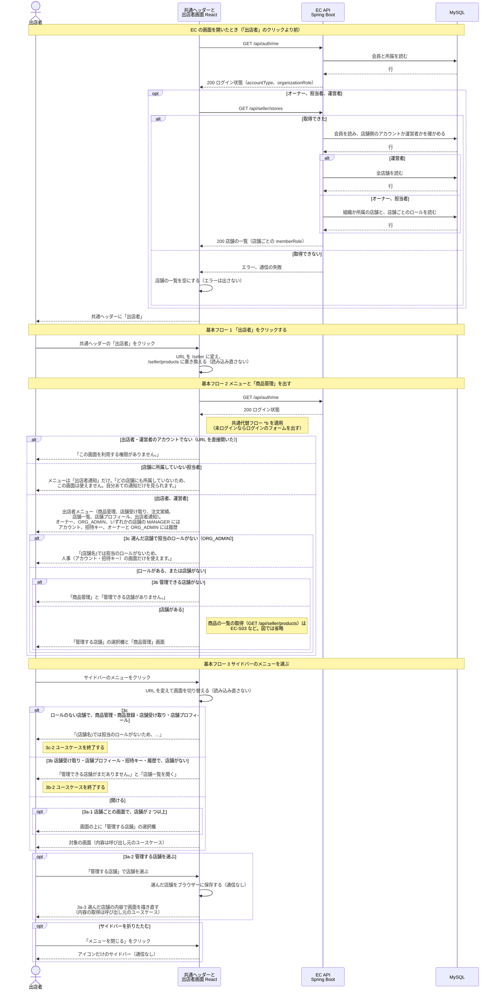
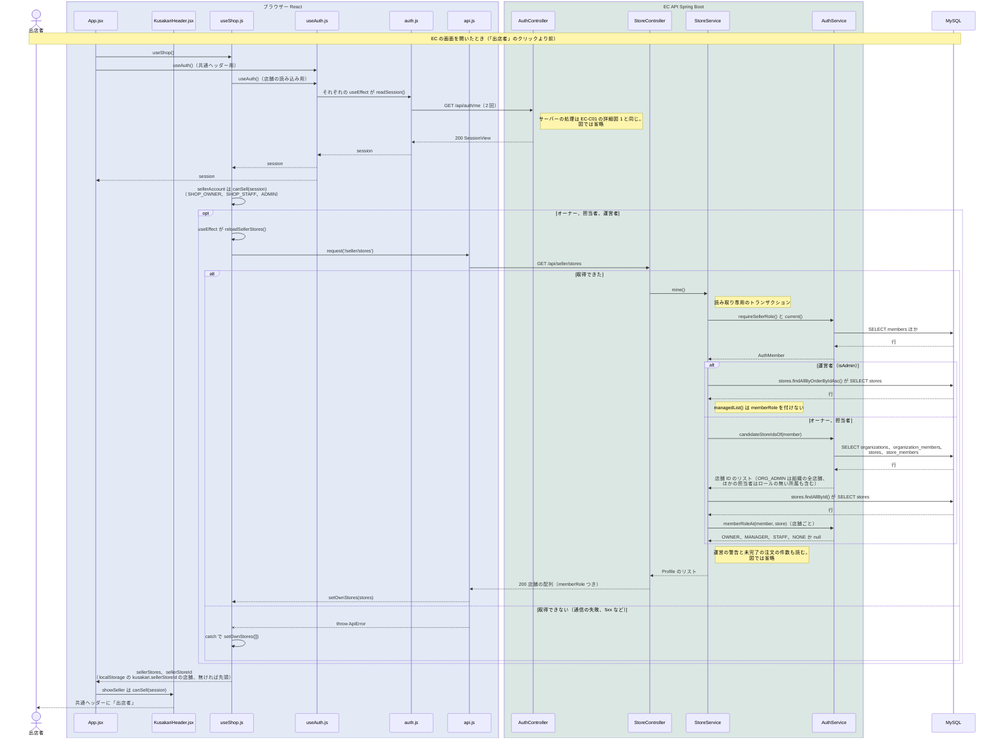
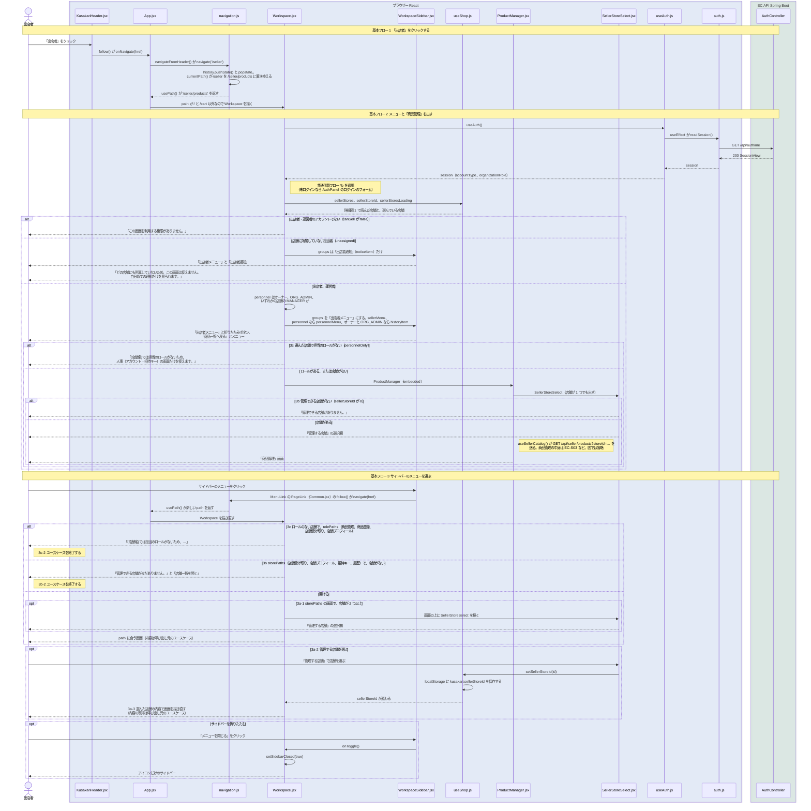

# EC-C03 出店者画面のメニューを開く

- ユースケース記述: [EC-C03_出店者画面のメニューを開く](<../../アーカイブ/ユースケース/kusakari-ec/EC-C03_出店者画面のメニューを開く.md>)
- 対象のコード: kusakari-ec の main（19a2be3、2026-11-20 時点）

出店者が扱える店舗の一覧（`GET /api/seller/stores`）は、「出店者」をクリックする前、EC の画面を開いたときに `useShop` が読み込みます。「出店者」をクリックしても画面は読み込み直さず、`navigation.js` の `currentPath()` が `/seller` を `/seller/products` に置き換えるので、最初に「商品管理」画面が出ます。代替フロー 3a〜3c は、読み込み済みの店舗の一覧と、店舗ごとのロール（`memberRole`）で画面が決めます。詳細図は、EC の画面を開いたときの読み込み（詳細図 1）と、メニューと画面の表示（詳細図 2）に分けました。`GET /api/auth/me` のサーバーの処理は [EC-C01 の詳細図 1](<EC-C01_アカウントのメニューを開く.md>) と同じなので、この図では省略します。

## 概要図

## 詳細図 1 EC の画面を開いたときの読み込み

## 詳細図 2 基本フロー 1〜3 メニューと画面を出す

## ユースケース記述との差

- 基本フロー 2：オーナーと ORG_ADMIN には、「アカウント」「招待キー」のほかに「履歴」（`/seller/member-events`）も表示します。記述にありません。
- 3a：「商品管理」では、店舗が 1 つでも「管理する店舗」の選択欄を出します（`ProductManager` の `SellerStoreSelect`）。ほかの画面は店舗が 2 つ以上のときだけです。選択欄を出す画面には「履歴」も含みます。
- 3b：「管理できる店舗がまだありません。」と「店舗一覧を開く」を出すのは、「店舗受け取り」「店舗プロフィール」「招待キー」「履歴」です。「商品管理」は選択欄の位置に「管理できる店舗がありません。」を出します。「注文実績」は `SalesPage` が `GET /api/seller/sales/stores` で読める店舗を決めます。
- 3b：記述は「担当の店舗がない担当者」にも「管理できる店舗がまだありません。」を出すとしています。コードでは、どの店舗にも所属していない担当者（ORG_ADMIN を除く）は、メニューが「出店者通知」だけになり、「どの店舗にも所属していないため、この画面は使えません。自分あての通知だけを見られます。」を出します。
- 3c：「注文実績」は、3c の表示より先に `SalesPage` を出す分岐があるので、ロールの無い店舗を選んでも 3c の文言は出ません。3c の文言は「商品登録」（`/seller/products/new`）でも出ます。
- `GET /api/seller/stores` に失敗すると、画面は店舗の一覧を空として扱い、通信エラーを出しません（`reloadSellerStores` の `catch`）。3b と同じ表示になり、共通代替フロー *a の「通信エラーを表示する」と違います。
- サイドバーの先頭に「商品一覧へ戻る」があります。記述にありません。

## 参照したコード

- [packages/site-header/KusakariHeader.jsx](https://github.com/abeouga/kusakari-ec/blob/19a2be307ee71a2cd87e538236c3c8c42929c5b3/packages/site-header/KusakariHeader.jsx): `KusakariHeader`、`follow`（「出店者」は `showSeller` のときだけ）
- [frontend/src/App.jsx](https://github.com/abeouga/kusakari-ec/blob/19a2be307ee71a2cd87e538236c3c8c42929c5b3/frontend/src/App.jsx): `navigateFromHeader`、`showSeller`、`Workspace`
- [frontend/src/auth.js](https://github.com/abeouga/kusakari-ec/blob/19a2be307ee71a2cd87e538236c3c8c42929c5b3/frontend/src/auth.js): `canSell`、`readSession`
- [frontend/src/useAuth.js](https://github.com/abeouga/kusakari-ec/blob/19a2be307ee71a2cd87e538236c3c8c42929c5b3/frontend/src/useAuth.js): `useAuth`
- [frontend/src/useShop.js](https://github.com/abeouga/kusakari-ec/blob/19a2be307ee71a2cd87e538236c3c8c42929c5b3/frontend/src/useShop.js): `reloadSellerStores`、`setSellerStoreId`、`savedStoreChoice`、`sellerStores`、`sellerStoreId`、`sellerStoresLoading`
- [frontend/src/api.js](https://github.com/abeouga/kusakari-ec/blob/19a2be307ee71a2cd87e538236c3c8c42929c5b3/frontend/src/api.js): `request`
- [frontend/src/workspace/navigation.js](https://github.com/abeouga/kusakari-ec/blob/19a2be307ee71a2cd87e538236c3c8c42929c5b3/frontend/src/workspace/navigation.js): `navigate`、`usePath`、`currentPath`（`/seller` の置き換え）
- [frontend/src/workspace/Workspace.jsx](https://github.com/abeouga/kusakari-ec/blob/19a2be307ee71a2cd87e538236c3c8c42929c5b3/frontend/src/workspace/Workspace.jsx): `sellerMenu`、`personnelMenu`、`historyItem`、`storePaths`、`rolePaths`、`unassigned`、`personnelOnly`、`personnel`
- [frontend/src/workspace/WorkspaceSidebar.jsx](https://github.com/abeouga/kusakari-ec/blob/19a2be307ee71a2cd87e538236c3c8c42929c5b3/frontend/src/workspace/WorkspaceSidebar.jsx): `WorkspaceSidebar`、`MenuLink`
- [frontend/src/workspace/Common.jsx](https://github.com/abeouga/kusakari-ec/blob/19a2be307ee71a2cd87e538236c3c8c42929c5b3/frontend/src/workspace/Common.jsx): `PageLink`
- [frontend/src/components/ProductManager.jsx](https://github.com/abeouga/kusakari-ec/blob/19a2be307ee71a2cd87e538236c3c8c42929c5b3/frontend/src/components/ProductManager.jsx): `ProductManager`
- [frontend/src/components/SellerStoreSelect.jsx](https://github.com/abeouga/kusakari-ec/blob/19a2be307ee71a2cd87e538236c3c8c42929c5b3/frontend/src/components/SellerStoreSelect.jsx): `SellerStoreSelect`
- [frontend/src/workspace/SalesReport.jsx](https://github.com/abeouga/kusakari-ec/blob/19a2be307ee71a2cd87e538236c3c8c42929c5b3/frontend/src/workspace/SalesReport.jsx): `SalesPage`
- [backend/src/main/java/jp/kusakari/ec/store/controller/StoreController.java](https://github.com/abeouga/kusakari-ec/blob/19a2be307ee71a2cd87e538236c3c8c42929c5b3/backend/src/main/java/jp/kusakari/ec/store/controller/StoreController.java): `mine`
- [backend/src/main/java/jp/kusakari/ec/store/service/StoreService.java](https://github.com/abeouga/kusakari-ec/blob/19a2be307ee71a2cd87e538236c3c8c42929c5b3/backend/src/main/java/jp/kusakari/ec/store/service/StoreService.java): `mine`、`managedList`、`withOpenOrders`、`withRole`
- [backend/src/main/java/jp/kusakari/ec/auth/AuthService.java](https://github.com/abeouga/kusakari-ec/blob/19a2be307ee71a2cd87e538236c3c8c42929c5b3/backend/src/main/java/jp/kusakari/ec/auth/AuthService.java): `requireSellerRole`、`current`、`candidateStoreIdsOf`、`memberRoleAt`
- [backend/src/main/java/jp/kusakari/ec/auth/AuthController.java](https://github.com/abeouga/kusakari-ec/blob/19a2be307ee71a2cd87e538236c3c8c42929c5b3/backend/src/main/java/jp/kusakari/ec/auth/AuthController.java): `me`
