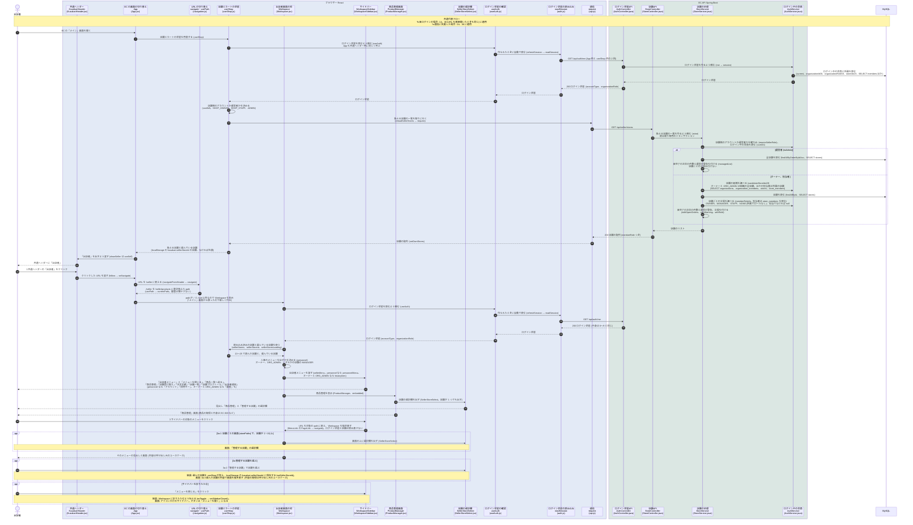
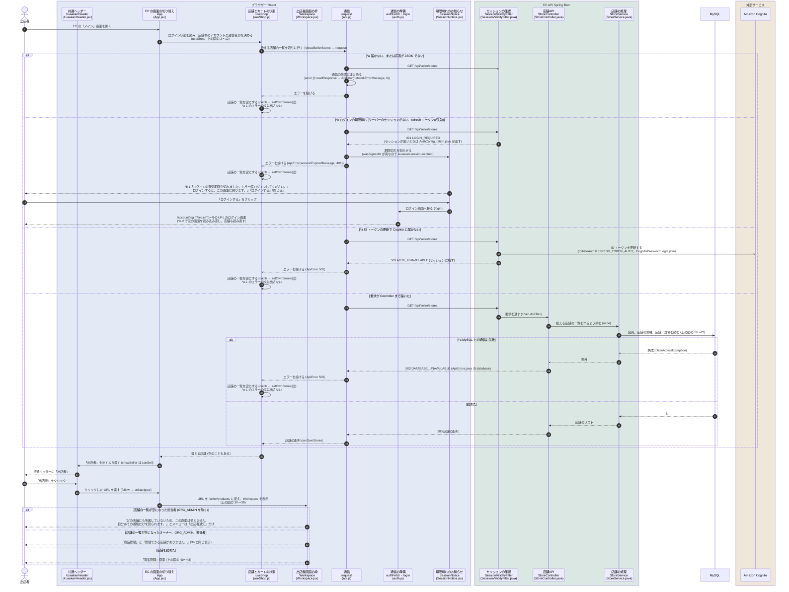

# EC-C03 出店者画面のメニューを開く

- ユースケース記述: [EC-C03_出店者画面のメニューを開く](<../../アーカイブ/ユースケース/kusakari-ec/EC-C03_出店者画面のメニューを開く.md>)
- 共通代替フロー: [00_全ユースケース共通の代替フロー](<00_全ユースケース共通の代替フロー.md>)
- 対象のコード: kusakari-ec の main（6bad7e3、2026-11-24 時点）

## シーケンス図

参加者は、上から「画面や役割の名前」「コンポーネント・クラスの名前」「ファイル名（かっこ付き）」の順に書いています。
出店者が扱える店舗の一覧（`GET /api/seller/stores`）は、「出店者」をクリックする前、EC の画面を開いたときに `useShop` が読み込みます。「出店者」をクリックしても画面は読み込み直さず、`Workspace` がログイン状態だけを `GET /api/auth/me` で読み直します。代替フロー 3a〜3c は、読み込み済みの店舗の一覧と、店舗ごとの立場（`memberRole`）で画面が決めます。共通代替フローの中身は、00 の図か、下の「共通代替フローを直接書いた図」を見てください。
エラーの代替フローは描かず、図の下に並べています。3a（管理する店舗を選ぶ）とサイドバーの折りたたみは、操作の矢印 1 本と Note にまとめています。

図に描いていない代替フロー：3b（管理できる店舗がない）、3c（担当のロールがない）、（記述なし）の分岐

## 共通代替フローを直接書いた図

上の図の `GET /api/seller/stores`（上の図の 14）に、この画面で起こる共通代替フロー（\*a、\*b）を書き込んだ図です。「出店者」をクリックした後の `GET /api/auth/me`（上の図の 36）の \*a・\*b は、[EC-C02](<EC-C02_管理者画面のメニューを開く.md>) の「共通代替フローを直接書いた図」と同じなので省いています（`/operator/members` を `/seller/products` に読み替え）。サイドバーのメニューのクリック、店舗の選択、折りたたみは通信しないので、共通代替フローは起こりません。

`GET /api/seller/stores` が失敗しても、画面は通信のエラーを出さず、店舗の一覧を空として扱います。

## ユースケース記述との差

- 関連情報は共通代替フロー \*b だけを挙げていますが、`GET /api/seller/stores` と `GET /api/auth/me` には \*a も起こります。`GET /api/seller/stores` が失敗すると、画面は店舗の一覧を空として扱い、通信のエラーを出しません（`reloadSellerStores` の `catch`）。オーナー・ORG_ADMIN・運営者には 3b と同じ「管理できる店舗がありません。」が、ほかの担当者には「どの店舗にも所属していないため、この画面は使えません。…」が出ます。「再取得」はなく、やり直すにはブラウザーで再読み込みします。
- 基本フロー 2: オーナーと ORG_ADMIN には、「アカウント」「招待キー」のほかに「履歴」（`/seller/member-events`）も出します。記述にありません。
- 基本フロー 2: 運営者（ADMIN）も出店者画面を開けます（`canSell`）。運営者には全店舗が出て、店舗ごとの立場を付けないので、人事のメニュー（「アカウント」「招待キー」）は出ません。記述のアクターは出店者だけです。
- 3a: 「商品管理」では、店舗が 1 つでも「管理する店舗」の選択欄を出します（`ProductManager` の `SellerStoreSelect`）。ほかの画面は店舗が 2 つ以上のときだけです。選択欄を出す画面には「履歴」も含みます。
- 3b: 「管理できる店舗がまだありません。」と「店舗一覧を開く」を出すのは、「店舗受け取り」「店舗プロフィール」「招待キー」「履歴」です。「商品管理」は選択欄の位置に「管理できる店舗がありません。」を出します。「注文実績」は `SalesPage` が `GET /api/seller/sales/stores` で読める店舗を決めます。
- 3b: 記述は「担当の店舗がない担当者」にも「管理できる店舗がまだありません。」を出すとしています。コードでは、どの店舗にも所属していない担当者（ORG_ADMIN を除く）は、メニューが「出店者通知」だけになり、「どの店舗にも所属していないため、この画面は使えません。自分あての通知だけを見られます。」を出します。
- 3c: 「注文実績」は、3c の表示より先に `SalesPage` を出す分岐があるので、ロールのない店舗を選んでも 3c の文は出ません。3c の文は「商品登録」（`/seller/products/new`）でも出ます。3c になるのは立場が null の店舗（ORG_ADMIN の、担当していない店舗）だけで、所属していてロールのない担当者（`NONE`）は 3c になりません。
- 3a-2: 選んだ店舗は `localStorage` に保存します。保存できないブラウザーでは、再読み込みまでの間だけ覚えます。
- サイドバーの先頭に「商品一覧へ戻る」があります。記述にありません。
- 出店者・運営者のアカウントでない人が出店者画面の URL を開いたときの「この画面を利用する権限がありません。」は、画面（`Workspace`）が `canSell` で決めます。事前条件で外したので、図には書いていません。

## 参照したコード

- [packages/site-header/KusakariHeader.jsx](https://github.com/abeouga/kusakari-ec/blob/6bad7e37c4135034fbe97e30309772fbe872e675/packages/site-header/KusakariHeader.jsx): `KusakariHeader`、`follow`（「出店者」は `showSeller` のときだけ）
- [frontend/src/App.jsx](https://github.com/abeouga/kusakari-ec/blob/6bad7e37c4135034fbe97e30309772fbe872e675/frontend/src/App.jsx): `navigateFromHeader`、`showSeller`、`Workspace` の表示
- [frontend/src/auth.js](https://github.com/abeouga/kusakari-ec/blob/6bad7e37c4135034fbe97e30309772fbe872e675/frontend/src/auth.js): `canSell`、`readSession`、`wasSignedIn`、`login`
- [frontend/src/useAuth.js](https://github.com/abeouga/kusakari-ec/blob/6bad7e37c4135034fbe97e30309772fbe872e675/frontend/src/useAuth.js): `useAuth`（`refreshSession`）
- [frontend/src/useShop.js](https://github.com/abeouga/kusakari-ec/blob/6bad7e37c4135034fbe97e30309772fbe872e675/frontend/src/useShop.js): `reloadSellerStores`、`setSellerStoreId`、`savedStoreChoice`、`sellerStores`、`sellerStoreId`、`sellerStoresLoading`
- [frontend/src/api.js](https://github.com/abeouga/kusakari-ec/blob/6bad7e37c4135034fbe97e30309772fbe872e675/frontend/src/api.js): `request`、`send`、`readResponse`、`networkErrorMessage`、`sessionExpiredMessage`
- [frontend/src/workspace/navigation.js](https://github.com/abeouga/kusakari-ec/blob/6bad7e37c4135034fbe97e30309772fbe872e675/frontend/src/workspace/navigation.js): `navigate`、`usePath`、`currentPath`（`/seller` の置き換え）
- [frontend/src/workspace/Workspace.jsx](https://github.com/abeouga/kusakari-ec/blob/6bad7e37c4135034fbe97e30309772fbe872e675/frontend/src/workspace/Workspace.jsx): `sellerMenu`、`personnelMenu`、`historyItem`、`noticeItem`、`storePaths`、`rolePaths`、`unassigned`、`personnelOnly`、`personnel`、`setSidebarClosed`
- [frontend/src/workspace/WorkspaceSidebar.jsx](https://github.com/abeouga/kusakari-ec/blob/6bad7e37c4135034fbe97e30309772fbe872e675/frontend/src/workspace/WorkspaceSidebar.jsx): `WorkspaceSidebar`、`MenuLink`
- [frontend/src/workspace/Common.jsx](https://github.com/abeouga/kusakari-ec/blob/6bad7e37c4135034fbe97e30309772fbe872e675/frontend/src/workspace/Common.jsx): `PageLink`
- [frontend/src/components/ProductManager.jsx](https://github.com/abeouga/kusakari-ec/blob/6bad7e37c4135034fbe97e30309772fbe872e675/frontend/src/components/ProductManager.jsx): `ProductManager`、`ManagerFrame`
- [frontend/src/components/SellerStoreSelect.jsx](https://github.com/abeouga/kusakari-ec/blob/6bad7e37c4135034fbe97e30309772fbe872e675/frontend/src/components/SellerStoreSelect.jsx): `SellerStoreSelect`
- [frontend/src/components/SessionNotice.jsx](https://github.com/abeouga/kusakari-ec/blob/6bad7e37c4135034fbe97e30309772fbe872e675/frontend/src/components/SessionNotice.jsx): 期限切れのお知らせ
- [frontend/src/workspace/SalesReport.jsx](https://github.com/abeouga/kusakari-ec/blob/6bad7e37c4135034fbe97e30309772fbe872e675/frontend/src/workspace/SalesReport.jsx): `SalesPage`
- [backend/src/main/java/jp/kusakari/ec/store/controller/StoreController.java](https://github.com/abeouga/kusakari-ec/blob/6bad7e37c4135034fbe97e30309772fbe872e675/backend/src/main/java/jp/kusakari/ec/store/controller/StoreController.java): `mine`
- [backend/src/main/java/jp/kusakari/ec/store/service/StoreService.java](https://github.com/abeouga/kusakari-ec/blob/6bad7e37c4135034fbe97e30309772fbe872e675/backend/src/main/java/jp/kusakari/ec/store/service/StoreService.java): `mine`、`managedList`、`withOpenOrders`、`withWarning`、`withRole`
- [backend/src/main/java/jp/kusakari/ec/auth/AuthService.java](https://github.com/abeouga/kusakari-ec/blob/6bad7e37c4135034fbe97e30309772fbe872e675/backend/src/main/java/jp/kusakari/ec/auth/AuthService.java): `session`、`requireSellerRole`、`current`、`candidateStoreIdsOf`、`memberRoleAt`
- [backend/src/main/java/jp/kusakari/ec/auth/AuthController.java](https://github.com/abeouga/kusakari-ec/blob/6bad7e37c4135034fbe97e30309772fbe872e675/backend/src/main/java/jp/kusakari/ec/auth/AuthController.java): `me`
- [backend/src/main/java/jp/kusakari/ec/auth/SessionValidityFilter.java](https://github.com/abeouga/kusakari-ec/blob/6bad7e37c4135034fbe97e30309772fbe872e675/backend/src/main/java/jp/kusakari/ec/auth/SessionValidityFilter.java): `doFilterInternal`（ID トークンの更新、401、503 のときはセッションを残す）
- [backend/src/main/java/jp/kusakari/ec/auth/CognitoPasswordLogin.java](https://github.com/abeouga/kusakari-ec/blob/6bad7e37c4135034fbe97e30309772fbe872e675/backend/src/main/java/jp/kusakari/ec/auth/CognitoPasswordLogin.java): ID トークンの更新、503 `AUTH_UNAVAILABLE`
- [backend/src/main/java/jp/kusakari/ec/auth/AuthConfiguration.java](https://github.com/abeouga/kusakari-ec/blob/6bad7e37c4135034fbe97e30309772fbe872e675/backend/src/main/java/jp/kusakari/ec/auth/AuthConfiguration.java): `authenticationEntryPoint`（401 `LOGIN_REQUIRED`）
- [backend/src/main/java/jp/kusakari/ec/common/web/ApiErrors.java](https://github.com/abeouga/kusakari-ec/blob/6bad7e37c4135034fbe97e30309772fbe872e675/backend/src/main/java/jp/kusakari/ec/common/web/ApiErrors.java): `database`
