# EC-S02 店舗プロフィールを編集する

- ユースケース記述: [EC-S02_店舗プロフィールを編集する](<../../アーカイブ/ユースケース/kusakari-ec/EC-S02_店舗プロフィールを編集する.md>)
- 共通代替フロー: [00_全ユースケース共通の代替フロー](<00_全ユースケース共通の代替フロー.md>)
- 対象のコード: kusakari-ec の main（6bad7e3、2026-11-24 時点）

## シーケンス図

参加者は、上から「画面や役割の名前」「コンポーネント・クラスの名前」「ファイル名（かっこ付き）」の順に書いています。
共通代替フローの中身は、00 の図か、下の「共通代替フローを直接書いた図」を見てください。
代替フローのうち、エラーで終わるもの（5a・6a・6b・6c）と記述にない分岐（同じ名前の店舗がある）は、分かれる所だけを描き、結果と画面は Note に文で書いています。エラーのときの画面の後処理（`readResponse` が `ApiError` を投げる → 409 なら `reload` でプロフィールを取り直す → `run` が false → エラーの文を出す）は、どれも同じです。1a（店舗を選び直す）は、選ぶ矢印 1 本と Note にまとめています。

```mermaid
sequenceDiagram
    autonumber
    actor User as 出店者
    box rgba(47,111,219,0.10) ブラウザー React
        participant Work as 出店者画面の枠<br/>Workspace<br/>(Workspace.jsx)
        participant Stores as 店舗一覧画面<br/>SellerStoresPage<br/>(SellerStores.jsx)
        participant Select as 店舗の選択欄<br/>SellerStoreSelect<br/>(SellerStoreSelect.jsx)
        participant Shop as 選んでいる店舗<br/>useShop<br/>(useShop.js)
        participant Page as 店舗プロフィール画面<br/>ProfilePage<br/>(PartnerForms.jsx)
        participant Hook as プロフィールの取得と保存<br/>useResource<br/>(useResource.js)
        participant Http as 通信<br/>request<br/>(api.js)
        participant AuthJs as 通信の準備<br/>authFetch<br/>(auth.js)
    end
    box rgba(27,127,92,0.12) EC API Spring Boot
        participant AuthCtrl as ログイン状態API<br/>AuthController<br/>(AuthController.java)
        participant Ctrl as 店舗API<br/>StoreController<br/>(StoreController.java)
        participant Errs as エラーの応答<br/>ApiErrors<br/>(ApiErrors.java)
        participant Svc as 店舗の処理<br/>StoreService<br/>(StoreService.java)
        participant Auth as ログイン中の会員<br/>AuthService<br/>(AuthService.java)
        participant Mod as 店舗への運営の警告<br/>StoreModerationService<br/>(StoreModerationService.java)
        participant Repo as 店舗の読み書き<br/>StoreRepository<br/>(StoreRepository.java)
        participant OrgRepo as 組織の読み込み<br/>OrganizationRepository<br/>(OrganizationRepository.java)
    end
    participant Db as MySQL

    Note over User,Db: 共通代替フロー<br/>*b 未ログインの場合: 5 (URL を直接開いたときのログインの確認)、8、27、プロフィールの取り直しの 45 に適用<br/>*a 通信に失敗した場合: 8、25、27、プロフィールの取り直しの 45 に適用

    alt 1b 「店舗一覧」から開く
        User->>Stores: 「店舗一覧」画面で対象の店舗の「店舗情報を編集」をクリック<br/>(閉鎖済みの店舗にはこのボタンを出さない)
        Stores->>Shop: その店舗を選んでいる店舗にする (edit → setSellerStoreId)<br/>選んだ店舗は localStorage にも残す
        Stores->>Work: URL を /seller/profile に変える (navigate)
    else 基本フロー 1 メニューから開く
        User->>Work: 出店者メニューの「店舗プロフィール」をクリック
    end
    Work->>Page: URL を /seller/profile にし、選んでいる店舗の<br/>ProfilePage を表示 (key={storeId})

    Page->>Hook: 店舗のプロフィールを取りに行くよう頼む (useResource)
    Hook->>Http: 画面を開いたときに自動で<br/>プロフィールの通信を始める (reload → request)
    Http->>Ctrl: GET /api/stores/{id}
    Ctrl->>Svc: 店舗のプロフィールを作るよう頼む (get)<br/>読むだけのトランザクション
    Svc->>Repo: 店舗を読む (require → findById、SELECT stores)
    Svc->>Auth: ログイン中の人が店舗側の立場でこの店舗を見られるかを確かめる (canViewAsStaff)<br/>会員と、オーナーの組織か店舗の担当かを読む (current、canManageView)
    Svc->>OrgRepo: 会社名を読む (view → findById、SELECT organizations)<br/>(その前に publiclyVisible が公開中かを確かめるが、見られるので結果は使わない)
    Svc->>Mod: 店舗に今出ている運営の警告を求めるよう頼む (warnings → activeWarnings)<br/>(findByStoreIdInAndEventTypeInOrderByIdDesc、SELECT store_moderation_events)
    Svc-->>Ctrl: 警告を付けたプロフィール (withWarning)
    Ctrl-->>Http: 200 プロフィール (revision、company、name、contact、<br/>email、address、hours、story、warning)
    Http-->>Hook: プロフィール
    Hook-->>Page: プロフィール
    Page-->>User: 警告があれば「警告中」と「運営からの警告：理由」、「会社名：…」、<br/>店舗名・担当者・問い合わせメール・所在地・営業時間・店舗紹介の入力欄、<br/>「店舗情報を保存」

    opt 1a 複数の店舗を扱う (管理できる店舗が 2 つ以上なら、画面上部に選択欄が出る)
        User->>Select: 「管理する店舗」の選択欄で、編集する店舗を選ぶ
        Note over User,Page: 結果: 選んだ店舗にし (onChange → setSellerStoreId)、Workspace が描き直す。key={storeId} が変わるので ProfilePage を作り直す。<br/>画面: 基本フロー 2 へ (流れは 6〜18 と同じ)
    end

    User->>Page: 入力欄を編集し、「店舗情報を保存」をクリック
    break 5a 店舗名・所在地・営業時間が空 (画面で止まる)
        Page-->>User: 5a-1 ブラウザーが送信を止め、空の入力欄に標準のメッセージを出す<br/>(Input の required)。通信しない。文字数は maxLength で上限を超えて入力できない
    end
    Page->>Hook: 6 項目と、表示したときの revision で保存するよう頼む<br/>(save → values → run)
    Hook->>Http: プロフィールを書き換える通信を送る (write → request)
    Http->>AuthJs: 書き込みの前に CSRF トークンを取るよう頼む (authFetch)
    AuthJs->>AuthCtrl: GET /api/auth/csrf
    AuthCtrl-->>AuthJs: 200 ヘッダー名とトークン (csrf)
    AuthJs->>Ctrl: PUT /api/seller/stores/{id}<br/>(CSRF トークンのヘッダー付き)
    Ctrl->>Ctrl: 入力を検査する (@Valid の StoreService.Input。<br/>@NotBlank、@NotNull、@Size、@Email)
    break 5a 入力が不正 (空白だけ、メールの形が違う、文字数の超過)
        Ctrl--xErrs: 入力の違反の例外を投げる (MethodArgumentNotValidException)
        Note over Page,Errs: 結果: 400 INVALID_INPUT を返す (invalid)。400 なので取り直さない。<br/>画面: 5a-1「入力内容・文字数・数値の範囲を確認してください。」入力欄は入力のまま (5a-2 基本フロー 3 へ戻る)
    end
    Ctrl->>Svc: 店舗のプロフィールを保存するよう頼む (save)<br/>save 全体が 1 つのトランザクション
    Svc->>Auth: オーナーか、その店舗の MANAGER かを確かめる (requireManager → requireStoreRole)<br/>会員、店舗、オーナーの組織か、店舗の担当とロールを読む
    break 6b 権限がない (STAFF、ロールなし、運営が停止した店舗、閉鎖で担当から外れた MANAGER)
        Auth--xErrs: 403 FORBIDDEN の例外を投げる (denied)
        Note over Page,Errs: 結果: 403 を返す (business)。403 なので取り直さない。<br/>画面: 6b-1「この操作の権限がありません。」。変更は確定しない
    end
    Svc->>Repo: 店舗を読む (require → findById、SELECT stores)
    break 6c 閉鎖済み (closedAt がある)
        Svc--xErrs: 409 STORE_CLOSED の例外を投げる (requireNotClosed)
        Note over Page,Errs: 結果: 409 を返す (business)。画面は 409 なので最新のプロフィールを取り直す (reload。流れは 8〜16 と同じ)。<br/>画面: 6c-1「この店舗は閉鎖済みです。」。変更は確定しない
    end
    break 6a 表示した後にほかの人が更新した (revision が違う)
        Svc--xErrs: 409 STORE_CHANGED の例外を投げる (ApiException)
        Note over Page,Errs: 結果: 409 を返す (business)。画面は最新のプロフィール (新しい revision) を取り直す (reload)。<br/>画面: 6a-1「店舗情報が更新されています。」と、6a-2 最新のプロフィールの入力欄 (form key={p.revision} を作り直す。6a-3 基本フロー 3 へ戻る)
    end
    opt 店舗名を変えた (前後の空白を除いて今の名前と比べる)
        Svc->>Repo: 同じ組織に同じ名前の店舗があるかを読む<br/>(existsByOrganizationIdAndName)
        Note over Svc,Repo: 結果: SELECT stores で、ある か ない かを返す
    end
    break 同じ組織に同じ名前の店舗がある (記述なし)
        Svc--xErrs: 409 STORE_NAME_EXISTS の例外を投げる (ApiException)
        Note over Page,Errs: 結果: 409 を返す (business)。画面は最新のプロフィールを取り直す (revision は同じ)。<br/>画面: 「同じ名前の店舗がすでにあります。」revision が同じなので form を作り直さず、入力欄は入力のまま
    end
    Svc->>Svc: 基本フロー 6 入力を店舗に書き込む (updateProfile。<br/>問い合わせメール以外は前後の空白を除く)
    Svc->>Repo: 書き込んだ店舗を送る (flush)
    Repo->>Db: UPDATE stores ... WHERE id と revision<br/>(@Version で revision を 1 増やす)
    Svc->>OrgRepo: 会社名を読む (view → findById、SELECT organizations)
    Svc-->>Ctrl: 保存後のプロフィール。コミットする
    Ctrl-->>Http: 200 保存後のプロフィール
    Http-->>Hook: 保存後のプロフィール
    Hook->>Ctrl: 最新のプロフィールを取り直す (reload → request)<br/>GET /api/stores/{id}。流れは 8〜16 と同じ
    Ctrl-->>Hook: 最新のプロフィール (1 増えた revision)
    Hook-->>Page: 成功を返す (run が true、「保存しました。」を設定)
    Page-->>User: 「保存しました。」と、保存した内容の入力欄<br/>(revision が増えたので form key={p.revision} を作り直す)
```

## 共通代替フローを直接書いた図

上の図の、画面を開いてプロフィールを取る通信（`GET /api/stores/{id}`）と、保存の通信（CSRF トークンの取得と `PUT /api/seller/stores/{id}`）に、この画面で起こる共通代替フロー（\*a、\*b）を書き込んだ図です。`GET /api/stores/{id}` はログインしていなくても呼べる API なので、サーバーのセッションがないときは 401 にならず、購入者向けの公開の内容が返ります（「ユースケース記述との差」を見てください）。409 の後などの取り直し（`reload`）の失敗は、開いたときの取得の失敗と同じ表示になるので省いています。

```mermaid
sequenceDiagram
    autonumber
    actor User as 出店者
    box rgba(47,111,219,0.10) ブラウザー React
        participant Work as 出店者画面の枠<br/>Workspace<br/>(Workspace.jsx)
        participant UseAuth as ログイン状態の読み込み<br/>useAuth<br/>(useAuth.js)
        participant Panel as ログイン欄<br/>AuthPanel<br/>(AuthPanel.jsx)
        participant Page as 店舗プロフィール画面<br/>ProfilePage<br/>(PartnerForms.jsx)
        participant Status as エラーの表示<br/>ResourceStatus<br/>(ResourceView.jsx)
        participant Hook as プロフィールの取得と保存<br/>useResource<br/>(useResource.js)
        participant Http as 通信<br/>request<br/>(api.js)
        participant AuthJs as 通信の準備<br/>authFetch<br/>(auth.js)
        participant Notice as 期限切れのお知らせ<br/>SessionNotice<br/>(SessionNotice.jsx)
    end
    box rgba(27,127,92,0.12) EC API Spring Boot
        participant AuthCtrl as ログイン状態API<br/>AuthController<br/>(AuthController.java)
        participant PwCtrl as ログインAPI<br/>PasswordLoginController<br/>(PasswordLoginController.java)
        participant Filter as セッションの確認<br/>SessionValidityFilter<br/>(SessionValidityFilter.java)
        participant Ctrl as 店舗API<br/>StoreController<br/>(StoreController.java)
        participant Svc as 店舗の処理<br/>StoreService<br/>(StoreService.java)
    end
    participant Db as MySQL
    box rgba(180,120,20,0.12) 外部サービス
        participant Cog as Amazon Cognito
    end

    alt URL を直接開いた (/seller/profile を開いた、再読み込みした)
        User->>UseAuth: /seller/profile の URL を開く
        alt *a ログイン状態を読めない
            UseAuth-xAuthCtrl: GET /api/auth/me (readSession)
            UseAuth-->>Work: 失敗の文 (fetch の例外の文。共通のメッセージにはならない)
            Work-->>User: *a-1 その文だけを表示。「再取得」はなく、やり直しはブラウザーの再読み込み
        else *b ログインしていない
            UseAuth->>AuthCtrl: GET /api/auth/me (readSession)
            AuthCtrl-->>UseAuth: 200 authenticated=false
            UseAuth-->>Work: ログインしていない
            Work->>Panel: 画面の代わりにログイン欄を表示 (AuthPanel)
            Panel-->>User: *b-1「メールアドレス」「パスワード」「ログイン」
            User->>Panel: 入力して「ログイン」をクリック
            Panel->>PwCtrl: ログインする (submit → passwordLogin)<br/>GET /api/auth/csrf の後に POST /api/auth/login。returnTo は今の URL
            PwCtrl->>Cog: メールアドレスとパスワードを確かめる<br/>(InitiateAuth USER_PASSWORD_AUTH、CognitoPasswordLogin.java)
            Cog-->>PwCtrl: ID トークンと refresh トークン
            PwCtrl-->>Panel: 200 戻り先 (returnTo)
            Panel-->>User: *b-2 /seller/profile を読み込み直す (complete → window.location.replace)<br/>この図の最初からやり直す
        else ログインしている
            UseAuth->>AuthCtrl: GET /api/auth/me (readSession)
            AuthCtrl-->>UseAuth: 200 authenticated=true
            UseAuth-->>Work: ログイン中の会員
        end
    else メニューから開いた (ログイン状態は読み直さない)
        User->>Work: 出店者メニューの「店舗プロフィール」をクリック
    end
    Work->>Page: 選んでいる店舗の ProfilePage を表示
    Page->>Hook: 店舗のプロフィールを取りに行くよう頼む (useResource)
    Hook->>Http: 自動で通信を始める (reload → request)
    alt *a GET が届かない、または応答が JSON でない
        Http-xFilter: GET /api/stores/{id}
        Http->>Http: 通信の失敗にまとめる<br/>(send か readResponse → ApiError(networkErrorMessage, 0))
        Http--xHook: エラーを投げる
        Hook->>Status: エラーの文を出す (reload の catch → setError)
        Status-->>User: *a-1「サーバーに接続できません。<br/>接続を確認して再試行してください。」と「再取得」。入力欄は出ない
    else *b refresh トークンが失効している
        Http->>Filter: GET /api/stores/{id}
        Filter->>Cog: ID トークンを更新する (InitiateAuth REFRESH_TOKEN_AUTH)
        Cog-->>Filter: 失効している (NotAuthorizedException)
        Filter-->>Http: セッションを消し、401 LOGIN_REQUIRED
        Http->>Notice: 期限切れを知らせる<br/>(wasSignedIn が真なので kusakari-session-expired)
        Http--xHook: エラーを投げる (ApiError(sessionExpiredMessage, 401))
        Hook->>Status: エラーの文を出す (reload の catch → setError)
        Notice-->>User: *b-1「ログインの有効期限が切れました。もう一度ログインしてください。」<br/>「ログインする」「閉じる」(「ログインする」の後は *b-2 で /seller/profile に戻る)
    else *a ID トークンの更新で Cognito に届かない
        Http->>Filter: GET /api/stores/{id}
        Filter-xCog: ID トークンを更新する<br/>(InitiateAuth REFRESH_TOKEN_AUTH、CognitoPasswordLogin.java)
        Filter-->>Http: 503 AUTH_UNAVAILABLE (セッションは残す)
        Http--xHook: エラーを投げる (ApiError 503)
        Hook->>Status: エラーの文を出す (reload の catch → setError)
        Status-->>User: *a-1「認証を確認できません。<br/>時間をおいて再試行してください。」と「再取得」
    else *a MySQL との通信に失敗
        Http->>Filter: GET /api/stores/{id}
        Filter->>Ctrl: 要求を通す (chain.doFilter)
        Ctrl->>Svc: 店舗のプロフィールを作るよう頼む (get)
        Svc->>Db: 店舗、会員、組織、警告を読む (上の図の 10〜13)
        Db--xSvc: 失敗 (DataAccessException)
        Svc--xCtrl: 例外
        Ctrl-->>Http: 503 DATABASE_UNAVAILABLE (ApiErrors.java の database)
        Http--xHook: エラーを投げる (ApiError 503)
        Hook->>Status: エラーの文を出す (reload の catch → setError)
        Status-->>User: *a-1「保存処理を完了できませんでした。<br/>時間をおいて再試行してください。」と「再取得」
    else 読めた
        Http->>Filter: GET /api/stores/{id}
        Filter->>Ctrl: 要求を通す (chain.doFilter)
        Ctrl-->>Http: 200 プロフィール (上の図の 9〜15)
        Http-->>Hook: プロフィール
        Hook-->>Page: プロフィール
        Page-->>User: 会社名と 6 つの入力欄、「店舗情報を保存」
        User->>Page: 入力欄を編集し、「店舗情報を保存」をクリック
        Page->>Hook: 保存するよう頼む (save → run)
        Hook->>Http: 書き換える通信を送る (write → request)
        Http->>AuthJs: 書き込みの前に CSRF トークンを取るよう頼む (authFetch)
        alt *a CSRF トークンを取れない (届かない、または 200 以外)
            AuthJs-xAuthCtrl: GET /api/auth/csrf
            AuthJs--xHttp: エラーを投げる
            Http->>Http: 通信の失敗にまとめる<br/>(send の catch → ApiError(networkErrorMessage, 0))
            Http--xHook: エラーを投げる
            Hook->>Status: エラーの文を出す (run の catch → setError)<br/>0 なので取り直さない
            Status-->>User: *a-1「サーバーに接続できません。<br/>接続を確認して再試行してください。」と「再取得」<br/>*a-2 入力欄は入力のまま
        else CSRF トークンを取れた
            AuthJs->>AuthCtrl: GET /api/auth/csrf
            AuthCtrl-->>AuthJs: 200 ヘッダー名とトークン
            alt *a PUT が届かない、または応答が JSON でない (保存されたかは分からない)
                AuthJs-xFilter: PUT /api/seller/stores/{id}
                Http->>Http: 通信の失敗にまとめる<br/>(send か readResponse → ApiError(networkErrorMessage, 0))
                Http--xHook: エラーを投げる
                Hook->>Status: エラーの文を出す (run の catch → setError)<br/>0 なので取り直さない
                Status-->>User: *a-1「サーバーに接続できません。<br/>接続を確認して再試行してください。」と「再取得」<br/>*a-2 入力欄は入力のまま
            else *b ログインの期限切れ (サーバーのセッションがない、refresh トークンが失効)
                AuthJs->>Filter: PUT /api/seller/stores/{id}
                Filter-->>Http: 401 LOGIN_REQUIRED<br/>(セッションが無いときは AuthConfiguration.java が返す)
                Http->>Notice: 期限切れを知らせる<br/>(wasSignedIn が真なので kusakari-session-expired)
                Http--xHook: エラーを投げる (ApiError(sessionExpiredMessage, 401))
                Hook->>Status: エラーの文を出す (run の catch → setError)
                Notice-->>User: *b-1「ログインの有効期限が切れました。<br/>もう一度ログインしてください。」「ログインする」「閉じる」
                alt ログインする
                    User->>Notice: 「ログインする」をクリック
                    Notice->>AuthJs: ログイン画面へ移る (login)
                    AuthJs-->>User: /account/login?returnTo=/seller/profile のログイン画面<br/>(*b-2 ログインの後は店舗プロフィール画面を開き直す。入力は残らない)
                else 閉じる
                    User->>Notice: 「閉じる」をクリック
                    Notice-->>User: お知らせを閉じる (setExpired(false))。入力欄は入力のまま。<br/>ログインはしていない
                end
            else *a ID トークンの更新で Cognito に届かない
                AuthJs->>Filter: PUT /api/seller/stores/{id}
                Filter-xCog: ID トークンを更新する<br/>(InitiateAuth REFRESH_TOKEN_AUTH、CognitoPasswordLogin.java)
                Filter-->>Http: 503 AUTH_UNAVAILABLE (セッションは残す)
                Http--xHook: エラーを投げる (ApiError 503)
                Hook->>Status: エラーの文を出す (run の catch → setError)<br/>503 なので取り直さない
                Status-->>User: *a-1「認証を確認できません。<br/>時間をおいて再試行してください。」と「再取得」<br/>*a-2 入力欄は入力のまま
            else 要求が Controller まで届いた
                AuthJs->>Filter: PUT /api/seller/stores/{id}
                Filter->>Ctrl: 要求を通す (chain.doFilter)
                Ctrl->>Svc: 店舗のプロフィールを保存するよう頼む (save)
                Svc->>Db: 立場を確かめ、店舗を読み、revision と店舗名を確かめて<br/>書き換え、コミットする (上の図の 31〜42)
                alt *a MySQL との通信に失敗
                    Db--xSvc: 失敗 (DataAccessException)。<br/>トランザクションの変更はすべて取り消す
                    Svc--xCtrl: 例外
                    Ctrl-->>Http: 503 DATABASE_UNAVAILABLE (ApiErrors.java の database)
                    Http--xHook: エラーを投げる (ApiError 503)
                    Hook->>Status: エラーの文を出す (run の catch → setError)<br/>503 なので取り直さない
                    Status-->>User: *a-1「保存処理を完了できませんでした。<br/>時間をおいて再試行してください。」と「再取得」<br/>*a-2 入力欄は入力のまま
                else 保存した
                    Db-->>Svc: 完了
                    Svc-->>Ctrl: 保存後のプロフィール
                    Ctrl-->>Http: 200 保存後のプロフィール
                    Http-->>Hook: 保存後のプロフィール
                    Hook-->>Page: 取り直して成功を返す (reload、run が true)
                    Page-->>User: 「保存しました。」と、保存した内容の入力欄
                end
            end
        end
    end
    opt *a-3 やり直す
        alt プロフィールを取り直す
            User->>Status: 「再取得」をクリック
            Status->>Hook: プロフィールを取り直す (reload)。保存の通信は送り直さない
        else 保存をやり直す
            User->>Page: 入力のまま、もう一度「店舗情報を保存」をクリック<br/>(基本フロー 4 へ戻る)
        end
    end
```

## ユースケース記述との差

- 5a のうち、店舗名・所在地・営業時間が空のときは、`ResourceView.jsx` の `Input` の `required` でブラウザーが送信を止めます。表示されるのはブラウザーの標準のメッセージで、通信しません。文字数の上限は `maxLength` で、超えて入力できません。サーバーまで届く 5a は、空白だけの入力や、問い合わせメールの形の違い（`@Email`）です。問い合わせメールの入力欄は `type="text"` なので、形を確かめるのはサーバーだけです。画面には `ApiErrors.invalid()` の「入力内容・文字数・数値の範囲を確認してください。」が出ます。
- 関連情報では担当者・問い合わせメール・店舗紹介は任意ですが、画面の `Input` は `required` を店舗名・所在地・営業時間だけに付けるので、記述どおりです。サーバーの `StoreService.Input` も、担当者・問い合わせメール・店舗紹介は `@NotNull` だけで、空の文字列を受け付けます。保存のときは、問い合わせメール以外の前後の空白を `StoreEntity.updateProfile()` が取り除きます。
- 6b の STAFF とロールなしの担当者にも、`Workspace.jsx` は「店舗プロフィール」画面と「店舗情報を保存」ボタンを出します（`GET /api/stores/{id}` は `canViewAsStaff()` で担当者なら見られる）。保存したときに、`AuthService.requireManager()` が 403 `FORBIDDEN` で止めます。
- 6c の「この店舗は閉鎖済みです。」（409 `STORE_CLOSED`）が出るのは、オーナー（と運営）だけです。閉鎖済みになると、`StoreClosureService.settle()` が `storeMembers.deleteAllAtStore()` で店舗の担当を外します。そのため MANAGER の保存は、`requireManager()` で 403 `FORBIDDEN`「この操作の権限がありません。」になります。図では 6b の枝に入れています。
- 6a の後の再確認は、エラーの文と、取り直した最新のプロフィールを入力欄に出すことで行います。ほかの確認の操作はありません。入力欄が最新の値に変わるのは、`<form key={p.revision}>` が新しい `revision` で作り直されるためで、出店者が入力していた内容は消えます。
- 記述にない分岐として、店舗名を変えたときに同じ組織に同じ名前の店舗があると、409 `STORE_NAME_EXISTS`「同じ名前の店舗がすでにあります。」で保存しません。このとき `revision` は変わらないので、`<form key={p.revision}>` が作り直されず、入力欄は出店者の入力のままです。
- 記述にない分岐として、`revision` を確かめてから `UPDATE` するまでにほかの更新が入ると、`StoreEntity` の `@Version` の確認で `OptimisticLockingFailureException` になり、`ApiErrors.conflict()` が 409 `DATA_CHANGED`「データが競合しました。最新の内容を確認してください。」を返します。画面は 409 なので取り直します。間が短いので、図には書いていません。
- 記述にない分岐として、運営が停止した店舗は、`GET /api/stores/{id}` が 404 `STORE_NOT_FOUND`「店舗が見つかりません。」になり、入力欄を出しません（`canManageView()` が運営だけに見せ、公開もされていないため）。保存も `requireStoreRole()` が 403 にします。事前条件には閉鎖済みだけが書かれているので、図には書いていません。
- 1a の選択欄は、管理できる店舗が 2 つ以上のときだけ、「店舗プロフィール」画面の上部に出ます（`Workspace.jsx` の `storePaths`）。記述では基本フロー 2 の前ですが、コードでは選択欄は画面と一緒に出るので、図では表示の後に置いています。選んだ店舗は `useShop.js` が `localStorage` に残すので、次に開いたときも同じ店舗を表示します。
- 1b の「店舗情報を編集」は、閉鎖済みの店舗（`closedAt` がある）には出ません。
- 基本フロー 1 の前に、`useShop.js` の `reloadSellerStores()` が `GET /api/seller/stores` で管理できる店舗を読みます。読み込み中は「管理する店舗を確認しています。」、管理できる店舗がないときは「管理できる店舗がまだありません。」と「店舗一覧を開く」を出します。ORG_ADMIN でロールのない店舗では、画面の代わりに「(店舗名)では担当のロールがないため、人事（アカウント・招待キー）の画面だけを使えます。」を出し、通信しません。どれも事前条件の外なので、図には書いていません。
- 共通代替フロー: `GET /api/stores/{id}` は、ログインしていなくても呼べる API です（`AuthConfiguration.java` の `permitAll`）。そのため、使っている間にサーバーのセッションがなくなったときは 401 になりません。`canViewAsStaff()` が false になり、店舗が公開中なら購入者向けの内容（警告なし）が 200 で返って入力欄が出ます。公開していない店舗なら 404「店舗が見つかりません。」です。どちらの場合も、保存の `PUT` で 401 になり、期限切れのお知らせが出ます。refresh トークンの失効は、`SessionValidityFilter` が API の種類によらず 401 を返すので、画面を開いたときにもお知らせが出ます。
- 共通代替フロー: 401 のときは、期限切れのお知らせ（`SessionNotice`）に加えて、`ResourceStatus` も「ログインの有効期限が切れました。もう一度ログインしてください。」と「再取得」を出します。
- 関連情報「閉鎖済みの店舗の担当者・問い合わせメールは、閉鎖済みになってから90日後に消す」は、このユースケースの流れの外なので、図には書いていません。

## 参照したコード

- [frontend/src/workspace/Workspace.jsx](https://github.com/abeouga/kusakari-ec/blob/6bad7e37c4135034fbe97e30309772fbe872e675/frontend/src/workspace/Workspace.jsx): `sellerMenu`、`storePaths`、`rolePaths`、`Workspace`（未ログインの `AuthPanel`、`ProfilePage` と `SellerStoreSelect` の表示）
- [frontend/src/workspace/WorkspaceSidebar.jsx](https://github.com/abeouga/kusakari-ec/blob/6bad7e37c4135034fbe97e30309772fbe872e675/frontend/src/workspace/WorkspaceSidebar.jsx): `MenuLink`
- [frontend/src/workspace/Common.jsx](https://github.com/abeouga/kusakari-ec/blob/6bad7e37c4135034fbe97e30309772fbe872e675/frontend/src/workspace/Common.jsx): `PageLink` の `follow`
- [frontend/src/workspace/navigation.js](https://github.com/abeouga/kusakari-ec/blob/6bad7e37c4135034fbe97e30309772fbe872e675/frontend/src/workspace/navigation.js): `navigate`、`usePath`
- [frontend/src/App.jsx](https://github.com/abeouga/kusakari-ec/blob/6bad7e37c4135034fbe97e30309772fbe872e675/frontend/src/App.jsx): `useShop` と `usePath` の結果を `Workspace` に渡す、`SessionNotice`
- [frontend/src/workspace/SellerStores.jsx](https://github.com/abeouga/kusakari-ec/blob/6bad7e37c4135034fbe97e30309772fbe872e675/frontend/src/workspace/SellerStores.jsx): `SellerStoresPage` の `edit`、「店舗情報を編集」
- [frontend/src/components/SellerStoreSelect.jsx](https://github.com/abeouga/kusakari-ec/blob/6bad7e37c4135034fbe97e30309772fbe872e675/frontend/src/components/SellerStoreSelect.jsx): `SellerStoreSelect` の `onChange`
- [frontend/src/useShop.js](https://github.com/abeouga/kusakari-ec/blob/6bad7e37c4135034fbe97e30309772fbe872e675/frontend/src/useShop.js): `setSellerStoreId`、`reloadSellerStores`、`sellerStoreId`
- [frontend/src/workspace/PartnerForms.jsx](https://github.com/abeouga/kusakari-ec/blob/6bad7e37c4135034fbe97e30309772fbe872e675/frontend/src/workspace/PartnerForms.jsx): `ProfilePage` の `save`、`<form key={p.revision}>`
- [frontend/src/workspace/ResourceView.jsx](https://github.com/abeouga/kusakari-ec/blob/6bad7e37c4135034fbe97e30309772fbe872e675/frontend/src/workspace/ResourceView.jsx): `Input`（`required`、`maxLength`）、`values`、`ResourceStatus`（エラーの文と「再取得」）
- [frontend/src/workspace/Moderation.jsx](https://github.com/abeouga/kusakari-ec/blob/6bad7e37c4135034fbe97e30309772fbe872e675/frontend/src/workspace/Moderation.jsx): `WarningBadge`
- [frontend/src/workspace/useResource.js](https://github.com/abeouga/kusakari-ec/blob/6bad7e37c4135034fbe97e30309772fbe872e675/frontend/src/workspace/useResource.js): `useResource`、`reload`、`run`、`write`
- [frontend/src/api.js](https://github.com/abeouga/kusakari-ec/blob/6bad7e37c4135034fbe97e30309772fbe872e675/frontend/src/api.js): `request`、`send`、`readResponse`、`ApiError`、`networkErrorMessage`、`sessionExpiredMessage`
- [frontend/src/auth.js](https://github.com/abeouga/kusakari-ec/blob/6bad7e37c4135034fbe97e30309772fbe872e675/frontend/src/auth.js): `readSession`、`authFetch`（`GET /api/auth/csrf`）、`passwordLogin`、`wasSignedIn`、`login`
- [frontend/src/useAuth.js](https://github.com/abeouga/kusakari-ec/blob/6bad7e37c4135034fbe97e30309772fbe872e675/frontend/src/useAuth.js): `useAuth`
- [frontend/src/components/AuthPanel.jsx](https://github.com/abeouga/kusakari-ec/blob/6bad7e37c4135034fbe97e30309772fbe872e675/frontend/src/components/AuthPanel.jsx): `submit`、`complete`、`returnTo`
- [frontend/src/components/SessionNotice.jsx](https://github.com/abeouga/kusakari-ec/blob/6bad7e37c4135034fbe97e30309772fbe872e675/frontend/src/components/SessionNotice.jsx): 期限切れのお知らせ
- [backend/src/main/java/jp/kusakari/ec/store/controller/StoreController.java](https://github.com/abeouga/kusakari-ec/blob/6bad7e37c4135034fbe97e30309772fbe872e675/backend/src/main/java/jp/kusakari/ec/store/controller/StoreController.java): `get`、`save`
- [backend/src/main/java/jp/kusakari/ec/store/service/StoreService.java](https://github.com/abeouga/kusakari-ec/blob/6bad7e37c4135034fbe97e30309772fbe872e675/backend/src/main/java/jp/kusakari/ec/store/service/StoreService.java): `Input`、`get`、`publiclyVisible`、`save`、`requireNotClosed`、`require`、`view`、`withWarning`
- [backend/src/main/java/jp/kusakari/ec/store/service/StoreModerationService.java](https://github.com/abeouga/kusakari-ec/blob/6bad7e37c4135034fbe97e30309772fbe872e675/backend/src/main/java/jp/kusakari/ec/store/service/StoreModerationService.java): `warnings`
- [backend/src/main/java/jp/kusakari/ec/moderation/persistence/repository/StoreModerationEventRepository.java](https://github.com/abeouga/kusakari-ec/blob/6bad7e37c4135034fbe97e30309772fbe872e675/backend/src/main/java/jp/kusakari/ec/moderation/persistence/repository/StoreModerationEventRepository.java): `findByStoreIdInAndEventTypeInOrderByIdDesc`
- [backend/src/main/java/jp/kusakari/ec/moderation/service/ModerationHistory.java](https://github.com/abeouga/kusakari-ec/blob/6bad7e37c4135034fbe97e30309772fbe872e675/backend/src/main/java/jp/kusakari/ec/moderation/service/ModerationHistory.java): `activeWarnings`
- [backend/src/main/java/jp/kusakari/ec/store/service/StoreClosureService.java](https://github.com/abeouga/kusakari-ec/blob/6bad7e37c4135034fbe97e30309772fbe872e675/backend/src/main/java/jp/kusakari/ec/store/service/StoreClosureService.java): `settle`（閉鎖済みにして担当を外す）
- [backend/src/main/java/jp/kusakari/ec/auth/AuthService.java](https://github.com/abeouga/kusakari-ec/blob/6bad7e37c4135034fbe97e30309772fbe872e675/backend/src/main/java/jp/kusakari/ec/auth/AuthService.java): `current`、`canViewAsStaff`、`canManageView`、`requireManager`、`requireStoreRole`、`denied`
- [backend/src/main/java/jp/kusakari/ec/catalog/persistence/repository/StoreRepository.java](https://github.com/abeouga/kusakari-ec/blob/6bad7e37c4135034fbe97e30309772fbe872e675/backend/src/main/java/jp/kusakari/ec/catalog/persistence/repository/StoreRepository.java): `existsByOrganizationIdAndName`
- [backend/src/main/java/jp/kusakari/ec/store/persistence/repository/OrganizationRepository.java](https://github.com/abeouga/kusakari-ec/blob/6bad7e37c4135034fbe97e30309772fbe872e675/backend/src/main/java/jp/kusakari/ec/store/persistence/repository/OrganizationRepository.java): `findById`（JpaRepository）
- [backend/src/main/java/jp/kusakari/ec/catalog/persistence/entity/StoreEntity.java](https://github.com/abeouga/kusakari-ec/blob/6bad7e37c4135034fbe97e30309772fbe872e675/backend/src/main/java/jp/kusakari/ec/catalog/persistence/entity/StoreEntity.java): `updateProfile`、`@Version revision`
- [backend/src/main/java/jp/kusakari/ec/auth/AuthController.java](https://github.com/abeouga/kusakari-ec/blob/6bad7e37c4135034fbe97e30309772fbe872e675/backend/src/main/java/jp/kusakari/ec/auth/AuthController.java): `GET /api/auth/me`、`csrf`
- [backend/src/main/java/jp/kusakari/ec/auth/PasswordLoginController.java](https://github.com/abeouga/kusakari-ec/blob/6bad7e37c4135034fbe97e30309772fbe872e675/backend/src/main/java/jp/kusakari/ec/auth/PasswordLoginController.java): `POST /api/auth/login`
- [backend/src/main/java/jp/kusakari/ec/auth/CognitoPasswordLogin.java](https://github.com/abeouga/kusakari-ec/blob/6bad7e37c4135034fbe97e30309772fbe872e675/backend/src/main/java/jp/kusakari/ec/auth/CognitoPasswordLogin.java): ログインと ID トークンの更新、503 `AUTH_UNAVAILABLE`
- [backend/src/main/java/jp/kusakari/ec/auth/SessionValidityFilter.java](https://github.com/abeouga/kusakari-ec/blob/6bad7e37c4135034fbe97e30309772fbe872e675/backend/src/main/java/jp/kusakari/ec/auth/SessionValidityFilter.java): `doFilterInternal`、`renewIdToken`（401 `LOGIN_REQUIRED`）
- [backend/src/main/java/jp/kusakari/ec/auth/AuthConfiguration.java](https://github.com/abeouga/kusakari-ec/blob/6bad7e37c4135034fbe97e30309772fbe872e675/backend/src/main/java/jp/kusakari/ec/auth/AuthConfiguration.java): `permitAll` の API（`GET /api/stores/*`）、`authenticationEntryPoint`（401 `LOGIN_REQUIRED`）
- [backend/src/main/java/jp/kusakari/ec/common/web/ApiErrors.java](https://github.com/abeouga/kusakari-ec/blob/6bad7e37c4135034fbe97e30309772fbe872e675/backend/src/main/java/jp/kusakari/ec/common/web/ApiErrors.java): `business`、`invalid`、`conflict`、`database`
