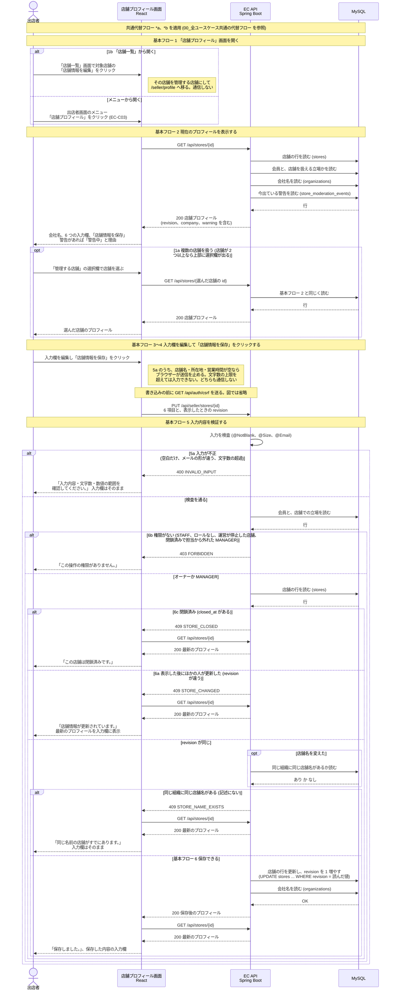
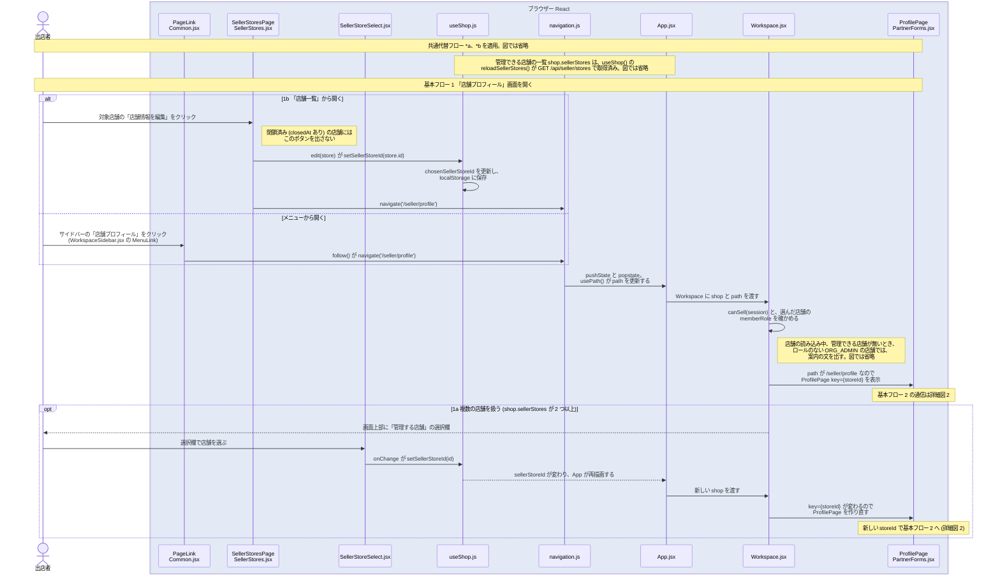
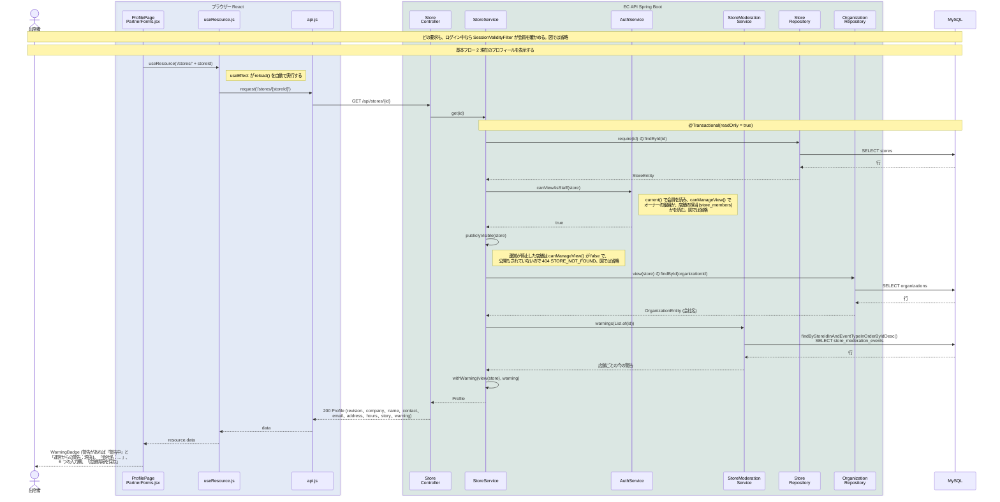
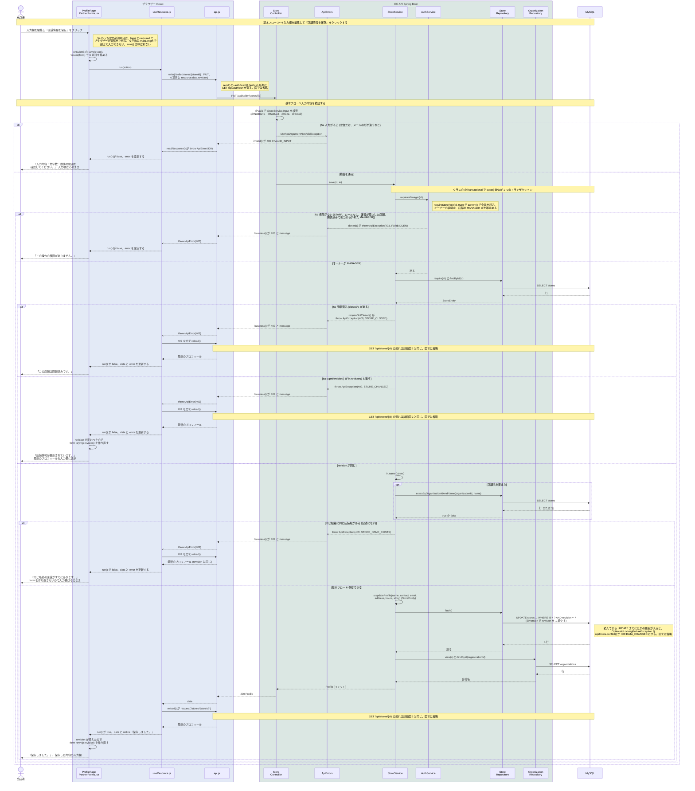

# EC-S02 店舗プロフィールを編集する

- ユースケース記述: [EC-S02_店舗プロフィールを編集する](<../../アーカイブ/ユースケース/kusakari-ec/EC-S02_店舗プロフィールを編集する.md>)
- 対象のコード: kusakari-ec の main（19a2be3、2026-11-20 時点）

## 概要図

## 詳細図 1 基本フロー 1（代替フロー 1a、1b）

## 詳細図 2 基本フロー 2

## 詳細図 3 基本フロー 3〜6

## ユースケース記述との差

- 5a のうち、店舗名・所在地・営業時間が空のときは、`ResourceView.jsx` の `Input` の `required` でブラウザーが送信を止めます。表示されるのはブラウザーの標準のメッセージで、通信しません。文字数の上限は `maxLength` で、超えて入力できません。サーバーまで届く 5a は、空白だけの入力や、問い合わせメールの形の違い（`@Email`）です。問い合わせメールの入力欄は `type="text"` なので、形を確かめるのはサーバーだけです。画面には `ApiErrors.invalid()` の「入力内容・文字数・数値の範囲を確認してください。」が出ます。
- 6b の STAFF とロールなしの担当者にも、`Workspace.jsx` は「店舗プロフィール」画面と「店舗情報を保存」ボタンを出します。保存したときに、`AuthService.requireManager()` が 403 `FORBIDDEN` で止めます。
- 6c の「この店舗は閉鎖済みです。」（409 `STORE_CLOSED`）が出るのは、オーナー（と運営）だけです。閉鎖済みになると、`StoreClosureService.settle()` が `storeMembers.deleteAllAtStore()` で店舗の担当を外します。そのため MANAGER の保存は、`requireManager()` で 403 `FORBIDDEN`「この操作の権限がありません。」になります。
- 6a の後の再確認は、エラーの文と、取り直した最新のプロフィールを入力欄に出すことで行います。ほかの確認の操作はありません。
- 記述にない処理として、店舗名を変えたときに同じ組織に同じ名前の店舗があると、409 `STORE_NAME_EXISTS`「同じ名前の店舗がすでにあります。」で保存しません。このとき `revision` は変わらないので、`<form key={p.revision}>` が作り直されず、入力欄は出店者の入力のままです。
- 記述にない処理として、`revision` を確かめてから `UPDATE` するまでにほかの更新が入ると、`StoreEntity` の `@Version` の確認で `OptimisticLockingFailureException` になり、`ApiErrors.conflict()` が 409 `DATA_CHANGED`「データが競合しました。最新の内容を確認してください。」を返します。
- 記述にない処理として、運営が停止した店舗は、`GET /api/stores/{id}` が 404 `STORE_NOT_FOUND`「店舗が見つかりません。」になり、入力欄を出しません。保存も `requireStoreRole()` が 403 にします。事前条件には閉鎖済みだけが書かれています。
- 1a の選択欄は、管理できる店舗が 2 つ以上のときだけ、「店舗プロフィール」画面の上部に出ます。選んだ店舗は `useShop.js` が `localStorage` に残すので、次に開いたときも同じ店舗を表示します。

## 確かめられなかったこと

- `revision` の確認と `UPDATE` のあいだの競合で 409 `DATA_CHANGED` になることは、コードから読んだだけで、動かして確かめていません。
- 5a でブラウザーが出すメッセージの文は、ブラウザーごとに違うので、図には書いていません。

## 参照したコード

- [frontend/src/workspace/WorkspaceSidebar.jsx](https://github.com/abeouga/kusakari-ec/blob/19a2be307ee71a2cd87e538236c3c8c42929c5b3/frontend/src/workspace/WorkspaceSidebar.jsx): `MenuLink`
- [frontend/src/workspace/Common.jsx](https://github.com/abeouga/kusakari-ec/blob/19a2be307ee71a2cd87e538236c3c8c42929c5b3/frontend/src/workspace/Common.jsx): `PageLink` の `follow()`
- [frontend/src/workspace/navigation.js](https://github.com/abeouga/kusakari-ec/blob/19a2be307ee71a2cd87e538236c3c8c42929c5b3/frontend/src/workspace/navigation.js): `navigate()`、`usePath()`
- [frontend/src/App.jsx](https://github.com/abeouga/kusakari-ec/blob/19a2be307ee71a2cd87e538236c3c8c42929c5b3/frontend/src/App.jsx): `useShop()` と `usePath()` の結果を `Workspace` に渡す
- [frontend/src/workspace/Workspace.jsx](https://github.com/abeouga/kusakari-ec/blob/19a2be307ee71a2cd87e538236c3c8c42929c5b3/frontend/src/workspace/Workspace.jsx): `sellerMenu`、`storePaths`、`rolePaths`、`Workspace`（`ProfilePage` と `SellerStoreSelect` の表示）
- [frontend/src/workspace/SellerStores.jsx](https://github.com/abeouga/kusakari-ec/blob/19a2be307ee71a2cd87e538236c3c8c42929c5b3/frontend/src/workspace/SellerStores.jsx): `SellerStoresPage` の `edit()`
- [frontend/src/components/SellerStoreSelect.jsx](https://github.com/abeouga/kusakari-ec/blob/19a2be307ee71a2cd87e538236c3c8c42929c5b3/frontend/src/components/SellerStoreSelect.jsx): `SellerStoreSelect` の `onChange`
- [frontend/src/useShop.js](https://github.com/abeouga/kusakari-ec/blob/19a2be307ee71a2cd87e538236c3c8c42929c5b3/frontend/src/useShop.js): `setSellerStoreId()`、`reloadSellerStores()`、`sellerStoreId`
- [frontend/src/workspace/PartnerForms.jsx](https://github.com/abeouga/kusakari-ec/blob/19a2be307ee71a2cd87e538236c3c8c42929c5b3/frontend/src/workspace/PartnerForms.jsx): `ProfilePage` の `save()`、`<form key={p.revision}>`
- [frontend/src/workspace/ResourceView.jsx](https://github.com/abeouga/kusakari-ec/blob/19a2be307ee71a2cd87e538236c3c8c42929c5b3/frontend/src/workspace/ResourceView.jsx): `Input`（`required`、`maxLength`）、`values()`、`ResourceStatus`
- [frontend/src/workspace/Moderation.jsx](https://github.com/abeouga/kusakari-ec/blob/19a2be307ee71a2cd87e538236c3c8c42929c5b3/frontend/src/workspace/Moderation.jsx): `WarningBadge`
- [frontend/src/workspace/useResource.js](https://github.com/abeouga/kusakari-ec/blob/19a2be307ee71a2cd87e538236c3c8c42929c5b3/frontend/src/workspace/useResource.js): `useResource` の `reload()`、`run()`、`write()`
- [frontend/src/api.js](https://github.com/abeouga/kusakari-ec/blob/19a2be307ee71a2cd87e538236c3c8c42929c5b3/frontend/src/api.js): `request()`、`send()`、`readResponse()`
- [frontend/src/auth.js](https://github.com/abeouga/kusakari-ec/blob/19a2be307ee71a2cd87e538236c3c8c42929c5b3/frontend/src/auth.js): `authFetch()`
- [backend/src/main/java/jp/kusakari/ec/store/controller/StoreController.java](https://github.com/abeouga/kusakari-ec/blob/19a2be307ee71a2cd87e538236c3c8c42929c5b3/backend/src/main/java/jp/kusakari/ec/store/controller/StoreController.java): `get()`、`save()`
- [backend/src/main/java/jp/kusakari/ec/store/service/StoreService.java](https://github.com/abeouga/kusakari-ec/blob/19a2be307ee71a2cd87e538236c3c8c42929c5b3/backend/src/main/java/jp/kusakari/ec/store/service/StoreService.java): `Input`、`get()`、`save()`、`requireNotClosed()`、`view()`、`withWarning()`
- [backend/src/main/java/jp/kusakari/ec/store/service/StoreModerationService.java](https://github.com/abeouga/kusakari-ec/blob/19a2be307ee71a2cd87e538236c3c8c42929c5b3/backend/src/main/java/jp/kusakari/ec/store/service/StoreModerationService.java): `warnings()`
- [backend/src/main/java/jp/kusakari/ec/store/service/StoreClosureService.java](https://github.com/abeouga/kusakari-ec/blob/19a2be307ee71a2cd87e538236c3c8c42929c5b3/backend/src/main/java/jp/kusakari/ec/store/service/StoreClosureService.java): `settle()`（閉鎖済みにして担当を外す）
- [backend/src/main/java/jp/kusakari/ec/auth/AuthService.java](https://github.com/abeouga/kusakari-ec/blob/19a2be307ee71a2cd87e538236c3c8c42929c5b3/backend/src/main/java/jp/kusakari/ec/auth/AuthService.java): `current()`、`canViewAsStaff()`、`canManageView()`、`requireManager()`、`requireStoreRole()`
- [backend/src/main/java/jp/kusakari/ec/auth/SessionValidityFilter.java](https://github.com/abeouga/kusakari-ec/blob/19a2be307ee71a2cd87e538236c3c8c42929c5b3/backend/src/main/java/jp/kusakari/ec/auth/SessionValidityFilter.java): `doFilterInternal()`
- [backend/src/main/java/jp/kusakari/ec/catalog/persistence/repository/StoreRepository.java](https://github.com/abeouga/kusakari-ec/blob/19a2be307ee71a2cd87e538236c3c8c42929c5b3/backend/src/main/java/jp/kusakari/ec/catalog/persistence/repository/StoreRepository.java): `existsByOrganizationIdAndName()`
- [backend/src/main/java/jp/kusakari/ec/catalog/persistence/entity/StoreEntity.java](https://github.com/abeouga/kusakari-ec/blob/19a2be307ee71a2cd87e538236c3c8c42929c5b3/backend/src/main/java/jp/kusakari/ec/catalog/persistence/entity/StoreEntity.java): `updateProfile()`、`@Version revision`
- [backend/src/main/java/jp/kusakari/ec/common/web/ApiErrors.java](https://github.com/abeouga/kusakari-ec/blob/19a2be307ee71a2cd87e538236c3c8c42929c5b3/backend/src/main/java/jp/kusakari/ec/common/web/ApiErrors.java): `business()`、`invalid()`、`conflict()`
- [backend/src/main/resources/db/migration/V1__schema.sql](https://github.com/abeouga/kusakari-ec/blob/19a2be307ee71a2cd87e538236c3c8c42929c5b3/backend/src/main/resources/db/migration/V1__schema.sql): `stores`（`uk_stores_org_name`、`revision`）
