# EC-S03 商品を登録する

- ユースケース記述: [EC-S03_商品を登録する](<../../アーカイブ/ユースケース/kusakari-ec/EC-S03_商品を登録する.md>)
- 共通代替フロー: [00_全ユースケース共通の代替フロー](<00_全ユースケース共通の代替フロー.md>)
- 対象のコード: kusakari-ec の main（6bad7e3、2026-11-24 時点）。3D プレビューと植物モデルの組み立てで使う kusakari-canvas は main（7e9a8dd、2026-11-24 時点）

## シーケンス図

参加者は、上から「画面や役割の名前」「コンポーネント・クラスの名前」「ファイル名（かっこ付き）」の順に書いています。
Repository と、商品番号を作る `ProductSkuGenerator`、商品を読む `CatalogService` は参加者にせず、MySQL への矢印の文にクラスとメソッドの名前を書いています。「商品管理」画面の一覧の取得とカテゴリーの取得は、[EC-S04](<EC-S04_商品情報を編集する.md>) の図と同じなので、Controller から先を省いています。
共通代替フローの中身は、00 の図か、下の「共通代替フローを直接書いた図」を見てください。

```mermaid
sequenceDiagram
    autonumber
    actor User as 出店者
    box rgba(47,111,219,0.10) ブラウザー React
        participant Work as 出店者画面の枠<br/>Workspace<br/>(Workspace.jsx)
        participant Mgr as 商品管理画面<br/>ProductManager<br/>(ProductManager.jsx)
        participant Cat as 出店者の商品一覧<br/>useSellerCatalog<br/>(useSellerCatalog.js)
        participant NewPage as 商品登録画面<br/>ProductCreatePage<br/>(ProductCreatePage.jsx)
        participant Form as 商品登録のフォーム<br/>ProductForm<br/>(ProductForm.jsx)
        participant Picker as カテゴリーの選択<br/>CategoryPicker<br/>(CategoryPicker.jsx)
        participant Images as 商品画像<br/>ProductImages<br/>(ProductImages.jsx)
        participant Garden as 庭オブジェクトの手順<br/>ProductGardenStep<br/>(ProductGardenStep.jsx)
        participant Preview as 3D プレビューと「AIで生成」<br/>PlantPreview<br/>(PlantPreview.jsx)
        participant Plant as 植物の特徴<br/>usePlantSuggestion<br/>(usePlantSuggestion.js)
        participant Review as 確認<br/>ProductReview<br/>(ProductReview.jsx)
        participant Shop as 商品の保存<br/>useShop<br/>(useShop.js)
        participant Hook as 警告とカテゴリーの取得<br/>useResource<br/>(useResource.js)
        participant Http as 通信<br/>request<br/>(api.js)
        participant AuthJs as 通信の準備<br/>authFetch<br/>(auth.js)
    end
    box rgba(47,111,219,0.10) ブラウザー Canvas の iframe React
        participant CWeb as Canvas の 3D プレビュー画面<br/>PlantPreviewPage<br/>(PlantPreviewPage.jsx)
    end
    box rgba(27,127,92,0.12) EC API Spring Boot
        participant AuthCtrl as ログイン状態API<br/>AuthController<br/>(AuthController.java)
        participant SPC as 出店者の商品API<br/>SellerProductController<br/>(SellerProductController.java)
        participant CatCtrl as カテゴリーAPI<br/>CategoryController<br/>(CategoryController.java)
        participant MediaCtrl as 商品画像API<br/>ProductMediaController<br/>(ProductMediaController.java)
        participant SugCtrl as AI の推定API<br/>PlantSuggestionController<br/>(PlantSuggestionController.java)
        participant EdCtrl as 商品の登録・編集API<br/>ProductEditorController<br/>(ProductEditorController.java)
        participant CartCtrl as カートAPI<br/>CartController<br/>(CartController.java)
        participant CatalogCtrl as 購入者向けの商品API<br/>CatalogController<br/>(CatalogController.java)
        participant Errs as エラーの応答<br/>ApiErrors<br/>(ApiErrors.java)
        participant MediaSvc as 商品画像の処理<br/>ProductMediaService<br/>(ProductMediaService.java)
        participant SugSvc as AI の推定の処理<br/>PlantSuggestionService<br/>(PlantSuggestionService.java)
        participant AiCli as OpenAI への問い合わせ<br/>PlantSuggestionClient<br/>(PlantSuggestionClient.java)
        participant Fitter as 寸法の調整<br/>PlantSuggestionFitter<br/>(PlantSuggestionFitter.java)
        participant EdSvc as 商品の登録・編集の処理<br/>ProductEditorService<br/>(ProductEditorService.java)
        participant CatgSvc as カテゴリーの処理<br/>CategoryService<br/>(CategoryService.java)
        participant Auth as ログイン中の会員<br/>AuthService<br/>(AuthService.java)
        participant CModel as Canvas への問い合わせ<br/>CanvasModelClient<br/>(CanvasModelClient.java)
    end
    box rgba(27,127,92,0.12) Canvas API FastAPI
        participant CApi as 植物の組み立てAPI<br/>resolve_model<br/>(main.py)
    end
    participant Db as MySQL
    box rgba(180,120,20,0.12) 外部サービス
        participant OpenAI as OpenAI API
    end

    Note over User,OpenAI: 共通代替フロー<br/>*b 未ログインの場合: 2 (URL を直接開いたときのログインの確認)、5、10、21、45、93、135、出品の後の 178・190・195 に適用<br/>*a 通信に失敗した場合: 5、10、21、43、45、61、75、76、78、86、91、93、133、135、出品の後の 178・182・190・195 に適用

    User->>Work: 出店者メニューの「商品管理」をクリック
    Work->>Mgr: URL を /seller/products に変え、<br/>ProductManager を表示 (embedded)
    par 商品の一覧
        Mgr->>Cat: 選んでいる店舗の商品を取りに行くよう頼む (useSellerCatalog)
        Cat->>Http: 自動で一覧の通信を始める<br/>(useEffect → api.sellerProducts → request)
        Http->>SPC: GET /api/seller/products?storeId={id}
        SPC-->>Http: 200 商品の配列<br/>(中は EC-S04 の図の 6〜26 と同じ)
        Http-->>Cat: 商品の一覧 (setProducts)
    and 運営からの警告・停止
        Mgr->>Hook: 店舗の商品への警告・停止を取りに行くよう頼む (useResource)
        Hook->>Http: 自動で通信を始める (reload → request)
        Http->>SPC: GET /api/seller/products/moderation?storeId={id}
        SPC-->>Http: 200 警告・停止の配列<br/>(中は EC-S04 の図の 31〜45 と同じ)
        Http-->>Hook: 警告・停止の一覧
    end
    Mgr-->>User: 「商品管理」、「管理する店舗」、「新しい商品」、<br/>「運営からの警告・停止」欄、商品一覧

    User->>Mgr: 「新しい商品」をクリック
    Mgr->>Work: お知らせとエラーを消し、URL を /seller/products/new に変える<br/>(shop.setError('')、shop.setNotice('')、navigate)
    Work->>NewPage: ProductCreatePage を表示
    NewPage->>Form: 在庫を登録する店舗の選択を付けて、空の商品のフォームを表示<br/>(StorePicker、ProductForm の product は null、onSave は shop.saveProduct)
    Form->>Picker: 「商品情報」の手順で、入力欄とカテゴリーの選択を表示<br/>(createDraft(emptyProduct)、step は INFO、ProductInfoFields → CategoryPicker)
    Picker->>Hook: カテゴリーの一覧を取りに行くよう頼む (useResource)
    Hook->>Http: 自動で通信を始める (reload → request)
    Http->>CatCtrl: GET /api/categories
    CatCtrl-->>Http: 200 カテゴリー名の配列<br/>(中は EC-S04 の図の 55〜58 と同じ)
    Http-->>Hook: カテゴリー名の一覧
    Hook-->>Picker: カテゴリー名の一覧
    Form-->>User: 「商品登録」、「1 / 4」、「商品情報」(商品名、カテゴリー、商品説明、<br/>税込価格（円）、選択店舗の在庫、在庫を登録する店舗、「サイズ」「詳しい情報」)、「次へ」

    User->>Form: 「商品名」「商品説明」「税込価格（円）」<br/>「選択店舗の在庫」に入力する
    Form->>Form: 入力を下書きに入れる (ProductInfoFields の change → set)
    User->>Picker: 「選ぶ」をクリックし、「カテゴリーを選ぶ」の一覧からカテゴリーを選ぶ
    Picker->>Form: 選んだカテゴリーを伝える (choose → onChange → set('category'))
    User->>Form: 「サイズ」を開いて「樹齢目安（年）」「鉢径（cm）」、<br/>「詳しい情報」を開いて「生産者名」を入力する
    Form->>Form: 入力を下書きに入れる (RangeField と input の onChange → set)
    User->>Form: 「次へ」をクリック
    Form->>Form: 「商品情報」の入力を確かめる (next → validate(INFO)。<br/>firstInvalid で required・min・max、商品名と説明が空白だけでないか)
    alt 10a 入力が不正 (必須項目が空、在庫数が 1 未満、価格が範囲外など)
        Form-->>User: 10a-1「在庫は1以上にしてください。」「商品名・説明を入力してください。」<br/>「入力内容を確認してください。」など。直す入力欄にフォーカス (fail → reveal)。<br/>通信しない (10a-2 基本フロー 5 へ戻る)
    else 基本フロー 10 検査を通る
        Form-->>User: 「2 / 4」、「画像」の手順 (move(IMAGES))
    end

    User->>Images: 「商品の写真を選択」(1 枚以上あれば「画像を追加」) から、<br/>商品画像のファイルを選ぶ
    Images->>Images: 枚数、形式、大きさを確かめる (upload)
    alt 12a 合わせて 6 枚以上になる
        Images-->>User: 12a-1「画像は最大5枚です。不要な画像を削除してから<br/>追加してください。」通信しない (12a-2 基本フロー 11 へ戻る)
    else 12a PNG・JPEG・WebP 以外、0 バイト、5MB を超える
        Images-->>User: 12a-1「1枚5MB以下のPNG・JPEG・WebPを選択してください。」<br/>通信しない (12a-2 基本フロー 11 へ戻る)
    else 画面の検査を通る
        Images->>Form: 保存の間はフォームを操作できなくする (onBusy(true))
        loop 選んだファイルごと (12a で失敗したら、残りのファイルは送らない)
            Images->>Http: 画像を送る (api.uploadProductImage → send、FormData)
            Http->>AuthJs: 書き込みの前に CSRF トークンを取るよう頼む (authFetch)
            AuthJs->>AuthCtrl: GET /api/auth/csrf
            AuthCtrl-->>AuthJs: 200 ヘッダー名とトークン (csrf)
            AuthJs->>MediaCtrl: POST /api/product-images (multipart の file)
            MediaCtrl->>Auth: 店舗側のアカウントか運営かを確かめる (requireSellerRole)
            Auth-->>MediaCtrl: 店舗側のアカウント
            MediaCtrl->>MediaSvc: 画像を保存するよう頼む (upload)。1 つのトランザクション
            MediaSvc->>MediaSvc: 先頭のバイトで形式を判定し、<br/>ファイルの Content-Type と比べる (detect)
            alt 12a 空、5MB 超、形式が判定できない、宣言と違う
                MediaSvc--xErrs: 400 INVALID_IMAGE の例外を投げる (invalid)
                Errs-->>Http: 400「画像は5MB以下のPNG・JPEG・WebPで<br/>選択してください。」(business)
                Http--xImages: エラーを投げる (readResponse → ApiError)
                Images-->>User: 12a-1 その文。それまでに保存した画像は残る
            else 基本フロー 12 保存できる
                MediaSvc->>Db: 画像を保存する (ProductMediaRepository.save、<br/>INSERT product_media。id は UUID)
                Db-->>MediaSvc: 完了
                MediaSvc-->>MediaCtrl: 画像の URL (/api/product-images/{id})
                MediaCtrl-->>Http: 200 imageUrl
                Http-->>Images: 画像の URL
                Images->>Form: 画像を下書きに入れる (change → onChange → set('imageUrl')、set('images'))
            end
        end
        Images->>Form: フォームを操作できるようにする (onBusy(false))
        Images->>MediaCtrl: サムネイルの img が画像を読む<br/>GET /api/product-images/{id}
        MediaCtrl->>MediaSvc: 画像を読むよう頼む (get)
        MediaSvc->>Db: SELECT product_media (ProductMediaRepository.findById)
        Db-->>MediaSvc: 画像の行
        MediaSvc-->>MediaCtrl: 形式とバイト列
        MediaCtrl-->>Images: 200 画像 (X-Content-Type-Options nosniff)
        Images-->>User: 商品画像のサムネイル。1 枚目に「メイン画像」
    end

    User->>Form: 「次へ」をクリック
    Form->>Form: 画像があるかを確かめる (next → validate(IMAGES)、draft.imageUrl)
    alt 14a 商品画像が 1 枚もない
        Form-->>User: 14a-1「商品画像を1枚以上追加してください。」ファイルの入力にフォーカス。<br/>通信しない (14a-2 基本フロー 11 へ戻る)
    else 基本フロー 14
        Form->>Garden: 「3 / 4」の「庭オブジェクト」を表示 (move(GARDEN)、active が true)
        alt 「鉢・庭材」のカテゴリー (植物ではない。isPlantCategory)
            Garden-->>User: 「「鉢・庭材」の商品は植物の3Dモデルを作りません。…」と<br/>「商品の高さ」。3D は作らない
        else 植物のカテゴリー
            Garden->>Garden: 入力が 400ms 止まるのを待ち、入力を確かめて<br/>Canvas のプレビューの URL を作る (usePlantPreview、firstInvalid、<br/>modelPreviewUrl。高さが空なら profile の既定の高さで仮表示)
            Garden->>Preview: 新しいプレビューの URL を渡す (pending)
            Preview->>CWeb: iframe の src で GET /model-preview?profile=...
            CWeb->>AuthCtrl: ログイン中かを確かめる (AuthGate、GET /api/auth/me)
            AuthCtrl-->>CWeb: 200 authenticated=true
            CWeb->>CApi: 植物の 3D の構成を求める (useQuery → requestJson)<br/>POST /api/model-assemblies/resolve
            CApi-->>CWeb: 200 構成 (assemble)
            CWeb-->>Preview: 3D の植物を描く。iframe を読み終えると onLoad → loaded で、<br/>700ms 後に前のプレビューと入れ替える
            Preview-->>User: 3D プレビュー、「AIで生成」、<br/>「植物の高さ」などの特徴の入力欄 (高さが空なら仮の高さの案内)
        end
    end

    alt 15a 「AIで生成」をクリックした
        User->>Preview: 「AIで生成」をクリック
        Preview->>Plant: 下書きの値で特徴を推定するよう頼む (suggest(draft))
        Plant->>Plant: 商品名が空でないか、高さが空か<br/>10〜1500 の整数かを確かめる
        alt 商品名が空、高さが不正 (記述なし)
            Plant-->>User: 「AIで生成する前に商品名を入力してください。」<br/>「植物の高さは10〜1500cmの整数にしてください。」(PlantPreview が表示)。<br/>通信しない
        else 確かめを通る
            Plant->>MediaCtrl: 1 枚目の画像を読む (photo → fetch)<br/>GET /api/product-images/{id}
            MediaCtrl-->>Plant: 200 画像 (中は 62〜65 と同じ)
            Plant->>Plant: 画像を data URL にする (dataUrl)
            Plant->>Http: 推定の通信を送る (api.suggestPlantModel → request)
            Http->>AuthJs: 書き込みの前に CSRF トークンを取るよう頼む (authFetch)
            AuthJs->>AuthCtrl: GET /api/auth/csrf
            AuthCtrl-->>AuthJs: 200 ヘッダー名とトークン
            AuthJs->>SugCtrl: POST /api/products/plant-model-suggestions<br/>(name、latinName、category、description、heightCm、<br/>currentProfile、imageDataUrl)
            SugCtrl->>Auth: 入力を検査し (@Valid の PlantSuggestionRequest)、<br/>店舗側のアカウントか運営かを確かめる (requireSellerRole)
            Auth-->>SugCtrl: 店舗側のアカウント
            SugCtrl->>SugSvc: 特徴を推定するよう頼む (suggest)。トランザクションはなく、DB を使わない
            SugSvc->>SugSvc: 画像を検査し、同時の推定を 2 件までにする (image、slots.tryAcquire)
            SugSvc->>AiCli: 商品情報と画像から特徴を推定するよう頼む (infer)
            AiCli->>OpenAI: POST /v1/responses (json_schema の構造化出力、store は false)
            OpenAI-->>AiCli: 推定した特徴の JSON (output_text)
            AiCli-->>SugSvc: profile と warnings
            SugSvc->>SugSvc: 高さと seed を入れ直し、検査する<br/>(Validator、整数と小数第 1 位の桁)
            SugSvc->>Fitter: 3D で組み立てられるかを確かめるよう頼む (fit)
            loop 組み立てられるまで (最大 4 回。2 回目からは葉・花・幹を小さくする)
                Fitter->>CModel: 組み立てられるかを問い合わせる (checkSuggestion)
                CModel->>CApi: POST /api/model-assemblies/resolve
                CApi-->>CModel: 200 構成か、400 INCOMPATIBLE_PLANT_DIMENSIONS
                CModel-->>Fitter: 組み立てられる か、422 AI_MODEL_DIMENSIONS の例外
            end
            Fitter-->>SugSvc: 寸法を調整したか
            alt 推定・組み立てができない、AI を使えない (記述なし。上のどの段階でも例外が出るとそこで止まる)
                SugSvc--xErrs: 例外を投げる (400 AI_INVALID_IMAGE、422 AI_PLANT_UNIDENTIFIED・AI_REFUSED・<br/>AI_MODEL_DIMENSIONS・AI_MODEL_INCOMPATIBLE、429 AI_BUSY・AI_RATE_LIMITED、<br/>502 AI_INVALID_PROFILE・AI_SERVICE_ERROR ほか、503 AI_NOT_CONFIGURED・<br/>MODEL_SERVICE_UNAVAILABLE、504 AI_TIMEOUT)
                Errs-->>Http: その状態と message (business)
                Http--xPlant: エラーを投げる (readResponse → ApiError)
                Plant-->>User: message (PlantPreview が表示)。入力欄と 3D プレビューはそのまま
            else 15a-1 推定できた
                SugSvc-->>SugCtrl: 推定した特徴、推定した項目、注意点 (PlantSuggestionView)
                SugCtrl-->>Http: 200 推定の結果
                Http-->>Plant: 推定の結果
                Plant->>Plant: 前の値を残し、推定を入力欄に入れる<br/>(setUndo、setProfile、setHeightValue、setWarnings)
                Plant-->>User: 特徴を入力欄に反映、「AIの推定を反映しました · 注意点」、<br/>「AI設定を元に戻す」。3D プレビューは 73〜81 と同じ流れで更新<br/>(15a-2 基本フロー 16 へ)
            end
        end
    else 基本フロー 15 手で入力する
        User->>Garden: 「植物の高さ」などの特徴を入力する (PlantModelFields)
        Garden->>Plant: 特徴を変える (setHeight、changeProfile)
        Plant-->>Garden: 新しい特徴。3D プレビューは 73〜81 と同じ流れで更新
    end

    User->>Form: 「次へ」をクリック
    Form->>Form: 庭オブジェクトの入力を確かめる (next → validate(GARDEN)。<br/>firstInvalid で model から始まる入力欄、plant.currentProfile)
    alt 17a 庭オブジェクトの入力が不正 (高さが空、10〜1500cm の整数でないなど)
        Form-->>User: 17a-1「植物の高さを入力してください。」<br/>「植物の高さは10〜1500cmの整数にしてください。」など。<br/>通信しない (17a-2 基本フロー 15 へ戻る)
    else 基本フロー 17 検査を通る
        Form->>Review: 「4 / 4」の「確認」を表示 (move(REVIEW) → ProductReview)
        Review->>CWeb: 植物の商品なら、iframe の src で GET /model-preview?profile=...<br/>(流れは 76〜80 と同じ)
        CWeb-->>Review: 3D モデル
        Review-->>User: 「確認」に商品画像、3D モデル、商品名、価格、登録店舗、在庫、<br/>カテゴリー、商品説明など。「前の手順へ」「出品する」
    end

    User->>Form: 「出品する」をクリック
    Form->>Form: すべての手順の入力を確かめ直す (save → validate(null))。<br/>不正ならその手順を開いて止まる (10a、14a、17a と同じ。通信しない)
    Form->>Shop: 入力をまとめて登録を頼む<br/>(onSave → productInput(values, storeId, currentProfile) → saveProduct)
    Shop->>Http: 商品を登録する通信を送る (run → api.createProduct → request)
    Http->>AuthJs: 書き込みの前に CSRF トークンを取るよう頼む (authFetch)
    AuthJs->>AuthCtrl: GET /api/auth/csrf
    AuthCtrl-->>AuthJs: 200 ヘッダー名とトークン
    AuthJs->>EdCtrl: POST /api/products<br/>(sku は空、storeId、stock、heightCm、plantModelProfile ほか)
    EdCtrl->>EdCtrl: 入力を検査する (@Valid の ProductRequest)
    alt 19a 入力が不正 (文字数、価格・在庫の範囲、画像の URL の形など)
        EdCtrl--xErrs: 入力の違反の例外を投げる (MethodArgumentNotValidException)
        Errs-->>Http: 400「入力内容・文字数・数値の範囲を確認してください。」<br/>(invalid、INVALID_INPUT)
    else 検査を通る
        EdCtrl->>EdSvc: 商品を登録するよう頼む (create)<br/>create 全体が 1 つのトランザクション。Canvas への問い合わせもこの中
        EdSvc->>Auth: オーナーか、その店舗の MANAGER かを確かめる<br/>(requireManager → requireStoreRole)
        Auth->>Db: 会員、店舗、オーナーの組織か、店舗の担当とロールを読む
        Db-->>Auth: 会員、店舗、組織、担当の行
        alt 19b 権限がない (STAFF、ロールなし、運営が停止した店舗)
            Auth--xErrs: 403 FORBIDDEN の例外を投げる (denied)
            Errs-->>Http: 403「この操作の権限がありません。」(business)
        else オーナーか MANAGER
            Auth-->>EdSvc: 扱える
            EdSvc->>Db: 店舗があるかを確かめる<br/>(CatalogService.requireStore → StoreRepository.existsById)
            Db-->>EdSvc: ある
            EdSvc->>CatgSvc: カテゴリーが登録済みかを確かめる (require)
            CatgSvc->>Db: カテゴリーを共有ロックで読む<br/>(CategoryRepository.share、SELECT ... FOR SHARE categories)
            Db-->>CatgSvc: カテゴリーの行 (なければなし)
            alt 19a カテゴリーが無いか削除済み
                CatgSvc--xErrs: 400 INVALID_CATEGORY の例外を投げる (ApiException)
                Errs-->>Http: 400「登録済みのカテゴリを選択してください。」(business)
            else 登録済み
                CatgSvc-->>EdSvc: 登録済み
                EdSvc->>EdSvc: 在庫が 1 以上かを確かめ、入力から商品を作る<br/>(mapper.toEntity、id は UUID、追加した人は auth.current() の会員)
                EdSvc->>Db: 商品番号を作り、店舗の中で重ならないかを確かめる<br/>(ProductSkuGenerator.next → ProductRepository.existsByStoreIdAndSku。<br/>KS-年月日-6 文字。重なれば最大 5 回作り直す)
                Db-->>EdSvc: 重ならない
                opt 植物の商品 (plantModelProfile がある。resolveModel)
                    EdSvc->>CModel: 植物の 3D の構成を作るよう頼む (resolve)
                    CModel->>CApi: POST /api/model-assemblies/resolve<br/>(受けた要求の KUSAKARI_SESSION Cookie と X-CSRF-TOKEN を付ける)
                    CApi-->>CModel: 200 構成 (parts)
                    CModel-->>EdSvc: 構成 (modelComposition に入れる)
                end
                alt Canvas に問い合わせられない、構成が空 (記述なし)
                    CModel--xErrs: 503 MODEL_SERVICE_UNAVAILABLE か<br/>502 INVALID_MODEL_RESPONSE の例外を投げる
                    Errs-->>Http: 503「植物モデルを確定できません。Canvasの起動を<br/>確認して再試行してください。」か 502 (business)
                else 基本フロー 19 登録できる
                    EdSvc->>Db: 商品と商品画像を保存する (saveProduct → entityManager.persist・flush、<br/>INSERT products、product_images)
                    Db-->>EdSvc: 完了
                    EdSvc->>Db: 在庫を公開中で保存する (InventoryRepository.save、<br/>INSERT inventory。publication_status は PUBLISHED)
                    Db-->>EdSvc: 完了
                    opt 構成がある
                        EdSvc->>Db: 素材コードと商品の対応を保存する<br/>(linkMaterial → MaterialProductRepository.save、material_products)
                        Db-->>EdSvc: 完了
                    end
                    EdSvc->>Db: 登録した商品を読む (CatalogService.product → listingsByIds)
                    Db-->>EdSvc: 商品、在庫、店舗、組織の行
                    EdSvc-->>EdCtrl: 登録した商品 (sku を含む)。コミットする
                    EdCtrl-->>Http: 200 登録した商品
                end
            end
        end
    end
    alt 失敗の応答 (19a、19b、記述にない 502・503)
        Http--xShop: エラーを投げる (readResponse → ApiError)
        Shop-->>Form: エラーの文を設定し、失敗を返す (run の catch → setError、run が false)
        Form-->>User: 19a-1・19b-1 「商品登録」の上部にエラーの文 (ProductCreatePage の shop.error)。<br/>「確認」のまま。商品は登録しない (19a-2「前の手順へ」で戻る)
    else 200
        Http-->>Shop: 登録した商品 (created)
        Shop->>Http: カートを読む (refresh → api.cart)
        Http->>CartCtrl: GET /api/cart
        CartCtrl-->>Http: 403「店舗・出店申請用のアカウントでは購入できません。…」<br/>(CartSessionResolver.resolve → requireBuyer、BUYER_REQUIRED)
        Http--xShop: エラーを投げる (ApiError 403)
        Shop->>Http: 購入を断られたので、購入者向けの商品だけを読む (api.products)
        Http->>CatalogCtrl: GET /api/products
        CatalogCtrl-->>Http: 200 購入者に見える商品の配列
        Http-->>Shop: 商品の一覧 (setProducts)
        Shop-->>Form: 成功を返す (setNotice('商品を保存しました。商品番号は {sku} です。')、run が true)
        Form->>Work: URL を /seller/products に戻す (onDone → navigate)
        Work->>Mgr: ProductManager を表示
        Mgr->>Cat: 選んでいる店舗の商品を取りに行くよう頼む (useSellerCatalog)
        Cat->>Http: 自動で一覧の通信を始める (useEffect → api.sellerProducts → request)
        Http->>SPC: GET /api/seller/products?storeId={id}<br/>(中は EC-S04 の図の 6〜26 と同じ)
        SPC-->>Http: 200 登録した商品を含む商品の配列
        Http-->>Cat: 商品の一覧 (setProducts)
        Mgr->>Hook: 警告・停止を取りに行くよう頼む (useResource)
        Hook->>Http: 自動で通信を始める (reload → request)
        Http->>SPC: GET /api/seller/products/moderation?storeId={id}
        SPC-->>Http: 200 警告・停止の配列
        Http-->>Hook: 警告・停止の一覧
        Mgr-->>User: 「商品を保存しました。商品番号は KS-… です。」と、<br/>登録した商品を含む商品一覧 (「追加した人：(自分の表示名)」)
    end
```

## 共通代替フローを直接書いた図

```mermaid
sequenceDiagram
    autonumber
    actor User as 出店者
    box rgba(47,111,219,0.10) ブラウザー React
        participant NewPage as 商品登録画面<br/>ProductCreatePage<br/>(ProductCreatePage.jsx)
        participant Form as 商品登録のフォーム<br/>ProductForm<br/>(ProductForm.jsx)
        participant Images as 商品画像<br/>ProductImages<br/>(ProductImages.jsx)
        participant Preview as 3D プレビューと「AIで生成」<br/>PlantPreview<br/>(PlantPreview.jsx)
        participant Plant as 植物の特徴<br/>usePlantSuggestion<br/>(usePlantSuggestion.js)
        participant Shop as 商品の保存<br/>useShop<br/>(useShop.js)
        participant Http as 通信<br/>request<br/>(api.js)
        participant AuthJs as 通信の準備<br/>authFetch<br/>(auth.js)
        participant Notice as 期限切れのお知らせ<br/>SessionNotice<br/>(SessionNotice.jsx)
    end
    box rgba(47,111,219,0.10) ブラウザー Canvas の iframe React
        participant CWeb as Canvas の 3D プレビュー画面<br/>PlantPreviewPage<br/>(PlantPreviewPage.jsx)
    end
    box rgba(27,127,92,0.12) EC API Spring Boot
        participant Filter as セッションの確認<br/>SessionValidityFilter<br/>(SessionValidityFilter.java)
        participant MediaCtrl as 商品画像API<br/>ProductMediaController<br/>(ProductMediaController.java)
        participant SugCtrl as AI の推定API<br/>PlantSuggestionController<br/>(PlantSuggestionController.java)
        participant EdCtrl as 商品の登録・編集API<br/>ProductEditorController<br/>(ProductEditorController.java)
        participant EdSvc as 商品の登録・編集の処理<br/>ProductEditorService<br/>(ProductEditorService.java)
    end
    box rgba(27,127,92,0.12) Canvas API FastAPI
        participant CApi as 植物の組み立てAPI<br/>resolve_model<br/>(main.py)
    end
    participant Db as MySQL
    box rgba(180,120,20,0.12) 外部サービス
        participant Cog as Amazon Cognito
    end

    User->>Images: 「画像を追加」からファイルを選ぶ
    Images->>Http: 画像を送る (api.uploadProductImage → send)
    Http->>AuthJs: CSRF トークンを取ってから送るよう頼む (authFetch)
    alt *a CSRF トークンの取得か POST が届かない、または応答が JSON でない
        AuthJs-xFilter: GET /api/auth/csrf、POST /api/product-images
        Http--xImages: エラーを投げる (ApiError(networkErrorMessage, 0))
        Images-->>User: *a-1「サーバーに接続できません。接続を確認して再試行してください。」<br/>(ProductImages の error)。*a-2 それまでに保存した画像と入力は残る
    else *b ログインの期限切れ (サーバーのセッションがない、refresh トークンが失効)
        AuthJs->>Filter: POST /api/product-images
        Filter-->>Http: 401 LOGIN_REQUIRED<br/>(セッションが無いときは AuthConfiguration.java が返す)
        Http->>Notice: 期限切れを知らせる (wasSignedIn が真なので kusakari-session-expired)
        Http--xImages: エラーを投げる (ApiError(sessionExpiredMessage, 401))
        Notice-->>User: *b-1「ログインの有効期限が切れました。<br/>もう一度ログインしてください。」「ログインする」「閉じる」<br/>(ProductImages にも同じ文が出る)
    else *a ID トークンの更新で Cognito に届かない
        AuthJs->>Filter: POST /api/product-images
        Filter-xCog: ID トークンを更新する (InitiateAuth REFRESH_TOKEN_AUTH)
        Filter-->>Http: 503 AUTH_UNAVAILABLE (セッションは残す)
        Http--xImages: エラーを投げる (ApiError 503)
        Images-->>User: *a-1「認証を確認できません。時間をおいて再試行してください。」
    else *a MySQL との通信に失敗
        AuthJs->>Filter: POST /api/product-images
        Filter->>MediaCtrl: 要求を通す (chain.doFilter)
        MediaCtrl->>Db: 画像を保存する (上の図の 46〜55)
        Db--xMediaCtrl: 失敗 (DataAccessException)
        MediaCtrl-->>Http: 503 DATABASE_UNAVAILABLE (ApiErrors.java の database)
        Http--xImages: エラーを投げる (ApiError 503)
        Images-->>User: *a-1「保存処理を完了できませんでした。時間をおいて再試行してください。」
    end
    opt *a-3 やり直す
        User->>Images: もう一度「画像を追加」からファイルを選ぶ (基本フロー 11 へ戻る)
    end

    User->>Preview: 「AIで生成」をクリック
    Preview->>Plant: 特徴を推定するよう頼む (suggest)
    alt *a 1 枚目の画像を読めない
        Plant-xMediaCtrl: GET /api/product-images/{id} (photo の fetch。api.js を通らない)
        Plant-->>User: *a-1 届かなければブラウザーが作る例外の文、200 以外なら<br/>「商品写真を取得できません。「画像」で画像を選び直してください。」(PlantPreview が表示)
    else 画像を読めた
        Plant->>Http: 推定の通信を送る (api.suggestPlantModel → request)
        alt *a CSRF トークンの取得か POST が届かない、または応答が JSON でない
            Http-xFilter: GET /api/auth/csrf、POST /api/products/plant-model-suggestions
            Http--xPlant: エラーを投げる (ApiError(networkErrorMessage, 0))
            Plant-->>User: *a-1「サーバーに接続できません。接続を確認して再試行してください。」<br/>(PlantPreview が表示)。*a-2 入力欄と 3D プレビューはそのまま
        else *b ログインの期限切れ
            Http->>Filter: POST /api/products/plant-model-suggestions
            Filter-->>Http: 401 LOGIN_REQUIRED
            Http->>Notice: 期限切れを知らせる (kusakari-session-expired)
            Http--xPlant: エラーを投げる (ApiError(sessionExpiredMessage, 401))
            Notice-->>User: *b-1「ログインの有効期限が切れました。…」「ログインする」「閉じる」
        else *a ID トークンの更新で Cognito に届かない
            Http->>Filter: POST /api/products/plant-model-suggestions
            Filter-xCog: ID トークンを更新する (InitiateAuth REFRESH_TOKEN_AUTH)
            Filter-->>Http: 503 AUTH_UNAVAILABLE
            Http--xPlant: エラーを投げる (ApiError 503)
            Plant-->>User: *a-1「認証を確認できません。時間をおいて再試行してください。」
        else 要求が Controller まで届いた
            Http->>Filter: POST /api/products/plant-model-suggestions
            Filter->>SugCtrl: 要求を通す (chain.doFilter)
            SugCtrl-->>Http: 200 推定の結果か、AI・Canvas のエラー (上の図の 94〜115)
            Http-->>Plant: 推定の結果か、エラー
        end
    end
    opt *a-3 やり直す
        User->>Preview: もう一度「AIで生成」をクリック (基本フロー 15 へ戻る)
    end

    Preview->>CWeb: iframe の src で GET /model-preview?profile=...
    alt *a Canvas API に届かない、組み立てられない
        CWeb-xCApi: POST /api/model-assemblies/resolve
        CWeb-->>User: iframe の中に、エラーの文か「プレビューを表示できません。<br/>入力値とCanvasの起動を確認してください。」。「再取得」はない
    else 組み立てられた
        CWeb->>CApi: POST /api/model-assemblies/resolve
        CApi-->>CWeb: 200 構成
        CWeb-->>User: 3D プレビュー
    end

    User->>Form: 「確認」で「出品する」をクリック
    Form->>Shop: 登録を頼む (onSave → saveProduct)
    Shop->>Http: 商品を登録する通信を送る (run → api.createProduct → request)
    alt *a CSRF トークンを取れない、POST が届かない、応答が JSON でない (登録されたかは分からない)
        Http-xFilter: GET /api/auth/csrf、POST /api/products
        Http--xShop: エラーを投げる (ApiError(networkErrorMessage, 0))
        Shop-->>NewPage: エラーの文を設定し、失敗を返す (run の catch → setError)
        NewPage-->>User: *a-1「商品登録」の上部に「サーバーに接続できません。<br/>接続を確認して再試行してください。」。*a-2「確認」のまま、入力は残る
    else *b ログインの期限切れ (サーバーのセッションがない、refresh トークンが失効)
        Http->>Filter: POST /api/products
        Filter-->>Http: 401 LOGIN_REQUIRED<br/>(セッションが無いときは AuthConfiguration.java が返す)
        Http->>Notice: 期限切れを知らせる (wasSignedIn が真なので kusakari-session-expired)
        Http--xShop: エラーを投げる (ApiError(sessionExpiredMessage, 401))
        Shop-->>NewPage: エラーの文を設定し、失敗を返す (run の catch → setError)
        Notice-->>User: *b-1「ログインの有効期限が切れました。<br/>もう一度ログインしてください。」「ログインする」「閉じる」
        alt ログインする
            User->>Notice: 「ログインする」をクリック
            Notice->>AuthJs: ログイン画面へ移る (login)
            AuthJs-->>User: /account/login?returnTo=/seller/products/new のログイン画面<br/>(*b-2 ログインの後は商品登録画面を最初から開く。入力と画像の選択は残らない)
        else 閉じる
            User->>Notice: 「閉じる」をクリック
            Notice-->>User: お知らせを閉じる (setExpired(false))。<br/>「確認」と入力は残る。ログインはしていない
        end
    else *a ID トークンの更新で Cognito に届かない
        Http->>Filter: POST /api/products
        Filter-xCog: ID トークンを更新する<br/>(InitiateAuth REFRESH_TOKEN_AUTH、CognitoPasswordLogin.java)
        Filter-->>Http: 503 AUTH_UNAVAILABLE (セッションは残す)
        Http--xShop: エラーを投げる (ApiError 503)
        Shop-->>NewPage: エラーの文を設定し、失敗を返す (run の catch → setError)
        NewPage-->>User: *a-1「商品登録」の上部に「認証を確認できません。<br/>時間をおいて再試行してください。」。*a-2 入力は残る
    else 要求が Controller まで届いた
        Http->>Filter: POST /api/products
        Filter->>EdCtrl: 要求を通す (chain.doFilter)
        EdCtrl->>EdSvc: 商品を登録するよう頼む (create)
        EdSvc->>Db: 立場とカテゴリーを確かめ、商品番号を作り、<br/>商品・在庫を保存してコミットする (上の図の 140〜171)
        alt *a MySQL との通信に失敗
            Db--xEdSvc: 失敗 (DataAccessException)。<br/>トランザクションの変更はすべて取り消す
            EdSvc--xEdCtrl: 例外
            EdCtrl-->>Http: 503 DATABASE_UNAVAILABLE (ApiErrors.java の database)
            Http--xShop: エラーを投げる (ApiError 503)
            Shop-->>NewPage: エラーの文を設定し、失敗を返す (run の catch → setError)
            NewPage-->>User: *a-1「商品登録」の上部に「保存処理を完了できませんでした。<br/>時間をおいて再試行してください。」。*a-2 入力は残る
        else 登録した
            Db-->>EdSvc: 完了
            EdSvc-->>EdCtrl: 登録した商品
            EdCtrl-->>Http: 200 登録した商品
            Http-->>Shop: 登録した商品
            Shop->>Http: 購入者向けの商品を取り直す (refresh → api.cart、api.products)
            alt *a 取り直しが届かない (登録はできている)
                Http-xFilter: GET /api/cart か GET /api/products
                Http--xShop: エラーを投げる (ApiError(networkErrorMessage, 0))
                Shop-->>NewPage: エラーの文を設定し、失敗を返す (run の catch → setError)
                NewPage-->>User: 「商品登録」の上部に「サーバーに接続できません。…」。<br/>登録できたのに「確認」のままで、商品番号も出ない
            else 取り直せた
                Http-->>Shop: 購入者向けの商品の一覧
                Shop-->>Form: 成功を返す (run が true)。この後は上の図の 185〜198
            end
        end
    end
    opt *a-3 やり直す
        User->>Form: 入力のまま、もう一度「出品する」をクリック (基本フロー 18 へ戻る)
    end
```

上の図の、画像の保存（`POST /api/product-images`）、「AIで生成」（1 枚目の画像の取得と `POST /api/products/plant-model-suggestions`）、3D プレビューの iframe、出品（`POST /api/products`）に、この画面で起こる共通代替フロー（\*a、\*b）を書き込んだ図です。「商品管理」画面を開いて一覧を取る通信と、URL を直接開いたときのログインの確認は、[EC-S04](<EC-S04_商品情報を編集する.md>) の「共通代替フローを直接書いた図」と同じなので省いています（戻り先は `/seller/products/new`）。どの通信でも、CSRF トークンの取得に失敗したときは、その後の要求が届かなかったときと同じ表示になるので、まとめて書いています。



## ユースケース記述との差

- 画面の文言は、記述の「カテゴリ」が「カテゴリー」、「在庫数」が「選択店舗の在庫」、「税込価格」が「税込価格（円）」です。基本フロー 11 のボタンは、画像が 1 枚もないときは「商品の写真を選択」で、1 枚以上あると「画像を追加」になります。
- 関連情報には「「商品管理」画面の上部で選んだ店舗に商品を登録する」とあります。コードでは、「商品登録」画面の「商品情報」に「在庫を登録する店舗」（`StorePicker`）があり、ここで店舗を選び直せます。初めは「商品管理」で選んだ店舗で、選び直すと `shop.setSellerStoreId()` で「商品管理」の店舗も変わります。
- 10a、14a、17a は、すべて画面（`ProductForm.jsx` の `validate()`）だけで止まり、通信しません。フォームは `noValidate` なので、ブラウザーの標準のメッセージではなく、`firstInvalid()` で見つけた入力欄にフォーカスし、`reportValidity()` とフォームの下のエラーの文で知らせます。サーバーにも同じ検査（400 `STOCK_REQUIRED`、400 `PLANT_HEIGHT_MISMATCH`）がありますが、画面が先に止めるので、画面からは届きません。
- 12a の枚数・形式・大きさは、まず画面（`ProductImages.upload()`）が確かめ、通信しません。サーバーは `ProductMediaService.upload()` で、先頭のバイトから形式を判定し、ファイルの `Content-Type` と違えば 400 `INVALID_IMAGE` にします。複数のファイルを選ぶと 1 枚ずつ送り、失敗するとそこで止めます。それまでに保存した画像は残ります。5MB を超えるファイルの 413 `IMAGE_TOO_LARGE`（`ApiErrors.imageTooLarge()`）は、画面が先に止めるので届きません。
- 記述にない処理として、画像はファイルを選んだ時点で `product_media` に保存されます。商品を登録しなかったときにその画像を消す処理は、コードに見つかりません。
- 記述にない処理として、「庭オブジェクト」と「確認」では、iframe で Kusakari Canvas の 3D プレビュー画面（`/model-preview`）を開きます。Canvas の画面は `AuthGate` で EC の `GET /api/auth/me` を読んでから、Canvas API の `POST /api/model-assemblies/resolve` で組み立てます。「鉢・庭材」のカテゴリーでは 3D を作らず、「商品の高さ」だけを入力します。
- 15a には、失敗したときの代替フローが記述にありません。コードでは、商品名が空だと通信せずに「AIで生成する前に商品名を入力してください。」を出します。サーバーからは 400、422、429、502、503、504 のエラーが返ることがあり、画面は message を出して入力を保ちます。推定の後で「AI設定を元に戻す」を押すと、推定の前の値に戻せます。
- 15a-1 の「1枚目の商品画像と商品情報から推定」は、ブラウザーが `GET /api/product-images/{id}` で 1 枚目の画像を読み、data URL にして送る形です。EC API は OpenAI の `POST /v1/responses` で推定した後、Canvas API の `POST /api/model-assemblies/resolve` で組み立てられるかを確かめます。組み立てられなければ、葉・花・幹の大きさを最大 3 回小さくして確かめ直します（`PlantSuggestionFitter.fit()`）。
- 19 の商品番号は、`ProductSkuGenerator.next()` が `KS-年月日-6 文字` の形で作り、店舗の中で重ならないものを最大 5 回まで作り直します。作れなければ 503 `SKU_UNAVAILABLE` です。同時の登録で一意制約（`uk_products_store_sku`）に当たると 409 `SKU_EXISTS` になります（`saveProduct()`）。どちらも起こることがまれなので、図には書いていません。
- 記述にない処理として、植物の商品は、登録のトランザクションの中で Canvas API に構成を問い合わせ、`model_composition` に保存します。Canvas に接続できないと 503 `MODEL_SERVICE_UNAVAILABLE` で登録しません。この問い合わせは、カテゴリーの共有ロック（`SELECT ... FOR SHARE`）を持ったまま行います。
- 19a でサーバーから届くのは、`@Valid` の違反（400 `INVALID_INPUT`）と、カテゴリーが無いか削除済みのとき（400 `INVALID_CATEGORY`「登録済みのカテゴリを選択してください。」）です。新しい商品のカテゴリーの初めの値は「庭木」（`productDraft.js` の `emptyProduct`）です。エラーは「商品登録」の上部に出て、出店者は「前の手順へ」で戻ります。
- 19b の STAFF とロールなしの担当者も、「新しい商品」から「商品登録」画面を開け、画像の保存と「AIで生成」まで使えます。どちらも `AuthService.requireSellerRole()` で店舗側のアカウントかだけを確かめるためです。止まるのは「出品する」の後です。
- 事後条件の「公開中」は、`InventoryEntity` の `publicationStatus` の初めの値 `PUBLISHED` で `inventory` に INSERT することで満たします。
- 記述にない処理として、6bad7e3 から、登録した会員を商品の「追加した人」（`created_by_member_id`）に保存します（`ProductEditorService.create()` の `auth.current()`）。基本フロー 20 の商品一覧には「追加した人：(表示名)」が出ます。
- 記述にない処理として、登録の後に `useShop.js` の `refresh()` が `GET /api/cart` と `GET /api/products` を送ります。店舗側のアカウントでは `GET /api/cart` が 403 `BUYER_REQUIRED` になり、購入者向けの商品一覧だけを取り直します。
- 共通代替フロー: 画像の保存の失敗は「画像」の手順の中（`ProductImages` の `error`）、「AIで生成」の失敗はプレビューの下（`plant.error`）、出品の失敗は「商品登録」の上部（`shop.error`）に出ます。どれも `useResource.js` を使わないので「再取得」のボタンはなく、\*a-3 は同じ操作をもう一度することです。
- 共通代替フロー: 1 枚目の画像の取得（`usePlantSuggestion.js` の `photo()`）は `api.js` を通らない `fetch()` なので、届かないときは共通のメッセージにならず、ブラウザーが作る例外の文が出ます。`GET /api/product-images/{id}` はログインしなくても呼べる API なので（`AuthConfiguration.java` の `permitAll`）、サーバーのセッションがなくても 401 になりません。
- 共通代替フロー: 「AIで生成」の処理（`PlantSuggestionService`）は DB を使わないので、503 `DATABASE_UNAVAILABLE` は Service からは出ません。
- 共通代替フロー: 出品の `POST /api/products` が届いた後で応答が失われると、画面は \*a-1 を出しますが、商品は登録されています。登録の後の取り直し（`refresh()`）が失敗したときも、登録できているのに「確認」のまま残ります。どちらの場合も、もう一度「出品する」を押すと、商品番号の違う同じ商品がもう 1 つ登録されます。コードから読んだだけで、動かして確かめていません。
- 共通代替フロー: iframe の中の Canvas の画面は、EC の画面とは別に動きます。Canvas API に届かないときや組み立てられないときは、iframe の中にエラーの文が出るだけで、EC の画面には知らせません。Canvas の `AuthGate` が EC の `GET /api/auth/me` で 401 を受けると、iframe の中でログイン画面へ移ります（`login()`）。

## 参照したコード

- [frontend/src/workspace/Workspace.jsx](https://github.com/abeouga/kusakari-ec/blob/6bad7e37c4135034fbe97e30309772fbe872e675/frontend/src/workspace/Workspace.jsx): `sellerMenu`、`rolePaths`、`ProductManager` と `ProductCreatePage` の表示
- [frontend/src/workspace/navigation.js](https://github.com/abeouga/kusakari-ec/blob/6bad7e37c4135034fbe97e30309772fbe872e675/frontend/src/workspace/navigation.js): `navigate`、`usePath`
- [frontend/src/components/ProductManager.jsx](https://github.com/abeouga/kusakari-ec/blob/6bad7e37c4135034fbe97e30309772fbe872e675/frontend/src/components/ProductManager.jsx): `ProductManager`（「新しい商品」、`shop.notice` の表示、`moderation`）
- [frontend/src/components/useSellerCatalog.js](https://github.com/abeouga/kusakari-ec/blob/6bad7e37c4135034fbe97e30309772fbe872e675/frontend/src/components/useSellerCatalog.js): `useEffect` の `api.sellerProducts`
- [frontend/src/components/SellerProductList.jsx](https://github.com/abeouga/kusakari-ec/blob/6bad7e37c4135034fbe97e30309772fbe872e675/frontend/src/components/SellerProductList.jsx): 「追加した人」
- [frontend/src/workspace/ProductCreatePage.jsx](https://github.com/abeouga/kusakari-ec/blob/6bad7e37c4135034fbe97e30309772fbe872e675/frontend/src/workspace/ProductCreatePage.jsx): `ProductCreatePage`（`StorePicker`、`shop.error`、`onSave={shop.saveProduct}`、`onDone`）
- [frontend/src/components/ProductForm.jsx](https://github.com/abeouga/kusakari-ec/blob/6bad7e37c4135034fbe97e30309772fbe872e675/frontend/src/components/ProductForm.jsx): `validate`、`next`、`move`、`fail`、`reveal`、`save`、「次へ」「前の手順へ」「出品する」
- [frontend/src/components/ProductInfoFields.jsx](https://github.com/abeouga/kusakari-ec/blob/6bad7e37c4135034fbe97e30309772fbe872e675/frontend/src/components/ProductInfoFields.jsx): 入力欄（`min={p.id ? 0 : 1}` など）、「サイズ」「詳しい情報」、`change`
- [frontend/src/components/CategoryPicker.jsx](https://github.com/abeouga/kusakari-ec/blob/6bad7e37c4135034fbe97e30309772fbe872e675/frontend/src/components/CategoryPicker.jsx): `useResource('/categories')`、「選ぶ」、「カテゴリーを選ぶ」、`choose`
- [frontend/src/components/StorePicker.jsx](https://github.com/abeouga/kusakari-ec/blob/6bad7e37c4135034fbe97e30309772fbe872e675/frontend/src/components/StorePicker.jsx): 「在庫を登録する店舗」
- [frontend/src/formValidity.js](https://github.com/abeouga/kusakari-ec/blob/6bad7e37c4135034fbe97e30309772fbe872e675/frontend/src/formValidity.js): `firstInvalid`
- [frontend/src/productDraft.js](https://github.com/abeouga/kusakari-ec/blob/6bad7e37c4135034fbe97e30309772fbe872e675/frontend/src/productDraft.js): `emptyProduct`、`createDraft`、`productInput`
- [frontend/src/components/ProductImages.jsx](https://github.com/abeouga/kusakari-ec/blob/6bad7e37c4135034fbe97e30309772fbe872e675/frontend/src/components/ProductImages.jsx): `upload`、`change`、サムネイルの `img`
- [frontend/src/components/ProductGardenStep.jsx](https://github.com/abeouga/kusakari-ec/blob/6bad7e37c4135034fbe97e30309772fbe872e675/frontend/src/components/ProductGardenStep.jsx): `ProductGardenStep`（「鉢・庭材」のとき）
- [frontend/src/components/PlantModelFields.jsx](https://github.com/abeouga/kusakari-ec/blob/6bad7e37c4135034fbe97e30309772fbe872e675/frontend/src/components/PlantModelFields.jsx): 「植物の高さ」（`modelHeight`）ほかの入力欄
- [frontend/src/components/usePlantPreview.js](https://github.com/abeouga/kusakari-ec/blob/6bad7e37c4135034fbe97e30309772fbe872e675/frontend/src/components/usePlantPreview.js): `usePlantPreview`（`PREVIEW_DELAY_MS`、`loaded`）
- [frontend/src/components/PlantPreview.jsx](https://github.com/abeouga/kusakari-ec/blob/6bad7e37c4135034fbe97e30309772fbe872e675/frontend/src/components/PlantPreview.jsx): iframe、「AIで生成」、`plant.error`、「AI設定を元に戻す」
- [frontend/src/components/usePlantSuggestion.js](https://github.com/abeouga/kusakari-ec/blob/6bad7e37c4135034fbe97e30309772fbe872e675/frontend/src/components/usePlantSuggestion.js): `suggest`、`photo`、`dataUrl`、`currentProfile`、`restore`
- [frontend/src/plantModel.js](https://github.com/abeouga/kusakari-ec/blob/6bad7e37c4135034fbe97e30309772fbe872e675/frontend/src/plantModel.js): `modelPreviewUrl`、`isPlantCategory`
- [frontend/src/components/ProductReview.jsx](https://github.com/abeouga/kusakari-ec/blob/6bad7e37c4135034fbe97e30309772fbe872e675/frontend/src/components/ProductReview.jsx): `ProductReview`
- [frontend/src/useShop.js](https://github.com/abeouga/kusakari-ec/blob/6bad7e37c4135034fbe97e30309772fbe872e675/frontend/src/useShop.js): `saveProduct`、`run`、`refresh`、`setSellerStoreId`
- [frontend/src/workspace/useResource.js](https://github.com/abeouga/kusakari-ec/blob/6bad7e37c4135034fbe97e30309772fbe872e675/frontend/src/workspace/useResource.js): `useResource`、`reload`
- [frontend/src/api.js](https://github.com/abeouga/kusakari-ec/blob/6bad7e37c4135034fbe97e30309772fbe872e675/frontend/src/api.js): `uploadProductImage`、`suggestPlantModel`、`createProduct`、`sellerProducts`、`cart`、`products`、`send`、`readResponse`
- [frontend/src/auth.js](https://github.com/abeouga/kusakari-ec/blob/6bad7e37c4135034fbe97e30309772fbe872e675/frontend/src/auth.js): `authFetch`、`wasSignedIn`、`login`
- [frontend/src/components/SessionNotice.jsx](https://github.com/abeouga/kusakari-ec/blob/6bad7e37c4135034fbe97e30309772fbe872e675/frontend/src/components/SessionNotice.jsx): 期限切れのお知らせ
- [backend/src/main/java/jp/kusakari/ec/catalog/controller/SellerProductController.java](https://github.com/abeouga/kusakari-ec/blob/6bad7e37c4135034fbe97e30309772fbe872e675/backend/src/main/java/jp/kusakari/ec/catalog/controller/SellerProductController.java): `list`、`moderation`
- [backend/src/main/java/jp/kusakari/ec/catalog/controller/CategoryController.java](https://github.com/abeouga/kusakari-ec/blob/6bad7e37c4135034fbe97e30309772fbe872e675/backend/src/main/java/jp/kusakari/ec/catalog/controller/CategoryController.java): `list`
- [backend/src/main/java/jp/kusakari/ec/catalog/controller/ProductMediaController.java](https://github.com/abeouga/kusakari-ec/blob/6bad7e37c4135034fbe97e30309772fbe872e675/backend/src/main/java/jp/kusakari/ec/catalog/controller/ProductMediaController.java): `upload`、`get`
- [backend/src/main/java/jp/kusakari/ec/catalog/service/ProductMediaService.java](https://github.com/abeouga/kusakari-ec/blob/6bad7e37c4135034fbe97e30309772fbe872e675/backend/src/main/java/jp/kusakari/ec/catalog/service/ProductMediaService.java): `upload`、`get`、`detect`、`invalid`
- [backend/src/main/java/jp/kusakari/ec/catalog/persistence/repository/ProductMediaRepository.java](https://github.com/abeouga/kusakari-ec/blob/6bad7e37c4135034fbe97e30309772fbe872e675/backend/src/main/java/jp/kusakari/ec/catalog/persistence/repository/ProductMediaRepository.java): `save`、`findById`（JpaRepository）
- [backend/src/main/java/jp/kusakari/ec/catalog/controller/PlantSuggestionController.java](https://github.com/abeouga/kusakari-ec/blob/6bad7e37c4135034fbe97e30309772fbe872e675/backend/src/main/java/jp/kusakari/ec/catalog/controller/PlantSuggestionController.java): `suggest`
- [backend/src/main/java/jp/kusakari/ec/catalog/dto/PlantSuggestionRequest.java](https://github.com/abeouga/kusakari-ec/blob/6bad7e37c4135034fbe97e30309772fbe872e675/backend/src/main/java/jp/kusakari/ec/catalog/dto/PlantSuggestionRequest.java): 検査の注釈
- [backend/src/main/java/jp/kusakari/ec/catalog/service/PlantSuggestionService.java](https://github.com/abeouga/kusakari-ec/blob/6bad7e37c4135034fbe97e30309772fbe872e675/backend/src/main/java/jp/kusakari/ec/catalog/service/PlantSuggestionService.java): `suggest`、`image`、`slots`
- [backend/src/main/java/jp/kusakari/ec/catalog/service/PlantSuggestionClient.java](https://github.com/abeouga/kusakari-ec/blob/6bad7e37c4135034fbe97e30309772fbe872e675/backend/src/main/java/jp/kusakari/ec/catalog/service/PlantSuggestionClient.java): `infer`（`/responses`、`json_schema`）
- [backend/src/main/java/jp/kusakari/ec/catalog/service/PlantSuggestionFitter.java](https://github.com/abeouga/kusakari-ec/blob/6bad7e37c4135034fbe97e30309772fbe872e675/backend/src/main/java/jp/kusakari/ec/catalog/service/PlantSuggestionFitter.java): `fit`
- [backend/src/main/java/jp/kusakari/ec/catalog/service/CanvasModelClient.java](https://github.com/abeouga/kusakari-ec/blob/6bad7e37c4135034fbe97e30309772fbe872e675/backend/src/main/java/jp/kusakari/ec/catalog/service/CanvasModelClient.java): `resolve`、`checkSuggestion`
- [backend/src/main/java/jp/kusakari/ec/common/CanvasClientConfiguration.java](https://github.com/abeouga/kusakari-ec/blob/6bad7e37c4135034fbe97e30309772fbe872e675/backend/src/main/java/jp/kusakari/ec/common/CanvasClientConfiguration.java): `canvasClient`（Cookie と CSRF の見出しを引き継ぐ）
- [backend/src/main/java/jp/kusakari/ec/catalog/controller/ProductEditorController.java](https://github.com/abeouga/kusakari-ec/blob/6bad7e37c4135034fbe97e30309772fbe872e675/backend/src/main/java/jp/kusakari/ec/catalog/controller/ProductEditorController.java): `create`
- [backend/src/main/java/jp/kusakari/ec/catalog/service/ProductEditorService.java](https://github.com/abeouga/kusakari-ec/blob/6bad7e37c4135034fbe97e30309772fbe872e675/backend/src/main/java/jp/kusakari/ec/catalog/service/ProductEditorService.java): `create`、`resolveModel`、`linkMaterial`、`saveProduct`
- [backend/src/main/java/jp/kusakari/ec/catalog/service/ProductSkuGenerator.java](https://github.com/abeouga/kusakari-ec/blob/6bad7e37c4135034fbe97e30309772fbe872e675/backend/src/main/java/jp/kusakari/ec/catalog/service/ProductSkuGenerator.java): `next`
- [backend/src/main/java/jp/kusakari/ec/catalog/service/CategoryService.java](https://github.com/abeouga/kusakari-ec/blob/6bad7e37c4135034fbe97e30309772fbe872e675/backend/src/main/java/jp/kusakari/ec/catalog/service/CategoryService.java): `require`、`list`
- [backend/src/main/java/jp/kusakari/ec/catalog/persistence/repository/CategoryRepository.java](https://github.com/abeouga/kusakari-ec/blob/6bad7e37c4135034fbe97e30309772fbe872e675/backend/src/main/java/jp/kusakari/ec/catalog/persistence/repository/CategoryRepository.java): `share`
- [backend/src/main/java/jp/kusakari/ec/catalog/service/CatalogService.java](https://github.com/abeouga/kusakari-ec/blob/6bad7e37c4135034fbe97e30309772fbe872e675/backend/src/main/java/jp/kusakari/ec/catalog/service/CatalogService.java): `requireStore`、`product`、`listingsByIds`
- [backend/src/main/java/jp/kusakari/ec/catalog/persistence/repository/ProductRepository.java](https://github.com/abeouga/kusakari-ec/blob/6bad7e37c4135034fbe97e30309772fbe872e675/backend/src/main/java/jp/kusakari/ec/catalog/persistence/repository/ProductRepository.java): `existsByStoreIdAndSku`
- [backend/src/main/java/jp/kusakari/ec/catalog/persistence/entity/InventoryEntity.java](https://github.com/abeouga/kusakari-ec/blob/6bad7e37c4135034fbe97e30309772fbe872e675/backend/src/main/java/jp/kusakari/ec/catalog/persistence/entity/InventoryEntity.java): `publicationStatus = PUBLISHED`
- [backend/src/main/java/jp/kusakari/ec/catalog/persistence/entity/ProductEntity.java](https://github.com/abeouga/kusakari-ec/blob/6bad7e37c4135034fbe97e30309772fbe872e675/backend/src/main/java/jp/kusakari/ec/catalog/persistence/entity/ProductEntity.java): `createdByMemberId`
- [backend/src/main/java/jp/kusakari/ec/catalog/dto/ProductRequest.java](https://github.com/abeouga/kusakari-ec/blob/6bad7e37c4135034fbe97e30309772fbe872e675/backend/src/main/java/jp/kusakari/ec/catalog/dto/ProductRequest.java): 検査の注釈
- [backend/src/main/java/jp/kusakari/ec/auth/AuthService.java](https://github.com/abeouga/kusakari-ec/blob/6bad7e37c4135034fbe97e30309772fbe872e675/backend/src/main/java/jp/kusakari/ec/auth/AuthService.java): `requireManager`、`requireStoreRole`、`requireSellerRole`、`requireBuyer`、`current`
- [backend/src/main/java/jp/kusakari/ec/commerce/controller/CartController.java](https://github.com/abeouga/kusakari-ec/blob/6bad7e37c4135034fbe97e30309772fbe872e675/backend/src/main/java/jp/kusakari/ec/commerce/controller/CartController.java): `get`
- [backend/src/main/java/jp/kusakari/ec/commerce/session/CartSessionResolver.java](https://github.com/abeouga/kusakari-ec/blob/6bad7e37c4135034fbe97e30309772fbe872e675/backend/src/main/java/jp/kusakari/ec/commerce/session/CartSessionResolver.java): `resolve`
- [backend/src/main/java/jp/kusakari/ec/catalog/controller/CatalogController.java](https://github.com/abeouga/kusakari-ec/blob/6bad7e37c4135034fbe97e30309772fbe872e675/backend/src/main/java/jp/kusakari/ec/catalog/controller/CatalogController.java): `products`
- [backend/src/main/java/jp/kusakari/ec/auth/AuthController.java](https://github.com/abeouga/kusakari-ec/blob/6bad7e37c4135034fbe97e30309772fbe872e675/backend/src/main/java/jp/kusakari/ec/auth/AuthController.java): `GET /api/auth/me`、`csrf`
- [backend/src/main/java/jp/kusakari/ec/auth/SessionValidityFilter.java](https://github.com/abeouga/kusakari-ec/blob/6bad7e37c4135034fbe97e30309772fbe872e675/backend/src/main/java/jp/kusakari/ec/auth/SessionValidityFilter.java): `doFilterInternal`（ID トークンの更新、401）
- [backend/src/main/java/jp/kusakari/ec/auth/CognitoPasswordLogin.java](https://github.com/abeouga/kusakari-ec/blob/6bad7e37c4135034fbe97e30309772fbe872e675/backend/src/main/java/jp/kusakari/ec/auth/CognitoPasswordLogin.java): ID トークンの更新、503 `AUTH_UNAVAILABLE`
- [backend/src/main/java/jp/kusakari/ec/auth/AuthConfiguration.java](https://github.com/abeouga/kusakari-ec/blob/6bad7e37c4135034fbe97e30309772fbe872e675/backend/src/main/java/jp/kusakari/ec/auth/AuthConfiguration.java): `permitAll` の API（`GET /api/product-images/**`、`GET /api/categories`）、`authenticationEntryPoint`
- [backend/src/main/java/jp/kusakari/ec/common/web/ApiErrors.java](https://github.com/abeouga/kusakari-ec/blob/6bad7e37c4135034fbe97e30309772fbe872e675/backend/src/main/java/jp/kusakari/ec/common/web/ApiErrors.java): `business`、`invalid`、`imageTooLarge`、`database`
- [frontend/src/pages/App.jsx](https://github.com/abeouga/kusakari-canvas/blob/7e9a8dd0a40f2b212ca20b3aa94f2dc984b00b7a/frontend/src/pages/App.jsx): kusakari-canvas の `/model-preview` の表示（`AuthGate buyerOnly={false}`）
- [frontend/src/components/AuthGate.jsx](https://github.com/abeouga/kusakari-canvas/blob/7e9a8dd0a40f2b212ca20b3aa94f2dc984b00b7a/frontend/src/components/AuthGate.jsx): kusakari-canvas の `AuthGate`（EC の `GET /api/auth/me`、`login`）
- [frontend/src/pages/PlantPreviewPage.jsx](https://github.com/abeouga/kusakari-canvas/blob/7e9a8dd0a40f2b212ca20b3aa94f2dc984b00b7a/frontend/src/pages/PlantPreviewPage.jsx): kusakari-canvas の `PlantPreviewPage`（`useQuery`、`requestJson`、エラーの文）
- [backend/kusakari_canvas_api/main.py](https://github.com/abeouga/kusakari-canvas/blob/7e9a8dd0a40f2b212ca20b3aa94f2dc984b00b7a/backend/kusakari_canvas_api/main.py): kusakari-canvas の `resolve_model`（`POST /api/model-assemblies/resolve`）、`backend_identity`
