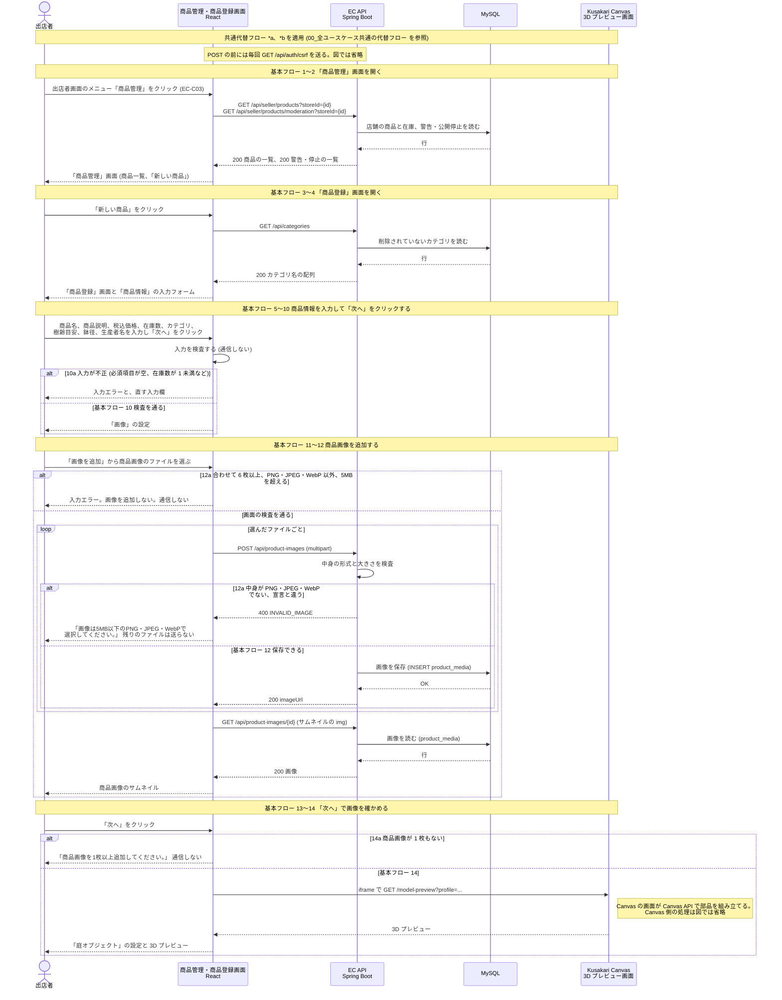
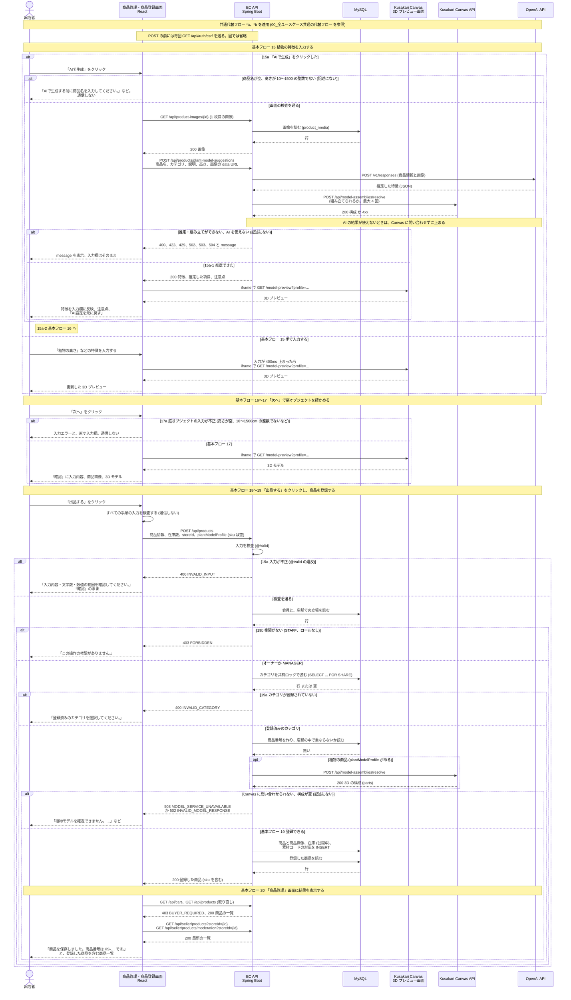
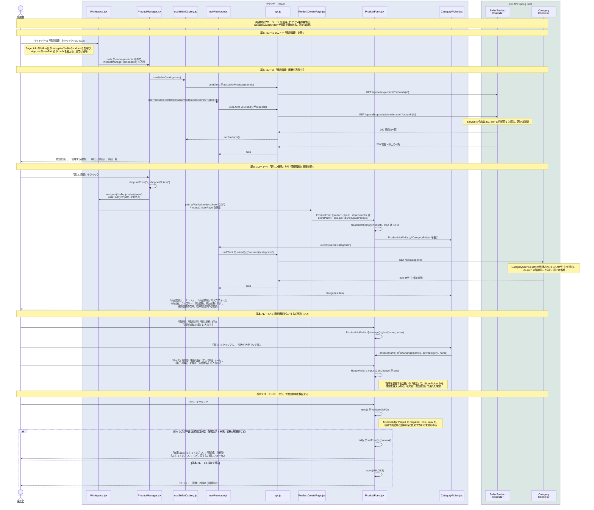
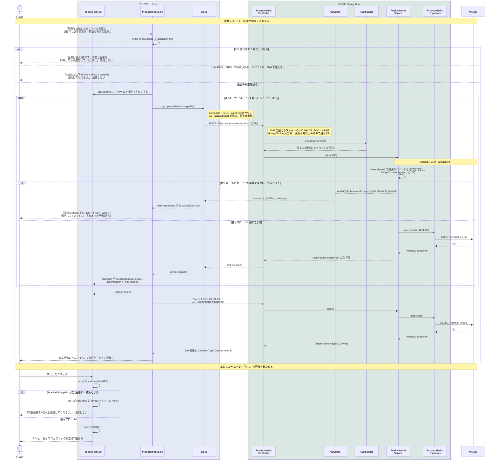
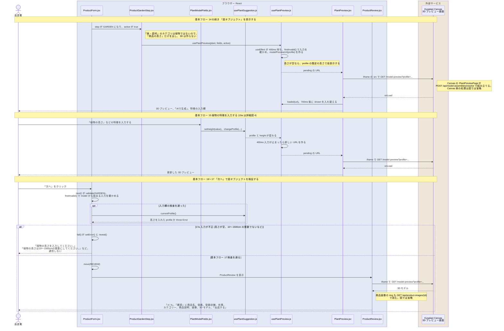
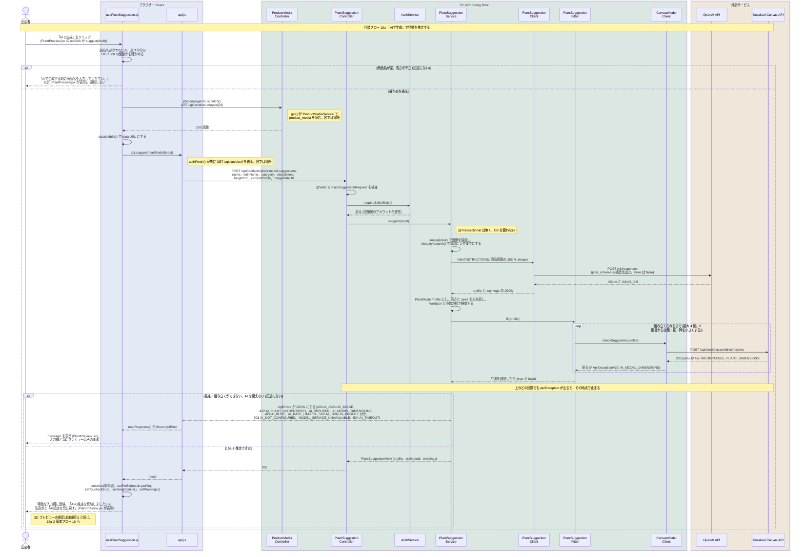
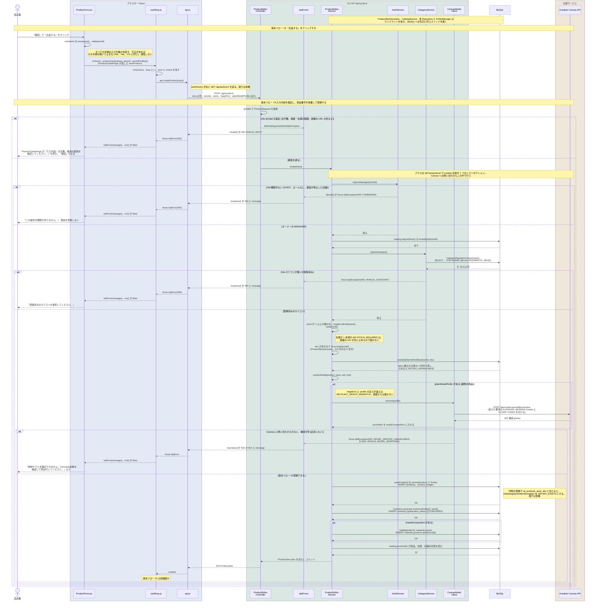
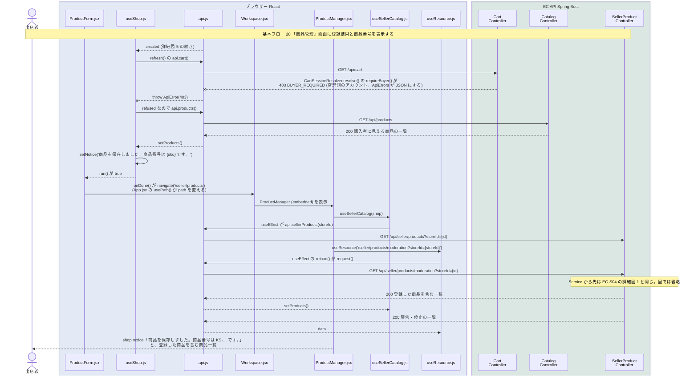

# EC-S03 商品を登録する

- ユースケース記述: [EC-S03_商品を登録する](<../../アーカイブ/ユースケース/kusakari-ec/EC-S03_商品を登録する.md>)
- 対象のコード: kusakari-ec の main（19a2be3、2026-11-20 時点）。3D プレビューと植物モデルの組み立てで使う kusakari-canvas は main（c19d497）

## 概要図 1 基本フロー 1〜14

## 概要図 2 基本フロー 15〜20

## 詳細図 1 基本フロー 1〜10

## 詳細図 2 基本フロー 11〜14

## 詳細図 3 基本フロー 14〜17

## 詳細図 4 代替フロー 15a

## 詳細図 5 基本フロー 18〜19

## 詳細図 6 基本フロー 20

## ユースケース記述との差

- 画面の文言は、記述の「カテゴリ」が「カテゴリー」、「在庫数」が「選択店舗の在庫」、「税込価格」が「税込価格（円）」です。基本フロー 11 のボタンは、画像が 1 枚も無いときは「商品の写真を選択」で、1 枚以上あると「画像を追加」になります。
- 関連情報には「「商品管理」画面の上部で選んだ店舗に商品を登録する」とあります。コードでは、「商品登録」画面の「商品情報」に「在庫を登録する店舗」（`StorePicker`）があり、ここで店舗を選び直せます。初めは「商品管理」で選んだ店舗で、選び直すと `shop.setSellerStoreId()` で「商品管理」の店舗も変わります。
- 10a、14a、17a は、すべて画面（`ProductForm.jsx` の `validate()`）だけで止まり、通信しません。サーバーにも同じ検査（400 `STOCK_REQUIRED`、400 `PLANT_HEIGHT_MISMATCH`）がありますが、画面が先に止めるので、画面からは届きません。
- 12a の枚数・形式・大きさは、まず画面（`ProductImages.upload()`）が確かめ、通信しません。サーバーは `ProductMediaService.upload()` で、先頭のバイトから形式を判定し、ファイルの `Content-Type` と違えば 400 `INVALID_IMAGE` にします。複数のファイルを選ぶと 1 枚ずつ送り、失敗するとそこで止めます。それまでに保存した画像は残ります。5MB を超えるファイルの 413 `IMAGE_TOO_LARGE` は、画面が先に止めるので届きません。
- 記述にない処理として、画像はファイルを選んだ時点で `product_media` に保存されます。商品を登録しなかったときにその画像を消す処理は、コードに見つかりません。
- 記述にない処理として、「庭オブジェクト」と「確認」では、iframe で Kusakari Canvas の 3D プレビュー画面（`/model-preview`）を開きます。「鉢・庭材」のカテゴリでは 3D を作らず、「商品の高さ」だけを入力します。
- 15a には、失敗したときの代替フローが記述にありません。コードでは、商品名が空だと通信せずに「AIで生成する前に商品名を入力してください。」を出します。サーバーからは 400、422、429、502、503、504 のエラーが返ることがあり、画面は message を出して入力を保ちます。推定の後で「AI設定を元に戻す」を押すと、推定の前の値に戻せます。
- 15a-1 の「1枚目の商品画像と商品情報から推定」は、ブラウザーが `GET /api/product-images/{id}` で 1 枚目の画像を読み、data URL にして送る形です。EC API は OpenAI の `POST /v1/responses` で推定した後、Canvas API の `POST /api/model-assemblies/resolve` で組み立てられるかを確かめます。組み立てられなければ、葉・花・幹の大きさを最大 3 回小さくして確かめ直します。
- 19 の商品番号は、`ProductSkuGenerator.next()` が `KS-年月日-6 文字` の形で作り、店舗の中で重ならないものを最大 5 回まで作り直します。作れなければ 503 `SKU_UNAVAILABLE` です。同時の登録で一意制約（`uk_products_store_sku`）に当たると 409 `SKU_EXISTS` になります。
- 記述にない処理として、植物の商品は、登録のトランザクションの中で Canvas API に構成を問い合わせ、`model_composition` に保存します。Canvas に接続できないと 503 `MODEL_SERVICE_UNAVAILABLE` で登録しません。この問い合わせは、カテゴリの共有ロック（`SELECT ... FOR SHARE`）を持ったまま行います。
- 19a でサーバーから届くのは、`@Valid` の違反（400 `INVALID_INPUT`）と、カテゴリが無いか削除済みのとき（400 `INVALID_CATEGORY`「登録済みのカテゴリを選択してください。」）です。新しい商品のカテゴリの初めの値は「庭木」（`productDraft.js` の `emptyProduct`）です。エラーは「確認」の上に出て、出店者は「前の手順へ」で戻ります。
- 19b の STAFF とロールなしの担当者も、「新しい商品」から「商品登録」画面を開け、画像の保存と「AIで生成」まで使えます。どちらも `AuthService.requireSellerRole()` で店舗側のアカウントかだけを確かめるためです。止まるのは「出品する」の後です。
- 事後条件の「公開中」は、`InventoryEntity` の `publicationStatus` の初めの値 `PUBLISHED` で `inventory` に INSERT することで満たします。`inventory.publication_status` の列の既定値は `HIDDEN` です。
- 記述にない処理として、登録の後に `useShop.js` の `refresh()` が `GET /api/cart` と `GET /api/products` を送ります。店舗側のアカウントでは `GET /api/cart` が 403 `BUYER_REQUIRED` になり、購入者向けの商品一覧だけを取り直します。

## 確かめられなかったこと

- iframe の中の Kusakari Canvas の画面（`PlantPreviewPage`）の処理は、Canvas API を呼ぶところまでしか読んでいません。iframe の中でのログインの扱いは追っていません。
- OpenAI の応答は、`PlantSuggestionClient` が送る要求と、読み取る項目（`status`、`output`、`output_text`、`refusal`）だけを見ました。実際の応答は確かめていません。
- 同時の登録で 409 `SKU_EXISTS` になることは、コードから読んだだけで、動かして確かめていません。

## 参照したコード

- [frontend/src/workspace/Workspace.jsx](https://github.com/abeouga/kusakari-ec/blob/19a2be307ee71a2cd87e538236c3c8c42929c5b3/frontend/src/workspace/Workspace.jsx): `sellerMenu`、`rolePaths`、`ProductManager` と `ProductCreatePage` の表示
- [frontend/src/workspace/navigation.js](https://github.com/abeouga/kusakari-ec/blob/19a2be307ee71a2cd87e538236c3c8c42929c5b3/frontend/src/workspace/navigation.js): `navigate()`、`usePath()`
- [frontend/src/components/ProductManager.jsx](https://github.com/abeouga/kusakari-ec/blob/19a2be307ee71a2cd87e538236c3c8c42929c5b3/frontend/src/components/ProductManager.jsx): `ProductManager`（「新しい商品」、`shop.notice` の表示）
- [frontend/src/components/useSellerCatalog.js](https://github.com/abeouga/kusakari-ec/blob/19a2be307ee71a2cd87e538236c3c8c42929c5b3/frontend/src/components/useSellerCatalog.js): `useEffect` の `api.sellerProducts()`
- [frontend/src/workspace/ProductCreatePage.jsx](https://github.com/abeouga/kusakari-ec/blob/19a2be307ee71a2cd87e538236c3c8c42929c5b3/frontend/src/workspace/ProductCreatePage.jsx): `ProductCreatePage`（`StorePicker`、`onSave={shop.saveProduct}`、`onDone`）
- [frontend/src/components/ProductForm.jsx](https://github.com/abeouga/kusakari-ec/blob/19a2be307ee71a2cd87e538236c3c8c42929c5b3/frontend/src/components/ProductForm.jsx): `validate()`、`next()`、`move()`、`fail()`、`save()`
- [frontend/src/components/ProductInfoFields.jsx](https://github.com/abeouga/kusakari-ec/blob/19a2be307ee71a2cd87e538236c3c8c42929c5b3/frontend/src/components/ProductInfoFields.jsx): 入力欄（`min={p.id ? 0 : 1}` など）、`change()`
- [frontend/src/components/CategoryPicker.jsx](https://github.com/abeouga/kusakari-ec/blob/19a2be307ee71a2cd87e538236c3c8c42929c5b3/frontend/src/components/CategoryPicker.jsx): `useResource('/categories')`、`choose()`
- [frontend/src/components/StorePicker.jsx](https://github.com/abeouga/kusakari-ec/blob/19a2be307ee71a2cd87e538236c3c8c42929c5b3/frontend/src/components/StorePicker.jsx): 「在庫を登録する店舗」
- [frontend/src/formValidity.js](https://github.com/abeouga/kusakari-ec/blob/19a2be307ee71a2cd87e538236c3c8c42929c5b3/frontend/src/formValidity.js): `firstInvalid()`
- [frontend/src/productDraft.js](https://github.com/abeouga/kusakari-ec/blob/19a2be307ee71a2cd87e538236c3c8c42929c5b3/frontend/src/productDraft.js): `emptyProduct`、`createDraft()`、`productInput()`
- [frontend/src/components/ProductImages.jsx](https://github.com/abeouga/kusakari-ec/blob/19a2be307ee71a2cd87e538236c3c8c42929c5b3/frontend/src/components/ProductImages.jsx): `upload()`、`change()`
- [frontend/src/components/ProductGardenStep.jsx](https://github.com/abeouga/kusakari-ec/blob/19a2be307ee71a2cd87e538236c3c8c42929c5b3/frontend/src/components/ProductGardenStep.jsx): `ProductGardenStep`
- [frontend/src/components/PlantModelFields.jsx](https://github.com/abeouga/kusakari-ec/blob/19a2be307ee71a2cd87e538236c3c8c42929c5b3/frontend/src/components/PlantModelFields.jsx): 「植物の高さ」（`modelHeight`）ほかの入力欄
- [frontend/src/components/usePlantSuggestion.js](https://github.com/abeouga/kusakari-ec/blob/19a2be307ee71a2cd87e538236c3c8c42929c5b3/frontend/src/components/usePlantSuggestion.js): `suggest()`、`photo()`、`dataUrl()`、`currentProfile()`、`restore()`
- [frontend/src/components/usePlantPreview.js](https://github.com/abeouga/kusakari-ec/blob/19a2be307ee71a2cd87e538236c3c8c42929c5b3/frontend/src/components/usePlantPreview.js): `usePlantPreview`（`PREVIEW_DELAY_MS`、`loaded()`）
- [frontend/src/components/PlantPreview.jsx](https://github.com/abeouga/kusakari-ec/blob/19a2be307ee71a2cd87e538236c3c8c42929c5b3/frontend/src/components/PlantPreview.jsx): iframe、「AIで生成」、「AI設定を元に戻す」
- [frontend/src/plantModel.js](https://github.com/abeouga/kusakari-ec/blob/19a2be307ee71a2cd87e538236c3c8c42929c5b3/frontend/src/plantModel.js): `modelPreviewUrl()`、`isPlantCategory()`
- [frontend/src/components/ProductReview.jsx](https://github.com/abeouga/kusakari-ec/blob/19a2be307ee71a2cd87e538236c3c8c42929c5b3/frontend/src/components/ProductReview.jsx): `ProductReview`
- [frontend/src/useShop.js](https://github.com/abeouga/kusakari-ec/blob/19a2be307ee71a2cd87e538236c3c8c42929c5b3/frontend/src/useShop.js): `saveProduct()`、`run()`、`refresh()`、`setSellerStoreId()`
- [frontend/src/workspace/useResource.js](https://github.com/abeouga/kusakari-ec/blob/19a2be307ee71a2cd87e538236c3c8c42929c5b3/frontend/src/workspace/useResource.js): `useResource` の `reload()`
- [frontend/src/api.js](https://github.com/abeouga/kusakari-ec/blob/19a2be307ee71a2cd87e538236c3c8c42929c5b3/frontend/src/api.js): `uploadProductImage()`、`suggestPlantModel()`、`createProduct()`、`sellerProducts()`、`cart()`、`products()`、`readResponse()`
- [frontend/src/auth.js](https://github.com/abeouga/kusakari-ec/blob/19a2be307ee71a2cd87e538236c3c8c42929c5b3/frontend/src/auth.js): `authFetch()`
- [backend/src/main/java/jp/kusakari/ec/catalog/controller/SellerProductController.java](https://github.com/abeouga/kusakari-ec/blob/19a2be307ee71a2cd87e538236c3c8c42929c5b3/backend/src/main/java/jp/kusakari/ec/catalog/controller/SellerProductController.java): `list()`、`moderation()`
- [backend/src/main/java/jp/kusakari/ec/catalog/controller/CategoryController.java](https://github.com/abeouga/kusakari-ec/blob/19a2be307ee71a2cd87e538236c3c8c42929c5b3/backend/src/main/java/jp/kusakari/ec/catalog/controller/CategoryController.java): `list()`
- [backend/src/main/java/jp/kusakari/ec/catalog/controller/ProductMediaController.java](https://github.com/abeouga/kusakari-ec/blob/19a2be307ee71a2cd87e538236c3c8c42929c5b3/backend/src/main/java/jp/kusakari/ec/catalog/controller/ProductMediaController.java): `upload()`、`get()`
- [backend/src/main/java/jp/kusakari/ec/catalog/service/ProductMediaService.java](https://github.com/abeouga/kusakari-ec/blob/19a2be307ee71a2cd87e538236c3c8c42929c5b3/backend/src/main/java/jp/kusakari/ec/catalog/service/ProductMediaService.java): `upload()`、`get()`、`detect()`
- [backend/src/main/java/jp/kusakari/ec/catalog/controller/PlantSuggestionController.java](https://github.com/abeouga/kusakari-ec/blob/19a2be307ee71a2cd87e538236c3c8c42929c5b3/backend/src/main/java/jp/kusakari/ec/catalog/controller/PlantSuggestionController.java): `suggest()`
- [backend/src/main/java/jp/kusakari/ec/catalog/service/PlantSuggestionService.java](https://github.com/abeouga/kusakari-ec/blob/19a2be307ee71a2cd87e538236c3c8c42929c5b3/backend/src/main/java/jp/kusakari/ec/catalog/service/PlantSuggestionService.java): `suggest()`、`image()`
- [backend/src/main/java/jp/kusakari/ec/catalog/service/PlantSuggestionClient.java](https://github.com/abeouga/kusakari-ec/blob/19a2be307ee71a2cd87e538236c3c8c42929c5b3/backend/src/main/java/jp/kusakari/ec/catalog/service/PlantSuggestionClient.java): `infer()`
- [backend/src/main/java/jp/kusakari/ec/catalog/service/PlantSuggestionFitter.java](https://github.com/abeouga/kusakari-ec/blob/19a2be307ee71a2cd87e538236c3c8c42929c5b3/backend/src/main/java/jp/kusakari/ec/catalog/service/PlantSuggestionFitter.java): `fit()`
- [backend/src/main/java/jp/kusakari/ec/catalog/service/CanvasModelClient.java](https://github.com/abeouga/kusakari-ec/blob/19a2be307ee71a2cd87e538236c3c8c42929c5b3/backend/src/main/java/jp/kusakari/ec/catalog/service/CanvasModelClient.java): `resolve()`、`checkSuggestion()`
- [backend/src/main/java/jp/kusakari/ec/common/CanvasClientConfiguration.java](https://github.com/abeouga/kusakari-ec/blob/19a2be307ee71a2cd87e538236c3c8c42929c5b3/backend/src/main/java/jp/kusakari/ec/common/CanvasClientConfiguration.java): `canvasClient()`（Cookie と CSRF の見出しを引き継ぐ）
- [backend/src/main/java/jp/kusakari/ec/catalog/controller/ProductEditorController.java](https://github.com/abeouga/kusakari-ec/blob/19a2be307ee71a2cd87e538236c3c8c42929c5b3/backend/src/main/java/jp/kusakari/ec/catalog/controller/ProductEditorController.java): `create()`
- [backend/src/main/java/jp/kusakari/ec/catalog/service/ProductEditorService.java](https://github.com/abeouga/kusakari-ec/blob/19a2be307ee71a2cd87e538236c3c8c42929c5b3/backend/src/main/java/jp/kusakari/ec/catalog/service/ProductEditorService.java): `create()`、`resolveModel()`、`linkMaterial()`、`saveProduct()`
- [backend/src/main/java/jp/kusakari/ec/catalog/service/ProductSkuGenerator.java](https://github.com/abeouga/kusakari-ec/blob/19a2be307ee71a2cd87e538236c3c8c42929c5b3/backend/src/main/java/jp/kusakari/ec/catalog/service/ProductSkuGenerator.java): `next()`
- [backend/src/main/java/jp/kusakari/ec/catalog/service/CategoryService.java](https://github.com/abeouga/kusakari-ec/blob/19a2be307ee71a2cd87e538236c3c8c42929c5b3/backend/src/main/java/jp/kusakari/ec/catalog/service/CategoryService.java): `require()`、`list()`
- [backend/src/main/java/jp/kusakari/ec/catalog/persistence/repository/CategoryRepository.java](https://github.com/abeouga/kusakari-ec/blob/19a2be307ee71a2cd87e538236c3c8c42929c5b3/backend/src/main/java/jp/kusakari/ec/catalog/persistence/repository/CategoryRepository.java): `share()`
- [backend/src/main/java/jp/kusakari/ec/catalog/service/CatalogService.java](https://github.com/abeouga/kusakari-ec/blob/19a2be307ee71a2cd87e538236c3c8c42929c5b3/backend/src/main/java/jp/kusakari/ec/catalog/service/CatalogService.java): `requireStore()`、`product()`
- [backend/src/main/java/jp/kusakari/ec/catalog/persistence/repository/ProductRepository.java](https://github.com/abeouga/kusakari-ec/blob/19a2be307ee71a2cd87e538236c3c8c42929c5b3/backend/src/main/java/jp/kusakari/ec/catalog/persistence/repository/ProductRepository.java): `existsByStoreIdAndSku()`
- [backend/src/main/java/jp/kusakari/ec/catalog/persistence/entity/InventoryEntity.java](https://github.com/abeouga/kusakari-ec/blob/19a2be307ee71a2cd87e538236c3c8c42929c5b3/backend/src/main/java/jp/kusakari/ec/catalog/persistence/entity/InventoryEntity.java): `publicationStatus = PUBLISHED`
- [backend/src/main/java/jp/kusakari/ec/catalog/dto/ProductRequest.java](https://github.com/abeouga/kusakari-ec/blob/19a2be307ee71a2cd87e538236c3c8c42929c5b3/backend/src/main/java/jp/kusakari/ec/catalog/dto/ProductRequest.java): 検査の注釈
- [backend/src/main/java/jp/kusakari/ec/auth/AuthService.java](https://github.com/abeouga/kusakari-ec/blob/19a2be307ee71a2cd87e538236c3c8c42929c5b3/backend/src/main/java/jp/kusakari/ec/auth/AuthService.java): `requireManager()`、`requireSellerRole()`、`requireBuyer()`
- [backend/src/main/java/jp/kusakari/ec/commerce/controller/CartController.java](https://github.com/abeouga/kusakari-ec/blob/19a2be307ee71a2cd87e538236c3c8c42929c5b3/backend/src/main/java/jp/kusakari/ec/commerce/controller/CartController.java): `get()`
- [backend/src/main/java/jp/kusakari/ec/commerce/session/CartSessionResolver.java](https://github.com/abeouga/kusakari-ec/blob/19a2be307ee71a2cd87e538236c3c8c42929c5b3/backend/src/main/java/jp/kusakari/ec/commerce/session/CartSessionResolver.java): `resolve()`
- [backend/src/main/java/jp/kusakari/ec/catalog/controller/CatalogController.java](https://github.com/abeouga/kusakari-ec/blob/19a2be307ee71a2cd87e538236c3c8c42929c5b3/backend/src/main/java/jp/kusakari/ec/catalog/controller/CatalogController.java): `products()`
- [backend/src/main/java/jp/kusakari/ec/common/web/ApiErrors.java](https://github.com/abeouga/kusakari-ec/blob/19a2be307ee71a2cd87e538236c3c8c42929c5b3/backend/src/main/java/jp/kusakari/ec/common/web/ApiErrors.java): `business()`、`invalid()`、`imageTooLarge()`、`conflict()`
- [backend/src/main/resources/application.properties](https://github.com/abeouga/kusakari-ec/blob/19a2be307ee71a2cd87e538236c3c8c42929c5b3/backend/src/main/resources/application.properties): `spring.servlet.multipart.max-file-size`
- [backend/src/main/resources/db/migration/V1__schema.sql](https://github.com/abeouga/kusakari-ec/blob/19a2be307ee71a2cd87e538236c3c8c42929c5b3/backend/src/main/resources/db/migration/V1__schema.sql): `products`（`uk_products_store_sku`）、`inventory`、`product_images`、`product_media`、`material_products`
- [backend/src/main/resources/db/migration/V2__sample_data.sql](https://github.com/abeouga/kusakari-ec/blob/19a2be307ee71a2cd87e538236c3c8c42929c5b3/backend/src/main/resources/db/migration/V2__sample_data.sql): `categories` の初めの行
- [frontend/src/pages/App.jsx](https://github.com/abeouga/kusakari-canvas/blob/c19d497dfef15b119f9bce8ecb5c886a36da6b7d/frontend/src/pages/App.jsx): kusakari-canvas の `/model-preview` の表示
- [frontend/src/pages/PlantPreviewPage.jsx](https://github.com/abeouga/kusakari-canvas/blob/c19d497dfef15b119f9bce8ecb5c886a36da6b7d/frontend/src/pages/PlantPreviewPage.jsx): kusakari-canvas の `PlantPreviewPage`（`POST /api/model-assemblies/resolve`）
- [backend/kusakari_canvas_api/main.py](https://github.com/abeouga/kusakari-canvas/blob/c19d497dfef15b119f9bce8ecb5c886a36da6b7d/backend/kusakari_canvas_api/main.py): kusakari-canvas の `/api/model-assemblies/resolve`
