# EC-S04 商品情報を編集する

```mermaid
sequenceDiagram
    autonumber
    actor User as 出店者
    box rgba(47,111,219,0.10) ブラウザー React
        participant Work as 出店者画面の枠<br/>Workspace<br/>(Workspace.jsx)
        participant Mgr as 商品管理画面<br/>ProductManager<br/>(ProductManager.jsx)
        participant List as 商品一覧<br/>SellerProductList<br/>(SellerProductList.jsx)
        participant Form as 編集フォーム<br/>ProductForm<br/>(ProductForm.jsx)
        participant Picker as カテゴリーの選択<br/>CategoryPicker<br/>(CategoryPicker.jsx)
        participant Cat as 出店者の商品一覧と保存<br/>useSellerCatalog<br/>(useSellerCatalog.js)
        participant Shop as 購入者向けの商品<br/>useShop<br/>(useShop.js)
        participant Hook as 警告とカテゴリーの取得<br/>useResource<br/>(useResource.js)
        participant Http as 通信<br/>request<br/>(api.js)
        participant AuthJs as 通信の準備<br/>authFetch<br/>(auth.js)
    end
    box rgba(27,127,92,0.12) EC API Spring Boot
        participant AuthCtrl as ログイン状態API<br/>AuthController<br/>(AuthController.java)
        participant SPC as 出店者の商品API<br/>SellerProductController<br/>(SellerProductController.java)
        participant CatCtrl as カテゴリーAPI<br/>CategoryController<br/>(CategoryController.java)
        participant EdCtrl as 商品の登録・編集API<br/>ProductEditorController<br/>(ProductEditorController.java)
        participant CartCtrl as カートAPI<br/>CartController<br/>(CartController.java)
        participant CatalogCtrl as 購入者向けの商品API<br/>CatalogController<br/>(CatalogController.java)
        participant SPSvc as 出店者の商品の処理<br/>SellerProductService<br/>(SellerProductService.java)
        participant ModSvc as 商品への運営の警告<br/>ProductModerationService<br/>(ProductModerationService.java)
        participant EdSvc as 商品の登録・編集の処理<br/>ProductEditorService<br/>(ProductEditorService.java)
        participant CatgSvc as カテゴリーの処理<br/>CategoryService<br/>(CategoryService.java)
        participant CatalogSvc as 商品の読み込み<br/>CatalogService<br/>(CatalogService.java)
        participant Auth as ログイン中の会員<br/>AuthService<br/>(AuthService.java)
        participant CModel as Canvas への問い合わせ<br/>CanvasModelClient<br/>(CanvasModelClient.java)
        participant ProdRepo as 商品の読み書き<br/>ProductRepository<br/>(ProductRepository.java)
        participant InvRepo as 在庫の読み書き<br/>InventoryRepository<br/>(InventoryRepository.java)
    end
    box rgba(27,127,92,0.12) Canvas API FastAPI
        participant CApi as 植物の組み立てAPI<br/>resolve_model<br/>(main.py)
    end
    participant Db as MySQL

    Note over User,Db: 共通代替フロー<br/>*b 未ログインの場合: 2 (URL を直接開いたときのログインの確認)、4、9、18、32、一覧の取り直しの 45、購入者向けの商品の 48・50 に適用<br/>*a 通信に失敗した場合: 4、9、18、30、32、一覧の取り直しの 45、購入者向けの商品の 48・50 に適用

    User->>Work: 出店者メニューの「商品管理」をクリック
    Work->>Mgr: URL を /seller/products に変え、<br/>ProductManager を表示 (embedded)
    par 商品の一覧
        Mgr->>Cat: 選んでいる店舗の商品を取りに行くよう頼む (useSellerCatalog)
        Cat->>SPC: 画面を開いたときに自動で一覧の通信を始める<br/>(useEffect → api.sellerProducts → request)<br/>GET /api/seller/products?storeId={id}
        SPC->>SPSvc: 出店者の商品一覧を作るよう頼む (list)。読むだけのトランザクション<br/>その店舗の商品を見られるかを確かめ (requireStoreViewer。ロールのない担当者も見られる)、<br/>商品を追加した人の名前を読む (ProductRepository.findCreatorNamesAtStore、SELECT products JOIN members)
        SPSvc->>CatalogSvc: 店舗の削除されていない商品を集めるよう頼む (storeProducts)<br/>店舗を確かめ (requireStore)、商品・画像を読み (findNotDeletedAtStore。在庫が DELETED の商品を除き、非公開の商品は含む)、<br/>在庫・店舗・組織を読む (listings、SELECT products、product_images、inventory、stores、organizations)
        SPC-->>Cat: 200 3D の構成を外し、追加した人の名前を付けた商品の配列<br/>(toSellerView。stock、publicationStatus、createdByName ほか。setProducts)
    and 運営からの警告・停止
        Mgr->>Hook: 店舗の商品への警告・停止を取りに行くよう頼む (useResource)
        Hook->>SPC: 画面を開いたときに自動で通信を始める (reload → request)<br/>GET /api/seller/products/moderation?storeId={id}
        SPC->>ModSvc: 店舗の商品への警告・停止を集めるよう頼む (moderation → noticesAt)。読むだけのトランザクション<br/>見られるかを確かめ (requireStoreViewer)、警告と解除の履歴 (findAtStore、product_moderation_events)、<br/>公開停止中の商品 (findSuspendedIdsAtStore)、警告中か停止中の商品名と削除の有無 (findImageReferences) を読む
        SPC-->>Hook: 200 削除されていない商品の警告・停止の配列
    end
    Mgr-->>User: 「運営からの警告・停止」欄 (商品名、「運営により公開停止中」、<br/>「警告中」「運営からの警告：理由」)、商品一覧 (公開状態、在庫、<br/>「追加した人：…」、「警告中」「運営により公開停止中」のバッジ、行ごとの「編集」)

    User->>List: 編集対象の商品の行の「編集」をクリック
    List->>Mgr: 選んだ商品を編集するよう伝える (setSelected([]) → onEdit → edit)
    Mgr->>Form: フォームを開いたときの在庫数を覚え、<br/>編集フォームを表示 (setExpectedStock(product.stock)、setEditing → ProductForm)
    Form->>Picker: 商品の値を入れた入力欄とカテゴリーの選択を表示<br/>(createDraft(product)、ProductInfoFields → CategoryPicker)
    Picker->>Hook: カテゴリーの一覧を取りに行くよう頼む (useResource)
    Hook->>CatCtrl: 自動で通信を始める (reload → request)<br/>GET /api/categories
    CatCtrl->>CatgSvc: カテゴリー名の一覧を作るよう頼む (list)<br/>削除されていないカテゴリーを読む (CategoryRepository.findByDeletedAtIsNull、SELECT categories)
    CatCtrl-->>Picker: 200 名前順のカテゴリー名の配列
    Mgr-->>User: 商品一覧を隠し、「戻る」、「変更前の在庫数：N」、<br/>「商品情報」「画像」「庭オブジェクト」のタブ、商品番号と<br/>「商品番号は変更できません。」、入力欄、「変更を保存」

    User->>Form: 編集フォームの入力欄で商品情報を変更する<br/>(「商品名」「商品説明」「税込価格（円）」「選択店舗の在庫」、<br/>「カテゴリーを選ぶ」など。タブで「画像」「庭オブジェクト」も開ける)
    Form->>Form: 入力を下書きに入れる (ProductInfoFields の change → set)<br/>画像の追加、3D プレビュー、「AIで生成」は EC-S03 の図と同じ通信をする
    opt 編集を中止する (関連情報)
        User->>Mgr: 「戻る」をクリック
        Note over User,Mgr: 結果: 保存せず、通信しない (resetEditor)。<br/>画面: 編集フォームを閉じて商品一覧に戻る。
    end

    User->>Form: 「変更を保存」をクリック
    Form->>Form: すべてのタブの入力を確かめる (save → validate(null)。<br/>firstInvalid、商品名・説明、画像、plant.currentProfile)
    Form->>Cat: 入力をまとめ、フォームを開いたときの在庫数を付けて保存を頼む<br/>(onSave → productInput → ProductManager の save → catalog.save、expectedStock)
    Cat->>Http: 商品を書き換える通信を送る<br/>(write → api.updateProduct → request)
    Http->>AuthJs: 書き込みの前に CSRF トークンを取るよう頼む (authFetch)
    AuthJs->>AuthCtrl: GET /api/auth/csrf
    AuthCtrl-->>AuthJs: 200 ヘッダー名とトークン (csrf)
    AuthJs->>EdCtrl: PUT /api/products/{id}<br/>(storeId、sku、stock、expectedStock、heightCm、plantModelProfile ほか)
    EdCtrl->>EdCtrl: 入力を検査する (@Valid の ProductRequest)
    EdCtrl->>EdSvc: 商品を書き換えるよう頼む (update)<br/>update 全体が 1 つのトランザクション。例外が出るとすべて取り消す
    EdSvc->>CatgSvc: カテゴリーが登録済みかを確かめる (require)<br/>カテゴリーを共有ロックで読む (CategoryRepository.share、SELECT ... FOR SHARE categories)
    EdSvc->>ProdRepo: 商品の行をロックして読む (findLocked、SELECT ... FOR UPDATE products)
    EdSvc->>Auth: 商品の店舗を扱えるか (STAFF 以上か) を確かめる<br/>(requireProductStore → requireStoreRole。会員、店舗、組織、担当とロールを読む)
    EdSvc->>InvRepo: 店舗と商品番号が変わっていないかを確かめ (画面はそのまま送るので通る)、<br/>在庫の行をロックして読む (lock、SELECT ... FOR UPDATE inventory)
    EdSvc->>EdSvc: 入力を商品に書き込む (mapper.updateEntity)。<br/>植物の構成を作り直すかを決める (resolveModel)
    opt 植物の特徴が前と違う、構成がない、構成の version が 4 未満
        CModel->>CApi: 植物の 3D の構成を作るよう頼む (EdSvc の resolve から)<br/>POST /api/model-assemblies/resolve<br/>(受けた要求の KUSAKARI_SESSION Cookie と X-CSRF-TOKEN を付ける)
        Note over EdSvc,CApi: 結果: 構成 (parts) を modelComposition に入れる。Canvas に問い合わせられないか構成が空 (記述なし) なら、<br/>503 MODEL_SERVICE_UNAVAILABLE か 502 INVALID_MODEL_RESPONSE を返して保存しない (画面の上部に「植物モデルを確定できません。…」など)
    end
    EdSvc->>Db: 商品・商品画像・在庫数を書き換える (saveProduct → entityManager.flush、<br/>InventoryRepository の setQuantity → save。UPDATE products、product_images、inventory)。<br/>構成があれば素材コードと商品の対応を保存する (linkMaterial → MaterialProductRepository.save、material_products)
    EdSvc->>CatalogSvc: 更新後の商品を読むよう頼む (product → listingsByIds)
    EdCtrl-->>Http: update が終わるとコミットし、200 更新後の商品
    Http-->>Cat: 更新後の商品
    par 出店者の一覧
        Cat->>SPC: 出店者の一覧を取り直す (refresh → api.sellerProducts)<br/>GET /api/seller/products?storeId={id}。流れは 4〜7 と同じ
        SPC-->>Cat: 200 最新の商品の配列 (setProducts)
    and 購入者向けの商品
        Cat->>Shop: 購入者向けの商品も取り直すよう頼む (shop.refreshProducts → refresh)
        Shop->>CartCtrl: カートを読む (api.cart)<br/>GET /api/cart
        CartCtrl-->>Shop: 403「店舗・出店申請用のアカウントでは購入できません。…」<br/>(CartSessionResolver.resolve → requireBuyer、BUYER_REQUIRED)
        Shop->>CatalogCtrl: 購入を断られたので、購入者向けの商品だけを読む (api.products)<br/>GET /api/products
        CatalogCtrl-->>Shop: 200 購入者に見える商品の配列 (setProducts)
    end
    Cat-->>Form: 成功を返す (shop.setNotice('商品を保存しました。')、saved が true)。<br/>ProductManager の save が true を返し、編集フォームを閉じる (onDone → resetEditor)
    Mgr-->>User: 「商品を保存しました。」と、更新後の商品一覧
```

- ユースケース記述: [EC-S04_商品情報を編集する](<../../アーカイブ/ユースケース/kusakari-ec/EC-S04_商品情報を編集する.md>)
- 共通代替フロー: [00_全ユースケース共通の代替フロー](<00_全ユースケース共通の代替フロー.md>)
- 対象のコード: kusakari-ec の main（6bad7e3、2026-11-24 時点）。植物モデルの組み立てで呼ぶ kusakari-canvas は main（7e9a8dd、2026-11-24 時点）

## シーケンス図

参加者は、上から「画面や役割の名前」「コンポーネント・クラスの名前」「ファイル名（かっこ付き）」の順に書いています。
Repository は、商品（`ProductRepository`）と在庫（`InventoryRepository`）だけを参加者にし、ほかは矢印の文に Repository とメソッドの名前を書いています。
共通代替フローの中身は、00 の図か、下の「共通代替フローを直接書いた図」を見てください。
エラーの代替フローは図に描かず、図の下に並べています。植物の構成の取り直し（Canvas API への問い合わせと 502・503）と「戻る」は、`opt` の中の矢印 1 本と Note にしています。

図に描いていない代替フロー：7a（入力の誤り、カテゴリーが無い）、8a（削除した商品）、8b（在庫数が変わっていた）、8c（編集の権限がない）、（記述なし）の分岐

## 共通代替フローを直接書いた図

上の図の、画面を開いて一覧を取る通信と、保存の通信（CSRF トークンの取得と `PUT /api/products/{id}`）に、この画面で起こる共通代替フロー（\*a、\*b）を書き込んだ図です。`useSellerCatalog.js` は `useResource.js` を使わないので、エラーの文は画面の上部に出て、「再取得」のボタンはありません。警告・停止（`GET /api/seller/products/moderation`）とカテゴリー（`GET /api/categories`）の取得の失敗は、「ユースケース記述との差」に書きます。保存の失敗の後の一覧の取り直しと、保存の後の取り直し（上の図の 45・48・50）の失敗は、最後の `opt` にまとめています。

```mermaid
sequenceDiagram
    autonumber
    actor User as 出店者
    box rgba(47,111,219,0.10) ブラウザー React
        participant Work as 出店者画面の枠<br/>Workspace<br/>(Workspace.jsx)
        participant UseAuth as ログイン状態の読み込み<br/>useAuth<br/>(useAuth.js)
        participant Panel as ログイン欄<br/>AuthPanel<br/>(AuthPanel.jsx)
        participant Mgr as 商品管理画面<br/>ProductManager<br/>(ProductManager.jsx)
        participant Form as 編集フォーム<br/>ProductForm<br/>(ProductForm.jsx)
        participant Cat as 出店者の商品一覧と保存<br/>useSellerCatalog<br/>(useSellerCatalog.js)
        participant Http as 通信<br/>request<br/>(api.js)
        participant AuthJs as 通信の準備<br/>authFetch<br/>(auth.js)
        participant Notice as 期限切れのお知らせ<br/>SessionNotice<br/>(SessionNotice.jsx)
    end
    box rgba(27,127,92,0.12) EC API Spring Boot
        participant AuthCtrl as ログイン状態API<br/>AuthController<br/>(AuthController.java)
        participant PwCtrl as ログインAPI<br/>PasswordLoginController<br/>(PasswordLoginController.java)
        participant Filter as セッションの確認<br/>SessionValidityFilter<br/>(SessionValidityFilter.java)
        participant SPC as 出店者の商品API<br/>SellerProductController<br/>(SellerProductController.java)
        participant EdCtrl as 商品の登録・編集API<br/>ProductEditorController<br/>(ProductEditorController.java)
        participant EdSvc as 商品の登録・編集の処理<br/>ProductEditorService<br/>(ProductEditorService.java)
    end
    participant Db as MySQL
    box rgba(180,120,20,0.12) 外部サービス
        participant Cog as Amazon Cognito
    end

    alt URL を直接開いた (/seller/products を開いた、再読み込みした)
        User->>UseAuth: /seller/products の URL を開く
        alt *a ログイン状態を読めない
            UseAuth-xAuthCtrl: GET /api/auth/me (readSession)
            UseAuth-->>Work: 失敗の文 (fetch の例外の文。共通のメッセージにはならない)
            Work-->>User: *a-1 その文だけを表示。「再取得」はなく、やり直しはブラウザーの再読み込み
        else *b ログインしていない
            UseAuth->>AuthCtrl: GET /api/auth/me (readSession)
            AuthCtrl-->>UseAuth: 200 authenticated=false
            UseAuth-->>Work: ログインしていない
            Work->>Panel: 画面の代わりにログイン欄を表示 (AuthPanel)
            Panel-->>User: *b-1「メールアドレス」「パスワード」「ログイン」
            User->>Panel: 入力して「ログイン」をクリック
            Panel->>PwCtrl: ログインする (submit → passwordLogin)<br/>GET /api/auth/csrf の後に POST /api/auth/login。returnTo は今の URL
            PwCtrl->>Cog: メールアドレスとパスワードを確かめる<br/>(InitiateAuth USER_PASSWORD_AUTH、CognitoPasswordLogin.java)
            Cog-->>PwCtrl: ID トークンと refresh トークン
            PwCtrl-->>Panel: 200 戻り先 (returnTo)
            Panel-->>User: *b-2 /seller/products を読み込み直す (complete → window.location.replace)<br/>この図の最初からやり直す
        else ログインしている
            UseAuth->>AuthCtrl: GET /api/auth/me (readSession)
            AuthCtrl-->>UseAuth: 200 authenticated=true
            UseAuth-->>Work: ログイン中の会員
        end
    else メニューから開いた (ログイン状態は読み直さない)
        User->>Work: 出店者メニューの「商品管理」をクリック
    end
    Work->>Mgr: ProductManager を表示
    Mgr->>Cat: 選んでいる店舗の商品を取りに行くよう頼む (useSellerCatalog)
    Cat->>Http: 自動で一覧の通信を始める (useEffect → api.sellerProducts → request)
    alt *a GET が届かない、または応答が JSON でない
        Http-xFilter: GET /api/seller/products?storeId={id}
        Http->>Http: 通信の失敗にまとめる<br/>(send か readResponse → ApiError(networkErrorMessage, 0))
        Http--xCat: エラーを投げる
        Cat-->>Mgr: エラーの文 (useEffect の catch → setError)
        Mgr-->>User: *a-1 画面の上部に「サーバーに接続できません。<br/>接続を確認して再試行してください。」。商品一覧は空。<br/>「再取得」はなく、*a-3 はメニューからもう一度開くか、再読み込み
    else *b ログインの期限切れ (サーバーのセッションがない、refresh トークンが失効)
        Http->>Filter: GET /api/seller/products?storeId={id}
        Filter-->>Http: 401 LOGIN_REQUIRED<br/>(セッションが無いときは AuthConfiguration.java が返す)
        Http->>Notice: 期限切れを知らせる<br/>(wasSignedIn が真なので kusakari-session-expired)
        Http--xCat: エラーを投げる (ApiError(sessionExpiredMessage, 401))
        Cat-->>Mgr: エラーの文 (useEffect の catch → setError)
        Notice-->>User: *b-1「ログインの有効期限が切れました。もう一度ログインしてください。」<br/>「ログインする」「閉じる」(「ログインする」の後は *b-2 で /seller/products に戻る)
    else *a ID トークンの更新で Cognito に届かない
        Http->>Filter: GET /api/seller/products?storeId={id}
        Filter-xCog: ID トークンを更新する<br/>(InitiateAuth REFRESH_TOKEN_AUTH、CognitoPasswordLogin.java)
        Filter-->>Http: 503 AUTH_UNAVAILABLE (セッションは残す)
        Http--xCat: エラーを投げる (ApiError 503)
        Cat-->>Mgr: エラーの文 (useEffect の catch → setError)
        Mgr-->>User: *a-1 画面の上部に「認証を確認できません。<br/>時間をおいて再試行してください。」。商品一覧は空
    else *a MySQL との通信に失敗
        Http->>Filter: GET /api/seller/products?storeId={id}
        Filter->>SPC: 要求を通す (chain.doFilter)
        SPC->>Db: 会員の立場、商品、在庫、店舗、組織を読む (上の図の 5〜6)
        Db--xSPC: 失敗 (DataAccessException)
        SPC-->>Http: 503 DATABASE_UNAVAILABLE (ApiErrors.java の database)
        Http--xCat: エラーを投げる (ApiError 503)
        Cat-->>Mgr: エラーの文 (useEffect の catch → setError)
        Mgr-->>User: *a-1 画面の上部に「保存処理を完了できませんでした。<br/>時間をおいて再試行してください。」。商品一覧は空
    else 読めた
        Http->>Filter: GET /api/seller/products?storeId={id}
        Filter->>SPC: 要求を通す (chain.doFilter)
        SPC-->>Http: 200 商品の配列 (上の図の 5〜7)
        Http-->>Cat: 商品の一覧
        Mgr-->>User: 商品一覧と行ごとの「編集」
        User->>Mgr: 「編集」をクリックし、入力欄を変更して「変更を保存」をクリック<br/>(上の図の 13〜27)
        Mgr->>Cat: 保存を頼む (catalog.save)
        Cat->>Http: 書き換える通信を送る (write → api.updateProduct → request)
        Http->>AuthJs: 書き込みの前に CSRF トークンを取るよう頼む (authFetch)
        alt *a CSRF トークンを取れない (届かない、または 200 以外)
            AuthJs-xAuthCtrl: GET /api/auth/csrf
            AuthJs--xHttp: エラーを投げる
            Http->>Http: 通信の失敗にまとめる<br/>(send の catch → ApiError(networkErrorMessage, 0))
            Http--xCat: エラーを投げる
            Cat-->>Mgr: エラーの文と失敗 (write の catch → setError、<br/>一覧の取り直しは下の opt)
            Mgr-->>User: *a-1 画面の上部に「サーバーに接続できません。<br/>接続を確認して再試行してください。」。*a-2 編集フォームは開いたままで、入力は残る
        else CSRF トークンを取れた
            AuthJs->>AuthCtrl: GET /api/auth/csrf
            AuthCtrl-->>AuthJs: 200 ヘッダー名とトークン
            alt *a PUT が届かない、または応答が JSON でない (保存されたかは分からない)
                AuthJs-xFilter: PUT /api/products/{id}
                Http->>Http: 通信の失敗にまとめる<br/>(send か readResponse → ApiError(networkErrorMessage, 0))
                Http--xCat: エラーを投げる
                Cat-->>Mgr: エラーの文と失敗 (write の catch → setError)
                Mgr-->>User: *a-1 画面の上部に「サーバーに接続できません。<br/>接続を確認して再試行してください。」。*a-2 入力は残る
            else *b ログインの期限切れ (サーバーのセッションがない、refresh トークンが失効)
                AuthJs->>Filter: PUT /api/products/{id}
                Filter-->>Http: 401 LOGIN_REQUIRED<br/>(セッションが無いときは AuthConfiguration.java が返す)
                Http->>Notice: 期限切れを知らせる<br/>(wasSignedIn が真なので kusakari-session-expired)
                Http--xCat: エラーを投げる (ApiError(sessionExpiredMessage, 401))
                Cat-->>Mgr: エラーの文と失敗 (write の catch → setError)
                Notice-->>User: *b-1「ログインの有効期限が切れました。<br/>もう一度ログインしてください。」「ログインする」「閉じる」
                alt ログインする
                    User->>Notice: 「ログインする」をクリック
                    Notice->>AuthJs: ログイン画面へ移る (login)
                    AuthJs-->>User: /account/login?returnTo=/seller/products のログイン画面<br/>(*b-2 ログインの後は商品管理画面を開き直す。編集中の入力は残らない)
                else 閉じる
                    User->>Notice: 「閉じる」をクリック
                    Notice-->>User: お知らせを閉じる (setExpired(false))。<br/>編集フォームと入力は残る。ログインはしていない
                end
            else *a ID トークンの更新で Cognito に届かない
                AuthJs->>Filter: PUT /api/products/{id}
                Filter-xCog: ID トークンを更新する<br/>(InitiateAuth REFRESH_TOKEN_AUTH、CognitoPasswordLogin.java)
                Filter-->>Http: 503 AUTH_UNAVAILABLE (セッションは残す)
                Http--xCat: エラーを投げる (ApiError 503)
                Cat-->>Mgr: エラーの文と失敗 (write の catch → setError)
                Mgr-->>User: *a-1 画面の上部に「認証を確認できません。<br/>時間をおいて再試行してください。」。*a-2 入力は残る
            else 要求が Controller まで届いた
                AuthJs->>Filter: PUT /api/products/{id}
                Filter->>EdCtrl: 要求を通す (chain.doFilter)
                EdCtrl->>EdSvc: 商品を書き換えるよう頼む (update)
                EdSvc->>Db: カテゴリー・商品・在庫をロックして確かめ、<br/>書き換えてコミットする (上の図の 35〜42)
                alt *a MySQL との通信に失敗
                    Db--xEdSvc: 失敗 (DataAccessException)。<br/>トランザクションの変更はすべて取り消す
                    EdSvc--xEdCtrl: 例外
                    EdCtrl-->>Http: 503 DATABASE_UNAVAILABLE (ApiErrors.java の database)
                    Http--xCat: エラーを投げる (ApiError 503)
                    Cat-->>Mgr: エラーの文と失敗 (write の catch → setError)
                    Mgr-->>User: *a-1 画面の上部に「保存処理を完了できませんでした。<br/>時間をおいて再試行してください。」。*a-2 入力は残る
                else 保存した
                    Db-->>EdSvc: 完了
                    EdSvc-->>EdCtrl: 更新後の商品
                    EdCtrl-->>Http: 200 更新後の商品
                    Http-->>Cat: 更新後の商品 (この後は上の図の 45〜53)
                end
            end
        end
        opt 保存の失敗の後、または成功の後の取り直し (失敗の後の取り直しと、上の図の 45・47)
            Cat->>Http: 一覧を取り直す (refresh → api.sellerProducts)
            Http-xFilter: GET /api/seller/products?storeId={id}
            Http--xCat: エラーを投げる
            Cat-->>Mgr: 失敗の後なら、取り直しの失敗は捨てる (refresh().catch)。<br/>成功の後なら、保存できていても「保存しました」を出さず、取り直しのエラーの文を出す
        end
        opt *a-3 やり直す
            User->>Form: 入力のまま、もう一度「変更を保存」をクリック (基本フロー 6 へ戻る)
        end
    end
```

## ユースケース記述との差

- 8c: 記述では「この操作の権限がありません。」と表示します。コードでは、`ProductEditorService.update()` が `AuthService.requireProductStore(storeId, false)` で確かめ、403 を 404 `PRODUCT_NOT_FOUND`「商品が見つかりません。」に変えて返します。ほかの店舗の商品があるかを知らせないためです。運営が停止した店舗と、ほかの組織の店舗でも同じ 404 になります。
- 8c の「ロールなし」に届くのは、所属店舗でロールが割り当てられていない担当者（`memberRole` が `NONE`）です。この担当者は `requireStoreViewer()` を通るので、商品一覧と「編集」が表示され、「変更を保存」の後に 404 になります。ORG_ADMIN でロールのない店舗（`memberRole` が `null`）では、`Workspace.jsx` が「商品管理」画面の代わりに「(店舗名)では担当のロールがないため、人事（アカウント・招待キー）の画面だけを使えます。」を出し、通信しません。
- 8a: 削除した商品は `inventory.publication_status` が `DELETED` で、409 `PRODUCT_ARCHIVED`「削除済みの商品は編集できません。」になります。記述の 8a-2「ユースケースを終了する」と違い、編集フォームは開いたままです。出店者は「戻る」で一覧に戻ります。取り直した一覧には削除した商品がないので、「変更前の在庫数」は変わりません。
- 8b: 「フォームを開いた後に在庫数が変わっていた」かどうかは、画面が送る `expectedStock`（フォームを開いたときの在庫数）と、ロックして読んだ `inventory.quantity` を比べて決めます。409 `STOCK_CHANGED` の後、画面は一覧を取り直し、「変更前の在庫数」を最新の値に変えます。入力した在庫数は残ります。
- 7a: 検査は画面（`ProductForm.validate()`）とサーバーの両方にあります。サーバーの `@Valid` の違反（400 `INVALID_INPUT`）は、画面の検査が先に止めるので、画面からはふつう届きません。フォームを開いた後に運営がカテゴリーを削除していると、サーバーで 400 `INVALID_CATEGORY`「登録済みのカテゴリを選択してください。」になります。画面で止まったときのエラーはフォームの下に、サーバーからのエラーは画面の上部に出ます。
- サーバーの確かめは、カテゴリー → 商品 → 店舗の権限 → 在庫の順です。図の `alt` も、この順に、最初に当たったところで止まります。
- 記述にない失敗の応答があります。商品の行がないと 404 `PRODUCT_NOT_FOUND` です。植物の特徴を変えたときに Kusakari Canvas API に接続できないと 503 `MODEL_SERVICE_UNAVAILABLE`、構成が空だと 502 `INVALID_MODEL_RESPONSE` で、保存しません。画面の高さと植物モデルの高さが違うときの 400 `PLANT_HEIGHT_MISMATCH`、店舗や商品番号を変えたときの 400 `STORE_IMMUTABLE`・409 `SKU_IMMUTABLE` は、画面からは届きません。
- 記述にない処理として、植物の商品は、特徴が前と違うとき、構成（`model_composition`）がないとき、構成の `version` が 4 より小さいときに、保存のトランザクションの中で Canvas API の `POST /api/model-assemblies/resolve` を呼び、構成を取り直します。この問い合わせは、カテゴリーの共有ロックと、商品と在庫の行のロックを持ったまま行います。Canvas API は、EC が転送したセッションの Cookie で会員を確かめます（`main.py` の `backend_identity`）。
- 基本フロー 2: 商品一覧には、6bad7e3 から「追加した人：(表示名)」が出ます（`SellerProductService.list()` の `findCreatorNamesAtStore`、`SellerProductList.jsx`）。追加した人のない初期データの商品は「追加した人：初期データ」です。記述にない表示です。
- 基本フロー 4: 編集フォームは「商品管理」画面の中に開き、商品一覧を隠します。商品登録と違い、「商品情報」「画像」「庭オブジェクト」はタブで、どのタブからでも「変更を保存」を押せます。商品番号は表示だけで、「商品番号は変更できません。」と出ます。編集では「選択店舗の在庫」を 0 にできます（登録では 1 以上）。
- 基本フロー 9: 保存に成功すると「商品を保存しました。」を出し、編集フォームを閉じます。記述にない処理として、出店者の一覧（`GET /api/seller/products`）のほかに、`shop.refreshProducts()` が購入者向けの商品（`GET /api/cart`、`GET /api/products`）も取り直します。店舗側のアカウントでは `GET /api/cart` が 403 `BUYER_REQUIRED` になり、`GET /api/products` の結果だけを使います。運営からの警告・停止（`GET /api/seller/products/moderation`）は取り直しません。
- 関連情報の「商品を編集しても、警告も公開停止も解除されない」は、`ProductEntity.suspended` に setter がなく、`ProductRequest` にも対応するフィールドがないことで満たします。警告は `product_moderation_events` にあり、編集では変えません。
- 共通代替フロー: 商品一覧の取得（`useSellerCatalog.js`）は `useResource.js` を使わないので、失敗すると画面の上部にエラーの文だけが出て、「再取得」のボタン（\*a-3）はありません。やり直しは、メニューから開き直すか、ブラウザーの再読み込みです。
- 共通代替フロー: 警告・停止の取得（`useResource`）が失敗しても、`ProductManager.jsx` は `moderation.error` を表示しません。「運営からの警告・停止」欄が出ないだけで、失敗したことは画面から分かりません。
- 共通代替フロー: カテゴリーの取得が失敗すると、`CategoryPicker.jsx` は「選ぶ」ボタンの代わりにエラーの文を出します。「再取得」はありません。今のカテゴリーのまま保存はできます。
- 共通代替フロー: 保存が成功した後の取り直し（`Promise.all([refresh(), shop.refreshProducts()])`）が失敗すると、`write()` の `catch` に入り、保存できているのに「商品を保存しました。」を出さず、取り直しのエラーの文を出して編集フォームを開いたままにします。もう一度「変更を保存」を押すと、`expectedStock` は取り直しに失敗したときの値のままなので、8b の 409 になることがあります。コードから読んだだけで、動かして確かめていません。

## 参照したコード

- [frontend/src/workspace/Workspace.jsx](https://github.com/abeouga/kusakari-ec/blob/6bad7e37c4135034fbe97e30309772fbe872e675/frontend/src/workspace/Workspace.jsx): `sellerMenu`、`rolePaths`、`personnelOnly`、未ログインの `AuthPanel`、`/seller/products` と `ProductManager` の対応
- [frontend/src/workspace/WorkspaceSidebar.jsx](https://github.com/abeouga/kusakari-ec/blob/6bad7e37c4135034fbe97e30309772fbe872e675/frontend/src/workspace/WorkspaceSidebar.jsx): `MenuLink`
- [frontend/src/workspace/Common.jsx](https://github.com/abeouga/kusakari-ec/blob/6bad7e37c4135034fbe97e30309772fbe872e675/frontend/src/workspace/Common.jsx): `PageLink`
- [frontend/src/components/ProductManager.jsx](https://github.com/abeouga/kusakari-ec/blob/6bad7e37c4135034fbe97e30309772fbe872e675/frontend/src/components/ProductManager.jsx): `edit`、`save`、`resetEditor`、`expectedStock`、「変更前の在庫数」、「戻る」、`moderation`
- [frontend/src/components/SellerProductList.jsx](https://github.com/abeouga/kusakari-ec/blob/6bad7e37c4135034fbe97e30309772fbe872e675/frontend/src/components/SellerProductList.jsx): 「編集」、`onEdit`、「追加した人」、「警告中」「運営により公開停止中」のバッジ
- [frontend/src/components/useSellerCatalog.js](https://github.com/abeouga/kusakari-ec/blob/6bad7e37c4135034fbe97e30309772fbe872e675/frontend/src/components/useSellerCatalog.js): `useEffect`（一覧の取得）、`refresh`、`write`、`save`
- [frontend/src/components/ProductForm.jsx](https://github.com/abeouga/kusakari-ec/blob/6bad7e37c4135034fbe97e30309772fbe872e675/frontend/src/components/ProductForm.jsx): `save`、`validate`、`fail`、`reveal`、`move`、「変更を保存」
- [frontend/src/components/WizardSteps.jsx](https://github.com/abeouga/kusakari-ec/blob/6bad7e37c4135034fbe97e30309772fbe872e675/frontend/src/components/WizardSteps.jsx): 編集のときのタブ
- [frontend/src/components/ProductInfoFields.jsx](https://github.com/abeouga/kusakari-ec/blob/6bad7e37c4135034fbe97e30309772fbe872e675/frontend/src/components/ProductInfoFields.jsx): 商品番号の表示、`min={p.id ? 0 : 1}`、`change`
- [frontend/src/components/CategoryPicker.jsx](https://github.com/abeouga/kusakari-ec/blob/6bad7e37c4135034fbe97e30309772fbe872e675/frontend/src/components/CategoryPicker.jsx): `useResource('/categories')`、`choose`、「カテゴリーを選ぶ」
- [frontend/src/components/usePlantSuggestion.js](https://github.com/abeouga/kusakari-ec/blob/6bad7e37c4135034fbe97e30309772fbe872e675/frontend/src/components/usePlantSuggestion.js): `currentProfile`、`configured`
- [frontend/src/productDraft.js](https://github.com/abeouga/kusakari-ec/blob/6bad7e37c4135034fbe97e30309772fbe872e675/frontend/src/productDraft.js): `createDraft`、`productInput`
- [frontend/src/formValidity.js](https://github.com/abeouga/kusakari-ec/blob/6bad7e37c4135034fbe97e30309772fbe872e675/frontend/src/formValidity.js): `firstInvalid`
- [frontend/src/workspace/useResource.js](https://github.com/abeouga/kusakari-ec/blob/6bad7e37c4135034fbe97e30309772fbe872e675/frontend/src/workspace/useResource.js): `useResource`、`reload`
- [frontend/src/useShop.js](https://github.com/abeouga/kusakari-ec/blob/6bad7e37c4135034fbe97e30309772fbe872e675/frontend/src/useShop.js): `refresh`（`refreshProducts`）、`setNotice`
- [frontend/src/api.js](https://github.com/abeouga/kusakari-ec/blob/6bad7e37c4135034fbe97e30309772fbe872e675/frontend/src/api.js): `request`、`send`、`readResponse`、`ApiError`、`api.sellerProducts`、`api.updateProduct`、`api.cart`、`api.products`
- [frontend/src/auth.js](https://github.com/abeouga/kusakari-ec/blob/6bad7e37c4135034fbe97e30309772fbe872e675/frontend/src/auth.js): `readSession`、`authFetch`（`GET /api/auth/csrf`）、`passwordLogin`、`wasSignedIn`、`login`
- [frontend/src/useAuth.js](https://github.com/abeouga/kusakari-ec/blob/6bad7e37c4135034fbe97e30309772fbe872e675/frontend/src/useAuth.js): `useAuth`
- [frontend/src/components/AuthPanel.jsx](https://github.com/abeouga/kusakari-ec/blob/6bad7e37c4135034fbe97e30309772fbe872e675/frontend/src/components/AuthPanel.jsx): `submit`、`complete`
- [frontend/src/components/SessionNotice.jsx](https://github.com/abeouga/kusakari-ec/blob/6bad7e37c4135034fbe97e30309772fbe872e675/frontend/src/components/SessionNotice.jsx): 期限切れのお知らせ
- [backend/src/main/java/jp/kusakari/ec/catalog/controller/SellerProductController.java](https://github.com/abeouga/kusakari-ec/blob/6bad7e37c4135034fbe97e30309772fbe872e675/backend/src/main/java/jp/kusakari/ec/catalog/controller/SellerProductController.java): `list`、`moderation`
- [backend/src/main/java/jp/kusakari/ec/catalog/service/SellerProductService.java](https://github.com/abeouga/kusakari-ec/blob/6bad7e37c4135034fbe97e30309772fbe872e675/backend/src/main/java/jp/kusakari/ec/catalog/service/SellerProductService.java): `list`、`stockChanged`
- [backend/src/main/java/jp/kusakari/ec/catalog/service/ProductModerationService.java](https://github.com/abeouga/kusakari-ec/blob/6bad7e37c4135034fbe97e30309772fbe872e675/backend/src/main/java/jp/kusakari/ec/catalog/service/ProductModerationService.java): `noticesAt`
- [backend/src/main/java/jp/kusakari/ec/catalog/service/CatalogService.java](https://github.com/abeouga/kusakari-ec/blob/6bad7e37c4135034fbe97e30309772fbe872e675/backend/src/main/java/jp/kusakari/ec/catalog/service/CatalogService.java): `storeProducts`、`requireStore`、`listings`、`listingsByIds`、`product`
- [backend/src/main/java/jp/kusakari/ec/catalog/controller/CategoryController.java](https://github.com/abeouga/kusakari-ec/blob/6bad7e37c4135034fbe97e30309772fbe872e675/backend/src/main/java/jp/kusakari/ec/catalog/controller/CategoryController.java): `list`
- [backend/src/main/java/jp/kusakari/ec/catalog/service/CategoryService.java](https://github.com/abeouga/kusakari-ec/blob/6bad7e37c4135034fbe97e30309772fbe872e675/backend/src/main/java/jp/kusakari/ec/catalog/service/CategoryService.java): `require`、`list`
- [backend/src/main/java/jp/kusakari/ec/catalog/controller/ProductEditorController.java](https://github.com/abeouga/kusakari-ec/blob/6bad7e37c4135034fbe97e30309772fbe872e675/backend/src/main/java/jp/kusakari/ec/catalog/controller/ProductEditorController.java): `update`
- [backend/src/main/java/jp/kusakari/ec/catalog/service/ProductEditorService.java](https://github.com/abeouga/kusakari-ec/blob/6bad7e37c4135034fbe97e30309772fbe872e675/backend/src/main/java/jp/kusakari/ec/catalog/service/ProductEditorService.java): `update`、`resolveModel`、`linkMaterial`、`saveProduct`
- [backend/src/main/java/jp/kusakari/ec/catalog/service/CanvasModelClient.java](https://github.com/abeouga/kusakari-ec/blob/6bad7e37c4135034fbe97e30309772fbe872e675/backend/src/main/java/jp/kusakari/ec/catalog/service/CanvasModelClient.java): `resolve`
- [backend/src/main/java/jp/kusakari/ec/common/CanvasClientConfiguration.java](https://github.com/abeouga/kusakari-ec/blob/6bad7e37c4135034fbe97e30309772fbe872e675/backend/src/main/java/jp/kusakari/ec/common/CanvasClientConfiguration.java): `canvasClient`（Cookie と CSRF の見出しを引き継ぐ）
- [backend/src/main/java/jp/kusakari/ec/catalog/mapper/ProductMapper.java](https://github.com/abeouga/kusakari-ec/blob/6bad7e37c4135034fbe97e30309772fbe872e675/backend/src/main/java/jp/kusakari/ec/catalog/mapper/ProductMapper.java): `updateEntity`、`toView`、`toSellerView`
- [backend/src/main/java/jp/kusakari/ec/catalog/dto/ProductRequest.java](https://github.com/abeouga/kusakari-ec/blob/6bad7e37c4135034fbe97e30309772fbe872e675/backend/src/main/java/jp/kusakari/ec/catalog/dto/ProductRequest.java): `expectedStock`、検査の注釈
- [backend/src/main/java/jp/kusakari/ec/catalog/persistence/repository/ProductRepository.java](https://github.com/abeouga/kusakari-ec/blob/6bad7e37c4135034fbe97e30309772fbe872e675/backend/src/main/java/jp/kusakari/ec/catalog/persistence/repository/ProductRepository.java): `findLocked`、`findNotDeletedAtStore`、`findSuspendedIdsAtStore`、`findImageReferences`、`findCreatorNamesAtStore`
- [backend/src/main/java/jp/kusakari/ec/catalog/persistence/repository/InventoryRepository.java](https://github.com/abeouga/kusakari-ec/blob/6bad7e37c4135034fbe97e30309772fbe872e675/backend/src/main/java/jp/kusakari/ec/catalog/persistence/repository/InventoryRepository.java): `lock`
- [backend/src/main/java/jp/kusakari/ec/catalog/persistence/repository/CategoryRepository.java](https://github.com/abeouga/kusakari-ec/blob/6bad7e37c4135034fbe97e30309772fbe872e675/backend/src/main/java/jp/kusakari/ec/catalog/persistence/repository/CategoryRepository.java): `share`、`findByDeletedAtIsNull`
- [backend/src/main/java/jp/kusakari/ec/catalog/persistence/entity/ProductEntity.java](https://github.com/abeouga/kusakari-ec/blob/6bad7e37c4135034fbe97e30309772fbe872e675/backend/src/main/java/jp/kusakari/ec/catalog/persistence/entity/ProductEntity.java): `suspended`（setter なし）
- [backend/src/main/java/jp/kusakari/ec/moderation/persistence/repository/ProductModerationEventRepository.java](https://github.com/abeouga/kusakari-ec/blob/6bad7e37c4135034fbe97e30309772fbe872e675/backend/src/main/java/jp/kusakari/ec/moderation/persistence/repository/ProductModerationEventRepository.java): `findAtStore`
- [backend/src/main/java/jp/kusakari/ec/moderation/service/ModerationHistory.java](https://github.com/abeouga/kusakari-ec/blob/6bad7e37c4135034fbe97e30309772fbe872e675/backend/src/main/java/jp/kusakari/ec/moderation/service/ModerationHistory.java): `activeWarnings`、`WARNING_TYPES`
- [backend/src/main/java/jp/kusakari/ec/auth/AuthService.java](https://github.com/abeouga/kusakari-ec/blob/6bad7e37c4135034fbe97e30309772fbe872e675/backend/src/main/java/jp/kusakari/ec/auth/AuthService.java): `requireStoreViewer`、`canManageView`、`requireProductStore`、`requireStoreRole`、`requireBuyer`
- [backend/src/main/java/jp/kusakari/ec/commerce/controller/CartController.java](https://github.com/abeouga/kusakari-ec/blob/6bad7e37c4135034fbe97e30309772fbe872e675/backend/src/main/java/jp/kusakari/ec/commerce/controller/CartController.java): `get`
- [backend/src/main/java/jp/kusakari/ec/commerce/session/CartSessionResolver.java](https://github.com/abeouga/kusakari-ec/blob/6bad7e37c4135034fbe97e30309772fbe872e675/backend/src/main/java/jp/kusakari/ec/commerce/session/CartSessionResolver.java): `resolve`
- [backend/src/main/java/jp/kusakari/ec/catalog/controller/CatalogController.java](https://github.com/abeouga/kusakari-ec/blob/6bad7e37c4135034fbe97e30309772fbe872e675/backend/src/main/java/jp/kusakari/ec/catalog/controller/CatalogController.java): `products`
- [backend/src/main/java/jp/kusakari/ec/auth/AuthController.java](https://github.com/abeouga/kusakari-ec/blob/6bad7e37c4135034fbe97e30309772fbe872e675/backend/src/main/java/jp/kusakari/ec/auth/AuthController.java): `GET /api/auth/me`、`csrf`
- [backend/src/main/java/jp/kusakari/ec/auth/PasswordLoginController.java](https://github.com/abeouga/kusakari-ec/blob/6bad7e37c4135034fbe97e30309772fbe872e675/backend/src/main/java/jp/kusakari/ec/auth/PasswordLoginController.java): `POST /api/auth/login`
- [backend/src/main/java/jp/kusakari/ec/auth/CognitoPasswordLogin.java](https://github.com/abeouga/kusakari-ec/blob/6bad7e37c4135034fbe97e30309772fbe872e675/backend/src/main/java/jp/kusakari/ec/auth/CognitoPasswordLogin.java): ログインと ID トークンの更新、503 `AUTH_UNAVAILABLE`
- [backend/src/main/java/jp/kusakari/ec/auth/SessionValidityFilter.java](https://github.com/abeouga/kusakari-ec/blob/6bad7e37c4135034fbe97e30309772fbe872e675/backend/src/main/java/jp/kusakari/ec/auth/SessionValidityFilter.java): `doFilterInternal`（ID トークンの更新、401）
- [backend/src/main/java/jp/kusakari/ec/auth/AuthConfiguration.java](https://github.com/abeouga/kusakari-ec/blob/6bad7e37c4135034fbe97e30309772fbe872e675/backend/src/main/java/jp/kusakari/ec/auth/AuthConfiguration.java): `authenticationEntryPoint`（401 `LOGIN_REQUIRED`）
- [backend/src/main/java/jp/kusakari/ec/common/web/ApiErrors.java](https://github.com/abeouga/kusakari-ec/blob/6bad7e37c4135034fbe97e30309772fbe872e675/backend/src/main/java/jp/kusakari/ec/common/web/ApiErrors.java): `business`、`invalid`、`database`
- [backend/kusakari_canvas_api/main.py](https://github.com/abeouga/kusakari-canvas/blob/7e9a8dd0a40f2b212ca20b3aa94f2dc984b00b7a/backend/kusakari_canvas_api/main.py): kusakari-canvas の `resolve_model`（`POST /api/model-assemblies/resolve`）、`backend_identity`
