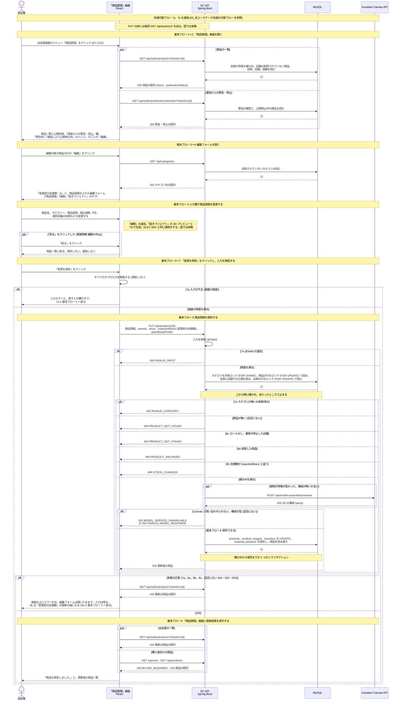
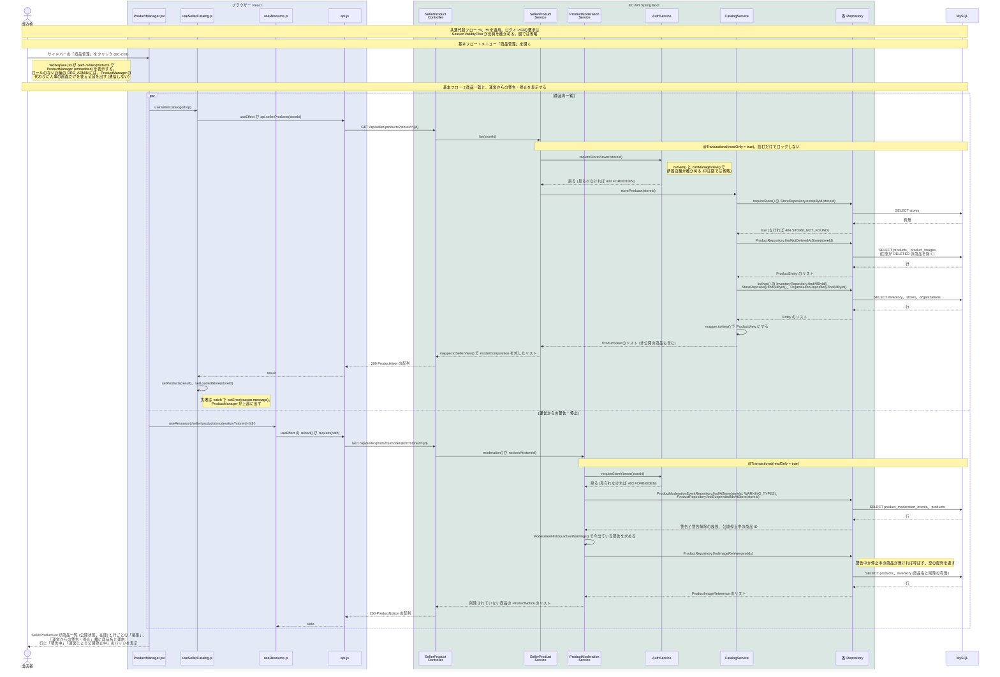
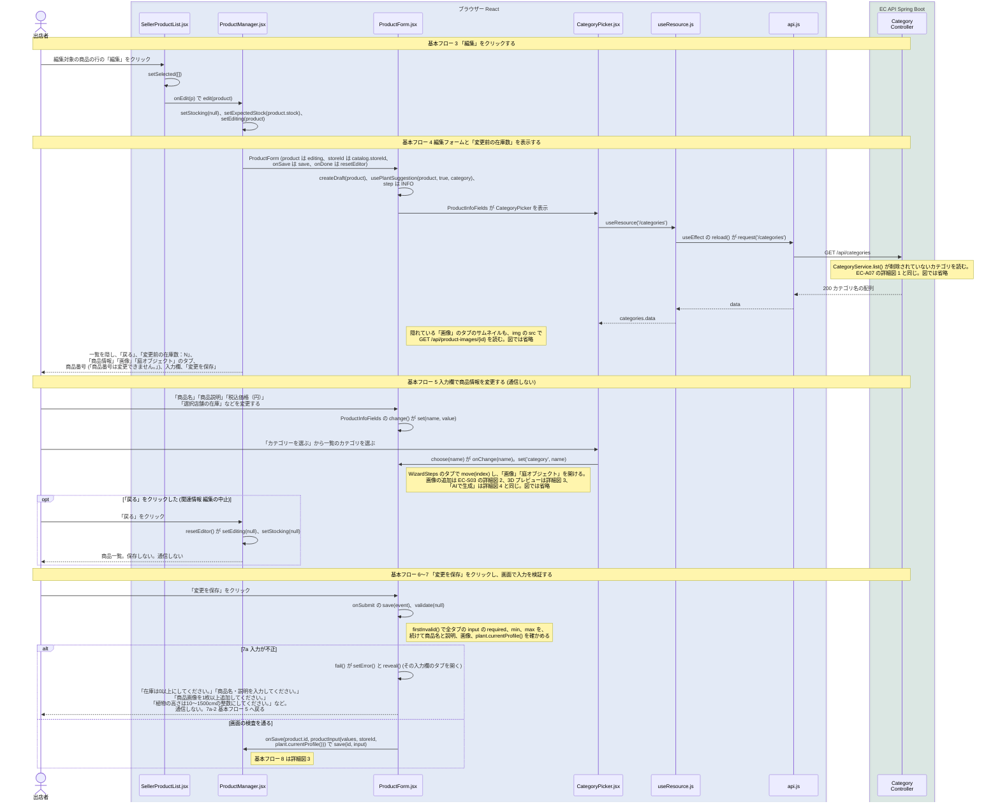
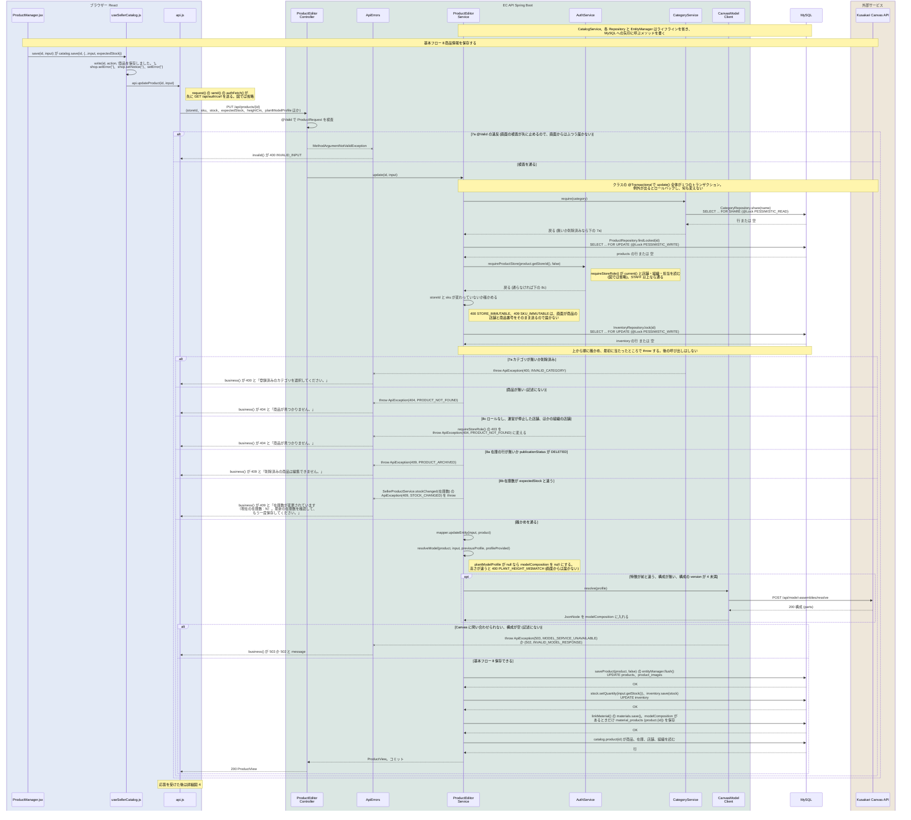
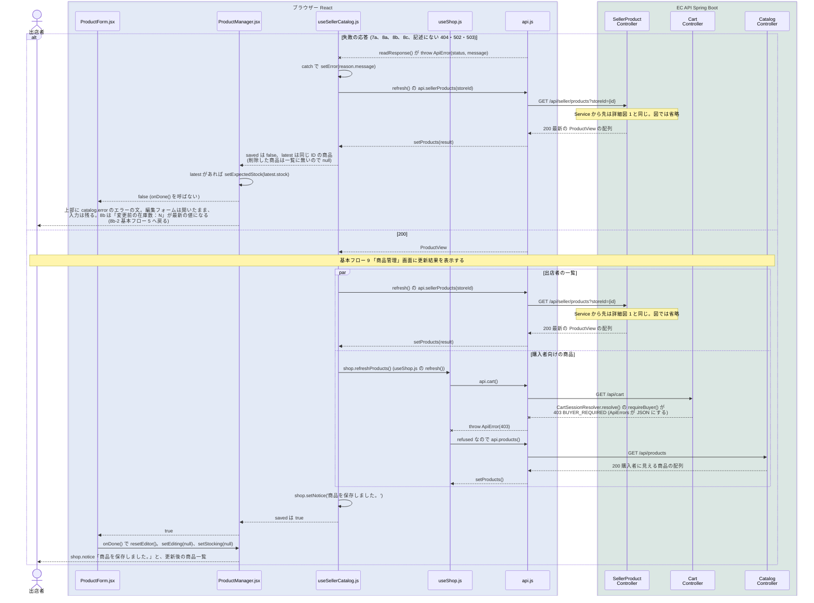

# EC-S04 商品情報を編集する

- ユースケース記述: [EC-S04_商品情報を編集する](<../../アーカイブ/ユースケース/kusakari-ec/EC-S04_商品情報を編集する.md>)
- 対象のコード: kusakari-ec の main（19a2be3、2026-11-20 時点）。植物モデルの組み立てで呼ぶ kusakari-canvas は main（c19d497）

## 概要図

## 詳細図 1 基本フロー 1〜2

## 詳細図 2 基本フロー 3〜7

## 詳細図 3 基本フロー 8

## 詳細図 4 基本フロー 9 と、失敗の応答の後

## ユースケース記述との差

- 8c: 記述では「この操作の権限がありません。」と表示します。コードでは、`ProductEditorService.update()` が `AuthService.requireProductStore(storeId, false)` で確かめ、403 を 404 `PRODUCT_NOT_FOUND`「商品が見つかりません。」に変えて返します。ほかの店舗の商品があるかを知らせないためです。運営が停止した店舗と、ほかの組織の店舗でも同じ 404 になります。
- 8c の「ロールなし」に届くのは、所属店舗でロールが割り当てられていない担当者（`memberRole` が `NONE`）です。この担当者は `requireStoreViewer()` を通るので、商品一覧と「編集」が表示され、「変更を保存」の後に 404 になります。ORG_ADMIN でロールのない店舗（`memberRole` が `null`）では、`Workspace.jsx` が「商品管理」画面の代わりに「(店舗名)では担当のロールがないため、人事（アカウント・招待キー）の画面だけを使えます。」を出し、通信しません。
- 8a: 削除した商品は `inventory.publication_status` が `DELETED` で、409 `PRODUCT_ARCHIVED`「削除済みの商品は編集できません。」になります。記述の 8a-2「ユースケースを終了する」と違い、編集フォームは開いたままです。出店者は「戻る」で一覧に戻ります。取り直した一覧には削除した商品が無いので、「変更前の在庫数」は変わりません。
- 8b: 「フォームを開いた後に在庫数が変わっていた」かどうかは、画面が送る `expectedStock`（フォームを開いたときの在庫数）と、ロックして読んだ `inventory.quantity` を比べて決めます。409 `STOCK_CHANGED` の後、画面は一覧を取り直し、「変更前の在庫数」を最新の値に変えます。入力した在庫数は残ります。
- 7a: 検査は画面（`ProductForm.validate()`）とサーバーの両方にあります。サーバーの `@Valid` の違反（400 `INVALID_INPUT`）は、画面の検査が先に止めるので、画面からはふつう届きません。フォームを開いた後に運営がカテゴリを削除していると、サーバーで 400 `INVALID_CATEGORY`「登録済みのカテゴリを選択してください。」になります。画面で止まったときのエラーはフォームの下に、サーバーからのエラーは画面の上に出ます。
- 記述にない失敗の応答があります。商品の行が無いと 404 `PRODUCT_NOT_FOUND` です。植物の特徴を変えたときに Kusakari Canvas API に接続できないと 503 `MODEL_SERVICE_UNAVAILABLE`、構成が空だと 502 `INVALID_MODEL_RESPONSE` で、保存しません。
- 記述にない処理として、植物の商品は、特徴が前と違うとき、構成（`model_composition`）が無いとき、構成の `version` が 4 より小さいときに、保存のトランザクションの中で Canvas API の `POST /api/model-assemblies/resolve` を呼び、構成を取り直します。この問い合わせは、カテゴリの共有ロックと、商品と在庫の行のロックを持ったまま行います。
- 基本フロー 4: 編集フォームは「商品管理」画面の中に開き、商品一覧を隠します。商品登録と違い、「商品情報」「画像」「庭オブジェクト」はタブで、どのタブからでも「変更を保存」を押せます。商品番号は表示だけで、「商品番号は変更できません。」と出ます。編集では「選択店舗の在庫」を 0 にできます（登録では 1 以上）。
- 基本フロー 9: 保存に成功すると「商品を保存しました。」を出し、編集フォームを閉じます。記述にない処理として、出店者の一覧（`GET /api/seller/products`）のほかに、`shop.refreshProducts()` が購入者向けの商品（`GET /api/cart`、`GET /api/products`）も取り直します。店舗側のアカウントでは `GET /api/cart` が 403 `BUYER_REQUIRED` になり、`GET /api/products` の結果だけを使います。運営からの警告・停止（`GET /api/seller/products/moderation`）は取り直しません。
- 関連情報の「商品を編集しても、警告も公開停止も解除されない」は、`ProductEntity.suspended` に setter が無く、`ProductRequest` にも対応するフィールドが無いことで満たします。警告は `product_moderation_events` にあり、編集では変えません。

## 確かめられなかったこと

- 隠れている「画像」のタブのサムネイル（`ProductImages.jsx` の `img`）を、フォームを開いた時点でブラウザーが読むかは、実行して確かめていません。
- `inventory.save(stock)` と `stock.setQuantity()` の変更が `UPDATE inventory` として送られる時点（`catalog.product(id)` の読み込みの前か、コミットのときか）は、実行して確かめていません。
- `linkMaterial()` の `materials.save()` は、主キー（`MaterialProductId`）を持つ Entity なので、Spring Data JPA の `merge()` になり、行が無いときだけ `INSERT` すると読みました。実行して確かめていません。
- `@Lock(PESSIMISTIC_READ)` と `@Lock(PESSIMISTIC_WRITE)` が MySQL で `FOR SHARE` と `FOR UPDATE` になることは、注釈から読んだものです。

## 参照したコード

- [frontend/src/workspace/Workspace.jsx](https://github.com/abeouga/kusakari-ec/blob/19a2be307ee71a2cd87e538236c3c8c42929c5b3/frontend/src/workspace/Workspace.jsx): `sellerMenu`、`rolePaths`、`personnelOnly`、`/seller/products` と `ProductManager` の対応
- [frontend/src/components/ProductManager.jsx](https://github.com/abeouga/kusakari-ec/blob/19a2be307ee71a2cd87e538236c3c8c42929c5b3/frontend/src/components/ProductManager.jsx): `edit()`、`save()`、`resetEditor()`、`expectedStock`、「変更前の在庫数」、「戻る」、`moderation`
- [frontend/src/components/SellerProductList.jsx](https://github.com/abeouga/kusakari-ec/blob/19a2be307ee71a2cd87e538236c3c8c42929c5b3/frontend/src/components/SellerProductList.jsx): 「編集」、`onEdit`、「警告中」「運営により公開停止中」のバッジ
- [frontend/src/components/useSellerCatalog.js](https://github.com/abeouga/kusakari-ec/blob/19a2be307ee71a2cd87e538236c3c8c42929c5b3/frontend/src/components/useSellerCatalog.js): `useEffect`（一覧の取得）、`refresh()`、`write()`、`save()`
- [frontend/src/components/ProductForm.jsx](https://github.com/abeouga/kusakari-ec/blob/19a2be307ee71a2cd87e538236c3c8c42929c5b3/frontend/src/components/ProductForm.jsx): `save()`、`validate()`、`fail()`、`reveal()`、`move()`、「変更を保存」
- [frontend/src/components/WizardSteps.jsx](https://github.com/abeouga/kusakari-ec/blob/19a2be307ee71a2cd87e538236c3c8c42929c5b3/frontend/src/components/WizardSteps.jsx): 編集のときのタブ
- [frontend/src/components/ProductInfoFields.jsx](https://github.com/abeouga/kusakari-ec/blob/19a2be307ee71a2cd87e538236c3c8c42929c5b3/frontend/src/components/ProductInfoFields.jsx): 商品番号の表示、`min={p.id ? 0 : 1}`、`change()`
- [frontend/src/components/CategoryPicker.jsx](https://github.com/abeouga/kusakari-ec/blob/19a2be307ee71a2cd87e538236c3c8c42929c5b3/frontend/src/components/CategoryPicker.jsx): `useResource('/categories')`、`choose()`
- [frontend/src/components/ProductImages.jsx](https://github.com/abeouga/kusakari-ec/blob/19a2be307ee71a2cd87e538236c3c8c42929c5b3/frontend/src/components/ProductImages.jsx): サムネイルの `img`
- [frontend/src/components/usePlantSuggestion.js](https://github.com/abeouga/kusakari-ec/blob/19a2be307ee71a2cd87e538236c3c8c42929c5b3/frontend/src/components/usePlantSuggestion.js): `currentProfile()`、`configured`
- [frontend/src/components/usePlantPreview.js](https://github.com/abeouga/kusakari-ec/blob/19a2be307ee71a2cd87e538236c3c8c42929c5b3/frontend/src/components/usePlantPreview.js): `active` のときだけ 3D プレビューを読む
- [frontend/src/productDraft.js](https://github.com/abeouga/kusakari-ec/blob/19a2be307ee71a2cd87e538236c3c8c42929c5b3/frontend/src/productDraft.js): `createDraft()`、`productInput()`
- [frontend/src/formValidity.js](https://github.com/abeouga/kusakari-ec/blob/19a2be307ee71a2cd87e538236c3c8c42929c5b3/frontend/src/formValidity.js): `firstInvalid()`
- [frontend/src/workspace/useResource.js](https://github.com/abeouga/kusakari-ec/blob/19a2be307ee71a2cd87e538236c3c8c42929c5b3/frontend/src/workspace/useResource.js): `useResource`、`reload()`
- [frontend/src/useShop.js](https://github.com/abeouga/kusakari-ec/blob/19a2be307ee71a2cd87e538236c3c8c42929c5b3/frontend/src/useShop.js): `refresh()`（`refreshProducts`）、`setNotice()`、`memberRole`
- [frontend/src/api.js](https://github.com/abeouga/kusakari-ec/blob/19a2be307ee71a2cd87e538236c3c8c42929c5b3/frontend/src/api.js): `request()`、`send()`、`readResponse()`、`ApiError`、`api.sellerProducts()`、`api.updateProduct()`、`api.cart()`、`api.products()`
- [frontend/src/auth.js](https://github.com/abeouga/kusakari-ec/blob/19a2be307ee71a2cd87e538236c3c8c42929c5b3/frontend/src/auth.js): `authFetch()`（`/api/auth/csrf`）
- [backend/src/main/java/jp/kusakari/ec/catalog/controller/SellerProductController.java](https://github.com/abeouga/kusakari-ec/blob/19a2be307ee71a2cd87e538236c3c8c42929c5b3/backend/src/main/java/jp/kusakari/ec/catalog/controller/SellerProductController.java): `list()`、`moderation()`
- [backend/src/main/java/jp/kusakari/ec/catalog/service/SellerProductService.java](https://github.com/abeouga/kusakari-ec/blob/19a2be307ee71a2cd87e538236c3c8c42929c5b3/backend/src/main/java/jp/kusakari/ec/catalog/service/SellerProductService.java): `list()`、`stockChanged()`
- [backend/src/main/java/jp/kusakari/ec/catalog/service/ProductModerationService.java](https://github.com/abeouga/kusakari-ec/blob/19a2be307ee71a2cd87e538236c3c8c42929c5b3/backend/src/main/java/jp/kusakari/ec/catalog/service/ProductModerationService.java): `noticesAt()`
- [backend/src/main/java/jp/kusakari/ec/catalog/service/CatalogService.java](https://github.com/abeouga/kusakari-ec/blob/19a2be307ee71a2cd87e538236c3c8c42929c5b3/backend/src/main/java/jp/kusakari/ec/catalog/service/CatalogService.java): `storeProducts()`、`requireStore()`、`listings()`、`product()`
- [backend/src/main/java/jp/kusakari/ec/catalog/controller/CategoryController.java](https://github.com/abeouga/kusakari-ec/blob/19a2be307ee71a2cd87e538236c3c8c42929c5b3/backend/src/main/java/jp/kusakari/ec/catalog/controller/CategoryController.java): `list()`
- [backend/src/main/java/jp/kusakari/ec/catalog/service/CategoryService.java](https://github.com/abeouga/kusakari-ec/blob/19a2be307ee71a2cd87e538236c3c8c42929c5b3/backend/src/main/java/jp/kusakari/ec/catalog/service/CategoryService.java): `require()`、`list()`
- [backend/src/main/java/jp/kusakari/ec/catalog/controller/ProductEditorController.java](https://github.com/abeouga/kusakari-ec/blob/19a2be307ee71a2cd87e538236c3c8c42929c5b3/backend/src/main/java/jp/kusakari/ec/catalog/controller/ProductEditorController.java): `update()`
- [backend/src/main/java/jp/kusakari/ec/catalog/service/ProductEditorService.java](https://github.com/abeouga/kusakari-ec/blob/19a2be307ee71a2cd87e538236c3c8c42929c5b3/backend/src/main/java/jp/kusakari/ec/catalog/service/ProductEditorService.java): `update()`、`resolveModel()`、`linkMaterial()`、`saveProduct()`
- [backend/src/main/java/jp/kusakari/ec/catalog/service/CanvasModelClient.java](https://github.com/abeouga/kusakari-ec/blob/19a2be307ee71a2cd87e538236c3c8c42929c5b3/backend/src/main/java/jp/kusakari/ec/catalog/service/CanvasModelClient.java): `resolve()`
- [backend/src/main/java/jp/kusakari/ec/catalog/mapper/ProductMapper.java](https://github.com/abeouga/kusakari-ec/blob/19a2be307ee71a2cd87e538236c3c8c42929c5b3/backend/src/main/java/jp/kusakari/ec/catalog/mapper/ProductMapper.java): `updateEntity()`、`toView()`、`toSellerView()`
- [backend/src/main/java/jp/kusakari/ec/catalog/dto/ProductRequest.java](https://github.com/abeouga/kusakari-ec/blob/19a2be307ee71a2cd87e538236c3c8c42929c5b3/backend/src/main/java/jp/kusakari/ec/catalog/dto/ProductRequest.java): `expectedStock`、`setPlantModelProfile()`、検査の注釈
- [backend/src/main/java/jp/kusakari/ec/catalog/persistence/repository/ProductRepository.java](https://github.com/abeouga/kusakari-ec/blob/19a2be307ee71a2cd87e538236c3c8c42929c5b3/backend/src/main/java/jp/kusakari/ec/catalog/persistence/repository/ProductRepository.java): `findLocked()`、`findNotDeletedAtStore()`、`findSuspendedIdsAtStore()`、`findImageReferences()`
- [backend/src/main/java/jp/kusakari/ec/catalog/persistence/repository/InventoryRepository.java](https://github.com/abeouga/kusakari-ec/blob/19a2be307ee71a2cd87e538236c3c8c42929c5b3/backend/src/main/java/jp/kusakari/ec/catalog/persistence/repository/InventoryRepository.java): `lock()`
- [backend/src/main/java/jp/kusakari/ec/catalog/persistence/repository/CategoryRepository.java](https://github.com/abeouga/kusakari-ec/blob/19a2be307ee71a2cd87e538236c3c8c42929c5b3/backend/src/main/java/jp/kusakari/ec/catalog/persistence/repository/CategoryRepository.java): `share()`
- [backend/src/main/java/jp/kusakari/ec/catalog/persistence/entity/ProductEntity.java](https://github.com/abeouga/kusakari-ec/blob/19a2be307ee71a2cd87e538236c3c8c42929c5b3/backend/src/main/java/jp/kusakari/ec/catalog/persistence/entity/ProductEntity.java): `suspended`（setter なし）、`images`
- [backend/src/main/java/jp/kusakari/ec/moderation/persistence/repository/ProductModerationEventRepository.java](https://github.com/abeouga/kusakari-ec/blob/19a2be307ee71a2cd87e538236c3c8c42929c5b3/backend/src/main/java/jp/kusakari/ec/moderation/persistence/repository/ProductModerationEventRepository.java): `findAtStore()`
- [backend/src/main/java/jp/kusakari/ec/moderation/service/ModerationHistory.java](https://github.com/abeouga/kusakari-ec/blob/19a2be307ee71a2cd87e538236c3c8c42929c5b3/backend/src/main/java/jp/kusakari/ec/moderation/service/ModerationHistory.java): `activeWarnings()`、`WARNING_TYPES`
- [backend/src/main/java/jp/kusakari/ec/auth/AuthService.java](https://github.com/abeouga/kusakari-ec/blob/19a2be307ee71a2cd87e538236c3c8c42929c5b3/backend/src/main/java/jp/kusakari/ec/auth/AuthService.java): `requireStoreViewer()`、`requireProductStore()`、`requireStoreRole()`、`memberRoleAt()`、`viewableStoreIdsOf()`、`requireBuyer()`
- [backend/src/main/java/jp/kusakari/ec/commerce/controller/CartController.java](https://github.com/abeouga/kusakari-ec/blob/19a2be307ee71a2cd87e538236c3c8c42929c5b3/backend/src/main/java/jp/kusakari/ec/commerce/controller/CartController.java): `get()`
- [backend/src/main/java/jp/kusakari/ec/commerce/session/CartSessionResolver.java](https://github.com/abeouga/kusakari-ec/blob/19a2be307ee71a2cd87e538236c3c8c42929c5b3/backend/src/main/java/jp/kusakari/ec/commerce/session/CartSessionResolver.java): `resolve()`
- [backend/src/main/java/jp/kusakari/ec/catalog/controller/CatalogController.java](https://github.com/abeouga/kusakari-ec/blob/19a2be307ee71a2cd87e538236c3c8c42929c5b3/backend/src/main/java/jp/kusakari/ec/catalog/controller/CatalogController.java): `products()`
- [backend/src/main/java/jp/kusakari/ec/common/web/ApiErrors.java](https://github.com/abeouga/kusakari-ec/blob/19a2be307ee71a2cd87e538236c3c8c42929c5b3/backend/src/main/java/jp/kusakari/ec/common/web/ApiErrors.java): `business()`、`invalid()`
- [backend/src/main/resources/db/migration/V1__schema.sql](https://github.com/abeouga/kusakari-ec/blob/19a2be307ee71a2cd87e538236c3c8c42929c5b3/backend/src/main/resources/db/migration/V1__schema.sql): `products`、`inventory`、`product_images`、`material_products`
- [backend/kusakari_canvas_api/main.py](https://github.com/abeouga/kusakari-canvas/blob/c19d497dfef15b119f9bce8ecb5c886a36da6b7d/backend/kusakari_canvas_api/main.py): kusakari-canvas の `/api/model-assemblies/resolve`
