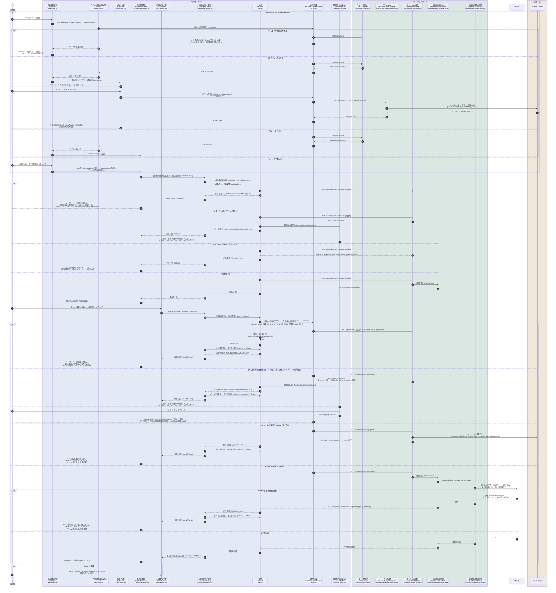

# EC-S05 店舗在庫数を更新する

```mermaid
sequenceDiagram
    autonumber
    actor User as 出店者
    box rgba(47,111,219,0.10) ブラウザー React
        participant Work as 出店者画面の枠<br/>Workspace<br/>(Workspace.jsx)
        participant Mgr as 商品管理画面<br/>ProductManager<br/>(ProductManager.jsx)
        participant List as 商品の一覧<br/>SellerProductList<br/>(SellerProductList.jsx)
        participant Editor as 在庫数の入力欄<br/>StockEditor<br/>(StockEditor.jsx)
        participant Cat as 商品の取得と変更<br/>useSellerCatalog<br/>(useSellerCatalog.js)
        participant Hook as 警告・停止の取得<br/>useResource<br/>(useResource.js)
        participant Http as 通信<br/>request<br/>(api.js)
        participant AuthJs as 通信の準備<br/>authFetch<br/>(auth.js)
    end
    box rgba(27,127,92,0.12) EC API Spring Boot
        participant AuthCtrl as ログイン状態API<br/>AuthController<br/>(AuthController.java)
        participant Ctrl as 出店者の商品API<br/>SellerProductController<br/>(SellerProductController.java)
        participant Svc as 出店者の商品の処理<br/>SellerProductService<br/>(SellerProductService.java)
        participant Mod as 運営の警告・停止<br/>ProductModerationService<br/>(ProductModerationService.java)
        participant Auth as ログイン中の会員<br/>AuthService<br/>(AuthService.java)
        participant CatSvc as 商品の読み込み<br/>CatalogService<br/>(CatalogService.java)
        participant Prod as 商品の読み書き<br/>ProductRepository<br/>(ProductRepository.java)
        participant Inv as 在庫の読み書き<br/>InventoryRepository<br/>(InventoryRepository.java)
    end
    participant Db as MySQL

    Note over User,Db: 共通代替フロー<br/>*b 未ログインの場合: 2 (URL を直接開いたときのログインの確認)、4、10、26、一覧の取り直しの 37 に適用<br/>*a 通信に失敗した場合: 4、10、24、26、一覧の取り直しの 37、購入者向けの商品の 39 に適用

    User->>Work: 出店者メニューの「商品管理」をクリック
    Work->>Mgr: URL を /seller/products に変え、<br/>ProductManager を表示 (選択中の店舗にロールがあるとき)
    par 商品の一覧
        Mgr->>Cat: 選択中の店舗の商品を取りに行くよう頼む (useSellerCatalog)
        Cat->>Ctrl: 店舗が決まったら自動で一覧の通信を始める (useEffect → api.sellerProducts)<br/>GET /api/seller/products?storeId={店舗ID}
        Ctrl->>Svc: 店舗の商品の一覧を作るよう頼む (list)。読むだけのトランザクション<br/>この店舗の商品を見られるかを確かめる (requireStoreViewer。オーナー、所属の担当者、運営)
        Svc->>Prod: 商品を追加した人の名前を読む (findCreatorNamesAtStore、SELECT products JOIN members)
        Svc->>CatSvc: 店舗の削除されていない商品を読むよう頼む (storeProducts)<br/>店舗があるかを確かめ、商品、在庫、店舗、組織を読む (requireStore、findNotDeletedAtStore、listings)
        Ctrl-->>Cat: 200 出店者向けの商品の配列 (toSellerView。在庫数 stock、公開状態。setProducts)
    and 運営からの警告・停止
        Mgr->>Hook: 運営からの警告・停止を取りに行くよう頼む (useResource)
        Hook->>Ctrl: 画面を開いたときに自動で通信を始める (reload → request)<br/>GET /api/seller/products/moderation?storeId={店舗ID}
        Ctrl->>Mod: 警告中・公開停止中の商品を読むよう頼む (noticesAt)<br/>見られる店舗かを確かめ、警告の履歴と公開停止中の商品を読む (requireStoreViewer ほか)
        Ctrl-->>Hook: 200 警告・停止の配列
    end
    Mgr->>List: 商品の一覧と警告・停止を渡して表示 (SellerProductList)
    List-->>User: 商品ごとの在庫数、0 なら「在庫切れ」、<br/>行ごとの「在庫を編集」

    User->>List: 対象商品の行の「在庫を編集」をクリック
    List->>Mgr: 選択を外し、在庫を変える商品を伝える (setSelected([]) → onStock)
    Mgr->>Editor: 在庫数の入力欄を表示 (setStocking → StockEditor)<br/>変更前の在庫数として今の在庫数を覚える (expected)
    Editor-->>User: 「(商品名)：変更前の在庫数 N」、「在庫数」の入力欄、<br/>「在庫を保存」、「取消」
    User->>Editor: 「在庫数」の入力欄に新しい在庫数を入力し、<br/>「在庫を保存」をクリック
    Editor->>Editor: 入力値が 0〜10000 の整数かを確かめる (save)
    Editor->>Cat: 在庫数の保存を頼む (onSave → saveStock)<br/>店舗 ID、変更前の在庫数、新しい在庫数
    Cat->>Http: 前のお知らせとエラーを消し、在庫数を書き換える通信を送る<br/>(write → request、本文は { storeId, expectedStock, stock })
    Http->>AuthJs: 書き込みの前に CSRF トークンを取るよう頼む (send → authFetch)
    AuthJs->>AuthCtrl: GET /api/auth/csrf
    AuthCtrl-->>AuthJs: 200 ヘッダー名とトークン (csrf)
    AuthJs->>Ctrl: PUT /api/seller/products/{id}/stock<br/>(CSRF トークンのヘッダー付き)
    Ctrl->>Svc: 在庫数を書き換えるよう頼む (updateStock)<br/>updateStock 全体が 1 つのトランザクション
    Svc->>Auth: ログイン中の人がこの店舗で STAFF 以上の<br/>ロールを持つかを確かめる (requireSeller → requireStoreRole)
    Svc->>Prod: 店舗があるかを確かめ (CatalogService.requireStore、SELECT stores)、<br/>商品がこの店舗のものかを確かめる (requireAtStore → findStoreReferences、SELECT products)
    Svc->>Inv: 在庫の行をロックして読む (lock、SELECT ... FOR UPDATE inventory)
    break 8a 今の在庫数が変更前の在庫数と違う (注文の引き当て、キャンセルの戻しなど)
        Note over Inv,Mgr: 結果: 409 STOCK_CHANGED を返し、在庫数は変えない。<br/>画面: 「在庫数が変更されています（現在の在庫数：N）。…」と、最新の変更前の在庫数。
    end
    Svc->>Svc: 在庫の数量を新しい在庫数に書き換える (setQuantity)
    Svc->>Prod: 商品を追加した人の名前を読む (findCreatorName、SELECT products JOIN members)
    Svc->>CatSvc: 書き換えた後の商品を読むよう頼む (product → findByIdIn、listings)
    Svc->>Db: 書き換えた行を保存してコミットする<br/>(save は呼ばない。UPDATE inventory)
    Ctrl-->>Http: 200 更新後の商品 (toSellerView)
    Http-->>Cat: 更新後の商品
    par 出店者の一覧
        Cat->>Ctrl: 一覧を取り直す (refresh → api.sellerProducts)<br/>GET /api/seller/products?storeId={店舗ID}。流れは 4〜7 と同じ
        Ctrl-->>Cat: 200 最新の商品の一覧
    and 購入者向けの商品
        Cat->>Http: カートと購入者向けの商品を取り直す (shop.refreshProducts)<br/>GET /api/cart は出店者には 403 BUYER_REQUIRED、続けて GET /api/products
        Http-->>Cat: 購入者向けの商品
    end
    Cat-->>Editor: 「在庫数を保存しました。」を出し (shop.setNotice)、成功を返す (saved が true)
    Editor->>Mgr: 入力欄を閉じるよう伝える (onDone → setStocking(null))
    Mgr-->>User: 入力欄を閉じ、「在庫数を保存しました。」と<br/>更新後の在庫数の一覧
```

- ユースケース記述: [EC-S05_店舗在庫数を更新する](<../../アーカイブ/ユースケース/kusakari-ec/EC-S05_店舗在庫数を更新する.md>)
- 共通代替フロー: [00_全ユースケース共通の代替フロー](<00_全ユースケース共通の代替フロー.md>)
- 対象のコード: kusakari-ec の main（6bad7e3、2026-11-24 時点）

## シーケンス図

参加者は、上から「画面や役割の名前」「コンポーネント・クラスの名前」「ファイル名（かっこ付き）」の順に書いています。
共通代替フローの中身は、00 の図か、下の「共通代替フローを直接書いた図」を見てください。
エラーは最重要の 8a（在庫数がもう変わっていた）だけを描き、ほかの代替フローは図の下に並べています。

図に描いていない代替フロー：7a（入力が無効）、8b（在庫数を変更する権限がない）、（記述なし）の分岐

## 共通代替フローを直接書いた図

上の図の、画面を開いたときの通信と在庫数の保存の通信に、この画面で起こる共通代替フロー（\*a、\*b）を書き込んだ図です。
この画面の商品の一覧は `useResource.js` ではなく `useSellerCatalog.js` が受けるので、失敗の出方が 00 の例（「再取得」が出る）と違います。運営からの警告・停止の通信（上の図の 10）は、失敗しても画面に何も出ません（`ProductManager` がエラーを表示しない）。

## ユースケース記述との差

- 8a: 「在庫数の表示後に在庫が変わっていた」かどうかは、画面が送る `expectedStock`（入力欄を開いたときの在庫数）と、ロックして読んだ `inventory.quantity` を比べて決めます。違うと 409 `STOCK_CHANGED` になり、メッセージに現在の在庫数が入ります。画面は一覧を取り直し、`StockEditor` の「変更前の在庫数」を最新の値に変えます。入力した値は残ります。
- 8b: 403 になるのはロールがないときだけではありません。`requireStoreRole()` は、運営が停止した店舗と、存在しない店舗でも 403 `FORBIDDEN` を返します。403 のあとも `StockEditor` は開いたままで、記述の 8b-2「ユースケースを終了する」のように画面が閉じることはありません。
- 8b: 403 に届く「ロールなし」は、所属店舗でロールが割り当てられていない担当者（`memberRole` が `NONE`）です。この担当者は `requireStoreViewer()` を通るので、一覧と「在庫を編集」が表示されます。ORG_ADMIN でロールのない店舗（`memberRole` が `null`）では、`Workspace.jsx` が「商品管理」画面の代わりに「(店舗名)では担当のロールがないため、人事（アカウント・招待キー）の画面だけを使えます。」を出し、通信しません。
- 記述にない失敗の応答があります。商品が選択店舗の商品でないと 404 `PRODUCT_NOT_FOUND`「選択店舗の商品が見つかりません。」、削除済みの商品だと 409 `PRODUCT_ARCHIVED`「削除済みの商品の在庫は変更できません。」です。`requireStore()` の 404 `STORE_NOT_FOUND` は、店舗がないと `requireSeller()` が先に 403 にするので、運営のアカウントのときだけ起きます。画面の動きは 8a と同じで、エラーの文を出して一覧を取り直します。
- 7a: 検査は画面（`StockEditor` の `save`）とサーバー（`StockUpdateRequest` の `@Min(0)`・`@Max(10000)`、違反は 400 `INVALID_INPUT`）の両方にあります。画面の検査が先に止めるので、画面からサーバーの検査には届きません。
- 基本フロー 8: 保存に成功すると、更新後の在庫数に加えて「在庫数を保存しました。」を出し、入力欄を閉じます。記述にはメッセージと入力欄を閉じることが書かれていません。
- 基本フロー 8: 成功のあと、出店者の一覧（`GET /api/seller/products`）のほかに、`shop.refreshProducts()` が購入者向けの商品（`GET /api/cart`、`GET /api/products`）も取り直します。記述にない処理です。
- 一覧の各行には「追加した人：(表示名)」（追加した人が記録されていない商品は「初期データ」）が出ます。サーバーは一覧と在庫の保存のたびに `findCreatorNamesAtStore()`・`findCreatorName()` で名前を読みます。記述にない表示です。
- 記述にない操作として、`StockEditor` の「取消」があります。入力欄を閉じるだけで、通信しません。
- 共通代替フロー: 保存に失敗すると、`useSellerCatalog.js` の `write()` は失敗の種類によらず一覧を取り直します（`useResource.js` は 404・409 のときだけ取り直す）。保存が成功しても、そのあとの一覧か購入者向けの商品の取り直し（上の図の 37・39）に失敗すると、`write()` は失敗として扱い、エラーの文を出して入力欄を開いたままにします（在庫数は保存済みです）。画面を開いたときの一覧の失敗は `ProductManager` の上部に文が出るだけで、「再取得」のボタンはありません。

## 参照したコード

- [frontend/src/workspace/Workspace.jsx](https://github.com/abeouga/kusakari-ec/blob/6bad7e37c4135034fbe97e30309772fbe872e675/frontend/src/workspace/Workspace.jsx): `sellerMenu`、`rolePaths`、`personnelOnly`、未ログインのときの `AuthPanel`、`/seller/products` と `ProductManager` の対応
- [frontend/src/workspace/WorkspaceSidebar.jsx](https://github.com/abeouga/kusakari-ec/blob/6bad7e37c4135034fbe97e30309772fbe872e675/frontend/src/workspace/WorkspaceSidebar.jsx): `MenuLink`
- [frontend/src/workspace/Common.jsx](https://github.com/abeouga/kusakari-ec/blob/6bad7e37c4135034fbe97e30309772fbe872e675/frontend/src/workspace/Common.jsx): `PageLink`
- [frontend/src/components/ProductManager.jsx](https://github.com/abeouga/kusakari-ec/blob/6bad7e37c4135034fbe97e30309772fbe872e675/frontend/src/components/ProductManager.jsx): `ProductManager`（`stocking`、`setStocking`、`moderation`、`catalog.error` と `shop.notice` の表示）
- [frontend/src/components/SellerProductList.jsx](https://github.com/abeouga/kusakari-ec/blob/6bad7e37c4135034fbe97e30309772fbe872e675/frontend/src/components/SellerProductList.jsx): 「在庫切れ」「在庫を編集」「追加した人」の表示、`onStock`
- [frontend/src/components/StockEditor.jsx](https://github.com/abeouga/kusakari-ec/blob/6bad7e37c4135034fbe97e30309772fbe872e675/frontend/src/components/StockEditor.jsx): `StockEditor`、`save`、`setExpected`
- [frontend/src/components/useSellerCatalog.js](https://github.com/abeouga/kusakari-ec/blob/6bad7e37c4135034fbe97e30309772fbe872e675/frontend/src/components/useSellerCatalog.js): `useEffect`（一覧の取得）、`refresh`、`write`、`saveStock`
- [frontend/src/useShop.js](https://github.com/abeouga/kusakari-ec/blob/6bad7e37c4135034fbe97e30309772fbe872e675/frontend/src/useShop.js): `refresh`（`refreshProducts`）、`sellerStoreId`、`setNotice`
- [frontend/src/workspace/useResource.js](https://github.com/abeouga/kusakari-ec/blob/6bad7e37c4135034fbe97e30309772fbe872e675/frontend/src/workspace/useResource.js): `useResource`、`reload`
- [frontend/src/api.js](https://github.com/abeouga/kusakari-ec/blob/6bad7e37c4135034fbe97e30309772fbe872e675/frontend/src/api.js): `request`、`send`、`readResponse`、`ApiError`、`api.sellerProducts`、`networkErrorMessage`、`sessionExpiredMessage`
- [frontend/src/auth.js](https://github.com/abeouga/kusakari-ec/blob/6bad7e37c4135034fbe97e30309772fbe872e675/frontend/src/auth.js): `authFetch`（`GET /api/auth/csrf`）、`readSession`、`passwordLogin`、`wasSignedIn`、`login`
- [frontend/src/useAuth.js](https://github.com/abeouga/kusakari-ec/blob/6bad7e37c4135034fbe97e30309772fbe872e675/frontend/src/useAuth.js): `useAuth`、`refreshSession`
- [frontend/src/components/AuthPanel.jsx](https://github.com/abeouga/kusakari-ec/blob/6bad7e37c4135034fbe97e30309772fbe872e675/frontend/src/components/AuthPanel.jsx): `submit`、`complete`、`returnTo`
- [frontend/src/components/SessionNotice.jsx](https://github.com/abeouga/kusakari-ec/blob/6bad7e37c4135034fbe97e30309772fbe872e675/frontend/src/components/SessionNotice.jsx): 期限切れのお知らせ
- [backend/src/main/java/jp/kusakari/ec/catalog/controller/SellerProductController.java](https://github.com/abeouga/kusakari-ec/blob/6bad7e37c4135034fbe97e30309772fbe872e675/backend/src/main/java/jp/kusakari/ec/catalog/controller/SellerProductController.java): `list`、`moderation`、`updateStock`
- [backend/src/main/java/jp/kusakari/ec/catalog/dto/StockUpdateRequest.java](https://github.com/abeouga/kusakari-ec/blob/6bad7e37c4135034fbe97e30309772fbe872e675/backend/src/main/java/jp/kusakari/ec/catalog/dto/StockUpdateRequest.java): `StockUpdateRequest`
- [backend/src/main/java/jp/kusakari/ec/catalog/service/SellerProductService.java](https://github.com/abeouga/kusakari-ec/blob/6bad7e37c4135034fbe97e30309772fbe872e675/backend/src/main/java/jp/kusakari/ec/catalog/service/SellerProductService.java): `list`、`updateStock`、`requireAtStore`、`notAtStore`、`stockChanged`
- [backend/src/main/java/jp/kusakari/ec/catalog/service/CatalogService.java](https://github.com/abeouga/kusakari-ec/blob/6bad7e37c4135034fbe97e30309772fbe872e675/backend/src/main/java/jp/kusakari/ec/catalog/service/CatalogService.java): `storeProducts`、`product`、`listing`、`listings`、`requireStore`
- [backend/src/main/java/jp/kusakari/ec/catalog/service/ProductModerationService.java](https://github.com/abeouga/kusakari-ec/blob/6bad7e37c4135034fbe97e30309772fbe872e675/backend/src/main/java/jp/kusakari/ec/catalog/service/ProductModerationService.java): `noticesAt`
- [backend/src/main/java/jp/kusakari/ec/catalog/persistence/repository/InventoryRepository.java](https://github.com/abeouga/kusakari-ec/blob/6bad7e37c4135034fbe97e30309772fbe872e675/backend/src/main/java/jp/kusakari/ec/catalog/persistence/repository/InventoryRepository.java): `lock`（`@Lock(PESSIMISTIC_WRITE)`）
- [backend/src/main/java/jp/kusakari/ec/catalog/persistence/repository/ProductRepository.java](https://github.com/abeouga/kusakari-ec/blob/6bad7e37c4135034fbe97e30309772fbe872e675/backend/src/main/java/jp/kusakari/ec/catalog/persistence/repository/ProductRepository.java): `findNotDeletedAtStore`、`findStoreReferences`、`findByIdIn`、`findCreatorNamesAtStore`、`findCreatorName`
- [backend/src/main/java/jp/kusakari/ec/auth/AuthService.java](https://github.com/abeouga/kusakari-ec/blob/6bad7e37c4135034fbe97e30309772fbe872e675/backend/src/main/java/jp/kusakari/ec/auth/AuthService.java): `requireStoreViewer`、`canManageView`、`requireSeller`、`requireStoreRole`、`denied`、`requireBuyer`
- [backend/src/main/java/jp/kusakari/ec/auth/AuthController.java](https://github.com/abeouga/kusakari-ec/blob/6bad7e37c4135034fbe97e30309772fbe872e675/backend/src/main/java/jp/kusakari/ec/auth/AuthController.java): `me`、`csrf`
- [backend/src/main/java/jp/kusakari/ec/auth/PasswordLoginController.java](https://github.com/abeouga/kusakari-ec/blob/6bad7e37c4135034fbe97e30309772fbe872e675/backend/src/main/java/jp/kusakari/ec/auth/PasswordLoginController.java): `POST /api/auth/login`
- [backend/src/main/java/jp/kusakari/ec/auth/SessionValidityFilter.java](https://github.com/abeouga/kusakari-ec/blob/6bad7e37c4135034fbe97e30309772fbe872e675/backend/src/main/java/jp/kusakari/ec/auth/SessionValidityFilter.java): `doFilterInternal`（ID トークンの更新、401、503）
- [backend/src/main/java/jp/kusakari/ec/auth/CognitoPasswordLogin.java](https://github.com/abeouga/kusakari-ec/blob/6bad7e37c4135034fbe97e30309772fbe872e675/backend/src/main/java/jp/kusakari/ec/auth/CognitoPasswordLogin.java): ログインと ID トークンの更新、503 `AUTH_UNAVAILABLE`
- [backend/src/main/java/jp/kusakari/ec/auth/AuthConfiguration.java](https://github.com/abeouga/kusakari-ec/blob/6bad7e37c4135034fbe97e30309772fbe872e675/backend/src/main/java/jp/kusakari/ec/auth/AuthConfiguration.java): `authenticationEntryPoint`（401 `LOGIN_REQUIRED`）
- [backend/src/main/java/jp/kusakari/ec/common/web/ApiErrors.java](https://github.com/abeouga/kusakari-ec/blob/6bad7e37c4135034fbe97e30309772fbe872e675/backend/src/main/java/jp/kusakari/ec/common/web/ApiErrors.java): `business`、`invalid`、`database`
