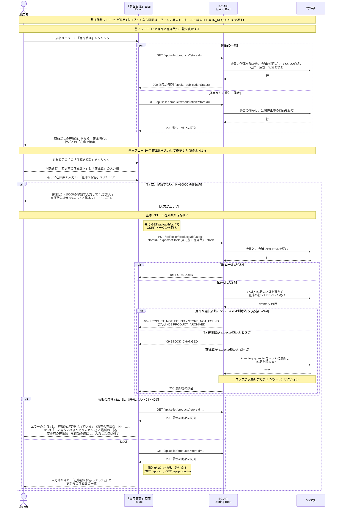
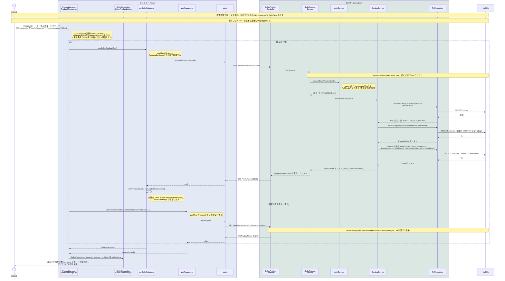
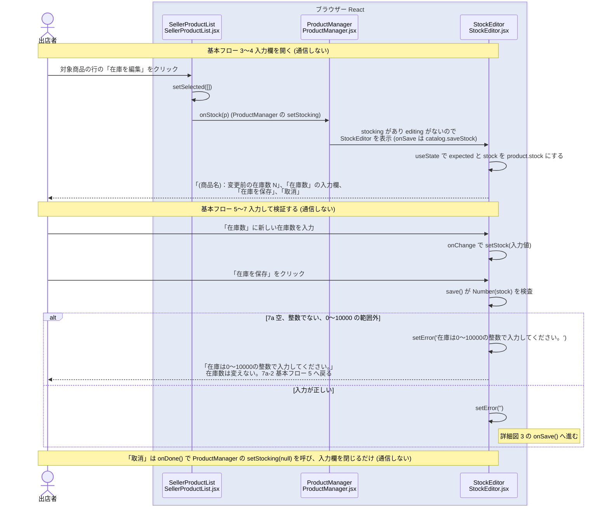
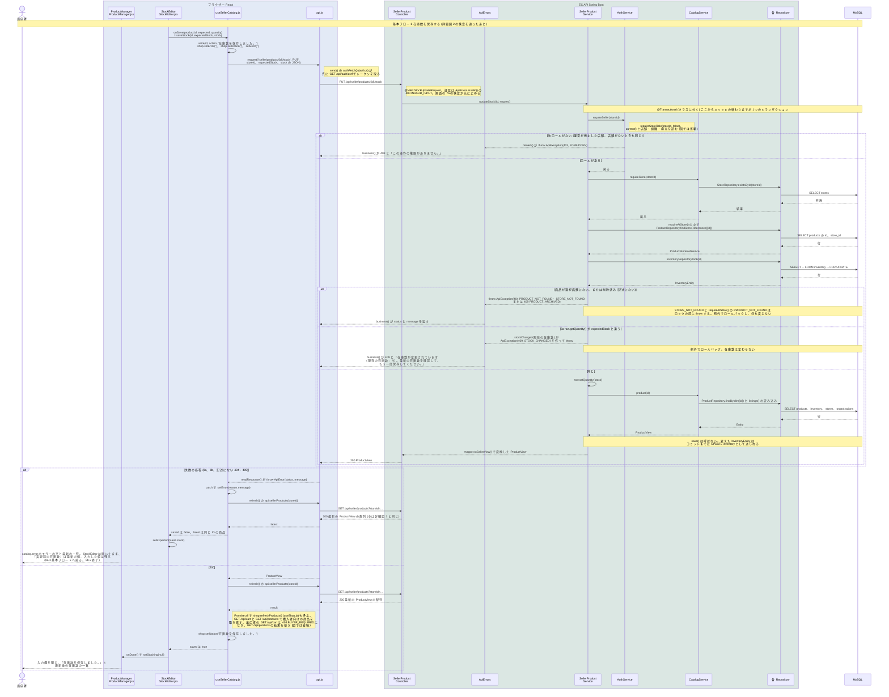

# EC-S05 店舗在庫数を更新する

- ユースケース記述: [EC-S05_店舗在庫数を更新する](<../../アーカイブ/ユースケース/kusakari-ec/EC-S05_店舗在庫数を更新する.md>)
- 対象のコード: kusakari-ec の main（19a2be3、2026-11-20 時点）

## 概要図

## 詳細図 1 基本フロー 1〜2

## 詳細図 2 基本フロー 3〜7

## 詳細図 3 基本フロー 8

## ユースケース記述との差

- 8a: 「在庫数の表示後に在庫が変わっていた」かどうかは、画面が送る `expectedStock`（入力欄を開いたときの在庫数）と、ロックして読んだ `inventory.quantity` を比べて決めます。違うと 409 `STOCK_CHANGED` になり、メッセージに現在の在庫数が入ります。画面は一覧を取り直し、`StockEditor` の「変更前の在庫数」を最新の値に変えます。入力した値は残ります。記述の 8a-1 と同じ動きです。
- 8b: 403 になるのはロールがないときだけではありません。`requireStoreRole()` は、運営が停止した店舗と、存在しない店舗でも 403 `FORBIDDEN` を返します。403 のあとも `StockEditor` は開いたままで、記述の 8b-2「ユースケースを終了する」のように画面が閉じることはありません。
- 8b: 「ロールなし」の 403 に届くのは、所属店舗でロールが割り当てられていない担当者（`memberRole` が `NONE`）です。この担当者は `requireStoreViewer()` を通るので、一覧と「在庫を編集」が表示されます。ORG_ADMIN でロールのない店舗（`memberRole` が `null`）では、`Workspace.jsx` が「商品管理」画面の代わりに「(店舗名)では担当のロールがないため、人事（アカウント・招待キー）の画面だけを使えます。」を出し、通信しません。
- 記述にない失敗の応答があります。商品が選択店舗の商品でないと 404 `PRODUCT_NOT_FOUND`「選択店舗の商品が見つかりません。」、削除済みの商品だと 409 `PRODUCT_ARCHIVED`「削除済みの商品の在庫は変更できません。」です。`requireStore()` の 404 `STORE_NOT_FOUND` は、店舗がないと `requireSeller()` が先に 403 にするので、運営のアカウントのときだけ起きます。画面の動きは 8a と同じで、エラーの文を出して一覧を取り直します。
- 7a: 検査は画面（`StockEditor.save()`）とサーバー（`StockUpdateRequest` の `@Min(0)`・`@Max(10000)`、違反は 400 `INVALID_INPUT`）の両方にあります。画面の検査が先に止めるので、画面からサーバーの検査には届きません。
- 基本フロー 8: 保存に成功すると、更新後の在庫数に加えて「在庫数を保存しました。」を出し、入力欄を閉じます。記述にはメッセージと入力欄を閉じることが書かれていません。
- 基本フロー 8: 成功のあと、出店者の一覧（`GET /api/seller/products`）のほかに、`shop.refreshProducts()` が購入者向けの商品（`GET /api/cart`、`GET /api/products`）も取り直します。記述にない処理です。
- 記述にない操作として、`StockEditor` の「取消」があります。入力欄を閉じるだけで、通信しません。

## 確かめられなかったこと

- `InventoryRepository.lock()` が `SELECT … FOR UPDATE` になることは、`@Lock(PESSIMISTIC_WRITE)` から読んだものです。`row.setQuantity()` の変更が `UPDATE inventory` として送られる時点（`catalog.product(id)` の読み込みの前か、コミットのときか）は、実行して確かめていません。

## 参照したコード

- [frontend/src/workspace/Workspace.jsx](https://github.com/abeouga/kusakari-ec/blob/19a2be307ee71a2cd87e538236c3c8c42929c5b3/frontend/src/workspace/Workspace.jsx): `sellerMenu`、`rolePaths`、`personnelOnly`、`/seller/products` と `ProductManager` の対応
- [frontend/src/components/ProductManager.jsx](https://github.com/abeouga/kusakari-ec/blob/19a2be307ee71a2cd87e538236c3c8c42929c5b3/frontend/src/components/ProductManager.jsx): `ProductManager`（`stocking`、`setStocking`、`moderation`）
- [frontend/src/components/SellerProductList.jsx](https://github.com/abeouga/kusakari-ec/blob/19a2be307ee71a2cd87e538236c3c8c42929c5b3/frontend/src/components/SellerProductList.jsx): 「在庫切れ」「在庫を編集」の表示、`onStock`
- [frontend/src/components/StockEditor.jsx](https://github.com/abeouga/kusakari-ec/blob/19a2be307ee71a2cd87e538236c3c8c42929c5b3/frontend/src/components/StockEditor.jsx): `StockEditor`、`save`、`setExpected`
- [frontend/src/components/useSellerCatalog.js](https://github.com/abeouga/kusakari-ec/blob/19a2be307ee71a2cd87e538236c3c8c42929c5b3/frontend/src/components/useSellerCatalog.js): `useEffect`（一覧の取得）、`refresh`、`write`、`saveStock`
- [frontend/src/useShop.js](https://github.com/abeouga/kusakari-ec/blob/19a2be307ee71a2cd87e538236c3c8c42929c5b3/frontend/src/useShop.js): `refresh`（`refreshProducts`）、`sellerStoreId`、`setNotice`
- [frontend/src/workspace/useResource.js](https://github.com/abeouga/kusakari-ec/blob/19a2be307ee71a2cd87e538236c3c8c42929c5b3/frontend/src/workspace/useResource.js): `useResource`、`reload`
- [frontend/src/api.js](https://github.com/abeouga/kusakari-ec/blob/19a2be307ee71a2cd87e538236c3c8c42929c5b3/frontend/src/api.js): `request`、`send`、`readResponse`、`ApiError`、`api.sellerProducts`
- [frontend/src/auth.js](https://github.com/abeouga/kusakari-ec/blob/19a2be307ee71a2cd87e538236c3c8c42929c5b3/frontend/src/auth.js): `authFetch`（`/api/auth/csrf`）
- [backend/src/main/java/jp/kusakari/ec/catalog/controller/SellerProductController.java](https://github.com/abeouga/kusakari-ec/blob/19a2be307ee71a2cd87e538236c3c8c42929c5b3/backend/src/main/java/jp/kusakari/ec/catalog/controller/SellerProductController.java): `list`、`moderation`、`updateStock`
- [backend/src/main/java/jp/kusakari/ec/catalog/dto/StockUpdateRequest.java](https://github.com/abeouga/kusakari-ec/blob/19a2be307ee71a2cd87e538236c3c8c42929c5b3/backend/src/main/java/jp/kusakari/ec/catalog/dto/StockUpdateRequest.java): `StockUpdateRequest`
- [backend/src/main/java/jp/kusakari/ec/catalog/service/SellerProductService.java](https://github.com/abeouga/kusakari-ec/blob/19a2be307ee71a2cd87e538236c3c8c42929c5b3/backend/src/main/java/jp/kusakari/ec/catalog/service/SellerProductService.java): `list`、`updateStock`、`requireAtStore`、`notAtStore`、`stockChanged`
- [backend/src/main/java/jp/kusakari/ec/catalog/service/CatalogService.java](https://github.com/abeouga/kusakari-ec/blob/19a2be307ee71a2cd87e538236c3c8c42929c5b3/backend/src/main/java/jp/kusakari/ec/catalog/service/CatalogService.java): `storeProducts`、`product`、`listing`、`listings`、`requireStore`
- [backend/src/main/java/jp/kusakari/ec/catalog/service/ProductModerationService.java](https://github.com/abeouga/kusakari-ec/blob/19a2be307ee71a2cd87e538236c3c8c42929c5b3/backend/src/main/java/jp/kusakari/ec/catalog/service/ProductModerationService.java): `noticesAt`
- [backend/src/main/java/jp/kusakari/ec/catalog/persistence/repository/InventoryRepository.java](https://github.com/abeouga/kusakari-ec/blob/19a2be307ee71a2cd87e538236c3c8c42929c5b3/backend/src/main/java/jp/kusakari/ec/catalog/persistence/repository/InventoryRepository.java): `lock`
- [backend/src/main/java/jp/kusakari/ec/catalog/persistence/repository/ProductRepository.java](https://github.com/abeouga/kusakari-ec/blob/19a2be307ee71a2cd87e538236c3c8c42929c5b3/backend/src/main/java/jp/kusakari/ec/catalog/persistence/repository/ProductRepository.java): `findNotDeletedAtStore`、`findStoreReferences`、`findByIdIn`
- [backend/src/main/java/jp/kusakari/ec/auth/AuthService.java](https://github.com/abeouga/kusakari-ec/blob/19a2be307ee71a2cd87e538236c3c8c42929c5b3/backend/src/main/java/jp/kusakari/ec/auth/AuthService.java): `requireStoreViewer`、`canManageView`、`requireSeller`、`requireStoreRole`、`denied`、`requireBuyer`
- [backend/src/main/java/jp/kusakari/ec/common/web/ApiErrors.java](https://github.com/abeouga/kusakari-ec/blob/19a2be307ee71a2cd87e538236c3c8c42929c5b3/backend/src/main/java/jp/kusakari/ec/common/web/ApiErrors.java): `business`、`invalid`
