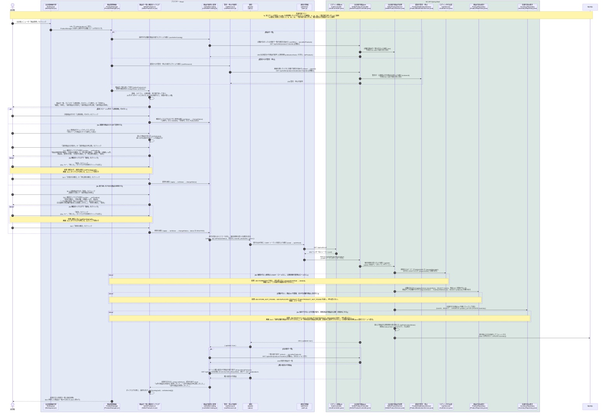
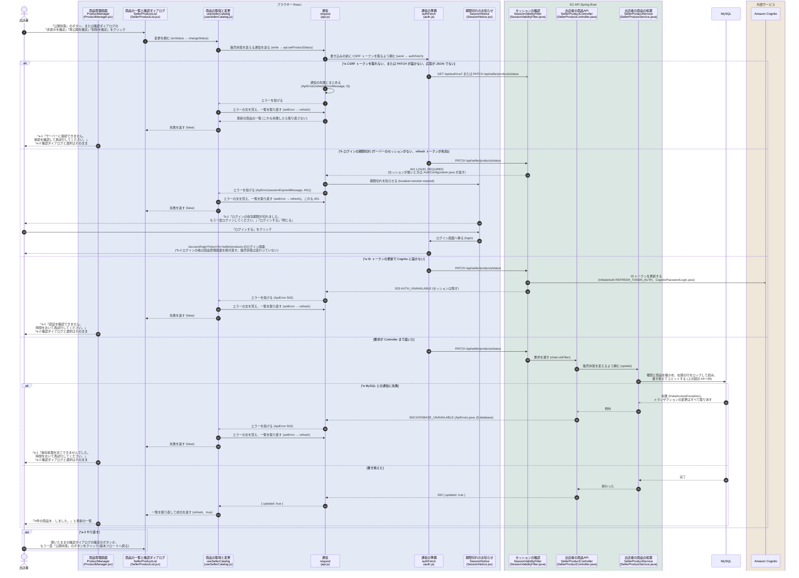

# EC-S06 商品の販売状態を変更する

- ユースケース記述: [EC-S06_商品の販売状態を変更する](<../../アーカイブ/ユースケース/kusakari-ec/EC-S06_商品の販売状態を変更する.md>)
- 共通代替フロー: [00_全ユースケース共通の代替フロー](<00_全ユースケース共通の代替フロー.md>)
- 対象のコード: kusakari-ec の main（6bad7e3、2026-11-24 時点）

## シーケンス図

参加者は、上から「画面や役割の名前」「コンポーネント・クラスの名前」「ファイル名（かっこ付き）」の順に書いています。
共通代替フローの中身は、00 の図か、下の「共通代替フローを直接書いた図」を見てください。
代替フローのうち、エラーで終わるもの（4a・4b）と記述にない分岐（店舗・商品がない 404、商品 ID の重複の 400）は、分かれる所だけを描き、結果と画面は Note に文で書いています。3c（確認ダイアログの「取消」）は、`break` の中の矢印 1 本と Note にしています。サーバーが失敗を返したときの画面の後処理（`readResponse` が `ApiError` を投げる → `write` の `catch` でエラーの文を覚える → 一覧を取り直す → 失敗を返し、確認ダイアログから確定したときはダイアログが開いたまま）は、どれも同じです。

## 共通代替フローを直接書いた図

上の図の、販売状態を変える通信（CSRF トークンの取得と `PATCH /api/seller/products/status`）に、この画面で起こる共通代替フロー（\*a、\*b）を書き込んだ図です。画面を開いて一覧を取る通信の \*a・\*b は、[EC-S05](<EC-S05_店舗在庫数を更新する.md>) の「共通代替フローを直接書いた図」と同じなので省いています。

## ユースケース記述との差

- 4a: 確認ダイアログ（3a・3b）から確定して失敗したとき、`apply()` は成功のときだけ `setPending(null)` を呼ぶので、ダイアログは開いたままです。エラーの文はダイアログの中ではなく、`ProductManager` の上部に出ます。記述の 4a-2「基本フロー 3 へ戻る」とは、ダイアログが残る点が違います。
- 4a: 記述は「保存に失敗した場合」とだけ書いています。サーバーが返す失敗は、店舗がない 404 `STORE_NOT_FOUND`（店舗がないと権限の確認が先に 403 にするので、運営のアカウントのときだけ）、ID の重複の 400 `DUPLICATE_PRODUCT`「商品IDが重複しています。」、選択店舗の商品でない 404 `PRODUCT_NOT_FOUND`「選択店舗の商品が見つかりません。」、削除済みの商品を公開・非表示にする 409 `PRODUCT_ARCHIVED`「削除済みの商品は再公開・非表示に変更できません。」です。どれも画面の動き（エラーの文を出して一覧を取り直す）は同じです。重複の 400 は、画面が同じ商品を 2 度選ばないので、画面からはふつう起きません。
- 4a: `useSellerCatalog.js` の `write()` は、失敗の種類によらず一覧を取り直します（共通代替フローの通信の失敗でも取り直す）。
- 4b: 権限の確かめ方は記述のとおりで、削除は `requireManager()`（オーナーか MANAGER）、公開状態の変更は `requireSeller()`（STAFF 以上）です。ただし画面は、STAFF にも「削除」「選択商品を削除」を出し、確認ダイアログも開きます。確定するとサーバーが 403 を返します。また、運営が停止した店舗と、存在しない店舗でも 403 になります。
- 4b: ORG_ADMIN でロールのない店舗（`memberRole` が `null`）では、`Workspace.jsx` が「商品管理」画面の代わりに人事の画面だけを使える旨を出し、通信しません。403 に届く「ロールなし」は、所属店舗でロールのない担当者（`memberRole` が `NONE`）です。
- 3a・3b: 確認ダイアログには、変更の内容として「この店舗の購入者一覧から除外し、カートに入っている場合も購入できなくなります。」（非表示・削除）か「この店舗の購入者一覧へ再公開します。」（再公開）も出ます。
- 3b-4: 削除は `inventory.publication_status` を `DELETED` にする論理削除で、商品と在庫の行は残ります。一覧は `findNotDeletedAtStore()` が `DELETED` の商品を除くので、画面から消えます。
- 基本フロー 5・3b-5: 成功すると、「N件の商品を非表示に変更しました。」「N件の商品を再公開しました。」「N件の商品を削除しました。」のどれかを出します。記述にはメッセージが書かれていません。
- 基本フロー 4: 成功のあと、出店者の一覧（`GET /api/seller/products`）のほかに、`shop.refreshProducts()` が購入者向けの商品（`GET /api/cart`、`GET /api/products`）も取り直します。記述にない処理です。保存が成功しても、この取り直しに失敗すると `write()` は失敗として扱い、エラーの文を出してダイアログを開いたままにします。
- 3c: 「取消」のほか、ダイアログの「閉じる」ボタン、Esc キー、ダイアログの外側のクリックも同じく `setPending(null)` だけです（通信中は閉じない）。選んでいたチェックボックスは残ります。
- 関連情報「商品一覧は25件ずつ…」: 検索（商品名と商品番号、大文字と小文字を区別しない）、絞り込み、並び替え、「条件をリセット」、ページ送りは画面の中だけで、通信しません。条件を変えると選択は外れ、1 ページ目に戻ります。

## 参照したコード

- [frontend/src/workspace/Workspace.jsx](https://github.com/abeouga/kusakari-ec/blob/6bad7e37c4135034fbe97e30309772fbe872e675/frontend/src/workspace/Workspace.jsx): `sellerMenu`、`rolePaths`、`personnelOnly`、`/seller/products` と `ProductManager` の対応
- [frontend/src/workspace/WorkspaceSidebar.jsx](https://github.com/abeouga/kusakari-ec/blob/6bad7e37c4135034fbe97e30309772fbe872e675/frontend/src/workspace/WorkspaceSidebar.jsx): `MenuLink`
- [frontend/src/components/ProductManager.jsx](https://github.com/abeouga/kusakari-ec/blob/6bad7e37c4135034fbe97e30309772fbe872e675/frontend/src/components/ProductManager.jsx): `ProductManager`（`catalog.error`、`shop.notice` の表示、`onStatus`）
- [frontend/src/components/SellerProductList.jsx](https://github.com/abeouga/kusakari-ec/blob/6bad7e37c4135034fbe97e30309772fbe872e675/frontend/src/components/SellerProductList.jsx): `SellerProductList`、`statusLabels`、`confirm`、`apply`、`setPending`、`setSelected`、確認ダイアログの文言
- [frontend/src/components/Dialog.jsx](https://github.com/abeouga/kusakari-ec/blob/6bad7e37c4135034fbe97e30309772fbe872e675/frontend/src/components/Dialog.jsx): `Dialog`（Esc キー、「閉じる」）
- [frontend/src/components/useSellerCatalog.js](https://github.com/abeouga/kusakari-ec/blob/6bad7e37c4135034fbe97e30309772fbe872e675/frontend/src/components/useSellerCatalog.js): `useEffect`（一覧の取得）、`refresh`、`write`、`changeStatus`
- [frontend/src/useShop.js](https://github.com/abeouga/kusakari-ec/blob/6bad7e37c4135034fbe97e30309772fbe872e675/frontend/src/useShop.js): `refresh`（`refreshProducts`）、`setNotice`
- [frontend/src/workspace/useResource.js](https://github.com/abeouga/kusakari-ec/blob/6bad7e37c4135034fbe97e30309772fbe872e675/frontend/src/workspace/useResource.js): `useResource`、`reload`
- [frontend/src/api.js](https://github.com/abeouga/kusakari-ec/blob/6bad7e37c4135034fbe97e30309772fbe872e675/frontend/src/api.js): `request`、`send`、`readResponse`、`api.sellerProducts`、`api.setProductStatus`、`networkErrorMessage`、`sessionExpiredMessage`
- [frontend/src/auth.js](https://github.com/abeouga/kusakari-ec/blob/6bad7e37c4135034fbe97e30309772fbe872e675/frontend/src/auth.js): `authFetch`（`GET /api/auth/csrf`）、`wasSignedIn`、`login`
- [frontend/src/components/SessionNotice.jsx](https://github.com/abeouga/kusakari-ec/blob/6bad7e37c4135034fbe97e30309772fbe872e675/frontend/src/components/SessionNotice.jsx): 期限切れのお知らせ
- [backend/src/main/java/jp/kusakari/ec/catalog/controller/SellerProductController.java](https://github.com/abeouga/kusakari-ec/blob/6bad7e37c4135034fbe97e30309772fbe872e675/backend/src/main/java/jp/kusakari/ec/catalog/controller/SellerProductController.java): `list`、`moderation`、`update`
- [backend/src/main/java/jp/kusakari/ec/catalog/dto/ProductStatusRequest.java](https://github.com/abeouga/kusakari-ec/blob/6bad7e37c4135034fbe97e30309772fbe872e675/backend/src/main/java/jp/kusakari/ec/catalog/dto/ProductStatusRequest.java): `ProductStatusRequest`（`productIds` は 1〜25 件、`status` は PUBLISHED・HIDDEN・DELETED）
- [backend/src/main/java/jp/kusakari/ec/catalog/service/SellerProductService.java](https://github.com/abeouga/kusakari-ec/blob/6bad7e37c4135034fbe97e30309772fbe872e675/backend/src/main/java/jp/kusakari/ec/catalog/service/SellerProductService.java): `list`、`update`、`requireAtStore`、`notAtStore`
- [backend/src/main/java/jp/kusakari/ec/catalog/service/CatalogService.java](https://github.com/abeouga/kusakari-ec/blob/6bad7e37c4135034fbe97e30309772fbe872e675/backend/src/main/java/jp/kusakari/ec/catalog/service/CatalogService.java): `requireStore`、`storeProducts`
- [backend/src/main/java/jp/kusakari/ec/catalog/service/ProductModerationService.java](https://github.com/abeouga/kusakari-ec/blob/6bad7e37c4135034fbe97e30309772fbe872e675/backend/src/main/java/jp/kusakari/ec/catalog/service/ProductModerationService.java): `noticesAt`
- [backend/src/main/java/jp/kusakari/ec/catalog/persistence/repository/InventoryRepository.java](https://github.com/abeouga/kusakari-ec/blob/6bad7e37c4135034fbe97e30309772fbe872e675/backend/src/main/java/jp/kusakari/ec/catalog/persistence/repository/InventoryRepository.java): `lockAll`（`@Lock(PESSIMISTIC_WRITE)`）
- [backend/src/main/java/jp/kusakari/ec/catalog/persistence/repository/ProductRepository.java](https://github.com/abeouga/kusakari-ec/blob/6bad7e37c4135034fbe97e30309772fbe872e675/backend/src/main/java/jp/kusakari/ec/catalog/persistence/repository/ProductRepository.java): `findStoreReferences`、`findNotDeletedAtStore`
- [backend/src/main/java/jp/kusakari/ec/catalog/persistence/entity/InventoryEntity.java](https://github.com/abeouga/kusakari-ec/blob/6bad7e37c4135034fbe97e30309772fbe872e675/backend/src/main/java/jp/kusakari/ec/catalog/persistence/entity/InventoryEntity.java): `PUBLISHED`、`HIDDEN`、`DELETED`、`setPublicationStatus`
- [backend/src/main/java/jp/kusakari/ec/auth/AuthService.java](https://github.com/abeouga/kusakari-ec/blob/6bad7e37c4135034fbe97e30309772fbe872e675/backend/src/main/java/jp/kusakari/ec/auth/AuthService.java): `requireSeller`、`requireManager`、`requireStoreRole`、`denied`
- [backend/src/main/java/jp/kusakari/ec/auth/AuthController.java](https://github.com/abeouga/kusakari-ec/blob/6bad7e37c4135034fbe97e30309772fbe872e675/backend/src/main/java/jp/kusakari/ec/auth/AuthController.java): `csrf`
- [backend/src/main/java/jp/kusakari/ec/auth/SessionValidityFilter.java](https://github.com/abeouga/kusakari-ec/blob/6bad7e37c4135034fbe97e30309772fbe872e675/backend/src/main/java/jp/kusakari/ec/auth/SessionValidityFilter.java): `doFilterInternal`（ID トークンの更新、401、503）
- [backend/src/main/java/jp/kusakari/ec/auth/CognitoPasswordLogin.java](https://github.com/abeouga/kusakari-ec/blob/6bad7e37c4135034fbe97e30309772fbe872e675/backend/src/main/java/jp/kusakari/ec/auth/CognitoPasswordLogin.java): ID トークンの更新、503 `AUTH_UNAVAILABLE`
- [backend/src/main/java/jp/kusakari/ec/auth/AuthConfiguration.java](https://github.com/abeouga/kusakari-ec/blob/6bad7e37c4135034fbe97e30309772fbe872e675/backend/src/main/java/jp/kusakari/ec/auth/AuthConfiguration.java): `authenticationEntryPoint`（401 `LOGIN_REQUIRED`）
- [backend/src/main/java/jp/kusakari/ec/common/web/ApiErrors.java](https://github.com/abeouga/kusakari-ec/blob/6bad7e37c4135034fbe97e30309772fbe872e675/backend/src/main/java/jp/kusakari/ec/common/web/ApiErrors.java): `business`、`invalid`、`database`
