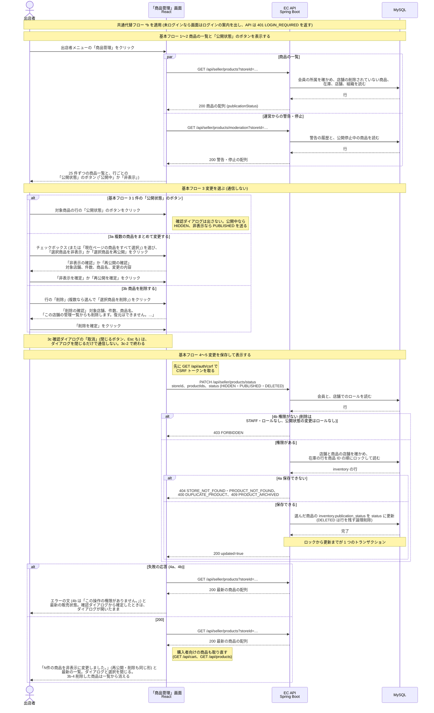
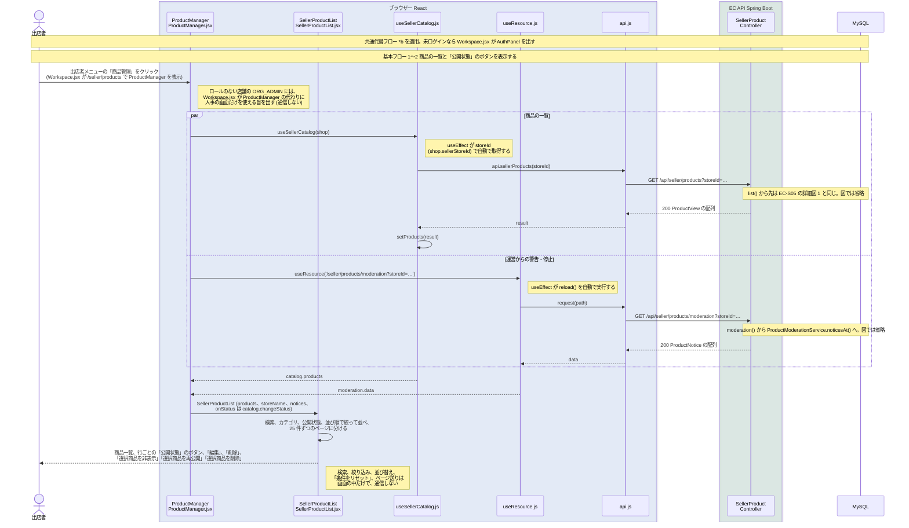
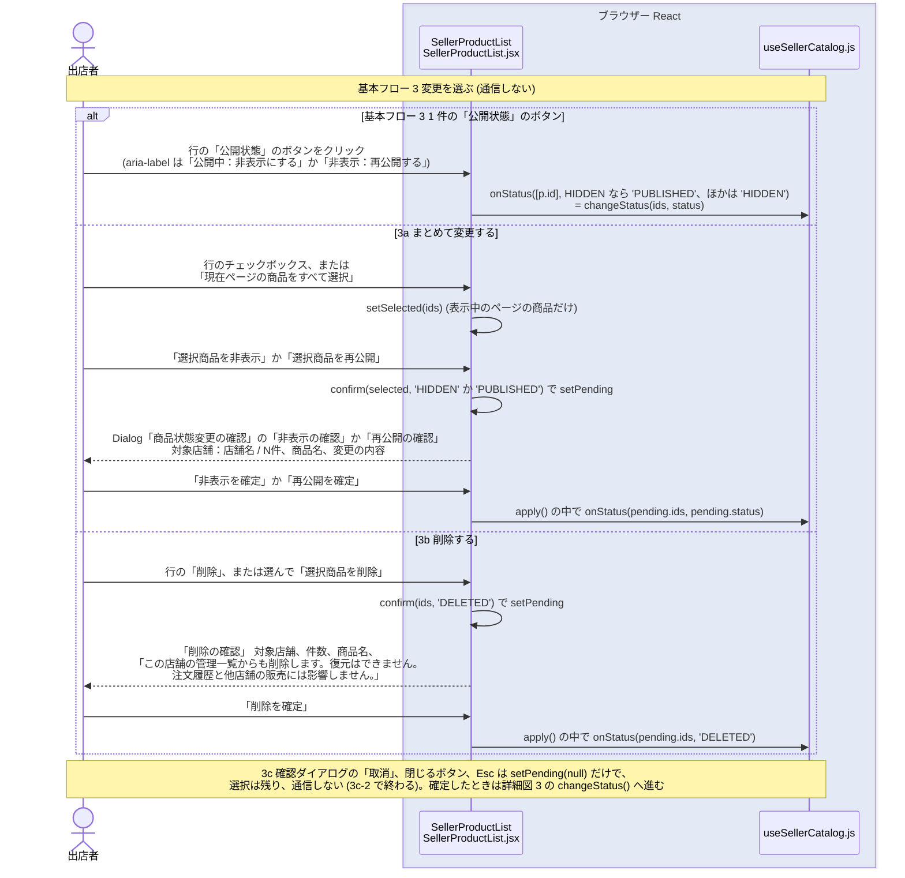
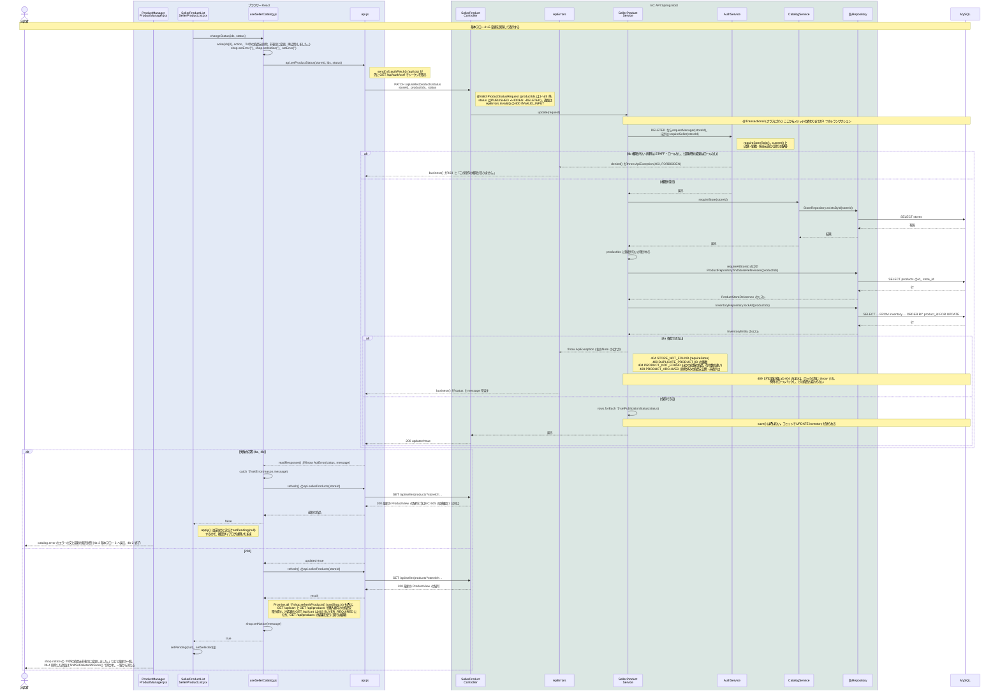

# EC-S06 商品の販売状態を変更する

- ユースケース記述: [EC-S06_商品の販売状態を変更する](<../../アーカイブ/ユースケース/kusakari-ec/EC-S06_商品の販売状態を変更する.md>)
- 対象のコード: kusakari-ec の main（19a2be3、2026-11-20 時点）

## 概要図

## 詳細図 1 基本フロー 1〜2

## 詳細図 2 基本フロー 3

## 詳細図 3 基本フロー 4〜5

## ユースケース記述との差

- 4a: 確認ダイアログ（3a・3b）から確定して失敗したとき、`apply()` は成功のときだけ `setPending(null)` を呼ぶので、ダイアログは開いたままです。エラーの文はダイアログの中ではなく、`ProductManager` の上部に出ます。記述の 4a-2「基本フロー 3 へ戻る」とは、ダイアログが残る点が違います。
- 4a: 記述は「保存に失敗した場合」とだけ書いています。サーバーが返す失敗は、店舗がない 404 `STORE_NOT_FOUND`（店舗がないと権限の確認が先に 403 にするので、運営のアカウントのときだけ）、ID の重複の 400 `DUPLICATE_PRODUCT`、選択店舗の商品でない 404 `PRODUCT_NOT_FOUND`「選択店舗の商品が見つかりません。」、削除済みの商品を公開・非表示にする 409 `PRODUCT_ARCHIVED`「削除済みの商品は再公開・非表示に変更できません。」です。どれも画面の動き（エラーの文を出して一覧を取り直す）は同じです。
- 4b: 権限の確かめ方は記述のとおりで、削除は `requireManager()`（オーナーか MANAGER）、公開状態の変更は `requireSeller()`（STAFF 以上）です。ただし画面は、STAFF にも「削除」「選択商品を削除」を出します。押すとサーバーが 403 を返します。また、運営が停止した店舗と、存在しない店舗でも 403 になります。
- 4b: ORG_ADMIN でロールのない店舗（`memberRole` が `null`）では、`Workspace.jsx` が「商品管理」画面の代わりに人事の画面だけを使える旨を出し、通信しません。403 に届く「ロールなし」は、所属店舗でロールのない担当者（`memberRole` が `NONE`）です。
- 3b-4: 削除は `inventory.publication_status` を `DELETED` にする論理削除で、商品と在庫の行は残ります。一覧は `findNotDeletedAtStore()` が `DELETED` の商品を除くので、画面から消えます。
- 基本フロー 5・3b-5: 成功すると、`N件の商品を非表示に変更しました。`、`N件の商品を再公開しました。`、`N件の商品を削除しました。` のどれかを出します。記述にはメッセージが書かれていません。
- 基本フロー 4: 成功のあと、出店者の一覧（`GET /api/seller/products`）のほかに、`shop.refreshProducts()` が購入者向けの商品（`GET /api/cart`、`GET /api/products`）も取り直します。記述にない処理です。
- 3c: 「取消」のほか、ダイアログの閉じるボタンと Esc も同じく `setPending(null)` だけです。選んでいたチェックボックスは残ります。

## 確かめられなかったこと

- 確認ダイアログは `showModal()` で開くので、失敗のときに `ProductManager` の上部に出るエラーの文が、ダイアログの後ろで読めるかどうかは、画面で確かめていません。
- `InventoryRepository.lockAll()` が `SELECT … FOR UPDATE` になることは、`@Lock(PESSIMISTIC_WRITE)` から読んだものです。`UPDATE inventory` を送る時点は、実行して確かめていません。

## 参照したコード

- [frontend/src/workspace/Workspace.jsx](https://github.com/abeouga/kusakari-ec/blob/19a2be307ee71a2cd87e538236c3c8c42929c5b3/frontend/src/workspace/Workspace.jsx): `sellerMenu`、`rolePaths`、`personnelOnly`、`/seller/products` と `ProductManager` の対応
- [frontend/src/components/ProductManager.jsx](https://github.com/abeouga/kusakari-ec/blob/19a2be307ee71a2cd87e538236c3c8c42929c5b3/frontend/src/components/ProductManager.jsx): `ProductManager`（`catalog.error`、`shop.notice` の表示、`onStatus`）
- [frontend/src/components/SellerProductList.jsx](https://github.com/abeouga/kusakari-ec/blob/19a2be307ee71a2cd87e538236c3c8c42929c5b3/frontend/src/components/SellerProductList.jsx): `SellerProductList`、`statusLabels`、`confirm`、`apply`、`setPending`、`setSelected`
- [frontend/src/components/Dialog.jsx](https://github.com/abeouga/kusakari-ec/blob/19a2be307ee71a2cd87e538236c3c8c42929c5b3/frontend/src/components/Dialog.jsx): `Dialog`（`showModal`、`onCancel`）
- [frontend/src/components/useSellerCatalog.js](https://github.com/abeouga/kusakari-ec/blob/19a2be307ee71a2cd87e538236c3c8c42929c5b3/frontend/src/components/useSellerCatalog.js): `useEffect`（一覧の取得）、`refresh`、`write`、`changeStatus`
- [frontend/src/useShop.js](https://github.com/abeouga/kusakari-ec/blob/19a2be307ee71a2cd87e538236c3c8c42929c5b3/frontend/src/useShop.js): `refresh`（`refreshProducts`）、`setNotice`
- [frontend/src/workspace/useResource.js](https://github.com/abeouga/kusakari-ec/blob/19a2be307ee71a2cd87e538236c3c8c42929c5b3/frontend/src/workspace/useResource.js): `useResource`、`reload`
- [frontend/src/api.js](https://github.com/abeouga/kusakari-ec/blob/19a2be307ee71a2cd87e538236c3c8c42929c5b3/frontend/src/api.js): `request`、`readResponse`、`api.sellerProducts`、`api.setProductStatus`
- [frontend/src/auth.js](https://github.com/abeouga/kusakari-ec/blob/19a2be307ee71a2cd87e538236c3c8c42929c5b3/frontend/src/auth.js): `authFetch`（`/api/auth/csrf`）
- [backend/src/main/java/jp/kusakari/ec/catalog/controller/SellerProductController.java](https://github.com/abeouga/kusakari-ec/blob/19a2be307ee71a2cd87e538236c3c8c42929c5b3/backend/src/main/java/jp/kusakari/ec/catalog/controller/SellerProductController.java): `list`、`moderation`、`update`
- [backend/src/main/java/jp/kusakari/ec/catalog/dto/ProductStatusRequest.java](https://github.com/abeouga/kusakari-ec/blob/19a2be307ee71a2cd87e538236c3c8c42929c5b3/backend/src/main/java/jp/kusakari/ec/catalog/dto/ProductStatusRequest.java): `ProductStatusRequest`
- [backend/src/main/java/jp/kusakari/ec/catalog/service/SellerProductService.java](https://github.com/abeouga/kusakari-ec/blob/19a2be307ee71a2cd87e538236c3c8c42929c5b3/backend/src/main/java/jp/kusakari/ec/catalog/service/SellerProductService.java): `update`、`requireAtStore`、`notAtStore`
- [backend/src/main/java/jp/kusakari/ec/catalog/service/CatalogService.java](https://github.com/abeouga/kusakari-ec/blob/19a2be307ee71a2cd87e538236c3c8c42929c5b3/backend/src/main/java/jp/kusakari/ec/catalog/service/CatalogService.java): `requireStore`、`storeProducts`
- [backend/src/main/java/jp/kusakari/ec/catalog/persistence/repository/InventoryRepository.java](https://github.com/abeouga/kusakari-ec/blob/19a2be307ee71a2cd87e538236c3c8c42929c5b3/backend/src/main/java/jp/kusakari/ec/catalog/persistence/repository/InventoryRepository.java): `lockAll`
- [backend/src/main/java/jp/kusakari/ec/catalog/persistence/repository/ProductRepository.java](https://github.com/abeouga/kusakari-ec/blob/19a2be307ee71a2cd87e538236c3c8c42929c5b3/backend/src/main/java/jp/kusakari/ec/catalog/persistence/repository/ProductRepository.java): `findStoreReferences`、`findNotDeletedAtStore`
- [backend/src/main/java/jp/kusakari/ec/catalog/persistence/entity/InventoryEntity.java](https://github.com/abeouga/kusakari-ec/blob/19a2be307ee71a2cd87e538236c3c8c42929c5b3/backend/src/main/java/jp/kusakari/ec/catalog/persistence/entity/InventoryEntity.java): `PUBLISHED`、`HIDDEN`、`DELETED`、`publicationStatus`
- [backend/src/main/java/jp/kusakari/ec/auth/AuthService.java](https://github.com/abeouga/kusakari-ec/blob/19a2be307ee71a2cd87e538236c3c8c42929c5b3/backend/src/main/java/jp/kusakari/ec/auth/AuthService.java): `requireSeller`、`requireManager`、`requireStoreRole`、`denied`
- [backend/src/main/java/jp/kusakari/ec/common/web/ApiErrors.java](https://github.com/abeouga/kusakari-ec/blob/19a2be307ee71a2cd87e538236c3c8c42929c5b3/backend/src/main/java/jp/kusakari/ec/common/web/ApiErrors.java): `business`、`invalid`
