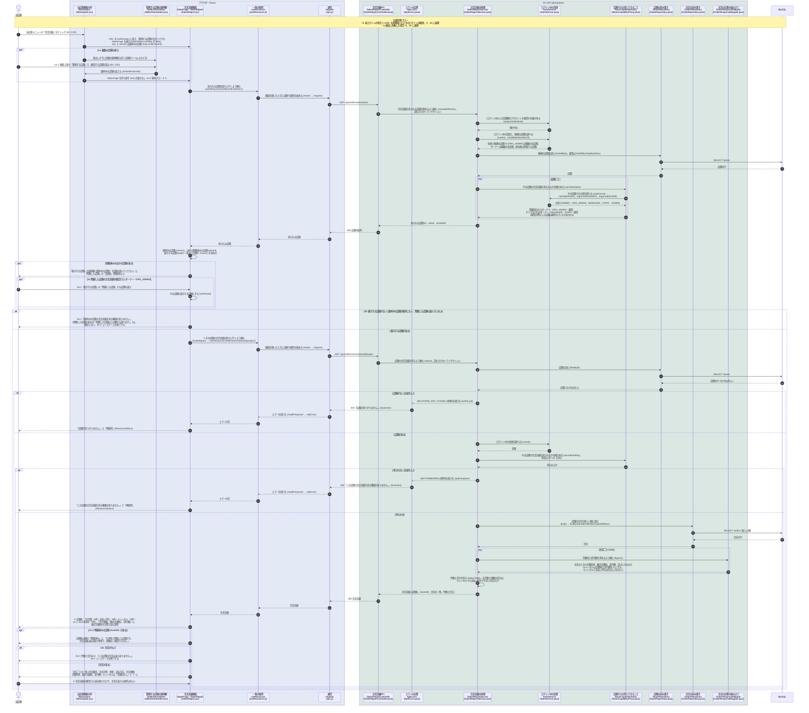
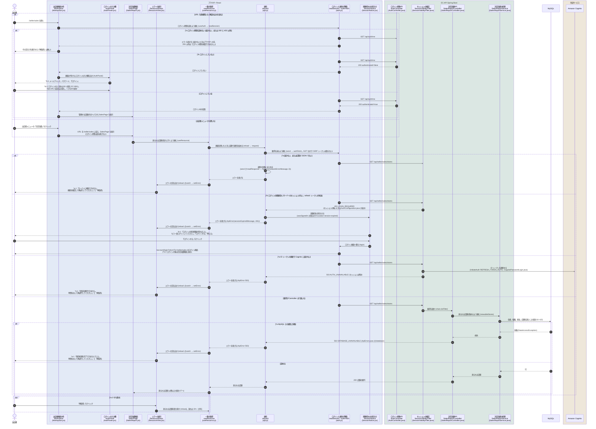

# EC-S07 注文実績を確認する

- ユースケース記述: [EC-S07_注文実績を確認する](<../../アーカイブ/ユースケース/kusakari-ec/EC-S07_注文実績を確認する.md>)
- 共通代替フロー: [00_全ユースケース共通の代替フロー](<00_全ユースケース共通の代替フロー.md>)
- 対象のコード: kusakari-ec の main（6bad7e3、2026-11-24 時点）

## シーケンス図

参加者は、上から「画面や役割の名前」「コンポーネント・クラスの名前」「ファイル名（かっこ付き）」の順に書いています。
共通代替フローの中身は、00 の図か、下の「共通代替フローを直接書いた図」を見てください。

## 共通代替フローを直接書いた図

上の図の、画面を開くときのログインの確認と、見られる店舗の `GET /api/seller/sales/stores` に、この画面で起こる共通代替フロー（\*a、\*b）を書き込んだ図です。注文実績の `GET /api/seller/stores/{storeId}/sales` の \*a・\*b も同じ流れで、`SalesReport` の `ResourceStatus` にエラーの文と「再取得」が出ます。この画面は読み取りだけなので、CSRF トークンの取得や書き込みの失敗はありません。

## ユースケース記述との差

- 2b: 見る権限があるかどうかは、画面が `GET /api/seller/sales/stores` の配列に選択中の店舗があるかで決めます。配列になければ、注文実績の API を呼ばずに「選択中の店舗の注文実績を見る権限がありません。」を出します。記述の 2b と同じ文言です。
- 記述にない失敗の応答があります。`GET /api/seller/stores/{storeId}/sales` は、店舗がないと 404 `STORE_NOT_FOUND`「店舗が見つかりません。」、見る権限がないと 403 `FORBIDDEN`「この店舗の注文実績を見る権限がありません。」を返します。画面は 2b で先に止めるので、届くのは店舗の一覧を取ったあとに権限や店舗が変わったときです。画面は `ResourceStatus` でエラーの文と「再取得」を出します。
- 2a: 「表示する店舗」の選択欄は、選択中の店舗のほかに閉鎖済みの店舗が 1 つ以上あるときだけ出ます。選択中の店舗そのものが閉鎖済みで見られる店舗なら、「表示する店舗」で選ばなくても、そのまま 2a-2 の表示になります。
- 2b・関連情報: `/seller/sales` は、ロールのない店舗の ORG_ADMIN にも「注文実績」画面を出し、見られるかどうかを API の配列で決めます（`Workspace.jsx` で `personnelOnly` より前に `SalesPage` を選ぶ）。営業中・閉鎖中の店舗では ORG_ADMIN の立場だけでは見られないので、店舗のロールがなければ 2b になります。
- 関連情報: 運営が停止した営業中の店舗は、オーナー・MANAGER・STAFF も見られず、運営だけが見られます（`StoreCapabilityPolicy.canViewSales` の `isSuspended`）。閉鎖済みの店舗は停止していても対応表のとおりです。記述にない決まりです。
- 基本フロー 3: 「注文数」はキャンセルと支払い待ちを除いた件数です（`SalesTotals` の `orderCount` は合計に入れる注文の件数）。「キャンセル申請中」はキャンセルでない注文のうち、キャンセル申請が `PENDING` の件数です。記述は件数の名前だけを書いています。
- 1a: 店舗を選び直すと、`Workspace.jsx` が `SalesPage` を `key` で作り直すので、見られる店舗（`GET /api/seller/sales/stores`）から取り直します。「表示する店舗」で選んでいた閉鎖済みの店舗の選択（`picked`）は消えます。
- 店舗側のアカウントでも運営でもない会員がこの画面を開くと、`Workspace.jsx` が「この画面を利用する権限がありません。」を出し、通信しません。API も `requireSellerRole()` で 403 を返します。事前条件が出店者のログインなので、図には書いていません。

## 確かめられなかったこと

- 注文実績の API の 403・404 が画面から起きる条件（店舗の一覧を取ってから注文実績を取るまでの間に、権限や店舗が変わったとき）は、実行して確かめていません。

## 参照したコード

- [frontend/src/workspace/Workspace.jsx](https://github.com/abeouga/kusakari-ec/blob/6bad7e37c4135034fbe97e30309772fbe872e675/frontend/src/workspace/Workspace.jsx): `sellerMenu`、`storePaths`、`/seller/sales` と `SalesPage` の対応、`SellerStoreSelect` の表示、未ログインの `AuthPanel`
- [frontend/src/components/SellerStoreSelect.jsx](https://github.com/abeouga/kusakari-ec/blob/6bad7e37c4135034fbe97e30309772fbe872e675/frontend/src/components/SellerStoreSelect.jsx): `SellerStoreSelect`（`setSellerStoreId`）
- [frontend/src/workspace/SalesReport.jsx](https://github.com/abeouga/kusakari-ec/blob/6bad7e37c4135034fbe97e30309772fbe872e675/frontend/src/workspace/SalesReport.jsx): `SalesPage`（`chosen`、`closed`、`target`、`setPicked`）、`SalesReport`、`rateLabel`
- [frontend/src/workspace/ResourceView.jsx](https://github.com/abeouga/kusakari-ec/blob/6bad7e37c4135034fbe97e30309772fbe872e675/frontend/src/workspace/ResourceView.jsx): `ResourceStatus`（エラーの文と「再取得」）
- [frontend/src/workspace/useResource.js](https://github.com/abeouga/kusakari-ec/blob/6bad7e37c4135034fbe97e30309772fbe872e675/frontend/src/workspace/useResource.js): `useResource`、`reload`
- [frontend/src/workspace/OrderPages.jsx](https://github.com/abeouga/kusakari-ec/blob/6bad7e37c4135034fbe97e30309772fbe872e675/frontend/src/workspace/OrderPages.jsx): `orderLabels`、`cancellationLabels`
- [frontend/src/payment.js](https://github.com/abeouga/kusakari-ec/blob/6bad7e37c4135034fbe97e30309772fbe872e675/frontend/src/payment.js): `paymentLabel`
- [frontend/src/useShop.js](https://github.com/abeouga/kusakari-ec/blob/6bad7e37c4135034fbe97e30309772fbe872e675/frontend/src/useShop.js): `sellerStoreId`、`sellerStoresLoading`、`setSellerStoreId`
- [frontend/src/api.js](https://github.com/abeouga/kusakari-ec/blob/6bad7e37c4135034fbe97e30309772fbe872e675/frontend/src/api.js): `request`、`send`、`readResponse`、`ApiError`、`networkErrorMessage`、`sessionExpiredMessage`
- [frontend/src/auth.js](https://github.com/abeouga/kusakari-ec/blob/6bad7e37c4135034fbe97e30309772fbe872e675/frontend/src/auth.js): `canSell`、`readSession`、`authFetch`、`wasSignedIn`、`login`
- [frontend/src/useAuth.js](https://github.com/abeouga/kusakari-ec/blob/6bad7e37c4135034fbe97e30309772fbe872e675/frontend/src/useAuth.js): `useAuth`
- [frontend/src/components/AuthPanel.jsx](https://github.com/abeouga/kusakari-ec/blob/6bad7e37c4135034fbe97e30309772fbe872e675/frontend/src/components/AuthPanel.jsx): ログイン欄
- [frontend/src/components/SessionNotice.jsx](https://github.com/abeouga/kusakari-ec/blob/6bad7e37c4135034fbe97e30309772fbe872e675/frontend/src/components/SessionNotice.jsx): 期限切れのお知らせ
- [backend/src/main/java/jp/kusakari/ec/commerce/controller/SalesReportController.java](https://github.com/abeouga/kusakari-ec/blob/6bad7e37c4135034fbe97e30309772fbe872e675/backend/src/main/java/jp/kusakari/ec/commerce/controller/SalesReportController.java): `stores`、`seller`
- [backend/src/main/java/jp/kusakari/ec/commerce/service/SalesReportService.java](https://github.com/abeouga/kusakari-ec/blob/6bad7e37c4135034fbe97e30309772fbe872e675/backend/src/main/java/jp/kusakari/ec/commerce/service/SalesReportService.java): `viewableStores`、`report`、`build`、`row`、`notFound`
- [backend/src/main/java/jp/kusakari/ec/auth/StoreCapabilityPolicy.java](https://github.com/abeouga/kusakari-ec/blob/6bad7e37c4135034fbe97e30309772fbe872e675/backend/src/main/java/jp/kusakari/ec/auth/StoreCapabilityPolicy.java): `TABLE`、`canViewSales`、`can`、`positionsAt`
- [backend/src/main/java/jp/kusakari/ec/auth/AuthService.java](https://github.com/abeouga/kusakari-ec/blob/6bad7e37c4135034fbe97e30309772fbe872e675/backend/src/main/java/jp/kusakari/ec/auth/AuthService.java): `requireSellerRole`、`current`、`candidateStoreIdsOf`、`viewableStoreIdsOf`、`memberRoleAt`、`organizationRoleOf`、`organizationIdOf`
- [backend/src/main/java/jp/kusakari/ec/catalog/persistence/repository/StoreRepository.java](https://github.com/abeouga/kusakari-ec/blob/6bad7e37c4135034fbe97e30309772fbe872e675/backend/src/main/java/jp/kusakari/ec/catalog/persistence/repository/StoreRepository.java): `findAllByOrderByIdAsc`（`findById`、`findAllById` は JpaRepository）
- [backend/src/main/java/jp/kusakari/ec/commerce/mapper/OrderResponseMapper.java](https://github.com/abeouga/kusakari-ec/blob/6bad7e37c4135034fbe97e30309772fbe872e675/backend/src/main/java/jp/kusakari/ec/commerce/mapper/OrderResponseMapper.java): `figures`
- [backend/src/main/java/jp/kusakari/ec/commerce/persistence/repository/OrderRepository.java](https://github.com/abeouga/kusakari-ec/blob/6bad7e37c4135034fbe97e30309772fbe872e675/backend/src/main/java/jp/kusakari/ec/commerce/persistence/repository/OrderRepository.java): `findByStoreIdOrderByCreatedAtDesc`
- [backend/src/main/java/jp/kusakari/ec/auth/AuthController.java](https://github.com/abeouga/kusakari-ec/blob/6bad7e37c4135034fbe97e30309772fbe872e675/backend/src/main/java/jp/kusakari/ec/auth/AuthController.java): `GET /api/auth/me`
- [backend/src/main/java/jp/kusakari/ec/auth/SessionValidityFilter.java](https://github.com/abeouga/kusakari-ec/blob/6bad7e37c4135034fbe97e30309772fbe872e675/backend/src/main/java/jp/kusakari/ec/auth/SessionValidityFilter.java): `doFilterInternal`、`renewIdToken`
- [backend/src/main/java/jp/kusakari/ec/auth/CognitoPasswordLogin.java](https://github.com/abeouga/kusakari-ec/blob/6bad7e37c4135034fbe97e30309772fbe872e675/backend/src/main/java/jp/kusakari/ec/auth/CognitoPasswordLogin.java): ID トークンの更新、503 `AUTH_UNAVAILABLE`
- [backend/src/main/java/jp/kusakari/ec/auth/AuthConfiguration.java](https://github.com/abeouga/kusakari-ec/blob/6bad7e37c4135034fbe97e30309772fbe872e675/backend/src/main/java/jp/kusakari/ec/auth/AuthConfiguration.java): `authenticationEntryPoint`（401 `LOGIN_REQUIRED`）
- [backend/src/main/java/jp/kusakari/ec/common/web/ApiErrors.java](https://github.com/abeouga/kusakari-ec/blob/6bad7e37c4135034fbe97e30309772fbe872e675/backend/src/main/java/jp/kusakari/ec/common/web/ApiErrors.java): `business`、`database`
