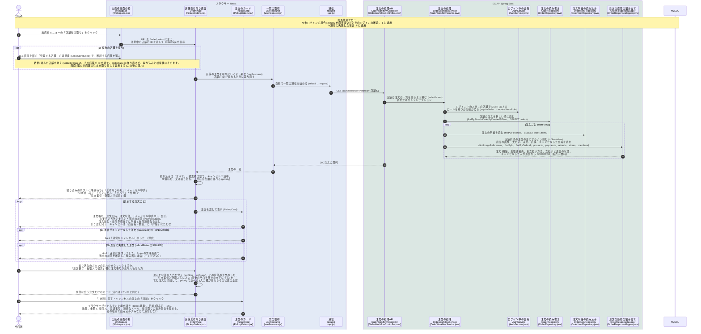
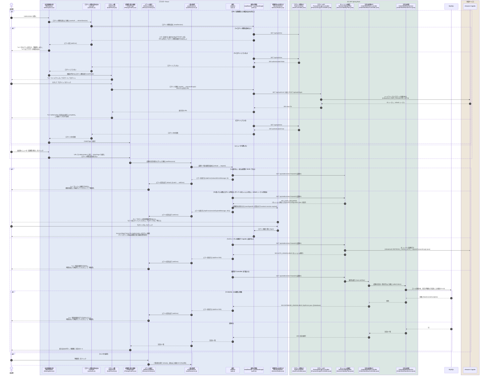

# EC-S08 注文一覧・詳細を確認する

- ユースケース記述: [EC-S08_注文一覧・詳細を確認する](<../../アーカイブ/ユースケース/kusakari-ec/EC-S08_注文一覧・詳細を確認する.md>)
- 共通代替フロー: [00_全ユースケース共通の代替フロー](<00_全ユースケース共通の代替フロー.md>)
- 対象のコード: kusakari-ec の main（6bad7e3、2026-11-24 時点）

## シーケンス図

参加者は、上から「画面や役割の名前」「コンポーネント・クラスの名前」「ファイル名（かっこ付き）」の順に書いています。
共通代替フローの中身は、00 の図か、下の「共通代替フローを直接書いた図」を見てください。
エラーの代替フローは図に描かず、図の下に並べています。1a（管理する店舗を選ぶ）は、`opt` の中の矢印 1 本と Note にしています。

図に描いていない代替フロー：2a（注文がない、条件に合う注文がない）、（記述なし）の分岐

## 共通代替フローを直接書いた図

上の図の、画面を開いて注文の一覧を取る通信に、この画面で起こる共通代替フロー（\*a、\*b）を書き込んだ図です。絞り込み、検索、「詳細」は画面の中だけで通信しないので、共通代替フローは起こりません。この図は、同じ画面を使う [EC-S09](<EC-S09_注文を受取準備完了にする.md>)・[EC-S10](<EC-S10_注文を引き渡し完了にする.md>)・[EC-S13](<EC-S13_注文キャンセル申請を処理する.md>) の、画面を開くときの共通代替フローも兼ねます。

## ユースケース記述との差

- 6a・6b: 記述は「詳細」をクリックしたあと（基本フロー 6）の代替フローにしています。コードでは、「運営がキャンセルしました：(理由)」と「返金に失敗しました。…」はカードの `details` 要素の外にあり、一覧を表示した時点（基本フロー 2）から出ています。
- 6a: `cancelledBy` が `OPERATOR` になるのは、注文をキャンセルした会員（`cancelled_by_member_id`）が運営（`isAdmin()`）のときです。店舗の閉鎖・組織の停止のまとめてキャンセル（`OpenOrders.cancelAll()`）のほか、運営のアカウントが出店者の画面からキャンセル申請を承認した注文（`decideCancellation()`）も同じ表示になります。
- 基本フロー 5〜6: 「詳細」は HTML の `details` 要素で、明細と受取連絡先は一覧の取得のときに読み込み済みです。開くときに通信はしません。注文 1 件を返す `GET /api/seller/orders/{id}` はありますが、この画面からは呼びません。
- 関連情報「ロールのない担当者は注文を見られない」: 所属店舗でロールのない担当者（`memberRole` が `NONE`）は、`requireSeller()` の 403 で「この操作の権限がありません。」と「再取得」が出ます。ORG_ADMIN でロールのない店舗（`memberRole` が `null`）では、`Workspace.jsx` が人事の画面だけを使える旨を出し、通信しません。運営が停止した店舗と、存在しない店舗でも 403 になります。
- 基本フロー 3: 絞り込みのボタンの件数は、検索欄の入力にかかわらず、取得したすべての注文で数えます。支払い待ち（`PENDING_PAYMENT`）の注文は「すべて」でだけ出ます。検索は注文番号と受取人名を空白でつないだ文字列に入力が含まれるかで決め、大文字と小文字を区別しません。
- 1a: 店舗を選び直しても、`OrderPage` は作り直さないので、絞り込みのボタンと検索欄の状態は残ります。
- 一覧の取得の失敗（403 と共通代替フロー）は、`ResourceStatus` がエラーの文と「再取得」を出します。取得に失敗したときは「該当する注文はありません。」は出ません（`resource.data` が空のまま）。

## 参照したコード

- [frontend/src/workspace/Workspace.jsx](https://github.com/abeouga/kusakari-ec/blob/6bad7e37c4135034fbe97e30309772fbe872e675/frontend/src/workspace/Workspace.jsx): `sellerMenu`、`storePaths`、`rolePaths`、`personnelOnly`、未ログインのときの `AuthPanel`、`/seller/orders` と `OrderPage` の対応
- [frontend/src/workspace/WorkspaceSidebar.jsx](https://github.com/abeouga/kusakari-ec/blob/6bad7e37c4135034fbe97e30309772fbe872e675/frontend/src/workspace/WorkspaceSidebar.jsx): `MenuLink`
- [frontend/src/workspace/Common.jsx](https://github.com/abeouga/kusakari-ec/blob/6bad7e37c4135034fbe97e30309772fbe872e675/frontend/src/workspace/Common.jsx): `PageLink`
- [frontend/src/components/SellerStoreSelect.jsx](https://github.com/abeouga/kusakari-ec/blob/6bad7e37c4135034fbe97e30309772fbe872e675/frontend/src/components/SellerStoreSelect.jsx): 「管理する店舗」の選択欄
- [frontend/src/useShop.js](https://github.com/abeouga/kusakari-ec/blob/6bad7e37c4135034fbe97e30309772fbe872e675/frontend/src/useShop.js): `sellerStoreId`、`setSellerStoreId`
- [frontend/src/workspace/PickupOrders.jsx](https://github.com/abeouga/kusakari-ec/blob/6bad7e37c4135034fbe97e30309772fbe872e675/frontend/src/workspace/PickupOrders.jsx): `OrderPage`、`filters`、`priority`、`PickupCard`、`Progress`
- [frontend/src/workspace/OrderPages.jsx](https://github.com/abeouga/kusakari-ec/blob/6bad7e37c4135034fbe97e30309772fbe872e675/frontend/src/workspace/OrderPages.jsx): `orderLabels`、`cancellationLabels`、`PaymentState`
- [frontend/src/payment.js](https://github.com/abeouga/kusakari-ec/blob/6bad7e37c4135034fbe97e30309772fbe872e675/frontend/src/payment.js): `paymentLabel`、`paymentStatusLabels`、`refundStatusLabels`
- [frontend/src/workspace/ResourceView.jsx](https://github.com/abeouga/kusakari-ec/blob/6bad7e37c4135034fbe97e30309772fbe872e675/frontend/src/workspace/ResourceView.jsx): `ResourceStatus`（エラーの文と「再取得」）
- [frontend/src/workspace/useResource.js](https://github.com/abeouga/kusakari-ec/blob/6bad7e37c4135034fbe97e30309772fbe872e675/frontend/src/workspace/useResource.js): `useResource`、`reload`
- [frontend/src/api.js](https://github.com/abeouga/kusakari-ec/blob/6bad7e37c4135034fbe97e30309772fbe872e675/frontend/src/api.js): `request`、`send`、`readResponse`、`ApiError`、`networkErrorMessage`、`sessionExpiredMessage`
- [frontend/src/auth.js](https://github.com/abeouga/kusakari-ec/blob/6bad7e37c4135034fbe97e30309772fbe872e675/frontend/src/auth.js): `readSession`、`passwordLogin`、`wasSignedIn`、`login`
- [frontend/src/useAuth.js](https://github.com/abeouga/kusakari-ec/blob/6bad7e37c4135034fbe97e30309772fbe872e675/frontend/src/useAuth.js): `useAuth`、`refreshSession`
- [frontend/src/components/AuthPanel.jsx](https://github.com/abeouga/kusakari-ec/blob/6bad7e37c4135034fbe97e30309772fbe872e675/frontend/src/components/AuthPanel.jsx): `submit`、`complete`、`returnTo`
- [frontend/src/components/SessionNotice.jsx](https://github.com/abeouga/kusakari-ec/blob/6bad7e37c4135034fbe97e30309772fbe872e675/frontend/src/components/SessionNotice.jsx): 期限切れのお知らせ
- [backend/src/main/java/jp/kusakari/ec/commerce/controller/OrderWorkflowController.java](https://github.com/abeouga/kusakari-ec/blob/6bad7e37c4135034fbe97e30309772fbe872e675/backend/src/main/java/jp/kusakari/ec/commerce/controller/OrderWorkflowController.java): `seller`、`sellerOrder`
- [backend/src/main/java/jp/kusakari/ec/commerce/service/OrderWorkflowService.java](https://github.com/abeouga/kusakari-ec/blob/6bad7e37c4135034fbe97e30309772fbe872e675/backend/src/main/java/jp/kusakari/ec/commerce/service/OrderWorkflowService.java): `sellerOrders`、`storeView`、`decideCancellation`
- [backend/src/main/java/jp/kusakari/ec/commerce/mapper/OrderResponseMapper.java](https://github.com/abeouga/kusakari-ec/blob/6bad7e37c4135034fbe97e30309772fbe872e675/backend/src/main/java/jp/kusakari/ec/commerce/mapper/OrderResponseMapper.java): `toStoreView`、`toView`、`figures`
- [backend/src/main/java/jp/kusakari/ec/commerce/persistence/repository/OrderRepository.java](https://github.com/abeouga/kusakari-ec/blob/6bad7e37c4135034fbe97e30309772fbe872e675/backend/src/main/java/jp/kusakari/ec/commerce/persistence/repository/OrderRepository.java): `findByStoreIdOrderByCreatedAtDesc`
- [backend/src/main/java/jp/kusakari/ec/commerce/persistence/repository/OrderItemRepository.java](https://github.com/abeouga/kusakari-ec/blob/6bad7e37c4135034fbe97e30309772fbe872e675/backend/src/main/java/jp/kusakari/ec/commerce/persistence/repository/OrderItemRepository.java): `findAllForOrder`
- [backend/src/main/java/jp/kusakari/ec/commerce/persistence/entity/OrderEntity.java](https://github.com/abeouga/kusakari-ec/blob/6bad7e37c4135034fbe97e30309772fbe872e675/backend/src/main/java/jp/kusakari/ec/commerce/persistence/entity/OrderEntity.java): `cancelByOperator`、`decideCancellation`
- [backend/src/main/java/jp/kusakari/ec/store/service/OpenOrders.java](https://github.com/abeouga/kusakari-ec/blob/6bad7e37c4135034fbe97e30309772fbe872e675/backend/src/main/java/jp/kusakari/ec/store/service/OpenOrders.java): `cancelAll`
- [backend/src/main/java/jp/kusakari/ec/auth/AuthService.java](https://github.com/abeouga/kusakari-ec/blob/6bad7e37c4135034fbe97e30309772fbe872e675/backend/src/main/java/jp/kusakari/ec/auth/AuthService.java): `requireSeller`、`requireStoreRole`、`denied`
- [backend/src/main/java/jp/kusakari/ec/auth/AuthController.java](https://github.com/abeouga/kusakari-ec/blob/6bad7e37c4135034fbe97e30309772fbe872e675/backend/src/main/java/jp/kusakari/ec/auth/AuthController.java): `me`
- [backend/src/main/java/jp/kusakari/ec/auth/PasswordLoginController.java](https://github.com/abeouga/kusakari-ec/blob/6bad7e37c4135034fbe97e30309772fbe872e675/backend/src/main/java/jp/kusakari/ec/auth/PasswordLoginController.java): `POST /api/auth/login`
- [backend/src/main/java/jp/kusakari/ec/auth/SessionValidityFilter.java](https://github.com/abeouga/kusakari-ec/blob/6bad7e37c4135034fbe97e30309772fbe872e675/backend/src/main/java/jp/kusakari/ec/auth/SessionValidityFilter.java): `doFilterInternal`（ID トークンの更新、401、503）
- [backend/src/main/java/jp/kusakari/ec/auth/CognitoPasswordLogin.java](https://github.com/abeouga/kusakari-ec/blob/6bad7e37c4135034fbe97e30309772fbe872e675/backend/src/main/java/jp/kusakari/ec/auth/CognitoPasswordLogin.java): ログインと ID トークンの更新、503 `AUTH_UNAVAILABLE`
- [backend/src/main/java/jp/kusakari/ec/auth/AuthConfiguration.java](https://github.com/abeouga/kusakari-ec/blob/6bad7e37c4135034fbe97e30309772fbe872e675/backend/src/main/java/jp/kusakari/ec/auth/AuthConfiguration.java): `authenticationEntryPoint`（401 `LOGIN_REQUIRED`）
- [backend/src/main/java/jp/kusakari/ec/common/web/ApiErrors.java](https://github.com/abeouga/kusakari-ec/blob/6bad7e37c4135034fbe97e30309772fbe872e675/backend/src/main/java/jp/kusakari/ec/common/web/ApiErrors.java): `business`、`database`
