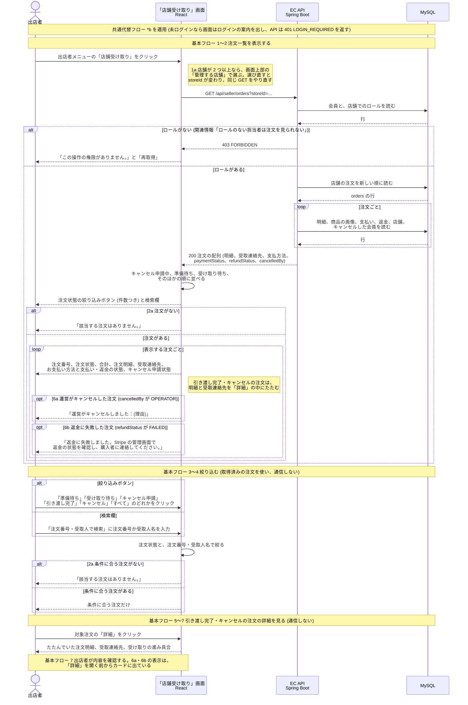
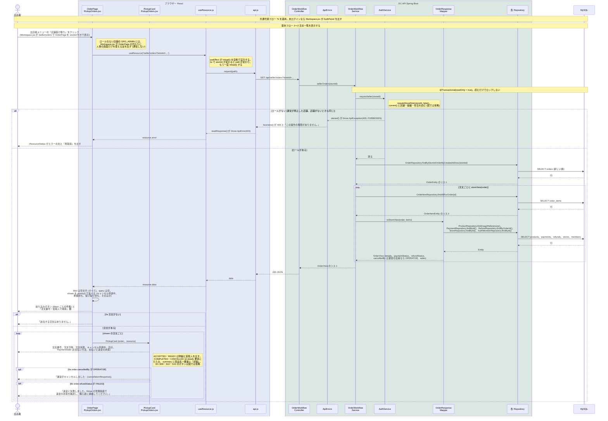
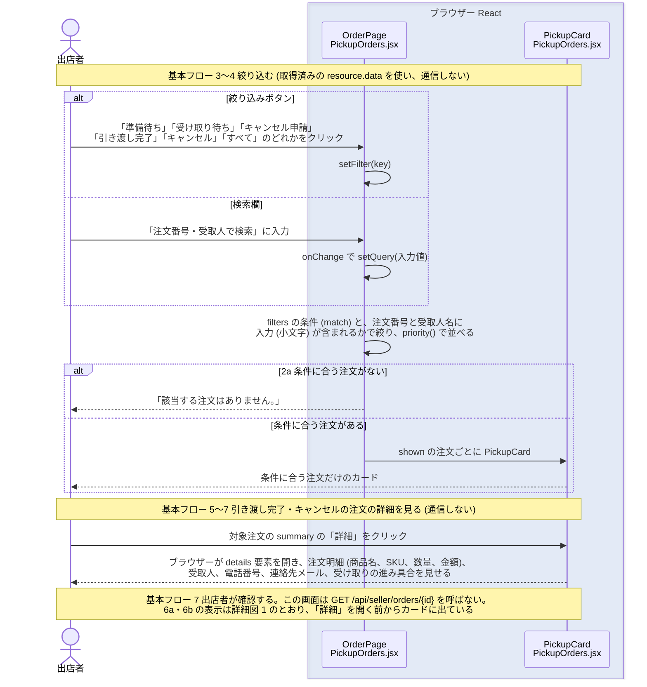

# EC-S08 注文一覧・詳細を確認する

- ユースケース記述: [EC-S08_注文一覧・詳細を確認する](<../../アーカイブ/ユースケース/kusakari-ec/EC-S08_注文一覧・詳細を確認する.md>)
- 対象のコード: kusakari-ec の main（19a2be3、2026-11-20 時点）

## 概要図

## 詳細図 1 基本フロー 1〜2

## 詳細図 2 基本フロー 3〜7

## ユースケース記述との差

- 6a・6b: 記述は「詳細」をクリックしたあと（基本フロー 6）の代替フローにしています。コードでは、「運営がキャンセルしました：(理由)」と「返金に失敗しました。…」はカードの `details` 要素の外にあり、一覧を表示した時点（基本フロー 2）から出ています。
- 6a: `cancelledBy` が `OPERATOR` になるのは、注文をキャンセルした会員（`cancelled_by_member_id`）が運営（`isAdmin()`）のときです。店舗の閉鎖・組織の停止のまとめてキャンセル（`OpenOrders.cancelAll()`）のほか、運営のアカウントが出店者の画面からキャンセル申請を承認した注文（`decideCancellation()`）も同じ表示になります。
- 基本フロー 5〜6: 「詳細」は HTML の `details` 要素で、明細と受取連絡先は一覧の取得のときに読み込み済みです。開くときに通信はしません。注文 1 件を返す `GET /api/seller/orders/{id}` はありますが、この画面からは呼びません。
- 関連情報「ロールのない担当者は注文を見られない」: 所属店舗でロールのない担当者（`memberRole` が `NONE`）は、`requireSeller()` の 403 で「この操作の権限がありません。」と「再取得」が出ます。ORG_ADMIN でロールのない店舗（`memberRole` が `null`）では、`Workspace.jsx` が人事の画面だけを使える旨を出し、通信しません。運営が停止した店舗と、存在しない店舗でも 403 になります。
- 基本フロー 3: 絞り込みボタンの件数は、検索欄の入力にかかわらず、取得したすべての注文で数えます。支払い待ち（`PENDING_PAYMENT`）の注文は「すべて」でだけ出ます。
- 1a: 店舗を選び直しても、`OrderPage` は作り直さないので、絞り込みボタンと検索欄の状態は残ります。

## 確かめられなかったこと

- 運営のアカウントが出店者の画面からキャンセル申請を承認した注文に「運営がキャンセルしました」が出ることは、コードから読んだもので、実行して確かめていません。

## 参照したコード

- [frontend/src/workspace/Workspace.jsx](https://github.com/abeouga/kusakari-ec/blob/19a2be307ee71a2cd87e538236c3c8c42929c5b3/frontend/src/workspace/Workspace.jsx): `sellerMenu`、`storePaths`、`rolePaths`、`personnelOnly`、`/seller/orders` と `OrderPage` の対応
- [frontend/src/workspace/PickupOrders.jsx](https://github.com/abeouga/kusakari-ec/blob/19a2be307ee71a2cd87e538236c3c8c42929c5b3/frontend/src/workspace/PickupOrders.jsx): `OrderPage`、`filters`、`priority`、`PickupCard`、`Progress`
- [frontend/src/workspace/OrderPages.jsx](https://github.com/abeouga/kusakari-ec/blob/19a2be307ee71a2cd87e538236c3c8c42929c5b3/frontend/src/workspace/OrderPages.jsx): `orderLabels`、`cancellationLabels`、`PaymentState`
- [frontend/src/payment.js](https://github.com/abeouga/kusakari-ec/blob/19a2be307ee71a2cd87e538236c3c8c42929c5b3/frontend/src/payment.js): `paymentMethods`、`paymentLabel`、`paymentStatusLabels`、`refundStatusLabels`
- [frontend/src/workspace/ResourceView.jsx](https://github.com/abeouga/kusakari-ec/blob/19a2be307ee71a2cd87e538236c3c8c42929c5b3/frontend/src/workspace/ResourceView.jsx): `ResourceStatus`
- [frontend/src/workspace/useResource.js](https://github.com/abeouga/kusakari-ec/blob/19a2be307ee71a2cd87e538236c3c8c42929c5b3/frontend/src/workspace/useResource.js): `useResource`、`reload`
- [frontend/src/api.js](https://github.com/abeouga/kusakari-ec/blob/19a2be307ee71a2cd87e538236c3c8c42929c5b3/frontend/src/api.js): `request`、`readResponse`、`ApiError`
- [backend/src/main/java/jp/kusakari/ec/commerce/controller/OrderWorkflowController.java](https://github.com/abeouga/kusakari-ec/blob/19a2be307ee71a2cd87e538236c3c8c42929c5b3/backend/src/main/java/jp/kusakari/ec/commerce/controller/OrderWorkflowController.java): `seller`、`sellerOrder`
- [backend/src/main/java/jp/kusakari/ec/commerce/service/OrderWorkflowService.java](https://github.com/abeouga/kusakari-ec/blob/19a2be307ee71a2cd87e538236c3c8c42929c5b3/backend/src/main/java/jp/kusakari/ec/commerce/service/OrderWorkflowService.java): `sellerOrders`、`storeView`、`decideCancellation`
- [backend/src/main/java/jp/kusakari/ec/commerce/mapper/OrderResponseMapper.java](https://github.com/abeouga/kusakari-ec/blob/19a2be307ee71a2cd87e538236c3c8c42929c5b3/backend/src/main/java/jp/kusakari/ec/commerce/mapper/OrderResponseMapper.java): `toStoreView`、`toView`、`figures`
- [backend/src/main/java/jp/kusakari/ec/commerce/persistence/repository/OrderRepository.java](https://github.com/abeouga/kusakari-ec/blob/19a2be307ee71a2cd87e538236c3c8c42929c5b3/backend/src/main/java/jp/kusakari/ec/commerce/persistence/repository/OrderRepository.java): `findByStoreIdOrderByCreatedAtDesc`
- [backend/src/main/java/jp/kusakari/ec/commerce/persistence/repository/OrderItemRepository.java](https://github.com/abeouga/kusakari-ec/blob/19a2be307ee71a2cd87e538236c3c8c42929c5b3/backend/src/main/java/jp/kusakari/ec/commerce/persistence/repository/OrderItemRepository.java): `findAllForOrder`
- [backend/src/main/java/jp/kusakari/ec/commerce/persistence/entity/OrderEntity.java](https://github.com/abeouga/kusakari-ec/blob/19a2be307ee71a2cd87e538236c3c8c42929c5b3/backend/src/main/java/jp/kusakari/ec/commerce/persistence/entity/OrderEntity.java): `cancelByOperator`、`decideCancellation`
- [backend/src/main/java/jp/kusakari/ec/store/service/OpenOrders.java](https://github.com/abeouga/kusakari-ec/blob/19a2be307ee71a2cd87e538236c3c8c42929c5b3/backend/src/main/java/jp/kusakari/ec/store/service/OpenOrders.java): `cancelAll`
- [backend/src/main/java/jp/kusakari/ec/auth/AuthService.java](https://github.com/abeouga/kusakari-ec/blob/19a2be307ee71a2cd87e538236c3c8c42929c5b3/backend/src/main/java/jp/kusakari/ec/auth/AuthService.java): `requireSeller`、`requireStoreRole`、`denied`
- [backend/src/main/java/jp/kusakari/ec/common/web/ApiErrors.java](https://github.com/abeouga/kusakari-ec/blob/19a2be307ee71a2cd87e538236c3c8c42929c5b3/backend/src/main/java/jp/kusakari/ec/common/web/ApiErrors.java): `business`
