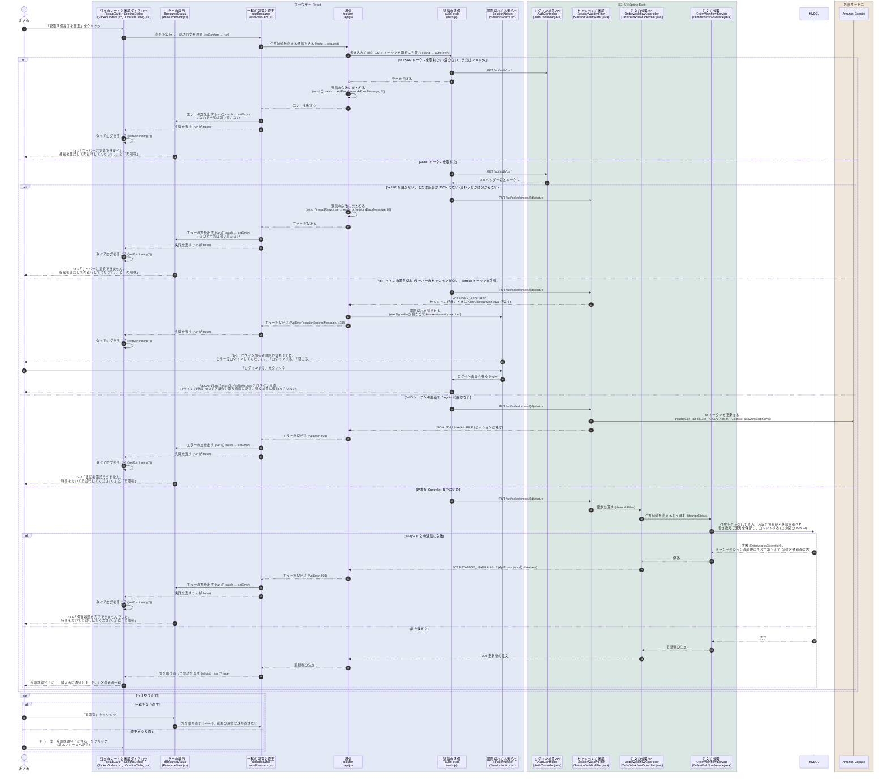

# EC-S09 注文を受取準備完了にする

```mermaid
sequenceDiagram
    autonumber
    actor User as 出店者
    box rgba(47,111,219,0.10) ブラウザー React
        participant Work as 出店者画面の枠<br/>Workspace<br/>(Workspace.jsx)
        participant Page as 店舗受け取り画面<br/>OrderPage<br/>(PickupOrders.jsx)
        participant Card as 注文のカードと確認ダイアログ<br/>PickupCard・ConfirmDialog<br/>(PickupOrders.jsx、ConfirmDialog.jsx)
        participant Hook as 一覧の取得と変更<br/>useResource<br/>(useResource.js)
        participant Http as 通信<br/>request<br/>(api.js)
        participant AuthJs as 通信の準備<br/>authFetch<br/>(auth.js)
    end
    box rgba(27,127,92,0.12) EC API Spring Boot
        participant AuthCtrl as ログイン状態API<br/>AuthController<br/>(AuthController.java)
        participant Ctrl as 注文の処理API<br/>OrderWorkflowController<br/>(OrderWorkflowController.java)
        participant Svc as 注文の処理<br/>OrderWorkflowService<br/>(OrderWorkflowService.java)
        participant Auth as ログイン中の会員<br/>AuthService<br/>(AuthService.java)
        participant OrderRepo as 注文の読み書き<br/>OrderRepository<br/>(OrderRepository.java)
        participant Ntf as 通知の保存<br/>NotificationService<br/>(NotificationService.java)
        participant Mapper as 注文の応答の組み立て<br/>OrderResponseMapper<br/>(OrderResponseMapper.java)
    end
    participant Db as MySQL

    Note over User,Db: 共通代替フロー<br/>*b 未ログインの場合: 2 (URL を直接開いたときのログインの確認)、4、17、一覧の取り直しの 27 に適用<br/>*a 通信に失敗した場合: 4、15、17、一覧の取り直しの 27 に適用

    User->>Work: 出店者メニューの「店舗受け取り」をクリック
    Work->>Page: URL を /seller/orders に変え、<br/>選択中の店舗の ID を渡して OrderPage を表示
    Page->>Hook: 店舗の注文を取りに行くよう頼む (useResource)
    Hook->>Ctrl: 自動で一覧の通信を始める (reload → request)<br/>GET /api/seller/orders?storeId={店舗ID}
    Ctrl->>Svc: 店舗の注文の一覧を作るよう頼む (sellerOrders)<br/>中身は EC-S08 の図と同じ流れ
    Ctrl-->>Hook: 200 注文の配列
    Page->>Card: キャンセル申請中、準備待ち、受け取り待ち、そのほかの順に<br/>並べ (priority)、注文ごとにカードを表示 (PickupCard)
    Card-->>User: 注文受付でキャンセル申請がない注文に、「商品を揃えたら、<br/>受取準備完了にして購入者へ通知します。」と「受取準備完了にする」
    User->>Card: 対象の注文の「受取準備完了にする」をクリック
    Card-->>User: 今の状態を覚えて確認ダイアログを表示 (setConfirming('ACCEPTED') → ConfirmDialog)<br/>「受取準備完了の確認」、注文番号：…、受取人：…、<br/>「注文状態を「受取準備完了」に更新し、購入者に受け取りの準備が<br/>できたことを通知します。」、「受取準備完了を確定」、「取消」
    User->>Card: 「受取準備完了を確定」をクリック
    Card->>Hook: 変更を実行し、成功の文を渡す (onConfirm → run)<br/>「受取準備完了にし、購入者に通知しました。」
    Hook->>Http: 注文状態を変える通信を送る (write → request、<br/>本文は { expectedStatus: 'ACCEPTED', status: 'READY' })
    Http->>AuthJs: 書き込みの前に CSRF トークンを取るよう頼む (send → authFetch)
    AuthJs->>AuthCtrl: GET /api/auth/csrf
    AuthCtrl-->>AuthJs: 200 ヘッダー名とトークン (csrf)
    AuthJs->>Ctrl: PUT /api/seller/orders/{id}/status<br/>(CSRF トークンのヘッダー付き)
    Ctrl->>Svc: 入力を確かめ (StatusRequest)、注文状態を変えるよう頼む (changeStatus)<br/>changeStatus 全体が 1 つのトランザクション
    Svc->>OrderRepo: 注文の行をロックして読む (lockOrder、SELECT ... FOR UPDATE orders)
    Svc->>Auth: ログイン中の人がこの店舗で STAFF 以上かを確かめる<br/>(requireStore → requireSeller)
    break 6a 注文状態が「注文受付」でなくなっている、またはキャンセル申請中になっている
        Note over Auth,Card: 結果: 409 ORDER_CHANGED を返し、何も変えない。<br/>画面: 一覧を取り直してダイアログを閉じ、「注文状態が変わりました。最新の状態を確認してください。」
    end
    Svc->>Svc: 注文状態を受取準備完了にし、<br/>準備完了の日時を記録する (markReady)
    Svc->>Ntf: 購入者に知らせるよう頼む (send)。「受取準備が完了しました」、<br/>本文は「注文番号 / 店舗名」。購入者あての通知を保存する (save、INSERT notifications)
    Svc->>Mapper: 店舗向けの注文の形にするよう頼む (storeView → toStoreView)<br/>中身は EC-S08 の図と同じ流れ
    Svc->>Db: 書き換えた行を保存してコミットする<br/>(save は呼ばない。UPDATE orders)
    Ctrl-->>Http: 200 更新後の注文
    Http-->>Hook: 更新後の注文
    Hook->>Ctrl: 一覧を取り直す (reload)<br/>GET /api/seller/orders?storeId={店舗ID}。流れは 4〜6 と同じ
    Ctrl-->>Hook: 最新の注文の一覧
    Hook-->>Card: 成功を返す (run が true、成功の文を設定)
    Card-->>User: ダイアログを閉じ (setConfirming(''))、<br/>「受取準備完了にし、購入者に通知しました。」と、<br/>注文状態が「受取準備完了」になった最新の一覧
```

- ユースケース記述: [EC-S09_注文を受取準備完了にする](<../../アーカイブ/ユースケース/kusakari-ec/EC-S09_注文を受取準備完了にする.md>)
- 共通代替フロー: [00_全ユースケース共通の代替フロー](<00_全ユースケース共通の代替フロー.md>)
- 対象のコード: kusakari-ec の main（6bad7e3、2026-11-24 時点）

## シーケンス図

参加者は、上から「画面や役割の名前」「コンポーネント・クラスの名前」「ファイル名（かっこ付き）」の順に書いています。
共通代替フローの中身は、00 の図か、下の「共通代替フローを直接書いた図」を見てください。
エラーは最重要の 6a（注文状態がもう変わっていた）だけを描き、ほかの代替フローは図の下に並べています。

図に描いていない代替フロー：3a（キャンセル申請中）、5a（確認ダイアログの「取消」）、（記述なし）の分岐

## 共通代替フローを直接書いた図

上の図の、確定の通信（CSRF トークンの取得と `PUT /api/seller/orders/{id}/status`）に、この画面で起こる共通代替フロー（\*a、\*b）を書き込んだ図です。画面を開いて注文の一覧を取る通信の \*a・\*b は、[EC-S08](<EC-S08_注文一覧・詳細を確認する.md>) の「共通代替フローを直接書いた図」と同じなので省いています。

## ユースケース記述との差

- 基本フロー 4 の確認ダイアログには、注文番号と受取人のほかに「注文状態を「受取準備完了」に更新し、購入者に受け取りの準備ができたことを通知します。」も出ます。
- 5a の「取消」のほか、Esc キー、ダイアログの「閉じる」、ダイアログの外側のクリックでも、通信せずにダイアログを閉じます（`Dialog.jsx` の `onClose` から `ConfirmDialog` の `onCancel`）。通信中（`busy`）は閉じません。
- 6a は、画面がダイアログを開いた時点の状態（`expectedStatus`）を送り、サーバーがロックして読み直した状態と比べて決めます。6a のあと、ダイアログは成功のときと同じく閉じます（`onConfirm` が `run()` の結果によらず `setConfirming('')` を呼ぶ）。
- 3a と同じ検査（キャンセル申請中は進めない）を、サーバーも 6a で行います。画面はボタンを押せなくし、サーバーは 409 を返します。
- 基本フロー 7 の通知の本文は「注文番号 / 店舗名」です。状態の更新と通知の保存は同じトランザクションで、どちらかが失敗すると両方取り消します（関連情報「注文状態の更新と通知は一緒に記録する」のとおり）。
- サーバーは次の応答も返しますが、記述にはありません。画面の操作ではふつう起きないため、図では枝にしていません。
  - 404 `ORDER_NOT_FOUND`「注文が見つかりません。」: 注文がないとき。ほかの店舗の注文や、運営が停止した店舗の注文、ロールのない担当者が送ったときも、`requireStore()` が 403 を 404 に変えて返します。画面は 404 のときも一覧を取り直します。
  - 400 `INVALID_INPUT`「入力内容・文字数・数値の範囲を確認してください。」: `status` が `READY`・`COMPLETED` 以外のとき。
- 権限の検査（`requireSeller()`）は、記述のアクター（オーナー、MANAGER、STAFF）のほかに運営のアカウントも通します。運営の「全注文管理」の画面（`OrderPage` の `operator`）はボタンを出しません。
- 共通代替フローで失敗したときも、ダイアログは閉じ、一覧の上にエラーの文と「再取得」が出ます。「再取得」は一覧を取り直すだけで、変更の通信は送り直しません。

## 参照したコード

- [frontend/src/workspace/Workspace.jsx](https://github.com/abeouga/kusakari-ec/blob/6bad7e37c4135034fbe97e30309772fbe872e675/frontend/src/workspace/Workspace.jsx): `sellerMenu` の「店舗受け取り」、`/seller/orders` で `OrderPage` を表示
- [frontend/src/workspace/WorkspaceSidebar.jsx](https://github.com/abeouga/kusakari-ec/blob/6bad7e37c4135034fbe97e30309772fbe872e675/frontend/src/workspace/WorkspaceSidebar.jsx): `MenuLink`
- [frontend/src/workspace/PickupOrders.jsx](https://github.com/abeouga/kusakari-ec/blob/6bad7e37c4135034fbe97e30309772fbe872e675/frontend/src/workspace/PickupOrders.jsx): `OrderPage`、`PickupCard`、`actions.ACCEPTED`、`priority`、`cancelPending`、`setConfirming`、`onConfirm`
- [frontend/src/components/ConfirmDialog.jsx](https://github.com/abeouga/kusakari-ec/blob/6bad7e37c4135034fbe97e30309772fbe872e675/frontend/src/components/ConfirmDialog.jsx): 「取消」と確定のボタン、`busy` のときの `disabled`
- [frontend/src/components/Dialog.jsx](https://github.com/abeouga/kusakari-ec/blob/6bad7e37c4135034fbe97e30309772fbe872e675/frontend/src/components/Dialog.jsx): Esc キー、「閉じる」、外側のクリックで `onClose`
- [frontend/src/workspace/useResource.js](https://github.com/abeouga/kusakari-ec/blob/6bad7e37c4135034fbe97e30309772fbe872e675/frontend/src/workspace/useResource.js): `useResource`、`reload`、`run`（404・409 で取り直す）、`write`
- [frontend/src/workspace/ResourceView.jsx](https://github.com/abeouga/kusakari-ec/blob/6bad7e37c4135034fbe97e30309772fbe872e675/frontend/src/workspace/ResourceView.jsx): `ResourceStatus`（エラーの文、成功の文、「再取得」）
- [frontend/src/api.js](https://github.com/abeouga/kusakari-ec/blob/6bad7e37c4135034fbe97e30309772fbe872e675/frontend/src/api.js): `request`、`send`、`readResponse`、`ApiError`、`networkErrorMessage`、`sessionExpiredMessage`
- [frontend/src/auth.js](https://github.com/abeouga/kusakari-ec/blob/6bad7e37c4135034fbe97e30309772fbe872e675/frontend/src/auth.js): `authFetch`（`GET /api/auth/csrf`）、`wasSignedIn`、`login`
- [frontend/src/components/SessionNotice.jsx](https://github.com/abeouga/kusakari-ec/blob/6bad7e37c4135034fbe97e30309772fbe872e675/frontend/src/components/SessionNotice.jsx): 期限切れのお知らせ
- [backend/src/main/java/jp/kusakari/ec/auth/AuthController.java](https://github.com/abeouga/kusakari-ec/blob/6bad7e37c4135034fbe97e30309772fbe872e675/backend/src/main/java/jp/kusakari/ec/auth/AuthController.java): `csrf`
- [backend/src/main/java/jp/kusakari/ec/commerce/controller/OrderWorkflowController.java](https://github.com/abeouga/kusakari-ec/blob/6bad7e37c4135034fbe97e30309772fbe872e675/backend/src/main/java/jp/kusakari/ec/commerce/controller/OrderWorkflowController.java): `seller`、`status`、`StatusRequest`
- [backend/src/main/java/jp/kusakari/ec/commerce/service/OrderWorkflowService.java](https://github.com/abeouga/kusakari-ec/blob/6bad7e37c4135034fbe97e30309772fbe872e675/backend/src/main/java/jp/kusakari/ec/commerce/service/OrderWorkflowService.java): `sellerOrders`、`changeStatus`、`requireStore`、`conflict`、`storeView`
- [backend/src/main/java/jp/kusakari/ec/commerce/persistence/repository/OrderRepository.java](https://github.com/abeouga/kusakari-ec/blob/6bad7e37c4135034fbe97e30309772fbe872e675/backend/src/main/java/jp/kusakari/ec/commerce/persistence/repository/OrderRepository.java): `findByStoreIdOrderByCreatedAtDesc`、`lockOrder`（`@Lock(PESSIMISTIC_WRITE)`）
- [backend/src/main/java/jp/kusakari/ec/commerce/persistence/entity/OrderEntity.java](https://github.com/abeouga/kusakari-ec/blob/6bad7e37c4135034fbe97e30309772fbe872e675/backend/src/main/java/jp/kusakari/ec/commerce/persistence/entity/OrderEntity.java): `markReady`
- [backend/src/main/java/jp/kusakari/ec/commerce/mapper/OrderResponseMapper.java](https://github.com/abeouga/kusakari-ec/blob/6bad7e37c4135034fbe97e30309772fbe872e675/backend/src/main/java/jp/kusakari/ec/commerce/mapper/OrderResponseMapper.java): `toStoreView`
- [backend/src/main/java/jp/kusakari/ec/notification/service/NotificationService.java](https://github.com/abeouga/kusakari-ec/blob/6bad7e37c4135034fbe97e30309772fbe872e675/backend/src/main/java/jp/kusakari/ec/notification/service/NotificationService.java): `send`
- [backend/src/main/java/jp/kusakari/ec/auth/AuthService.java](https://github.com/abeouga/kusakari-ec/blob/6bad7e37c4135034fbe97e30309772fbe872e675/backend/src/main/java/jp/kusakari/ec/auth/AuthService.java): `requireSeller`、`requireStoreRole`
- [backend/src/main/java/jp/kusakari/ec/auth/SessionValidityFilter.java](https://github.com/abeouga/kusakari-ec/blob/6bad7e37c4135034fbe97e30309772fbe872e675/backend/src/main/java/jp/kusakari/ec/auth/SessionValidityFilter.java): `doFilterInternal`（ID トークンの更新、401、503）
- [backend/src/main/java/jp/kusakari/ec/auth/CognitoPasswordLogin.java](https://github.com/abeouga/kusakari-ec/blob/6bad7e37c4135034fbe97e30309772fbe872e675/backend/src/main/java/jp/kusakari/ec/auth/CognitoPasswordLogin.java): ID トークンの更新、503 `AUTH_UNAVAILABLE`
- [backend/src/main/java/jp/kusakari/ec/auth/AuthConfiguration.java](https://github.com/abeouga/kusakari-ec/blob/6bad7e37c4135034fbe97e30309772fbe872e675/backend/src/main/java/jp/kusakari/ec/auth/AuthConfiguration.java): `authenticationEntryPoint`（401 `LOGIN_REQUIRED`）
- [backend/src/main/java/jp/kusakari/ec/common/web/ApiErrors.java](https://github.com/abeouga/kusakari-ec/blob/6bad7e37c4135034fbe97e30309772fbe872e675/backend/src/main/java/jp/kusakari/ec/common/web/ApiErrors.java): `business`、`invalid`、`database`
