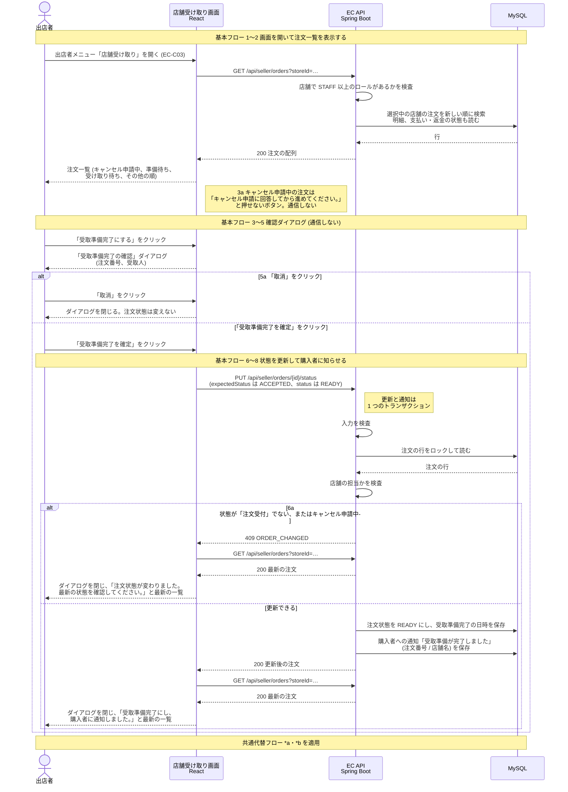
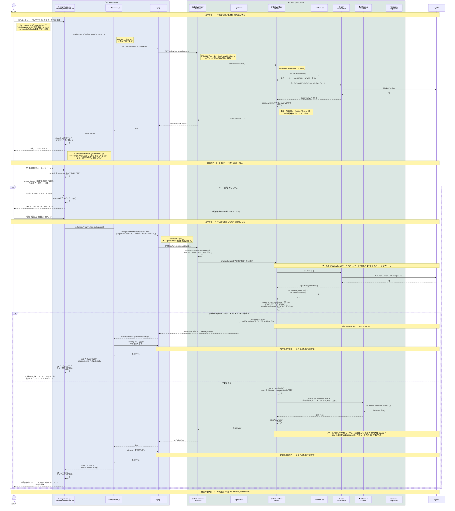

# EC-S09 注文を受取準備完了にする

- ユースケース記述: [EC-S09_注文を受取準備完了にする](<../../アーカイブ/ユースケース/kusakari-ec/EC-S09_注文を受取準備完了にする.md>)
- 対象のコード: kusakari-ec の main（19a2be3、2026-11-20 時点）

## 概要図

## 詳細図

## ユースケース記述との差

- 基本フロー 4 の確認ダイアログには、注文番号と受取人のほかに「注文状態を「受取準備完了」に更新し、購入者に受け取りの準備ができたことを通知します。」も出ます。
- 5a の「取消」のほか、Esc キー、ダイアログの「×」、ダイアログの外のクリックでも、通信せずにダイアログを閉じます（`Dialog.jsx` の `onClose` から `ConfirmDialog` の `onCancel`）。
- 6a は、画面がダイアログを開いた時点の状態（`expectedStatus`）を送り、サーバーがロックして読み直した状態と比べて決めます。6a のあと、ダイアログは成功のときと同じく閉じます（`onConfirm` が `run()` の結果によらず `setConfirming('')` を呼ぶ）。
- 3a と同じ検査（キャンセル申請中は進めない）を、サーバーも 6a で行います。画面はボタンを押せなくし、サーバーは 409 を返します。
- サーバーは次の応答も返しますが、記述にはありません。画面の操作ではふつう起きないため、図では枝にしていません。
  - 404 `ORDER_NOT_FOUND`「注文が見つかりません。」: 注文がないとき。ほかの店舗の注文や、運営が停止した店舗の注文も、`requireStore()` が 403 を 404 に変えて返します。画面は 404 のときも一覧を取り直します。
  - 400 `INVALID_INPUT`「入力内容・文字数・数値の範囲を確認してください。」: `status` が `READY`・`COMPLETED` 以外のとき。
- 権限の検査（`requireSeller()`）は、記述のアクター（オーナー、MANAGER、STAFF）のほかに運営のアカウントも通します。運営の「全注文管理」の画面（`OrderPage` の `operator`）はボタンを出しません。

## 参照したコード

- [frontend/src/workspace/PickupOrders.jsx](https://github.com/abeouga/kusakari-ec/blob/19a2be307ee71a2cd87e538236c3c8c42929c5b3/frontend/src/workspace/PickupOrders.jsx): `OrderPage`、`PickupCard`、`actions.ACCEPTED`、`priority()`、`filters`、`setConfirming()`、`onConfirm`
- [frontend/src/components/ConfirmDialog.jsx](https://github.com/abeouga/kusakari-ec/blob/19a2be307ee71a2cd87e538236c3c8c42929c5b3/frontend/src/components/ConfirmDialog.jsx): 「取消」と確定のボタン、`busy` のときの `disabled`
- [frontend/src/components/Dialog.jsx](https://github.com/abeouga/kusakari-ec/blob/19a2be307ee71a2cd87e538236c3c8c42929c5b3/frontend/src/components/Dialog.jsx): Esc、×、外のクリックで `onClose`
- [frontend/src/workspace/Workspace.jsx](https://github.com/abeouga/kusakari-ec/blob/19a2be307ee71a2cd87e538236c3c8c42929c5b3/frontend/src/workspace/Workspace.jsx): `sellerMenu` の「店舗受け取り」、`/seller/orders` で `OrderPage` を表示
- [frontend/src/workspace/useResource.js](https://github.com/abeouga/kusakari-ec/blob/19a2be307ee71a2cd87e538236c3c8c42929c5b3/frontend/src/workspace/useResource.js): `useResource()`、`reload()`、`run()`（404・409 で取り直す）、`write()`
- [frontend/src/workspace/ResourceView.jsx](https://github.com/abeouga/kusakari-ec/blob/19a2be307ee71a2cd87e538236c3c8c42929c5b3/frontend/src/workspace/ResourceView.jsx): `ResourceStatus`（エラーと notice の表示）
- [frontend/src/api.js](https://github.com/abeouga/kusakari-ec/blob/19a2be307ee71a2cd87e538236c3c8c42929c5b3/frontend/src/api.js): `request()`、`send()`、`readResponse()`
- [frontend/src/auth.js](https://github.com/abeouga/kusakari-ec/blob/19a2be307ee71a2cd87e538236c3c8c42929c5b3/frontend/src/auth.js): `authFetch()`（GET 以外の前に `/api/auth/csrf` を読む）
- [backend/src/main/java/jp/kusakari/ec/commerce/controller/OrderWorkflowController.java](https://github.com/abeouga/kusakari-ec/blob/19a2be307ee71a2cd87e538236c3c8c42929c5b3/backend/src/main/java/jp/kusakari/ec/commerce/controller/OrderWorkflowController.java): `seller()`、`status()`、`StatusRequest`
- [backend/src/main/java/jp/kusakari/ec/commerce/service/OrderWorkflowService.java](https://github.com/abeouga/kusakari-ec/blob/19a2be307ee71a2cd87e538236c3c8c42929c5b3/backend/src/main/java/jp/kusakari/ec/commerce/service/OrderWorkflowService.java): `sellerOrders()`、`changeStatus()`、`requireStore()`、`conflict()`、`storeView()`
- [backend/src/main/java/jp/kusakari/ec/commerce/persistence/repository/OrderRepository.java](https://github.com/abeouga/kusakari-ec/blob/19a2be307ee71a2cd87e538236c3c8c42929c5b3/backend/src/main/java/jp/kusakari/ec/commerce/persistence/repository/OrderRepository.java): `findByStoreIdOrderByCreatedAtDesc()`、`lockOrder()`（`@Lock(PESSIMISTIC_WRITE)`）
- [backend/src/main/java/jp/kusakari/ec/commerce/persistence/entity/OrderEntity.java](https://github.com/abeouga/kusakari-ec/blob/19a2be307ee71a2cd87e538236c3c8c42929c5b3/backend/src/main/java/jp/kusakari/ec/commerce/persistence/entity/OrderEntity.java): `markReady()`
- [backend/src/main/java/jp/kusakari/ec/notification/service/NotificationService.java](https://github.com/abeouga/kusakari-ec/blob/19a2be307ee71a2cd87e538236c3c8c42929c5b3/backend/src/main/java/jp/kusakari/ec/notification/service/NotificationService.java): `send()`
- [backend/src/main/java/jp/kusakari/ec/auth/AuthService.java](https://github.com/abeouga/kusakari-ec/blob/19a2be307ee71a2cd87e538236c3c8c42929c5b3/backend/src/main/java/jp/kusakari/ec/auth/AuthService.java): `requireSeller()`、`requireStoreRole()`
- [backend/src/main/java/jp/kusakari/ec/common/web/ApiErrors.java](https://github.com/abeouga/kusakari-ec/blob/19a2be307ee71a2cd87e538236c3c8c42929c5b3/backend/src/main/java/jp/kusakari/ec/common/web/ApiErrors.java): `business()`、`invalid()`
