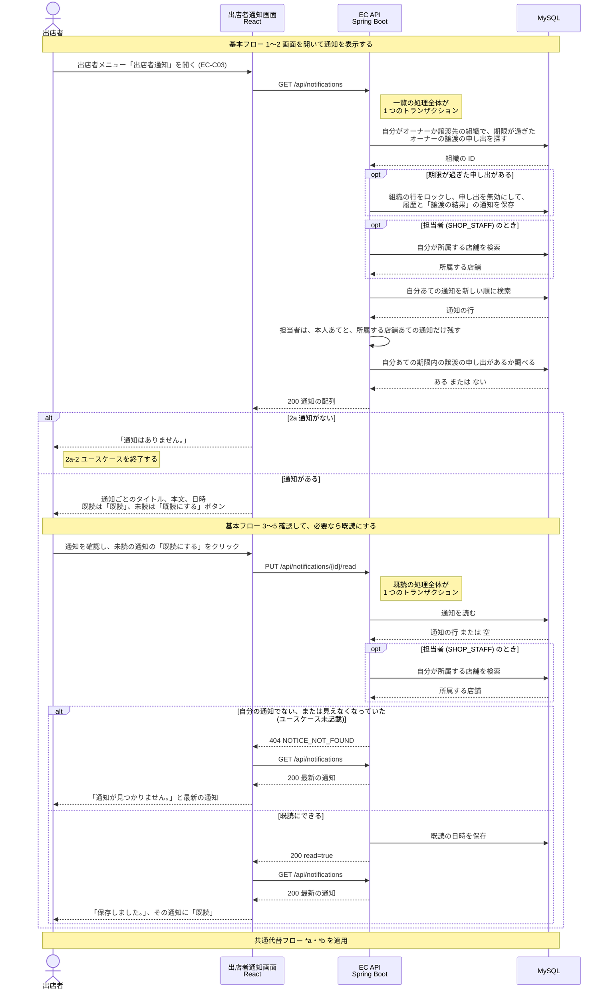
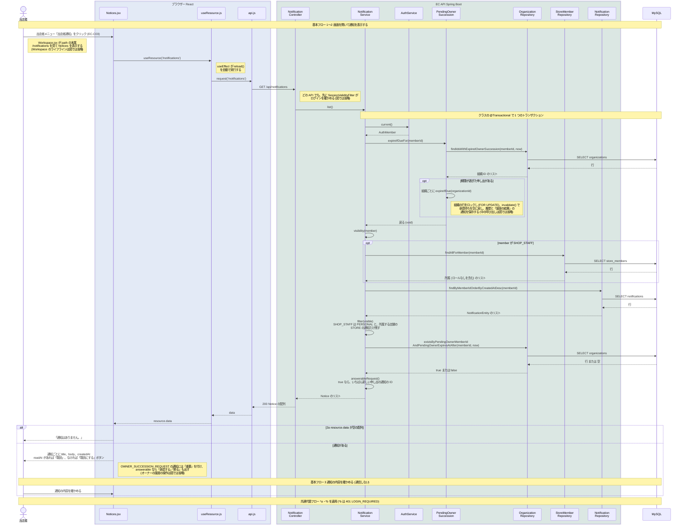
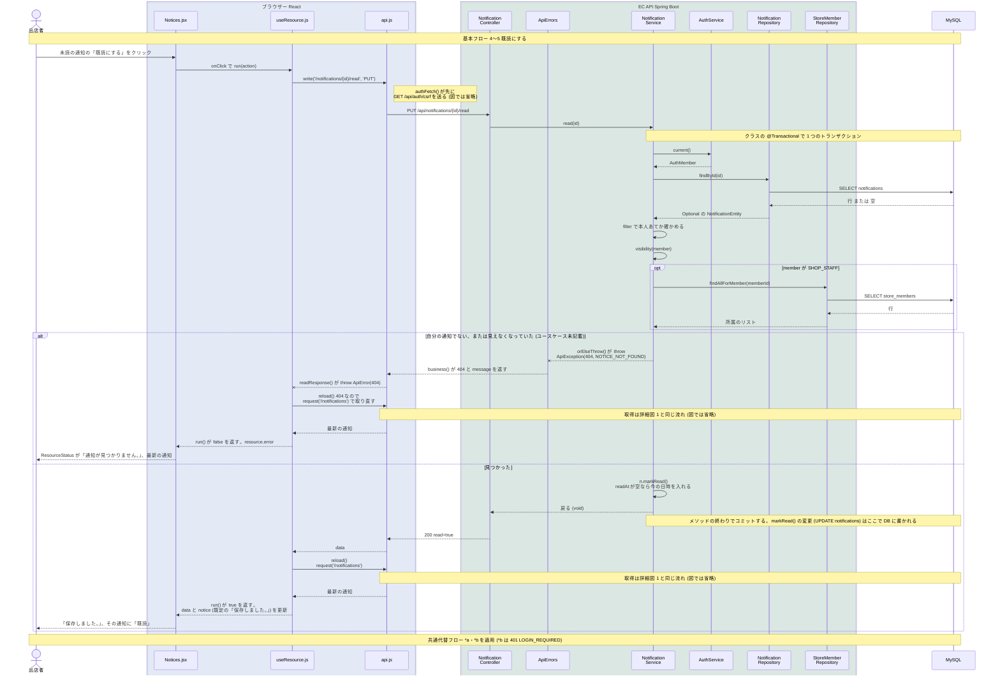

# EC-S11 イベント通知を確認する

- ユースケース記述: [EC-S11_イベント通知を確認する](<../../アーカイブ/ユースケース/kusakari-ec/EC-S11_イベント通知を確認する.md>)
- 対象のコード: kusakari-ec の main（19a2be3、2026-11-20 時点）

## 概要図

## 詳細図 1 基本フロー 1〜3 通知を表示する

## 詳細図 2 基本フロー 4〜5 既読にする

## ユースケース記述との差

- 記述の見出しは「通知一覧を確認する」、ファイル名は「イベント通知を確認する」、画面のメニューと見出しは「出店者通知」です。画面（`Notices`）は購入者の「通知一覧」（`/notifications`）と共用で、どちらも `GET /api/notifications` で自分あての通知を読みます。
- 基本フロー 2 の「担当する店舗に関する通知」は、コードでは次のとおりです（`NotificationService.visibility()`）。
  - オーナーは、自分あての通知をすべて見ます。
  - 担当者（`SHOP_STAFF`）は、本人あて（`PERSONAL`）の通知と、今所属している店舗あて（`STORE`）の通知を見ます。所属にはロールのない店舗も含みます。店舗から外れると、その店舗あての通知は前に見えていたものも見えなくなります。
- 基本フロー 2 の通知の取得では、通知を読む前に、自分がオーナーか譲渡先の組織に期限切れのオーナーの譲渡の申し出がないかを調べ、あれば無効にして、履歴と「オーナーの譲渡の申し出が無効になりました」の通知を保存します（`PendingOwnerSuccession.expireIfDueFor()`）。GET の中で書き込みが起きます。
- オーナーの譲渡の申し出の通知には「重要」の印が付き、譲渡先が今承認できる申し出なら「承認する」「断る」ボタンも出ます（`POST /api/seller/owner-succession/approval`・`refusal`）。記述にはありません。
- 基本フロー 5 で「既読にする」を押すと、その通知に「既読」が出るほか、一覧の上に「保存しました。」も出ます。`Notices.jsx` が `run()` にメッセージを渡さず、`useResource.js` の既定のメッセージが使われるためです。
- 2a で、記述の「通知なしの状態」は、画面では「通知はありません。」です。
- 404 `NOTICE_NOT_FOUND`「通知が見つかりません。」は記述にありません。担当者が一覧を開いたあとで店舗から外されると、その店舗あての通知を既読にできず 404 になります。画面は 404 のとき一覧を取り直します。
- 関連情報の通知の一覧のほかに、次の通知も届きます。「店舗の担当から外れました」（本人あて）、オーナーの譲渡の申し出・承認・取り消し・断り・無効の通知。
- 関連情報の「通知は、組織のオーナーと、その店舗でロールを割り振られた担当者それぞれに届く」は、店舗あての通知（`NotificationService.toStore()`）の説明です。組織の受付停止・停止・再開の通知（`OrganizationSuspensionService.notifyOwner()`）は、オーナーだけに届きます。

## 参照したコード

- [frontend/src/workspace/Notices.jsx](https://github.com/abeouga/kusakari-ec/blob/19a2be307ee71a2cd87e538236c3c8c42929c5b3/frontend/src/workspace/Notices.jsx): `Notices`、「通知はありません。」、「既読」と「既読にする」、`IMPORTANT_CATEGORIES`、`answerable` のボタン
- [frontend/src/workspace/Workspace.jsx](https://github.com/abeouga/kusakari-ec/blob/19a2be307ee71a2cd87e538236c3c8c42929c5b3/frontend/src/workspace/Workspace.jsx): `noticeItem` の「出店者通知」、`path.endsWith('/notifications')` で `Notices` を表示
- [frontend/src/workspace/useResource.js](https://github.com/abeouga/kusakari-ec/blob/19a2be307ee71a2cd87e538236c3c8c42929c5b3/frontend/src/workspace/useResource.js): `useResource()`、`run()`（既定のメッセージ「保存しました。」）、`reload()`、`write()`
- [frontend/src/workspace/ResourceView.jsx](https://github.com/abeouga/kusakari-ec/blob/19a2be307ee71a2cd87e538236c3c8c42929c5b3/frontend/src/workspace/ResourceView.jsx): `ResourceStatus`
- [frontend/src/api.js](https://github.com/abeouga/kusakari-ec/blob/19a2be307ee71a2cd87e538236c3c8c42929c5b3/frontend/src/api.js): `request()`、`readResponse()`
- [frontend/src/auth.js](https://github.com/abeouga/kusakari-ec/blob/19a2be307ee71a2cd87e538236c3c8c42929c5b3/frontend/src/auth.js): `authFetch()`
- [backend/src/main/java/jp/kusakari/ec/notification/controller/NotificationController.java](https://github.com/abeouga/kusakari-ec/blob/19a2be307ee71a2cd87e538236c3c8c42929c5b3/backend/src/main/java/jp/kusakari/ec/notification/controller/NotificationController.java): `list()`、`read()`
- [backend/src/main/java/jp/kusakari/ec/notification/service/NotificationService.java](https://github.com/abeouga/kusakari-ec/blob/19a2be307ee71a2cd87e538236c3c8c42929c5b3/backend/src/main/java/jp/kusakari/ec/notification/service/NotificationService.java): `list()`、`answerableRequest()`、`read()`、`visibility()`、`toStore()`
- [backend/src/main/java/jp/kusakari/ec/notification/persistence/repository/NotificationRepository.java](https://github.com/abeouga/kusakari-ec/blob/19a2be307ee71a2cd87e538236c3c8c42929c5b3/backend/src/main/java/jp/kusakari/ec/notification/persistence/repository/NotificationRepository.java): `findByMemberIdOrderByCreatedAtDesc()`
- [backend/src/main/java/jp/kusakari/ec/notification/persistence/entity/NotificationEntity.java](https://github.com/abeouga/kusakari-ec/blob/19a2be307ee71a2cd87e538236c3c8c42929c5b3/backend/src/main/java/jp/kusakari/ec/notification/persistence/entity/NotificationEntity.java): `PERSONAL`・`STORE`、通知の種類、`markRead()`
- [backend/src/main/java/jp/kusakari/ec/store/service/PendingOwnerSuccession.java](https://github.com/abeouga/kusakari-ec/blob/19a2be307ee71a2cd87e538236c3c8c42929c5b3/backend/src/main/java/jp/kusakari/ec/store/service/PendingOwnerSuccession.java): `expireIfDueFor()`、`expireIfDue()`、`invalidate()`
- [backend/src/main/java/jp/kusakari/ec/store/persistence/repository/OrganizationRepository.java](https://github.com/abeouga/kusakari-ec/blob/19a2be307ee71a2cd87e538236c3c8c42929c5b3/backend/src/main/java/jp/kusakari/ec/store/persistence/repository/OrganizationRepository.java): `findIdsWithExpiredOwnerSuccession()`、`existsByPendingOwnerMemberIdAndPendingOwnerExpiresAtAfter()`
- [backend/src/main/java/jp/kusakari/ec/store/persistence/repository/StoreMemberRepository.java](https://github.com/abeouga/kusakari-ec/blob/19a2be307ee71a2cd87e538236c3c8c42929c5b3/backend/src/main/java/jp/kusakari/ec/store/persistence/repository/StoreMemberRepository.java): `findAllForMember()`
- [backend/src/main/java/jp/kusakari/ec/store/service/OwnerSuccessionNotices.java](https://github.com/abeouga/kusakari-ec/blob/19a2be307ee71a2cd87e538236c3c8c42929c5b3/backend/src/main/java/jp/kusakari/ec/store/service/OwnerSuccessionNotices.java): オーナーの譲渡の通知の文面
- [backend/src/main/java/jp/kusakari/ec/store/service/StaffAccountService.java](https://github.com/abeouga/kusakari-ec/blob/19a2be307ee71a2cd87e538236c3c8c42929c5b3/backend/src/main/java/jp/kusakari/ec/store/service/StaffAccountService.java): 「店舗の担当から外れました」
- [backend/src/main/java/jp/kusakari/ec/store/service/OrganizationSuspensionService.java](https://github.com/abeouga/kusakari-ec/blob/19a2be307ee71a2cd87e538236c3c8c42929c5b3/backend/src/main/java/jp/kusakari/ec/store/service/OrganizationSuspensionService.java): `notifyOwner()`
- [backend/src/main/java/jp/kusakari/ec/auth/AuthService.java](https://github.com/abeouga/kusakari-ec/blob/19a2be307ee71a2cd87e538236c3c8c42929c5b3/backend/src/main/java/jp/kusakari/ec/auth/AuthService.java): `current()`
- [backend/src/main/java/jp/kusakari/ec/common/web/ApiErrors.java](https://github.com/abeouga/kusakari-ec/blob/19a2be307ee71a2cd87e538236c3c8c42929c5b3/backend/src/main/java/jp/kusakari/ec/common/web/ApiErrors.java): `business()`
