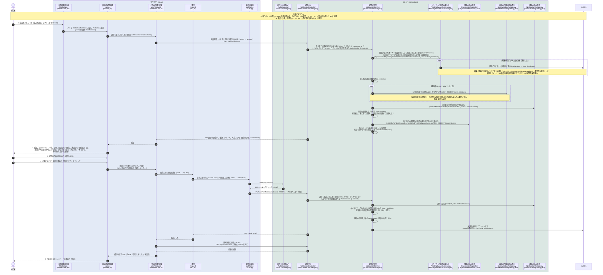
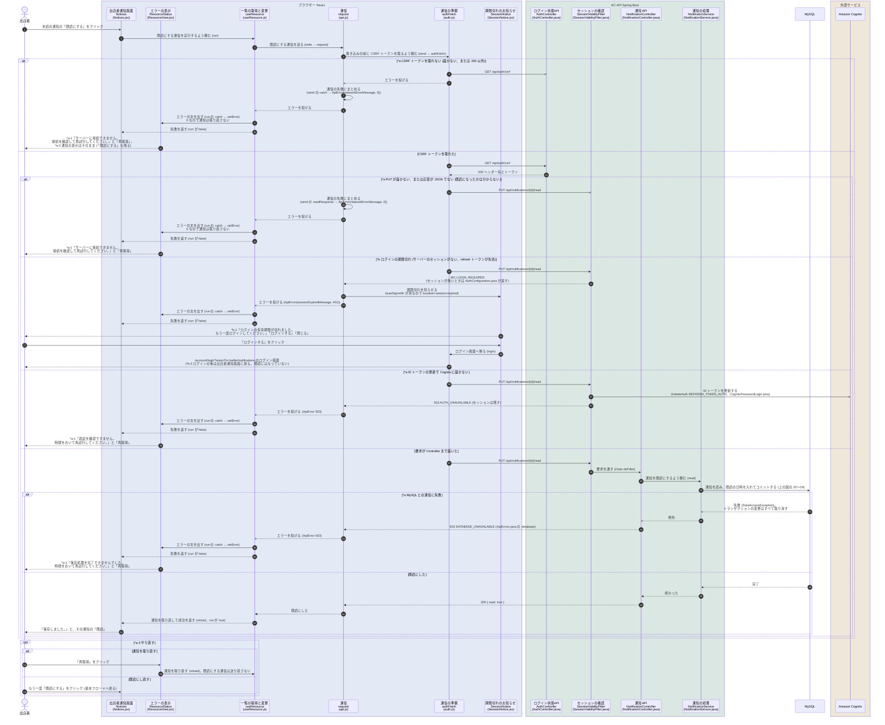

# EC-S11 イベント通知を確認する

- ユースケース記述: [EC-S11_イベント通知を確認する](<../../アーカイブ/ユースケース/kusakari-ec/EC-S11_イベント通知を確認する.md>)
- 共通代替フロー: [00_全ユースケース共通の代替フロー](<00_全ユースケース共通の代替フロー.md>)
- 対象のコード: kusakari-ec の main（6bad7e3、2026-11-24 時点）

## シーケンス図

参加者は、上から「画面や役割の名前」「コンポーネント・クラスの名前」「ファイル名（かっこ付き）」の順に書いています。
共通代替フローの中身は、00 の図か、下の「共通代替フローを直接書いた図」を見てください。
エラーの代替フローは図に描かず、図の下に並べています。期限が過ぎた譲渡の申し出の無効化（記述なし）と担当者の所属店舗の読み込みは、`opt` の中の矢印 1 本と Note にしています。基本フロー 4 の「既読にする」は、必要に応じて行う操作ですが、新しい書き込みがあるので `opt` にせず矢印で描いています。

図に描いていない代替フロー：2a（通知がない）、（記述なし）の分岐

## 共通代替フローを直接書いた図

上の図の「既読にする」の通信（CSRF トークンの取得と `PUT /api/notifications/{id}/read`）に、この画面で起こる共通代替フロー（\*a、\*b）を書き込んだ図です。画面を開いて通知を取る `GET /api/notifications` の \*a・\*b は、[EC-S07](<EC-S07_注文実績を確認する.md>) の「共通代替フローを直接書いた図」と同じ流れ（`useResource` と `ResourceStatus` のエラーの文と「再取得」）なので省いています。

## ユースケース記述との差

- 記述の見出しは「通知一覧を確認する」、ファイル名は「イベント通知を確認する」、画面のメニューと見出しは「出店者通知」です。画面（`Notices`）は購入者の「通知一覧」（`/notifications`）と共用で、どちらも `GET /api/notifications` で自分あての通知を読みます。
- 基本フロー 2 の「担当する店舗に関する通知」は、コードでは次のとおりです（`NotificationService.visibility()`）。
  - オーナーは、自分あての通知をすべて見ます。
  - 担当者（`SHOP_STAFF`）は、本人あて（`PERSONAL`）の通知と、今所属している店舗あて（`STORE`）の通知を見ます。所属にはロールのない店舗も含みます。店舗から外れると、その店舗あての通知は前に見えていたものも見えなくなります。店舗を持たない古い店舗あての通知は、どこかの店舗に所属している間だけ見えます。
- 基本フロー 2 の通知の取得では、通知を読む前に、自分がオーナーか譲渡先の組織に期限切れのオーナーの譲渡の申し出がないかを調べ、あれば無効にして、履歴と「オーナーの譲渡の申し出が無効になりました」の通知を保存します（`PendingOwnerSuccession.expireIfDueFor()`）。GET の中で書き込みが起きます。
- オーナーの譲渡の申し出の通知には「重要」の印が付き、譲渡先が今承認できる申し出なら「承認する」「断る」ボタンも出ます（`POST /api/seller/owner-succession/approval`・`refusal`）。承認・断りのできない申し出の通知には「この申し出は終わったため、承認も断りもできません。」が出ます。どれも記述にありません。
- 基本フロー 5 で「既読にする」を押すと、その通知に「既読」が出るほか、一覧の上に「保存しました。」も出ます。`Notices.jsx` が `run()` にメッセージを渡さず、`useResource.js` の既定のメッセージが使われるためです。
- 2a で、記述の「通知なしの状態」は、画面では「通知はありません。」です。
- 404 `NOTICE_NOT_FOUND`「通知が見つかりません。」は記述にありません。担当者が一覧を開いたあとで店舗から外されると、その店舗あての通知を既読にできず 404 になります。画面は 404 のとき一覧を取り直します。
- 既読にする通信が失敗したとき、「再取得」は一覧を取り直すだけで、既読にする通信は送り直しません。やり直すには、もう一度「既読にする」を押します。
- 関連情報の通知の一覧のほかに、次の通知も届きます。「店舗の担当から外れました」（本人あて）、オーナーの譲渡の申し出・承認・取り消し・断り・無効の通知。
- 関連情報の「通知は、組織のオーナーと、その店舗でロールを割り振られた担当者それぞれに届く」は、店舗あての通知（`NotificationService.toStore()`）の説明です。組織の受付停止・停止・再開の通知（`OrganizationSuspensionService.notifyOwner()`）は、オーナーだけに届きます。
- 店舗側のアカウントでも運営でもない会員が `/seller/notifications` を開くと、`Workspace.jsx` が「この画面を利用する権限がありません。」を出します。事前条件が出店者のログインなので、図には書いていません。どの店舗にも所属していない担当者には、出店者メニューに「出店者通知」だけが出ます。

## 参照したコード

- [frontend/src/workspace/Notices.jsx](https://github.com/abeouga/kusakari-ec/blob/6bad7e37c4135034fbe97e30309772fbe872e675/frontend/src/workspace/Notices.jsx): `Notices`、「通知はありません。」、「既読」と「既読にする」、`IMPORTANT_CATEGORIES`、`answerable` のボタン
- [frontend/src/workspace/Workspace.jsx](https://github.com/abeouga/kusakari-ec/blob/6bad7e37c4135034fbe97e30309772fbe872e675/frontend/src/workspace/Workspace.jsx): `noticeItem` の「出店者通知」、`path.endsWith('/notifications')` で `Notices` を表示、`unassigned`、未ログインの `AuthPanel`
- [frontend/src/workspace/useResource.js](https://github.com/abeouga/kusakari-ec/blob/6bad7e37c4135034fbe97e30309772fbe872e675/frontend/src/workspace/useResource.js): `useResource`、`run`（既定のメッセージ「保存しました。」、404 と 409 のときの `reload`）、`reload`、`write`
- [frontend/src/workspace/ResourceView.jsx](https://github.com/abeouga/kusakari-ec/blob/6bad7e37c4135034fbe97e30309772fbe872e675/frontend/src/workspace/ResourceView.jsx): `ResourceStatus`（エラーの文と「再取得」）
- [frontend/src/api.js](https://github.com/abeouga/kusakari-ec/blob/6bad7e37c4135034fbe97e30309772fbe872e675/frontend/src/api.js): `request`、`send`、`readResponse`、`ApiError`、`networkErrorMessage`、`sessionExpiredMessage`
- [frontend/src/auth.js](https://github.com/abeouga/kusakari-ec/blob/6bad7e37c4135034fbe97e30309772fbe872e675/frontend/src/auth.js): `authFetch`（`GET /api/auth/csrf`）、`wasSignedIn`、`login`
- [frontend/src/components/SessionNotice.jsx](https://github.com/abeouga/kusakari-ec/blob/6bad7e37c4135034fbe97e30309772fbe872e675/frontend/src/components/SessionNotice.jsx): 期限切れのお知らせ
- [backend/src/main/java/jp/kusakari/ec/auth/AuthController.java](https://github.com/abeouga/kusakari-ec/blob/6bad7e37c4135034fbe97e30309772fbe872e675/backend/src/main/java/jp/kusakari/ec/auth/AuthController.java): `csrf`
- [backend/src/main/java/jp/kusakari/ec/notification/controller/NotificationController.java](https://github.com/abeouga/kusakari-ec/blob/6bad7e37c4135034fbe97e30309772fbe872e675/backend/src/main/java/jp/kusakari/ec/notification/controller/NotificationController.java): `list`、`read`
- [backend/src/main/java/jp/kusakari/ec/notification/service/NotificationService.java](https://github.com/abeouga/kusakari-ec/blob/6bad7e37c4135034fbe97e30309772fbe872e675/backend/src/main/java/jp/kusakari/ec/notification/service/NotificationService.java): `list`、`answerableRequest`、`read`、`visibility`、`toStore`
- [backend/src/main/java/jp/kusakari/ec/notification/persistence/repository/NotificationRepository.java](https://github.com/abeouga/kusakari-ec/blob/6bad7e37c4135034fbe97e30309772fbe872e675/backend/src/main/java/jp/kusakari/ec/notification/persistence/repository/NotificationRepository.java): `findByMemberIdOrderByCreatedAtDesc`（`findById` は JpaRepository）
- [backend/src/main/java/jp/kusakari/ec/notification/persistence/entity/NotificationEntity.java](https://github.com/abeouga/kusakari-ec/blob/6bad7e37c4135034fbe97e30309772fbe872e675/backend/src/main/java/jp/kusakari/ec/notification/persistence/entity/NotificationEntity.java): `PERSONAL`・`STORE`、通知の種類、`markRead`
- [backend/src/main/java/jp/kusakari/ec/store/service/PendingOwnerSuccession.java](https://github.com/abeouga/kusakari-ec/blob/6bad7e37c4135034fbe97e30309772fbe872e675/backend/src/main/java/jp/kusakari/ec/store/service/PendingOwnerSuccession.java): `expireIfDueFor`、`expireIfDue`、`lock`、`invalidate`
- [backend/src/main/java/jp/kusakari/ec/store/persistence/repository/OrganizationRepository.java](https://github.com/abeouga/kusakari-ec/blob/6bad7e37c4135034fbe97e30309772fbe872e675/backend/src/main/java/jp/kusakari/ec/store/persistence/repository/OrganizationRepository.java): `findIdsWithExpiredOwnerSuccession`、`existsByPendingOwnerMemberIdAndPendingOwnerExpiresAtAfter`
- [backend/src/main/java/jp/kusakari/ec/store/persistence/repository/StoreMemberRepository.java](https://github.com/abeouga/kusakari-ec/blob/6bad7e37c4135034fbe97e30309772fbe872e675/backend/src/main/java/jp/kusakari/ec/store/persistence/repository/StoreMemberRepository.java): `findAllForMember`
- [backend/src/main/java/jp/kusakari/ec/store/service/OwnerSuccessionNotices.java](https://github.com/abeouga/kusakari-ec/blob/6bad7e37c4135034fbe97e30309772fbe872e675/backend/src/main/java/jp/kusakari/ec/store/service/OwnerSuccessionNotices.java): オーナーの譲渡の通知の文面
- [backend/src/main/java/jp/kusakari/ec/store/service/StaffAccountService.java](https://github.com/abeouga/kusakari-ec/blob/6bad7e37c4135034fbe97e30309772fbe872e675/backend/src/main/java/jp/kusakari/ec/store/service/StaffAccountService.java): 「店舗の担当から外れました」
- [backend/src/main/java/jp/kusakari/ec/store/service/OrganizationSuspensionService.java](https://github.com/abeouga/kusakari-ec/blob/6bad7e37c4135034fbe97e30309772fbe872e675/backend/src/main/java/jp/kusakari/ec/store/service/OrganizationSuspensionService.java): `notifyOwner`
- [backend/src/main/java/jp/kusakari/ec/auth/AuthService.java](https://github.com/abeouga/kusakari-ec/blob/6bad7e37c4135034fbe97e30309772fbe872e675/backend/src/main/java/jp/kusakari/ec/auth/AuthService.java): `current`
- [backend/src/main/java/jp/kusakari/ec/auth/SessionValidityFilter.java](https://github.com/abeouga/kusakari-ec/blob/6bad7e37c4135034fbe97e30309772fbe872e675/backend/src/main/java/jp/kusakari/ec/auth/SessionValidityFilter.java): `doFilterInternal`、`renewIdToken`
- [backend/src/main/java/jp/kusakari/ec/auth/CognitoPasswordLogin.java](https://github.com/abeouga/kusakari-ec/blob/6bad7e37c4135034fbe97e30309772fbe872e675/backend/src/main/java/jp/kusakari/ec/auth/CognitoPasswordLogin.java): ID トークンの更新、503 `AUTH_UNAVAILABLE`
- [backend/src/main/java/jp/kusakari/ec/auth/AuthConfiguration.java](https://github.com/abeouga/kusakari-ec/blob/6bad7e37c4135034fbe97e30309772fbe872e675/backend/src/main/java/jp/kusakari/ec/auth/AuthConfiguration.java): `authenticationEntryPoint`（401 `LOGIN_REQUIRED`）
- [backend/src/main/java/jp/kusakari/ec/common/web/ApiErrors.java](https://github.com/abeouga/kusakari-ec/blob/6bad7e37c4135034fbe97e30309772fbe872e675/backend/src/main/java/jp/kusakari/ec/common/web/ApiErrors.java): `business`、`database`
