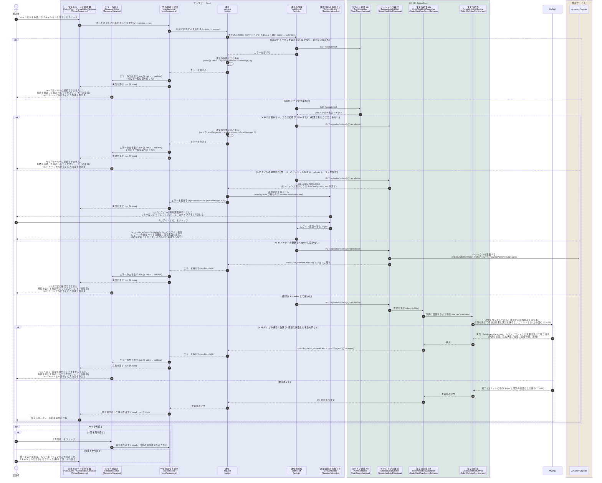

# EC-S13 注文キャンセル申請を処理する

```mermaid
sequenceDiagram
    autonumber
    actor User as 出店者
    box rgba(47,111,219,0.10) ブラウザー React
        participant Work as 出店者画面の枠<br/>Workspace<br/>(Workspace.jsx)
        participant Page as 店舗受け取り画面<br/>OrderPage<br/>(PickupOrders.jsx)
        participant Card as 注文のカードと回答欄<br/>PickupCard・CancellationDecision<br/>(PickupOrders.jsx)
        participant Hook as 一覧の取得と変更<br/>useResource<br/>(useResource.js)
        participant Http as 通信<br/>request<br/>(api.js)
        participant AuthJs as 通信の準備<br/>authFetch<br/>(auth.js)
    end
    box rgba(27,127,92,0.12) EC API Spring Boot
        participant AuthCtrl as ログイン状態API<br/>AuthController<br/>(AuthController.java)
        participant Ctrl as 注文の処理API<br/>OrderWorkflowController<br/>(OrderWorkflowController.java)
        participant Svc as 注文の処理<br/>OrderWorkflowService<br/>(OrderWorkflowService.java)
        participant Auth as ログイン中の会員<br/>AuthService<br/>(AuthService.java)
        participant OrderRepo as 注文の読み書き<br/>OrderRepository<br/>(OrderRepository.java)
        participant Stock as 在庫の戻し<br/>StockReturn<br/>(StockReturn.java)
        participant Refund as 返金の依頼<br/>RefundService<br/>(RefundService.java)
        participant Close as 閉鎖・停止の確認<br/>ClosureSettlement<br/>(ClosureSettlement.java)
        participant Ntf as 通知の保存<br/>NotificationService<br/>(NotificationService.java)
        participant Mapper as 注文の応答の組み立て<br/>OrderResponseMapper<br/>(OrderResponseMapper.java)
    end
    participant Db as MySQL
    box rgba(180,120,20,0.12) 外部サービス
        participant Stripe as Stripe
    end

    Note over User,Stripe: 共通代替フロー<br/>*b 未ログインの場合: 2 (URL を直接開いたときのログインの確認)、4、15、一覧の取り直しの 31 に適用<br/>*a 通信に失敗した場合: 4、13、15、一覧の取り直しの 31 に適用

    User->>Work: 出店者メニューの「店舗受け取り」をクリック
    Work->>Page: URL を /seller/orders に変え、<br/>選択中の店舗の ID を渡して OrderPage を表示
    Page->>Hook: 店舗の注文を取りに行くよう頼む (useResource)
    Hook->>Ctrl: 自動で一覧の通信を始める (reload → request)<br/>GET /api/seller/orders?storeId={店舗ID}
    Ctrl->>Svc: 店舗の注文の一覧を作るよう頼む (sellerOrders)<br/>中身は EC-S08 の図と同じ流れ
    Ctrl-->>Hook: 200 注文の配列
    Page->>Card: キャンセル申請中の注文を先にして並べ (priority)、<br/>注文ごとにカードを表示 (PickupCard)
    Card-->>User: 「キャンセル申請中」、注文の明細と合計、「キャンセル申請があります：<br/>(キャンセル理由)」、「キャンセル回答」の入力欄、<br/>「キャンセルを承認」「キャンセルを却下」(CancellationDecision)
    User->>Card: 申請の内容を確かめ、却下するなら「キャンセル回答」に<br/>却下理由を入力し、「キャンセルを承認」か「キャンセルを却下」をクリック
    Card->>Hook: 押したボタンと回答を渡して変更を実行 (decide → run)<br/>成功の文は既定の「保存しました。」
    Hook->>Http: 申請に回答する通信を送る (write → request、<br/>本文は { approved: 承認なら true, reason: 回答 })
    Http->>AuthJs: 書き込みの前に CSRF トークンを取るよう頼む (send → authFetch)
    AuthJs->>AuthCtrl: GET /api/auth/csrf
    AuthCtrl-->>AuthJs: 200 ヘッダー名とトークン (csrf)
    AuthJs->>Ctrl: PUT /api/seller/orders/{id}/cancellation<br/>(CSRF トークンのヘッダー付き)
    Ctrl->>Svc: 入力を確かめ (DecisionRequest、回答は 500 文字まで)、<br/>申請に回答するよう頼む (decideCancellation)<br/>decideCancellation 全体が 1 つのトランザクション
    Svc->>OrderRepo: 注文の行をロックして読む (lockOrder、SELECT ... FOR UPDATE orders)
    Svc->>Auth: この店舗で STAFF 以上か (requireStore → requireSeller)、<br/>オーナーか MANAGER か (requireManager → requireStoreRole) を確かめる
    break 6b 申請がすでに処理されている (注文受付でない、申請中でない)
        Note over Auth,Card: 結果: 409 ORDER_CHANGED を返し、何も変えない。<br/>画面: 一覧を取り直し、「注文状態が変わりました。最新の状態を確認してください。」と最新の一覧。
    end
    alt 承認
        Svc->>Stock: 引き当てた在庫を戻すよう頼む (restock)。注文の明細を読み、在庫の行を<br/>商品 ID の順にロックして (findAllForOrder、lockAll の SELECT ... FOR UPDATE inventory)、<br/>在庫の数量に注文の数量を足す (setQuantity。在庫の行がなければ 409 STOCK_NOT_FOUND)
        Svc->>Svc: 申請を承認にし、注文状態をキャンセルにして、<br/>回答した会員を記録する (decideCancellation。回答は前後の空白を除いて保存)
        opt カードで支払い済み
            Svc->>Refund: 返金を依頼するよう頼む (refundCancelledOrder)
            Note over Svc,Refund: 結果: 返金の有無と支払いを読み、返金の行を保存して (findByOrderId、findById、save)、<br/>コミットの後に Stripe を呼ぶよう登録する (AfterCommit.run)。店舗でお支払いのときは何もしない
        end
        Svc->>Close: コミットの後に、閉鎖中の店舗・受付停止中の組織を<br/>確かめるよう登録する (afterOrderChanged → AfterCommit.run)
    else 却下
        Svc->>Svc: 申請を却下にし、回答した会員を記録する。注文状態は変えない<br/>(decideCancellation。回答は前後の空白を除いて保存)
    end
    Svc->>Ntf: 購入者に結果を知らせるよう頼む (send)。承認は「注文をキャンセルしました」、<br/>却下は「キャンセル申請の結果」、本文は「注文番号 回答」。<br/>購入者あての通知を保存する (save、INSERT notifications)
    Svc->>Mapper: 店舗向けの注文の形にするよう頼む (storeView → toStoreView)<br/>中身は EC-S08 の図と同じ流れ
    Svc->>Db: 書き換えた行を保存してコミットする (save は呼ばない。<br/>UPDATE orders、承認なら UPDATE inventory と INSERT refunds)
    opt 承認で、返金の行を保存した (コミットの後、応答を返す前)
        Refund->>Stripe: 注文の金額の返金を作る (send → StripeGateway.createRefund)
        Note over Refund,Stripe: 結果: 届けば、別のトランザクションで返金の行に Stripe の返金の ID を記録する (attachStripeRefund)。<br/>届かない、または Stripe の鍵がないときは、別のトランザクションで返金の行を「返金の失敗」にする (changeStatus(FAILED))
    end
    opt 承認で、閉鎖中の店舗・受付停止中の組織に未完了の注文が残っていない (関連情報。コミットの後、応答を返す前)
        Close->>Db: 別のトランザクションで、閉鎖済み・停止にする (settleStore)
        Note over Close,Db: 結果: 店舗を閉鎖済み・組織を停止にする。失敗はログに残すだけで、応答は変えない。<br/>画面: 変わらない
    end
    Ctrl-->>Http: 200 更新後の注文
    Http-->>Hook: 更新後の注文
    Hook->>Ctrl: 一覧を取り直す (reload)<br/>GET /api/seller/orders?storeId={店舗ID}。流れは 4〜6 と同じ
    Ctrl-->>Hook: 最新の注文の一覧
    Hook-->>Card: 成功を返す (run が true、成功の文を設定)
    Card-->>User: 「保存しました。」と処理結果の一覧。承認なら注文状態が「キャンセル」、<br/>「キャンセル申請（承認）：理由 / 回答：…」と返金の状態。<br/>却下なら注文状態はそのままで、「キャンセル申請（却下）：理由 / 回答：…」
```

- ユースケース記述: [EC-S13_注文キャンセル申請を処理する](<../../アーカイブ/ユースケース/kusakari-ec/EC-S13_注文キャンセル申請を処理する.md>)
- 共通代替フロー: [00_全ユースケース共通の代替フロー](<00_全ユースケース共通の代替フロー.md>)
- 対象のコード: kusakari-ec の main（6bad7e3、2026-11-24 時点）

## シーケンス図

参加者は、上から「画面や役割の名前」「コンポーネント・クラスの名前」「ファイル名（かっこ付き）」の順に書いています。
共通代替フローの中身は、00 の図か、下の「共通代替フローを直接書いた図」を見てください。
エラーは最重要の 6b（申請がもう処理されていた）だけを描き、ほかの代替フローは図の下に並べています。承認と却下は、承認でしか起きないやり取り（在庫の戻し、返金の依頼、閉鎖・停止の確認の登録）だけを矢印で描いています。返金の依頼、コミットの後の Stripe への返金の依頼、閉鎖・停止の確定は、`opt` の中の矢印 1 本と Note にしています。

図に描いていない代替フロー：2a（キャンセル申請中の注文がない）、6a（却下理由が未入力）、6c（更新に失敗）、6d（回答する権限がない）、（記述なし）の分岐

## 共通代替フローを直接書いた図

上の図の、回答の通信（CSRF トークンの取得と `PUT /api/seller/orders/{id}/cancellation`）に、この画面で起こる共通代替フロー（\*a、\*b）を書き込んだ図です。画面を開いて注文の一覧を取る通信の \*a・\*b は、[EC-S08](<EC-S08_注文一覧・詳細を確認する.md>) の「共通代替フローを直接書いた図」と同じなので省いています。

## ユースケース記述との差

- 6a の「却下理由を入力してください。」は、ブラウザーではなくサーバーが返します（400 `REASON_REQUIRED`）。「キャンセル回答」の入力欄は `required={false}` なので、ブラウザーは空欄の送信を止めません。サーバーは、注文をロックし、権限（6d）と申請の状態（6b）を確かめたあとで検査します。空白だけの回答も空とみなします（`isBlank()`）。400 なので画面は一覧を取り直さず、入力欄はそのまま残ります。
- 6c の更新の失敗は、コードでは例外によるロールバックです。DB の例外（`DataAccessException`）は 503 `DATABASE_UNAVAILABLE`「保存処理を完了できませんでした。時間をおいて再試行してください。」になり、画面は一覧を取り直しません（共通代替フローを直接書いた図の \*a MySQL の枝）。次の場合は 409 になり、画面は一覧を取り直します。
  - 在庫の行がない: `STOCK_NOT_FOUND`「在庫情報が見つかりません。」（`StockReturn.restock()`）
  - 楽観ロック・一意制約の違反: `DATA_CHANGED`「データが競合しました。最新の内容を確認してください。」（`ApiErrors.conflict()`）
- 6d について、画面は STAFF にも「キャンセル回答」の欄と「キャンセルを承認」「キャンセルを却下」ボタンを出します（`PickupCard` は `operator` でなければ `CancellationDecision` を出す）。押すとサーバーが 403 を返し、「この操作の権限がありません。」が出ます。403 なので一覧は取り直しません。
- 基本フロー 6 の返金の依頼は、注文のトランザクションのコミットの後、応答を返す前に、同じリクエストの中で Stripe を呼びます（`AfterCommit`）。Stripe の呼び出しが失敗したとき（`StripeException`）、または Stripe の鍵がそろっていないときは、返金の行を `FAILED` にし、承認そのものは 200 で終わります。そのあとの一覧には「返金の失敗」と「返金に失敗しました。Stripe の管理画面で返金の状態を確認し、購入者に連絡してください。」が出ます（EC-S08 の 6b と同じ表示）。返金の結果（成功・失敗）は、そのあと Stripe の Webhook で返金の行に反映します（`RefundService.apply()`）。
- 基本フロー 7 の通知の本文は「注文番号 回答」です。店舗名は入りません。回答が空の承認では、本文は注文番号のあとに空白が付くだけです。
- 基本フロー 8: 成功の文は `useResource.js` の `run()` の既定の「保存しました。」です。「キャンセル回答」は、却下のときだけでなく承認のときも注文に保存し（`cancellationResponse`）、一覧に「キャンセル申請（承認）：理由 / 回答：…」として出ます。
- 承認のとき、閉鎖中の店舗・受付停止中の組織の確認（`ClosureSettlement.afterOrderChanged()`）もコミットの後に別のトランザクションで行います。閉鎖済み・停止にしたときは「店舗の閉鎖が完了しました」「組織が停止されました」を通知し、店舗の担当の割り当てを外します。ここで失敗しても応答は変わらず、定期処理（`settleAll()`）がもう一度確かめます。
- 承認と却下を押す前の確認ダイアログはありません。ボタンを押すとすぐに送ります。
- サーバーは次の応答も返しますが、記述にはありません。画面の操作ではふつう起きないため、図では枝にしていません。
  - 404 `ORDER_NOT_FOUND`「注文が見つかりません。」: 注文がないとき。ほかの店舗の注文や、運営が停止した店舗の注文、ロールのない担当者が送ったときも 404 になります。画面は 404 のときも一覧を取り直します。
  - 400 `INVALID_INPUT`: `reason` がないか 500 文字を超えるとき。画面の入力欄は `maxLength` 500 です。
- 権限の検査（`requireManager()`）は、記述のアクター（オーナー、MANAGER）のほかに運営のアカウントも通します。運営の「全注文管理」の画面は回答の欄を出しません。運営が出店者の画面から承認した注文は、EC-S08 の 6a の「運営がキャンセルしました：(回答)」の表示になります。

## 参照したコード

- [frontend/src/workspace/Workspace.jsx](https://github.com/abeouga/kusakari-ec/blob/6bad7e37c4135034fbe97e30309772fbe872e675/frontend/src/workspace/Workspace.jsx): `sellerMenu` の「店舗受け取り」、`/seller/orders` で `OrderPage` を表示
- [frontend/src/workspace/WorkspaceSidebar.jsx](https://github.com/abeouga/kusakari-ec/blob/6bad7e37c4135034fbe97e30309772fbe872e675/frontend/src/workspace/WorkspaceSidebar.jsx): `MenuLink`
- [frontend/src/workspace/PickupOrders.jsx](https://github.com/abeouga/kusakari-ec/blob/6bad7e37c4135034fbe97e30309772fbe872e675/frontend/src/workspace/PickupOrders.jsx): `OrderPage`、`PickupCard`、`CancellationDecision`、`decide`、`priority`、`cancelPending`
- [frontend/src/workspace/OrderPages.jsx](https://github.com/abeouga/kusakari-ec/blob/6bad7e37c4135034fbe97e30309772fbe872e675/frontend/src/workspace/OrderPages.jsx): `cancellationLabels`、`PaymentState`（返金の状態の表示）
- [frontend/src/workspace/ResourceView.jsx](https://github.com/abeouga/kusakari-ec/blob/6bad7e37c4135034fbe97e30309772fbe872e675/frontend/src/workspace/ResourceView.jsx): `Input`（`required`、`maxLength`）、`values`、`ResourceStatus`
- [frontend/src/workspace/useResource.js](https://github.com/abeouga/kusakari-ec/blob/6bad7e37c4135034fbe97e30309772fbe872e675/frontend/src/workspace/useResource.js): `useResource`、`reload`、`run`（404・409 で取り直す、既定の文「保存しました。」）、`write`
- [frontend/src/api.js](https://github.com/abeouga/kusakari-ec/blob/6bad7e37c4135034fbe97e30309772fbe872e675/frontend/src/api.js): `request`、`send`、`readResponse`、`ApiError`、`networkErrorMessage`、`sessionExpiredMessage`
- [frontend/src/auth.js](https://github.com/abeouga/kusakari-ec/blob/6bad7e37c4135034fbe97e30309772fbe872e675/frontend/src/auth.js): `authFetch`（`GET /api/auth/csrf`）、`wasSignedIn`、`login`
- [frontend/src/components/SessionNotice.jsx](https://github.com/abeouga/kusakari-ec/blob/6bad7e37c4135034fbe97e30309772fbe872e675/frontend/src/components/SessionNotice.jsx): 期限切れのお知らせ
- [frontend/src/payment.js](https://github.com/abeouga/kusakari-ec/blob/6bad7e37c4135034fbe97e30309772fbe872e675/frontend/src/payment.js): `refundStatusLabels`
- [backend/src/main/java/jp/kusakari/ec/auth/AuthController.java](https://github.com/abeouga/kusakari-ec/blob/6bad7e37c4135034fbe97e30309772fbe872e675/backend/src/main/java/jp/kusakari/ec/auth/AuthController.java): `csrf`
- [backend/src/main/java/jp/kusakari/ec/commerce/controller/OrderWorkflowController.java](https://github.com/abeouga/kusakari-ec/blob/6bad7e37c4135034fbe97e30309772fbe872e675/backend/src/main/java/jp/kusakari/ec/commerce/controller/OrderWorkflowController.java): `seller`、`decide`、`DecisionRequest`
- [backend/src/main/java/jp/kusakari/ec/commerce/service/OrderWorkflowService.java](https://github.com/abeouga/kusakari-ec/blob/6bad7e37c4135034fbe97e30309772fbe872e675/backend/src/main/java/jp/kusakari/ec/commerce/service/OrderWorkflowService.java): `sellerOrders`、`decideCancellation`、`requireStore`、`conflict`、`storeView`
- [backend/src/main/java/jp/kusakari/ec/commerce/persistence/repository/OrderRepository.java](https://github.com/abeouga/kusakari-ec/blob/6bad7e37c4135034fbe97e30309772fbe872e675/backend/src/main/java/jp/kusakari/ec/commerce/persistence/repository/OrderRepository.java): `findByStoreIdOrderByCreatedAtDesc`、`lockOrder`
- [backend/src/main/java/jp/kusakari/ec/commerce/persistence/entity/OrderEntity.java](https://github.com/abeouga/kusakari-ec/blob/6bad7e37c4135034fbe97e30309772fbe872e675/backend/src/main/java/jp/kusakari/ec/commerce/persistence/entity/OrderEntity.java): `decideCancellation`
- [backend/src/main/java/jp/kusakari/ec/commerce/service/StockReturn.java](https://github.com/abeouga/kusakari-ec/blob/6bad7e37c4135034fbe97e30309772fbe872e675/backend/src/main/java/jp/kusakari/ec/commerce/service/StockReturn.java): `restock`
- [backend/src/main/java/jp/kusakari/ec/commerce/persistence/repository/OrderItemRepository.java](https://github.com/abeouga/kusakari-ec/blob/6bad7e37c4135034fbe97e30309772fbe872e675/backend/src/main/java/jp/kusakari/ec/commerce/persistence/repository/OrderItemRepository.java): `findAllForOrder`
- [backend/src/main/java/jp/kusakari/ec/catalog/persistence/repository/InventoryRepository.java](https://github.com/abeouga/kusakari-ec/blob/6bad7e37c4135034fbe97e30309772fbe872e675/backend/src/main/java/jp/kusakari/ec/catalog/persistence/repository/InventoryRepository.java): `lockAll`（`@Lock(PESSIMISTIC_WRITE)`）
- [backend/src/main/java/jp/kusakari/ec/commerce/mapper/OrderResponseMapper.java](https://github.com/abeouga/kusakari-ec/blob/6bad7e37c4135034fbe97e30309772fbe872e675/backend/src/main/java/jp/kusakari/ec/commerce/mapper/OrderResponseMapper.java): `toStoreView`
- [backend/src/main/java/jp/kusakari/ec/payment/service/RefundService.java](https://github.com/abeouga/kusakari-ec/blob/6bad7e37c4135034fbe97e30309772fbe872e675/backend/src/main/java/jp/kusakari/ec/payment/service/RefundService.java): `refundCancelledOrder`、`send`、`apply`
- [backend/src/main/java/jp/kusakari/ec/payment/persistence/repository/RefundRepository.java](https://github.com/abeouga/kusakari-ec/blob/6bad7e37c4135034fbe97e30309772fbe872e675/backend/src/main/java/jp/kusakari/ec/payment/persistence/repository/RefundRepository.java): `findByOrderId`、`lock`
- [backend/src/main/java/jp/kusakari/ec/payment/persistence/repository/PaymentRepository.java](https://github.com/abeouga/kusakari-ec/blob/6bad7e37c4135034fbe97e30309772fbe872e675/backend/src/main/java/jp/kusakari/ec/payment/persistence/repository/PaymentRepository.java): `findById`
- [backend/src/main/java/jp/kusakari/ec/payment/persistence/entity/RefundEntity.java](https://github.com/abeouga/kusakari-ec/blob/6bad7e37c4135034fbe97e30309772fbe872e675/backend/src/main/java/jp/kusakari/ec/payment/persistence/entity/RefundEntity.java): `REQUESTED`・`SUCCEEDED`・`FAILED`、`attachStripeRefund`、`changeStatus`
- [backend/src/main/java/jp/kusakari/ec/payment/service/StripeGateway.java](https://github.com/abeouga/kusakari-ec/blob/6bad7e37c4135034fbe97e30309772fbe872e675/backend/src/main/java/jp/kusakari/ec/payment/service/StripeGateway.java): `createRefund`、`stripe`、`unavailable`
- [backend/src/main/java/jp/kusakari/ec/payment/service/AfterCommit.java](https://github.com/abeouga/kusakari-ec/blob/6bad7e37c4135034fbe97e30309772fbe872e675/backend/src/main/java/jp/kusakari/ec/payment/service/AfterCommit.java): `run`
- [backend/src/main/java/jp/kusakari/ec/store/service/ClosureSettlement.java](https://github.com/abeouga/kusakari-ec/blob/6bad7e37c4135034fbe97e30309772fbe872e675/backend/src/main/java/jp/kusakari/ec/store/service/ClosureSettlement.java): `afterOrderChanged`、`settleStore`、`settleAll`
- [backend/src/main/java/jp/kusakari/ec/notification/service/NotificationService.java](https://github.com/abeouga/kusakari-ec/blob/6bad7e37c4135034fbe97e30309772fbe872e675/backend/src/main/java/jp/kusakari/ec/notification/service/NotificationService.java): `send`
- [backend/src/main/java/jp/kusakari/ec/auth/AuthService.java](https://github.com/abeouga/kusakari-ec/blob/6bad7e37c4135034fbe97e30309772fbe872e675/backend/src/main/java/jp/kusakari/ec/auth/AuthService.java): `requireSeller`、`requireManager`、`requireStoreRole`、`denied`、`current`
- [backend/src/main/java/jp/kusakari/ec/auth/SessionValidityFilter.java](https://github.com/abeouga/kusakari-ec/blob/6bad7e37c4135034fbe97e30309772fbe872e675/backend/src/main/java/jp/kusakari/ec/auth/SessionValidityFilter.java): `doFilterInternal`（ID トークンの更新、401、503）
- [backend/src/main/java/jp/kusakari/ec/auth/CognitoPasswordLogin.java](https://github.com/abeouga/kusakari-ec/blob/6bad7e37c4135034fbe97e30309772fbe872e675/backend/src/main/java/jp/kusakari/ec/auth/CognitoPasswordLogin.java): ID トークンの更新、503 `AUTH_UNAVAILABLE`
- [backend/src/main/java/jp/kusakari/ec/auth/AuthConfiguration.java](https://github.com/abeouga/kusakari-ec/blob/6bad7e37c4135034fbe97e30309772fbe872e675/backend/src/main/java/jp/kusakari/ec/auth/AuthConfiguration.java): `authenticationEntryPoint`（401 `LOGIN_REQUIRED`）
- [backend/src/main/java/jp/kusakari/ec/common/web/ApiErrors.java](https://github.com/abeouga/kusakari-ec/blob/6bad7e37c4135034fbe97e30309772fbe872e675/backend/src/main/java/jp/kusakari/ec/common/web/ApiErrors.java): `business`、`invalid`、`conflict`、`database`
