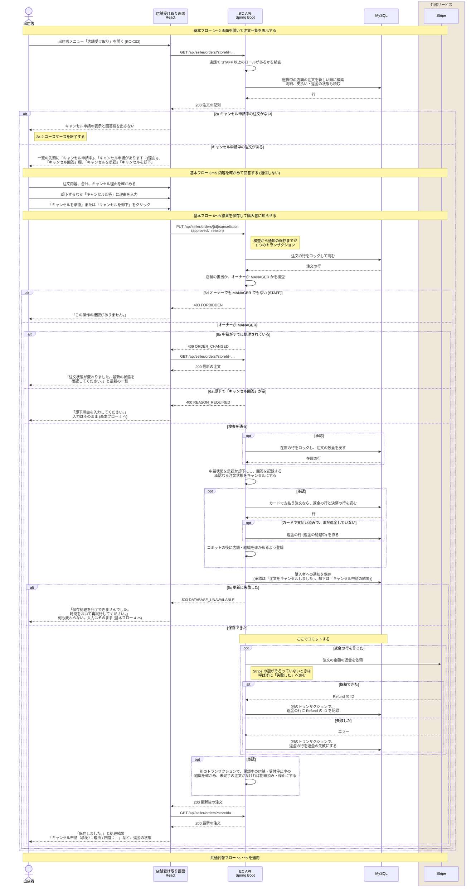
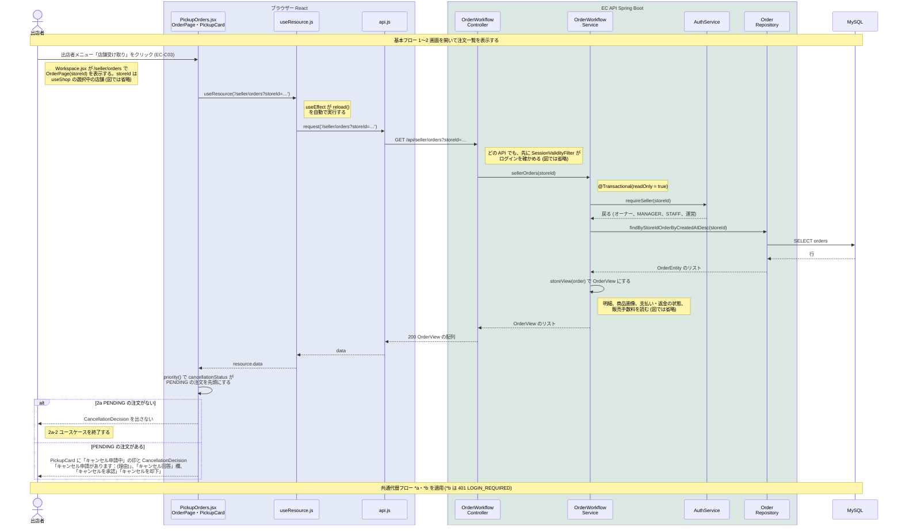
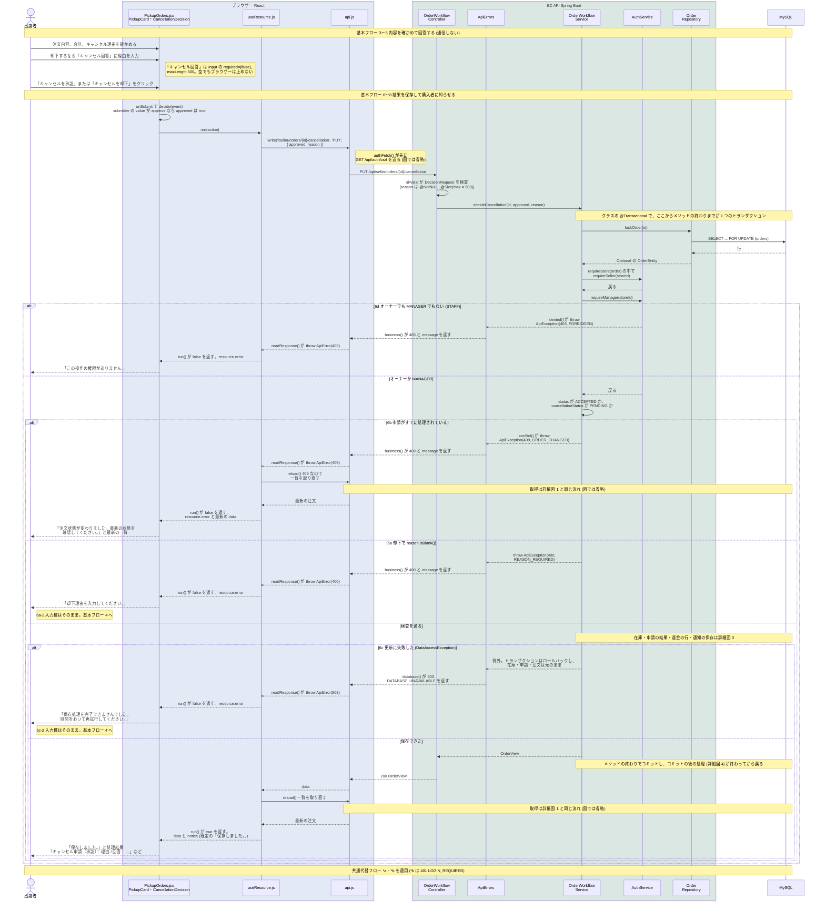
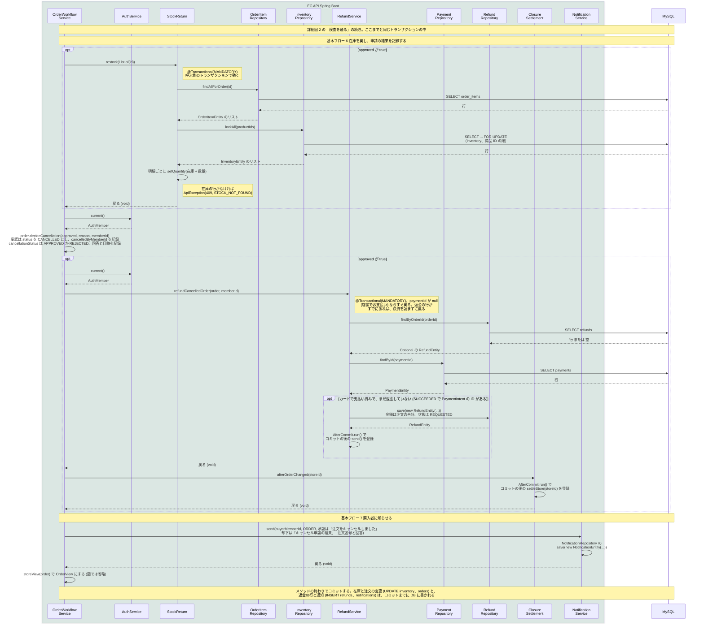
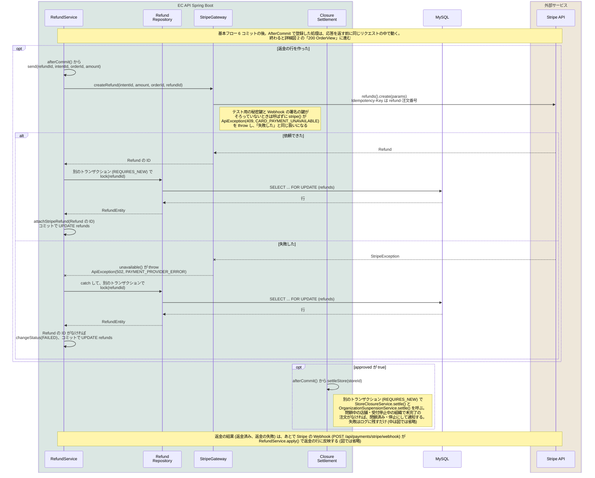

# EC-S13 注文キャンセル申請を処理する

- ユースケース記述: [EC-S13_注文キャンセル申請を処理する](<../../アーカイブ/ユースケース/kusakari-ec/EC-S13_注文キャンセル申請を処理する.md>)
- 対象のコード: kusakari-ec の main（19a2be3、2026-11-20 時点）

## 概要図

## 詳細図 1 基本フロー 1〜2 注文一覧を表示する

## 詳細図 2 基本フロー 3〜8 回答を送り、結果を表示する

## 詳細図 3 基本フロー 6〜7 トランザクションの中で保存する

## 詳細図 4 基本フロー 6 コミットの後に返金を依頼し、店舗を確かめる

## ユースケース記述との差

- 6a の「却下理由を入力してください。」は、ブラウザーではなくサーバーが返します（400 `REASON_REQUIRED`）。「キャンセル回答」の入力欄は `required={false}` なので、ブラウザーは空欄の送信を止めません。サーバーは、注文をロックし、権限（6d）と申請の状態（6b）を確かめたあとで検査します。空白だけの回答も空とみなします（`isBlank()`）。
- 6c の更新の失敗は、コードでは例外によるロールバックです。DB の例外（`DataAccessException`）は 503 `DATABASE_UNAVAILABLE`「保存処理を完了できませんでした。時間をおいて再試行してください。」になり、画面は一覧を取り直しません。次の場合は 409 になり、画面は一覧を取り直します。
  - 在庫の行がない: `STOCK_NOT_FOUND`「在庫情報が見つかりません。」（`StockReturn.restock()`）
  - 楽観ロック・一意制約の違反: `DATA_CHANGED`「データが競合しました。最新の内容を確認してください。」（`ApiErrors.conflict()`）
- 6d について、画面は STAFF にも「キャンセル回答」の欄と「キャンセルを承認」「キャンセルを却下」ボタンを出します（`PickupCard` は `operator` でなければ `CancellationDecision` を出す）。押すとサーバーが 403 を返し、「この操作の権限がありません。」が出ます。
- 基本フロー 6 の返金の依頼は、注文のトランザクションのコミットの後、応答を返す前に、同じリクエストの中で Stripe を呼びます（`AfterCommit`）。Stripe の呼び出しが失敗したとき（`StripeException`）、または Stripe の鍵（テスト用の秘密鍵と Webhook の署名の鍵）がそろっていないときは、返金の行を `FAILED` にし、承認そのものは 200 で終わります。そのあとの一覧には「返金の失敗」と「返金に失敗しました。Stripe の管理画面で返金の状態を確認し、購入者に連絡してください。」が出ます（EC-S08 6b と同じ表示）。
- 基本フロー 7 の通知の本文は「注文番号 回答」です。店舗名は入りません。回答が空の承認では、本文は注文番号だけです。
- 「キャンセル回答」は、却下のときだけでなく承認のときも注文に保存し（`cancellationResponse`）、一覧に「キャンセル申請（承認）：理由 / 回答：…」として出ます。
- 承認のとき、閉鎖中の店舗・受付停止中の組織の確認（`ClosureSettlement.afterOrderChanged()`）もコミットの後に別のトランザクションで行います。閉鎖済み・停止にしたときは「店舗の閉鎖が完了しました」「組織が停止されました」を通知し、店舗の担当の割り当てを外します。ここで失敗しても応答は変わらず、定期処理（`settleAll()`）がもう一度確かめます。
- サーバーは次の応答も返しますが、記述にはありません。画面の操作ではふつう起きないため、図では枝にしていません。
  - 404 `ORDER_NOT_FOUND`「注文が見つかりません。」: 注文がないとき。ほかの店舗の注文や、運営が停止した店舗の注文も 404 になります。画面は 404 のときも一覧を取り直します。
  - 400 `INVALID_INPUT`: `reason` がないか 500 文字を超えるとき。画面の入力欄は `maxLength` 500 です。
- 権限の検査（`requireManager()`）は、記述のアクター（オーナー、MANAGER）のほかに運営のアカウントも通します。運営の「全注文管理」の画面は回答の欄を出しません。

## 参照したコード

- [frontend/src/workspace/PickupOrders.jsx](https://github.com/abeouga/kusakari-ec/blob/19a2be307ee71a2cd87e538236c3c8c42929c5b3/frontend/src/workspace/PickupOrders.jsx): `OrderPage`、`PickupCard`、`CancellationDecision`、`decide()`、`priority()`、`cancelPending()`
- [frontend/src/workspace/OrderPages.jsx](https://github.com/abeouga/kusakari-ec/blob/19a2be307ee71a2cd87e538236c3c8c42929c5b3/frontend/src/workspace/OrderPages.jsx): `cancellationLabels`、`PaymentState`（返金の状態の表示）
- [frontend/src/workspace/ResourceView.jsx](https://github.com/abeouga/kusakari-ec/blob/19a2be307ee71a2cd87e538236c3c8c42929c5b3/frontend/src/workspace/ResourceView.jsx): `Input`（`required`、`maxLength`）、`values()`、`ResourceStatus`
- [frontend/src/workspace/Workspace.jsx](https://github.com/abeouga/kusakari-ec/blob/19a2be307ee71a2cd87e538236c3c8c42929c5b3/frontend/src/workspace/Workspace.jsx): `/seller/orders` で `OrderPage` を表示
- [frontend/src/workspace/useResource.js](https://github.com/abeouga/kusakari-ec/blob/19a2be307ee71a2cd87e538236c3c8c42929c5b3/frontend/src/workspace/useResource.js): `useResource()`、`reload()`、`run()`（404・409 で取り直す、既定のメッセージ「保存しました。」）、`write()`
- [frontend/src/api.js](https://github.com/abeouga/kusakari-ec/blob/19a2be307ee71a2cd87e538236c3c8c42929c5b3/frontend/src/api.js): `request()`、`readResponse()`
- [frontend/src/auth.js](https://github.com/abeouga/kusakari-ec/blob/19a2be307ee71a2cd87e538236c3c8c42929c5b3/frontend/src/auth.js): `authFetch()`
- [frontend/src/payment.js](https://github.com/abeouga/kusakari-ec/blob/19a2be307ee71a2cd87e538236c3c8c42929c5b3/frontend/src/payment.js): `refundStatusLabels`
- [backend/src/main/java/jp/kusakari/ec/commerce/controller/OrderWorkflowController.java](https://github.com/abeouga/kusakari-ec/blob/19a2be307ee71a2cd87e538236c3c8c42929c5b3/backend/src/main/java/jp/kusakari/ec/commerce/controller/OrderWorkflowController.java): `seller()`、`decide()`、`DecisionRequest`
- [backend/src/main/java/jp/kusakari/ec/commerce/service/OrderWorkflowService.java](https://github.com/abeouga/kusakari-ec/blob/19a2be307ee71a2cd87e538236c3c8c42929c5b3/backend/src/main/java/jp/kusakari/ec/commerce/service/OrderWorkflowService.java): `sellerOrders()`、`decideCancellation()`、`requireStore()`、`conflict()`、`storeView()`
- [backend/src/main/java/jp/kusakari/ec/commerce/persistence/repository/OrderRepository.java](https://github.com/abeouga/kusakari-ec/blob/19a2be307ee71a2cd87e538236c3c8c42929c5b3/backend/src/main/java/jp/kusakari/ec/commerce/persistence/repository/OrderRepository.java): `findByStoreIdOrderByCreatedAtDesc()`、`lockOrder()`
- [backend/src/main/java/jp/kusakari/ec/commerce/persistence/entity/OrderEntity.java](https://github.com/abeouga/kusakari-ec/blob/19a2be307ee71a2cd87e538236c3c8c42929c5b3/backend/src/main/java/jp/kusakari/ec/commerce/persistence/entity/OrderEntity.java): `decideCancellation()`
- [backend/src/main/java/jp/kusakari/ec/commerce/service/StockReturn.java](https://github.com/abeouga/kusakari-ec/blob/19a2be307ee71a2cd87e538236c3c8c42929c5b3/backend/src/main/java/jp/kusakari/ec/commerce/service/StockReturn.java): `restock()`
- [backend/src/main/java/jp/kusakari/ec/commerce/persistence/repository/OrderItemRepository.java](https://github.com/abeouga/kusakari-ec/blob/19a2be307ee71a2cd87e538236c3c8c42929c5b3/backend/src/main/java/jp/kusakari/ec/commerce/persistence/repository/OrderItemRepository.java): `findAllForOrder()`
- [backend/src/main/java/jp/kusakari/ec/catalog/persistence/repository/InventoryRepository.java](https://github.com/abeouga/kusakari-ec/blob/19a2be307ee71a2cd87e538236c3c8c42929c5b3/backend/src/main/java/jp/kusakari/ec/catalog/persistence/repository/InventoryRepository.java): `lockAll()`（`@Lock(PESSIMISTIC_WRITE)`）
- [backend/src/main/java/jp/kusakari/ec/payment/service/RefundService.java](https://github.com/abeouga/kusakari-ec/blob/19a2be307ee71a2cd87e538236c3c8c42929c5b3/backend/src/main/java/jp/kusakari/ec/payment/service/RefundService.java): `refundCancelledOrder()`、`send()`、`apply()`
- [backend/src/main/java/jp/kusakari/ec/payment/persistence/repository/RefundRepository.java](https://github.com/abeouga/kusakari-ec/blob/19a2be307ee71a2cd87e538236c3c8c42929c5b3/backend/src/main/java/jp/kusakari/ec/payment/persistence/repository/RefundRepository.java): `findByOrderId()`、`lock()`
- [backend/src/main/java/jp/kusakari/ec/payment/persistence/repository/PaymentRepository.java](https://github.com/abeouga/kusakari-ec/blob/19a2be307ee71a2cd87e538236c3c8c42929c5b3/backend/src/main/java/jp/kusakari/ec/payment/persistence/repository/PaymentRepository.java): `findById()`
- [backend/src/main/java/jp/kusakari/ec/payment/persistence/entity/RefundEntity.java](https://github.com/abeouga/kusakari-ec/blob/19a2be307ee71a2cd87e538236c3c8c42929c5b3/backend/src/main/java/jp/kusakari/ec/payment/persistence/entity/RefundEntity.java): `REQUESTED`・`SUCCEEDED`・`FAILED`、`attachStripeRefund()`、`changeStatus()`
- [backend/src/main/java/jp/kusakari/ec/payment/service/StripeGateway.java](https://github.com/abeouga/kusakari-ec/blob/19a2be307ee71a2cd87e538236c3c8c42929c5b3/backend/src/main/java/jp/kusakari/ec/payment/service/StripeGateway.java): `createRefund()`、`stripe()`、`unavailable()`
- [backend/src/main/java/jp/kusakari/ec/payment/service/AfterCommit.java](https://github.com/abeouga/kusakari-ec/blob/19a2be307ee71a2cd87e538236c3c8c42929c5b3/backend/src/main/java/jp/kusakari/ec/payment/service/AfterCommit.java): `run()`
- [backend/src/main/java/jp/kusakari/ec/payment/service/StripeWebhookService.java](https://github.com/abeouga/kusakari-ec/blob/19a2be307ee71a2cd87e538236c3c8c42929c5b3/backend/src/main/java/jp/kusakari/ec/payment/service/StripeWebhookService.java): 返金のイベントを `RefundService.apply()` に渡す
- [backend/src/main/java/jp/kusakari/ec/store/service/ClosureSettlement.java](https://github.com/abeouga/kusakari-ec/blob/19a2be307ee71a2cd87e538236c3c8c42929c5b3/backend/src/main/java/jp/kusakari/ec/store/service/ClosureSettlement.java): `afterOrderChanged()`、`settleStore()`、`settleAll()`
- [backend/src/main/java/jp/kusakari/ec/notification/service/NotificationService.java](https://github.com/abeouga/kusakari-ec/blob/19a2be307ee71a2cd87e538236c3c8c42929c5b3/backend/src/main/java/jp/kusakari/ec/notification/service/NotificationService.java): `send()`
- [backend/src/main/java/jp/kusakari/ec/auth/AuthService.java](https://github.com/abeouga/kusakari-ec/blob/19a2be307ee71a2cd87e538236c3c8c42929c5b3/backend/src/main/java/jp/kusakari/ec/auth/AuthService.java): `requireSeller()`、`requireManager()`、`requireStoreRole()`、`denied()`、`current()`
- [backend/src/main/java/jp/kusakari/ec/common/web/ApiErrors.java](https://github.com/abeouga/kusakari-ec/blob/19a2be307ee71a2cd87e538236c3c8c42929c5b3/backend/src/main/java/jp/kusakari/ec/common/web/ApiErrors.java): `business()`、`invalid()`、`conflict()`、`database()`
