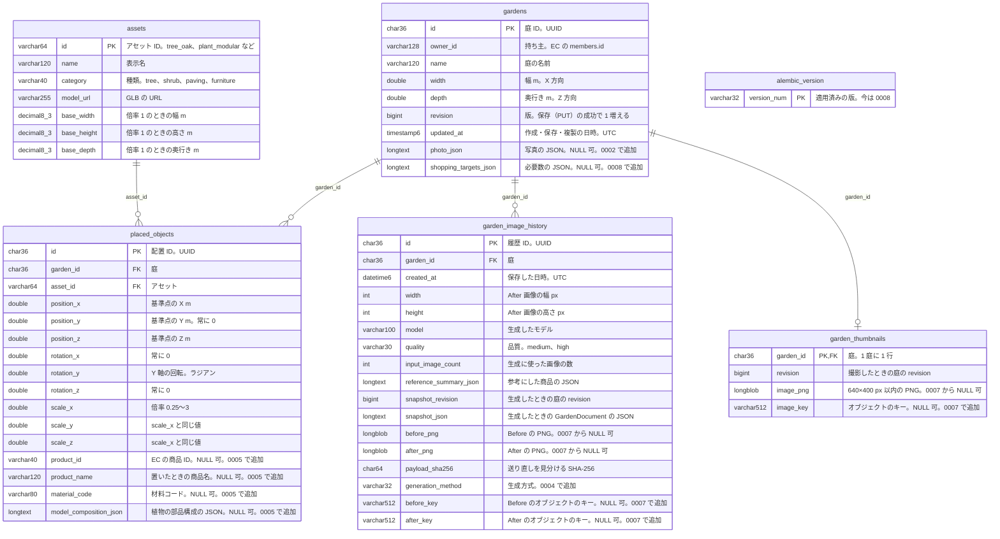
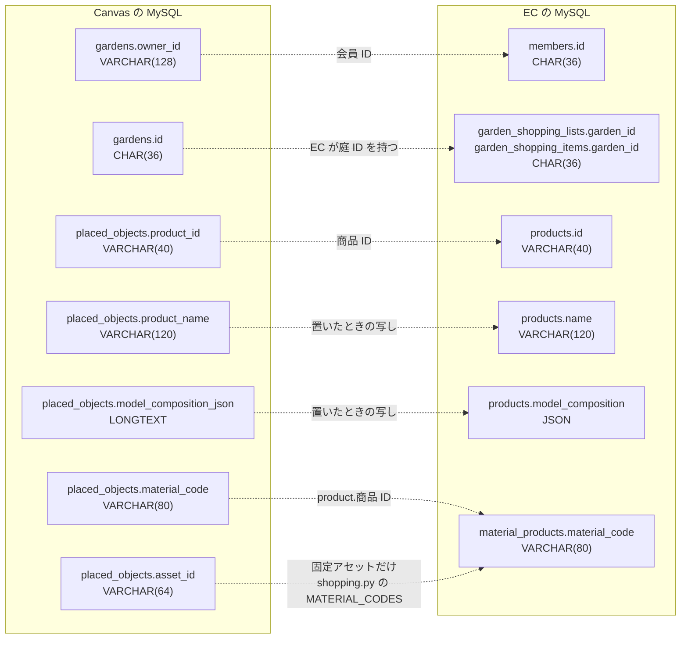

# Canvas のテーブル設計図（全体）

- 対象のコード: kusakari-canvas の main（c19d497、2026-11-20 時点）
- 元にしたマイグレーション（Alembic）: [0001_garden_tables.py](https://github.com/abeouga/kusakari-canvas/blob/c19d497dfef15b119f9bce8ecb5c886a36da6b7d/backend/alembic/versions/0001_garden_tables.py)（[V1__create_garden_tables_and_seed_assets.sql](https://github.com/abeouga/kusakari-canvas/blob/c19d497dfef15b119f9bce8ecb5c886a36da6b7d/backend/alembic/sql/V1__create_garden_tables_and_seed_assets.sql) を実行）、[0002_garden_photo.py](https://github.com/abeouga/kusakari-canvas/blob/c19d497dfef15b119f9bce8ecb5c886a36da6b7d/backend/alembic/versions/0002_garden_photo.py)（[V2__garden_photo.sql](https://github.com/abeouga/kusakari-canvas/blob/c19d497dfef15b119f9bce8ecb5c886a36da6b7d/backend/alembic/sql/V2__garden_photo.sql) を実行）、[0003_garden_image_history.py](https://github.com/abeouga/kusakari-canvas/blob/c19d497dfef15b119f9bce8ecb5c886a36da6b7d/backend/alembic/versions/0003_garden_image_history.py)、[0004_history_generation_method.py](https://github.com/abeouga/kusakari-canvas/blob/c19d497dfef15b119f9bce8ecb5c886a36da6b7d/backend/alembic/versions/0004_history_generation_method.py)、[0005_product_plant_composition.py](https://github.com/abeouga/kusakari-canvas/blob/c19d497dfef15b119f9bce8ecb5c886a36da6b7d/backend/alembic/versions/0005_product_plant_composition.py)、[0006_garden_thumbnails.py](https://github.com/abeouga/kusakari-canvas/blob/c19d497dfef15b119f9bce8ecb5c886a36da6b7d/backend/alembic/versions/0006_garden_thumbnails.py)、[0007_media_storage.py](https://github.com/abeouga/kusakari-canvas/blob/c19d497dfef15b119f9bce8ecb5c886a36da6b7d/backend/alembic/versions/0007_media_storage.py)、[0008_garden_shopping_targets.py](https://github.com/abeouga/kusakari-canvas/blob/c19d497dfef15b119f9bce8ecb5c886a36da6b7d/backend/alembic/versions/0008_garden_shopping_targets.py)
- 照らし合わせた Entity: [models.py](https://github.com/abeouga/kusakari-canvas/blob/c19d497dfef15b119f9bce8ecb5c886a36da6b7d/backend/kusakari_canvas_api/models.py)、[history_models.py](https://github.com/abeouga/kusakari-canvas/blob/c19d497dfef15b119f9bce8ecb5c886a36da6b7d/backend/kusakari_canvas_api/history_models.py)
- テーブルごとの定義と制約: [01_テーブル定義](<01_テーブル定義.md>)

Canvas の MySQL には、庭（GardenDocument）と、庭に付く画像（生成履歴とサムネイル）を入れます。
商品・価格・在庫・カート・注文は EC の DB にあり、Canvas の DB には持ちません。
この図は、0001〜0008 を順に当てた後の構成です。
マイグレーションは `python -m kusakari_canvas_api migrate`（[migrations.py](https://github.com/abeouga/kusakari-canvas/blob/c19d497dfef15b119f9bce8ecb5c886a36da6b7d/backend/kusakari_canvas_api/migrations.py)）が当てます。
既存の DB では当てる前に、どの DB でも当てた後に、テーブル・列・型・NULL 可否・主キー・索引・外部キー・InnoDB を Entity と照らし合わせます。

## 凡例

- 型の表記: Mermaid の erDiagram は型に括弧とコンマを書けないので、次のように書きます。正しい型は [01_テーブル定義](<01_テーブル定義.md>) の表にあります。

  | 図の表記 | マイグレーションの型 |
  | --- | --- |
  | `varchar64` | `VARCHAR(64)`（数字は長さ） |
  | `char36` | `CHAR(36)` |
  | `decimal8_3` | `DECIMAL(8, 3)` |
  | `timestamp6` | `TIMESTAMP(6)` |
  | `datetime6` | `DATETIME(6)` |
  | `int` | `INTEGER` |
  | `bigint`、`double`、`longtext`、`longblob` | `BIGINT`、`DOUBLE`、`LONGTEXT`、`LONGBLOB` |

- キー: `PK` は主キー、`FK` は外部キーです。一意制約は 1 つも無いので、`UK` は出てきません。
- 関係の線: `||--o{` は「1 対 0 以上」、`||--o|` は「1 対 0 か 1」です。外部キーの列は、どれも NOT NULL です。
- 関係のラベル: 外部キーの列名です。
- 説明の「NULL 可」: NULL を入れられる列です。書いていない列は NOT NULL です。

## ER 図

外部キーの削除の動きは、3 つとも `ON DELETE CASCADE` です（`fk_placed_objects_garden`、`fk_image_history_garden`、`fk_thumbnail_garden`）。
庭を消すと、配置・生成履歴・サムネイルの行も消えます。
`fk_placed_objects_asset` には `ON DELETE` の指定が無いので、配置で使っているアセットの行は消せません。

## テーブルの一覧

| テーブル | まとまり | 役割 | 作ったマイグレーション | 後で変えたマイグレーション | Entity | 主に読み書きするコード |
| --- | --- | --- | --- | --- | --- | --- |
| `assets` | カタログ | 配置できる 3D アセットの一覧です。固定アセット 4 つと、植物の商品を置くための `plant_modular` があります。 | 0001（4 行を入れる） | 0005（`plant_modular` の行を入れる。形は変えない） | `Asset` | `service.py`（`list_assets`、保存のときの照合）、`shopping.py`、`history_service.py`、`ai_service.py` |
| `gardens` | 庭の本体 | 庭 1 件の行です。GardenDocument の名前・寸法・revision・写真・必要数を持ちます。 | 0001 | 0002（`photo_json`）、0008（`shopping_targets_json`） | `Garden` | `service.py`、`shopping.py`、`thumbnails.py`、`history_service.py` |
| `placed_objects` | 庭の本体 | 庭に置いた物 1 個ごとの行です（GardenDocument の `objects`）。 | 0001 | 0005（`product_id`、`product_name`、`material_code`、`model_composition_json`） | `PlacedObject` | `service.py`、`shopping.py`、`thumbnails.py`（配置図） |
| `garden_image_history` | 庭に付く画像 | 完成イメージの生成履歴です。Before・After の画像と、生成したときの GardenDocument を持ちます。 | 0003 | 0004（`generation_method`）、0007（`before_key`、`after_key`。`before_png`、`after_png` を NULL 可に） | `HistoryEntity` | `history_service.py`、`ai_service.py`、`thumbnails.py`、`shopping.py` |
| `garden_thumbnails` | 庭に付く画像 | EC の庭の一覧に出す、Canvas の画面のキャプチャです。1 庭に 1 行です。 | 0006 | 0007（`image_key`。`image_png` を NULL 可に） | `GardenThumbnail` | `thumbnails.py`、`service.py`（複製）、`shopping.py` |
| `alembic_version` | 管理用 | Alembic が、適用済みの版を 1 行で持ちます。 | Alembic が作る | なし | なし | `migrations.py` |
| `flyway_schema_history` | 管理用 | 旧 Flyway で作った DB を引き継いだときだけ残ります。Canvas は V1・V2 の履歴を読むだけで、書きません。新しく作った DB にはありません。 | 旧 Flyway | なし | なし | `migrations.py`（`legacy_revision`） |

`Asset`、`Garden`、`PlacedObject`、`GardenThumbnail` は `models.py`、`HistoryEntity` は `history_models.py` にあります。
クラス図は、前の 4 つが [01_APIとデータの層](<../../クラス図/kusakari-canvas/01_APIとデータの層.md>) の「図 6 Entity（models.py）」、`HistoryEntity` が [02_画像生成と履歴](<../../クラス図/kusakari-canvas/02_画像生成と履歴.md>) の「図 7 生成履歴の Entity と DTO」です。
Entity には `relationship()` が無く、関係は外部キーだけで表しています。

## マイグレーションの順と変更

| 版 | 変更 |
| --- | --- |
| 0001 | `assets`、`gardens`、`placed_objects` を作り、`assets` に 4 行（`tree_oak`、`shrub_boxwood`、`brick_paver`、`bench_wood`）を入れます。行の追加は `ON DUPLICATE KEY UPDATE id = id` なので、同じ ID の行があれば変えません。 |
| 0002 | `gardens` に `photo_json`（`LONGTEXT`、NULL 可）を足します。 |
| 0003 | `garden_image_history` と索引 `idx_image_history_garden_created` を作ります。 |
| 0004 | `garden_image_history` に `generation_method`（`VARCHAR(32)`、NOT NULL）を足します。既存の行には `masked_composite_v1` を入れ、その後で初期値を外します。 |
| 0005 | `placed_objects` に `product_id`、`product_name`、`material_code`、`model_composition_json`（どれも NULL 可）を足し、`assets` に `plant_modular` の行を入れます。 |
| 0006 | `garden_thumbnails` を作ります。 |
| 0007 | `garden_image_history` に `before_key`、`after_key`、`garden_thumbnails` に `image_key`（どれも `VARCHAR(512)`、NULL 可）を足し、`before_png`、`after_png`、`image_png` を NULL 可にします。 |
| 0008 | `gardens` に `shopping_targets_json`（`LONGTEXT`、NULL 可）を足します。 |

サンプルデータだけのマイグレーションはありません。
行を入れるのは 0001 と 0005 の `assets` だけで、どちらも同じマイグレーションでテーブルの形も変えます。
庭や配置のサンプルの行は入れません。
`downgrade()` は、すべて例外を出して止まります（バックアップから戻す決まりです）。

## GardenDocument と列の対応

庭の保存は、GardenDocument 全体を `PUT /api/gardens/{id}` で送る形です。
サーバーは `gardens` の 1 行を書き換え、`placed_objects` の行をすべて消して入れ直します（[service.py](https://github.com/abeouga/kusakari-canvas/blob/c19d497dfef15b119f9bce8ecb5c886a36da6b7d/backend/kusakari_canvas_api/service.py) の `update_garden`）。

| GardenDocument の項目 | 保存する列 | 補足 |
| --- | --- | --- |
| `schemaVersion` | なし | 列はありません。読み出すときは `schemas.py` の `GardenDocument` の既定値 1 になります。保存は 1 だけを受け付けます。 |
| `id` | `gardens.id` | |
| `revision` | `gardens.revision` | 使い方は [01_テーブル定義](<01_テーブル定義.md>) の「revision の使い方」にあります。 |
| `name`、`width`、`depth` | `gardens.name`、`gardens.width`、`gardens.depth` | |
| `objects[]` | `placed_objects` の行（1 個 1 行） | 並び順の列はありません。読み出すときは `placed_objects.id` の順に並べます。 |
| `objects[].id`、`assetId` | `placed_objects.id`、`placed_objects.asset_id` | `id` は小文字にして保存します。 |
| `objects[].position`、`rotation`、`scale` | `position_x`〜`scale_z` の 9 列 | |
| `objects[].productId`、`productName`、`materialCode`、`modelComposition` | `product_id`、`product_name`、`material_code`、`model_composition_json` | 商品の植物（`plant_modular`）の配置だけに入ります。 |
| `photo` | `gardens.photo_json` | |
| `shoppingTargets` | `gardens.shopping_targets_json` | |

## JSON を入れる列

JSON の列は、どれも MySQL の `JSON` 型ではなく `LONGTEXT` です。
中の形は、DB では確かめず、保存の前に Pydantic の DTO で確かめます。

| 列 | 中の形 | 形を定義している場所 | NULL のとき |
| --- | --- | --- | --- |
| `gardens.photo_json` | `GardenPhoto` の JSON（`dataUrl`、`imageWidth`、`imageHeight`、`corners`、`boundary`、`calibration`、`edgeLengths`、`projectionSize`）。画像の保存先が `s3` のときは、`dataUrl` の代わりに `imageKey` と `imageMime` を入れます。 | [schemas.py](https://github.com/abeouga/kusakari-canvas/blob/c19d497dfef15b119f9bce8ecb5c886a36da6b7d/backend/kusakari_canvas_api/schemas.py) の `GardenPhoto`・`PhotoCalibration`・`PhotoProjectionSize`、[garden.d.ts](https://github.com/abeouga/kusakari-canvas/blob/c19d497dfef15b119f9bce8ecb5c886a36da6b7d/frontend/src/types/garden.d.ts) の `GardenPhoto`、`s3` のときの置き換えは [media.py](https://github.com/abeouga/kusakari-canvas/blob/c19d497dfef15b119f9bce8ecb5c886a36da6b7d/backend/kusakari_canvas_api/media.py) の `store_photo` | 写真がありません。 |
| `gardens.shopping_targets_json` | `ShoppingTarget` の配列（`[{key, quantity}]`）。`key` は `product:<商品 ID>` か `asset:<アセット ID>`、`quantity` は 1〜999、200 件までです。 | `schemas.py` の `ShoppingTarget`、`garden.d.ts` の `GardenDocument.shoppingTargets` | 空の配列です。画面からは使いませんが、保存のときに値を保ちます（[shopping-targets.md](https://github.com/abeouga/kusakari-canvas/blob/c19d497dfef15b119f9bce8ecb5c886a36da6b7d/docs/shopping-targets.md)）。 |
| `placed_objects.model_composition_json` | 植物の部品構成 `PlantComposition`（`version`、`catalogVersion`、`profile`、`baseDimensions`、`fitScale`、`parts`）。`version` が 5 なら今の規則、1〜4 なら凍結した旧規則です。 | [plant_schemas.py](https://github.com/abeouga/kusakari-canvas/blob/c19d497dfef15b119f9bce8ecb5c886a36da6b7d/backend/kusakari_canvas_api/plant_schemas.py) が [plants/schemas.py](https://github.com/abeouga/kusakari-canvas/blob/c19d497dfef15b119f9bce8ecb5c886a36da6b7d/backend/kusakari_canvas_api/plants/schemas.py)（v5）と [plant_legacy/plant_schemas.py](https://github.com/abeouga/kusakari-canvas/blob/c19d497dfef15b119f9bce8ecb5c886a36da6b7d/backend/kusakari_canvas_api/plant_legacy/plant_schemas.py)（v1〜v4）を振り分けます。画面は `garden.d.ts` の `PlantComposition` | 固定アセットの配置です。 |
| `garden_image_history.reference_summary_json` | `ReferenceSummary` の配列（`[{assetId, productId, productName, source}]`）。`source` は `catalog` か `uploaded` です。1〜15 件です。 | [ai_schemas.py](https://github.com/abeouga/kusakari-canvas/blob/c19d497dfef15b119f9bce8ecb5c886a36da6b7d/backend/kusakari_canvas_api/ai_schemas.py) の `ReferenceSummary` | NULL にはなりません。 |
| `garden_image_history.snapshot_json` | 生成したときの GardenDocument（`GardenDocumentRequest` の JSON）。`s3` のときは、中の `photo` を `photo_json` と同じ形に置き換えます。 | `schemas.py` の `GardenDocumentRequest`、置き換えは `media.py` の `store_document` | NULL にはなりません。 |

## 画像を入れる列

画像の保存先は、環境変数 `KUSAKARI_CANVAS_MEDIA_STORAGE` で決まります（`media.py` の `MediaStore`）。

| 保存先 | `*_png` の列 | `*_key` の列 | 写真（`photo_json`） |
| --- | --- | --- | --- |
| `database`（既定） | PNG のバイト列 | NULL | `dataUrl` に画像を入れます。 |
| `s3` | NULL | オブジェクトのキー（`<接頭辞>/<内容の SHA-256>.png`） | `imageKey` と `imageMime` を入れます。 |

対象の列は、`garden_image_history` の `before_png`・`before_key`、`after_png`・`after_key` と、`garden_thumbnails` の `image_png`・`image_key` です。
どちらか一方だけに値が入るのはアプリの決まりで、CHECK 制約はありません。
キーは内容のハッシュなので、同じ画像は同じキーになります。
DB の行を消しても、オブジェクトは消しません（`media.py` の説明）。

## EC の DB との対応

Canvas と EC は別の MySQL の DB です。
DB をまたぐ外部キーはありません。
値の対応は、API と両方のアプリのコードで保ちます。
EC の DB を作り直したときは、Canvas の DB も作り直します（[database-reset.md](https://github.com/abeouga/kusakari-canvas/blob/c19d497dfef15b119f9bce8ecb5c886a36da6b7d/docs/database-reset.md)）。
EC のテーブルの定義は、EC の [V1__schema.sql](https://github.com/abeouga/kusakari-ec/blob/19a2be307ee71a2cd87e538236c3c8c42929c5b3/backend/src/main/resources/db/migration/V1__schema.sql) と [EC のテーブル設計図](<../kusakari-ec/>) にあります。`members` は [01_会員と通知](<../kusakari-ec/01_会員と通知.md>)、`products` と `material_products` は [03_商品と在庫](<../kusakari-ec/03_商品と在庫.md>) です。
EC 側は kusakari-ec の main（19a2be3、2026-11-20 時点）で確かめました。

図の線は、同じ値を持つ列どうしを結びます。
向きは、どれも Canvas から EC へ描いています。
値がどちらから来るかは、線のラベルと下の表に書きました。
線はどれも点線で、外部キーではありません。

| Canvas の列 | EC の列 | 値の入り方 | 使うところ |
| --- | --- | --- | --- |
| `gardens.owner_id`（`VARCHAR(128)`） | `members.id`（`CHAR(36)`） | Canvas の [auth.py](https://github.com/abeouga/kusakari-canvas/blob/c19d497dfef15b119f9bce8ecb5c886a36da6b7d/backend/kusakari_canvas_api/auth.py) が、EC の `GET /api/auth/me`（書き込みは `POST /api/auth/verify`）の応答の `id` を UUID として読み、文字列にして入れます。EC の応答の `id` は `members.id` です（EC の `AuthService.session`）。クライアントからは受け取りません。隔離した E2E の `demo` モードだけは、設定の固定値（`config.py` の `Settings.owner_id`）を入れます。 | 庭・配置・履歴・サムネイル・買い物リストのすべての読み書きを、この列で絞ります（`service.py` の `owned_garden`）。 |
| `placed_objects.product_id`（`VARCHAR(40)`） | `products.id`（`VARCHAR(40)`） | 画面が、EC の `GET /api/products` の商品から植物を置いたときに入れます（`frontend/src/domain/productModels.js` の `productAsset`、`gardenEditing.js` の `createPlacedObject`）。EC は商品の行を消さず、削除は在庫の公開状態を `DELETED` にします（EC の `ProductEditorService.delete`）。 | Canvas の `GET /api/gardens/{id}/shopping-list` の `productId` として EC に渡します。EC は、この商品を買い物リストの候補にします（EC の `ShoppingService`）。 |
| `placed_objects.product_name`（`VARCHAR(120)`） | `products.name`（`VARCHAR(120)`） | 置いたときの商品の名前を写します。 | 買い物リストと配置の一覧の表示名です。 |
| `placed_objects.model_composition_json`（`LONGTEXT`） | `products.model_composition`（`JSON`） | 置いたときの商品の `modelComposition` を写します。保存のたびに、Canvas の `validation.py` が同じ規則で組み立て直し、一致することを確かめます。 | 庭を開いたときの植物の表示です。 |
| `placed_objects.material_code`（`VARCHAR(80)`） | `material_products.material_code`（`VARCHAR(80)`） | `plant_modular` の配置は `product.<product_id>` です（`validation.py` が確かめます）。EC の商品の `canvasMaterialCode` も同じ値で、EC は植物の構成がある商品を保存するとき `material_products` に同じ値を入れます（EC の `ProductEntity.getCanvasMaterialCode`、`ProductEditorService.linkMaterial`）。 | `GET /api/gardens/{id}/shopping-list` の `materialCode` として EC に渡します。EC は、`productId` が無い行だけ、`materialCode` から `material_products` で候補を探します。 |
| `placed_objects.asset_id`（固定アセット） | `material_products.material_code` | 固定アセットの配置は `material_code` が NULL です。`shopping.py` の `MATERIAL_CODES` が、`tree_oak` を `plant.oak`、`shrub_boxwood` を `plant.boxwood`、`brick_paver` を `garden.brick`、`bench_wood` を `garden.bench` にします。EC の V2 のサンプルデータが、この 4 つを `canvas-oak` などの商品に対応させます。 | EC の買い物リストの候補です。AI の商品候補（`ai_catalog.py` から EC の `POST /api/materials/quote`）も、`tree_oak` と `shrub_boxwood` をこの材料コードで探します。 |
| `gardens.id`（`CHAR(36)`） | `garden_shopping_lists.garden_id`、`garden_shopping_items.garden_id`（`CHAR(36)`） | EC が、買い物リストに商品を入れたときに庭 ID を持ちます。 | Canvas の DB だけを作り直すと、EC の行は無い庭を指します（database-reset.md）。 |

型の違いが 1 つあります。
`gardens.owner_id` は `VARCHAR(128)` で、EC の `members.id`（`CHAR(36)`）より長い型です。
`demo` モードの固定値は UUID ではありません（`config.py`）。
database-reset.md の最後の項目は、持ち主の列を EC の会員 ID に合わせる変更を含めていないと書いています。
0008 までのマイグレーションにも、この列の変更はありません。

## 元の文書・コードとの差

マイグレーションと Entity（`models.py`、`history_models.py`）の間に、型・NULL 可否・索引・外部キーの差はありません。
ほかに見つかった差は次のとおりです。

- 列の並び: マイグレーションで後から足した列は、テーブルの末尾に付きます。`models.py` の `PlacedObject` は `product_id` などを `asset_id` の次に書いていますが、DB では `scale_z` の後ろです。`history_models.py` の `HistoryEntity` も、`generation_method` を `quality` の次に、`before_key`・`after_key` を `payload_sha256` の前に書いていますが、DB では `payload_sha256`、`generation_method`、`before_key`、`after_key` の順です。この文書は DB の並びで書きました。
- [garden-duplication.md](https://github.com/abeouga/kusakari-canvas/blob/c19d497dfef15b119f9bce8ecb5c886a36da6b7d/docs/garden-duplication.md) の複製する項目に `shopping_targets_json` がありません。`service.py` の `duplicate_garden` は、この列も写します（shopping-targets.md にも「庭の複製では必要数も複製する」とあります）。
- `garden.d.ts` の `PlantComposition` には、`plants/schemas.py`（v5）の `PlantComposition` にある `color` の項目がありません。
- [fastapi-migration.md](https://github.com/abeouga/kusakari-canvas/blob/c19d497dfef15b119f9bce8ecb5c886a36da6b7d/docs/fastapi-migration.md) の「Migration」は、最新が 0002 だったときの書き方です。今の最新は 0008（`migrations.py` の `HEAD`）です。

## 確かめられなかったこと

- 実際の MySQL で `SHOW CREATE TABLE` を見ていません。`placed_objects.asset_id` の索引は、InnoDB が外部キーのために自動で作ります（`migrations.py` のコメント）。マイグレーションに索引名が無いので、名前は確かめていません。
- `flyway_schema_history` の列の定義は Flyway が決めるもので、このリポジトリのコードにはありません。Canvas が読む列（`version`、`type`、`success`、`installed_rank`）だけが分かります。
