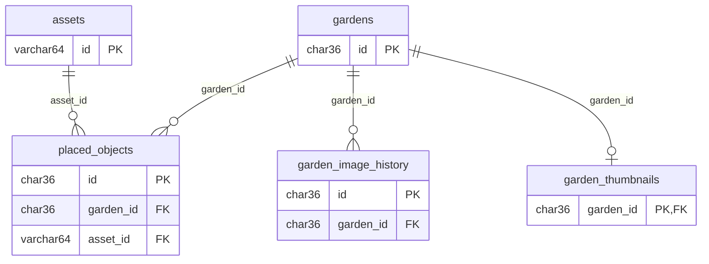

# Canvas のテーブル定義

- 対象のコード: kusakari-canvas の main（c19d497、2026-11-20 時点）
- 元にしたマイグレーション（Alembic）: [0001](https://github.com/abeouga/kusakari-canvas/blob/c19d497dfef15b119f9bce8ecb5c886a36da6b7d/backend/alembic/versions/0001_garden_tables.py)（[V1__create_garden_tables_and_seed_assets.sql](https://github.com/abeouga/kusakari-canvas/blob/c19d497dfef15b119f9bce8ecb5c886a36da6b7d/backend/alembic/sql/V1__create_garden_tables_and_seed_assets.sql)）、[0002](https://github.com/abeouga/kusakari-canvas/blob/c19d497dfef15b119f9bce8ecb5c886a36da6b7d/backend/alembic/versions/0002_garden_photo.py)（[V2__garden_photo.sql](https://github.com/abeouga/kusakari-canvas/blob/c19d497dfef15b119f9bce8ecb5c886a36da6b7d/backend/alembic/sql/V2__garden_photo.sql)）、[0003](https://github.com/abeouga/kusakari-canvas/blob/c19d497dfef15b119f9bce8ecb5c886a36da6b7d/backend/alembic/versions/0003_garden_image_history.py)、[0004](https://github.com/abeouga/kusakari-canvas/blob/c19d497dfef15b119f9bce8ecb5c886a36da6b7d/backend/alembic/versions/0004_history_generation_method.py)、[0005](https://github.com/abeouga/kusakari-canvas/blob/c19d497dfef15b119f9bce8ecb5c886a36da6b7d/backend/alembic/versions/0005_product_plant_composition.py)、[0006](https://github.com/abeouga/kusakari-canvas/blob/c19d497dfef15b119f9bce8ecb5c886a36da6b7d/backend/alembic/versions/0006_garden_thumbnails.py)、[0007](https://github.com/abeouga/kusakari-canvas/blob/c19d497dfef15b119f9bce8ecb5c886a36da6b7d/backend/alembic/versions/0007_media_storage.py)、[0008](https://github.com/abeouga/kusakari-canvas/blob/c19d497dfef15b119f9bce8ecb5c886a36da6b7d/backend/alembic/versions/0008_garden_shopping_targets.py)
- 全体の ER 図・JSON の列・EC の DB との対応: [00_全体](<00_全体.md>)
- Entity のクラス: [クラス図](<../../クラス図/クラス図.md>) の「Kusakari Canvas」（`Asset`、`Garden`、`PlacedObject`、`GardenThumbnail`、`HistoryEntity`）

0001〜0008 を順に当てた後の構成を、テーブルごとに書きます。
Entity は [models.py](https://github.com/abeouga/kusakari-canvas/blob/c19d497dfef15b119f9bce8ecb5c886a36da6b7d/backend/kusakari_canvas_api/models.py) と [history_models.py](https://github.com/abeouga/kusakari-canvas/blob/c19d497dfef15b119f9bce8ecb5c886a36da6b7d/backend/kusakari_canvas_api/history_models.py) にあり、型・NULL 可否・索引・外部キーはマイグレーションと一致します。

## 凡例

- 型: マイグレーションに書かれたとおりです。
- NULL: `NOT NULL` か `NULL`（NULL 可）です。
- 初期値: マイグレーションの `DEFAULT` です。「なし」は `DEFAULT` を書いていない列です。どの列にも `DEFAULT` は残っていません（0004 の初期値は、既存の行に入れた後で外しています）。
- キー: `PK` は主キー、`FK` は外部キーです。
- 列の並び: DB の並びです。後のマイグレーションで足した列は、末尾に付きます。説明に、足したマイグレーションを書きます。
- 主キーの名前: マイグレーションは主キーに名前を付けていません（MySQL では `PRIMARY` です）。
- `ON UPDATE`: どの外部キーにも指定がありません。`ON DELETE` に「指定なし」とあるものも、MySQL の既定の動きになります。
- 一意制約と CHECK 制約: どのテーブルにもありません。`migrations.py` は、主キー以外の一意の索引があるとマイグレーションを止めます。値の決まりは、保存の前に `schemas.py` の DTO と `validation.py` が確かめます。
- エンジン: すべて InnoDB です（`migrations.py` が確かめます）。文字コードはテーブルごとに指定せず、DB の既定に従います。セットアップと `DB-reset.bat` は、DB を `utf8mb4`・`utf8mb4_0900_ai_ci` で作ります（`setup_database.py`、`reset_database.py`）。
- 日時: 接続ごとに `time_zone` を `+00:00` にするので、UTC で入ります（`database.py`）。

## ER 図（キーだけ）

列をすべて書いた ER 図は [00_全体](<00_全体.md>) にあります。

## assets（アセット）

配置できる 3D アセットの一覧です。
画面は `GET /api/assets` で読みます。
保存のとき、`service.py` の `update_garden` は、配置の `assetId` がすべてこのテーブルにあるかを確かめます（無ければ 400 `UNKNOWN_ASSET`）。
Entity は `Asset`（models.py）です。

| 列名 | 型 | NULL | 初期値 | キー | 説明 |
| --- | --- | --- | --- | --- | --- |
| `id` | `VARCHAR(64)` | NOT NULL | なし | PK | アセット ID です。`placed_objects.asset_id` から参照されます。 |
| `name` | `VARCHAR(120)` | NOT NULL | なし | | 表示名です。 |
| `category` | `VARCHAR(40)` | NOT NULL | なし | | 種類です。今の行の値は `tree`、`shrub`、`paving`、`furniture` です。値を限る制約はありません。生成履歴の保存では、`tree` と `shrub` を植物として扱います（`history_service.py`）。 |
| `model_url` | `VARCHAR(255)` | NOT NULL | なし | | GLB の URL です。`GET /api/assets` の `modelUrl` です。 |
| `base_width` | `DECIMAL(8, 3)` | NOT NULL | なし | | 倍率 1 のときの幅（m）です。`GET /api/assets` の `baseDimensions.width` です。 |
| `base_height` | `DECIMAL(8, 3)` | NOT NULL | なし | | 倍率 1 のときの高さ（m）です。 |
| `base_depth` | `DECIMAL(8, 3)` | NOT NULL | なし | | 倍率 1 のときの奥行き（m）です。 |

- 主キー: `PRIMARY KEY (id)`
- 一意制約: なし
- 索引: なし（主キーだけ）
- CHECK 制約: なし
- 外部キー: なし。参照される側です（`fk_placed_objects_asset`）。

マイグレーションが入れる行は次の 5 行です。

| `id` | `name` | `category` | `model_url` | `base_width` | `base_height` | `base_depth` | 入れたマイグレーション |
| --- | --- | --- | --- | --- | --- | --- | --- |
| `tree_oak` | 木 | `tree` | `/models/tree-oak.glb` | 2.000 | 4.000 | 2.000 | 0001 |
| `shrub_boxwood` | 低木 | `shrub` | `/models/shrub-boxwood.glb` | 1.200 | 1.200 | 1.200 | 0001 |
| `brick_paver` | レンガ | `paving` | `/models/brick-paver.glb` | 0.600 | 0.150 | 0.200 | 0001 |
| `bench_wood` | ベンチ | `furniture` | `/models/bench-wood.glb` | 1.600 | 0.850 | 0.650 | 0001 |
| `plant_modular` | 植物（商品モデル） | `tree` | `/models/plant-parts/v1/stem.glb` | 1 | 1 | 1 | 0005 |

- 0001 の 4 行は `ON DUPLICATE KEY UPDATE id = id` で入れるので、同じ ID の行があれば変えません。0005 の行は普通の `INSERT` です。
- セットアップと `DB-reset.bat` は、マイグレーションの後に 0001 の 4 行があることを確かめます（`setup_database.py` の `migrate_and_verify`）。
- `plant_modular` は、EC の植物の商品を置くためのアセットです。`validation.py` は、`plant_modular` の配置に `productId`、`productName`、`materialCode`（`product.<productId>`）、`modelComposition` を求め、ほかのアセットの配置ではこの 4 つを認めません。

## gardens（庭）

庭 1 件の行です。
GardenDocument のうち、配置（`objects`）以外を持ちます。
Entity は `Garden`（models.py）です。

| 列名 | 型 | NULL | 初期値 | キー | 説明 |
| --- | --- | --- | --- | --- | --- |
| `id` | `CHAR(36)` | NOT NULL | なし | PK | 庭 ID です。作成と複製のときに、サーバーが UUID を作ります（`service.py`）。GardenDocument の `id` です。 |
| `owner_id` | `VARCHAR(128)` | NOT NULL | なし | | 持ち主です。EC の `members.id` を入れます（`auth.py` が EC のログインの確認の応答から決めます。クライアントからは受け取りません）。隔離した E2E の `demo` モードでは、設定の固定値です。読み書きはすべて、この列で持ち主の庭に絞ります（`service.py` の `owned_garden`）。 |
| `name` | `VARCHAR(120)` | NOT NULL | なし | | 庭の名前です。前後の空白を除いて入れます。UTF-16 で 120 単位までです（`schemas.py` の `NamedRequest`）。複製は、元の名前に「（複製）」を付けます。 |
| `width` | `DOUBLE` | NOT NULL | なし | | 庭の幅（m、X 方向）です。1〜50 です。作成で省くと 10 です。 |
| `depth` | `DOUBLE` | NOT NULL | なし | | 庭の奥行き（m、Z 方向）です。1〜50 です。作成で省くと 8 です。 |
| `revision` | `BIGINT` | NOT NULL | なし | | 版です。作成と複製で 0 になり、保存（PUT）の成功で 1 増えます。下の「revision の使い方」を見てください。 |
| `updated_at` | `TIMESTAMP(6)` | NOT NULL | なし | | 作成・保存（PUT）・複製の日時（UTC）です。一覧は、この列の新しい順に並べます。 |
| `photo_json` | `LONGTEXT` | NULL | なし | | 写真（GardenDocument の `photo`）の JSON です。写真の無い庭は NULL です。0002 で足しました。 |
| `shopping_targets_json` | `LONGTEXT` | NULL | なし | | 必要数（GardenDocument の `shoppingTargets`）の JSON です。空のときは NULL です。0008 で足しました。画面からは使いませんが、PUT で送られた値をそのまま入れます。 |

- 主キー: `PRIMARY KEY (id)`
- 一意制約: なし
- 索引: `idx_gardens_owner_updated (owner_id, updated_at)`。庭の一覧（`GET /api/gardens`、`GET /api/shopping-lists`）を、持ち主で絞って更新の新しい順に並べます。
- CHECK 制約: なし
- 外部キー: なし。参照される側です（`fk_placed_objects_garden`、`fk_image_history_garden`、`fk_thumbnail_garden`）。

`DELETE /api/gardens/{id}` は、この行を消します。
外部キーの `ON DELETE CASCADE` で、`placed_objects`、`garden_image_history`、`garden_thumbnails` の行も消えます。
画像の保存先が `s3` のとき、オブジェクトは消しません（`media.py`）。

## placed_objects（配置）

庭に置いた物 1 個ごとの行です（GardenDocument の `objects`）。
1 つの庭に 200 個まで置けます（`schemas.py` の `GardenDocumentRequest`）。
Entity は `PlacedObject`（models.py）です。

| 列名 | 型 | NULL | 初期値 | キー | 説明 |
| --- | --- | --- | --- | --- | --- |
| `id` | `CHAR(36)` | NOT NULL | なし | PK | 配置 ID（UUID）です。画面が作り、サーバーが小文字にして入れます。複製では新しい ID にします。主キーはすべての庭で一意なので、別の庭の配置と同じ ID を送ると、409 `STORAGE_CONFLICT` になります（`main.py` の `IntegrityError` の扱い）。 |
| `garden_id` | `CHAR(36)` | NOT NULL | なし | FK | 置いた庭（`gardens.id`）です。 |
| `asset_id` | `VARCHAR(64)` | NOT NULL | なし | FK | アセット（`assets.id`）です。EC の植物の商品は `plant_modular` です。 |
| `position_x` | `DOUBLE` | NOT NULL | なし | | 配置の基準点の X（m）です。庭の中心が原点です。基準点は施工範囲の中に限ります（`validation.py`）。 |
| `position_y` | `DOUBLE` | NOT NULL | なし | | 基準点の Y（m）です。常に 0 です。 |
| `position_z` | `DOUBLE` | NOT NULL | なし | | 基準点の Z（m）です。 |
| `rotation_x` | `DOUBLE` | NOT NULL | なし | | X 軸の回転です。常に 0 です。 |
| `rotation_y` | `DOUBLE` | NOT NULL | なし | | Y 軸の回転（ラジアン）です。 |
| `rotation_z` | `DOUBLE` | NOT NULL | なし | | Z 軸の回転です。常に 0 です。 |
| `scale_x` | `DOUBLE` | NOT NULL | なし | | 倍率です。0.25〜3 です。 |
| `scale_y` | `DOUBLE` | NOT NULL | なし | | 倍率です。`scale_x` と同じ値です。 |
| `scale_z` | `DOUBLE` | NOT NULL | なし | | 倍率です。`scale_x` と同じ値です。 |
| `product_id` | `VARCHAR(40)` | NULL | なし | | EC の商品 ID（`products.id`）です。`plant_modular` の配置だけに入り、固定アセットの配置は NULL です。0005 で足しました。 |
| `product_name` | `VARCHAR(120)` | NULL | なし | | 置いたときの商品名です。`plant_modular` の配置だけに入ります。0005 で足しました。 |
| `material_code` | `VARCHAR(80)` | NULL | なし | | 材料コードです。`plant_modular` の配置は `product.<product_id>` です。固定アセットの配置は NULL で、買い物リストでは `shopping.py` の `MATERIAL_CODES` から決めます。0005 で足しました。 |
| `model_composition_json` | `LONGTEXT` | NULL | なし | | 植物の部品構成（`PlantComposition`）の JSON です。`plant_modular` の配置だけに入ります。保存のたびに、`validation.py` が同じ規則で組み立て直して一致を確かめます。0005 で足しました。 |

- 主キー: `PRIMARY KEY (id)`
- 一意制約: なし
- 索引: `idx_placed_objects_garden (garden_id)`。配置は、読むのも消すのも庭ごとです（`service.py`、`shopping.py`、`thumbnails.py`）。`asset_id` には、外部キー `fk_placed_objects_asset` のために InnoDB が自動で索引を作ります（`migrations.py` のコメント）。
- CHECK 制約: なし。位置・回転・倍率・商品の列の決まりは、`validation.py` の `validate_document` が保存の前に確かめます。
- 外部キー:
  - `fk_placed_objects_garden`: `garden_id` → `gardens (id)`。`ON DELETE CASCADE`、`ON UPDATE` は指定なし。
  - `fk_placed_objects_asset`: `asset_id` → `assets (id)`。`ON DELETE`・`ON UPDATE` は指定なし。

保存（PUT）は、この庭の行をすべて消してから、送られた配置を入れ直します。
読み出すときは `id` の順に並べます。

## garden_image_history（生成履歴）

完成イメージの生成履歴です。
画像を生成したときに、サーバーが保存します（`ai_service.py`）。
保存に失敗した画像は、画面から `POST /api/gardens/{id}/image-history` で保存し直せます。
Entity は `HistoryEntity`（history_models.py）です。
関係する流れは [UC-06 のシーケンス図](<../../シーケンス図/kusakari-canvas/UC-06_完成イメージ画像を生成・保存する.md>) にあります。

| 列名 | 型 | NULL | 初期値 | キー | 説明 |
| --- | --- | --- | --- | --- | --- |
| `id` | `CHAR(36)` | NOT NULL | なし | PK | 履歴 ID（UUID）です。保存の要求（`HistorySaveRequest`）の `id` です。同じ ID で同じ内容を送り直すと、前の行を返して新しく作りません。内容が違うと 409 `HISTORY_ID_CONFLICT` です。 |
| `garden_id` | `CHAR(36)` | NOT NULL | なし | FK | 庭（`gardens.id`）です。 |
| `created_at` | `DATETIME(6)` | NOT NULL | なし | | 保存した日時（UTC）です。一覧は新しい順に並べます。 |
| `width` | `INTEGER` | NOT NULL | なし | | After 画像の幅（px）です。 |
| `height` | `INTEGER` | NOT NULL | なし | | After 画像の高さ（px）です。 |
| `model` | `VARCHAR(100)` | NOT NULL | なし | | 生成に使ったモデルです。保存では `ai_config.py` の `MODEL` と同じ値だけを受け付けます。 |
| `quality` | `VARCHAR(30)` | NOT NULL | なし | | 品質です。`medium` か `high` です（`ai_config.py` の `SUPPORTED_QUALITIES`）。 |
| `input_image_count` | `INTEGER` | NOT NULL | なし | | 生成に使った画像の数です。2〜16 で、Before の 1 枚と参考にした商品の数を足した数以上です。 |
| `reference_summary_json` | `LONGTEXT` | NOT NULL | なし | | 参考にした商品の一覧（`ReferenceSummary` の配列）の JSON です。 |
| `snapshot_revision` | `BIGINT` | NOT NULL | なし | | 生成したときの GardenDocument の `revision` です。 |
| `snapshot_json` | `LONGTEXT` | NOT NULL | なし | | 生成したときの GardenDocument の JSON です。写真を含みます。 |
| `before_png` | `LONGBLOB` | NULL | なし | | Before 画像の PNG です。画像の保存先が `database` のときに入ります。0007 で NULL 可にしました。 |
| `after_png` | `LONGBLOB` | NULL | なし | | After 画像の PNG です。画像の保存先が `database` のときに入ります。0007 で NULL 可にしました。 |
| `payload_sha256` | `CHAR(64)` | NOT NULL | なし | | 要求の内容（画像の dataUrl を除く）と、Before・After の PNG から求めた SHA-256 です（`history_service.py` の `history_fingerprint`）。同じ ID の送り直しが同じ内容かを比べます。 |
| `generation_method` | `VARCHAR(32)` | NOT NULL | なし | | 生成方式です。0004 で足し、それまでの行には `masked_composite_v1` を入れました。 |
| `before_key` | `VARCHAR(512)` | NULL | なし | | Before 画像のオブジェクトのキーです。画像の保存先が `s3` のときに入ります。0007 で足しました。 |
| `after_key` | `VARCHAR(512)` | NULL | なし | | After 画像のオブジェクトのキーです。画像の保存先が `s3` のときに入ります。0007 で足しました。 |

- 主キー: `PRIMARY KEY (id)`
- 一意制約: なし
- 索引: `idx_image_history_garden_created (garden_id, created_at, id)`。庭ごとの一覧を新しい順に読み、`(created_at, id)` のカーソルで続きを読みます（`history_service.py` の `list_history`）。最新の After をサムネイルにするときにも、この順で 1 件を読みます（`thumbnails.py`、`shopping.py`）。
- CHECK 制約: なし
- 外部キー: `fk_image_history_garden`: `garden_id` → `gardens (id)`。`ON DELETE CASCADE`、`ON UPDATE` は指定なし。

`generation_method` の値は、`ai_schemas.py` の `GenerationMethod` の 4 つです。
意味は、画面の表示（`frontend/src/components/GenerationMethodDetails.jsx`）から書きました。

| 値 | 意味 |
| --- | --- |
| `masked_composite_v1` | 旧方式です。植物の編集範囲だけを Before に重ねた画像です。0004 より前の行にも、この値を入れました。 |
| `full_frame_v1` | AI が編集した庭全体の画像です（画面の表示は「AI生成画像を全体採用」）。旧版です。 |
| `full_frame_v2` | `full_frame_v1` と同じく、庭全体の画像です。旧版です。 |
| `full_frame_v3` | 庭全体の画像で、今の生成で使う方式です（`ai_config.py` の `GENERATION_METHOD`、[image-studio.md](https://github.com/abeouga/kusakari-canvas/blob/c19d497dfef15b119f9bce8ecb5c886a36da6b7d/docs/image-studio.md)）。この方式だけ、After と Before の寸法が違ってもよいです。 |

## garden_thumbnails（サムネイル）

EC の庭の一覧に出す、Canvas の画面のキャプチャです。
1 つの庭に 1 行です。
画面は保存の後に撮影し、`POST /api/gardens/{id}/thumbnail` で送ります。
Entity は `GardenThumbnail`（models.py）です。

| 列名 | 型 | NULL | 初期値 | キー | 説明 |
| --- | --- | --- | --- | --- | --- |
| `garden_id` | `CHAR(36)` | NOT NULL | なし | PK, FK | 庭（`gardens.id`）です。 |
| `revision` | `BIGINT` | NOT NULL | なし | | 撮影したときの `gardens.revision` です。 |
| `image_png` | `LONGBLOB` | NULL | なし | | 640×400 px 以内の PNG です。画像の保存先が `database` のときに入ります。0007 で NULL 可にしました。 |
| `image_key` | `VARCHAR(512)` | NULL | なし | | オブジェクトのキーです。画像の保存先が `s3` のときに入ります。0007 で足しました。 |

- 主キー: `PRIMARY KEY (garden_id)`
- 一意制約: なし（主キーが `garden_id` なので、1 庭に 1 行です）
- 索引: なし（主キーだけ）
- CHECK 制約: なし
- 外部キー: `fk_thumbnail_garden`: `garden_id` → `gardens (id)`。`ON DELETE CASCADE`、`ON UPDATE` は指定なし。

`GET /api/gardens/{id}/thumbnail` は、次の順で画像を選びます（`thumbnails.py` の `read_thumbnail`）。

1. 最新の生成履歴の After を縮小した画像
2. `revision` が今の `gardens.revision` と同じときの、この行の画像
3. 今の配置から描いた配置図

## alembic_version（マイグレーションの版）

Alembic が作り、適用済みの版を 1 行で持ちます。
定義はこのリポジトリではなく、Alembic（`backend/uv.lock` で 1.20.0）が決めます。

| 列名 | 型 | NULL | 初期値 | キー | 説明 |
| --- | --- | --- | --- | --- | --- |
| `version_num` | `VARCHAR(32)` | NOT NULL | なし | PK | 適用済みの版です。今は `0008`（`migrations.py` の `HEAD`）です。 |

- 主キー: `PRIMARY KEY (version_num)`
- `migrations.py` は、行が 1 つだけで、値が 0001〜0008 のどれかであることを確かめます。違えばマイグレーションを止めます。

旧 Flyway の DB を引き継いだときは、`flyway_schema_history` も残ります。
Canvas は `version`、`type`、`success` を `installed_rank` の順に読み、V1 か V1・V2 の成功した SQL の履歴であることを確かめるだけです（`migrations.py` の `legacy_revision`）。

## revision の使い方

庭の保存は、GardenDocument 全体を送り、MySQL のトランザクションの中で revision を比べて上書きする形です。
流れの図は [UC-07 のシーケンス図](<../../シーケンス図/kusakari-canvas/UC-07_庭プロジェクトを保存する.md>) にあります。

| 列 | 使い方 |
| --- | --- |
| `gardens.revision` | `PUT /api/gardens/{id}` で送られた GardenDocument の `revision` と、`SELECT … FOR UPDATE` で読んだこの列を比べます。違えば 409 `REVISION_CONFLICT` で、何も変えません。同じなら、庭の行を書き換えてこの列を 1 増やし、`placed_objects` を入れ直します（`service.py` の `update_garden`）。この列が `BIGINT` の最大値（9223372036854775807）のときは、409 `REVISION_EXHAUSTED` です。画像の保存先が `s3` のときは、写真を送る前にも一度比べます。 |
| `gardens.revision`（そのほか） | 作成と複製では 0 にします。この列を増やすのは PUT だけです。サムネイルと生成履歴の保存は、この列を変えません。EC は、カートに入れるときに送られた `gardenRevision` と、Canvas の `GET /api/gardens/{id}/shopping-list` の `revision` を比べ、違えば 409 `GARDEN_CHANGED` にします（EC の `ShoppingService.transfer`）。 |
| `garden_thumbnails.revision` | `POST /api/gardens/{id}/thumbnail` の `revision` が今の `gardens.revision` と同じときだけ保存します。違えば 409 `THUMBNAIL_STALE` です。読み出しでは、今の `gardens.revision` と同じときだけこの行の画像を返します。複製では、元の庭の `revision` と同じ行だけを、版 0 として写します。 |
| `garden_image_history.snapshot_revision` | 生成したときの `revision` を記録するだけで、比べには使いません。一覧の `snapshotRevision` として返します。 |

一覧の `thumbnailVersion` も、この列から作ります（`thumbnails.py` の `thumbnail_version`）。
生成履歴があれば `generated-<履歴 ID>`、キャプチャの `revision` が今と同じなら `scene-<revision>`、どちらでもなければ `layout-<revision>` です。

## 確かめられなかったこと

- 実際の MySQL で `SHOW CREATE TABLE` を見ていません。`placed_objects.asset_id` に InnoDB が自動で作る索引の名前は、マイグレーションに無いので確かめていません。
- `ON DELETE`・`ON UPDATE` を指定しない外部キーの動きは、MySQL の既定によります。実際の DB では確かめていません。
