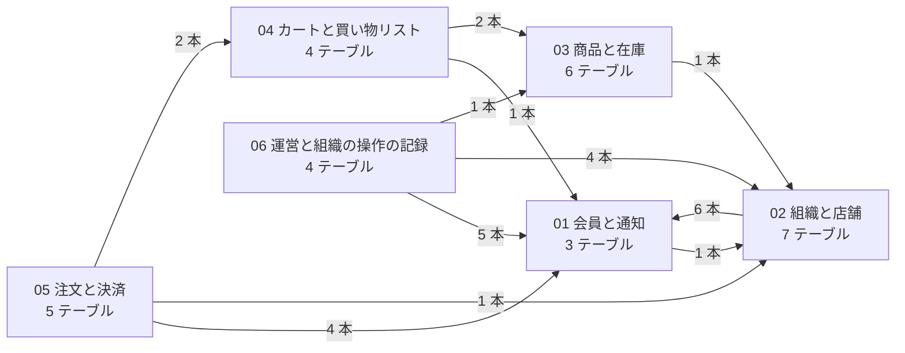
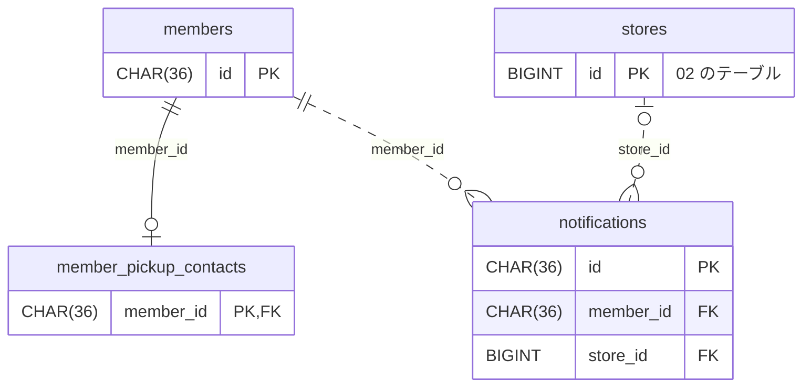
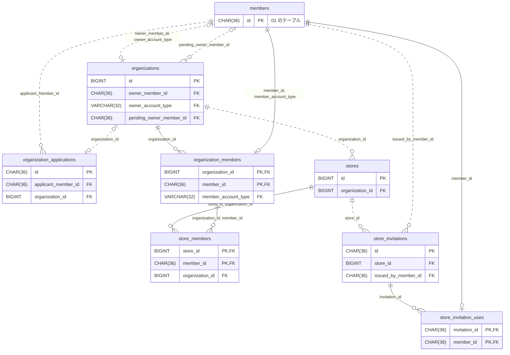
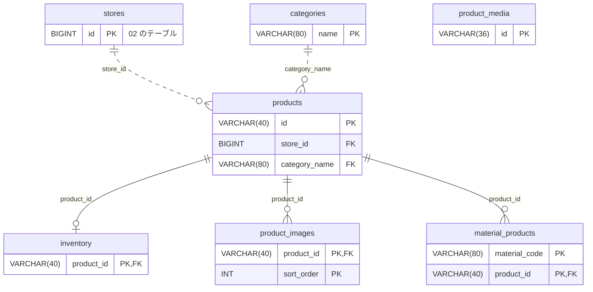
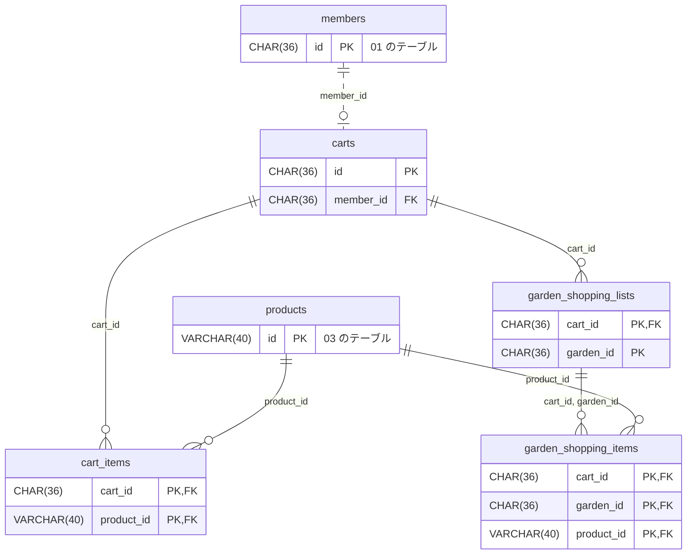
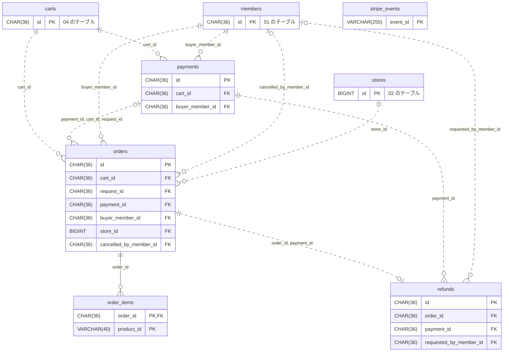
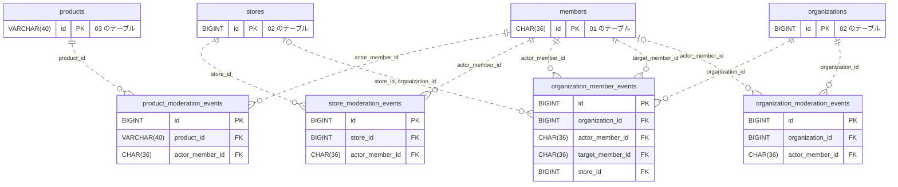

# 00 全体（kusakari-ec のテーブル設計図）

kusakari-ec の DB（MySQL）の 29 テーブルの全体図と一覧です。テーブルを 6 つのまとまりに分け、まとまりごとのファイルに、全列の ER 図と定義表を書いています。

| ファイル | まとまり | テーブルの数 |
| --- | --- | --- |
| [01_会員と通知](<01_会員と通知.md>) | 会員と、会員あての通知 | 3 |
| [02_組織と店舗](<02_組織と店舗.md>) | 出店する組織、出店申請、店舗、子アカウントの所属と担当、招待キー | 7 |
| [03_商品と在庫](<03_商品と在庫.md>) | カテゴリ、商品、在庫、画像、素材コードと商品の対応 | 6 |
| [04_カートと買い物リスト](<04_カートと買い物リスト.md>) | カート、庭の買い物リストの EC 追加分 | 4 |
| [05_注文と決済](<05_注文と決済.md>) | 注文、決済、Stripe の通知、返金 | 5 |
| [06_運営と組織の操作の記録](<06_運営と組織の操作の記録.md>) | 運営者による警告・停止の履歴、組織の中の操作の記録 | 4 |

## 対象のコード

- kusakari-ec の main、コミット 19a2be3（2026-11-20 時点）です。
- テーブル定義の正は、`backend/src/main/resources/db/migration` の Flyway のマイグレーション V1〜V6 です。すべてを順に当てた後の形を書いています。

| マイグレーション | テーブルへの変更 |
| --- | --- |
| [V1__schema.sql](https://github.com/abeouga/kusakari-ec/blob/19a2be307ee71a2cd87e538236c3c8c42929c5b3/backend/src/main/resources/db/migration/V1__schema.sql) | 27 テーブルを作ります。 |
| [V2__sample_data.sql](https://github.com/abeouga/kusakari-ec/blob/19a2be307ee71a2cd87e538236c3c8c42929c5b3/backend/src/main/resources/db/migration/V2__sample_data.sql) | サンプルデータを入れるだけで、テーブルの形は変えません。`organizations`、`stores`、`categories`、`products`、`inventory`、`material_products` に行を入れ、`products` の 4 行を `UPDATE` します。 |
| [V3__organization_moderation_events.sql](https://github.com/abeouga/kusakari-ec/blob/19a2be307ee71a2cd87e538236c3c8c42929c5b3/backend/src/main/resources/db/migration/V3__organization_moderation_events.sql) | `organization_moderation_events` を作ります。 |
| [V4__organization_member_events.sql](https://github.com/abeouga/kusakari-ec/blob/19a2be307ee71a2cd87e538236c3c8c42929c5b3/backend/src/main/resources/db/migration/V4__organization_member_events.sql) | `organization_members` に `expelled` を足し、`organization_member_events` を作ります。 |
| [V5__notification_kind.sql](https://github.com/abeouga/kusakari-ec/blob/19a2be307ee71a2cd87e538236c3c8c42929c5b3/backend/src/main/resources/db/migration/V5__notification_kind.sql) | `notifications` に `kind`・`store_id` と、その索引・CHECK・外部キーを足します。担当者あての既存の通知を店舗あてに書き換えます（データの更新）。 |
| [V6__owner_succession.sql](https://github.com/abeouga/kusakari-ec/blob/19a2be307ee71a2cd87e538236c3c8c42929c5b3/backend/src/main/resources/db/migration/V6__owner_succession.sql) | `organizations` に `pending_owner_member_id`・`pending_owner_expires_at` と CHECK・外部キーを足します。`organization_member_events.event_type` を `VARCHAR(40)` に広げ、種類の CHECK を作り直します。`notifications` に `category` と CHECK を足します。 |

- 比べた文書は、EC リポジトリの [docs/database-er.md](https://github.com/abeouga/kusakari-ec/blob/19a2be307ee71a2cd87e538236c3c8c42929c5b3/docs/database-er.md)（今の ER 図）と docs/decisions/ です。食い違いは、下の「docs/database-er.md との差」に書いています。
- テーブルに対応する Entity のクラスの図は [クラス図/kusakari-ec](<../../クラス図/kusakari-ec>) にあります。どのテーブルがどのクラスかは、まとまりごとのファイルに書いています。

## 凡例

このファイルの ER 図は、主キーと外部キーの列だけを載せ、キーの印も `PK` と `FK` だけを付けます。全部の列と一意制約は、まとまりごとのファイルにあります。

| 書き方 | 意味 |
| --- | --- |
| `型 列名 キー` | 1 つの列です。型はマイグレーションの表記のまま書きます（例 `CHAR(36)`）。 |
| 主キーの列だけで、説明に「〜 のテーブル」とあるテーブル | ほかのまとまりのテーブルです。 |
| 実線 | 外部キーの列が、子（外部キーを持つ側）の主キーに入っている関係です。 |
| 点線 | 外部キーの列が、子の主キーに入っていない関係です。 |
| 線のラベル | 外部キーの列名です。複合外部キーは、列をすべて書きます。 |

多重度は、線の両端の記号で表します。親は参照される側、子は外部キーを持つ側です。

- `||`: ちょうど 1 です。親の側に付け、外部キーの列が NOT NULL のときに使います。
- `|o`（右の端では `o|`）: 0 か 1 です。親の側では、外部キーの列が NULL を許すときに使います。子の側では、外部キーの列に一意制約か主キーがあるときに使います。
- `}o`（右の端では `o{`）: 0 以上です。子の側で、外部キーの列が一意でないときに使います。
- 「子が 1 行以上ある」ことは DB の制約で守っていないので、`|{` は使いません。
- 複合外部キーの列に NULL を許す列が 1 つでもあるときは、親の側を「0 か 1」にします（MySQL は、外部キーの列のどれかが NULL の行を確かめません）。

「まとまりの間の関係」の図では、箱が 1 つのまとまり、矢印が「外部キーを持つまとまり → 参照されるまとまり」、ラベルが外部キーの本数です。

## テーブルの一覧

| テーブル | まとまり | 説明 | 定義 |
| --- | --- | --- | --- |
| `members` | 01 | 会員です。Cognito のユーザーと 1 対 1 で、会員の種別を持ちます。 | [01_会員と通知](<01_会員と通知.md#members>) |
| `member_pickup_contacts` | 01 | 会員が保存した店舗受け取りの連絡先です。お会計で注文へ写します。 | [01_会員と通知](<01_会員と通知.md#member_pickup_contacts>) |
| `notifications` | 01 | 会員あての通知です。本人あてと店舗あてがあります。 | [01_会員と通知](<01_会員と通知.md#notifications>) |
| `organizations` | 02 | 出店する組織です。出店申請の承認で作り、オーナーを 1 人持ちます。 | [02_組織と店舗](<02_組織と店舗.md#organizations>) |
| `organization_applications` | 02 | 出店申請です。1 人につき今の申請と前回の申請の 2 行までです。 | [02_組織と店舗](<02_組織と店舗.md#organization_applications>) |
| `organization_members` | 02 | 組織に所属する子アカウントと、組織の人事のロールです。 | [02_組織と店舗](<02_組織と店舗.md#organization_members>) |
| `stores` | 02 | 組織の店舗です。公開・運営者による停止・閉鎖の状態を持ちます。 | [02_組織と店舗](<02_組織と店舗.md#stores>) |
| `store_members` | 02 | 店舗の担当と、店舗の操作のロールです。 | [02_組織と店舗](<02_組織と店舗.md#store_members>) |
| `store_invitations` | 02 | 店舗の招待キーです。キーのハッシュだけを持ちます。 | [02_組織と店舗](<02_組織と店舗.md#store_invitations>) |
| `store_invitation_uses` | 02 | 招待キーを使って登録した人です。 | [02_組織と店舗](<02_組織と店舗.md#store_invitation_uses>) |
| `categories` | 03 | 商品カテゴリです。 | [03_商品と在庫](<03_商品と在庫.md#categories>) |
| `products` | 03 | 商品です。1 つの店舗に属します。 | [03_商品と在庫](<03_商品と在庫.md#products>) |
| `inventory` | 03 | 商品ごとの在庫数と、出店者による公開状態です。 | [03_商品と在庫](<03_商品と在庫.md#inventory>) |
| `product_images` | 03 | 商品の画像の URL の並びです。 | [03_商品と在庫](<03_商品と在庫.md#product_images>) |
| `product_media` | 03 | 出店者がアップロードした商品画像の中身です。 | [03_商品と在庫](<03_商品と在庫.md#product_media>) |
| `material_products` | 03 | 素材コード（Canvas の庭の買い物リストなどで使う）と商品の対応です。 | [03_商品と在庫](<03_商品と在庫.md#material_products>) |
| `carts` | 04 | 会員ごとのカートです（1 人に 1 つ）。 | [04_カートと買い物リスト](<04_カートと買い物リスト.md#carts>) |
| `cart_items` | 04 | カートの明細です。 | [04_カートと買い物リスト](<04_カートと買い物リスト.md#cart_items>) |
| `garden_shopping_lists` | 04 | カートと Canvas の庭の組ごとの、EC 追加分の版です。 | [04_カートと買い物リスト](<04_カートと買い物リスト.md#garden_shopping_lists>) |
| `garden_shopping_items` | 04 | EC の商品カードから庭の買い物リストへ足した商品です。 | [04_カートと買い物リスト](<04_カートと買い物リスト.md#garden_shopping_items>) |
| `orders` | 05 | 店舗ごとの注文です。お会計 1 回で、受取店舗ごとに 1 件作ります。 | [05_注文と決済](<05_注文と決済.md#orders>) |
| `order_items` | 05 | 注文の明細です。注文したときの商品番号・名前・単価を写します。 | [05_注文と決済](<05_注文と決済.md#order_items>) |
| `payments` | 05 | お会計 1 回のカード決済（Stripe の PaymentIntent）です。 | [05_注文と決済](<05_注文と決済.md#payments>) |
| `stripe_events` | 05 | 処理した Stripe の通知（Webhook）の記録です。 | [05_注文と決済](<05_注文と決済.md#stripe_events>) |
| `refunds` | 05 | 注文 1 件の返金（Stripe の Refund）です。 | [05_注文と決済](<05_注文と決済.md#refunds>) |
| `product_moderation_events` | 06 | 運営者による商品の警告・警告解除・停止・再開の履歴です。 | [06_運営と組織の操作の記録](<06_運営と組織の操作の記録.md#product_moderation_events>) |
| `store_moderation_events` | 06 | 運営者による店舗の警告・警告解除・停止・再開の履歴です。 | [06_運営と組織の操作の記録](<06_運営と組織の操作の記録.md#store_moderation_events>) |
| `organization_moderation_events` | 06 | 組織の受付停止・停止・再開の履歴です。 | [06_運営と組織の操作の記録](<06_運営と組織の操作の記録.md#organization_moderation_events>) |
| `organization_member_events` | 06 | 店舗の担当の出入り、組織からの除名・復帰、オーナーの譲渡の記録です。 | [06_運営と組織の操作の記録](<06_運営と組織の操作の記録.md#organization_member_events>) |

外部キーは全部で 48 本です。そのうち 28 本が、まとまりをまたぎます。

## まとまりの間の関係

まとまりをまたぐ外部キーは次の 28 本です。

| 外部キーを持つまとまり | 参照する列 | 制約名 | 参照先 |
| --- | --- | --- | --- |
| 01 | `notifications.store_id` | `fk_notifications_store` | 02 `stores (id)` |
| 02 | `organizations.owner_member_id`, `owner_account_type` | `fk_organizations_owner` | 01 `members (id, account_type)` |
| 02 | `organizations.pending_owner_member_id` | `fk_organizations_pending_owner` | 01 `members (id)` |
| 02 | `organization_applications.applicant_member_id` | `fk_applications_applicant` | 01 `members (id)` |
| 02 | `organization_members.member_id`, `member_account_type` | `fk_org_members_member` | 01 `members (id, account_type)` |
| 02 | `store_invitations.issued_by_member_id` | `fk_invitations_issuer` | 01 `members (id)` |
| 02 | `store_invitation_uses.member_id` | `fk_invitation_uses_member` | 01 `members (id)` |
| 03 | `products.store_id` | `fk_products_store` | 02 `stores (id)` |
| 04 | `carts.member_id` | `fk_carts_member` | 01 `members (id)` |
| 04 | `cart_items.product_id` | `fk_cart_items_product` | 03 `products (id)` |
| 04 | `garden_shopping_items.product_id` | `fk_garden_items_product` | 03 `products (id)` |
| 05 | `payments.buyer_member_id` | `fk_payments_buyer` | 01 `members (id)` |
| 05 | `orders.buyer_member_id` | `fk_orders_buyer` | 01 `members (id)` |
| 05 | `orders.cancelled_by_member_id` | `fk_orders_cancelled_by` | 01 `members (id)` |
| 05 | `refunds.requested_by_member_id` | `fk_refunds_requested_by` | 01 `members (id)` |
| 05 | `orders.store_id` | `fk_orders_store` | 02 `stores (id)` |
| 05 | `payments.cart_id` | `fk_payments_cart` | 04 `carts (id)` |
| 05 | `orders.cart_id` | `fk_orders_cart` | 04 `carts (id)` |
| 06 | `product_moderation_events.actor_member_id` | `fk_product_moderation_actor` | 01 `members (id)` |
| 06 | `store_moderation_events.actor_member_id` | `fk_store_moderation_actor` | 01 `members (id)` |
| 06 | `organization_moderation_events.actor_member_id` | `fk_organization_moderation_actor` | 01 `members (id)` |
| 06 | `organization_member_events.actor_member_id` | `fk_org_member_events_actor` | 01 `members (id)` |
| 06 | `organization_member_events.target_member_id` | `fk_org_member_events_target` | 01 `members (id)` |
| 06 | `store_moderation_events.store_id` | `fk_store_moderation_store` | 02 `stores (id)` |
| 06 | `organization_moderation_events.organization_id` | `fk_organization_moderation_org` | 02 `organizations (id)` |
| 06 | `organization_member_events.organization_id` | `fk_org_member_events_org` | 02 `organizations (id)` |
| 06 | `organization_member_events.store_id`, `organization_id` | `fk_org_member_events_store` | 02 `stores (id, organization_id)` |
| 06 | `product_moderation_events.product_id` | `fk_product_moderation_product` | 03 `products (id)` |

## まとまりごとの ER 図（主キーと外部キーだけ）

### 01 会員と通知

### 02 組織と店舗

`organizations.owner_account_type` と `organization_members.member_account_type` は、`members (id, account_type)` を参照する複合外部キーの列です。参照先の `members.account_type` は主キーでも外部キーでもないので、この図には載せていません（[01_会員と通知](<01_会員と通知.md#members>) にあります）。

### 03 商品と在庫

### 04 カートと買い物リスト

### 05 注文と決済

`order_items.product_id` は商品 ID の値を持ちますが、外部キーはありません。

### 06 運営と組織の操作の記録

## Canvas の DB とのつながり

EC と Canvas は別の DB です。DB をまたぐ外部キーはなく、次の列に同じ値が入ることで対応します。値が合っていることは、DB ではなくアプリが API で確かめます。詳しくは [04_カートと買い物リスト](<04_カートと買い物リスト.md>) の「Canvas の DB との対応」にあります。

| EC の列 | Canvas の列 | 対応 |
| --- | --- | --- |
| `members.id` CHAR(36) | `gardens.owner_id` VARCHAR(128) | Canvas の庭の持ち主は、EC の会員 ID です。Canvas は、EC の `GET /api/auth/me`（書き込みでは `POST /api/auth/verify`）が返す会員 ID を持ち主に使います（Canvas の [auth.py](https://github.com/abeouga/kusakari-canvas/blob/c19d497dfef15b119f9bce8ecb5c886a36da6b7d/backend/kusakari_canvas_api/auth.py)）。 |
| `garden_shopping_lists.garden_id`、`garden_shopping_items.garden_id` CHAR(36) | `gardens.id` CHAR(36) | EC 追加分を持つ庭です。 |
| `products.id` VARCHAR(40) | `placed_objects.product_id` VARCHAR(40) | 庭に配置した EC の商品です。 |
| `material_products.material_code` VARCHAR(80) | `placed_objects.material_code` VARCHAR(80) | 素材コードです。Canvas の買い物リストの `materialCode` を、EC が商品の候補に変えます。 |

Canvas 側の列は、kusakari-canvas の main、コミット c19d497（2026-11-20 時点）の Alembic のマイグレーションで確かめています。

## docs/database-er.md との差

[docs/database-er.md](https://github.com/abeouga/kusakari-ec/blob/19a2be307ee71a2cd87e538236c3c8c42929c5b3/docs/database-er.md) は、テーブル（29 個）・列・制約の名前と型では、マイグレーションと食い違いません。次の点が違います。この設計図は、マイグレーションとコードを正としています。

| 項目 | docs/database-er.md | この設計図 | 書いたファイル |
| --- | --- | --- | --- |
| 商品と在庫の多重度 | どの商品にも在庫が 1 行ある（ちょうど 1 対 ちょうど 1）としています。 | 在庫の行が必ずあることは DB で守っていないので、在庫の側を 0 か 1 にしています。 | [03_商品と在庫](<03_商品と在庫.md>) |
| 注文と明細の多重度 | どの注文にも明細が 1 行以上あるとしています。 | 明細が必ずあることは DB で守っていないので、明細の側を 0 以上にしています。 | [05_注文と決済](<05_注文と決済.md>) |
| Canvas の DB とのつながり | `members.id`、`products.id`、`garden_shopping_lists.garden_id` の 3 つだけ | `material_products.material_code` と Canvas の素材コードのつながりも書いています（`ShoppingService.resolve`）。 | [04_カートと買い物リスト](<04_カートと買い物リスト.md>) |
| `organization_member_events` から `members` への線 | 2 本の外部キーを 1 本の線で描いています。 | 外部キーごとに 1 本の線にしています。 | [06_運営と組織の操作の記録](<06_運営と組織の操作の記録.md>) |
| 型 | 長さを省いています（例 `varchar`）。 | マイグレーションの型をそのまま書いています（例 `VARCHAR(255)`）。 | すべて |
| 一意制約の印 | 一部の列（`stores.id`、`products.sku`、`orders.request_id` など）に付けていません。 | 一意制約に入る列すべてに `UK` を付けています。 | 01、02、03、05 |
| 線の種類 | すべて実線です。 | 外部キーの列が子の主キーに入らない関係を点線にしています。 | すべて |

## 確かめられなかったこと

- マイグレーションは読んだだけで、DB に当てて確かめてはいません。MySQL が外部キーのために自動で作る索引の有無と名前は確かめていません。
- 列ごとの確かめられなかったことは、まとまりごとのファイルに書いています（[01_会員と通知](<01_会員と通知.md>)、[03_商品と在庫](<03_商品と在庫.md>)）。
