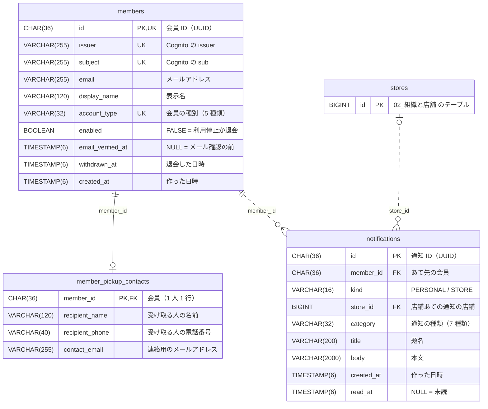

# 01 会員と通知（kusakari-ec のテーブル設計図）

kusakari-ec の DB のうち、会員と通知のまとまり（`members`、`member_pickup_contacts`、`notifications`）の設計図です。29 テーブル全体の図と一覧は [00_全体](<00_全体.md>) にあります。

## 対象のコード

- kusakari-ec の main、コミット 19a2be3（2026-11-20 時点）です。
- 元にしたマイグレーションは次のとおりです。V2（サンプルデータ）は、このまとまりのテーブルに行を入れず、形も変えません。
  - [V1__schema.sql の members](https://github.com/abeouga/kusakari-ec/blob/19a2be307ee71a2cd87e538236c3c8c42929c5b3/backend/src/main/resources/db/migration/V1__schema.sql#L5-L22)、[member_pickup_contacts](https://github.com/abeouga/kusakari-ec/blob/19a2be307ee71a2cd87e538236c3c8c42929c5b3/backend/src/main/resources/db/migration/V1__schema.sql#L24-L31)、[notifications](https://github.com/abeouga/kusakari-ec/blob/19a2be307ee71a2cd87e538236c3c8c42929c5b3/backend/src/main/resources/db/migration/V1__schema.sql#L33-L43): 3 つのテーブルを作ります。
  - [V5__notification_kind.sql](https://github.com/abeouga/kusakari-ec/blob/19a2be307ee71a2cd87e538236c3c8c42929c5b3/backend/src/main/resources/db/migration/V5__notification_kind.sql): `notifications` に `kind`・`store_id` と、その索引・CHECK・外部キーを足します。あわせて、担当者（`SHOP_STAFF`）あての既存の通知の `kind` を `STORE` に書き換えます（データの更新）。
  - [V6__owner_succession.sql](https://github.com/abeouga/kusakari-ec/blob/19a2be307ee71a2cd87e538236c3c8c42929c5b3/backend/src/main/resources/db/migration/V6__owner_succession.sql#L28-L33): `notifications` に `category` と CHECK を足します。
- 比べた文書は、EC リポジトリの [docs/database-er.md](https://github.com/abeouga/kusakari-ec/blob/19a2be307ee71a2cd87e538236c3c8c42929c5b3/docs/database-er.md) です。

## このまとまりの役割

- `members` は会員です。Cognito のユーザー（`issuer` と `subject` の組）と 1 対 1 で、会員の種別（`account_type`）を持ちます。ほかのまとまりの多くのテーブルが、この `id` を参照します。Canvas の庭の持ち主（Canvas の `gardens.owner_id`）にも、この `id` が入ります。
- `member_pickup_contacts` は、会員が保存した店舗受け取りの連絡先です。お会計のとき、注文（[05_注文と決済](<05_注文と決済.md>) の `orders`）へ写します。
- `notifications` は会員あての通知です。本人あて（`PERSONAL`）と店舗あて（`STORE`）があります。

対応する Entity は次のとおりです。クラスの図は、表の「クラス図」の列のファイルにあります。

| テーブル | Entity | クラス図 |
| --- | --- | --- |
| `members` | [AuthMember](https://github.com/abeouga/kusakari-ec/blob/19a2be307ee71a2cd87e538236c3c8c42929c5b3/backend/src/main/java/jp/kusakari/ec/auth/AuthMember.java) | [01_共通と認証と会員](<../../クラス図/kusakari-ec/01_共通と認証と会員.md>) |
| `member_pickup_contacts` | [PickupContactEntity](https://github.com/abeouga/kusakari-ec/blob/19a2be307ee71a2cd87e538236c3c8c42929c5b3/backend/src/main/java/jp/kusakari/ec/member/persistence/entity/PickupContactEntity.java) | [01_共通と認証と会員](<../../クラス図/kusakari-ec/01_共通と認証と会員.md>) |
| `notifications` | [NotificationEntity](https://github.com/abeouga/kusakari-ec/blob/19a2be307ee71a2cd87e538236c3c8c42929c5b3/backend/src/main/java/jp/kusakari/ec/notification/persistence/entity/NotificationEntity.java) | [07_通知と運営の記録](<../../クラス図/kusakari-ec/07_通知と運営の記録.md>) |

## 凡例

ER 図の書き方です。

| 書き方 | 意味 |
| --- | --- |
| `型 列名 キー "説明"` | 1 つの列です。型はマイグレーションの表記のまま書きます（例 `VARCHAR(255)`）。 |
| `PK`、`FK`、`UK` | 主キー、外部キー、一意制約に入る列です。どの一意制約かは、説明か定義表に書きます。 |
| 主キーの列だけのテーブル | ほかのまとまりのテーブルです。列の定義は、本文のリンク先のファイルにあります。 |
| 実線 | 外部キーの列が、子（外部キーを持つ側）の主キーに入っている関係です。 |
| 点線 | 外部キーの列が、子の主キーに入っていない関係です。 |
| 線のラベル | 外部キーの列名です。複合外部キーは、列をすべて書きます。 |

多重度は、線の両端の記号で表します。親は参照される側、子は外部キーを持つ側です。

- `||`: ちょうど 1 です。親の側に付け、外部キーの列が NOT NULL のときに使います。
- `|o`（右の端では `o|`）: 0 か 1 です。親の側では、外部キーの列が NULL を許すときに使います。子の側では、外部キーの列に一意制約か主キーがあるときに使います。
- `}o`（右の端では `o{`）: 0 以上です。子の側で、外部キーの列が一意でないときに使います。
- 「子が 1 行以上ある」ことは DB の制約で守っていないので、`|{` は使いません。

定義表の書き方です。

- NULL の「不可」は NOT NULL、「可」は NULL を許す列です。
- 初期値はマイグレーションの DEFAULT です。「—」は DEFAULT の指定が無い列です（NULL を許す列は NULL になります）。
- 主キーの名前は、MySQL では常に `PRIMARY` です。
- 索引は、マイグレーションに書いたものだけを載せます。外部キーの列で始まる索引が無いときは、MySQL が外部キーと同じ名前の索引を自動で作ります。
- 外部キーの「指定なし」は、ON DELETE・ON UPDATE を書いていないことです。MySQL の既定（NO ACTION）になり、InnoDB では RESTRICT と同じく、子から参照されている親の行の削除と、参照されている列の値の変更を拒否します。
- `BINARY` を付けた CHECK は、大文字・小文字と空白を区別して比べます。一覧の値と完全に同じ文字列だけが通ります。
- どのテーブルも `ENGINE=InnoDB`、`DEFAULT CHARSET=utf8mb4` です。

## ER 図

`stores` の列は [02_組織と店舗](<02_組織と店舗.md#stores>) にあります。

## テーブル定義

### members

会員です。会員を作るのは次の 3 か所で、`id` には `AuthMember` が作った UUID が入ります。

- 購入者が初めてログインしたとき（`AuthService.provision`、種別 `USER`）
- 企業様向けの登録をしたとき（`AuthService.registerApplicant`、種別 `SHOP_OWNER_APPLICANT`）
- 招待キーで登録したとき（`StoreInvitationService.register`、種別 `SHOP_STAFF`）

退会しても行は消さず、`enabled` を FALSE にして `withdrawn_at` を入れます（`AuthMember.withdraw`）。

| 列名 | 型 | NULL | 初期値 | キー | 説明 |
| --- | --- | --- | --- | --- | --- |
| `id` | CHAR(36) | 不可 | — | PK、UK | 会員 ID（UUID）。`uk_members_id_type` にも入ります。 |
| `issuer` | VARCHAR(255) | 不可 | — | UK | Cognito のユーザープールの issuer です。`subject` と組で会員を探します（`findByIssuerAndSubject`）。 |
| `subject` | VARCHAR(255) | 不可 | — | UK | Cognito のユーザーの sub です。 |
| `email` | VARCHAR(255) | 不可 | — | | メールアドレスです。 |
| `display_name` | VARCHAR(120) | 不可 | — | | 表示名です。購入者は ID トークンの氏名（無ければメールアドレス）、企業様向けの登録と招待キーの登録ではメールアドレスを、120 文字までに切って入れます。 |
| `account_type` | VARCHAR(32) | 不可 | — | UK | 会員の種別です。値は下の表のとおりです。`uk_members_id_type` に入ります。 |
| `enabled` | BOOLEAN | 不可 | TRUE | | FALSE なら Kusakari を使えません（`AuthService.current` が 403 `ACCOUNT_DISABLED` を返します）。運営者による利用停止と、本人の退会で FALSE にします。 |
| `email_verified_at` | TIMESTAMP(6) | 可 | — | | メール確認が済んだ日時です。企業様向けの登録で作った会員は、確認が済むまで NULL です。 |
| `withdrawn_at` | TIMESTAMP(6) | 可 | — | | 退会した日時です。 |
| `created_at` | TIMESTAMP(6) | 不可 | CURRENT_TIMESTAMP(6) | | 作った日時です。DB が入れます（Entity では `insertable = false`）。 |

`account_type` の値（`ck_members_account_type` と `AuthMember` の定数）です。

| 値 | 意味 |
| --- | --- |
| `USER` | 購入者 |
| `SHOP_OWNER_APPLICANT` | 申請中の法人用アカウント。出店申請が承認されると `SHOP_OWNER` になります（`AuthMember.becomeOwner`）。 |
| `SHOP_OWNER` | 組織のオーナー。オーナーの譲渡では、譲渡先が `SHOP_OWNER` に、元のオーナーが `SHOP_STAFF` になります（`becomeOwner`、`becomeStaff`）。 |
| `SHOP_STAFF` | 子アカウント（担当者）。店舗ごとのロールは `store_members` が持ちます。 |
| `ADMIN` | 運営者 |

| 種類 | 名前 | 列 | 内容 |
| --- | --- | --- | --- |
| 主キー | `PRIMARY` | `id` | |
| 一意制約 | `uk_members_issuer_subject` | `issuer`, `subject` | Cognito のユーザー 1 人に会員 1 行です。 |
| 一意制約 | `uk_members_id_type` | `id`, `account_type` | 複合外部キー `fk_organizations_owner` と `fk_org_members_member` の参照先です。 |
| 索引 | `idx_members_issuer_email` | `issuer`, `email` | |
| CHECK | `ck_members_account_type` | `account_type` | `BINARY account_type IN ('USER','SHOP_OWNER_APPLICANT','SHOP_OWNER','SHOP_STAFF','ADMIN')` |

Entity は `AuthMember` で、すべての列を持ちます。

`members` を参照する外部キーは次の 18 本です。

| 参照する列 | 制約名 | 定義のファイル |
| --- | --- | --- |
| `member_pickup_contacts.member_id` | `fk_pickup_contacts_member` | このファイル |
| `notifications.member_id` | `fk_notifications_member` | このファイル |
| `organizations.owner_member_id`, `owner_account_type`（`id`, `account_type` を参照） | `fk_organizations_owner` | [02_組織と店舗](<02_組織と店舗.md#organizations>) |
| `organizations.pending_owner_member_id` | `fk_organizations_pending_owner` | [02_組織と店舗](<02_組織と店舗.md#organizations>) |
| `organization_applications.applicant_member_id` | `fk_applications_applicant` | [02_組織と店舗](<02_組織と店舗.md#organization_applications>) |
| `organization_members.member_id`, `member_account_type`（`id`, `account_type` を参照） | `fk_org_members_member` | [02_組織と店舗](<02_組織と店舗.md#organization_members>) |
| `store_invitations.issued_by_member_id` | `fk_invitations_issuer` | [02_組織と店舗](<02_組織と店舗.md#store_invitations>) |
| `store_invitation_uses.member_id` | `fk_invitation_uses_member` | [02_組織と店舗](<02_組織と店舗.md#store_invitation_uses>) |
| `carts.member_id` | `fk_carts_member` | [04_カートと買い物リスト](<04_カートと買い物リスト.md#carts>) |
| `payments.buyer_member_id` | `fk_payments_buyer` | [05_注文と決済](<05_注文と決済.md#payments>) |
| `orders.buyer_member_id` | `fk_orders_buyer` | [05_注文と決済](<05_注文と決済.md#orders>) |
| `orders.cancelled_by_member_id` | `fk_orders_cancelled_by` | [05_注文と決済](<05_注文と決済.md#orders>) |
| `refunds.requested_by_member_id` | `fk_refunds_requested_by` | [05_注文と決済](<05_注文と決済.md#refunds>) |
| `product_moderation_events.actor_member_id` | `fk_product_moderation_actor` | [06_運営と組織の操作の記録](<06_運営と組織の操作の記録.md#product_moderation_events>) |
| `store_moderation_events.actor_member_id` | `fk_store_moderation_actor` | [06_運営と組織の操作の記録](<06_運営と組織の操作の記録.md#store_moderation_events>) |
| `organization_moderation_events.actor_member_id` | `fk_organization_moderation_actor` | [06_運営と組織の操作の記録](<06_運営と組織の操作の記録.md#organization_moderation_events>) |
| `organization_member_events.actor_member_id` | `fk_org_member_events_actor` | [06_運営と組織の操作の記録](<06_運営と組織の操作の記録.md#organization_member_events>) |
| `organization_member_events.target_member_id` | `fk_org_member_events_target` | [06_運営と組織の操作の記録](<06_運営と組織の操作の記録.md#organization_member_events>) |

### member_pickup_contacts

会員が保存した、店舗受け取りの連絡先です。会員 1 人につき 1 行までです。画面からは `GET`・`PUT`・`DELETE /api/account/pickup-contact` で読み書きします（`MemberService`）。お会計のとき、この行の値を注文の `recipient_name`・`recipient_phone`・`contact_email` に写します（`DeliveryService.pickupDetails`）。行が無ければ空の文字列を写します。

| 列名 | 型 | NULL | 初期値 | キー | 説明 |
| --- | --- | --- | --- | --- | --- |
| `member_id` | CHAR(36) | 不可 | — | PK、FK | 会員です。 |
| `recipient_name` | VARCHAR(120) | 不可 | '' | | 受け取る人の名前です。 |
| `recipient_phone` | VARCHAR(40) | 不可 | '' | | 受け取る人の電話番号です。 |
| `contact_email` | VARCHAR(255) | 不可 | '' | | 連絡用のメールアドレスです。 |

| 種類 | 名前 | 列 | 内容 |
| --- | --- | --- | --- |
| 主キー | `PRIMARY` | `member_id` | |
| 外部キー | `fk_pickup_contacts_member` | `member_id` | → `members (id)`。ON DELETE・ON UPDATE は指定なし。 |

Entity は `PickupContactEntity` です。`@Column` の長さは `recipient_name` が 100、`recipient_phone` が 30、`contact_email` が 200 で、マイグレーションより短く書かれています。DB の長さはマイグレーションのとおりです。画面からの入力は、`MemberService` の検証で名前 100 文字まで、電話番号 30 文字までです。

### notifications

会員あての通知です。行は会員ごとに作ります。店舗あての通知は、店舗の組織のオーナーと、その店舗でロールが割り振られた担当者のうち、有効な会員に 1 行ずつ作ります（`NotificationService.toStore`）。一覧は `GET /api/notifications`、既読は `PUT /api/notifications/{id}/read` です。

担当者（`SHOP_STAFF`）が見られるのは、本人あての通知と、今担当している店舗の店舗あての通知だけです。`store_id` が NULL の店舗あての通知（V5 より前のもの）は、どこかの店舗を担当している間だけ見られます（`NotificationService` の `visibility`）。

| 列名 | 型 | NULL | 初期値 | キー | 説明 |
| --- | --- | --- | --- | --- | --- |
| `id` | CHAR(36) | 不可 | — | PK | 通知 ID（UUID）です。 |
| `member_id` | CHAR(36) | 不可 | — | FK | あて先の会員です。 |
| `kind` | VARCHAR(16) | 不可 | 'PERSONAL' | | `PERSONAL`（本人あて）か `STORE`（店舗あて）です。V5 で足しました。 |
| `store_id` | BIGINT | 可 | — | FK | 店舗あての通知の店舗です。本人あての通知では NULL です。V5 より前の店舗あての通知も NULL です。V5 で足しました。 |
| `category` | VARCHAR(32) | 不可 | 'GENERAL' | | 通知の種類です。値は下の表のとおりです。V6 より前の通知は `GENERAL` です。V6 で足しました。 |
| `title` | VARCHAR(200) | 不可 | — | | 題名です。 |
| `body` | VARCHAR(2000) | 不可 | — | | 本文です。 |
| `created_at` | TIMESTAMP(6) | 不可 | CURRENT_TIMESTAMP(6) | | 作った日時です。Entity が作るときの時刻を入れます。 |
| `read_at` | TIMESTAMP(6) | 可 | — | | 既読にした日時です。NULL なら未読です。 |

`category` の値（`ck_notifications_category` と `NotificationEntity` の定数）です。重要かどうかは DB に持たず、種類から画面が決めます。

| 値 | 使う通知 | 作る Service |
| --- | --- | --- |
| `ORDER` | 注文の受け付け、受取準備・引き渡し、キャンセルなど | `CheckoutService`、`PaymentService`、`OrderWorkflowService`、`OpenOrders` |
| `CANCEL_REQUEST` | キャンセル申請が届いたこと | `OrderWorkflowService` |
| `MODERATION` | 運営者による商品・店舗・組織の操作 | `ProductModerationService`、`StoreModerationService`、`OrganizationSuspensionService` |
| `STORE_CLOSURE` | 店舗の閉鎖 | `StoreClosureService` |
| `OWNER_SUCCESSION_REQUEST` | オーナーの譲渡の申し出 | `OwnerSuccessionNotices` |
| `OWNER_SUCCESSION_RESULT` | オーナーの譲渡の結果（承認・断り・取り消しなど） | `OwnerSuccessionNotices` |
| `GENERAL` | 出店申請の受け付けと審査の結果、店舗の担当から外れたこと | `StoreApplicationService`、`StaffAccountService` |

| 種類 | 名前 | 列 | 内容 |
| --- | --- | --- | --- |
| 主キー | `PRIMARY` | `id` | |
| 索引 | `idx_notifications_member` | `member_id`, `read_at`, `created_at` | |
| 索引 | `idx_notifications_store` | `store_id` | V5 で足しました。 |
| CHECK | `ck_notifications_kind` | `kind` | `BINARY kind IN ('PERSONAL','STORE')`（V5） |
| CHECK | `ck_notifications_store` | `kind`, `store_id` | `kind = 'STORE' OR store_id IS NULL`。本人あての通知は店舗を持てません（V5）。 |
| CHECK | `ck_notifications_category` | `category` | `BINARY category IN ('ORDER','CANCEL_REQUEST','MODERATION','STORE_CLOSURE','OWNER_SUCCESSION_REQUEST','OWNER_SUCCESSION_RESULT','GENERAL')`（V6） |
| 外部キー | `fk_notifications_member` | `member_id` | → `members (id)`。ON DELETE・ON UPDATE は指定なし。 |
| 外部キー | `fk_notifications_store` | `store_id` | → [`stores (id)`](<02_組織と店舗.md#stores>)。ON DELETE・ON UPDATE は指定なし（V5）。 |

Entity は `NotificationEntity` です。`kind`・`store_id`・`category` は `updatable = false` で、作った後は変えません。`@Column` の `body` の長さは 1000 で、マイグレーション（2000）より短く書かれています。DB の長さはマイグレーションのとおりです。

V5 は、列を足した後に `UPDATE notifications ... SET n.kind = 'STORE' WHERE m.account_type = 'SHOP_STAFF'` で、その時点で担当者あてだった通知を店舗あてにします。店舗は分からないので `store_id` は NULL のままです。

## docs/database-er.md との差

このまとまりの列・型・制約は、[docs/database-er.md](https://github.com/abeouga/kusakari-ec/blob/19a2be307ee71a2cd87e538236c3c8c42929c5b3/docs/database-er.md) の図と食い違いません。違うのは書き方だけです。

- docs/database-er.md の図は、型の長さを省いています（例 `varchar email`）。この文書は、マイグレーションの型をそのまま書いています。
- docs/database-er.md の図は、`members.id` を `PK` だけにし、`members.account_type` に印を付けていません（説明に「id, account_type で一意」と書いています）。この文書は、2 つとも `uk_members_id_type` に入るので、`PK, UK` と `UK` にしています。

## 確かめられなかったこと

- `idx_members_issuer_email`（`issuer`, `email`）を使う検索は、backend/src/main のコードに見つかりませんでした。何のための索引かは書いていません。
- マイグレーションは読んだだけで、DB に当てて確かめてはいません。MySQL が外部キーのために自動で作る索引の有無と名前は確かめていません。
