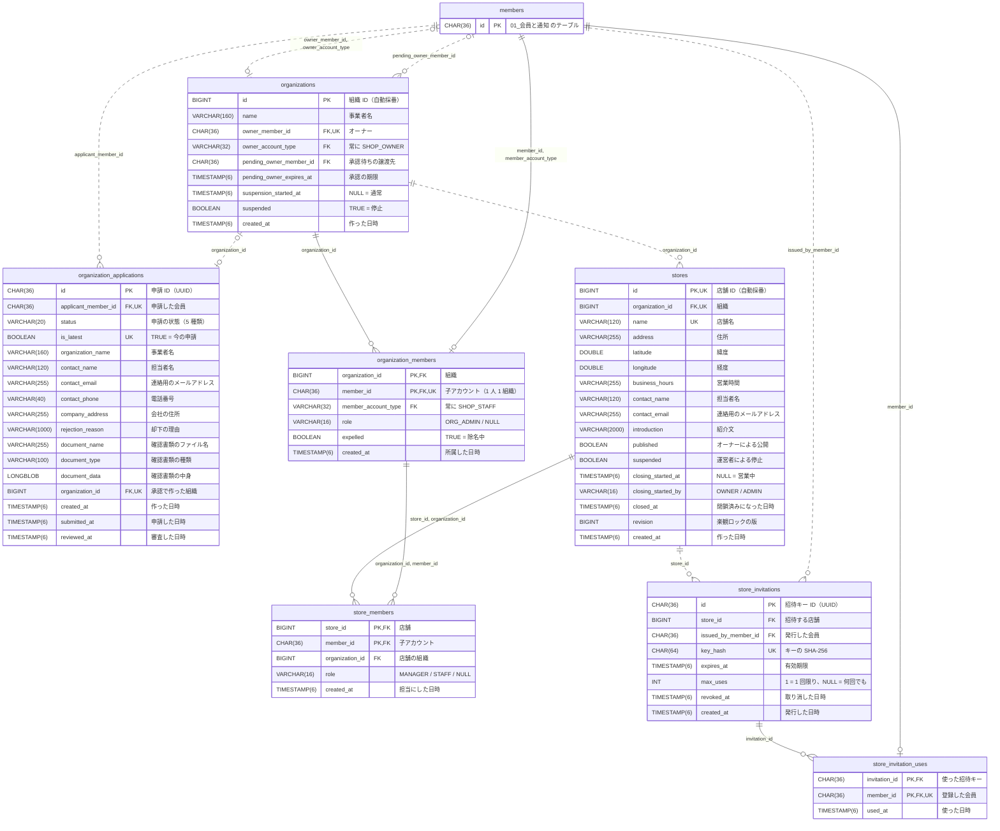

# 02 組織と店舗（kusakari-ec のテーブル設計図）

kusakari-ec の DB のうち、組織と店舗のまとまり（`organizations`、`organization_applications`、`organization_members`、`stores`、`store_members`、`store_invitations`、`store_invitation_uses`）の設計図です。29 テーブル全体の図と一覧は [00_全体](<00_全体.md>) にあります。

## 対象のコード

- kusakari-ec の main、コミット 19a2be3（2026-11-20 時点）です。
- 元にしたマイグレーションは次のとおりです。
  - V1__schema.sql の [organizations](https://github.com/abeouga/kusakari-ec/blob/19a2be307ee71a2cd87e538236c3c8c42929c5b3/backend/src/main/resources/db/migration/V1__schema.sql#L45-L60)、[organization_applications](https://github.com/abeouga/kusakari-ec/blob/19a2be307ee71a2cd87e538236c3c8c42929c5b3/backend/src/main/resources/db/migration/V1__schema.sql#L62-L90)、[organization_members](https://github.com/abeouga/kusakari-ec/blob/19a2be307ee71a2cd87e538236c3c8c42929c5b3/backend/src/main/resources/db/migration/V1__schema.sql#L92-L106)、[stores](https://github.com/abeouga/kusakari-ec/blob/19a2be307ee71a2cd87e538236c3c8c42929c5b3/backend/src/main/resources/db/migration/V1__schema.sql#L108-L135)、[store_members](https://github.com/abeouga/kusakari-ec/blob/19a2be307ee71a2cd87e538236c3c8c42929c5b3/backend/src/main/resources/db/migration/V1__schema.sql#L137-L150)、[store_invitations](https://github.com/abeouga/kusakari-ec/blob/19a2be307ee71a2cd87e538236c3c8c42929c5b3/backend/src/main/resources/db/migration/V1__schema.sql#L152-L168)、[store_invitation_uses](https://github.com/abeouga/kusakari-ec/blob/19a2be307ee71a2cd87e538236c3c8c42929c5b3/backend/src/main/resources/db/migration/V1__schema.sql#L171-L179): 7 つのテーブルを作ります。
  - [V2__sample_data.sql](https://github.com/abeouga/kusakari-ec/blob/19a2be307ee71a2cd87e538236c3c8c42929c5b3/backend/src/main/resources/db/migration/V2__sample_data.sql): サンプルの組織 1 つ（`id` = 1、オーナーなし）と、公開済みの店舗 3 つ（`id` = 1〜3）を入れます。テーブルの形は変えません。
  - [V4__organization_member_events.sql](https://github.com/abeouga/kusakari-ec/blob/19a2be307ee71a2cd87e538236c3c8c42929c5b3/backend/src/main/resources/db/migration/V4__organization_member_events.sql#L4-L5): `organization_members` に `expelled` を足します。
  - [V6__owner_succession.sql](https://github.com/abeouga/kusakari-ec/blob/19a2be307ee71a2cd87e538236c3c8c42929c5b3/backend/src/main/resources/db/migration/V6__owner_succession.sql#L6-L12): `organizations` に `pending_owner_member_id`・`pending_owner_expires_at` と、その CHECK・外部キーを足します。
- 比べた文書は、EC リポジトリの [docs/database-er.md](https://github.com/abeouga/kusakari-ec/blob/19a2be307ee71a2cd87e538236c3c8c42929c5b3/docs/database-er.md) です。

## このまとまりの役割

出店する事業者を「組織」として持ち、組織の店舗と、店舗で働く子アカウントを結び付けます。

- 法人用アカウント（`SHOP_OWNER_APPLICANT`）が出店申請（`organization_applications`）を出し、運営者が承認すると組織（`organizations`）を作ります。申請した人はその組織のオーナー（`SHOP_OWNER`）になります。
- 店舗（`stores`）は、承認の後にオーナーが作ります。
- 子アカウント（`SHOP_STAFF`）は、店舗の招待キー（`store_invitations`）で登録します。登録すると、組織への所属（`organization_members`）、店舗の担当（`store_members`、ロールなし）、キーの使用記録（`store_invitation_uses`）を 1 つのトランザクションで作ります（`StoreInvitationService.register`）。
- ロールは 2 種類です。組織の人事のロール（`organization_members.role`）と、店舗の操作のロール（`store_members.role`）です。
- オーナーは `organization_members` に入りません。組織とは `organizations.owner_member_id` で結び付きます。

担当者の操作の記録と、運営者による組織・店舗の操作の履歴は [06_運営と組織の操作の記録](<06_運営と組織の操作の記録.md>) にあります。

対応する Entity は次のとおりです。クラスの図は、表の「クラス図」の列のファイルにあります。

| テーブル | Entity | クラス図 |
| --- | --- | --- |
| `organizations` | [OrganizationEntity](https://github.com/abeouga/kusakari-ec/blob/19a2be307ee71a2cd87e538236c3c8c42929c5b3/backend/src/main/java/jp/kusakari/ec/store/persistence/entity/OrganizationEntity.java) | [02_店舗と組織](<../../クラス図/kusakari-ec/02_店舗と組織.md>) |
| `organization_applications` | [StoreApplicationEntity](https://github.com/abeouga/kusakari-ec/blob/19a2be307ee71a2cd87e538236c3c8c42929c5b3/backend/src/main/java/jp/kusakari/ec/store/persistence/entity/StoreApplicationEntity.java) | [02_店舗と組織](<../../クラス図/kusakari-ec/02_店舗と組織.md>) |
| `organization_members` | [OrganizationMemberEntity](https://github.com/abeouga/kusakari-ec/blob/19a2be307ee71a2cd87e538236c3c8c42929c5b3/backend/src/main/java/jp/kusakari/ec/store/persistence/entity/OrganizationMemberEntity.java)（主キーは `OrganizationMemberId`） | [02_店舗と組織](<../../クラス図/kusakari-ec/02_店舗と組織.md>) |
| `stores` | [StoreEntity](https://github.com/abeouga/kusakari-ec/blob/19a2be307ee71a2cd87e538236c3c8c42929c5b3/backend/src/main/java/jp/kusakari/ec/catalog/persistence/entity/StoreEntity.java)（パッケージは `catalog`） | [03_商品カタログ](<../../クラス図/kusakari-ec/03_商品カタログ.md>) |
| `store_members` | [StoreMemberEntity](https://github.com/abeouga/kusakari-ec/blob/19a2be307ee71a2cd87e538236c3c8c42929c5b3/backend/src/main/java/jp/kusakari/ec/store/persistence/entity/StoreMemberEntity.java)（主キーは `StoreMemberId`） | [02_店舗と組織](<../../クラス図/kusakari-ec/02_店舗と組織.md>) |
| `store_invitations` | [StoreInvitationEntity](https://github.com/abeouga/kusakari-ec/blob/19a2be307ee71a2cd87e538236c3c8c42929c5b3/backend/src/main/java/jp/kusakari/ec/store/persistence/entity/StoreInvitationEntity.java) | [02_店舗と組織](<../../クラス図/kusakari-ec/02_店舗と組織.md>) |
| `store_invitation_uses` | [StoreInvitationUseEntity](https://github.com/abeouga/kusakari-ec/blob/19a2be307ee71a2cd87e538236c3c8c42929c5b3/backend/src/main/java/jp/kusakari/ec/store/persistence/entity/StoreInvitationUseEntity.java)（主キーは `StoreInvitationUseId`） | [02_店舗と組織](<../../クラス図/kusakari-ec/02_店舗と組織.md>) |

## 凡例

ER 図の書き方です。

| 書き方 | 意味 |
| --- | --- |
| `型 列名 キー "説明"` | 1 つの列です。型はマイグレーションの表記のまま書きます（例 `VARCHAR(255)`）。 |
| `PK`、`FK`、`UK` | 主キー、外部キー、一意制約に入る列です。どの一意制約かは、説明か定義表に書きます。 |
| 主キーの列だけのテーブル | ほかのまとまりのテーブルです。列の定義は、本文のリンク先のファイルにあります。 |
| 実線 | 外部キーの列が、子（外部キーを持つ側）の主キーに入っている関係です。 |
| 点線 | 外部キーの列が、子の主キーに入っていない関係です。 |
| 線のラベル | 外部キーの列名です。複合外部キーは、列をすべて書きます。 |

多重度は、線の両端の記号で表します。親は参照される側、子は外部キーを持つ側です。

- `||`: ちょうど 1 です。親の側に付け、外部キーの列が NOT NULL のときに使います。
- `|o`（右の端では `o|`）: 0 か 1 です。親の側では、外部キーの列が NULL を許すときに使います。子の側では、外部キーの列に一意制約か主キーがあるときに使います。
- `}o`（右の端では `o{`）: 0 以上です。子の側で、外部キーの列が一意でないときに使います。
- 「子が 1 行以上ある」ことは DB の制約で守っていないので、`|{` は使いません。
- 複合外部キーの列に NULL を許す列が 1 つでもあるときは、親の側を「0 か 1」にします（MySQL は、外部キーの列のどれかが NULL の行を確かめません）。

定義表の書き方です。

- NULL の「不可」は NOT NULL、「可」は NULL を許す列です。
- 初期値はマイグレーションの DEFAULT です。「—」は DEFAULT の指定が無い列です（NULL を許す列は NULL になります）。
- 初期値の `AUTO_INCREMENT` は、MySQL が番号を振る列です。
- 主キーの名前は、MySQL では常に `PRIMARY` です。
- 索引は、マイグレーションに書いたものだけを載せます。外部キーの列で始まる索引が無いときは、MySQL が外部キーと同じ名前の索引を自動で作ります。
- 外部キーの「指定なし」は、ON DELETE・ON UPDATE を書いていないことです。MySQL の既定（NO ACTION）になり、InnoDB では RESTRICT と同じく、子から参照されている親の行の削除と、参照されている列の値の変更を拒否します。
- `BINARY` を付けた CHECK は、大文字・小文字と空白を区別して比べます。一覧の値と完全に同じ文字列だけが通ります。
- どのテーブルも `ENGINE=InnoDB`、`DEFAULT CHARSET=utf8mb4` です。

## ER 図

`members` の列は [01_会員と通知](<01_会員と通知.md#members>) にあります。`organizations` から `members` への 2 本の線は、オーナー（`fk_organizations_owner`）と承認待ちの譲渡先（`fk_organizations_pending_owner`）です。

## テーブル定義

### organizations

出店する組織です。出店申請の承認で作ります（`StoreApplicationService.decide`）。事業者名の正本はここだけに持ちます。状態は `suspension_started_at` と `suspended` の組で決まります（`OrganizationEntity.status`）。

| 状態 | `suspension_started_at` | `suspended` | 変わるとき |
| --- | --- | --- | --- |
| 通常（`ACTIVE`） | NULL | FALSE | 運営者が受付停止を取り消すか、停止から再開したとき（`resume`） |
| 受付停止中（`NOT_ACCEPTING`） | 日時あり | FALSE | 運営者が受付を止めたとき（`stopAccepting`）。配下のすべての店舗が新しい注文を受け付けません。 |
| 停止（`SUSPENDED`） | 日時あり | TRUE | 受付停止中で、未完了の注文がなくなったとき（`suspend`）。`ClosureSettlement` が、注文の状態が変わった後と 1 分ごとの定期処理で確かめます。 |

| 列名 | 型 | NULL | 初期値 | キー | 説明 |
| --- | --- | --- | --- | --- | --- |
| `id` | BIGINT | 不可 | AUTO_INCREMENT | PK | 組織 ID です。 |
| `name` | VARCHAR(160) | 不可 | — | | 事業者名です。承認した申請の `organization_name` を入れます。 |
| `owner_member_id` | CHAR(36) | 可 | — | FK、UK | オーナーの会員です。NULL は V2 のサンプルの組織だけです。オーナーの譲渡の承認で付け替えます（`changeOwner`）。 |
| `owner_account_type` | VARCHAR(32) | 不可 | 'SHOP_OWNER' | FK | 複合外部キー `fk_organizations_owner` のための固定値の列です。CHECK で `SHOP_OWNER` に限るので、オーナーは種別が `SHOP_OWNER` の会員だけです。 |
| `pending_owner_member_id` | CHAR(36) | 可 | — | FK | オーナーの譲渡で、承認を待っている譲渡先です。申し出が無ければ NULL です。V6 で足しました。 |
| `pending_owner_expires_at` | TIMESTAMP(6) | 可 | — | | 譲渡の承認の期限です。申し出た時刻の 30 分後です。譲渡先と一緒に NULL になります。期限を過ぎた申し出は、次の操作のときに見つけて NULL に戻します。V6 で足しました。 |
| `suspension_started_at` | TIMESTAMP(6) | 可 | — | | 運営者が受付を止めた日時です。NULL なら通常です。 |
| `suspended` | BOOLEAN | 不可 | FALSE | | TRUE なら停止です。 |
| `created_at` | TIMESTAMP(6) | 不可 | CURRENT_TIMESTAMP(6) | | 作った日時です。DB が入れます。 |

| 種類 | 名前 | 列 | 内容 |
| --- | --- | --- | --- |
| 主キー | `PRIMARY` | `id` | |
| 一意制約 | `uk_organizations_owner` | `owner_member_id` | 1 人が 2 つの組織のオーナーになれません。 |
| CHECK | `ck_organizations_suspension` | `suspended`, `suspension_started_at` | `suspended = FALSE OR suspension_started_at IS NOT NULL`。受付停止を経ずに停止にできません。 |
| CHECK | `ck_organizations_owner_type` | `owner_account_type` | `BINARY owner_account_type = 'SHOP_OWNER'` |
| CHECK | `ck_organizations_pending_owner` | `pending_owner_member_id`, `pending_owner_expires_at` | `(pending_owner_member_id IS NULL) = (pending_owner_expires_at IS NULL)`。2 つは両方 NULL か、両方値ありです（V6）。 |
| 外部キー | `fk_organizations_owner` | `owner_member_id`, `owner_account_type` | → [`members (id, account_type)`](<01_会員と通知.md#members>)。ON DELETE・ON UPDATE は指定なし。オーナーである間は、その会員の種別を変えられません。 |
| 外部キー | `fk_organizations_pending_owner` | `pending_owner_member_id` | → [`members (id)`](<01_会員と通知.md#members>)。ON DELETE・ON UPDATE は指定なし（V6）。 |

Entity は `OrganizationEntity` です。`owner_account_type` と `created_at` は Entity に無く、DB の初期値が入ります。

`organizations` を参照する外部キーは次の 5 本です。

| 参照する列 | 制約名 | 定義のファイル |
| --- | --- | --- |
| `organization_applications.organization_id` | `fk_applications_organization` | このファイル |
| `organization_members.organization_id` | `fk_org_members_org` | このファイル |
| `stores.organization_id` | `fk_stores_org` | このファイル |
| `organization_moderation_events.organization_id` | `fk_organization_moderation_org` | [06_運営と組織の操作の記録](<06_運営と組織の操作の記録.md#organization_moderation_events>) |
| `organization_member_events.organization_id` | `fk_org_member_events_org` | [06_運営と組織の操作の記録](<06_運営と組織の操作の記録.md#organization_member_events>) |

### organization_applications

出店申請です。1 人につき「今の申請」（`is_latest` = TRUE）と「前回の申請」（`is_latest` = FALSE）の 2 行まで持ちます。再申請では、前々回の申請の行を消し、今の申請を前回の申請にしてから、新しい申請を作ります（`StoreApplicationService`）。運営者が審査し、承認すると組織を作って `organization_id` を入れます。

| 列名 | 型 | NULL | 初期値 | キー | 説明 |
| --- | --- | --- | --- | --- | --- |
| `id` | CHAR(36) | 不可 | — | PK | 申請 ID（UUID）です。 |
| `applicant_member_id` | CHAR(36) | 不可 | — | FK、UK | 申請した会員です。`uk_applications_applicant_latest` に入ります。 |
| `status` | VARCHAR(20) | 不可 | 'DRAFT' | | 申請の状態です。値は下の表のとおりです。 |
| `is_latest` | BOOLEAN | 不可 | TRUE | UK | TRUE は今の申請、FALSE は前回の申請です。`uk_applications_applicant_latest` に入ります。 |
| `organization_name` | VARCHAR(160) | 不可 | — | | 事業者名です。承認すると `organizations.name` になります。 |
| `contact_name` | VARCHAR(120) | 不可 | — | | 担当者名です。 |
| `contact_email` | VARCHAR(255) | 不可 | — | | 連絡用のメールアドレスです。 |
| `contact_phone` | VARCHAR(40) | 不可 | — | | 電話番号です。 |
| `company_address` | VARCHAR(255) | 不可 | — | | 会社の住所です。 |
| `rejection_reason` | VARCHAR(1000) | 可 | — | | 却下の理由です。承認したときは空の文字列を入れます。 |
| `document_name` | VARCHAR(255) | 可 | — | | 確認書類のファイル名です。アプリは 200 文字までに切って入れます。 |
| `document_type` | VARCHAR(100) | 可 | — | | 確認書類の種類です。アプリはファイルの中身から `application/pdf`、`image/png`、`image/jpeg` のどれかを入れます。 |
| `document_data` | LONGBLOB | 可 | — | | 確認書類の中身です。アプリは 5MB までを受け付けます。 |
| `organization_id` | BIGINT | 可 | — | FK、UK | 承認で作った組織です。承認済みの申請にだけ入ります。 |
| `created_at` | TIMESTAMP(6) | 不可 | CURRENT_TIMESTAMP(6) | | 作った日時です。Entity が作るときの時刻を入れます。 |
| `submitted_at` | TIMESTAMP(6) | 可 | — | | 申請した日時です。Entity が作るときの時刻を入れます。 |
| `reviewed_at` | TIMESTAMP(6) | 可 | — | | 承認か却下をした日時です。 |

`status` の値（`ck_applications_status` と `StoreApplicationEntity` の定数）です。

| 値 | 意味 |
| --- | --- |
| `DRAFT` | CHECK と初期値にだけある値です。`StoreApplicationEntity` は `SUBMITTED` で作るので、アプリは使いません。 |
| `SUBMITTED` | 審査中 |
| `APPROVED` | 承認済み。組織を作りました。 |
| `REJECTED` | 却下 |
| `WITHDRAWN` | 申請した人が取り下げました。 |

| 種類 | 名前 | 列 | 内容 |
| --- | --- | --- | --- |
| 主キー | `PRIMARY` | `id` | |
| 一意制約 | `uk_applications_applicant_latest` | `applicant_member_id`, `is_latest` | 1 人につき、今の申請と前回の申請がそれぞれ 1 行までです。 |
| 一意制約 | `uk_applications_organization` | `organization_id` | 1 つの組織を作った申請は 1 つだけです。 |
| CHECK | `ck_applications_status` | `status` | `BINARY status IN ('DRAFT','SUBMITTED','APPROVED','REJECTED','WITHDRAWN')` |
| CHECK | `ck_applications_approved` | `status`, `organization_id` | `(status = 'APPROVED') = (organization_id IS NOT NULL)`。承認済みなら組織があり、承認済みでなければ組織がありません。 |
| CHECK | `ck_applications_previous` | `is_latest`, `status` | `is_latest OR status IN ('REJECTED','WITHDRAWN')`。前回の申請にできるのは、却下か取り下げの申請だけです。 |
| 外部キー | `fk_applications_applicant` | `applicant_member_id` | → [`members (id)`](<01_会員と通知.md#members>)。ON DELETE・ON UPDATE は指定なし。 |
| 外部キー | `fk_applications_organization` | `organization_id` | → `organizations (id)`。ON DELETE・ON UPDATE は指定なし。 |

Entity は `StoreApplicationEntity` で、すべての列を持ちます。列名と違うフィールド名は、`applicant_member_id` → `memberId`、`is_latest` → `latest`、`organization_name` → `company`、`contact_name` → `contact`、`contact_email` → `email`、`contact_phone` → `phone`、`company_address` → `address`、`rejection_reason` → `reason` です。

### organization_members

組織に所属する子アカウント（`SHOP_STAFF`）です。オーナーは入りません。1 人は 1 つの組織にだけ所属します。

| 列名 | 型 | NULL | 初期値 | キー | 説明 |
| --- | --- | --- | --- | --- | --- |
| `organization_id` | BIGINT | 不可 | — | PK、FK | 組織です。 |
| `member_id` | CHAR(36) | 不可 | — | PK、FK、UK | 子アカウントの会員です。 |
| `member_account_type` | VARCHAR(32) | 不可 | 'SHOP_STAFF' | FK | 複合外部キー `fk_org_members_member` のための固定値の列です。CHECK で `SHOP_STAFF` に限るので、所属できるのは種別が `SHOP_STAFF` の会員だけです。 |
| `role` | VARCHAR(16) | 可 | — | | 組織の人事のロールです。`ORG_ADMIN` か NULL（ロールなし）です。店舗の操作のロールは `store_members.role` が持ちます。 |
| `expelled` | BOOLEAN | 不可 | FALSE | | TRUE なら組織から除名中です。除名は論理削除で、所属と担当の行は残します。除名中の担当者は Kusakari を使えません（`AuthService.current` が 403 `ACCOUNT_EXPELLED` を返します）。V4 で足しました。 |
| `created_at` | TIMESTAMP(6) | 不可 | CURRENT_TIMESTAMP(6) | | 所属した日時です。DB が入れます。 |

| 種類 | 名前 | 列 | 内容 |
| --- | --- | --- | --- |
| 主キー | `PRIMARY` | `organization_id`, `member_id` | `fk_store_members_member` の参照先です。 |
| 一意制約 | `uk_org_members_member` | `member_id` | 1 人が 2 つの組織に所属できません。 |
| CHECK | `ck_org_members_type` | `member_account_type` | `BINARY member_account_type = 'SHOP_STAFF'` |
| CHECK | `ck_org_members_role` | `role` | `BINARY role IN ('ORG_ADMIN')`。NULL は CHECK を通ります。 |
| 外部キー | `fk_org_members_org` | `organization_id` | → `organizations (id)`。ON DELETE・ON UPDATE は指定なし。 |
| 外部キー | `fk_org_members_member` | `member_id`, `member_account_type` | → [`members (id, account_type)`](<01_会員と通知.md#members>)。ON DELETE・ON UPDATE は指定なし。所属している間は、その会員の種別を変えられません。 |

Entity は `OrganizationMemberEntity` です。`created_at` は Entity に無く、DB の初期値が入ります。

行を消すのは、オーナーの譲渡の承認で、譲渡先の所属を外すときです（`OwnerSuccessionService.approve`）。そのとき、その人の店舗の担当（`store_members`）は `fk_store_members_member` の ON DELETE CASCADE で一緒に消えます。元のオーナーは、`SHOP_STAFF` に変えてから `ORG_ADMIN` として所属させます。

### stores

組織の店舗です。承認の後にオーナーが作ります（`StoreService`、`StoreEntity.create`）。作った直後は非公開です。購入者に見えて新しい注文を受け付けるのは、`published` が TRUE、`suspended` が FALSE、`closing_started_at` が NULL の店舗です（`StoreEntity.isOpen`。組織の状態は別に確かめます）。

閉鎖は 3 つの段階で表します。

| 段階 | `closing_started_at` | `closed_at` | 変わるとき |
| --- | --- | --- | --- |
| 営業中 | NULL | NULL | 閉鎖中を取り消したとき（`cancelClosing`）。運営者が始めた閉鎖は、運営者だけが取り消せます。 |
| 閉鎖中 | 日時あり | NULL | オーナーか運営者が閉鎖を始めたとき（`startClosing`）。新しい注文を受け付けません。 |
| 閉鎖済み | 日時あり | 日時あり | 閉鎖中で、未完了の注文がなくなったとき（`completeClosing`）。`ClosureSettlement` が、注文の状態が変わった後と 1 分ごとの定期処理で確かめます。戻せません。 |

閉鎖済みになると、その店舗の担当（`store_members`）の行を消します（`StoreClosureService`）。閉鎖済みから 90 日たった店舗は、1 日 1 回の定期処理で `contact_name` と `contact_email` を空の文字列にします（`ClosureSettlement.clearClosedContacts`）。行は消しません。

| 列名 | 型 | NULL | 初期値 | キー | 説明 |
| --- | --- | --- | --- | --- | --- |
| `id` | BIGINT | 不可 | AUTO_INCREMENT | PK、UK | 店舗 ID です。`uk_stores_id_org` にも入ります。 |
| `organization_id` | BIGINT | 不可 | — | FK、UK | 店舗が属する組織です。作った後は変えません。`uk_stores_id_org` と `uk_stores_org_name` に入ります。 |
| `name` | VARCHAR(120) | 不可 | — | UK | 店舗名です。同じ組織の中で一意です。 |
| `address` | VARCHAR(255) | 不可 | '' | | 住所です。 |
| `latitude` | DOUBLE | 可 | — | | 緯度です。位置が無い店舗は、緯度と経度の両方が NULL です。 |
| `longitude` | DOUBLE | 可 | — | | 経度です。 |
| `business_hours` | VARCHAR(255) | 不可 | '' | | 営業時間です。 |
| `contact_name` | VARCHAR(120) | 不可 | '' | | 担当者名です。 |
| `contact_email` | VARCHAR(255) | 不可 | '' | | 連絡用のメールアドレスです。 |
| `introduction` | VARCHAR(2000) | 不可 | '' | | 店舗の紹介文です。 |
| `published` | BOOLEAN | 不可 | FALSE | | オーナーによる公開です。 |
| `suspended` | BOOLEAN | 不可 | FALSE | | 運営者による停止です（`StoreModerationService`）。 |
| `closing_started_at` | TIMESTAMP(6) | 可 | — | | 閉鎖を始めた日時です。NULL なら営業中です。 |
| `closing_started_by` | VARCHAR(16) | 可 | — | | 閉鎖を始めた人です。`OWNER` か `ADMIN` です。 |
| `closed_at` | TIMESTAMP(6) | 可 | — | | 閉鎖済みになった日時です。 |
| `revision` | BIGINT | 不可 | 0 | | 楽観ロックの版です（Entity の `@Version`）。 |
| `created_at` | TIMESTAMP(6) | 不可 | CURRENT_TIMESTAMP(6) | | 作った日時です。DB が入れます。 |

| 種類 | 名前 | 列 | 内容 |
| --- | --- | --- | --- |
| 主キー | `PRIMARY` | `id` | |
| 一意制約 | `uk_stores_id_org` | `id`, `organization_id` | 複合外部キー `fk_store_members_store` と `fk_org_member_events_store` の参照先です。 |
| 一意制約 | `uk_stores_org_name` | `organization_id`, `name` | 同じ組織に同じ名前の店舗を作れません。 |
| CHECK | `ck_stores_location` | `latitude`, `longitude` | `(latitude IS NULL) = (longitude IS NULL)` |
| CHECK | `ck_stores_closing` | `closing_started_at`, `closing_started_by` | `(closing_started_at IS NULL) = (closing_started_by IS NULL)` |
| CHECK | `ck_stores_closing_by` | `closing_started_by` | `BINARY closing_started_by IN ('OWNER','ADMIN')` |
| CHECK | `ck_stores_closed` | `closed_at`, `closing_started_at` | `closed_at IS NULL OR closing_started_at IS NOT NULL`。閉鎖中を経ずに閉鎖済みにできません。 |
| 外部キー | `fk_stores_org` | `organization_id` | → `organizations (id)`。ON DELETE・ON UPDATE は指定なし。 |

Entity は `StoreEntity`（パッケージは `catalog`）です。`created_at` は Entity に無く、DB の初期値が入ります。列名と違うフィールド名は、`business_hours` → `hours`、`contact_name` → `contact`、`contact_email` → `email`、`introduction` → `story` です。V2 は、公開済みで位置のある店舗を 3 つ入れます。

`stores` を参照する外部キーは次の 7 本です。

| 参照する列 | 制約名 | 定義のファイル |
| --- | --- | --- |
| `notifications.store_id` | `fk_notifications_store` | [01_会員と通知](<01_会員と通知.md#notifications>) |
| `store_members.store_id`, `organization_id`（`id`, `organization_id` を参照） | `fk_store_members_store` | このファイル |
| `store_invitations.store_id` | `fk_invitations_store` | このファイル |
| `products.store_id` | `fk_products_store` | [03_商品と在庫](<03_商品と在庫.md#products>) |
| `orders.store_id` | `fk_orders_store` | [05_注文と決済](<05_注文と決済.md#orders>) |
| `store_moderation_events.store_id` | `fk_store_moderation_store` | [06_運営と組織の操作の記録](<06_運営と組織の操作の記録.md#store_moderation_events>) |
| `organization_member_events.store_id`, `organization_id`（`id`, `organization_id` を参照） | `fk_org_member_events_store` | [06_運営と組織の操作の記録](<06_運営と組織の操作の記録.md#organization_member_events>) |

### store_members

店舗の担当です。子アカウントを、店舗ごとのロールで割り当てます。`organization_id` は、2 つの複合外部キーのための列です。これで、同じ組織の店舗に、その組織に所属している人だけを担当にできます。

| 列名 | 型 | NULL | 初期値 | キー | 説明 |
| --- | --- | --- | --- | --- | --- |
| `store_id` | BIGINT | 不可 | — | PK、FK | 店舗です。 |
| `member_id` | CHAR(36) | 不可 | — | PK、FK | 担当の子アカウントです。 |
| `organization_id` | BIGINT | 不可 | — | FK | 店舗の組織です。 |
| `role` | VARCHAR(16) | 可 | — | | 店舗のロールです。`MANAGER`、`STAFF`、NULL（未割り当て）のどれかです。招待キーで登録した直後は NULL です。 |
| `created_at` | TIMESTAMP(6) | 不可 | CURRENT_TIMESTAMP(6) | | 担当にした日時です。DB が入れます。 |

| 種類 | 名前 | 列 | 内容 |
| --- | --- | --- | --- |
| 主キー | `PRIMARY` | `store_id`, `member_id` | |
| 索引 | `idx_store_members_member` | `organization_id`, `member_id` | |
| CHECK | `ck_store_members_role` | `role` | `BINARY role IN ('MANAGER','STAFF')`。NULL は CHECK を通ります。 |
| 外部キー | `fk_store_members_store` | `store_id`, `organization_id` | → `stores (id, organization_id)`。ON DELETE・ON UPDATE は指定なし。別の組織の店舗の担当にできません。 |
| 外部キー | `fk_store_members_member` | `organization_id`, `member_id` | → `organization_members (organization_id, member_id)`。ON DELETE CASCADE、ON UPDATE は指定なし。所属していない人とオーナーは担当にできません。 |

Entity は `StoreMemberEntity` です。`created_at` は Entity に無く、DB の初期値が入ります。行を消すのは、担当から外したとき（`StaffAccountService`）、店舗が閉鎖済みになったとき（`StoreClosureService`）、所属の行が消えたとき（ON DELETE CASCADE）です。除名では消しません。

### store_invitations

店舗の招待キーです。キーそのものは保存せず、SHA-256 のハッシュ（16 進の 64 文字）だけを持ちます。キーは発行した直後の応答でだけ返します（`StoreInvitationService.issue`）。停止中・閉鎖済みの店舗には発行できません。

| 列名 | 型 | NULL | 初期値 | キー | 説明 |
| --- | --- | --- | --- | --- | --- |
| `id` | CHAR(36) | 不可 | — | PK | 招待キー ID（UUID）です。 |
| `store_id` | BIGINT | 不可 | — | FK | 招待する店舗です。 |
| `issued_by_member_id` | CHAR(36) | 不可 | — | FK | 発行した会員です。 |
| `key_hash` | CHAR(64) | 不可 | — | UK | キーの SHA-256 のハッシュです。 |
| `expires_at` | TIMESTAMP(6) | 不可 | — | | 有効期限です。アプリは発行から 30 日後を入れます。 |
| `max_uses` | INT | 可 | — | | 使える人数の上限です。アプリは 1（1 回限り）か NULL（期限内なら何回でも）を入れます。 |
| `revoked_at` | TIMESTAMP(6) | 可 | — | | 取り消した日時です。 |
| `created_at` | TIMESTAMP(6) | 不可 | CURRENT_TIMESTAMP(6) | | 発行した日時です。DB が入れます（Entity では `insertable = false`）。 |

| 種類 | 名前 | 列 | 内容 |
| --- | --- | --- | --- |
| 主キー | `PRIMARY` | `id` | |
| 一意制約 | `uk_invitations_key` | `key_hash` | |
| 索引 | `idx_invitations_store` | `store_id` | |
| CHECK | `ck_invitations_max_uses` | `max_uses` | `max_uses IS NULL OR max_uses >= 1` |
| 外部キー | `fk_invitations_store` | `store_id` | → `stores (id)`。ON DELETE・ON UPDATE は指定なし。 |
| 外部キー | `fk_invitations_issuer` | `issued_by_member_id` | → [`members (id)`](<01_会員と通知.md#members>)。ON DELETE・ON UPDATE は指定なし。 |

Entity は `StoreInvitationEntity` で、すべての列を持ちます。上限の人数を超えないことは DB の制約では守れません。登録のとき、キーの行をロックしてから使用記録の件数を数えて確かめます（`StoreInvitationService.register`、`StoreInvitationEntity.usable`）。

### store_invitation_uses

招待キーを使って登録した人です。キーは新規登録のときだけ使えるので、1 人 1 行までです。

| 列名 | 型 | NULL | 初期値 | キー | 説明 |
| --- | --- | --- | --- | --- | --- |
| `invitation_id` | CHAR(36) | 不可 | — | PK、FK | 使った招待キーです。 |
| `member_id` | CHAR(36) | 不可 | — | PK、FK、UK | キーで登録した会員です。 |
| `used_at` | TIMESTAMP(6) | 不可 | CURRENT_TIMESTAMP(6) | | 使った日時です。DB が入れます（Entity では `insertable = false`）。 |

| 種類 | 名前 | 列 | 内容 |
| --- | --- | --- | --- |
| 主キー | `PRIMARY` | `invitation_id`, `member_id` | |
| 一意制約 | `uk_invitation_uses_member` | `member_id` | キーで登録した人は 1 行だけです。 |
| 外部キー | `fk_invitation_uses_invitation` | `invitation_id` | → `store_invitations (id)`。ON DELETE・ON UPDATE は指定なし。 |
| 外部キー | `fk_invitation_uses_member` | `member_id` | → [`members (id)`](<01_会員と通知.md#members>)。ON DELETE・ON UPDATE は指定なし。 |

Entity は `StoreInvitationUseEntity` で、すべての列を持ちます。

## docs/database-er.md との差

このまとまりの列・型・制約は、[docs/database-er.md](https://github.com/abeouga/kusakari-ec/blob/19a2be307ee71a2cd87e538236c3c8c42929c5b3/docs/database-er.md) の図と食い違いません。違うのは書き方だけです。

- docs/database-er.md の図は、型の長さを省いています（例 `varchar name`）。この文書は、マイグレーションの型をそのまま書いています。
- docs/database-er.md の図は、`stores.id` を `PK` だけにしています。この文書は、`uk_stores_id_org` に入るので `PK, UK` にしています。同じく `stores.organization_id` を `FK, UK`、`stores.name` を `UK` にしています。
- docs/database-er.md の図は、関係の線をすべて実線で描いています。この文書は、外部キーの列が子の主キーに入らない関係を点線にしています。

## 確かめられなかったこと

- マイグレーションは読んだだけで、DB に当てて確かめてはいません。MySQL が外部キーのために自動で作る索引の有無と名前は確かめていません。
