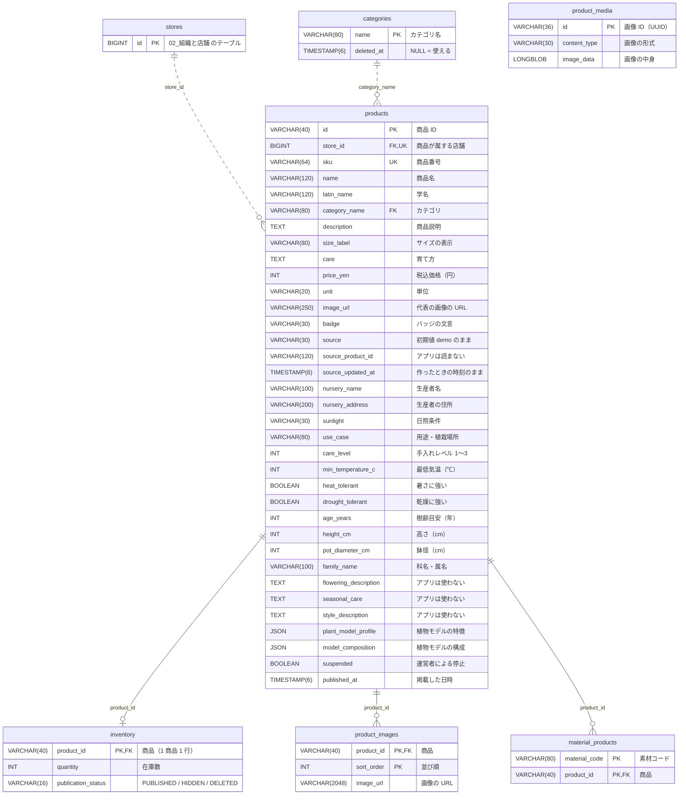

# 03 商品と在庫（kusakari-ec のテーブル設計図）

kusakari-ec の DB のうち、商品と在庫のまとまり（`categories`、`products`、`inventory`、`product_images`、`product_media`、`material_products`）の設計図です。29 テーブル全体の図と一覧は [00_全体](<00_全体.md>) にあります。

## 対象のコード

- kusakari-ec の main、コミット 19a2be3（2026-11-20 時点）です。
- 元にしたマイグレーションは次のとおりです。
  - V1__schema.sql の [categories](https://github.com/abeouga/kusakari-ec/blob/19a2be307ee71a2cd87e538236c3c8c42929c5b3/backend/src/main/resources/db/migration/V1__schema.sql#L181-L185)、[products](https://github.com/abeouga/kusakari-ec/blob/19a2be307ee71a2cd87e538236c3c8c42929c5b3/backend/src/main/resources/db/migration/V1__schema.sql#L188-L230)、[inventory](https://github.com/abeouga/kusakari-ec/blob/19a2be307ee71a2cd87e538236c3c8c42929c5b3/backend/src/main/resources/db/migration/V1__schema.sql#L232-L240)、[product_images](https://github.com/abeouga/kusakari-ec/blob/19a2be307ee71a2cd87e538236c3c8c42929c5b3/backend/src/main/resources/db/migration/V1__schema.sql#L242-L248)、[product_media](https://github.com/abeouga/kusakari-ec/blob/19a2be307ee71a2cd87e538236c3c8c42929c5b3/backend/src/main/resources/db/migration/V1__schema.sql#L251-L256)、[material_products](https://github.com/abeouga/kusakari-ec/blob/19a2be307ee71a2cd87e538236c3c8c42929c5b3/backend/src/main/resources/db/migration/V1__schema.sql#L259-L264): 6 つのテーブルを作ります。V3〜V6 は、このまとまりのテーブルを変えません。
  - [V2__sample_data.sql](https://github.com/abeouga/kusakari-ec/blob/19a2be307ee71a2cd87e538236c3c8c42929c5b3/backend/src/main/resources/db/migration/V2__sample_data.sql): サンプルデータを入れるだけで、テーブルの形は変えません。カテゴリ 5 つ、商品 14 個（店舗 1〜3 に分けて置く）、その在庫（すべて `PUBLISHED`）、素材コードと商品の対応 16 行を入れ、商品 4 個の詳しい列を `UPDATE` で埋めます。
- 比べた文書は、EC リポジトリの [docs/database-er.md](https://github.com/abeouga/kusakari-ec/blob/19a2be307ee71a2cd87e538236c3c8c42929c5b3/docs/database-er.md) です。

## このまとまりの役割

店舗が売る商品と、その在庫・画像を持ちます。

- 商品（`products`）は 1 つの店舗に属します。店舗は登録した後に変えません。商品の行は消さず、削除は在庫の公開状態を `DELETED` にします（`ProductEditorService.delete`）。注文や庭の記録から商品を参照するためです。
- 在庫と出店者による公開状態は、商品と 1 対 1 の `inventory` に分けています。大きな 3D モデルの JSON を持つ商品の行と、ロックの対象を分けるためです（`InventoryEntity` のコメント）。
- 商品が購入者に見えるかは、このまとまりの列（`products.suspended`、`inventory.publication_status`）と、店舗・組織の列（[02_組織と店舗](<02_組織と店舗.md>)）を合わせて決まります。
- `material_products` は、Canvas の庭の素材コードを EC の商品に結び付けます。Canvas の DB との対応は [04_カートと買い物リスト](<04_カートと買い物リスト.md>) にあります。
- 運営者による商品の警告・停止の履歴は [06_運営と組織の操作の記録](<06_運営と組織の操作の記録.md#product_moderation_events>) にあります。

対応する Entity は次のとおりです。主な Entity は [クラス図](<../../クラス図/クラス図.md>) に載せています。表の「クラス図」の列が「載せていない」のものは、図にありません。

| テーブル | Entity | クラス図 |
| --- | --- | --- |
| `categories` | [CategoryEntity](https://github.com/abeouga/kusakari-ec/blob/19a2be307ee71a2cd87e538236c3c8c42929c5b3/backend/src/main/java/jp/kusakari/ec/catalog/persistence/entity/CategoryEntity.java) | [クラス図](<../../クラス図/クラス図.md>) |
| `products` | [ProductEntity](https://github.com/abeouga/kusakari-ec/blob/19a2be307ee71a2cd87e538236c3c8c42929c5b3/backend/src/main/java/jp/kusakari/ec/catalog/persistence/entity/ProductEntity.java) | [クラス図](<../../クラス図/クラス図.md>) |
| `inventory` | [InventoryEntity](https://github.com/abeouga/kusakari-ec/blob/19a2be307ee71a2cd87e538236c3c8c42929c5b3/backend/src/main/java/jp/kusakari/ec/catalog/persistence/entity/InventoryEntity.java) | [クラス図](<../../クラス図/クラス図.md>) |
| `product_images` | Entity は無く、`ProductEntity` の `images`（`@ElementCollection`）が読み書きします。 | 載せていない |
| `product_media` | [ProductMediaEntity](https://github.com/abeouga/kusakari-ec/blob/19a2be307ee71a2cd87e538236c3c8c42929c5b3/backend/src/main/java/jp/kusakari/ec/catalog/persistence/entity/ProductMediaEntity.java) | 載せていない |
| `material_products` | [MaterialProductEntity](https://github.com/abeouga/kusakari-ec/blob/19a2be307ee71a2cd87e538236c3c8c42929c5b3/backend/src/main/java/jp/kusakari/ec/catalog/persistence/entity/MaterialProductEntity.java)（主キーは `MaterialProductId`） | [クラス図](<../../クラス図/クラス図.md>) |

## 凡例

ER 図の書き方です。

| 書き方 | 意味 |
| --- | --- |
| `型 列名 キー "説明"` | 1 つの列です。型はマイグレーションの表記のまま書きます（例 `VARCHAR(255)`）。 |
| `PK`、`FK`、`UK` | 主キー、外部キー、一意制約に入る列です。どの一意制約かは、説明か定義表に書きます。 |
| 主キーの列だけのテーブル | ほかのまとまりのテーブルです。列の定義は、本文のリンク先のファイルにあります。 |
| 実線 | 外部キーの列が、子（外部キーを持つ側）の主キーに入っている関係です。 |
| 点線 | 外部キーの列が、子の主キーに入っていない関係です。 |
| 線のラベル | 外部キーの列名です。複合外部キーは、列をすべて書きます。 |

多重度は、線の両端の記号で表します。親は参照される側、子は外部キーを持つ側です。

- `||`: ちょうど 1 です。親の側に付け、外部キーの列が NOT NULL のときに使います。
- `|o`（右の端では `o|`）: 0 か 1 です。親の側では、外部キーの列が NULL を許すときに使います。子の側では、外部キーの列に一意制約か主キーがあるときに使います。
- `}o`（右の端では `o{`）: 0 以上です。子の側で、外部キーの列が一意でないときに使います。
- 「子が 1 行以上ある」ことは DB の制約で守っていないので、`|{` は使いません。

定義表の書き方です。

- NULL の「不可」は NOT NULL、「可」は NULL を許す列です。
- 初期値はマイグレーションの DEFAULT です。「—」は DEFAULT の指定が無い列です（NULL を許す列は NULL になります）。
- 主キーの名前は、MySQL では常に `PRIMARY` です。
- 索引は、マイグレーションに書いたものだけを載せます。外部キーの列で始まる索引が無いときは、MySQL が外部キーと同じ名前の索引を自動で作ります。
- 外部キーの「指定なし」は、ON DELETE・ON UPDATE を書いていないことです。MySQL の既定（NO ACTION）になり、InnoDB では RESTRICT と同じく、子から参照されている親の行の削除と、参照されている列の値の変更を拒否します。
- `BINARY` を付けた CHECK は、大文字・小文字と空白を区別して比べます。一覧の値と完全に同じ文字列だけが通ります。
- 「API は〜を受け付けます」は、DB の制約ではなく、登録・編集の API の入力の検証（`ProductRequest`）です。
- どのテーブルも `ENGINE=InnoDB`、`DEFAULT CHARSET=utf8mb4` です。

## ER 図

`stores` の列は [02_組織と店舗](<02_組織と店舗.md#stores>) にあります。`product_media` は、どのテーブルからも外部キーで参照されません。商品は、画像の URL（`/api/product-images/{id}`）の文字列で `product_media` を指します。

## テーブル定義

### categories

商品カテゴリです。運営者が追加・編集・削除します（`CategoryService`）。名前が主キーなので、名前を変えるときは、新しい名前の行を作り、商品の `category_name` を書き換えてから、古い行を消します。削除では、削除済みの商品がまだ参照していれば `deleted_at` を入れて行を残し、参照が無ければ行を消します。公開中・非公開の商品が使っているカテゴリは削除できません（409 `CATEGORY_IN_USE`）。

| 列名 | 型 | NULL | 初期値 | キー | 説明 |
| --- | --- | --- | --- | --- | --- |
| `name` | VARCHAR(80) | 不可 | — | PK | カテゴリ名です。 |
| `deleted_at` | TIMESTAMP(6) | 可 | — | | 削除した日時です。NULL のカテゴリだけを一覧に出し、商品の登録・編集で選べます。 |

| 種類 | 名前 | 列 | 内容 |
| --- | --- | --- | --- |
| 主キー | `PRIMARY` | `name` | |

Entity は `CategoryEntity` で、すべての列を持ちます。`@Column` の `name` の長さは 30 で、マイグレーション（80）より短く書かれています。DB の長さはマイグレーションのとおりです。商品の登録・編集の API は、カテゴリ名を 30 文字まで受け付けます。V2 は、`庭木`、`草花`、`ハーブ`、`観葉植物`、`鉢・庭材` の 5 つを入れます。

`categories` を参照する外部キーは、`products.category_name`（`fk_products_category`）の 1 本です。

### products

商品です。出店者（その店舗の組織のオーナーと、店舗の担当者）が登録・編集します（`ProductEditorService`）。登録では `id` に UUID を入れ、在庫の行を一緒に作ります。

| 列名 | 型 | NULL | 初期値 | キー | 説明 |
| --- | --- | --- | --- | --- | --- |
| `id` | VARCHAR(40) | 不可 | — | PK | 商品 ID です。登録では UUID（36 文字）を入れます。V2 のサンプルは `olive` のような文字列です。 |
| `store_id` | BIGINT | 不可 | — | FK、UK | 商品が属する店舗です。登録した後は変えません（Entity では `updatable = false`）。注文の店舗と商品の店舗を一致させるためです。 |
| `sku` | VARCHAR(64) | 不可 | — | UK | 商品番号です。同じ店舗の中で一意です。登録で空なら自動で振ります（`ProductSkuGenerator`）。登録した後は変えません。API は 50 文字まで受け付けます。 |
| `name` | VARCHAR(120) | 不可 | — | | 商品名です。 |
| `latin_name` | VARCHAR(120) | 不可 | — | | 学名です。 |
| `category_name` | VARCHAR(80) | 不可 | — | FK | カテゴリです。 |
| `description` | TEXT | 不可 | — | | 商品説明です。API は 5000 文字まで受け付けます。 |
| `size_label` | VARCHAR(80) | 不可 | — | | サイズの表示です。 |
| `care` | TEXT | 不可 | — | | 育て方です。API は 5000 文字まで受け付けます。 |
| `price_yen` | INT | 不可 | — | | 税込価格（円）です。API は 1〜100000 を受け付けます。 |
| `unit` | VARCHAR(20) | 不可 | 'piece' | | 単位です。登録・編集の API では変えません（`ProductMapper` が無視します）。 |
| `image_url` | VARCHAR(250) | 不可 | — | | 代表の画像の URL です。API は `/images/...`、`/api/product-images/{id}`、`https://...` の形だけを受け付けます。 |
| `badge` | VARCHAR(30) | 不可 | — | | 商品カードに出すバッジの文言です（V2 の例は「おすすめ」）。 |
| `source` | VARCHAR(30) | 不可 | 'demo' | | 登録・編集の API では変えません。商品の応答（`ProductView`）に出します。 |
| `source_product_id` | VARCHAR(120) | 可 | — | | 登録・編集の API では変えません。 |
| `source_updated_at` | TIMESTAMP(6) | 不可 | CURRENT_TIMESTAMP(6) | | 登録・編集の API では変えません。Entity が作るときの時刻を入れます。商品の応答に出します。 |
| `nursery_name` | VARCHAR(100) | 不可 | '' | | 生産者名です。 |
| `nursery_address` | VARCHAR(200) | 不可 | '' | | 生産者の住所です。商品詳細で生産者名と一緒に出します。 |
| `sunlight` | VARCHAR(30) | 不可 | '未設定' | | 日照条件です。API は `未設定`、`日なた`、`半日陰`、`日陰` だけを受け付けます。 |
| `use_case` | VARCHAR(80) | 不可 | '' | | 用途・植栽場所です。 |
| `care_level` | INT | 不可 | 1 | | 手入れレベルです（1〜3）。商品一覧の「育てやすさ順」は、この値の小さい順です。 |
| `min_temperature_c` | INT | 可 | — | | 列名のとおり、最低気温（℃）です。API は -50〜50 を受け付けます。 |
| `heat_tolerant` | BOOLEAN | 不可 | FALSE | | 列名のとおり、暑さに強いかです。 |
| `drought_tolerant` | BOOLEAN | 不可 | FALSE | | 列名のとおり、乾燥に強いかです。 |
| `age_years` | INT | 可 | — | | 樹齢目安（年）です。API は 0〜1000 を受け付けます。 |
| `height_cm` | INT | 可 | — | | 高さ（cm）です。出店者は「庭オブジェクト」で入力します。植物モデルの特徴があるときは、その高さと一致させます（違えば 400 `PLANT_HEIGHT_MISMATCH`）。API は 10〜1500 を受け付けます。 |
| `pot_diameter_cm` | INT | 可 | — | | 鉢径（cm）です。API は 1〜300 を受け付けます。 |
| `family_name` | VARCHAR(100) | 不可 | '' | | 科名・属名です。 |
| `flowering_description` | TEXT | 可 | — | | Entity に対応するフィールドが無く、アプリは読み書きしません。V2 のサンプルだけが値を入れます。 |
| `seasonal_care` | TEXT | 可 | — | | 同上です。 |
| `style_description` | TEXT | 可 | — | | 同上です。 |
| `plant_model_profile` | JSON | 可 | — | | 出店者が入れた植物モデルの特徴です（`PlantModelProfile`。植物の種類・高さ・幅・葉や花の形と色など）。 |
| `model_composition` | JSON | 可 | — | | Canvas の `POST /api/model-assemblies/resolve` で求めた植物モデルの構成です（`CanvasModelClient`）。`plant_model_profile` が NULL なら NULL にします。NULL でなければ、素材コード `product.{id}` を `material_products` に入れます。 |
| `suspended` | BOOLEAN | 不可 | FALSE | | 運営者による停止です（`ProductModerationService`）。 |
| `published_at` | TIMESTAMP(6) | 不可 | CURRENT_TIMESTAMP(6) | | 掲載した日時です。Entity が作るときの時刻を入れ、登録・編集の API では変えません。商品の応答に出します。 |

| 種類 | 名前 | 列 | 内容 |
| --- | --- | --- | --- |
| 主キー | `PRIMARY` | `id` | |
| 一意制約 | `uk_products_store_sku` | `store_id`, `sku` | 同じ店舗に同じ商品番号を付けられません。店舗が違えば使えます。 |
| CHECK | `ck_products_price` | `price_yen` | `price_yen > 0` |
| CHECK | `ck_products_care_level` | `care_level` | `care_level BETWEEN 1 AND 3` |
| 外部キー | `fk_products_store` | `store_id` | → [`stores (id)`](<02_組織と店舗.md#stores>)。ON DELETE・ON UPDATE は指定なし。 |
| 外部キー | `fk_products_category` | `category_name` | → `categories (name)`。ON DELETE・ON UPDATE は指定なし。 |

Entity は `ProductEntity` です。`flowering_description`、`seasonal_care`、`style_description` は Entity に無く、ほかのコードからも読み書きしません。列名と違うフィールド名は、`category_name` → `category` です。`getCanvasMaterialCode` は、`model_composition` が NULL でなければ `product.{id}` を返します。

`products` を参照する外部キーは次の 6 本です。注文の明細（`order_items.product_id`）は外部キーを持ちません。

| 参照する列 | 制約名 | 定義のファイル |
| --- | --- | --- |
| `inventory.product_id` | `fk_inventory_product` | このファイル |
| `product_images.product_id` | `fk_product_images_product` | このファイル |
| `material_products.product_id` | `fk_material_products_product` | このファイル |
| `cart_items.product_id` | `fk_cart_items_product` | [04_カートと買い物リスト](<04_カートと買い物リスト.md#cart_items>) |
| `garden_shopping_items.product_id` | `fk_garden_items_product` | [04_カートと買い物リスト](<04_カートと買い物リスト.md#garden_shopping_items>) |
| `product_moderation_events.product_id` | `fk_product_moderation_product` | [06_運営と組織の操作の記録](<06_運営と組織の操作の記録.md#product_moderation_events>) |

### inventory

商品ごとの在庫数と、出店者による公開状態です。商品 1 つに 1 行です。お会計では、この行をロックしてから在庫数を減らします（`CheckoutService`）。

| 列名 | 型 | NULL | 初期値 | キー | 説明 |
| --- | --- | --- | --- | --- | --- |
| `product_id` | VARCHAR(40) | 不可 | — | PK、FK | 商品です。 |
| `quantity` | INT | 不可 | 0 | | 在庫数です。API は 0〜10000 を受け付け、登録では 1 以上が必要です。 |
| `publication_status` | VARCHAR(16) | 不可 | 'HIDDEN' | | 出店者による公開状態です。値は下の表のとおりです。 |

`publication_status` の値（`ck_inventory_status` と `InventoryEntity` の定数）です。

| 値 | 意味 |
| --- | --- |
| `PUBLISHED` | 公開。購入者に見えて、注文できます（店舗・組織の停止と、運営者による停止が無いとき）。 |
| `HIDDEN` | 非公開 |
| `DELETED` | 削除。商品を削除すると、この値にします。削除済みの商品は編集できません（409 `PRODUCT_ARCHIVED`）。 |

| 種類 | 名前 | 列 | 内容 |
| --- | --- | --- | --- |
| 主キー | `PRIMARY` | `product_id` | |
| CHECK | `ck_inventory_quantity` | `quantity` | `quantity >= 0`。在庫数を負にできません。 |
| CHECK | `ck_inventory_status` | `publication_status` | `BINARY publication_status IN ('PUBLISHED','HIDDEN','DELETED')` |
| 外部キー | `fk_inventory_product` | `product_id` | → `products (id)`。ON DELETE・ON UPDATE は指定なし。 |

Entity は `InventoryEntity` で、すべての列を持ちます。`publication_status` の初期値は、DB では `'HIDDEN'`、Entity のフィールドでは `PUBLISHED` です。登録（`ProductEditorService.create`）は Entity から行を作るので、登録した商品は `PUBLISHED` で始まります。

### product_images

商品の画像の URL の並びです。`ProductEntity` の `images` が、`sort_order` を並び順（`@OrderColumn`）にして読み書きします。

| 列名 | 型 | NULL | 初期値 | キー | 説明 |
| --- | --- | --- | --- | --- | --- |
| `product_id` | VARCHAR(40) | 不可 | — | PK、FK | 商品です。 |
| `sort_order` | INT | 不可 | — | PK | 並び順です。 |
| `image_url` | VARCHAR(2048) | 不可 | — | | 画像の URL です。API は 1 商品 4 枚まで、`image_url` と同じ 3 つの形だけを受け付けます。 |

| 種類 | 名前 | 列 | 内容 |
| --- | --- | --- | --- |
| 主キー | `PRIMARY` | `product_id`, `sort_order` | |
| 外部キー | `fk_product_images_product` | `product_id` | → `products (id)`。ON DELETE・ON UPDATE は指定なし。 |

### product_media

出店者がアップロードした商品画像の中身です。`POST /api/product-images` で保存し、`GET /api/product-images/{id}` で返します（`ProductMediaService`）。保存すると、その URL（`/api/product-images/{id}`）を返し、商品の `image_url` や `product_images.image_url` に入ります。

| 列名 | 型 | NULL | 初期値 | キー | 説明 |
| --- | --- | --- | --- | --- | --- |
| `id` | VARCHAR(36) | 不可 | — | PK | 画像 ID（UUID）です。 |
| `content_type` | VARCHAR(30) | 不可 | — | | 画像の形式です。アプリはファイルの中身から `image/png`、`image/jpeg`、`image/webp` のどれかを入れます。 |
| `image_data` | LONGBLOB | 不可 | — | | 画像の中身です。アプリは 5MB までを受け付けます。 |

| 種類 | 名前 | 列 | 内容 |
| --- | --- | --- | --- |
| 主キー | `PRIMARY` | `id` | |

Entity は `ProductMediaEntity` で、すべての列を持ちます。

### material_products

素材コードと商品の対応です。素材コードは、Canvas の庭の買い物リストの `materialCode` と、AI の商品候補（`POST /api/materials/quote`、`CatalogService.match`）で使います。EC は、この表で素材コードを商品の候補に変えます（`ShoppingService`）。1 つの素材コードに、商品を何個でも結び付けられます。

素材コードは 2 通りです。

- V2 のサンプルデータの対応です（例 `plant.oak` → `canvas-oak`、`plant.herb` → `lavender` と `rosemary`）。
- 商品の登録・編集で、`model_composition` が NULL でなければ、`product.{商品 ID}` → その商品の行を入れます（`ProductEditorService.linkMaterial`）。

| 列名 | 型 | NULL | 初期値 | キー | 説明 |
| --- | --- | --- | --- | --- | --- |
| `material_code` | VARCHAR(80) | 不可 | — | PK | 素材コードです。 |
| `product_id` | VARCHAR(40) | 不可 | — | PK、FK | 商品です。 |

| 種類 | 名前 | 列 | 内容 |
| --- | --- | --- | --- |
| 主キー | `PRIMARY` | `material_code`, `product_id` | |
| 外部キー | `fk_material_products_product` | `product_id` | → `products (id)`。ON DELETE・ON UPDATE は指定なし。 |

Entity は `MaterialProductEntity` で、すべての列を持ちます。

## docs/database-er.md との差

[docs/database-er.md](https://github.com/abeouga/kusakari-ec/blob/19a2be307ee71a2cd87e538236c3c8c42929c5b3/docs/database-er.md) の図と、次の点が違います。マイグレーションを正としています。

- 商品と在庫の関係を、docs/database-er.md は `products ||--|| inventory`（どの商品にも在庫が 1 行ある）にしています。マイグレーションには「商品には在庫の行が必ずある」ことを守る制約が無いので、この文書は `products ||--o| inventory` にしています。在庫の行を商品と一緒に作るのは、アプリ（`ProductEditorService.create`）です。
- docs/database-er.md の図は、型の長さを省いています（例 `varchar image_url`）。この文書は、マイグレーションの型をそのまま書いています。
- docs/database-er.md の図は、`products.store_id` と `products.sku` に一意制約の印を付けていません（説明に「store_id, sku で一意」と書いています）。この文書は `UK` を付けています。

## 確かめられなかったこと

- `source`、`source_product_id`、`source_updated_at` が何の出どころを表すかは、コードと docs/ から確かめられませんでした。アプリは初期値のまま使い、`source_product_id` はどこからも読みません。
- `min_temperature_c`、`heat_tolerant`、`drought_tolerant` を画面で入力・表示する箇所は、frontend/src に見つかりませんでした。説明は列名から書いています。
- マイグレーションは読んだだけで、DB に当てて確かめてはいません。MySQL が外部キーのために自動で作る索引の有無と名前は確かめていません。
