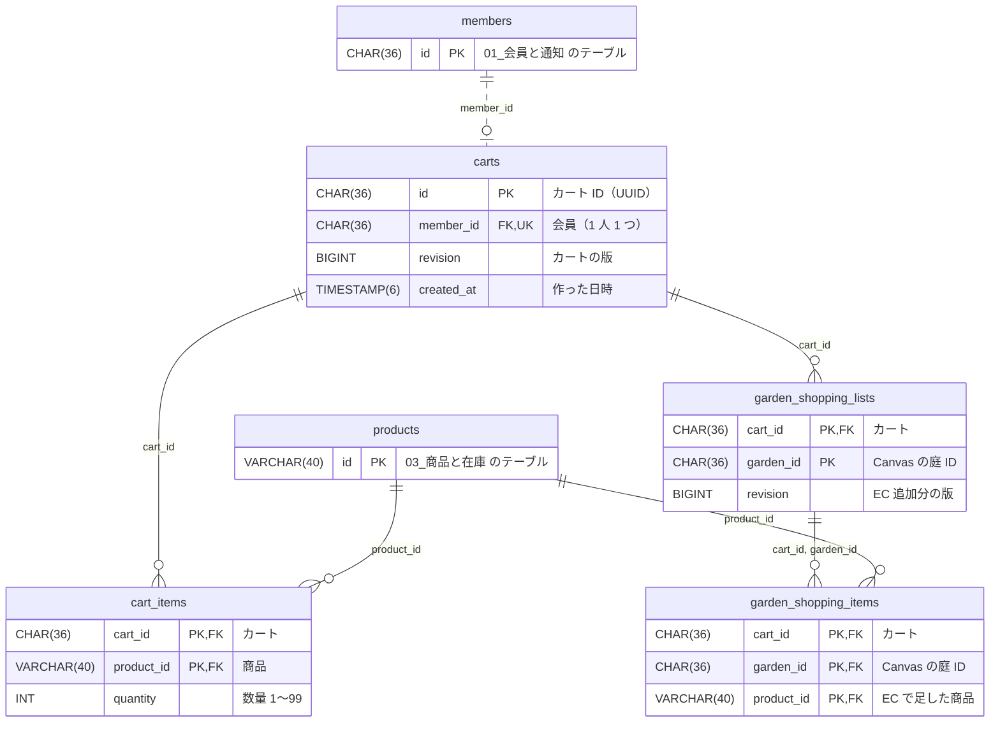
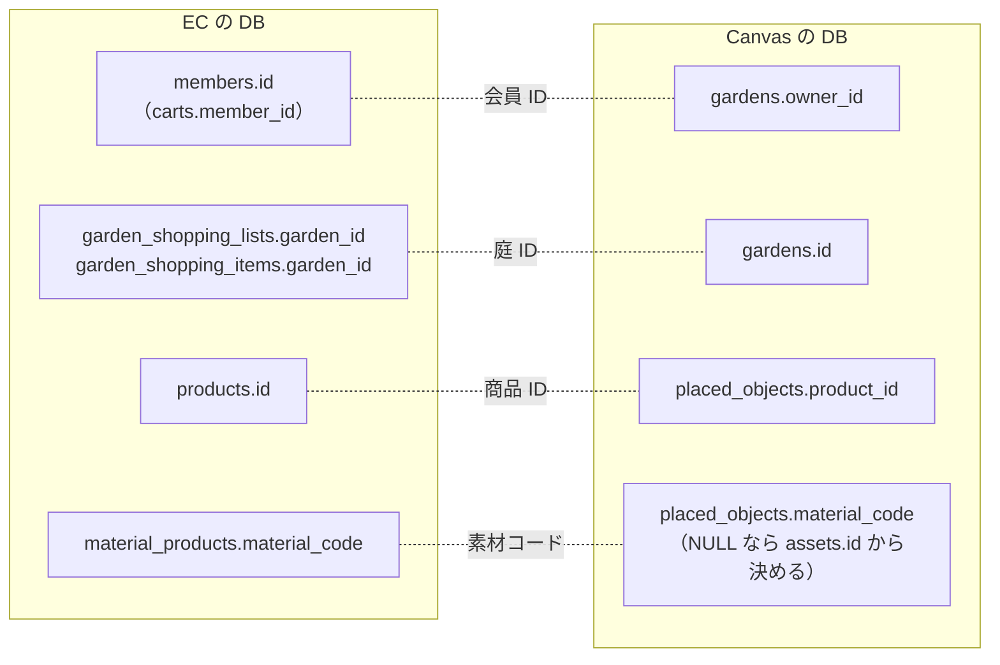

# 04 カートと買い物リスト（kusakari-ec のテーブル設計図）

kusakari-ec の DB のうち、カートと買い物リストのまとまり（`carts`、`cart_items`、`garden_shopping_lists`、`garden_shopping_items`）の設計図です。29 テーブル全体の図と一覧は [00_全体](<00_全体.md>) にあります。

## 対象のコード

- kusakari-ec の main、コミット 19a2be3（2026-11-20 時点）です。
- Canvas 側の列は、kusakari-canvas の main、コミット c19d497（2026-11-20 時点）で確かめています。
- 元にしたマイグレーションは次のとおりです。V2〜V6 は、このまとまりのテーブルに行を入れず、形も変えません。
  - V1__schema.sql の [carts](https://github.com/abeouga/kusakari-ec/blob/19a2be307ee71a2cd87e538236c3c8c42929c5b3/backend/src/main/resources/db/migration/V1__schema.sql#L266-L274)、[cart_items](https://github.com/abeouga/kusakari-ec/blob/19a2be307ee71a2cd87e538236c3c8c42929c5b3/backend/src/main/resources/db/migration/V1__schema.sql#L276-L284)、[garden_shopping_lists](https://github.com/abeouga/kusakari-ec/blob/19a2be307ee71a2cd87e538236c3c8c42929c5b3/backend/src/main/resources/db/migration/V1__schema.sql#L286-L292)、[garden_shopping_items](https://github.com/abeouga/kusakari-ec/blob/19a2be307ee71a2cd87e538236c3c8c42929c5b3/backend/src/main/resources/db/migration/V1__schema.sql#L294-L302): 4 つのテーブルを作ります。
- Canvas 側は、[V1__create_garden_tables_and_seed_assets.sql](https://github.com/abeouga/kusakari-canvas/blob/c19d497dfef15b119f9bce8ecb5c886a36da6b7d/backend/alembic/sql/V1__create_garden_tables_and_seed_assets.sql)（`gardens`・`placed_objects`・`assets`）と [0005_product_plant_composition.py](https://github.com/abeouga/kusakari-canvas/blob/c19d497dfef15b119f9bce8ecb5c886a36da6b7d/backend/alembic/versions/0005_product_plant_composition.py)（`placed_objects.product_id`・`material_code` ほか）を見ています。
- 比べた文書は、EC リポジトリの [docs/database-er.md](https://github.com/abeouga/kusakari-ec/blob/19a2be307ee71a2cd87e538236c3c8c42929c5b3/docs/database-er.md) です。仕様は EC リポジトリの [docs/garden-shopping-lists.md](https://github.com/abeouga/kusakari-ec/blob/19a2be307ee71a2cd87e538236c3c8c42929c5b3/docs/garden-shopping-lists.md) にあります。

## このまとまりの役割

- `carts`・`cart_items` は、会員ごとのカートとその明細です。カートはログインした会員だけが使え、1 人に 1 つです。受取店舗は商品の店舗なので、明細には店舗を持ちません（`CartItemEntity` のコメント）。
- `garden_shopping_lists`・`garden_shopping_items` は、Canvas の庭ごとの買い物リストのうち、EC の商品カードから庭へ足した商品（EC 追加分）です。庭に配置した物は Canvas の DB にあり、EC はこの 2 つの表に保存しません。表示するとき、EC のサーバーが Canvas から庭の買い物リストを取り、EC 追加分と合わせます（`ShoppingService`）。
- 買い物リストから選んだ商品は、カートの明細（`cart_items`）に足します。足した後も買い物リストは残ります。

カートからのお会計で作る決済と注文は [05_注文と決済](<05_注文と決済.md>) にあります。

対応するクラスは次のとおりです。クラスの図は、表の「クラス図」の列のファイルにあります。

| テーブル | クラス | クラス図 |
| --- | --- | --- |
| `carts` | [CartEntity](https://github.com/abeouga/kusakari-ec/blob/19a2be307ee71a2cd87e538236c3c8c42929c5b3/backend/src/main/java/jp/kusakari/ec/commerce/persistence/entity/CartEntity.java) | [04_カートと注文](<../../クラス図/kusakari-ec/04_カートと注文.md>) |
| `cart_items` | [CartItemEntity](https://github.com/abeouga/kusakari-ec/blob/19a2be307ee71a2cd87e538236c3c8c42929c5b3/backend/src/main/java/jp/kusakari/ec/commerce/persistence/entity/CartItemEntity.java)（主キーは `CartItemId`） | [04_カートと注文](<../../クラス図/kusakari-ec/04_カートと注文.md>) |
| `garden_shopping_lists`、`garden_shopping_items` | Entity は無く、[SavedShoppingItems](https://github.com/abeouga/kusakari-ec/blob/19a2be307ee71a2cd87e538236c3c8c42929c5b3/backend/src/main/java/jp/kusakari/ec/shopping/SavedShoppingItems.java) が `JdbcTemplate` の SQL で読み書きします。 | [06_買い物リスト](<../../クラス図/kusakari-ec/06_買い物リスト.md>) |

## 凡例

ER 図の書き方です。

| 書き方 | 意味 |
| --- | --- |
| `型 列名 キー "説明"` | 1 つの列です。型はマイグレーションの表記のまま書きます（例 `VARCHAR(255)`）。 |
| `PK`、`FK`、`UK` | 主キー、外部キー、一意制約に入る列です。どの一意制約かは、説明か定義表に書きます。 |
| 主キーの列だけのテーブル | ほかのまとまりのテーブルです。列の定義は、本文のリンク先のファイルにあります。 |
| 実線 | 外部キーの列が、子（外部キーを持つ側）の主キーに入っている関係です。 |
| 点線 | 外部キーの列が、子の主キーに入っていない関係です。 |
| 線のラベル | 外部キーの列名です。複合外部キーは、列をすべて書きます。 |

多重度は、線の両端の記号で表します。親は参照される側、子は外部キーを持つ側です。

- `||`: ちょうど 1 です。親の側に付け、外部キーの列が NOT NULL のときに使います。
- `|o`（右の端では `o|`）: 0 か 1 です。親の側では、外部キーの列が NULL を許すときに使います。子の側では、外部キーの列に一意制約か主キーがあるときに使います。
- `}o`（右の端では `o{`）: 0 以上です。子の側で、外部キーの列が一意でないときに使います。
- 「子が 1 行以上ある」ことは DB の制約で守っていないので、`|{` は使いません。

定義表の書き方です。

- NULL の「不可」は NOT NULL、「可」は NULL を許す列です。
- 初期値はマイグレーションの DEFAULT です。「—」は DEFAULT の指定が無い列です（NULL を許す列は NULL になります）。
- 主キーの名前は、MySQL では常に `PRIMARY` です。
- 索引は、マイグレーションに書いたものだけを載せます。外部キーの列で始まる索引が無いときは、MySQL が外部キーと同じ名前の索引を自動で作ります。
- 外部キーの「指定なし」は、ON DELETE・ON UPDATE を書いていないことです。MySQL の既定（NO ACTION）になり、InnoDB では RESTRICT と同じく、子から参照されている親の行の削除と、参照されている列の値の変更を拒否します。
- どのテーブルも `ENGINE=InnoDB`、`DEFAULT CHARSET=utf8mb4` です。

## ER 図

`members` の列は [01_会員と通知](<01_会員と通知.md#members>)、`products` の列は [03_商品と在庫](<03_商品と在庫.md#products>) にあります。`garden_shopping_lists.garden_id` は Canvas の DB の値で、外部キーはありません（下の「Canvas の DB との対応」）。

## テーブル定義

### carts

会員ごとのカートです。1 人に 1 つで、初めて必要になったときに作ります（`MemberCartService.resolve`）。`revision` は、明細を変えるたびに 1 増やします。画面は読んだときの `revision` を送り、違えば 409 `CART_CHANGED` を返します。お会計では、この値を注文の `request_revision` に残します。

| 列名 | 型 | NULL | 初期値 | キー | 説明 |
| --- | --- | --- | --- | --- | --- |
| `id` | CHAR(36) | 不可 | — | PK | カート ID（UUID）です。 |
| `member_id` | CHAR(36) | 不可 | — | FK、UK | カートを持つ会員です。 |
| `revision` | BIGINT | 不可 | 0 | | カートの版です。明細の追加・変更・削除、買えなくなった明細を外したとき、お会計の後に 1 増やします（`CartEntity.incrementRevision`）。 |
| `created_at` | TIMESTAMP(6) | 不可 | CURRENT_TIMESTAMP(6) | | 作った日時です。Entity が作るときの時刻を入れます。 |

| 種類 | 名前 | 列 | 内容 |
| --- | --- | --- | --- |
| 主キー | `PRIMARY` | `id` | |
| 一意制約 | `uk_carts_member` | `member_id` | 1 人に 2 つ目のカートを作れません。 |
| 外部キー | `fk_carts_member` | `member_id` | → [`members (id)`](<01_会員と通知.md#members>)。ON DELETE・ON UPDATE は指定なし。 |

Entity は `CartEntity` で、すべての列を持ちます。`carts` の行を消すコードはありません。

`carts` を参照する外部キーは次の 4 本です。

| 参照する列 | 制約名 | 定義のファイル |
| --- | --- | --- |
| `cart_items.cart_id` | `fk_cart_items_cart`（ON DELETE CASCADE） | このファイル |
| `garden_shopping_lists.cart_id` | `fk_garden_lists_cart`（ON DELETE CASCADE） | このファイル |
| `payments.cart_id` | `fk_payments_cart` | [05_注文と決済](<05_注文と決済.md#payments>) |
| `orders.cart_id` | `fk_orders_cart` | [05_注文と決済](<05_注文と決済.md#orders>) |

### cart_items

カートの明細です。受取店舗は商品の店舗です。画面からは `PUT /api/cart/items/{productId}` で数量を変え、数量 0 で明細を消します（`CartService.updateItem`）。カートは 50 種類までです。お会計が済むと、そのカートの明細をすべて消します（`CheckoutService`）。

| 列名 | 型 | NULL | 初期値 | キー | 説明 |
| --- | --- | --- | --- | --- | --- |
| `cart_id` | CHAR(36) | 不可 | — | PK、FK | カートです。 |
| `product_id` | VARCHAR(40) | 不可 | — | PK、FK | 商品です。 |
| `quantity` | INT | 不可 | — | | 数量です（1〜99）。 |

| 種類 | 名前 | 列 | 内容 |
| --- | --- | --- | --- |
| 主キー | `PRIMARY` | `cart_id`, `product_id` | 同じ商品は 1 行にまとめます。 |
| CHECK | `ck_cart_items_quantity` | `quantity` | `quantity BETWEEN 1 AND 99` |
| 外部キー | `fk_cart_items_cart` | `cart_id` | → `carts (id)`。ON DELETE CASCADE、ON UPDATE は指定なし。 |
| 外部キー | `fk_cart_items_product` | `product_id` | → [`products (id)`](<03_商品と在庫.md#products>)。ON DELETE・ON UPDATE は指定なし。 |

Entity は `CartItemEntity` で、すべての列を持ちます。

### garden_shopping_lists

カートと Canvas の庭の組ごとの、EC 追加分の版です。`SavedShoppingItems.add` が、その庭に初めて商品を足すときに `revision` = 0 で行を作り、商品を足すたびに 1 増やします。カートへの追加（`POST /api/cart/shopping-lists/{gardenId}/items`）では、画面が送った版（`listRevision`）とこの値を比べ、違えば 409 `SHOPPING_LIST_CHANGED` を返します。

| 列名 | 型 | NULL | 初期値 | キー | 説明 |
| --- | --- | --- | --- | --- | --- |
| `cart_id` | CHAR(36) | 不可 | — | PK、FK | 会員のカートです。EC 追加分を会員ごとに分けるキーに使います。 |
| `garden_id` | CHAR(36) | 不可 | — | PK | Canvas の庭 ID（Canvas の `gardens.id`）です。外部キーはありません。 |
| `revision` | BIGINT | 不可 | 0 | | EC 追加分の版です。行が無い庭の版は 0 として扱います。 |

| 種類 | 名前 | 列 | 内容 |
| --- | --- | --- | --- |
| 主キー | `PRIMARY` | `cart_id`, `garden_id` | `fk_garden_items_list` の参照先です。 |
| 外部キー | `fk_garden_lists_cart` | `cart_id` | → `carts (id)`。ON DELETE CASCADE、ON UPDATE は指定なし。 |

### garden_shopping_items

EC の商品カードから、庭の買い物リストへ足した商品です。`PUT /api/shopping-lists/{gardenId}/items/{productId}` で 1 行足します（`ShoppingService.add`）。同じ商品をもう一度送っても行は増えません。販売を終えた商品は足せず（409 `PRODUCT_ARCHIVED`）、1 つの庭に 200 種類までです（400 `SHOPPING_LIST_LIMIT`）。`POST /api/shopping-lists/items/{productId}` は、Canvas に「買い物リストN」という名前の庭を作ってから、同じように 1 行足します（`ShoppingService.createAndAdd`）。

数量は持ちません。表示するとき、Canvas の配置に同じ商品が無ければ、必要数 1 の行として足します（`ShoppingService.supplement`）。EC 追加分だけを消す操作はありません。

| 列名 | 型 | NULL | 初期値 | キー | 説明 |
| --- | --- | --- | --- | --- | --- |
| `cart_id` | CHAR(36) | 不可 | — | PK、FK | 会員のカートです。 |
| `garden_id` | CHAR(36) | 不可 | — | PK、FK | Canvas の庭 ID です。 |
| `product_id` | VARCHAR(40) | 不可 | — | PK、FK | 足した商品です。 |

| 種類 | 名前 | 列 | 内容 |
| --- | --- | --- | --- |
| 主キー | `PRIMARY` | `cart_id`, `garden_id`, `product_id` | |
| 外部キー | `fk_garden_items_list` | `cart_id`, `garden_id` | → `garden_shopping_lists (cart_id, garden_id)`。ON DELETE CASCADE、ON UPDATE は指定なし。 |
| 外部キー | `fk_garden_items_product` | `product_id` | → [`products (id)`](<03_商品と在庫.md#products>)。ON DELETE・ON UPDATE は指定なし。 |

`garden_shopping_lists` と `garden_shopping_items` への書き込み（`SavedShoppingItems.add`）と、カートへの追加のときの読み取り（`SavedShoppingItems.lockAndRead`）は、カートの行をロックしてから行います。同じカートの行のロックなので、2 つの操作は順に行われます。

## Canvas の DB との対応

EC と Canvas は別の DB なので、DB をまたぐ外部キーはありません。次の列は、同じ値が入ることで対応します。値が合っていることは DB では確かめず、アプリが API で確かめます。

| EC の列 | Canvas の列 | 値のつながり方 |
| --- | --- | --- |
| [`members.id`](<01_会員と通知.md#members>) CHAR(36)。カートの持ち主は `carts.member_id` | `gardens.owner_id` VARCHAR(128) | Canvas の [auth.py](https://github.com/abeouga/kusakari-canvas/blob/c19d497dfef15b119f9bce8ecb5c886a36da6b7d/backend/kusakari_canvas_api/auth.py) は、EC の `GET /api/auth/me`（書き込みでは `POST /api/auth/verify`）が返す会員 ID を、UUID の形か確かめてから庭の持ち主に使います。EC のサーバーが Canvas を呼ぶときは、利用者の Cookie `KUSAKARI_SESSION` をそのまま送ります（`CanvasClientConfiguration`）。なので、EC から見える庭は、その会員の庭だけです。 |
| `garden_shopping_lists.garden_id`、`garden_shopping_items.garden_id` CHAR(36) | `gardens.id` CHAR(36) | EC は、行を作る前に Canvas の `GET /api/gardens/{id}/shopping-list` を呼び、庭があり、その会員のものかを確かめます（`ShoppingService.add`）。Canvas で庭を消しても、EC の行は消えません（消すコードはありません）。EC の庭の一覧（`ShoppingService.summaries`）は Canvas の `GET /api/shopping-lists` から作るので、消えた庭の行は表示しません。 |
| [`products.id`](<03_商品と在庫.md#products>) VARCHAR(40) | `placed_objects.product_id` VARCHAR(40) | 庭に配置した EC の商品です。Canvas の買い物リストの行の `productId` になり、EC はその商品を候補にします（`ShoppingService.resolve`）。 |
| [`material_products.material_code`](<03_商品と在庫.md#material_products>) VARCHAR(80) | `placed_objects.material_code` VARCHAR(80) | Canvas の買い物リストの行の `materialCode` です。`placed_objects.material_code` が NULL の行は、Canvas の [shopping.py](https://github.com/abeouga/kusakari-canvas/blob/c19d497dfef15b119f9bce8ecb5c886a36da6b7d/backend/kusakari_canvas_api/shopping.py) の `MATERIAL_CODES` が `assets.id` から決めます（例 `tree_oak` → `plant.oak`）。`productId` の無い行は、EC が `material_products` で商品の候補に変えます。 |
| 列は無し | `gardens.revision` BIGINT | カートへの追加で、画面が送った庭の版（`gardenRevision`）と比べ、違えば 409 `GARDEN_CHANGED` を返します。EC は保存しません。 |

Canvas の買い物リストは、庭に配置した物（`placed_objects`）を商品 ID か `assets.id` ごとに数えたものです。数量（必要数）は配置した数で、EC には保存しません。

## docs/database-er.md との差

[docs/database-er.md](https://github.com/abeouga/kusakari-ec/blob/19a2be307ee71a2cd87e538236c3c8c42929c5b3/docs/database-er.md) と、次の点が違います。マイグレーションとコードを正としています。

- docs/database-er.md の「6. Canvas の DB とのつながり」は、つながりを `members.id`、`products.id`、`garden_shopping_lists.garden_id` の 3 つだけとしています。コードでは、`material_products.material_code` も Canvas の素材コード（`placed_objects.material_code` か `MATERIAL_CODES`）とつながっています（`ShoppingService.resolve`）。
- docs/database-er.md の図は、型の長さを省いています。この文書は、マイグレーションの型をそのまま書いています。
- docs/database-er.md の図は、`carts ||--o{ garden_shopping_lists` などの線をすべて実線で描いています。この文書は、外部キーの列が子の主キーに入らない `members` と `carts` の関係を点線にしています。

## 確かめられなかったこと

- マイグレーションは読んだだけで、DB に当てて確かめてはいません。MySQL が外部キーのために自動で作る索引の有無と名前は確かめていません。
