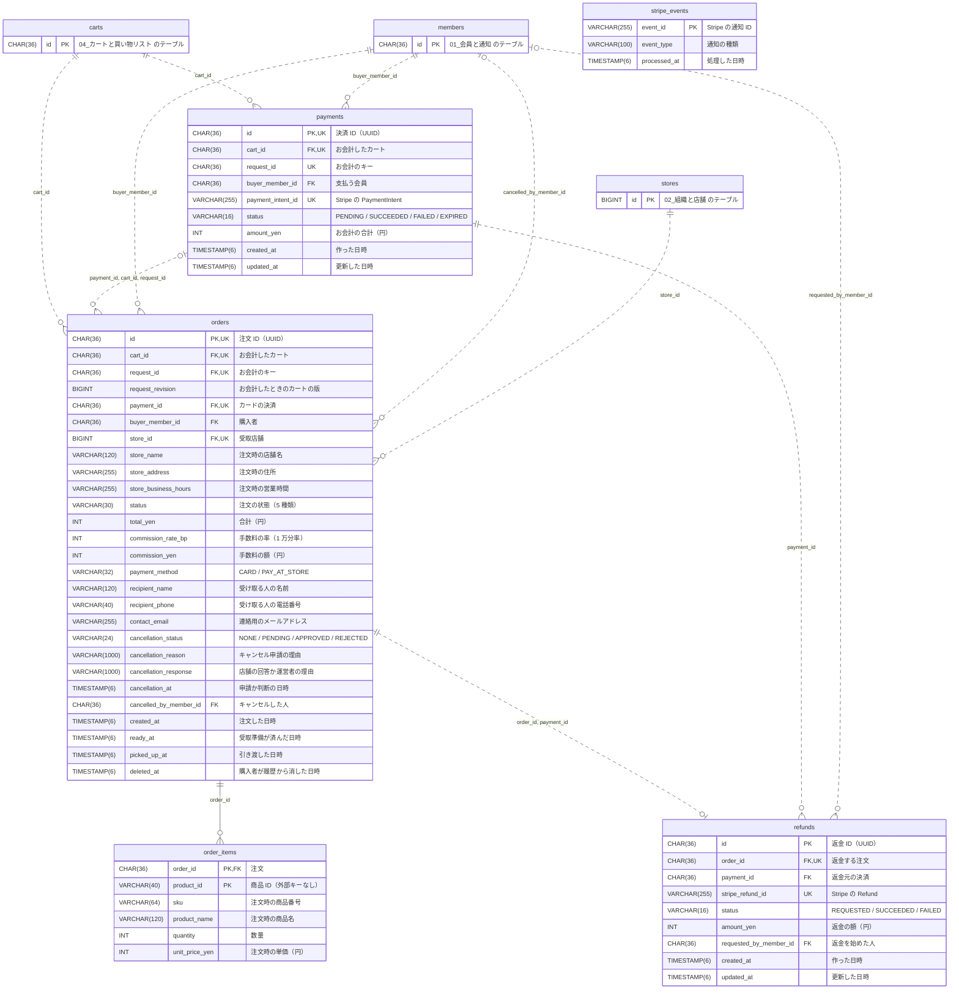

# 05 注文と決済（kusakari-ec のテーブル設計図）

kusakari-ec の DB のうち、注文と決済のまとまり（`orders`、`order_items`、`payments`、`stripe_events`、`refunds`）の設計図です。29 テーブル全体の図と一覧は [00_全体](<00_全体.md>) にあります。

## 対象のコード

- kusakari-ec の main、コミット 19a2be3（2026-11-20 時点）です。
- 元にしたマイグレーションは次のとおりです。V2〜V6 は、このまとまりのテーブルに行を入れず、形も変えません。
  - V1__schema.sql の [payments](https://github.com/abeouga/kusakari-ec/blob/19a2be307ee71a2cd87e538236c3c8c42929c5b3/backend/src/main/resources/db/migration/V1__schema.sql#L305-L323)、[stripe_events](https://github.com/abeouga/kusakari-ec/blob/19a2be307ee71a2cd87e538236c3c8c42929c5b3/backend/src/main/resources/db/migration/V1__schema.sql#L326-L331)、[orders](https://github.com/abeouga/kusakari-ec/blob/19a2be307ee71a2cd87e538236c3c8c42929c5b3/backend/src/main/resources/db/migration/V1__schema.sql#L333-L379)、[order_items](https://github.com/abeouga/kusakari-ec/blob/19a2be307ee71a2cd87e538236c3c8c42929c5b3/backend/src/main/resources/db/migration/V1__schema.sql#L381-L390)、[refunds](https://github.com/abeouga/kusakari-ec/blob/19a2be307ee71a2cd87e538236c3c8c42929c5b3/backend/src/main/resources/db/migration/V1__schema.sql#L393-L414): 5 つのテーブルを作ります。
- 比べた文書は、EC リポジトリの [docs/database-er.md](https://github.com/abeouga/kusakari-ec/blob/19a2be307ee71a2cd87e538236c3c8c42929c5b3/docs/database-er.md) です。

## このまとまりの役割

カートからのお会計で作る注文と、カード払いの決済・返金を持ちます。決済は Stripe のテストモードだけを使います。受け取りは店舗受け取りだけです。

- お会計 1 回で、受取店舗（商品の店舗）ごとに注文（`orders`）を 1 件ずつ作り、明細（`order_items`）に商品番号・名前・単価を写します（`CheckoutService.placeOrder`）。在庫はこの時点で減らします。
- 支払い方法は、カード（`CARD`）か店頭払い（`PAY_AT_STORE`）です。カードなら、お会計 1 回に決済（`payments`）を 1 つ作り、その回の注文はすべて同じ決済を指します。店頭払いでは決済を作りません。
- Stripe からの通知（Webhook）は、処理する前に `stripe_events` に記録し、同じ通知を 2 回処理しません（`StripeWebhookService`）。
- カードで支払い済みの注文をキャンセルすると、その注文の金額だけを返金します（`refunds`。注文 1 件に 1 行）。
- 「返金済み」は列で持たず、注文ごとの返金の行から求めます。

対応する Entity は次のとおりです。主な Entity は [クラス図](<../../クラス図/クラス図.md>) に載せています。表の「クラス図」の列が「載せていない」のものは、図にありません。

| テーブル | クラス | クラス図 |
| --- | --- | --- |
| `orders` | [OrderEntity](https://github.com/abeouga/kusakari-ec/blob/19a2be307ee71a2cd87e538236c3c8c42929c5b3/backend/src/main/java/jp/kusakari/ec/commerce/persistence/entity/OrderEntity.java) | [クラス図](<../../クラス図/クラス図.md>) |
| `order_items` | [OrderItemEntity](https://github.com/abeouga/kusakari-ec/blob/19a2be307ee71a2cd87e538236c3c8c42929c5b3/backend/src/main/java/jp/kusakari/ec/commerce/persistence/entity/OrderItemEntity.java)（主キーは `OrderItemId`） | [クラス図](<../../クラス図/クラス図.md>) |
| `payments` | [PaymentEntity](https://github.com/abeouga/kusakari-ec/blob/19a2be307ee71a2cd87e538236c3c8c42929c5b3/backend/src/main/java/jp/kusakari/ec/payment/persistence/entity/PaymentEntity.java) | [クラス図](<../../クラス図/クラス図.md>) |
| `stripe_events` | Entity は無く、[StripeWebhookService](https://github.com/abeouga/kusakari-ec/blob/19a2be307ee71a2cd87e538236c3c8c42929c5b3/backend/src/main/java/jp/kusakari/ec/payment/service/StripeWebhookService.java) が `JdbcTemplate` の SQL で書きます。 | 載せていない |
| `refunds` | [RefundEntity](https://github.com/abeouga/kusakari-ec/blob/19a2be307ee71a2cd87e538236c3c8c42929c5b3/backend/src/main/java/jp/kusakari/ec/payment/persistence/entity/RefundEntity.java) | 載せていない |

## 凡例

ER 図の書き方です。

| 書き方 | 意味 |
| --- | --- |
| `型 列名 キー "説明"` | 1 つの列です。型はマイグレーションの表記のまま書きます（例 `VARCHAR(255)`）。 |
| `PK`、`FK`、`UK` | 主キー、外部キー、一意制約に入る列です。どの一意制約かは、説明か定義表に書きます。 |
| 主キーの列だけのテーブル | ほかのまとまりのテーブルです。列の定義は、本文のリンク先のファイルにあります。 |
| 実線 | 外部キーの列が、子（外部キーを持つ側）の主キーに入っている関係です。 |
| 点線 | 外部キーの列が、子の主キーに入っていない関係です。 |
| 線のラベル | 外部キーの列名です。複合外部キーは、列をすべて書きます。 |

多重度は、線の両端の記号で表します。親は参照される側、子は外部キーを持つ側です。

- `||`: ちょうど 1 です。親の側に付け、外部キーの列が NOT NULL のときに使います。
- `|o`（右の端では `o|`）: 0 か 1 です。親の側では、外部キーの列が NULL を許すときに使います。子の側では、外部キーの列に一意制約か主キーがあるときに使います。
- `}o`（右の端では `o{`）: 0 以上です。子の側で、外部キーの列が一意でないときに使います。
- 「子が 1 行以上ある」ことは DB の制約で守っていないので、`|{` は使いません。
- 複合外部キーの列に NULL を許す列が 1 つでもあるときは、親の側を「0 か 1」にします（MySQL は、外部キーの列のどれかが NULL の行を確かめません）。

定義表の書き方です。

- NULL の「不可」は NOT NULL、「可」は NULL を許す列です。
- 初期値はマイグレーションの DEFAULT です。「—」は DEFAULT の指定が無い列です（NULL を許す列は NULL になります）。
- 初期値の「ON UPDATE CURRENT_TIMESTAMP(6)」は、行を更新するたびに MySQL が今の時刻を入れる列です。
- 主キーの名前は、MySQL では常に `PRIMARY` です。
- 索引は、マイグレーションに書いたものだけを載せます。外部キーの列で始まる索引が無いときは、MySQL が外部キーと同じ名前の索引を自動で作ります。
- 外部キーの「指定なし」は、ON DELETE・ON UPDATE を書いていないことです。MySQL の既定（NO ACTION）になり、InnoDB では RESTRICT と同じく、子から参照されている親の行の削除と、参照されている列の値の変更を拒否します。
- `BINARY` を付けた CHECK は、大文字・小文字と空白を区別して比べます。一覧の値と完全に同じ文字列だけが通ります。
- どのテーブルも `ENGINE=InnoDB`、`DEFAULT CHARSET=utf8mb4` です。

## ER 図

`members` の列は [01_会員と通知](<01_会員と通知.md#members>)、`stores` の列は [02_組織と店舗](<02_組織と店舗.md#stores>)、`carts` の列は [04_カートと買い物リスト](<04_カートと買い物リスト.md#carts>) にあります。`stripe_events` は、どのテーブルとも外部キーでつながりません。

## テーブル定義

### payments

お会計 1 回のカード決済です（Stripe の PaymentIntent 1 つ）。カード払いのお会計で、注文より先に作ります（`CheckoutService.placeOrder`）。PaymentIntent は、お会計のトランザクションをコミットした後に作り、その ID を `payment_intent_id` に入れます（`PaymentService.start`）。

`status` の値（`ck_payments_status` と `PaymentEntity` の定数）です。

| 値 | 意味 | 変わるとき |
| --- | --- | --- |
| `PENDING` | 支払い待ち | 作ったとき |
| `SUCCEEDED` | 支払い済み | 通知 `payment_intent.succeeded` を受けたとき（`PaymentService.succeeded`） |
| `FAILED` | 支払いの失敗 | 通知 `payment_intent.payment_failed` を受けたとき。支払い待ちの注文を取り消し、在庫を戻します。 |
| `EXPIRED` | 時間切れ | 支払い待ちのまま一定の時間（設定 `kusakari.ec.payment-timeout-minutes`、既定は 30 分）が過ぎたとき（`PaymentExpiryJob`、1 分ごと）。注文と在庫は `FAILED` と同じです。 |

`FAILED`・`EXPIRED` の後に支払いの成功が届いたときは、`SUCCEEDED` にしますが、注文は取り消したままにして、注文ごとに全額を返金します。

| 列名 | 型 | NULL | 初期値 | キー | 説明 |
| --- | --- | --- | --- | --- | --- |
| `id` | CHAR(36) | 不可 | — | PK、UK | 決済 ID（UUID）です。`uk_payments_id_checkout` にも入ります。 |
| `cart_id` | CHAR(36) | 不可 | — | FK、UK | お会計したカートです。 |
| `request_id` | CHAR(36) | 不可 | — | UK | お会計のキーです。画面がお会計の操作ごとに作る UUID（`CheckoutRequest.requestId`）で、同じ回の注文の `request_id` と同じ値です。Stripe に PaymentIntent を作るときの Idempotency-Key にも使います。 |
| `buyer_member_id` | CHAR(36) | 不可 | — | FK | 支払う会員です。 |
| `payment_intent_id` | VARCHAR(255) | 可 | — | UK | Stripe の PaymentIntent の ID です。作る前は NULL で、一度入れたら変えません（`attachIntent`）。 |
| `status` | VARCHAR(16) | 不可 | 'PENDING' | | 決済の状態です。値は上の表のとおりです。 |
| `amount_yen` | INT | 不可 | — | | お会計の合計（円）です。その回のすべての注文の合計です。 |
| `created_at` | TIMESTAMP(6) | 不可 | CURRENT_TIMESTAMP(6) | | 作った日時です。Entity が作るときの時刻を入れます。 |
| `updated_at` | TIMESTAMP(6) | 不可 | CURRENT_TIMESTAMP(6)、ON UPDATE CURRENT_TIMESTAMP(6) | | 更新した日時です。MySQL が入れます。 |

| 種類 | 名前 | 列 | 内容 |
| --- | --- | --- | --- |
| 主キー | `PRIMARY` | `id` | |
| 一意制約 | `uk_payments_checkout` | `cart_id`, `request_id` | 同じお会計に決済を 2 つ作れません（二重の請求を防ぎます）。 |
| 一意制約 | `uk_payments_intent` | `payment_intent_id` | 同じ PaymentIntent を 2 つの決済に付けられません。 |
| 一意制約 | `uk_payments_id_checkout` | `id`, `cart_id`, `request_id` | 複合外部キー `fk_orders_payment` の参照先です。 |
| CHECK | `ck_payments_status` | `status` | `BINARY status IN ('PENDING','SUCCEEDED','FAILED','EXPIRED')` |
| CHECK | `ck_payments_amount` | `amount_yen` | `amount_yen > 0` |
| 外部キー | `fk_payments_cart` | `cart_id` | → [`carts (id)`](<04_カートと買い物リスト.md#carts>)。ON DELETE・ON UPDATE は指定なし。 |
| 外部キー | `fk_payments_buyer` | `buyer_member_id` | → [`members (id)`](<01_会員と通知.md#members>)。ON DELETE・ON UPDATE は指定なし。 |

Entity は `PaymentEntity` です。`updated_at` は Entity に無く、MySQL が入れます。

### stripe_events

処理した Stripe の通知（Webhook）の記録です。通知を受けると、最初に `INSERT IGNORE INTO stripe_events` を行い、行が入らなかった（同じ `event_id` が既にある）ときは何もしません（`StripeWebhookService.handle`）。同時に同じ通知が届いても、主キーの重複で片方だけが処理します。

処理する通知は、`payment_intent.succeeded`、`payment_intent.payment_failed`、`refund.created`、`refund.updated`、`refund.failed`、`charge.refunded` です。それ以外の通知（`charge.dispute.created` など）は、記録するだけです。

| 列名 | 型 | NULL | 初期値 | キー | 説明 |
| --- | --- | --- | --- | --- | --- |
| `event_id` | VARCHAR(255) | 不可 | — | PK | Stripe の通知 ID です。アプリは `evt_` で始まる値だけを受け付けます。 |
| `event_type` | VARCHAR(100) | 不可 | — | | 通知の種類です（例 `payment_intent.succeeded`）。 |
| `processed_at` | TIMESTAMP(6) | 不可 | CURRENT_TIMESTAMP(6) | | 記録した日時です。DB が入れます。 |

| 種類 | 名前 | 列 | 内容 |
| --- | --- | --- | --- |
| 主キー | `PRIMARY` | `event_id` | 同じ通知を 2 回処理しません。 |

### orders

店舗ごとの注文です。お会計 1 回で、受取店舗ごとに 1 件作ります。店舗の名前・住所・営業時間と、受取連絡先（[`member_pickup_contacts`](<01_会員と通知.md#member_pickup_contacts>) の値）は、注文したときの値を写します。後で店舗の情報を変えても、注文は変わりません。

`status` の値（`ck_orders_status`）です。`OrderEntity` は文字列で持ちます。

| 値 | 意味 | 変わるとき |
| --- | --- | --- |
| `PENDING_PAYMENT` | 支払い待ち | カード払いのお会計で作ったとき（`awaitPayment`） |
| `ACCEPTED` | 受付 | 店頭払いのお会計で作ったとき（Entity の初期値）と、カードの支払いが成功したとき（`acceptPayment`） |
| `READY` | 受取準備完了 | 店舗が受取準備を完了にしたとき（`markReady`。`ACCEPTED` からだけで、キャンセル申請中はできません） |
| `COMPLETED` | 引き渡し完了 | 店舗が商品を渡したとき（`completePickup`。`READY` からだけで、キャンセル申請中はできません） |
| `CANCELLED` | キャンセル | 支払いの失敗・時間切れ（`cancelUnpaid`）、キャンセル申請の承認（`decideCancellation`）、閉鎖中の店舗か受付停止中の組織の未完了の注文を、運営者がまとめてキャンセルしたとき（`cancelByOperator`） |

`cancellation_status` の値（`ck_orders_cancellation_status`）です。購入者のキャンセル申請の状態で、注文の `status` とは別の列です。運営者がまとめてキャンセルしても、この列は変えません。

| 値 | 意味 |
| --- | --- |
| `NONE` | 申請なし |
| `PENDING` | 申請中。購入者が `ACCEPTED` の注文に申請したとき（`POST /api/orders/{id}/cancellation`） |
| `APPROVED` | 店舗が承認しました。注文は `CANCELLED` になります。 |
| `REJECTED` | 店舗が却下しました。理由が必須です。 |

| 列名 | 型 | NULL | 初期値 | キー | 説明 |
| --- | --- | --- | --- | --- | --- |
| `id` | CHAR(36) | 不可 | — | PK、UK | 注文 ID（UUID）です。`uk_orders_id_payment` にも入ります。 |
| `cart_id` | CHAR(36) | 不可 | — | FK、UK | お会計したカートです。`fk_orders_cart` と `fk_orders_payment` の両方に入ります。 |
| `request_id` | CHAR(36) | 不可 | — | FK、UK | お会計のキーです。同じキーでもう一度送られたときは、新しく作らずに前の結果を返します（中身が違えば 409 `REQUEST_REUSED`）。 |
| `request_revision` | BIGINT | 不可 | — | | お会計したときのカートの `revision` です。 |
| `payment_id` | CHAR(36) | 可 | — | FK、UK | カード払いの決済です。店頭払いでは NULL です。 |
| `buyer_member_id` | CHAR(36) | 不可 | — | FK | 購入者です。 |
| `store_id` | BIGINT | 不可 | — | FK、UK | 受取店舗です。明細の商品の店舗です。 |
| `store_name` | VARCHAR(120) | 不可 | — | | 注文したときの店舗名です。 |
| `store_address` | VARCHAR(255) | 不可 | — | | 注文したときの店舗の住所です。 |
| `store_business_hours` | VARCHAR(255) | 不可 | — | | 注文したときの店舗の営業時間です。 |
| `status` | VARCHAR(30) | 不可 | — | | 注文の状態です。値は上の表のとおりです。 |
| `total_yen` | INT | 不可 | — | | 注文の合計（円）です。 |
| `commission_rate_bp` | INT | 不可 | — | | 注文したときの手数料の率（1 万分率。800 = 8%）です。率は設定 `kusakari.ec.commission-rate-bp`（既定 800）から取ります。後で率を変えても、過去の注文は変わりません。 |
| `commission_yen` | INT | 不可 | — | | 手数料の額（円）です。`total_yen × commission_rate_bp ÷ 10000` で、1 円未満は切り捨てます。 |
| `payment_method` | VARCHAR(32) | 不可 | — | | 支払い方法です。お会計の API は `CARD` か `PAY_AT_STORE` だけを受け付けます。 |
| `recipient_name` | VARCHAR(120) | 不可 | — | | 受け取る人の名前です。受付（`ACCEPTED`）の間は、購入者が `PUT /api/orders/{id}` で変えられます。 |
| `recipient_phone` | VARCHAR(40) | 不可 | — | | 受け取る人の電話番号です。 |
| `contact_email` | VARCHAR(255) | 不可 | — | | 連絡用のメールアドレスです。 |
| `cancellation_status` | VARCHAR(24) | 不可 | 'NONE' | | キャンセル申請の状態です。値は上の表のとおりです。 |
| `cancellation_reason` | VARCHAR(1000) | 不可 | '' | | 購入者が書いたキャンセル申請の理由です。 |
| `cancellation_response` | VARCHAR(1000) | 不可 | '' | | 店舗の承認・却下の理由です。運営者がまとめてキャンセルしたときは、運営者の理由を入れます。 |
| `cancellation_at` | TIMESTAMP(6) | 可 | — | | キャンセルを申請した日時、または承認・却下・運営者のキャンセルをした日時です。 |
| `cancelled_by_member_id` | CHAR(36) | 可 | — | FK | キャンセルした人（承認した店舗の担当者・オーナー、または運営者）です。運営者か店舗かは会員の種別で分かります。 |
| `created_at` | TIMESTAMP(6) | 不可 | CURRENT_TIMESTAMP(6) | | 注文した日時です。Entity が作るときの時刻を入れます。 |
| `ready_at` | TIMESTAMP(6) | 可 | — | | 受取準備を完了にした日時です。 |
| `picked_up_at` | TIMESTAMP(6) | 可 | — | | 商品を渡した日時です。 |
| `deleted_at` | TIMESTAMP(6) | 可 | — | | 購入者が注文履歴から消した日時です（`DELETE /api/orders/{id}`、`OrderService.delete`）。行は消しません。購入者の注文履歴は、NULL の注文だけを出します。 |

| 種類 | 名前 | 列 | 内容 |
| --- | --- | --- | --- |
| 主キー | `PRIMARY` | `id` | |
| 一意制約 | `uk_orders_request` | `cart_id`, `request_id`, `store_id` | 同じお会計から、同じ店舗への注文を 2 件作れません。 |
| 一意制約 | `uk_orders_id_payment` | `id`, `payment_id` | 複合外部キー `fk_refunds_order` の参照先です。 |
| 索引 | `idx_orders_buyer` | `buyer_member_id`, `created_at` | |
| 索引 | `idx_orders_store` | `store_id`, `status`, `created_at` | |
| CHECK | `ck_orders_status` | `status` | `BINARY status IN ('PENDING_PAYMENT','ACCEPTED','READY','COMPLETED','CANCELLED')` |
| CHECK | `ck_orders_cancellation_status` | `cancellation_status` | `BINARY cancellation_status IN ('NONE','PENDING','APPROVED','REJECTED')` |
| CHECK | `ck_orders_commission_rate` | `commission_rate_bp` | `commission_rate_bp BETWEEN 0 AND 10000` |
| CHECK | `ck_orders_commission` | `commission_yen`, `total_yen` | `commission_yen >= 0 AND commission_yen <= total_yen` |
| 外部キー | `fk_orders_cart` | `cart_id` | → [`carts (id)`](<04_カートと買い物リスト.md#carts>)。ON DELETE・ON UPDATE は指定なし。 |
| 外部キー | `fk_orders_payment` | `payment_id`, `cart_id`, `request_id` | → `payments (id, cart_id, request_id)`。ON DELETE・ON UPDATE は指定なし。注文は、同じお会計の決済だけを指せます。 |
| 外部キー | `fk_orders_cancelled_by` | `cancelled_by_member_id` | → [`members (id)`](<01_会員と通知.md#members>)。ON DELETE・ON UPDATE は指定なし。 |
| 外部キー | `fk_orders_buyer` | `buyer_member_id` | → [`members (id)`](<01_会員と通知.md#members>)。ON DELETE・ON UPDATE は指定なし。 |
| 外部キー | `fk_orders_store` | `store_id` | → [`stores (id)`](<02_組織と店舗.md#stores>)。ON DELETE・ON UPDATE は指定なし。 |

Entity は `OrderEntity` で、すべての列を持ちます。列名と違うフィールド名は、`store_address` → `pickupAddress`、`store_business_hours` → `pickupHours` です。

`orders` を参照する外部キーは、`order_items.order_id`（`fk_order_items_order`）と、`refunds.order_id`, `payment_id`（`fk_refunds_order`）の 2 本です。

### order_items

注文の明細です。商品番号・商品名・単価は、注文したときの値を写します。`product_id` には外部キーがありません。

| 列名 | 型 | NULL | 初期値 | キー | 説明 |
| --- | --- | --- | --- | --- | --- |
| `order_id` | CHAR(36) | 不可 | — | PK、FK | 注文です。 |
| `product_id` | VARCHAR(40) | 不可 | — | PK | 商品 ID です（[`products.id`](<03_商品と在庫.md#products>) の値）。外部キーはありません。 |
| `sku` | VARCHAR(64) | 不可 | — | | 注文したときの商品番号です。 |
| `product_name` | VARCHAR(120) | 不可 | — | | 注文したときの商品名です。 |
| `quantity` | INT | 不可 | — | | 数量です。 |
| `unit_price_yen` | INT | 不可 | — | | 注文したときの単価（円）です。 |

| 種類 | 名前 | 列 | 内容 |
| --- | --- | --- | --- |
| 主キー | `PRIMARY` | `order_id`, `product_id` | |
| 外部キー | `fk_order_items_order` | `order_id` | → `orders (id)`。ON DELETE・ON UPDATE は指定なし。 |

Entity は `OrderItemEntity` で、すべての列を持ちます。

### refunds

注文 1 件の返金です（Stripe の Refund）。注文 1 件に 1 行までです。行を作るのは次のときです（`RefundService`）。どれも、金額はその注文の `total_yen` です。

- カードで支払い済み（決済が `SUCCEEDED`）の注文のキャンセルを、店舗が承認したとき、または運営者がまとめてキャンセルしたとき
- 支払い待ちの注文を取り消した後に、支払いの成功が届いたとき
- Stripe の管理画面から返金されたとき（通知から、金額が合い、まだ返金の無い注文 1 件に記録します）

| 列名 | 型 | NULL | 初期値 | キー | 説明 |
| --- | --- | --- | --- | --- | --- |
| `id` | CHAR(36) | 不可 | — | PK | 返金 ID（UUID）です。 |
| `order_id` | CHAR(36) | 不可 | — | FK、UK | 返金する注文です。 |
| `payment_id` | CHAR(36) | 不可 | — | FK | 返金元の決済です。注文が支払われた決済と同じです。 |
| `stripe_refund_id` | VARCHAR(255) | 可 | — | UK | Stripe の Refund の ID です。一度入れたら変えません（`attachStripeRefund`）。 |
| `status` | VARCHAR(16) | 不可 | 'REQUESTED' | | 返金の状態です。`REQUESTED`（依頼した）、`SUCCEEDED`（成功）、`FAILED`（失敗）のどれかで、結果は通知で反映します。 |
| `amount_yen` | INT | 不可 | — | | 返金の額（円）です。 |
| `requested_by_member_id` | CHAR(36) | 可 | — | FK | 返金を始めた人（キャンセルを承認した人か運営者）です。自動の返金と、Stripe の管理画面からの返金では NULL です。 |
| `created_at` | TIMESTAMP(6) | 不可 | CURRENT_TIMESTAMP(6) | | 作った日時です。Entity が作るときの時刻を入れます。 |
| `updated_at` | TIMESTAMP(6) | 不可 | CURRENT_TIMESTAMP(6)、ON UPDATE CURRENT_TIMESTAMP(6) | | 更新した日時です。MySQL が入れます。 |

| 種類 | 名前 | 列 | 内容 |
| --- | --- | --- | --- |
| 主キー | `PRIMARY` | `id` | |
| 一意制約 | `uk_refunds_order` | `order_id` | 同じ注文に 2 つ目の返金を作れません（二重の返金を防ぎます）。 |
| 一意制約 | `uk_refunds_stripe` | `stripe_refund_id` | |
| 索引 | `idx_refunds_payment` | `payment_id` | |
| CHECK | `ck_refunds_status` | `status` | `BINARY status IN ('REQUESTED','SUCCEEDED','FAILED')` |
| CHECK | `ck_refunds_amount` | `amount_yen` | `amount_yen > 0` |
| 外部キー | `fk_refunds_order` | `order_id`, `payment_id` | → `orders (id, payment_id)`。ON DELETE・ON UPDATE は指定なし。返金は、その注文が支払われた決済だけを指せます。 |
| 外部キー | `fk_refunds_payment` | `payment_id` | → `payments (id)`。ON DELETE・ON UPDATE は指定なし。 |
| 外部キー | `fk_refunds_requested_by` | `requested_by_member_id` | → [`members (id)`](<01_会員と通知.md#members>)。ON DELETE・ON UPDATE は指定なし。 |

Entity は `RefundEntity` です。`updated_at` は Entity に無く、MySQL が入れます。

## docs/database-er.md との差

[docs/database-er.md](https://github.com/abeouga/kusakari-ec/blob/19a2be307ee71a2cd87e538236c3c8c42929c5b3/docs/database-er.md) の図と、次の点が違います。マイグレーションを正としています。

- 注文と明細の関係を、docs/database-er.md は `orders ||--|{ order_items`（どの注文にも明細が 1 行以上ある）にしています。マイグレーションには「注文には明細が必ずある」ことを守る制約が無いので、この文書は `orders ||--o{ order_items` にしています。明細を注文と一緒に作るのは、アプリ（`CheckoutService`）です。
- docs/database-er.md の図は、`orders.request_id` に印を付けていません。`request_id` は複合外部キー `fk_orders_payment` と一意制約 `uk_orders_request` に入るので、この文書は `FK, UK` にしています。同じく `payments.id`・`orders.id` を `PK, UK`、`orders.payment_id`・`orders.store_id` を `FK, UK` にしています。
- docs/database-er.md の図は、型の長さを省いています。この文書は、マイグレーションの型をそのまま書いています。

## 確かめられなかったこと

- マイグレーションは読んだだけで、DB に当てて確かめてはいません。MySQL が外部キーのために自動で作る索引の有無と名前は確かめていません。
