# 06 運営と組織の操作の記録（kusakari-ec のテーブル設計図）

kusakari-ec の DB のうち、運営と組織の操作の記録のまとまり（`product_moderation_events`、`store_moderation_events`、`organization_moderation_events`、`organization_member_events`）の設計図です。29 テーブル全体の図と一覧は [00_全体](<00_全体.md>) にあります。

## 対象のコード

- kusakari-ec の main、コミット 19a2be3（2026-11-20 時点）です。
- 元にしたマイグレーションは次のとおりです。V2（サンプルデータ）は、このまとまりのテーブルに行を入れず、形も変えません。
  - V1__schema.sql の [product_moderation_events](https://github.com/abeouga/kusakari-ec/blob/19a2be307ee71a2cd87e538236c3c8c42929c5b3/backend/src/main/resources/db/migration/V1__schema.sql#L417-L430)、[store_moderation_events](https://github.com/abeouga/kusakari-ec/blob/19a2be307ee71a2cd87e538236c3c8c42929c5b3/backend/src/main/resources/db/migration/V1__schema.sql#L432-L445): 2 つのテーブルを作ります。
  - [V3__organization_moderation_events.sql](https://github.com/abeouga/kusakari-ec/blob/19a2be307ee71a2cd87e538236c3c8c42929c5b3/backend/src/main/resources/db/migration/V3__organization_moderation_events.sql): `organization_moderation_events` を作ります。
  - [V4__organization_member_events.sql](https://github.com/abeouga/kusakari-ec/blob/19a2be307ee71a2cd87e538236c3c8c42929c5b3/backend/src/main/resources/db/migration/V4__organization_member_events.sql#L11-L33): `organization_member_events` を作ります。
  - [V6__owner_succession.sql](https://github.com/abeouga/kusakari-ec/blob/19a2be307ee71a2cd87e538236c3c8c42929c5b3/backend/src/main/resources/db/migration/V6__owner_succession.sql#L16-L24): `organization_member_events` の CHECK `ck_org_member_events_type` を消し、`event_type` を `VARCHAR(40)` に広げてから、オーナーの譲渡の 5 つの種類を足した CHECK を作り直します。
- 比べた文書は、EC リポジトリの [docs/database-er.md](https://github.com/abeouga/kusakari-ec/blob/19a2be307ee71a2cd87e538236c3c8c42929c5b3/docs/database-er.md) です。

## このまとまりの役割

だれが、いつ、何に、どの操作をしたかを残す記録です。4 つとも、行を足していくだけで、書き換えません（Entity の列はどれも `updatable = false` です）。

- `product_moderation_events`、`store_moderation_events`: 運営者が商品・店舗に行った警告・警告解除・停止・再開の履歴です。2 つは同じ列の形です。「今、警告中か」は列で持たず、この履歴のうち最新の `WARN` と `CLEAR_WARNING` のどちらが新しいかで求めます（`ModerationHistory.activeWarning`）。停止しているかは、対象の `products.suspended`・`stores.suspended` が持ちます。
- `organization_moderation_events`: 組織の受付停止・停止・再開の履歴です。店舗の履歴と同じ形にそろえています。組織の今の状態は `organizations.suspension_started_at`・`suspended` が持ちます。
- `organization_member_events`: 組織の中の操作の記録です。店舗の担当にする・外す、組織からの除名・復帰、オーナーの譲渡を残します。見られるのはオーナーと `ORG_ADMIN` だけです（`MemberEventService`）。

対象の商品・店舗・組織の今の状態は、[02_組織と店舗](<02_組織と店舗.md>) と [03_商品と在庫](<03_商品と在庫.md>) のテーブルにあります。

対応する Entity は次のとおりです。クラスの図は、表の「クラス図」の列のファイルにあります。

| テーブル | Entity | クラス図 |
| --- | --- | --- |
| `product_moderation_events` | [ProductModerationEventEntity](https://github.com/abeouga/kusakari-ec/blob/19a2be307ee71a2cd87e538236c3c8c42929c5b3/backend/src/main/java/jp/kusakari/ec/moderation/persistence/entity/ProductModerationEventEntity.java)（`event_type` は enum の [ModerationAction](https://github.com/abeouga/kusakari-ec/blob/19a2be307ee71a2cd87e538236c3c8c42929c5b3/backend/src/main/java/jp/kusakari/ec/moderation/persistence/entity/ModerationAction.java)。共通の interface は `ModerationEvent`） | [07_通知と運営の記録](<../../クラス図/kusakari-ec/07_通知と運営の記録.md>) |
| `store_moderation_events` | [StoreModerationEventEntity](https://github.com/abeouga/kusakari-ec/blob/19a2be307ee71a2cd87e538236c3c8c42929c5b3/backend/src/main/java/jp/kusakari/ec/moderation/persistence/entity/StoreModerationEventEntity.java)（同上） | [07_通知と運営の記録](<../../クラス図/kusakari-ec/07_通知と運営の記録.md>) |
| `organization_moderation_events` | [OrganizationModerationEventEntity](https://github.com/abeouga/kusakari-ec/blob/19a2be307ee71a2cd87e538236c3c8c42929c5b3/backend/src/main/java/jp/kusakari/ec/store/persistence/entity/OrganizationModerationEventEntity.java) | [02_店舗と組織](<../../クラス図/kusakari-ec/02_店舗と組織.md>) |
| `organization_member_events` | [OrganizationMemberEventEntity](https://github.com/abeouga/kusakari-ec/blob/19a2be307ee71a2cd87e538236c3c8c42929c5b3/backend/src/main/java/jp/kusakari/ec/store/persistence/entity/OrganizationMemberEventEntity.java) | [02_店舗と組織](<../../クラス図/kusakari-ec/02_店舗と組織.md>) |

## 凡例

ER 図の書き方です。

| 書き方 | 意味 |
| --- | --- |
| `型 列名 キー "説明"` | 1 つの列です。型はマイグレーションの表記のまま書きます（例 `VARCHAR(255)`）。 |
| `PK`、`FK`、`UK` | 主キー、外部キー、一意制約に入る列です。どの一意制約かは、説明か定義表に書きます。 |
| 主キーの列だけのテーブル | ほかのまとまりのテーブルです。列の定義は、本文のリンク先のファイルにあります。 |
| 実線 | 外部キーの列が、子（外部キーを持つ側）の主キーに入っている関係です。 |
| 点線 | 外部キーの列が、子の主キーに入っていない関係です。 |
| 線のラベル | 外部キーの列名です。複合外部キーは、列をすべて書きます。 |

多重度は、線の両端の記号で表します。親は参照される側、子は外部キーを持つ側です。

- `||`: ちょうど 1 です。親の側に付け、外部キーの列が NOT NULL のときに使います。
- `|o`（右の端では `o|`）: 0 か 1 です。親の側では、外部キーの列が NULL を許すときに使います。子の側では、外部キーの列に一意制約か主キーがあるときに使います。
- `}o`（右の端では `o{`）: 0 以上です。子の側で、外部キーの列が一意でないときに使います。
- 「子が 1 行以上ある」ことは DB の制約で守っていないので、`|{` は使いません。
- 複合外部キーの列に NULL を許す列が 1 つでもあるときは、親の側を「0 か 1」にします（MySQL は、外部キーの列のどれかが NULL の行を確かめません）。

定義表の書き方です。

- NULL の「不可」は NOT NULL、「可」は NULL を許す列です。
- 初期値はマイグレーションの DEFAULT です。「—」は DEFAULT の指定が無い列です（NULL を許す列は NULL になります）。
- 初期値の `AUTO_INCREMENT` は、MySQL が番号を振る列です。
- 主キーの名前は、MySQL では常に `PRIMARY` です。
- 索引は、マイグレーションに書いたものだけを載せます。外部キーの列で始まる索引が無いときは、MySQL が外部キーと同じ名前の索引を自動で作ります。
- 外部キーの「指定なし」は、ON DELETE・ON UPDATE を書いていないことです。MySQL の既定（NO ACTION）になり、InnoDB では RESTRICT と同じく、子から参照されている親の行の削除と、参照されている列の値の変更を拒否します。
- `BINARY` を付けた CHECK は、大文字・小文字と空白を区別して比べます。一覧の値と完全に同じ文字列だけが通ります。
- どのテーブルも `ENGINE=InnoDB`、`DEFAULT CHARSET=utf8mb4` です。

## ER 図

```mermaid
erDiagram
    products {
        VARCHAR(40) id PK "03_商品と在庫 のテーブル"
    }
    product_moderation_events {
        BIGINT id PK "履歴 ID（自動採番）"
        VARCHAR(40) product_id FK "対象の商品"
        VARCHAR(16) event_type "WARN / CLEAR_WARNING / SUSPEND / RESUME"
        VARCHAR(1000) reason "理由。警告と停止では必須"
        CHAR(36) actor_member_id FK "操作した運営者"
        TIMESTAMP(6) created_at "操作した日時"
    }
    members {
        CHAR(36) id PK "01_会員と通知 のテーブル"
    }
    store_moderation_events {
        BIGINT id PK "履歴 ID（自動採番）"
        BIGINT store_id FK "対象の店舗"
        VARCHAR(16) event_type "WARN / CLEAR_WARNING / SUSPEND / RESUME"
        VARCHAR(1000) reason "理由。警告と停止では必須"
        CHAR(36) actor_member_id FK "操作した運営者"
        TIMESTAMP(6) created_at "操作した日時"
    }
    stores {
        BIGINT id PK "02_組織と店舗 のテーブル"
    }
    organization_member_events {
        BIGINT id PK "記録 ID（自動採番）"
        BIGINT organization_id FK "組織"
        VARCHAR(40) event_type "操作の種類（9 種類）"
        CHAR(36) actor_member_id FK "操作した人"
        CHAR(36) target_member_id FK "操作された人"
        BIGINT store_id FK "担当の出入りの店舗"
        TIMESTAMP(6) created_at "記録した日時"
    }
    organizations {
        BIGINT id PK "02_組織と店舗 のテーブル"
    }
    organization_moderation_events {
        BIGINT id PK "履歴 ID（自動採番）"
        BIGINT organization_id FK "対象の組織"
        VARCHAR(16) event_type "STOP_ACCEPTING / SUSPEND / RESUME"
        VARCHAR(1000) reason "理由。受付停止では必須"
        CHAR(36) actor_member_id FK "操作した運営者。NULL = 自動の停止"
        TIMESTAMP(6) created_at "記録した日時"
    }

    products ||..o{ product_moderation_events : "product_id"
    members ||..o{ product_moderation_events : "actor_member_id"
    members ||..o{ store_moderation_events : "actor_member_id"
    stores ||..o{ store_moderation_events : "store_id"
    stores |o..o{ organization_member_events : "store_id, organization_id"
    members ||..o{ organization_member_events : "actor_member_id"
    members ||..o{ organization_member_events : "target_member_id"
    organizations ||..o{ organization_member_events : "organization_id"
    organizations ||..o{ organization_moderation_events : "organization_id"
    members |o..o{ organization_moderation_events : "actor_member_id"
```

`members` の列は [01_会員と通知](<01_会員と通知.md#members>)、`stores` と `organizations` の列は [02_組織と店舗](<02_組織と店舗.md#stores>)、`products` の列は [03_商品と在庫](<03_商品と在庫.md#products>) にあります。`organization_member_events` から `stores` への外部キーは `stores (id, organization_id)` を参照します。

## テーブル定義

### product_moderation_events

運営者による商品の警告・警告解除・停止・再開の履歴です。運営者の画面の `PUT /api/operator/products/{id}/moderation`（停止・再開）と `PUT /api/operator/products/{id}/warning`（警告・警告解除）で 1 行ずつ足します（`ProductModerationService`）。停止中の商品の停止と、停止していない商品の再開では、行を足しません。警告中の商品にもう一度警告すると行を足し、警告していない商品の警告解除では足しません。

| 列名 | 型 | NULL | 初期値 | キー | 説明 |
| --- | --- | --- | --- | --- | --- |
| `id` | BIGINT | 不可 | AUTO_INCREMENT | PK | 履歴 ID です。 |
| `product_id` | VARCHAR(40) | 不可 | — | FK | 対象の商品です。 |
| `event_type` | VARCHAR(16) | 不可 | — | | 操作の種類です。値は下の表のとおりです。 |
| `reason` | VARCHAR(1000) | 不可 | '' | | 理由です。警告と停止では空にできません。アプリは前後の空白を除いて入れます（`ModerationHistory.reasonFor`）。 |
| `actor_member_id` | CHAR(36) | 不可 | — | FK | 操作した運営者の会員です。 |
| `created_at` | TIMESTAMP(6) | 不可 | CURRENT_TIMESTAMP(6) | | 操作した日時です。Entity が作るときの時刻を入れます。 |

`event_type` の値（`ck_product_moderation_type` と `ModerationAction`）です。`store_moderation_events` も同じです。

| 値 | 意味 | 理由 |
| --- | --- | --- |
| `WARN` | 警告 | 必須 |
| `CLEAR_WARNING` | 警告の解除 | 任意 |
| `SUSPEND` | 停止。対象の `suspended` を TRUE にします。 | 必須 |
| `RESUME` | 再開。対象の `suspended` を FALSE にします。 | 任意 |

| 種類 | 名前 | 列 | 内容 |
| --- | --- | --- | --- |
| 主キー | `PRIMARY` | `id` | |
| 索引 | `idx_product_moderation_target` | `product_id`, `id` | |
| CHECK | `ck_product_moderation_type` | `event_type` | `BINARY event_type IN ('WARN','CLEAR_WARNING','SUSPEND','RESUME')` |
| CHECK | `ck_product_moderation_reason` | `event_type`, `reason` | `event_type NOT IN ('WARN','SUSPEND') OR reason <> ''`。警告と停止は、理由が空だと入りません。 |
| 外部キー | `fk_product_moderation_product` | `product_id` | → [`products (id)`](<03_商品と在庫.md#products>)。ON DELETE・ON UPDATE は指定なし。 |
| 外部キー | `fk_product_moderation_actor` | `actor_member_id` | → [`members (id)`](<01_会員と通知.md#members>)。ON DELETE・ON UPDATE は指定なし。 |

Entity は `ProductModerationEventEntity` で、すべての列を持ちます。`event_type` は `@Enumerated(EnumType.STRING)` で、enum の `ModerationAction` の名前を入れます。

### store_moderation_events

運営者による店舗の警告・警告解除・停止・再開の履歴です。列の形は `product_moderation_events` とそろえています。運営者の画面の `PUT /api/operator/stores/{id}/enabled`（停止・再開）と `PUT /api/operator/stores/{id}/warning`（警告・警告解除）で 1 行ずつ足します（`StoreModerationService`）。行を足さない場合も商品と同じです。`event_type` の値は `product_moderation_events` と同じです。

| 列名 | 型 | NULL | 初期値 | キー | 説明 |
| --- | --- | --- | --- | --- | --- |
| `id` | BIGINT | 不可 | AUTO_INCREMENT | PK | 履歴 ID です。 |
| `store_id` | BIGINT | 不可 | — | FK | 対象の店舗です。 |
| `event_type` | VARCHAR(16) | 不可 | — | | 操作の種類です。`WARN`、`CLEAR_WARNING`、`SUSPEND`、`RESUME` のどれかです。 |
| `reason` | VARCHAR(1000) | 不可 | '' | | 理由です。警告と停止では空にできません。 |
| `actor_member_id` | CHAR(36) | 不可 | — | FK | 操作した運営者の会員です。 |
| `created_at` | TIMESTAMP(6) | 不可 | CURRENT_TIMESTAMP(6) | | 操作した日時です。Entity が作るときの時刻を入れます。 |

| 種類 | 名前 | 列 | 内容 |
| --- | --- | --- | --- |
| 主キー | `PRIMARY` | `id` | |
| 索引 | `idx_store_moderation_target` | `store_id`, `id` | |
| CHECK | `ck_store_moderation_type` | `event_type` | `BINARY event_type IN ('WARN','CLEAR_WARNING','SUSPEND','RESUME')` |
| CHECK | `ck_store_moderation_reason` | `event_type`, `reason` | `event_type NOT IN ('WARN','SUSPEND') OR reason <> ''` |
| 外部キー | `fk_store_moderation_store` | `store_id` | → [`stores (id)`](<02_組織と店舗.md#stores>)。ON DELETE・ON UPDATE は指定なし。 |
| 外部キー | `fk_store_moderation_actor` | `actor_member_id` | → [`members (id)`](<01_会員と通知.md#members>)。ON DELETE・ON UPDATE は指定なし。 |

Entity は `StoreModerationEventEntity` で、すべての列を持ちます。`event_type` は `ModerationAction` の名前です。

### organization_moderation_events

組織の受付停止・停止・再開の履歴です（V3）。`OrganizationSuspensionService` が、組織の状態を変えるたびに 1 行足します。

| 列名 | 型 | NULL | 初期値 | キー | 説明 |
| --- | --- | --- | --- | --- | --- |
| `id` | BIGINT | 不可 | AUTO_INCREMENT | PK | 履歴 ID です。 |
| `organization_id` | BIGINT | 不可 | — | FK | 対象の組織です。 |
| `event_type` | VARCHAR(16) | 不可 | — | | 操作の種類です。値は下の表のとおりです。 |
| `reason` | VARCHAR(1000) | 不可 | '' | | 理由です。受付停止では空にできません。自動の停止では、アプリが「未完了の注文がなくなったため停止しました。」を入れます。 |
| `actor_member_id` | CHAR(36) | 可 | — | FK | 操作した運営者の会員です。自動の停止（`SUSPEND`）では NULL です。 |
| `created_at` | TIMESTAMP(6) | 不可 | CURRENT_TIMESTAMP(6) | | 記録した日時です。Entity が作るときの時刻を入れます。 |

`event_type` の値（`ck_organization_moderation_type` と `OrganizationModerationEventEntity` の定数）です。

| 値 | 意味 | 操作した人 |
| --- | --- | --- |
| `STOP_ACCEPTING` | 運営者が受付を止めました（`POST /api/operator/organizations/{id}/stop-accepting`）。理由が必須です。 | 運営者 |
| `SUSPEND` | 受付停止中で未完了の注文がなくなり、停止になりました。 | なし（NULL） |
| `RESUME` | 運営者が受付停止を取り消したか、停止を解いて通常に戻しました（`POST /api/operator/organizations/{id}/resume`）。 | 運営者 |

| 種類 | 名前 | 列 | 内容 |
| --- | --- | --- | --- |
| 主キー | `PRIMARY` | `id` | |
| 索引 | `idx_organization_moderation_target` | `organization_id`, `id` | |
| CHECK | `ck_organization_moderation_type` | `event_type` | `BINARY event_type IN ('STOP_ACCEPTING','SUSPEND','RESUME')` |
| CHECK | `ck_organization_moderation_reason` | `event_type`, `reason` | `event_type <> 'STOP_ACCEPTING' OR reason <> ''`。受付停止は、理由が空だと入りません。 |
| CHECK | `ck_organization_moderation_actor` | `event_type`, `actor_member_id` | `event_type = 'SUSPEND' OR actor_member_id IS NOT NULL`。操作した人を NULL にできるのは停止だけです。 |
| 外部キー | `fk_organization_moderation_org` | `organization_id` | → [`organizations (id)`](<02_組織と店舗.md#organizations>)。ON DELETE・ON UPDATE は指定なし。 |
| 外部キー | `fk_organization_moderation_actor` | `actor_member_id` | → [`members (id)`](<01_会員と通知.md#members>)。ON DELETE・ON UPDATE は指定なし。 |

Entity は `OrganizationModerationEventEntity` で、すべての列を持ちます。

### organization_member_events

組織の中の操作の記録です（V4。V6 で種類を足しました）。操作された人が除名されても、記録は残します。店舗の担当にする・外す記録には店舗を入れ、除名・復帰とオーナーの譲渡の記録では店舗を NULL にします。店舗は `stores (id, organization_id)` で参照するので、ほかの組織の店舗は入りません。

| 列名 | 型 | NULL | 初期値 | キー | 説明 |
| --- | --- | --- | --- | --- | --- |
| `id` | BIGINT | 不可 | AUTO_INCREMENT | PK | 記録 ID です。 |
| `organization_id` | BIGINT | 不可 | — | FK | 組織です。 |
| `event_type` | VARCHAR(40) | 不可 | — | | 操作の種類です。値は下の表のとおりです。V4 では `VARCHAR(32)` で、V6 で 40 文字に広げました。 |
| `actor_member_id` | CHAR(36) | 不可 | — | FK | 操作した人です。自動で無効（`OWNER_SUCCESSION_AUTO_INVALIDATED`）では、譲渡を申し出たオーナーを入れます。 |
| `target_member_id` | CHAR(36) | 不可 | — | FK | 操作された人です。オーナーの譲渡の記録では譲渡先です。 |
| `store_id` | BIGINT | 可 | — | FK | 担当にした・外した店舗です。それ以外の記録では NULL です。 |
| `created_at` | TIMESTAMP(6) | 不可 | CURRENT_TIMESTAMP(6) | | 記録した日時です。Entity が作るときの時刻を入れます。 |

`event_type` の値（`ck_org_member_events_type` と `OrganizationMemberEventEntity` の定数）です。

| 値 | 意味 | 店舗 | 記録する Service |
| --- | --- | --- | --- |
| `ASSIGN_TO_STORE` | 店舗の担当にした | あり | `StaffAccountService` |
| `REMOVE_FROM_STORE` | 店舗の担当から外した | あり | `StaffAccountService` |
| `EXPEL_FROM_ORGANIZATION` | 組織から除名した | なし | `StaffAccountService` |
| `REINSTATE_TO_ORGANIZATION` | 組織に復帰させた | なし | `StaffAccountService` |
| `OWNER_SUCCESSION_REQUEST` | オーナーが譲渡を申し出た | なし | `OwnerSuccessionService` |
| `OWNER_SUCCESSION_APPROVAL` | 譲渡先が承認した。オーナーの交代の記録を兼ねます。操作した人も操作された人も新しいオーナーです。 | なし | `OwnerSuccessionService` |
| `OWNER_SUCCESSION_REFUSAL` | 譲渡先が断った | なし | `OwnerSuccessionService` |
| `OWNER_SUCCESSION_CANCELLATION` | オーナーが申し出を取り消した | なし | `OwnerSuccessionService` |
| `OWNER_SUCCESSION_AUTO_INVALIDATED` | 期限切れ、譲渡先の除名・停止・退会、オーナー本人の停止・退会で、申し出が自動で無効になった | なし | `PendingOwnerSuccession` |

| 種類 | 名前 | 列 | 内容 |
| --- | --- | --- | --- |
| 主キー | `PRIMARY` | `id` | |
| 索引 | `idx_org_member_events_org` | `organization_id`, `id` | |
| 索引 | `idx_org_member_events_store` | `store_id`, `id` | |
| CHECK | `ck_org_member_events_type` | `event_type` | `BINARY event_type IN ('ASSIGN_TO_STORE','REMOVE_FROM_STORE','EXPEL_FROM_ORGANIZATION','REINSTATE_TO_ORGANIZATION','OWNER_SUCCESSION_REQUEST','OWNER_SUCCESSION_APPROVAL','OWNER_SUCCESSION_REFUSAL','OWNER_SUCCESSION_CANCELLATION','OWNER_SUCCESSION_AUTO_INVALIDATED')`（V6 で作り直したもの） |
| CHECK | `ck_org_member_events_store` | `event_type`, `store_id` | `(event_type IN ('ASSIGN_TO_STORE','REMOVE_FROM_STORE')) = (store_id IS NOT NULL)`。担当の出入りなら店舗あり、それ以外なら店舗なしです。 |
| 外部キー | `fk_org_member_events_org` | `organization_id` | → [`organizations (id)`](<02_組織と店舗.md#organizations>)。ON DELETE・ON UPDATE は指定なし。 |
| 外部キー | `fk_org_member_events_actor` | `actor_member_id` | → [`members (id)`](<01_会員と通知.md#members>)。ON DELETE・ON UPDATE は指定なし。 |
| 外部キー | `fk_org_member_events_target` | `target_member_id` | → [`members (id)`](<01_会員と通知.md#members>)。ON DELETE・ON UPDATE は指定なし。 |
| 外部キー | `fk_org_member_events_store` | `store_id`, `organization_id` | → [`stores (id, organization_id)`](<02_組織と店舗.md#stores>)。ON DELETE・ON UPDATE は指定なし。 |

Entity は `OrganizationMemberEventEntity` で、すべての列を持ちます。行は、種類ごとのファクトリーメソッド（`ofStore`、`ofOrganization`、`ofOwnerSuccession`）で作ります。どれも、種類が合わないと `IllegalArgumentException` を投げます。

記録は `GET /api/seller/stores/{storeId}/member-events` で読みます（`MemberEventService.list`）。除名・復帰と譲渡の記録は組織の全件を、担当にする・外す記録は選んでいる店舗の分だけを返します。

## docs/database-er.md との差

このまとまりの列・型・制約は、[docs/database-er.md](https://github.com/abeouga/kusakari-ec/blob/19a2be307ee71a2cd87e538236c3c8c42929c5b3/docs/database-er.md) の図と食い違いません。違うのは書き方だけです。

- docs/database-er.md の図は、型の長さを省いています（例 `varchar event_type`）。この文書は、マイグレーションの型をそのまま書いています。
- docs/database-er.md の図は、`organization_member_events` から `members` への 2 本の外部キー（`actor_member_id` と `target_member_id`）を 1 本の線（「操作した人・操作された人」）で描いています。この文書は、外部キーごとに 1 本の線にしています。
- docs/database-er.md の図は、関係の線をすべて実線で描いています。この文書は、外部キーの列が子の主キーに入らない関係を点線にしています（このまとまりの線はすべて点線です）。

## 確かめられなかったこと

- マイグレーションは読んだだけで、DB に当てて確かめてはいません。MySQL が外部キーのために自動で作る索引の有無と名前は確かめていません。
