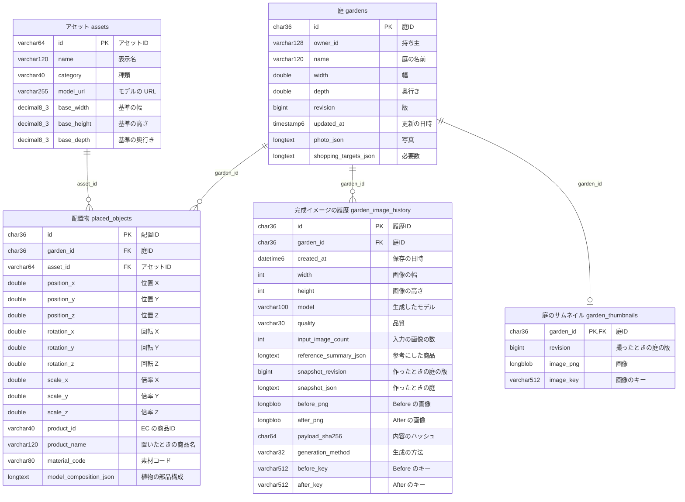

# テーブル設計書

Kusakari EC と Kusakari Canvas の MySQL のテーブルを、テーブル一覧と、テーブルごとの列の定義でまとめた設計書です。

- 対象のコード: kusakari-ec の main（8892344）、kusakari-canvas の main（7e9a8dd）。どちらも 2026-11-25 時点です。
- マイグレーション（EC は Flyway の V1〜V7、Canvas は Alembic の 0001〜0008）を空の MySQL 8.0 に当て、`information_schema` から起こしました。
- データの構造は [クラス図](<../クラス図/クラス図.md>)、処理の流れは [シーケンス図](<../シーケンス図>) にあります。
- EC と Canvas は別の DB です。Canvas の庭の持ち主（`gardens.owner_id`）と、EC の庭の買い物リスト（`garden_shopping_lists.garden_id`）は、相手の DB を外部キーで指しません。

## 図と表の読み方

- ER 図の箱は、上が「論理名称 物理名称」、中が「型 列名 キー 論理名称」です。型はかっこを書けないので、`varchar64` は VARCHAR(64)、`decimal8_3` は DECIMAL(8,3)、`timestamp6` は TIMESTAMP(6) です。
- ER 図の線は外部キーで、ラベルは外部キーの列です。親の側の `||` は必ず 1 つ、`|o` は無いか 1 つ（外部キーが NULL 可）、子の側の `o{` は 0 個以上、`o|` は無いか 1 つ（外部キーが一意）です。

- PK は主キー、NN は NOT NULL の列に ○ を付けます。FK は外部キーの参照先（テーブル.列）です。
- 桁数は、VARCHAR・CHAR は文字数、DECIMAL は「全体の桁,小数の桁」、TIMESTAMP・DATETIME は秒の小数の桁です。
- BOOLEAN は、MySQL では TINYINT(1) です。初期値の「（更新時も）」は、行を更新するたびに今の時刻が入る列です。
- 「制約と索引」には、複合主キー、複数列の外部キーと削除時の動き、一意制約、外部キー以外の索引、CHECK 制約を書きます。どのテーブルも InnoDB・utf8mb4 です。

## Kusakari EC

### テーブル一覧（29 テーブル）

| No | 論理名称 | 物理名称 | 備考 |
| --- | --- | --- | --- |
| 1 | 会員 | `members` | Cognito でログインする利用者・店舗の人・運営者のアカウント。行は消さず、退会・停止は列で表す |
| 2 | 受取連絡先 | `member_pickup_contacts` | 店舗受け取りの注文で前回使った受取人と連絡先。会員 1 人に 1 行 |
| 3 | 通知 | `notifications` | 会員あての通知と、店舗あての通知 |
| 4 | 事業者申請 | `organization_applications` | 店舗を出したい会員の事業者登録の申請。承認すると組織を作る |
| 5 | 組織 | `organizations` | 店舗を持つ事業者。オーナー 1 人と、所属する店舗の人を持つ |
| 6 | 組織の所属 | `organization_members` | 組織に所属する店舗の人（SHOP_STAFF）。1 人 1 組織まで |
| 7 | 店舗 | `stores` | 組織の店舗。商品と注文の受け取り先 |
| 8 | 店舗の担当 | `store_members` | 組織の人がどの店舗を担当するか |
| 9 | 招待キー | `store_invitations` | 店舗の人を新規登録させる招待キー。キーそのものは持たずハッシュだけ持つ |
| 10 | 招待キーの使用 | `store_invitation_uses` | 招待キーで登録した会員。1 人 1 行まで |
| 11 | カテゴリー | `categories` | 商品の分類 |
| 12 | 商品 | `products` | 店舗が売る植物・資材。植物の 3D モデルの情報も持つ |
| 13 | 商品画像 | `product_images` | 商品の画像の URL と並び順 |
| 14 | 画像データ | `product_media` | 店舗が上げた商品画像の本体 |
| 15 | 在庫 | `inventory` | 商品ごとの在庫数と公開の状態。商品 1 つに 1 行 |
| 16 | 素材コードの対応 | `material_products` | Canvas の素材コードと EC の商品の対応 |
| 17 | カート | `carts` | 会員のカート。会員 1 人に 1 つ |
| 18 | カートの商品 | `cart_items` | カートに入れた商品と数量 |
| 19 | 庭の買い物リスト | `garden_shopping_lists` | Canvas の庭から EC のカートに入れた買い物リスト。カートと庭の組に 1 行 |
| 20 | 庭の買い物リストの商品 | `garden_shopping_items` | 庭の買い物リストから入れた商品 |
| 21 | 注文 | `orders` | お会計で作る店舗受け取りの注文。受取店舗ごとに 1 件。店舗の名前などは注文時の値を写す |
| 22 | 注文明細 | `order_items` | 注文した商品。商品番号・名前・単価は注文時の値を写す |
| 23 | 決済 | `payments` | カード払いのお会計 1 回に 1 つの決済（Stripe のテストモード） |
| 24 | 返金 | `refunds` | カード払いの注文をキャンセルしたときの返金。注文 1 件に 1 行 |
| 25 | Stripe の通知の記録 | `stripe_events` | 処理済みの Stripe の通知（Webhook）。同じ通知を 2 回処理しないため |
| 26 | 商品の運営記録 | `product_moderation_events` | 運営による商品の警告・警告解除・停止・再開の記録。書き換えず消さない |
| 27 | 店舗の運営記録 | `store_moderation_events` | 運営による店舗の警告・警告解除・停止・再開の記録。書き換えず消さない |
| 28 | 組織の運営記録 | `organization_moderation_events` | 運営による組織の受付停止・停止・再開の記録 |
| 29 | 組織の人の操作記録 | `organization_member_events` | 店舗の担当の付け外し・除名・復帰・オーナーの引き継ぎの記録 |

### ER 図

```mermaid
erDiagram
    members ||--o| member_pickup_contacts : "member_id"
    members ||--o{ notifications : "member_id"
    stores |o--o{ notifications : "store_id"
    members ||--o{ organization_applications : "applicant_member_id"
    organizations |o--o| organization_applications : "organization_id"
    members |o--o{ organizations : "owner_member_id, owner_account_type"
    members |o--o{ organizations : "pending_owner_member_id"
    members ||--o{ organization_members : "member_id, member_account_type"
    organizations ||--o{ organization_members : "organization_id"
    organizations ||--o{ stores : "organization_id"
    organization_members ||--o{ store_members : "organization_id, member_id"
    stores ||--o{ store_members : "store_id, organization_id"
    members ||--o{ store_invitations : "issued_by_member_id"
    stores ||--o{ store_invitations : "store_id"
    store_invitations ||--o{ store_invitation_uses : "invitation_id"
    members ||--o| store_invitation_uses : "member_id"
    categories ||--o{ products : "category_name"
    members |o--o{ products : "created_by_member_id"
    stores ||--o{ products : "store_id"
    products ||--o{ product_images : "product_id"
    products ||--o| inventory : "product_id"
    products ||--o{ material_products : "product_id"
    members ||--o| carts : "member_id"
    carts ||--o{ cart_items : "cart_id"
    products ||--o{ cart_items : "product_id"
    carts ||--o{ garden_shopping_lists : "cart_id"
    garden_shopping_lists ||--o{ garden_shopping_items : "cart_id, garden_id"
    products ||--o{ garden_shopping_items : "product_id"
    members ||--o{ orders : "buyer_member_id"
    members |o--o{ orders : "cancelled_by_member_id"
    carts ||--o{ orders : "cart_id"
    payments |o--o{ orders : "payment_id, cart_id, request_id"
    stores ||--o{ orders : "store_id"
    orders ||--o{ order_items : "order_id"
    members ||--o{ payments : "buyer_member_id"
    carts ||--o{ payments : "cart_id"
    orders ||--o{ refunds : "order_id, payment_id"
    payments ||--o{ refunds : "payment_id"
    members |o--o{ refunds : "requested_by_member_id"
    members ||--o{ product_moderation_events : "actor_member_id"
    products ||--o{ product_moderation_events : "product_id"
    members ||--o{ store_moderation_events : "actor_member_id"
    stores ||--o{ store_moderation_events : "store_id"
    members |o--o{ organization_moderation_events : "actor_member_id"
    organizations ||--o{ organization_moderation_events : "organization_id"
    members ||--o{ organization_member_events : "actor_member_id"
    organizations ||--o{ organization_member_events : "organization_id"
    stores |o--o{ organization_member_events : "store_id, organization_id"
    members ||--o{ organization_member_events : "target_member_id"
    members["会員 <br>members"] {
        char36 id PK, UK "会員ID"
        varchar255 issuer UK "認証の発行元"
        varchar255 subject UK "認証の利用者ID"
        varchar255 email "メールアドレス"
        varchar120 display_name "表示名"
        varchar32 account_type UK "会員の種別"
        boolean enabled "有効"
        timestamp6 email_verified_at "メール確認の日時"
        timestamp6 withdrawn_at "退会の日時"
        timestamp6 created_at "登録の日時"
    }
    member_pickup_contacts["受取連絡先<br> member_pickup_contacts"] {
        char36 member_id PK, FK "会員ID"
        varchar120 recipient_name "受取人の名前"
        varchar40 recipient_phone "受取人の電話番号"
        varchar255 contact_email "連絡用のメールアドレス"
    }
    notifications["通知 <br>notifications"] {
        char36 id PK "通知ID"
        char36 member_id FK "あて先の会員"
        varchar16 kind "通知の種類"
        bigint store_id FK "あて先の店舗"
        varchar32 category "通知の分類"
        varchar200 title "題名"
        varchar2000 body "本文"
        timestamp6 created_at "作成の日時"
        timestamp6 read_at "既読の日時"
    }
    organization_applications["事業者申請 <br>organization_applications"] {
        char36 id PK "申請ID"
        char36 applicant_member_id FK, UK "申請した会員"
        varchar20 status "申請の状態"
        boolean is_latest UK "今の申請か"
        varchar160 organization_name "事業者名"
        varchar120 contact_name "担当者名"
        varchar255 contact_email "連絡用のメールアドレス"
        varchar40 contact_phone "電話番号"
        varchar255 company_address "会社の住所"
        varchar1000 rejection_reason "却下の理由"
        varchar255 document_name "確認書類のファイル名"
        varchar100 document_type "確認書類の形式"
        longblob document_data "確認書類の中身"
        bigint organization_id FK, UK "作った組織"
        timestamp6 created_at "作成の日時"
        timestamp6 submitted_at "提出の日時"
        timestamp6 reviewed_at "審査の日時"
    }
    organizations["組織<br> organizations"] {
        bigint id PK "組織ID"
        varchar160 name "事業者名"
        char36 owner_member_id FK, UK "オーナー"
        varchar32 owner_account_type FK "オーナーの種別"
        char36 pending_owner_member_id FK "承認待ちの譲り先"
        timestamp6 pending_owner_expires_at "引き継ぎの承認期限"
        timestamp6 suspension_started_at "受付停止の開始日時"
        boolean suspended "停止中"
        timestamp6 created_at "作成の日時"
    }
    organization_members["組織の所属<br> organization_members"] {
        bigint organization_id PK, FK "組織ID"
        char36 member_id PK, FK, UK "会員ID"
        varchar32 member_account_type FK "会員の種別"
        varchar16 role "組織のロール"
        boolean expelled "除名済み"
        timestamp6 created_at "所属の日時"
    }
    stores["店舗<br>stores"] {
        bigint id PK, UK "店舗ID"
        bigint organization_id FK, UK "組織ID"
        varchar120 name UK "店舗名"
        varchar255 address "住所"
        double latitude "緯度"
        double longitude "経度"
        varchar255 business_hours "営業時間"
        varchar120 contact_name "担当者名"
        varchar255 contact_email "連絡用のメールアドレス"
        varchar2000 introduction "紹介文"
        boolean published "公開中"
        boolean suspended "停止中"
        timestamp6 closing_started_at "閉鎖の開始日時"
        varchar16 closing_started_by "閉鎖を始めた人"
        timestamp6 closed_at "閉鎖済みの日時"
        bigint revision "版"
        timestamp6 created_at "作成の日時"
    }
    store_members["店舗の担当<br> store_members"] {
        bigint store_id PK, FK "店舗ID"
        char36 member_id PK, FK "会員ID"
        bigint organization_id FK "組織ID"
        varchar16 role "店舗のロール"
        timestamp6 created_at "担当になった日時"
    }
    store_invitations["招待キー<br>store_invitations"] {
        char36 id PK "招待キーID"
        bigint store_id FK "招待する店舗"
        char36 issued_by_member_id FK "発行した会員"
        char64 key_hash UK "キーのハッシュ"
        timestamp6 expires_at "有効期限"
        int max_uses "使える回数"
        timestamp6 revoked_at "取り消しの日時"
        timestamp6 created_at "発行の日時"
    }
    store_invitation_uses["招待キーの使用<br>store_invitation_uses"] {
        char36 invitation_id PK, FK "招待キーID"
        char36 member_id PK, FK, UK "登録した会員"
        timestamp6 used_at "使った日時"
    }
    categories["カテゴリー<br> categories"] {
        varchar80 name PK "カテゴリー名"
        timestamp6 deleted_at "削除の日時"
    }
    products["商品 <br>products"] {
        varchar40 id PK "商品ID"
        bigint store_id FK, UK "売る店舗"
        char36 created_by_member_id FK "追加した会員"
        varchar64 sku UK "商品番号"
        varchar120 name "商品名"
        varchar120 latin_name "学名"
        varchar80 category_name FK "カテゴリー名"
        text description "商品説明"
        varchar80 size_label "サイズの表示"
        text care "育て方"
        int price_yen "税込価格"
        varchar20 unit "単位"
        varchar250 image_url "代表画像の URL"
        varchar30 badge "バッジの文字"
        varchar30 source "登録元"
        varchar120 source_product_id "登録元の商品ID"
        timestamp6 source_updated_at "登録元の更新日時"
        varchar100 nursery_name "生産者名"
        varchar200 nursery_address "生産者の住所"
        varchar30 sunlight "日当たり"
        varchar80 use_case "用途・植える場所"
        int care_level "手入れのレベル"
        int min_temperature_c "最低気温"
        boolean heat_tolerant "暑さに強い"
        boolean drought_tolerant "乾燥に強い"
        int age_years "樹齢の目安"
        int height_cm "高さ"
        int pot_diameter_cm "鉢の直径"
        varchar100 family_name "科名・属名"
        text flowering_description "開花の説明"
        text seasonal_care "季節の手入れ"
        text style_description "庭のスタイルの説明"
        json plant_model_profile "植物モデルの特徴"
        json model_composition "植物モデルの部品構成"
        boolean suspended "停止中"
        timestamp6 published_at "掲載の日時"
    }
    product_images["商品画像<br> product_images"] {
        varchar40 product_id PK, FK "商品ID"
        int sort_order PK "並び順"
        varchar2048 image_url "画像の URL"
    }
    product_media["画像データ<br> product_media"] {
        varchar36 id PK "画像ID"
        varchar30 content_type "画像の形式"
        longblob image_data "画像の中身"
    }
    inventory["在庫 <br>inventory"] {
        varchar40 product_id PK, FK "商品ID"
        int quantity "在庫数"
        varchar16 publication_status "公開の状態"
    }
    material_products["素材コードの対応<br> material_products"] {
        varchar80 material_code PK "素材コード"
        varchar40 product_id PK, FK "商品ID"
    }
    carts["カート<br> carts"] {
        char36 id PK "カートID"
        char36 member_id FK, UK "会員ID"
        bigint revision "版"
        timestamp6 created_at "作成の日時"
    }
    cart_items["カートの商品<br> cart_items"] {
        char36 cart_id PK, FK "カートID"
        varchar40 product_id PK, FK "商品ID"
        int quantity "数量"
    }
    garden_shopping_lists["庭の買い物リスト<br> garden_shopping_lists"] {
        char36 cart_id PK, FK "カートID"
        char36 garden_id PK "庭ID"
        bigint revision "庭の版"
    }
    garden_shopping_items["庭の買い物リストの商品<br>garden_shopping_items"] {
        char36 cart_id PK, FK "カートID"
        char36 garden_id PK, FK "庭ID"
        varchar40 product_id PK, FK "商品ID"
    }
    orders["注文<br> orders"] {
        char36 id PK, UK "注文ID"
        char36 cart_id FK, UK "お会計したカート"
        char36 request_id FK, UK "お会計のキー"
        bigint request_revision "お会計時のカートの版"
        char36 payment_id FK, UK "決済ID"
        char36 buyer_member_id FK "購入者"
        bigint store_id FK, UK "受取店舗"
        varchar120 store_name "注文時の店舗名"
        varchar255 store_address "注文時の店舗の住所"
        varchar255 store_business_hours "注文時の営業時間"
        varchar30 status "注文の状態"
        int total_yen "合計"
        int commission_rate_bp "手数料の率"
        int commission_yen "手数料の額"
        varchar32 payment_method "支払い方法"
        varchar120 recipient_name "受取人の名前"
        varchar40 recipient_phone "受取人の電話番号"
        varchar255 contact_email "連絡用のメールアドレス"
        varchar24 cancellation_status "キャンセルの状態"
        varchar1000 cancellation_reason "キャンセルの理由"
        varchar1000 cancellation_response "キャンセルへの回答"
        timestamp6 cancellation_at "キャンセルの日時"
        char36 cancelled_by_member_id FK "キャンセルした会員"
        timestamp6 created_at "注文の日時"
        timestamp6 ready_at "受取準備の完了日時"
        timestamp6 picked_up_at "引き渡しの日時"
        timestamp6 deleted_at "履歴から消した日時"
    }
    order_items["注文明細<br>order_items"] {
        char36 order_id PK, FK "注文ID"
        varchar40 product_id PK "商品ID"
        varchar64 sku "注文時の商品番号"
        varchar120 product_name "注文時の商品名"
        int quantity "数量"
        int unit_price_yen "注文時の単価"
    }
    payments["決済<br> payments"] {
        char36 id PK, UK "決済ID"
        char36 cart_id FK, UK "お会計したカート"
        char36 request_id UK "お会計のキー"
        char36 buyer_member_id FK "支払う会員"
        varchar255 payment_intent_id UK "Stripe の PaymentIntent"
        varchar16 status "決済の状態"
        int amount_yen "金額"
        timestamp6 created_at "作成の日時"
        timestamp6 updated_at "更新の日時"
    }
    refunds["返金<br>refunds"] {
        char36 id PK "返金ID"
        char36 order_id FK, UK "返金する注文"
        char36 payment_id FK "返金元の決済"
        varchar255 stripe_refund_id UK "Stripe の Refund"
        varchar16 status "返金の状態"
        int amount_yen "返金の額"
        char36 requested_by_member_id FK "返金を始めた会員"
        timestamp6 created_at "作成の日時"
        timestamp6 updated_at "更新の日時"
    }
    stripe_events["Stripe の通知の記録<br>stripe_events"] {
        varchar255 event_id PK "通知ID"
        varchar100 event_type "通知の種類"
        timestamp6 processed_at "処理の日時"
    }
    product_moderation_events["商品の運営記録<br>product_moderation_events"] {
        bigint id PK "記録ID"
        varchar40 product_id FK "対象の商品"
        varchar16 event_type "操作の種類"
        varchar1000 reason "理由"
        char36 actor_member_id FK "操作した運営者"
        timestamp6 created_at "操作の日時"
    }
    store_moderation_events["店舗の運営記録<br> store_moderation_events"] {
        bigint id PK "記録ID"
        bigint store_id FK "対象の店舗"
        varchar16 event_type "操作の種類"
        varchar1000 reason "理由"
        char36 actor_member_id FK "操作した運営者"
        timestamp6 created_at "操作の日時"
    }
    organization_moderation_events["組織の運営記録<br> organization_moderation_events"] {
        bigint id PK "記録ID"
        bigint organization_id FK "対象の組織"
        varchar16 event_type "操作の種類"
        varchar1000 reason "理由"
        char36 actor_member_id FK "操作した運営者"
        timestamp6 created_at "操作の日時"
    }
    organization_member_events["組織の人の操作記録 <br>organization_member_events"] {
        bigint id PK "記録ID"
        bigint organization_id FK "組織ID"
        varchar40 event_type "操作の種類"
        char36 actor_member_id FK "操作した会員"
        char36 target_member_id FK "操作された会員"
        bigint store_id FK "店舗ID"
        timestamp6 created_at "記録の日時"
    }
```

### 1. 会員（members）

Cognito でログインする利用者・店舗の人・運営者のアカウント。行は消さず、退会・停止は列で表す

| No | 論理名称 | 物理名称 | データ型 | 桁数 | 初期値 | PK | FK | NN | 備考 |
| --- | --- | --- | --- | --- | --- | --- | --- | --- | --- |
| 1 | 会員ID | `id` | CHAR | 36 | - | ○ |  | ○ | UUID |
| 2 | 認証の発行元 | `issuer` | VARCHAR | 255 | - |  |  | ○ | Cognito の issuer |
| 3 | 認証の利用者ID | `subject` | VARCHAR | 255 | - |  |  | ○ | Cognito の sub |
| 4 | メールアドレス | `email` | VARCHAR | 255 | - |  |  | ○ |  |
| 5 | 表示名 | `display_name` | VARCHAR | 120 | - |  |  | ○ |  |
| 6 | 会員の種別 | `account_type` | VARCHAR | 32 | - |  |  | ○ | USER / SHOP_OWNER_APPLICANT / SHOP_OWNER / SHOP_STAFF / ADMIN |
| 7 | 有効 | `enabled` | BOOLEAN | - | TRUE |  |  | ○ | FALSE = 利用停止か退会 |
| 8 | メール確認の日時 | `email_verified_at` | TIMESTAMP | 6 | - |  |  |  | NULL = 確認の前 |
| 9 | 退会の日時 | `withdrawn_at` | TIMESTAMP | 6 | - |  |  |  | NULL = 退会していない |
| 10 | 登録の日時 | `created_at` | TIMESTAMP | 6 | CURRENT_TIMESTAMP(6) |  |  | ○ |  |

制約と索引:

- 一意 uk_members_id_type: (id, account_type)
- 一意 uk_members_issuer_subject: (issuer, subject)
- 索引 idx_members_issuer_email: (issuer, email)
- CHECK ck_members_account_type: `account_type in ('USER','SHOP_OWNER_APPLICANT','SHOP_OWNER','SHOP_STAFF','ADMIN')`

### 2. 受取連絡先（member_pickup_contacts）

店舗受け取りの注文で前回使った受取人と連絡先。会員 1 人に 1 行

| No | 論理名称 | 物理名称 | データ型 | 桁数 | 初期値 | PK | FK | NN | 備考 |
| --- | --- | --- | --- | --- | --- | --- | --- | --- | --- |
| 1 | 会員ID | `member_id` | CHAR | 36 | - | ○ | members.id | ○ |  |
| 2 | 受取人の名前 | `recipient_name` | VARCHAR | 120 | ''（空文字） |  |  | ○ |  |
| 3 | 受取人の電話番号 | `recipient_phone` | VARCHAR | 40 | ''（空文字） |  |  | ○ |  |
| 4 | 連絡用のメールアドレス | `contact_email` | VARCHAR | 255 | ''（空文字） |  |  | ○ |  |

### 3. 通知（notifications）

会員あての通知と、店舗あての通知

| No | 論理名称 | 物理名称 | データ型 | 桁数 | 初期値 | PK | FK | NN | 備考 |
| --- | --- | --- | --- | --- | --- | --- | --- | --- | --- |
| 1 | 通知ID | `id` | CHAR | 36 | - | ○ |  | ○ | UUID |
| 2 | あて先の会員 | `member_id` | CHAR | 36 | - |  | members.id | ○ |  |
| 3 | 通知の種類 | `kind` | VARCHAR | 16 | PERSONAL |  |  | ○ | PERSONAL = 会員あて / STORE = 店舗あて |
| 4 | あて先の店舗 | `store_id` | BIGINT | - | - |  | stores.id |  | STORE のときだけ入る |
| 5 | 通知の分類 | `category` | VARCHAR | 32 | GENERAL |  |  | ○ | ORDER / CANCEL_REQUEST / MODERATION / STORE_CLOSURE / OWNER_SUCCESSION_REQUEST / OWNER_SUCCESSION_RESULT / GENERAL |
| 6 | 題名 | `title` | VARCHAR | 200 | - |  |  | ○ |  |
| 7 | 本文 | `body` | VARCHAR | 2000 | - |  |  | ○ |  |
| 8 | 作成の日時 | `created_at` | TIMESTAMP | 6 | CURRENT_TIMESTAMP(6) |  |  | ○ |  |
| 9 | 既読の日時 | `read_at` | TIMESTAMP | 6 | - |  |  |  | NULL = 未読 |

制約と索引:

- 索引 idx_notifications_member: (member_id, read_at, created_at)
- 索引 idx_notifications_store: (store_id)
- CHECK ck_notifications_category: `category in ('ORDER','CANCEL_REQUEST','MODERATION','STORE_CLOSURE','OWNER_SUCCESSION_REQUEST','OWNER_SUCCESSION_RESULT','GENERAL')`
- CHECK ck_notifications_kind: `kind in ('PERSONAL','STORE')`
- CHECK ck_notifications_store: `(kind = 'STORE') or (store_id is null)`

### 4. 事業者申請（organization_applications）

店舗を出したい会員の事業者登録の申請。承認すると組織を作る

| No | 論理名称 | 物理名称 | データ型 | 桁数 | 初期値 | PK | FK | NN | 備考 |
| --- | --- | --- | --- | --- | --- | --- | --- | --- | --- |
| 1 | 申請ID | `id` | CHAR | 36 | - | ○ |  | ○ | UUID |
| 2 | 申請した会員 | `applicant_member_id` | CHAR | 36 | - |  | members.id | ○ |  |
| 3 | 申請の状態 | `status` | VARCHAR | 20 | DRAFT |  |  | ○ | DRAFT / SUBMITTED / APPROVED / REJECTED / WITHDRAWN |
| 4 | 今の申請か | `is_latest` | BOOLEAN | - | TRUE |  |  | ○ | TRUE = 今の申請、FALSE = 前回の申請 |
| 5 | 事業者名 | `organization_name` | VARCHAR | 160 | - |  |  | ○ |  |
| 6 | 担当者名 | `contact_name` | VARCHAR | 120 | - |  |  | ○ |  |
| 7 | 連絡用のメールアドレス | `contact_email` | VARCHAR | 255 | - |  |  | ○ |  |
| 8 | 電話番号 | `contact_phone` | VARCHAR | 40 | - |  |  | ○ |  |
| 9 | 会社の住所 | `company_address` | VARCHAR | 255 | - |  |  | ○ |  |
| 10 | 却下の理由 | `rejection_reason` | VARCHAR | 1000 | - |  |  |  |  |
| 11 | 確認書類のファイル名 | `document_name` | VARCHAR | 255 | - |  |  |  |  |
| 12 | 確認書類の形式 | `document_type` | VARCHAR | 100 | - |  |  |  | MIME タイプ |
| 13 | 確認書類の中身 | `document_data` | LONGBLOB | - | - |  |  |  |  |
| 14 | 作った組織 | `organization_id` | BIGINT | - | - |  | organizations.id |  | 承認されたときだけ入る |
| 15 | 作成の日時 | `created_at` | TIMESTAMP | 6 | CURRENT_TIMESTAMP(6) |  |  | ○ |  |
| 16 | 提出の日時 | `submitted_at` | TIMESTAMP | 6 | - |  |  |  |  |
| 17 | 審査の日時 | `reviewed_at` | TIMESTAMP | 6 | - |  |  |  |  |

制約と索引:

- 一意 uk_applications_applicant_latest: (applicant_member_id, is_latest)
- 一意 uk_applications_organization: (organization_id)
- CHECK ck_applications_approved: `(status = 'APPROVED') = (organization_id is not null)`
- CHECK ck_applications_previous: `(is_latest = true) or (status in ('REJECTED','WITHDRAWN'))`
- CHECK ck_applications_status: `status in ('DRAFT','SUBMITTED','APPROVED','REJECTED','WITHDRAWN')`

### 5. 組織（organizations）

店舗を持つ事業者。オーナー 1 人と、所属する店舗の人を持つ

| No | 論理名称 | 物理名称 | データ型 | 桁数 | 初期値 | PK | FK | NN | 備考 |
| --- | --- | --- | --- | --- | --- | --- | --- | --- | --- |
| 1 | 組織ID | `id` | BIGINT | - | AUTO_INCREMENT | ○ |  | ○ | 自動の連番 |
| 2 | 事業者名 | `name` | VARCHAR | 160 | - |  |  | ○ |  |
| 3 | オーナー | `owner_member_id` | CHAR | 36 | - |  | members.id |  |  |
| 4 | オーナーの種別 | `owner_account_type` | VARCHAR | 32 | SHOP_OWNER |  | members.account_type | ○ | 常に SHOP_OWNER（複合外部キー用） |
| 5 | 承認待ちの譲り先 | `pending_owner_member_id` | CHAR | 36 | - |  | members.id |  | オーナーの引き継ぎの相手 |
| 6 | 引き継ぎの承認期限 | `pending_owner_expires_at` | TIMESTAMP | 6 | - |  |  |  |  |
| 7 | 受付停止の開始日時 | `suspension_started_at` | TIMESTAMP | 6 | - |  |  |  | NULL = 通常 |
| 8 | 停止中 | `suspended` | BOOLEAN | - | FALSE |  |  | ○ | TRUE = 運営が停止 |
| 9 | 作成の日時 | `created_at` | TIMESTAMP | 6 | CURRENT_TIMESTAMP(6) |  |  | ○ |  |

制約と索引:

- 外部キー fk_organizations_owner: (owner_member_id, owner_account_type) → members (id, account_type)
- 一意 uk_organizations_owner: (owner_member_id)
- CHECK ck_organizations_owner_type: `owner_account_type = 'SHOP_OWNER'`
- CHECK ck_organizations_pending_owner: `(pending_owner_member_id is null) = (pending_owner_expires_at is null)`
- CHECK ck_organizations_suspension: `(suspended = false) or (suspension_started_at is not null)`

### 6. 組織の所属（organization_members）

組織に所属する店舗の人（SHOP_STAFF）。1 人 1 組織まで

| No | 論理名称 | 物理名称 | データ型 | 桁数 | 初期値 | PK | FK | NN | 備考 |
| --- | --- | --- | --- | --- | --- | --- | --- | --- | --- |
| 1 | 組織ID | `organization_id` | BIGINT | - | - | ○ | organizations.id | ○ |  |
| 2 | 会員ID | `member_id` | CHAR | 36 | - | ○ | members.id | ○ |  |
| 3 | 会員の種別 | `member_account_type` | VARCHAR | 32 | SHOP_STAFF |  | members.account_type | ○ | 常に SHOP_STAFF（複合外部キー用） |
| 4 | 組織のロール | `role` | VARCHAR | 16 | - |  |  |  | ORG_ADMIN / NULL = ロールなし |
| 5 | 除名済み | `expelled` | BOOLEAN | - | FALSE |  |  | ○ | TRUE = 組織から除名 |
| 6 | 所属の日時 | `created_at` | TIMESTAMP | 6 | CURRENT_TIMESTAMP(6) |  |  | ○ |  |

制約と索引:

- 複合主キー: (organization_id, member_id)
- 外部キー fk_org_members_member: (member_id, member_account_type) → members (id, account_type)
- 一意 uk_org_members_member: (member_id)
- CHECK ck_org_members_role: `role = 'ORG_ADMIN'`
- CHECK ck_org_members_type: `member_account_type = 'SHOP_STAFF'`

### 7. 店舗（stores）

組織の店舗。商品と注文の受け取り先

| No | 論理名称 | 物理名称 | データ型 | 桁数 | 初期値 | PK | FK | NN | 備考 |
| --- | --- | --- | --- | --- | --- | --- | --- | --- | --- |
| 1 | 店舗ID | `id` | BIGINT | - | AUTO_INCREMENT | ○ |  | ○ | 自動の連番 |
| 2 | 組織ID | `organization_id` | BIGINT | - | - |  | organizations.id | ○ |  |
| 3 | 店舗名 | `name` | VARCHAR | 120 | - |  |  | ○ | 組織の中で一意 |
| 4 | 住所 | `address` | VARCHAR | 255 | ''（空文字） |  |  | ○ |  |
| 5 | 緯度 | `latitude` | DOUBLE | - | - |  |  |  |  |
| 6 | 経度 | `longitude` | DOUBLE | - | - |  |  |  |  |
| 7 | 営業時間 | `business_hours` | VARCHAR | 255 | ''（空文字） |  |  | ○ |  |
| 8 | 担当者名 | `contact_name` | VARCHAR | 120 | ''（空文字） |  |  | ○ |  |
| 9 | 連絡用のメールアドレス | `contact_email` | VARCHAR | 255 | ''（空文字） |  |  | ○ |  |
| 10 | 紹介文 | `introduction` | VARCHAR | 2000 | ''（空文字） |  |  | ○ |  |
| 11 | 公開中 | `published` | BOOLEAN | - | FALSE |  |  | ○ | オーナーが公開 |
| 12 | 停止中 | `suspended` | BOOLEAN | - | FALSE |  |  | ○ | 運営が停止 |
| 13 | 閉鎖の開始日時 | `closing_started_at` | TIMESTAMP | 6 | - |  |  |  | NULL = 営業中 |
| 14 | 閉鎖を始めた人 | `closing_started_by` | VARCHAR | 16 | - |  |  |  | OWNER / ADMIN |
| 15 | 閉鎖済みの日時 | `closed_at` | TIMESTAMP | 6 | - |  |  |  |  |
| 16 | 版 | `revision` | BIGINT | - | 0 |  |  | ○ | 楽観ロック |
| 17 | 作成の日時 | `created_at` | TIMESTAMP | 6 | CURRENT_TIMESTAMP(6) |  |  | ○ |  |

制約と索引:

- 一意 uk_stores_id_org: (id, organization_id)
- 一意 uk_stores_org_name: (organization_id, name)
- CHECK ck_stores_closed: `(closed_at is null) or (closing_started_at is not null)`
- CHECK ck_stores_closing: `(closing_started_at is null) = (closing_started_by is null)`
- CHECK ck_stores_closing_by: `closing_started_by in ('OWNER','ADMIN')`
- CHECK ck_stores_location: `(latitude is null) = (longitude is null)`

### 8. 店舗の担当（store_members）

組織の人がどの店舗を担当するか

| No | 論理名称 | 物理名称 | データ型 | 桁数 | 初期値 | PK | FK | NN | 備考 |
| --- | --- | --- | --- | --- | --- | --- | --- | --- | --- |
| 1 | 店舗ID | `store_id` | BIGINT | - | - | ○ | stores.id | ○ |  |
| 2 | 会員ID | `member_id` | CHAR | 36 | - | ○ | organization_members.member_id | ○ |  |
| 3 | 組織ID | `organization_id` | BIGINT | - | - |  | organization_members.organization_id、stores.organization_id | ○ | 店舗と所属が同じ組織かを確かめる |
| 4 | 店舗のロール | `role` | VARCHAR | 16 | - |  |  |  | MANAGER / STAFF / NULL |
| 5 | 担当になった日時 | `created_at` | TIMESTAMP | 6 | CURRENT_TIMESTAMP(6) |  |  | ○ |  |

制約と索引:

- 複合主キー: (store_id, member_id)
- 外部キー fk_store_members_member: (organization_id, member_id) → organization_members (organization_id, member_id)。親の行を消すと一緒に消える
- 外部キー fk_store_members_store: (store_id, organization_id) → stores (id, organization_id)
- 索引 idx_store_members_member: (organization_id, member_id)
- CHECK ck_store_members_role: `role in ('MANAGER','STAFF')`

### 9. 招待キー（store_invitations）

店舗の人を新規登録させる招待キー。キーそのものは持たずハッシュだけ持つ

| No | 論理名称 | 物理名称 | データ型 | 桁数 | 初期値 | PK | FK | NN | 備考 |
| --- | --- | --- | --- | --- | --- | --- | --- | --- | --- |
| 1 | 招待キーID | `id` | CHAR | 36 | - | ○ |  | ○ | UUID |
| 2 | 招待する店舗 | `store_id` | BIGINT | - | - |  | stores.id | ○ |  |
| 3 | 発行した会員 | `issued_by_member_id` | CHAR | 36 | - |  | members.id | ○ |  |
| 4 | キーのハッシュ | `key_hash` | CHAR | 64 | - |  |  | ○ | SHA-256 |
| 5 | 有効期限 | `expires_at` | TIMESTAMP | 6 | - |  |  | ○ |  |
| 6 | 使える回数 | `max_uses` | INT | - | - |  |  |  | 1 = 1 回限り、NULL = 期限内なら何回でも |
| 7 | 取り消しの日時 | `revoked_at` | TIMESTAMP | 6 | - |  |  |  |  |
| 8 | 発行の日時 | `created_at` | TIMESTAMP | 6 | CURRENT_TIMESTAMP(6) |  |  | ○ |  |

制約と索引:

- 一意 uk_invitations_key: (key_hash)
- 索引 idx_invitations_store: (store_id)
- CHECK ck_invitations_max_uses: `(max_uses is null) or (max_uses >= 1)`

### 10. 招待キーの使用（store_invitation_uses）

招待キーで登録した会員。1 人 1 行まで

| No | 論理名称 | 物理名称 | データ型 | 桁数 | 初期値 | PK | FK | NN | 備考 |
| --- | --- | --- | --- | --- | --- | --- | --- | --- | --- |
| 1 | 招待キーID | `invitation_id` | CHAR | 36 | - | ○ | store_invitations.id | ○ |  |
| 2 | 登録した会員 | `member_id` | CHAR | 36 | - | ○ | members.id | ○ |  |
| 3 | 使った日時 | `used_at` | TIMESTAMP | 6 | CURRENT_TIMESTAMP(6) |  |  | ○ |  |

制約と索引:

- 複合主キー: (invitation_id, member_id)
- 一意 uk_invitation_uses_member: (member_id)

### 11. カテゴリー（categories）

商品の分類

| No | 論理名称 | 物理名称 | データ型 | 桁数 | 初期値 | PK | FK | NN | 備考 |
| --- | --- | --- | --- | --- | --- | --- | --- | --- | --- |
| 1 | カテゴリー名 | `name` | VARCHAR | 80 | - | ○ |  | ○ |  |
| 2 | 削除の日時 | `deleted_at` | TIMESTAMP | 6 | - |  |  |  | NULL = 使用中 |

### 12. 商品（products）

店舗が売る植物・資材。植物の 3D モデルの情報も持つ

| No | 論理名称 | 物理名称 | データ型 | 桁数 | 初期値 | PK | FK | NN | 備考 |
| --- | --- | --- | --- | --- | --- | --- | --- | --- | --- |
| 1 | 商品ID | `id` | VARCHAR | 40 | - | ○ |  | ○ |  |
| 2 | 売る店舗 | `store_id` | BIGINT | - | - |  | stores.id | ○ |  |
| 3 | 追加した会員 | `created_by_member_id` | CHAR | 36 | - |  | members.id |  | 店舗の画面で登録したときだけ入る。初期データは NULL |
| 4 | 商品番号 | `sku` | VARCHAR | 64 | - |  |  | ○ | 店舗の中で一意 |
| 5 | 商品名 | `name` | VARCHAR | 120 | - |  |  | ○ |  |
| 6 | 学名 | `latin_name` | VARCHAR | 120 | - |  |  | ○ |  |
| 7 | カテゴリー名 | `category_name` | VARCHAR | 80 | - |  | categories.name | ○ |  |
| 8 | 商品説明 | `description` | TEXT | - | - |  |  | ○ |  |
| 9 | サイズの表示 | `size_label` | VARCHAR | 80 | - |  |  | ○ |  |
| 10 | 育て方 | `care` | TEXT | - | - |  |  | ○ |  |
| 11 | 税込価格 | `price_yen` | INT | - | - |  |  | ○ | 円 |
| 12 | 単位 | `unit` | VARCHAR | 20 | piece |  |  | ○ |  |
| 13 | 代表画像の URL | `image_url` | VARCHAR | 250 | - |  |  | ○ |  |
| 14 | バッジの文字 | `badge` | VARCHAR | 30 | - |  |  | ○ |  |
| 15 | 登録元 | `source` | VARCHAR | 30 | demo |  |  | ○ |  |
| 16 | 登録元の商品ID | `source_product_id` | VARCHAR | 120 | - |  |  |  |  |
| 17 | 登録元の更新日時 | `source_updated_at` | TIMESTAMP | 6 | CURRENT_TIMESTAMP(6) |  |  | ○ |  |
| 18 | 生産者名 | `nursery_name` | VARCHAR | 100 | ''（空文字） |  |  | ○ |  |
| 19 | 生産者の住所 | `nursery_address` | VARCHAR | 200 | ''（空文字） |  |  | ○ |  |
| 20 | 日当たり | `sunlight` | VARCHAR | 30 | 未設定 |  |  | ○ |  |
| 21 | 用途・植える場所 | `use_case` | VARCHAR | 80 | ''（空文字） |  |  | ○ |  |
| 22 | 手入れのレベル | `care_level` | INT | - | 1 |  |  | ○ | 1〜3 |
| 23 | 最低気温 | `min_temperature_c` | INT | - | - |  |  |  | ℃ |
| 24 | 暑さに強い | `heat_tolerant` | BOOLEAN | - | FALSE |  |  | ○ |  |
| 25 | 乾燥に強い | `drought_tolerant` | BOOLEAN | - | FALSE |  |  | ○ |  |
| 26 | 樹齢の目安 | `age_years` | INT | - | - |  |  |  | 年 |
| 27 | 高さ | `height_cm` | INT | - | - |  |  |  | cm |
| 28 | 鉢の直径 | `pot_diameter_cm` | INT | - | - |  |  |  | cm |
| 29 | 科名・属名 | `family_name` | VARCHAR | 100 | ''（空文字） |  |  | ○ |  |
| 30 | 開花の説明 | `flowering_description` | TEXT | - | - |  |  |  |  |
| 31 | 季節の手入れ | `seasonal_care` | TEXT | - | - |  |  |  |  |
| 32 | 庭のスタイルの説明 | `style_description` | TEXT | - | - |  |  |  |  |
| 33 | 植物モデルの特徴 | `plant_model_profile` | JSON | - | - |  |  |  | JSON。Canvas の 3D モデルを作る値 |
| 34 | 植物モデルの部品構成 | `model_composition` | JSON | - | - |  |  |  | JSON |
| 35 | 停止中 | `suspended` | BOOLEAN | - | FALSE |  |  | ○ | 運営が停止 |
| 36 | 掲載の日時 | `published_at` | TIMESTAMP | 6 | CURRENT_TIMESTAMP(6) |  |  | ○ |  |

制約と索引:

- 一意 uk_products_store_sku: (store_id, sku)
- CHECK ck_products_care_level: `care_level between 1 and 3`
- CHECK ck_products_price: `price_yen > 0`

### 13. 商品画像（product_images）

商品の画像の URL と並び順

| No | 論理名称 | 物理名称 | データ型 | 桁数 | 初期値 | PK | FK | NN | 備考 |
| --- | --- | --- | --- | --- | --- | --- | --- | --- | --- |
| 1 | 商品ID | `product_id` | VARCHAR | 40 | - | ○ | products.id | ○ |  |
| 2 | 並び順 | `sort_order` | INT | - | - | ○ |  | ○ |  |
| 3 | 画像の URL | `image_url` | VARCHAR | 2048 | - |  |  | ○ |  |

制約と索引:

- 複合主キー: (product_id, sort_order)

### 14. 画像データ（product_media）

店舗が上げた商品画像の本体

| No | 論理名称 | 物理名称 | データ型 | 桁数 | 初期値 | PK | FK | NN | 備考 |
| --- | --- | --- | --- | --- | --- | --- | --- | --- | --- |
| 1 | 画像ID | `id` | VARCHAR | 36 | - | ○ |  | ○ | UUID |
| 2 | 画像の形式 | `content_type` | VARCHAR | 30 | - |  |  | ○ | MIME タイプ |
| 3 | 画像の中身 | `image_data` | LONGBLOB | - | - |  |  | ○ |  |

### 15. 在庫（inventory）

商品ごとの在庫数と公開の状態。商品 1 つに 1 行

| No | 論理名称 | 物理名称 | データ型 | 桁数 | 初期値 | PK | FK | NN | 備考 |
| --- | --- | --- | --- | --- | --- | --- | --- | --- | --- |
| 1 | 商品ID | `product_id` | VARCHAR | 40 | - | ○ | products.id | ○ |  |
| 2 | 在庫数 | `quantity` | INT | - | 0 |  |  | ○ | 0 以上 |
| 3 | 公開の状態 | `publication_status` | VARCHAR | 16 | HIDDEN |  |  | ○ | PUBLISHED / HIDDEN / DELETED |

制約と索引:

- CHECK ck_inventory_quantity: `quantity >= 0`
- CHECK ck_inventory_status: `publication_status in ('PUBLISHED','HIDDEN','DELETED')`

### 16. 素材コードの対応（material_products）

Canvas の素材コードと EC の商品の対応

| No | 論理名称 | 物理名称 | データ型 | 桁数 | 初期値 | PK | FK | NN | 備考 |
| --- | --- | --- | --- | --- | --- | --- | --- | --- | --- |
| 1 | 素材コード | `material_code` | VARCHAR | 80 | - | ○ |  | ○ |  |
| 2 | 商品ID | `product_id` | VARCHAR | 40 | - | ○ | products.id | ○ |  |

制約と索引:

- 複合主キー: (material_code, product_id)

### 17. カート（carts）

会員のカート。会員 1 人に 1 つ

| No | 論理名称 | 物理名称 | データ型 | 桁数 | 初期値 | PK | FK | NN | 備考 |
| --- | --- | --- | --- | --- | --- | --- | --- | --- | --- |
| 1 | カートID | `id` | CHAR | 36 | - | ○ |  | ○ | UUID |
| 2 | 会員ID | `member_id` | CHAR | 36 | - |  | members.id | ○ |  |
| 3 | 版 | `revision` | BIGINT | - | 0 |  |  | ○ | カートを変えるたびに増える |
| 4 | 作成の日時 | `created_at` | TIMESTAMP | 6 | CURRENT_TIMESTAMP(6) |  |  | ○ |  |

制約と索引:

- 一意 uk_carts_member: (member_id)

### 18. カートの商品（cart_items）

カートに入れた商品と数量

| No | 論理名称 | 物理名称 | データ型 | 桁数 | 初期値 | PK | FK | NN | 備考 |
| --- | --- | --- | --- | --- | --- | --- | --- | --- | --- |
| 1 | カートID | `cart_id` | CHAR | 36 | - | ○ | carts.id | ○ |  |
| 2 | 商品ID | `product_id` | VARCHAR | 40 | - | ○ | products.id | ○ |  |
| 3 | 数量 | `quantity` | INT | - | - |  |  | ○ | 1〜99 |

制約と索引:

- 複合主キー: (cart_id, product_id)
- 外部キー fk_cart_items_cart: (cart_id) → carts (id)。親の行を消すと一緒に消える
- CHECK ck_cart_items_quantity: `quantity between 1 and 99`

### 19. 庭の買い物リスト（garden_shopping_lists）

Canvas の庭から EC のカートに入れた買い物リスト。カートと庭の組に 1 行

| No | 論理名称 | 物理名称 | データ型 | 桁数 | 初期値 | PK | FK | NN | 備考 |
| --- | --- | --- | --- | --- | --- | --- | --- | --- | --- |
| 1 | カートID | `cart_id` | CHAR | 36 | - | ○ | carts.id | ○ |  |
| 2 | 庭ID | `garden_id` | CHAR | 36 | - | ○ |  | ○ | Canvas の gardens.id |
| 3 | 庭の版 | `revision` | BIGINT | - | 0 |  |  | ○ | カートに入れたときの庭の revision |

制約と索引:

- 複合主キー: (cart_id, garden_id)
- 外部キー fk_garden_lists_cart: (cart_id) → carts (id)。親の行を消すと一緒に消える

### 20. 庭の買い物リストの商品（garden_shopping_items）

庭の買い物リストから入れた商品

| No | 論理名称 | 物理名称 | データ型 | 桁数 | 初期値 | PK | FK | NN | 備考 |
| --- | --- | --- | --- | --- | --- | --- | --- | --- | --- |
| 1 | カートID | `cart_id` | CHAR | 36 | - | ○ | garden_shopping_lists.cart_id | ○ |  |
| 2 | 庭ID | `garden_id` | CHAR | 36 | - | ○ | garden_shopping_lists.garden_id | ○ |  |
| 3 | 商品ID | `product_id` | VARCHAR | 40 | - | ○ | products.id | ○ |  |

制約と索引:

- 複合主キー: (cart_id, garden_id, product_id)
- 外部キー fk_garden_items_list: (cart_id, garden_id) → garden_shopping_lists (cart_id, garden_id)。親の行を消すと一緒に消える

### 21. 注文（orders）

お会計で作る店舗受け取りの注文。受取店舗ごとに 1 件。店舗の名前などは注文時の値を写す

| No | 論理名称 | 物理名称 | データ型 | 桁数 | 初期値 | PK | FK | NN | 備考 |
| --- | --- | --- | --- | --- | --- | --- | --- | --- | --- |
| 1 | 注文ID | `id` | CHAR | 36 | - | ○ |  | ○ | UUID |
| 2 | お会計したカート | `cart_id` | CHAR | 36 | - |  | carts.id、payments.cart_id | ○ |  |
| 3 | お会計のキー | `request_id` | CHAR | 36 | - |  | payments.request_id | ○ | 同じお会計を 2 回しないための値 |
| 4 | お会計時のカートの版 | `request_revision` | BIGINT | - | - |  |  | ○ |  |
| 5 | 決済ID | `payment_id` | CHAR | 36 | - |  | payments.id |  | カード払いのときだけ入る |
| 6 | 購入者 | `buyer_member_id` | CHAR | 36 | - |  | members.id | ○ |  |
| 7 | 受取店舗 | `store_id` | BIGINT | - | - |  | stores.id | ○ |  |
| 8 | 注文時の店舗名 | `store_name` | VARCHAR | 120 | - |  |  | ○ |  |
| 9 | 注文時の店舗の住所 | `store_address` | VARCHAR | 255 | - |  |  | ○ |  |
| 10 | 注文時の営業時間 | `store_business_hours` | VARCHAR | 255 | - |  |  | ○ |  |
| 11 | 注文の状態 | `status` | VARCHAR | 30 | - |  |  | ○ | PENDING_PAYMENT / ACCEPTED / READY / COMPLETED / CANCELLED |
| 12 | 合計 | `total_yen` | INT | - | - |  |  | ○ | 円 |
| 13 | 手数料の率 | `commission_rate_bp` | INT | - | - |  |  | ○ | 1 万分率。800 = 8% |
| 14 | 手数料の額 | `commission_yen` | INT | - | - |  |  | ○ | 円 |
| 15 | 支払い方法 | `payment_method` | VARCHAR | 32 | - |  |  | ○ | CARD / PAY_AT_STORE |
| 16 | 受取人の名前 | `recipient_name` | VARCHAR | 120 | - |  |  | ○ |  |
| 17 | 受取人の電話番号 | `recipient_phone` | VARCHAR | 40 | - |  |  | ○ |  |
| 18 | 連絡用のメールアドレス | `contact_email` | VARCHAR | 255 | - |  |  | ○ |  |
| 19 | キャンセルの状態 | `cancellation_status` | VARCHAR | 24 | NONE |  |  | ○ | NONE / PENDING / APPROVED / REJECTED |
| 20 | キャンセルの理由 | `cancellation_reason` | VARCHAR | 1000 | ''（空文字） |  |  | ○ |  |
| 21 | キャンセルへの回答 | `cancellation_response` | VARCHAR | 1000 | ''（空文字） |  |  | ○ | 店舗の回答か運営の理由 |
| 22 | キャンセルの日時 | `cancellation_at` | TIMESTAMP | 6 | - |  |  |  | 申請か判断の日時 |
| 23 | キャンセルした会員 | `cancelled_by_member_id` | CHAR | 36 | - |  | members.id |  |  |
| 24 | 注文の日時 | `created_at` | TIMESTAMP | 6 | CURRENT_TIMESTAMP(6) |  |  | ○ |  |
| 25 | 受取準備の完了日時 | `ready_at` | TIMESTAMP | 6 | - |  |  |  |  |
| 26 | 引き渡しの日時 | `picked_up_at` | TIMESTAMP | 6 | - |  |  |  |  |
| 27 | 履歴から消した日時 | `deleted_at` | TIMESTAMP | 6 | - |  |  |  | 購入者が消したとき |

制約と索引:

- 外部キー fk_orders_payment: (payment_id, cart_id, request_id) → payments (id, cart_id, request_id)
- 一意 uk_orders_id_payment: (id, payment_id)
- 一意 uk_orders_request: (cart_id, request_id, store_id)
- 索引 idx_orders_buyer: (buyer_member_id, created_at)
- 索引 idx_orders_store: (store_id, status, created_at)
- CHECK ck_orders_cancellation_status: `cancellation_status in ('NONE','PENDING','APPROVED','REJECTED')`
- CHECK ck_orders_commission: `(commission_yen >= 0) and (commission_yen <= total_yen)`
- CHECK ck_orders_commission_rate: `commission_rate_bp between 0 and 10000`
- CHECK ck_orders_status: `status in ('PENDING_PAYMENT','ACCEPTED','READY','COMPLETED','CANCELLED')`

### 22. 注文明細（order_items）

注文した商品。商品番号・名前・単価は注文時の値を写す

| No | 論理名称 | 物理名称 | データ型 | 桁数 | 初期値 | PK | FK | NN | 備考 |
| --- | --- | --- | --- | --- | --- | --- | --- | --- | --- |
| 1 | 注文ID | `order_id` | CHAR | 36 | - | ○ | orders.id | ○ |  |
| 2 | 商品ID | `product_id` | VARCHAR | 40 | - | ○ |  | ○ | 外部キーなし |
| 3 | 注文時の商品番号 | `sku` | VARCHAR | 64 | - |  |  | ○ |  |
| 4 | 注文時の商品名 | `product_name` | VARCHAR | 120 | - |  |  | ○ |  |
| 5 | 数量 | `quantity` | INT | - | - |  |  | ○ |  |
| 6 | 注文時の単価 | `unit_price_yen` | INT | - | - |  |  | ○ | 円 |

制約と索引:

- 複合主キー: (order_id, product_id)

### 23. 決済（payments）

カード払いのお会計 1 回に 1 つの決済（Stripe のテストモード）

| No | 論理名称 | 物理名称 | データ型 | 桁数 | 初期値 | PK | FK | NN | 備考 |
| --- | --- | --- | --- | --- | --- | --- | --- | --- | --- |
| 1 | 決済ID | `id` | CHAR | 36 | - | ○ |  | ○ | UUID |
| 2 | お会計したカート | `cart_id` | CHAR | 36 | - |  | carts.id | ○ |  |
| 3 | お会計のキー | `request_id` | CHAR | 36 | - |  |  | ○ |  |
| 4 | 支払う会員 | `buyer_member_id` | CHAR | 36 | - |  | members.id | ○ |  |
| 5 | Stripe の PaymentIntent | `payment_intent_id` | VARCHAR | 255 | - |  |  |  |  |
| 6 | 決済の状態 | `status` | VARCHAR | 16 | PENDING |  |  | ○ | PENDING / SUCCEEDED / FAILED / EXPIRED |
| 7 | 金額 | `amount_yen` | INT | - | - |  |  | ○ | 円 |
| 8 | 作成の日時 | `created_at` | TIMESTAMP | 6 | CURRENT_TIMESTAMP(6) |  |  | ○ |  |
| 9 | 更新の日時 | `updated_at` | TIMESTAMP | 6 | CURRENT_TIMESTAMP(6)（更新時も） |  |  | ○ |  |

制約と索引:

- 一意 uk_payments_checkout: (cart_id, request_id)
- 一意 uk_payments_id_checkout: (id, cart_id, request_id)
- 一意 uk_payments_intent: (payment_intent_id)
- CHECK ck_payments_amount: `amount_yen > 0`
- CHECK ck_payments_status: `status in ('PENDING','SUCCEEDED','FAILED','EXPIRED')`

### 24. 返金（refunds）

カード払いの注文をキャンセルしたときの返金。注文 1 件に 1 行

| No | 論理名称 | 物理名称 | データ型 | 桁数 | 初期値 | PK | FK | NN | 備考 |
| --- | --- | --- | --- | --- | --- | --- | --- | --- | --- |
| 1 | 返金ID | `id` | CHAR | 36 | - | ○ |  | ○ | UUID |
| 2 | 返金する注文 | `order_id` | CHAR | 36 | - |  | orders.id | ○ |  |
| 3 | 返金元の決済 | `payment_id` | CHAR | 36 | - |  | orders.payment_id、payments.id | ○ |  |
| 4 | Stripe の Refund | `stripe_refund_id` | VARCHAR | 255 | - |  |  |  |  |
| 5 | 返金の状態 | `status` | VARCHAR | 16 | REQUESTED |  |  | ○ | REQUESTED / SUCCEEDED / FAILED |
| 6 | 返金の額 | `amount_yen` | INT | - | - |  |  | ○ | 円 |
| 7 | 返金を始めた会員 | `requested_by_member_id` | CHAR | 36 | - |  | members.id |  | Stripe の管理画面から返金したときは NULL |
| 8 | 作成の日時 | `created_at` | TIMESTAMP | 6 | CURRENT_TIMESTAMP(6) |  |  | ○ |  |
| 9 | 更新の日時 | `updated_at` | TIMESTAMP | 6 | CURRENT_TIMESTAMP(6)（更新時も） |  |  | ○ |  |

制約と索引:

- 外部キー fk_refunds_order: (order_id, payment_id) → orders (id, payment_id)
- 一意 uk_refunds_order: (order_id)
- 一意 uk_refunds_stripe: (stripe_refund_id)
- 索引 idx_refunds_payment: (payment_id)
- CHECK ck_refunds_amount: `amount_yen > 0`
- CHECK ck_refunds_status: `status in ('REQUESTED','SUCCEEDED','FAILED')`

### 25. Stripe の通知の記録（stripe_events）

処理済みの Stripe の通知（Webhook）。同じ通知を 2 回処理しないため

| No | 論理名称 | 物理名称 | データ型 | 桁数 | 初期値 | PK | FK | NN | 備考 |
| --- | --- | --- | --- | --- | --- | --- | --- | --- | --- |
| 1 | 通知ID | `event_id` | VARCHAR | 255 | - | ○ |  | ○ | Stripe の event の id |
| 2 | 通知の種類 | `event_type` | VARCHAR | 100 | - |  |  | ○ |  |
| 3 | 処理の日時 | `processed_at` | TIMESTAMP | 6 | CURRENT_TIMESTAMP(6) |  |  | ○ |  |

### 26. 商品の運営記録（product_moderation_events）

運営による商品の警告・警告解除・停止・再開の記録。書き換えず消さない

| No | 論理名称 | 物理名称 | データ型 | 桁数 | 初期値 | PK | FK | NN | 備考 |
| --- | --- | --- | --- | --- | --- | --- | --- | --- | --- |
| 1 | 記録ID | `id` | BIGINT | - | AUTO_INCREMENT | ○ |  | ○ | 自動の連番 |
| 2 | 対象の商品 | `product_id` | VARCHAR | 40 | - |  | products.id | ○ |  |
| 3 | 操作の種類 | `event_type` | VARCHAR | 16 | - |  |  | ○ | WARN / CLEAR_WARNING / SUSPEND / RESUME |
| 4 | 理由 | `reason` | VARCHAR | 1000 | ''（空文字） |  |  | ○ | 警告と停止では必須 |
| 5 | 操作した運営者 | `actor_member_id` | CHAR | 36 | - |  | members.id | ○ |  |
| 6 | 操作の日時 | `created_at` | TIMESTAMP | 6 | CURRENT_TIMESTAMP(6) |  |  | ○ |  |

制約と索引:

- 索引 idx_product_moderation_target: (product_id, id)
- CHECK ck_product_moderation_reason: `(event_type not in ('WARN','SUSPEND')) or (reason <> '')`
- CHECK ck_product_moderation_type: `event_type in ('WARN','CLEAR_WARNING','SUSPEND','RESUME')`

### 27. 店舗の運営記録（store_moderation_events）

運営による店舗の警告・警告解除・停止・再開の記録。書き換えず消さない

| No | 論理名称 | 物理名称 | データ型 | 桁数 | 初期値 | PK | FK | NN | 備考 |
| --- | --- | --- | --- | --- | --- | --- | --- | --- | --- |
| 1 | 記録ID | `id` | BIGINT | - | AUTO_INCREMENT | ○ |  | ○ | 自動の連番 |
| 2 | 対象の店舗 | `store_id` | BIGINT | - | - |  | stores.id | ○ |  |
| 3 | 操作の種類 | `event_type` | VARCHAR | 16 | - |  |  | ○ | WARN / CLEAR_WARNING / SUSPEND / RESUME |
| 4 | 理由 | `reason` | VARCHAR | 1000 | ''（空文字） |  |  | ○ | 警告と停止では必須 |
| 5 | 操作した運営者 | `actor_member_id` | CHAR | 36 | - |  | members.id | ○ |  |
| 6 | 操作の日時 | `created_at` | TIMESTAMP | 6 | CURRENT_TIMESTAMP(6) |  |  | ○ |  |

制約と索引:

- 索引 idx_store_moderation_target: (store_id, id)
- CHECK ck_store_moderation_reason: `(event_type not in ('WARN','SUSPEND')) or (reason <> '')`
- CHECK ck_store_moderation_type: `event_type in ('WARN','CLEAR_WARNING','SUSPEND','RESUME')`

### 28. 組織の運営記録（organization_moderation_events）

運営による組織の受付停止・停止・再開の記録

| No | 論理名称 | 物理名称 | データ型 | 桁数 | 初期値 | PK | FK | NN | 備考 |
| --- | --- | --- | --- | --- | --- | --- | --- | --- | --- |
| 1 | 記録ID | `id` | BIGINT | - | AUTO_INCREMENT | ○ |  | ○ | 自動の連番 |
| 2 | 対象の組織 | `organization_id` | BIGINT | - | - |  | organizations.id | ○ |  |
| 3 | 操作の種類 | `event_type` | VARCHAR | 16 | - |  |  | ○ | STOP_ACCEPTING / SUSPEND / RESUME |
| 4 | 理由 | `reason` | VARCHAR | 1000 | ''（空文字） |  |  | ○ | 受付停止では必須 |
| 5 | 操作した運営者 | `actor_member_id` | CHAR | 36 | - |  | members.id |  | NULL = 自動の停止 |
| 6 | 操作の日時 | `created_at` | TIMESTAMP | 6 | CURRENT_TIMESTAMP(6) |  |  | ○ |  |

制約と索引:

- 索引 idx_organization_moderation_target: (organization_id, id)
- CHECK ck_organization_moderation_actor: `(event_type = 'SUSPEND') or (actor_member_id is not null)`
- CHECK ck_organization_moderation_reason: `(event_type <> 'STOP_ACCEPTING') or (reason <> '')`
- CHECK ck_organization_moderation_type: `event_type in ('STOP_ACCEPTING','SUSPEND','RESUME')`

### 29. 組織の人の操作記録（organization_member_events）

店舗の担当の付け外し・除名・復帰・オーナーの引き継ぎの記録

| No | 論理名称 | 物理名称 | データ型 | 桁数 | 初期値 | PK | FK | NN | 備考 |
| --- | --- | --- | --- | --- | --- | --- | --- | --- | --- |
| 1 | 記録ID | `id` | BIGINT | - | AUTO_INCREMENT | ○ |  | ○ | 自動の連番 |
| 2 | 組織ID | `organization_id` | BIGINT | - | - |  | organizations.id、stores.organization_id | ○ |  |
| 3 | 操作の種類 | `event_type` | VARCHAR | 40 | - |  |  | ○ | ASSIGN_TO_STORE / REMOVE_FROM_STORE / EXPEL_FROM_ORGANIZATION / REINSTATE_TO_ORGANIZATION / OWNER_SUCCESSION_REQUEST / OWNER_SUCCESSION_APPROVAL / OWNER_SUCCESSION_REFUSAL / OWNER_SUCCESSION_CANCELLATION / OWNER_SUCCESSION_AUTO_INVALIDATED |
| 4 | 操作した会員 | `actor_member_id` | CHAR | 36 | - |  | members.id | ○ |  |
| 5 | 操作された会員 | `target_member_id` | CHAR | 36 | - |  | members.id | ○ |  |
| 6 | 店舗ID | `store_id` | BIGINT | - | - |  | stores.id |  | 担当の付け外しのときだけ入る |
| 7 | 記録の日時 | `created_at` | TIMESTAMP | 6 | CURRENT_TIMESTAMP(6) |  |  | ○ |  |

制約と索引:

- 外部キー fk_org_member_events_store: (store_id, organization_id) → stores (id, organization_id)
- 索引 idx_org_member_events_org: (organization_id, id)
- 索引 idx_org_member_events_store: (store_id, id)
- CHECK ck_org_member_events_store: `(event_type in ('ASSIGN_TO_STORE','REMOVE_FROM_STORE')) = (store_id is not null)`
- CHECK ck_org_member_events_type: `event_type in ('ASSIGN_TO_STORE','REMOVE_FROM_STORE','EXPEL_FROM_ORGANIZATION','REINSTATE_TO_ORGANIZATION','OWNER_SUCCESSION_REQUEST','OWNER_SUCCESSION_APPROVAL','OWNER_SUCCESSION_REFUSAL','OWNER_SUCCESSION_CANCELLATION','OWNER_SUCCESSION_AUTO_INVALIDATED')`

## Kusakari Canvas

### テーブル一覧（5 テーブル）

| No | 論理名称 | 物理名称 | 備考 |
| --- | --- | --- | --- |
| 1 | 庭 | `gardens` | GardenDocument の本体。持ち主は EC の会員。保存は全体の置き換えで、revision を比べる |
| 2 | 配置物 | `placed_objects` | 庭に置いた植物・資材。位置・回転・倍率と、結び付けた EC の商品を持つ |
| 3 | アセット | `assets` | 置ける 3D モデルの種類。初期データで入れる |
| 4 | 完成イメージの履歴 | `garden_image_history` | AI で作った完成イメージの Before・After と、作ったときの庭 |
| 5 | 庭のサムネイル | `garden_thumbnails` | 庭の一覧に出す小さな画像。庭 1 つに 1 行 |

### ER 図

### 1. 庭（gardens）

GardenDocument の本体。持ち主は EC の会員。保存は全体の置き換えで、revision を比べる

| No | 論理名称 | 物理名称 | データ型 | 桁数 | 初期値 | PK | FK | NN | 備考 |
| --- | --- | --- | --- | --- | --- | --- | --- | --- | --- |
| 1 | 庭ID | `id` | CHAR | 36 | - | ○ |  | ○ | UUID |
| 2 | 持ち主 | `owner_id` | VARCHAR | 128 | - |  |  | ○ | EC の members.id |
| 3 | 庭の名前 | `name` | VARCHAR | 120 | - |  |  | ○ |  |
| 4 | 幅 | `width` | DOUBLE | - | - |  |  | ○ | m。X 方向 |
| 5 | 奥行き | `depth` | DOUBLE | - | - |  |  | ○ | m。Z 方向 |
| 6 | 版 | `revision` | BIGINT | - | - |  |  | ○ | 保存が成功するたびに 1 増える |
| 7 | 更新の日時 | `updated_at` | TIMESTAMP | 6 | - |  |  | ○ | 作成・保存・複製の日時。UTC |
| 8 | 写真 | `photo_json` | LONGTEXT | - | - |  |  |  | JSON。写真とカメラの設定 |
| 9 | 必要数 | `shopping_targets_json` | LONGTEXT | - | - |  |  |  | JSON。買い物リストの必要数 |

制約と索引:

- 索引 idx_gardens_owner_updated: (owner_id, updated_at)

### 2. 配置物（placed_objects）

庭に置いた植物・資材。位置・回転・倍率と、結び付けた EC の商品を持つ

| No | 論理名称 | 物理名称 | データ型 | 桁数 | 初期値 | PK | FK | NN | 備考 |
| --- | --- | --- | --- | --- | --- | --- | --- | --- | --- |
| 1 | 配置ID | `id` | CHAR | 36 | - | ○ |  | ○ | UUID |
| 2 | 庭ID | `garden_id` | CHAR | 36 | - |  | gardens.id | ○ |  |
| 3 | アセットID | `asset_id` | VARCHAR | 64 | - |  | assets.id | ○ |  |
| 4 | 位置 X | `position_x` | DOUBLE | - | - |  |  | ○ | m。基準点 |
| 5 | 位置 Y | `position_y` | DOUBLE | - | - |  |  | ○ | m。常に 0 |
| 6 | 位置 Z | `position_z` | DOUBLE | - | - |  |  | ○ | m。基準点 |
| 7 | 回転 X | `rotation_x` | DOUBLE | - | - |  |  | ○ | 常に 0 |
| 8 | 回転 Y | `rotation_y` | DOUBLE | - | - |  |  | ○ | ラジアン |
| 9 | 回転 Z | `rotation_z` | DOUBLE | - | - |  |  | ○ | 常に 0 |
| 10 | 倍率 X | `scale_x` | DOUBLE | - | - |  |  | ○ | 0.25〜3 |
| 11 | 倍率 Y | `scale_y` | DOUBLE | - | - |  |  | ○ | scale_x と同じ値 |
| 12 | 倍率 Z | `scale_z` | DOUBLE | - | - |  |  | ○ | scale_x と同じ値 |
| 13 | EC の商品ID | `product_id` | VARCHAR | 40 | - |  |  |  |  |
| 14 | 置いたときの商品名 | `product_name` | VARCHAR | 120 | - |  |  |  |  |
| 15 | 素材コード | `material_code` | VARCHAR | 80 | - |  |  |  |  |
| 16 | 植物の部品構成 | `model_composition_json` | LONGTEXT | - | - |  |  |  | JSON |

制約と索引:

- 外部キー fk_placed_objects_garden: (garden_id) → gardens (id)。親の行を消すと一緒に消える
- 索引 idx_placed_objects_garden: (garden_id)

### 3. アセット（assets）

置ける 3D モデルの種類。初期データで入れる

| No | 論理名称 | 物理名称 | データ型 | 桁数 | 初期値 | PK | FK | NN | 備考 |
| --- | --- | --- | --- | --- | --- | --- | --- | --- | --- |
| 1 | アセットID | `id` | VARCHAR | 64 | - | ○ |  | ○ | tree_oak、plant_modular など |
| 2 | 表示名 | `name` | VARCHAR | 120 | - |  |  | ○ |  |
| 3 | 種類 | `category` | VARCHAR | 40 | - |  |  | ○ | tree / shrub / paving / furniture |
| 4 | モデルの URL | `model_url` | VARCHAR | 255 | - |  |  | ○ | GLB |
| 5 | 基準の幅 | `base_width` | DECIMAL | 8,3 | - |  |  | ○ | m。倍率 1 のとき |
| 6 | 基準の高さ | `base_height` | DECIMAL | 8,3 | - |  |  | ○ | m。倍率 1 のとき |
| 7 | 基準の奥行き | `base_depth` | DECIMAL | 8,3 | - |  |  | ○ | m。倍率 1 のとき |

### 4. 完成イメージの履歴（garden_image_history）

AI で作った完成イメージの Before・After と、作ったときの庭

| No | 論理名称 | 物理名称 | データ型 | 桁数 | 初期値 | PK | FK | NN | 備考 |
| --- | --- | --- | --- | --- | --- | --- | --- | --- | --- |
| 1 | 履歴ID | `id` | CHAR | 36 | - | ○ |  | ○ | UUID |
| 2 | 庭ID | `garden_id` | CHAR | 36 | - |  | gardens.id | ○ |  |
| 3 | 保存の日時 | `created_at` | DATETIME | 6 | - |  |  | ○ | UTC |
| 4 | 画像の幅 | `width` | INT | - | - |  |  | ○ | px |
| 5 | 画像の高さ | `height` | INT | - | - |  |  | ○ | px |
| 6 | 生成したモデル | `model` | VARCHAR | 100 | - |  |  | ○ |  |
| 7 | 品質 | `quality` | VARCHAR | 30 | - |  |  | ○ | 今は medium |
| 8 | 入力の画像の数 | `input_image_count` | INT | - | - |  |  | ○ |  |
| 9 | 参考にした商品 | `reference_summary_json` | LONGTEXT | - | - |  |  | ○ | JSON |
| 10 | 作ったときの庭の版 | `snapshot_revision` | BIGINT | - | - |  |  | ○ |  |
| 11 | 作ったときの庭 | `snapshot_json` | LONGTEXT | - | - |  |  | ○ | GardenDocument の JSON |
| 12 | Before の画像 | `before_png` | LONGBLOB | - | - |  |  |  | PNG。オブジェクトストレージに置いたときは NULL |
| 13 | After の画像 | `after_png` | LONGBLOB | - | - |  |  |  | PNG。オブジェクトストレージに置いたときは NULL |
| 14 | 内容のハッシュ | `payload_sha256` | CHAR | 64 | - |  |  | ○ | SHA-256。同じ保存を 2 回しないため |
| 15 | 生成の方法 | `generation_method` | VARCHAR | 32 | - |  |  | ○ | masked_composite_v1 / full_frame_v1〜v3。今は full_frame_v3 |
| 16 | Before のキー | `before_key` | VARCHAR | 512 | - |  |  |  | オブジェクトストレージのキー |
| 17 | After のキー | `after_key` | VARCHAR | 512 | - |  |  |  | オブジェクトストレージのキー |

制約と索引:

- 外部キー fk_image_history_garden: (garden_id) → gardens (id)。親の行を消すと一緒に消える
- 索引 idx_image_history_garden_created: (garden_id, created_at, id)

### 5. 庭のサムネイル（garden_thumbnails）

庭の一覧に出す小さな画像。庭 1 つに 1 行

| No | 論理名称 | 物理名称 | データ型 | 桁数 | 初期値 | PK | FK | NN | 備考 |
| --- | --- | --- | --- | --- | --- | --- | --- | --- | --- |
| 1 | 庭ID | `garden_id` | CHAR | 36 | - | ○ | gardens.id | ○ |  |
| 2 | 撮ったときの庭の版 | `revision` | BIGINT | - | - |  |  | ○ |  |
| 3 | 画像 | `image_png` | LONGBLOB | - | - |  |  |  | PNG。オブジェクトストレージに置いたときは NULL |
| 4 | 画像のキー | `image_key` | VARCHAR | 512 | - |  |  |  | オブジェクトストレージのキー |

制約と索引:

- 外部キー fk_thumbnail_garden: (garden_id) → gardens (id)。親の行を消すと一緒に消える
