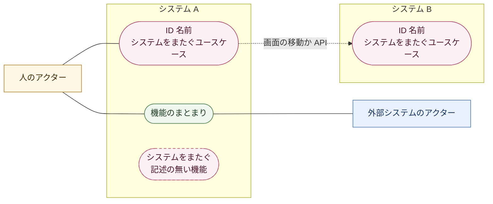
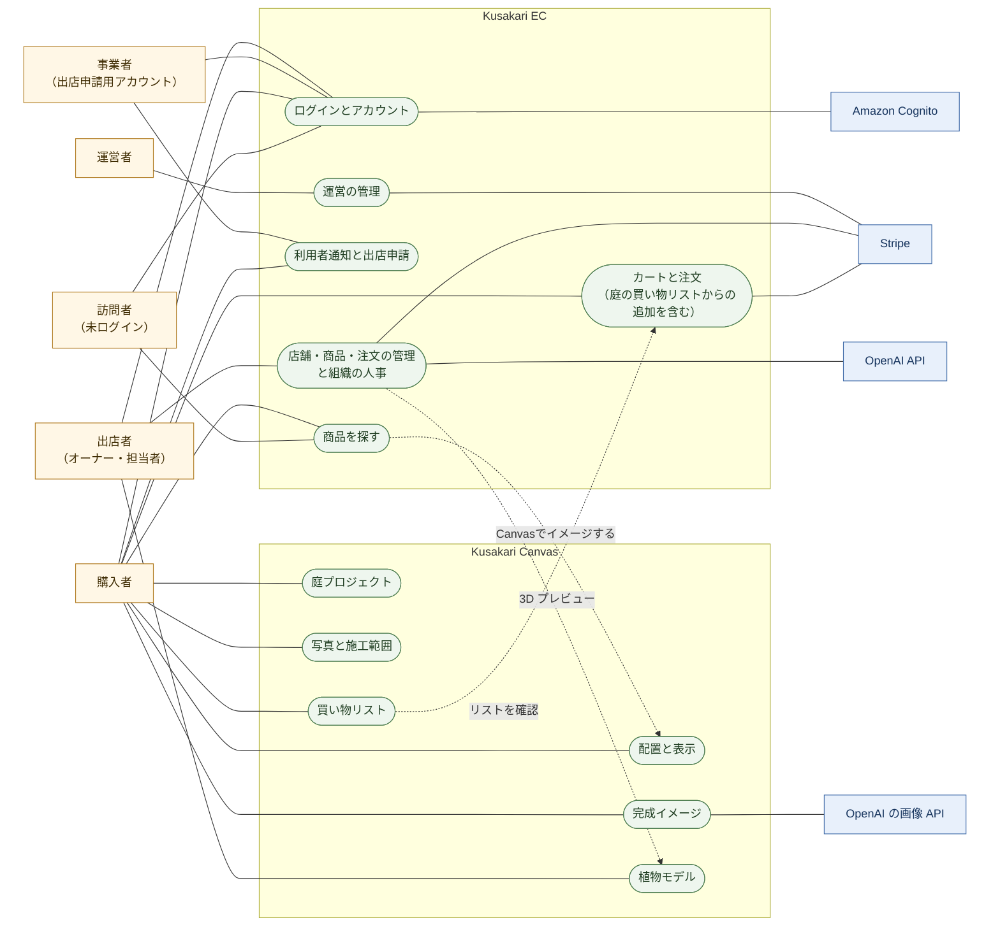
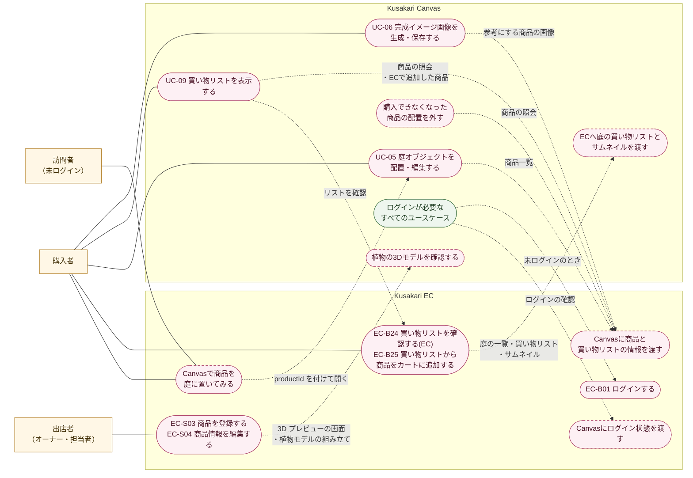

# EC と Canvas の全体のユースケース図

Kusakari EC と Kusakari Canvas を並べて、アクター・外部システムと、2 つのシステムをまたぐユースケースを示します。Canvas は EC の中の 3D 庭づくり機能で、利用者から見るとサービスは EC の 1 つです。開発では、コード・ポート・DB を分けています。

図は 2 つです。1 の図は、2 つのシステムの全体を機能のまとまりの単位で書きます。2 の図は、システムをまたぐユースケースだけを書きます。個々のユースケースの ID と関係は、詳しい図にあります。

- [Kusakari EC ユースケース図](<kusakari-ec/EC_ユースケース図.md>)
- [Kusakari Canvas ユースケース図](<kusakari-canvas/Canvas_ユースケース図.md>)

## 対象のコード

- kusakari-ec の main、コミット 19a2be3（2026-11-20 時点）です。
- kusakari-canvas の main、コミット c19d497（2026-11-20 時点）です。
- 元の文書は、[アーカイブ/ユースケース/kusakari-ec](<../アーカイブ/ユースケース/kusakari-ec>) と [アーカイブ/ユースケース/kusakari-canvas](<../アーカイブ/ユースケース/kusakari-canvas>) のユースケース記述です。仕様は、Canvas の [docs/ec-integration.md](https://github.com/abeouga/kusakari-canvas/blob/c19d497dfef15b119f9bce8ecb5c886a36da6b7d/docs/ec-integration.md)・[docs/garden-shopping-lists.md](https://github.com/abeouga/kusakari-canvas/blob/c19d497dfef15b119f9bce8ecb5c886a36da6b7d/docs/garden-shopping-lists.md)・[docs/cognito-auth.md](https://github.com/abeouga/kusakari-canvas/blob/c19d497dfef15b119f9bce8ecb5c886a36da6b7d/docs/cognito-auth.md)、EC の [docs/garden-shopping-lists.md](https://github.com/abeouga/kusakari-ec/blob/19a2be307ee71a2cd87e538236c3c8c42929c5b3/docs/garden-shopping-lists.md)・[docs/cognito-auth.md](https://github.com/abeouga/kusakari-ec/blob/19a2be307ee71a2cd87e538236c3c8c42929c5b3/docs/cognito-auth.md)・[docs/architecture.md](https://github.com/abeouga/kusakari-ec/blob/19a2be307ee71a2cd87e538236c3c8c42929c5b3/docs/architecture.md) を見ています。

## システム間の責務

- 商品・価格・在庫・カート・注文の正本は EC です。Canvas は価格・在庫を保存せず、表示のたびに EC から取ります。
- 庭データ（GardenDocument）・写真・配置・完成イメージの履歴の正本は Canvas です。EC は庭を保存せず、必要なときに Canvas の API から買い物リストとサムネイルを取ります。EC で買い物リストに入れた商品（`garden_shopping_items`）だけは EC が持ちます。
- 庭の持ち主は、EC で認証した会員 ID です。Canvas は Cookie `KUSAKARI_SESSION` を EC に問い合わせて決めます。クライアントが指定した持ち主は受け付けません。
- 2 つのシステムは HTTP だけでつながり、DB は共有しません。Canvas からカートは変えません。カートに入れるのは、EC の画面で購入者が商品を選んだときだけです。
- EC に渡すのは、庭の買い物リスト（行キー・商品 ID・材料コード・数量・単位）とサムネイルの PNG です。Three.js の Scene・Object3D・Mesh や写真は渡しません。
- ログインは EC が Amazon Cognito で行います。Canvas は Cognito に直接つながりません。

根拠: [EC の architecture.md](https://github.com/abeouga/kusakari-ec/blob/19a2be307ee71a2cd87e538236c3c8c42929c5b3/docs/architecture.md)、[EC の cognito-auth.md](https://github.com/abeouga/kusakari-ec/blob/19a2be307ee71a2cd87e538236c3c8c42929c5b3/docs/cognito-auth.md)、[Canvas の shopping.py の ShoppingRow](https://github.com/abeouga/kusakari-canvas/blob/c19d497dfef15b119f9bce8ecb5c886a36da6b7d/backend/kusakari_canvas_api/shopping.py#L19-L33)、[Canvas の auth.py](https://github.com/abeouga/kusakari-canvas/blob/c19d497dfef15b119f9bce8ecb5c886a36da6b7d/backend/kusakari_canvas_api/auth.py#L56-L75)、[EC の V1__schema.sql の garden_shopping_items](https://github.com/abeouga/kusakari-ec/blob/19a2be307ee71a2cd87e538236c3c8c42929c5b3/backend/src/main/resources/db/migration/V1__schema.sql#L294)。

## 凡例

| 書き方 | 意味 |
| --- | --- |
| 黄色の四角 | 人のアクターです（訪問者、購入者、事業者、出店者、運営者）。 |
| 青の四角 | 外部システムのアクターです（Amazon Cognito、Stripe、OpenAI API、OpenAI の画像 API）。 |
| 角の丸い枠（緑） | ユースケースのまとまりです。中のユースケースは詳しい図にあります。 |
| 角の丸い枠（ピンク・実線） | 2 つのシステムをまたぐユースケースです。ユースケース記述があるものは ID を書きます。 |
| 角の丸い枠（ピンク・点線） | 2 つのシステムをまたぐ、ユースケース記述の無い実装の機能です。ID はありません。 |
| 外側の枠 | システムの境界（Kusakari EC、Kusakari Canvas）です。 |
| 実線 | アクターがそのユースケースにかかわります。 |
| 点線の矢印（ラベルつき） | システムをまたぐ画面の移動か、API の呼び出しです。矢印の元が、移る元か呼び出す側です。ラベルは、ボタンの文言か渡すものです。 |

- 見出しの無い 2 つの枠（`ACTORS`、`EXTERNALS`）は、アクターを左右にそろえるためだけのもので、枠線を消しています。
- 名前は詳しい図とそろえています。EC と Canvas が互いを外部システムとして書いている線（Canvas の図の「Kusakari EC」、EC の図の「Kusakari Canvas」）は、この図では点線の矢印にしています。

## 図

### 1. 全体

人の 5 つのアクターと 4 つの外部システムと、EC の 6 つのまとまり・Canvas の 6 つのまとまりです。まとまりどうしの点線は、システムをまたぐ画面の移動です。API のやりとりは 2 の図に書きます。共通のメニュー（EC-C01〜EC-C03）は、どのまとまりからも使うので省いています。

- EC のまとまりは、EC の図の 1 のまとまりです。出店者の 3 つ（店舗と商品の管理、注文の受け渡しと通知、組織の人事）は 1 つにまとめ、共通のメニューは省いています。Canvas のまとまりは、Canvas の図の 1 の中の枠と同じです。
- Canvas を使えるのは、種別が `USER`（購入者）と `ADMIN`（運営者）のアカウントです。図では購入者にまとめています。店舗側のアカウント（`SHOP_OWNER`・`SHOP_STAFF`）と申請中のアカウント（`SHOP_OWNER_APPLICANT`）が Canvas を開くと、「Canvas は購入者のアカウントで使えます。」と出て、API は 403 の `BUYER_ACCOUNT_REQUIRED` を返します。例外は植物モデルで、出店者も EC の商品登録の画面の中で使います（[Canvas の auth.py](https://github.com/abeouga/kusakari-canvas/blob/c19d497dfef15b119f9bce8ecb5c886a36da6b7d/backend/kusakari_canvas_api/auth.py#L9-L14)、[Canvas の App.jsx](https://github.com/abeouga/kusakari-canvas/blob/c19d497dfef15b119f9bce8ecb5c886a36da6b7d/frontend/src/pages/App.jsx#L8-L16)）。
- Stripe の線は、カード決済（カートと注文）と返金（出店者のキャンセル申請の承認、運営のまとめてキャンセル）です。OpenAI API は商品登録の「AIで生成」、OpenAI の画像 API は完成イメージの生成です。
- Amazon Cognito は EC だけが使います。Canvas のログインは、EC のログインを使います（2 の図）。

### 2. システムをまたぐユースケース

訪問者・購入者・出店者と、2 つのシステムをまたぐユースケース 12 件です。EC 側は EC-B01・EC-B24・EC-B25・EC-S03・EC-S04 と記述の無い機能 3 件、Canvas 側は UC-05・UC-06・UC-09 と記述の無い機能 3 件です。緑の枠は、Canvas のログインが必要なすべてのユースケースをまとめたものです。

- 矢印の向きは、画面が移る向きか、API を呼ぶ向きです。たとえば「商品一覧」は、Canvas の UC-05 が EC の API を呼んで商品一覧を取ることを表します。
- 「購入できなくなった商品の配置を外す」は、庭を開いたときに画面が自動で行うので、人のアクターの線がありません（Canvas の図では UC-01-1 に «extend»）。
- 訪問者が「Canvasで商品を庭に置いてみる」を選ぶと、Canvas は EC のログイン画面（EC-B01）へ移します。ログインの後で元の Canvas の画面に戻ります。
- EC-B01 は EC の中のユースケースですが、Canvas の未ログイン時の行き先なので、この図ではシステムをまたぐユースケースとして書いています。

## システムをまたぐユースケース

| ユースケース | EC 側 | Canvas 側 | 使う API と画面の移動 |
| --- | --- | --- | --- |
| Canvasで商品を庭に置いてみる | 「植物について」ダイアログの「Canvasでイメージする」と、カートの「この商品を庭に配置」（記述の無い機能。[ProductDetail.jsx](https://github.com/abeouga/kusakari-ec/blob/19a2be307ee71a2cd87e538236c3c8c42929c5b3/frontend/src/components/ProductDetail.jsx#L136-L142)、[Cart.jsx](https://github.com/abeouga/kusakari-ec/blob/19a2be307ee71a2cd87e538236c3c8c42929c5b3/frontend/src/components/Cart.jsx#L124)） | 庭の一覧で庭を選ぶか作る（UC-01-1・UC-01）と、その商品のモデルを選んだ状態で編集画面が開きます。地面をクリックして置きます（UC-05。[urls.js](https://github.com/abeouga/kusakari-canvas/blob/c19d497dfef15b119f9bce8ecb5c886a36da6b7d/frontend/src/domain/urls.js#L15-L20)、[EditorPage.jsx](https://github.com/abeouga/kusakari-canvas/blob/c19d497dfef15b119f9bce8ecb5c886a36da6b7d/frontend/src/pages/EditorPage.jsx#L33-L44)） | 画面の移動: EC → Canvas の `/?productId={商品ID}`。Canvas の画面 → EC API: `GET /api/products`（商品からモデルを探します） |
| 庭の買い物リストを確かめてカートに入れる | EC-B24・EC-B25。「ショッピングカート」画面の「庭に設置したものから追加」 | UC-09 の「リストを確認」で、保存を終えてから EC の `/cart?garden={gardenId}` を開きます（[CommercePanel.jsx](https://github.com/abeouga/kusakari-canvas/blob/c19d497dfef15b119f9bce8ecb5c886a36da6b7d/frontend/src/components/CommercePanel.jsx#L80)）。「ECへ庭の買い物リストとサムネイルを渡す」が答えます | 画面の移動: Canvas → EC の `/cart?garden={gardenId}`。EC の画面 → EC API: `GET /api/shopping-lists`、`GET /api/shopping-lists/{gardenId}`、`GET /api/shopping-lists/{gardenId}/thumbnail`、`POST /api/cart/shopping-lists/{gardenId}/items`。EC API → Canvas API: `GET /api/shopping-lists`、`GET /api/gardens/{id}/shopping-list`、`GET /api/gardens/{id}/thumbnail`（[CanvasShoppingClient.java](https://github.com/abeouga/kusakari-ec/blob/19a2be307ee71a2cd87e538236c3c8c42929c5b3/backend/src/main/java/jp/kusakari/ec/shopping/CanvasShoppingClient.java#L21-L57)） |
| Canvas の買い物リストに、商品の店舗・在庫と EC で追加した商品を出す | 「Canvasに商品と買い物リストの情報を渡す」 | UC-09 | Canvas の画面 → EC API: `GET /api/products`、`POST /api/products/references`、`GET /api/shopping-lists/{gardenId}/saved-items`（[commerce.js](https://github.com/abeouga/kusakari-canvas/blob/c19d497dfef15b119f9bce8ecb5c886a36da6b7d/frontend/src/api/commerce.js#L29-L36)） |
| 購入できなくなった商品の配置を外す | 「Canvasに商品と買い物リストの情報を渡す」。商品が買えなくなる理由（削除・店舗の閉鎖や停止・組織の停止）は、EC-S06・EC-A11 と、記述の無い店舗の閉鎖・組織の停止で決まります | 「購入できなくなった商品の配置を外す」（[useUnavailablePlacements.js](https://github.com/abeouga/kusakari-canvas/blob/c19d497dfef15b119f9bce8ecb5c886a36da6b7d/frontend/src/hooks/useUnavailablePlacements.js#L5-L29)） | Canvas の画面 → EC API: `POST /api/products/references` |
| 完成イメージに、配置した植物の商品画像を使う | 「Canvasに商品と買い物リストの情報を渡す」 | UC-06（基本フロー 5） | Canvas の画面 → Canvas API: `POST /api/ai/product-references`、`POST /api/gardens/{id}/ai-image`。Canvas API → EC API: `POST /api/products/references` と、商品の登録画像の取得（[ai_catalog.py](https://github.com/abeouga/kusakari-canvas/blob/c19d497dfef15b119f9bce8ecb5c886a36da6b7d/backend/kusakari_canvas_api/ai_catalog.py#L102-L130)、[画像の取得](https://github.com/abeouga/kusakari-canvas/blob/c19d497dfef15b119f9bce8ecb5c886a36da6b7d/backend/kusakari_canvas_api/ai_catalog.py#L175-L183)）。Canvas API → OpenAI の画像 API（`images.edit`） |
| 出店者が商品登録で植物の3Dモデルを確かめる | EC-S03・EC-S04 の「庭オブジェクト」の設定（[PlantPreview.jsx](https://github.com/abeouga/kusakari-ec/blob/19a2be307ee71a2cd87e538236c3c8c42929c5b3/frontend/src/components/PlantPreview.jsx#L27-L36)） | 「植物の3Dモデルを確認する」（`/model-preview`） | EC の画面 → Canvas の画面: `/model-preview` を枠の中に出します。EC API → Canvas API: `POST /api/model-assemblies/resolve`（[CanvasModelClient.java](https://github.com/abeouga/kusakari-ec/blob/19a2be307ee71a2cd87e538236c3c8c42929c5b3/backend/src/main/java/jp/kusakari/ec/catalog/service/CanvasModelClient.java#L25-L31)） |
| EC のログインで Canvas を使う | EC-B01（`/account/login?returnTo=...`）と、「Canvasにログイン状態を渡す」 | ログインが必要なすべてのユースケース（[AuthGate.jsx](https://github.com/abeouga/kusakari-canvas/blob/c19d497dfef15b119f9bce8ecb5c886a36da6b7d/frontend/src/components/AuthGate.jsx#L18-L26)） | Canvas の画面 → EC API: `GET /api/auth/me`、`GET /api/auth/csrf`。Canvas API → EC API: `GET /api/auth/me`（読み取り）、`POST /api/auth/verify`（更新）。未ログインのときは、EC の `/account/login?returnTo={Canvas の URL}` へ移ります（[auth.js](https://github.com/abeouga/kusakari-canvas/blob/c19d497dfef15b119f9bce8ecb5c886a36da6b7d/frontend/src/api/auth.js#L28-L36)） |

- EC の API が Canvas の API を呼ぶときは、利用者の Cookie `KUSAKARI_SESSION` と CSRF トークンをそのまま付けて送ります（[CanvasClientConfiguration.java](https://github.com/abeouga/kusakari-ec/blob/19a2be307ee71a2cd87e538236c3c8c42929c5b3/backend/src/main/java/jp/kusakari/ec/common/CanvasClientConfiguration.java#L18-L29)）。Canvas は、EC から呼ばれたときも同じ方法で庭の持ち主を決めます。
- Canvas から EC の画面へ移るとき（「リストを確認」、共通ヘッダーのリンク）は、庭の保存を終えてから移ります（EC-B02 の関連情報、Canvas の UC-07）。
- 表の 7 行と 2 の図の対応: 1 行目は「Canvasで商品を庭に置いてみる」と UC-05、2 行目は EC-B24・EC-B25 と UC-09 と「ECへ庭の買い物リストとサムネイルを渡す」、3〜5 行目は「Canvasに商品と買い物リストの情報を渡す」と UC-09・「購入できなくなった商品の配置を外す」・UC-06、6 行目は EC-S03・EC-S04 と「植物の3Dモデルを確認する」、7 行目は EC-B01 と「Canvasにログイン状態を渡す」と緑の枠です。

図に載せなかったもの:

- EC の商品カードから庭の買い物リストに商品を入れる操作（必要なら「買い物リストN」という庭を Canvas に作る）です。EC の API（`PUT /api/shopping-lists/{gardenId}/items/{productId}`、`POST /api/shopping-lists/items/{productId}`）と、EC API → Canvas API の `POST /api/gardens` はあります。しかし EC の画面のボタンは #65 で外れていて、どこからも開かれません（[AddToShoppingList.jsx](https://github.com/abeouga/kusakari-ec/blob/19a2be307ee71a2cd87e538236c3c8c42929c5b3/frontend/src/components/AddToShoppingList.jsx#L9)、[Catalog.jsx](https://github.com/abeouga/kusakari-ec/blob/19a2be307ee71a2cd87e538236c3c8c42929c5b3/frontend/src/components/Catalog.jsx#L5-L8)）。
- Canvas の共通ヘッダーのカートの件数（EC の `GET /api/cart`）と、EC の画面へのリンクです。どの画面にも出る表示で、利用者の目的ではないため載せていません。
- EC の `POST /api/materials/quote` と、それを呼ぶ Canvas の `GET /api/ai/candidates` です。どちらの画面からも呼ばれていません。

## 詳しい図

| 図 | 中身 |
| --- | --- |
| [Kusakari EC ユースケース図](<kusakari-ec/EC_ユースケース図.md>) | EC のアクター一覧、EC-A・EC-B・EC-C・EC-S のすべてのユースケースと、記述の無い機能の一覧です。 |
| [Kusakari Canvas ユースケース図](<kusakari-canvas/Canvas_ユースケース図.md>) | Canvas のアクター一覧、UC-01〜UC-09・UC-01-1 と、記述の無い機能の一覧です。 |

## 確かめられなかったこと

- 画面を実際に動かしての確認はしていません。図はコードと `docs/` を読んで起こしています。
- Canvas の API は、参考画像の URL として `/images/` の下の PNG・JPEG・WebP だけを受け付けます（[ai_catalog.py の raster_url](https://github.com/abeouga/kusakari-canvas/blob/c19d497dfef15b119f9bce8ecb5c886a36da6b7d/backend/kusakari_canvas_api/ai_catalog.py#L33-L43)）。出店者が EC で登録した画像（`/api/product-images/{id}`）を参考画像にできるかどうかは、確かめていません。
- 運営者（`ADMIN`）が Canvas で庭を作る運用を想定しているかどうかは、コードからは分かりません。
