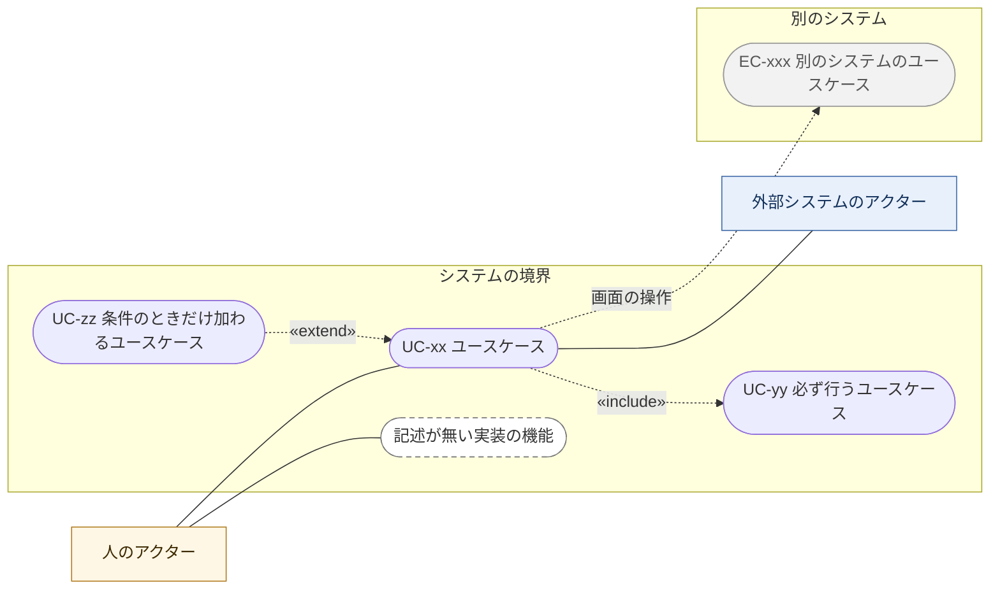
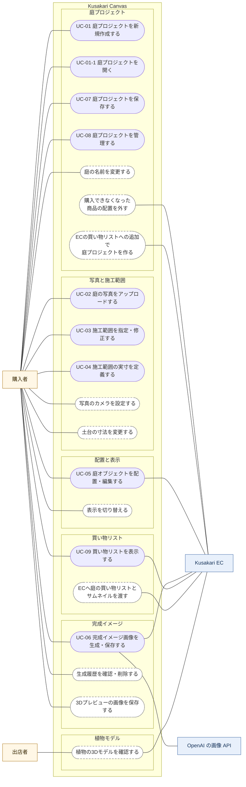
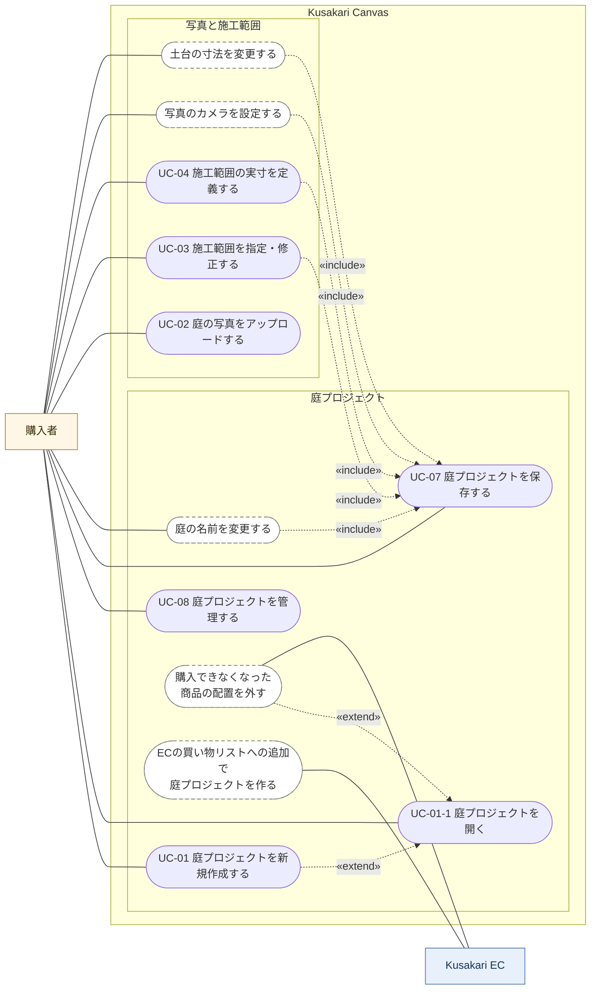
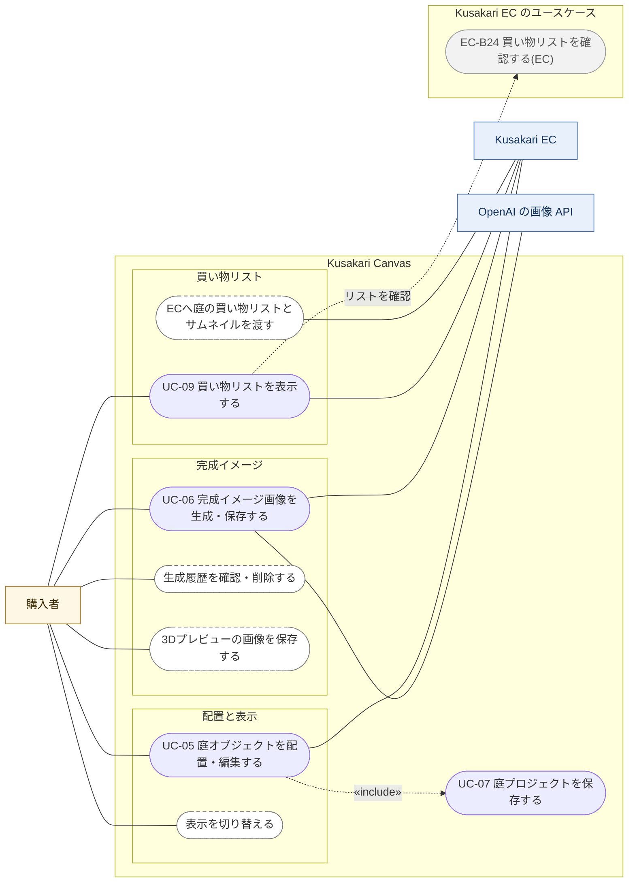

# Kusakari Canvas ユースケース図

Kusakari Canvas（Kusakari EC の中の 3D 庭づくり機能）のユースケース図です。ユースケース記述と今の実装から起こしています。ユースケース記述が無いが実装にある利用者向けの機能も、ID を付けずに載せています。

## 対象のコード

- kusakari-canvas の main、コミット c19d497（2026-11-20 時点）です。画面は `frontend/src`、API は `backend/kusakari_canvas_api`、仕様は `docs/` を見ています。
- Canvas を呼ぶ EC 側のコードは、kusakari-ec の main、コミット 19a2be3（2026-11-20 時点）で確かめています。
- 元のユースケース記述は [アーカイブ/ユースケース/kusakari-canvas](<../../アーカイブ/ユースケース/kusakari-canvas>) にあります。[全ユースケース共通の代替フロー](<../../アーカイブ/ユースケース/kusakari-canvas/00_全ユースケース共通の代替フロー.md>) と UC-01-1 も含めています。

## 凡例

| 書き方 | 意味 |
| --- | --- |
| 黄色の四角 | 人のアクターです（購入者、出店者）。 |
| 青の四角 | 外部システムのアクターです（Kusakari EC、OpenAI の画像 API）。 |
| 角の丸い枠（実線） | ユースケース記述があるユースケースです。ID と名前を書きます。 |
| 角の丸い枠（白地に点線） | ユースケース記述は無いが、実装にある利用者向けの機能です。ID はありません。 |
| 角の丸い枠（灰色） | 別のシステム（Kusakari EC）のユースケースです。 |
| 外側の枠 | システムの境界（Kusakari Canvas）です。中の枠は機能のまとまりです。 |
| 実線 | アクターがそのユースケースにかかわります。 |
| 点線の矢印「«include»」 | 矢印の元のユースケースが、基本フローの中で矢印の先のユースケースを必ず行います。 |
| 点線の矢印「«extend»」 | 矢印の元のユースケースが、条件のときだけ矢印の先のユースケースに加わります。 |
| 点線の矢印（ラベルが画面の操作） | その操作で、別のシステムのユースケースへ画面が移ります。 |

- include と extend は、ユースケース記述の基本フロー・代替フローにある参照から引き、コードで確かめています。
- 関連情報で「別のユースケースで行う」と分担だけを書いている参照は、線にせず、ユースケース一覧の「関係」の列に書きます。
- 記述の無い機能の線は、コードで確かめた動きから引いています。

## アクター

| アクター | 種類 | 内容 | 根拠のコード |
| --- | --- | --- | --- |
| 購入者 | 人 | EC の会員で、種別（`accountType`）が `USER` のアカウントです。Canvas の画面をすべて使います。種別が `ADMIN` の運営者も、Canvas では購入者と同じに扱います。図では購入者にまとめています。 | [auth.py の BUYER_ACCOUNT_TYPES](https://github.com/abeouga/kusakari-canvas/blob/c19d497dfef15b119f9bce8ecb5c886a36da6b7d/backend/kusakari_canvas_api/auth.py#L11)、[AuthGate.jsx](https://github.com/abeouga/kusakari-canvas/blob/c19d497dfef15b119f9bce8ecb5c886a36da6b7d/frontend/src/components/AuthGate.jsx#L18-L26) |
| 出店者 | 人 | 種別が `SHOP_OWNER`・`SHOP_STAFF` のアカウントです。庭の画面と API は使えません（UC-01 の代替フロー 1a。API は 403 の `BUYER_ACCOUNT_REQUIRED` を返します）。出店申請中の `SHOP_OWNER_APPLICANT` も同じです。出店者は、EC の商品登録の画面の中で、植物の 3D プレビューだけを見ます。 | [auth.py](https://github.com/abeouga/kusakari-canvas/blob/c19d497dfef15b119f9bce8ecb5c886a36da6b7d/backend/kusakari_canvas_api/auth.py#L12-L14)、[auth.py の拒否](https://github.com/abeouga/kusakari-canvas/blob/c19d497dfef15b119f9bce8ecb5c886a36da6b7d/backend/kusakari_canvas_api/auth.py#L73-L74)、[App.jsx の /model-preview](https://github.com/abeouga/kusakari-canvas/blob/c19d497dfef15b119f9bce8ecb5c886a36da6b7d/frontend/src/pages/App.jsx#L12) |
| Kusakari EC | 外部システム | ログインの確認、商品の情報の提供、EC からの Canvas の API の呼び出しで、Canvas とやりとりします。内容は次の表に分けて書きます。 | 次の表 |
| OpenAI の画像 API | 外部システム | 完成イメージの生成（UC-06）で、Canvas の API が画像の編集（`images.edit`）を呼びます。API キーが無いときは生成しません。 | [ai_provider.py](https://github.com/abeouga/kusakari-canvas/blob/c19d497dfef15b119f9bce8ecb5c886a36da6b7d/backend/kusakari_canvas_api/ai_provider.py#L21-L24)、[main.py の /api/ai/status](https://github.com/abeouga/kusakari-canvas/blob/c19d497dfef15b119f9bce8ecb5c886a36da6b7d/backend/kusakari_canvas_api/main.py#L150-L152) |

### Kusakari EC とのやりとり

| やりとり | 向き | かかわるユースケース | 根拠のコード |
| --- | --- | --- | --- |
| ログインの確認と、庭の持ち主の決定 | Canvas → EC | ログインが必要なすべてのユースケース | 画面は EC の `/api/auth/me` でログイン状態と種別を確かめ、未ログインなら EC の `/account/login` へ移ります（[AuthGate.jsx](https://github.com/abeouga/kusakari-canvas/blob/c19d497dfef15b119f9bce8ecb5c886a36da6b7d/frontend/src/components/AuthGate.jsx#L18-L24)、[auth.js](https://github.com/abeouga/kusakari-canvas/blob/c19d497dfef15b119f9bce8ecb5c886a36da6b7d/frontend/src/api/auth.js#L28-L36)）。API は Cookie `KUSAKARI_SESSION` を EC の `/api/auth/me`（読み取り）か `/api/auth/verify`（更新）に問い合わせ、返った会員 ID を庭の持ち主にします（[auth.py](https://github.com/abeouga/kusakari-canvas/blob/c19d497dfef15b119f9bce8ecb5c886a36da6b7d/backend/kusakari_canvas_api/auth.py#L56-L75)）。 |
| 商品一覧 | Canvas の画面 → EC | UC-05、UC-09 | `GET /api/products`（[commerce.js](https://github.com/abeouga/kusakari-canvas/blob/c19d497dfef15b119f9bce8ecb5c886a36da6b7d/frontend/src/api/commerce.js#L32)） |
| 商品の一括照会（店舗名・在庫・買えるか） | Canvas の画面 → EC | UC-09、購入できなくなった商品の配置を外す | `POST /api/products/references`（[commerce.js](https://github.com/abeouga/kusakari-canvas/blob/c19d497dfef15b119f9bce8ecb5c886a36da6b7d/frontend/src/api/commerce.js#L34)） |
| EC で買い物リストに追加した商品 | Canvas の画面 → EC | UC-09 | `GET /api/shopping-lists/{gardenId}/saved-items`（[commerce.js](https://github.com/abeouga/kusakari-canvas/blob/c19d497dfef15b119f9bce8ecb5c886a36da6b7d/frontend/src/api/commerce.js#L36)） |
| 植物の参考画像（商品の登録画像） | Canvas の API → EC | UC-06 | `POST /api/products/references` と画像の取得（[ai_catalog.py](https://github.com/abeouga/kusakari-canvas/blob/c19d497dfef15b119f9bce8ecb5c886a36da6b7d/backend/kusakari_canvas_api/ai_catalog.py#L108)、[画像の取得](https://github.com/abeouga/kusakari-canvas/blob/c19d497dfef15b119f9bce8ecb5c886a36da6b7d/backend/kusakari_canvas_api/ai_catalog.py#L183)） |
| 庭の一覧・買い物リスト・サムネイルの取得 | EC → Canvas の API | ECへ庭の買い物リストとサムネイルを渡す | [CanvasShoppingClient.java](https://github.com/abeouga/kusakari-ec/blob/19a2be307ee71a2cd87e538236c3c8c42929c5b3/backend/src/main/java/jp/kusakari/ec/shopping/CanvasShoppingClient.java#L21-L57) |
| 庭の作成 | EC → Canvas の API | ECの買い物リストへの追加で庭プロジェクトを作る | [CanvasShoppingClient.java の createGarden](https://github.com/abeouga/kusakari-ec/blob/19a2be307ee71a2cd87e538236c3c8c42929c5b3/backend/src/main/java/jp/kusakari/ec/shopping/CanvasShoppingClient.java#L39-L46) |
| 植物モデルの組み立て | EC → Canvas の API | 植物の3Dモデルを確認する | [CanvasModelClient.java](https://github.com/abeouga/kusakari-ec/blob/19a2be307ee71a2cd87e538236c3c8c42929c5b3/backend/src/main/java/jp/kusakari/ec/catalog/service/CanvasModelClient.java#L25-L31)、[ProductEditorService.java](https://github.com/abeouga/kusakari-ec/blob/19a2be307ee71a2cd87e538236c3c8c42929c5b3/backend/src/main/java/jp/kusakari/ec/catalog/service/ProductEditorService.java#L110) |

- EC のサーバーが Canvas の API を呼ぶときは、利用者の Cookie `KUSAKARI_SESSION` と CSRF トークンをそのまま付けて送ります（[CanvasClientConfiguration.java](https://github.com/abeouga/kusakari-ec/blob/19a2be307ee71a2cd87e538236c3c8c42929c5b3/backend/src/main/java/jp/kusakari/ec/common/CanvasClientConfiguration.java#L18-L29)）。そのため、EC から呼ばれたときも、Canvas は同じ方法で庭の持ち主を決めます。ブラウザーやリクエストから持ち主を指定させることはありません。
- ログインの確認は、ログインが必要なすべてのユースケースにかかわります。図では、この線を省いています。図の Kusakari EC への線は、ログインの確認以外のやりとりです。

アクターにしないもの:

- Amazon Cognito: ログインは EC が Cognito で行います。Canvas の画面と API は EC にだけ問い合わせ、Cognito には直接つながりません。
- MySQL と、画像の保存先の S3: Canvas の中の保存先です。S3 は `KUSAKARI_CANVAS_MEDIA_STORAGE` が `s3` のときだけ使います（[media.py](https://github.com/abeouga/kusakari-canvas/blob/c19d497dfef15b119f9bce8ecb5c886a36da6b7d/backend/kusakari_canvas_api/media.py#L15-L34)）。

## 図

### 1. 全体

購入者・出店者・Kusakari EC・OpenAI の画像 API と、Canvas のすべてのユースケース（記述のある 10 件と UC-01-1、記述の無い機能 10 件）です。この図はアクターとのつながりだけを書きます。include と extend は、2 と 3 の図に書きます。

### 2. 庭プロジェクトと写真と施工範囲

購入者と Kusakari EC と、UC-01・UC-01-1・UC-02・UC-03・UC-04・UC-07・UC-08、それにかかわる記述の無い機能 5 件です。写真は UC-02 → UC-03 → UC-04 の順に進みます（UC-02 の基本フロー 6、UC-03 の基本フロー 7）。この順番は線にしていません。

- UC-01 → UC-01-1 の «extend»: UC-01-1 の代替フロー 2a（庭プロジェクトがない場合、購入者が新規作成する）から引いています。
- UC-03・UC-04 → UC-07 の «include»: UC-03 の基本フロー 6 と UC-04 の基本フロー 11 で庭プロジェクトに保存し、UC-07 の基本フロー 1 がこの操作を保存のきっかけに挙げています。実装では、GardenDocument が変わると 500ms 後に `PUT /api/gardens/{id}` で庭全体を保存します（[useGardenAutosave.js](https://github.com/abeouga/kusakari-canvas/blob/c19d497dfef15b119f9bce8ecb5c886a36da6b7d/frontend/src/hooks/useGardenAutosave.js#L38)、[500ms の待ち](https://github.com/abeouga/kusakari-canvas/blob/c19d497dfef15b119f9bce8ecb5c886a36da6b7d/frontend/src/hooks/useGardenAutosave.js#L70)）。
- 記述の無い機能の «include» と «extend» は、下の「ユースケース記述が無い実装の機能」の表に根拠を書いています。

### 3. 配置と画像生成と買い物リスト

購入者・Kusakari EC・OpenAI の画像 API と、UC-05・UC-06・UC-09、それにかかわる記述の無い機能 4 件です。UC-07 は、UC-05 との関係を示すために載せています（2 の図と同じユースケースです）。EC-B24 は Kusakari EC のユースケースです。

- UC-05 → UC-07 の «include»: UC-05 の基本フロー 3 の「変更は自動保存される(UC-07)」から引いています。基本フロー 6 と 9 も自動保存します。
- UC-09 → EC-B24: UC-09 の基本フロー 8 の「(EC-B24)」から引いています。実装では、保存が終わるのを待ってから EC の `/cart?garden={gardenId}` を開きます（[CommercePanel.jsx](https://github.com/abeouga/kusakari-canvas/blob/c19d497dfef15b119f9bce8ecb5c886a36da6b7d/frontend/src/components/CommercePanel.jsx#L80)、[EditorPage.jsx の移動前の保存](https://github.com/abeouga/kusakari-canvas/blob/c19d497dfef15b119f9bce8ecb5c886a36da6b7d/frontend/src/pages/EditorPage.jsx#L148-L169)）。
- UC-06 と Kusakari EC の線は、配置した植物に紐づく商品の登録画像を参考画像として取るやりとりです（UC-06 の基本フロー 5）。

## ユースケース一覧

| ID | ユースケース名 | 主なアクター | かかわる外部システム（ログインの確認を除く） | 関係 | ユースケース記述 | シーケンス図 |
| --- | --- | --- | --- | --- | --- | --- |
| UC-01 | 庭プロジェクトを新規作成する | 購入者 | なし | UC-01-1 に «extend»（UC-01-1 の代替フロー 2a）。共通代替フロー *b を適用します。 | [記述](<../../アーカイブ/ユースケース/kusakari-canvas/UC-01_庭プロジェクトを新規作成する.md>) | [シーケンス図](<../../シーケンス図/kusakari-canvas/UC-01_庭プロジェクトを新規作成する.md>) |
| UC-01-1 | 庭プロジェクトを開く | 購入者 | なし | UC-01 と「購入できなくなった商品の配置を外す」から «extend»。複製・削除は UC-08 で行います（関連情報）。共通代替フロー *b を適用します。 | [記述](<../../アーカイブ/ユースケース/kusakari-canvas/UC-01-1_庭プロジェクトを開く.md>) | [シーケンス図](<../../シーケンス図/kusakari-canvas/UC-01-1_庭プロジェクトを開く.md>) |
| UC-02 | 庭の写真をアップロードする | 購入者 | なし | 続けて UC-03 が始まります（基本フロー 6）。写真は UC-03 で施工範囲を確定したときに保存されます（関連情報）。 | [記述](<../../アーカイブ/ユースケース/kusakari-canvas/UC-02_庭の写真をアップロードする.md>) | [シーケンス図](<../../シーケンス図/kusakari-canvas/UC-02_庭の写真をアップロードする.md>) |
| UC-03 | 施工範囲を指定・修正する | 購入者 | なし | UC-07 を «include»（基本フロー 6）。続けて UC-04 の編集を開きます（基本フロー 7）。 | [記述](<../../アーカイブ/ユースケース/kusakari-canvas/UC-03_施工範囲を指定・修正する.md>) | [シーケンス図](<../../シーケンス図/kusakari-canvas/UC-03_施工範囲を指定・修正する.md>) |
| UC-04 | 施工範囲の実寸を定義する | 購入者 | なし | UC-07 を «include»（基本フロー 11）。 | [記述](<../../アーカイブ/ユースケース/kusakari-canvas/UC-04_施工範囲の実寸を定義する.md>) | [シーケンス図](<../../シーケンス図/kusakari-canvas/UC-04_施工範囲の実寸を定義する.md>) |
| UC-05 | 庭オブジェクトを配置・編集する | 購入者 | Kusakari EC（商品一覧。URL の `productId` は EC の商品詳細とカートから付きます） | UC-07 を «include»（基本フロー 3）。 | [記述](<../../アーカイブ/ユースケース/kusakari-canvas/UC-05_庭オブジェクトを配置・編集する.md>) | [シーケンス図](<../../シーケンス図/kusakari-canvas/UC-05_庭オブジェクトを配置・編集する.md>) |
| UC-06 | 完成イメージ画像を生成・保存する | 購入者 | OpenAI の画像 API（生成）、Kusakari EC（植物の参考画像） | 生成履歴と 3D プレビューの保存は関連情報で触れているだけなので、記述の無い機能として載せています。 | [記述](<../../アーカイブ/ユースケース/kusakari-canvas/UC-06_完成イメージ画像を生成・保存する.md>) | [シーケンス図](<../../シーケンス図/kusakari-canvas/UC-06_完成イメージ画像を生成・保存する.md>) |
| UC-07 | 庭プロジェクトを保存する | 購入者 | なし（代替フロー 3d の再ログインは EC の画面で行います） | UC-03・UC-04・UC-05 から «include»。 | [記述](<../../アーカイブ/ユースケース/kusakari-canvas/UC-07_庭プロジェクトを保存する.md>) | [シーケンス図](<../../シーケンス図/kusakari-canvas/UC-07_庭プロジェクトを保存する.md>) |
| UC-08 | 庭プロジェクトを管理する | 購入者 | なし | 庭が無いときは UC-01 を案内します（代替フロー 2a。線にはしていません）。共通代替フロー *b を適用します。 | [記述](<../../アーカイブ/ユースケース/kusakari-canvas/UC-08_庭プロジェクトを管理する.md>) | [シーケンス図](<../../シーケンス図/kusakari-canvas/UC-08_庭プロジェクトを管理する.md>) |
| UC-09 | 買い物リストを表示する | 購入者 | Kusakari EC（商品一覧、商品の一括照会、EC で追加した商品） | 「リストを確認」で EC-B24 へ移ります（基本フロー 8）。カートへの追加は EC-B25 で行います（関連情報）。 | [記述](<../../アーカイブ/ユースケース/kusakari-canvas/UC-09_買い物リストを表示する.md>) | [シーケンス図](<../../シーケンス図/kusakari-canvas/UC-09_買い物リストを表示する.md>) |

- 共通代替フロー（*a 通信に失敗した場合、*b 未ログインの場合）は [00_全ユースケース共通の代替フロー.md](<../../アーカイブ/ユースケース/kusakari-canvas/00_全ユースケース共通の代替フロー.md>) にあります。*a はすべてのユースケースに、*b はログインが必要なユースケースにかかわります。関連情報で *b を挙げているのは UC-01・UC-01-1・UC-08 です。
- EC 側のユースケース記述: [EC-B24 買い物リストを確認する(EC)](<../../アーカイブ/ユースケース/kusakari-ec/EC-B24_買い物リストを確認する(EC).md>)、[EC-B25 買い物リストから商品をカートに追加する](<../../アーカイブ/ユースケース/kusakari-ec/EC-B25_買い物リストから商品をカートに追加する.md>)、[EC-S03 商品を登録する](<../../アーカイブ/ユースケース/kusakari-ec/EC-S03_商品を登録する.md>)。

## ユースケース記述が無い実装の機能

| 機能 | 主なアクター | かかわる外部システム | 図での関係（コードで確かめた動き） | 根拠のコード |
| --- | --- | --- | --- | --- |
| 庭の名前を変更する | 購入者 | なし | UC-07 を «include»。編集画面の「庭の名前を変更」で名前（1〜60 文字）を変え、自動保存します。 | [GardenTitle.jsx](https://github.com/abeouga/kusakari-canvas/blob/c19d497dfef15b119f9bce8ecb5c886a36da6b7d/frontend/src/components/GardenTitle.jsx#L34)、[editorStore.js の renameGarden](https://github.com/abeouga/kusakari-canvas/blob/c19d497dfef15b119f9bce8ecb5c886a36da6b7d/frontend/src/stores/editorStore.js#L54) |
| 写真のカメラを設定する | 購入者 | なし | UC-07 を «include»。「写真のカメラを設定」で、地面にある長方形の四隅と実寸から撮影カメラを求め（`POST /api/photo-calibration`）、「カメラを適用」で写真に反映して自動保存します。UC-04（辺の長さから求める）とは別の操作です。 | [PhotoOverlay.jsx](https://github.com/abeouga/kusakari-canvas/blob/c19d497dfef15b119f9bce8ecb5c886a36da6b7d/frontend/src/components/PhotoOverlay.jsx#L208)、[PhotoCalibrationEditor.jsx](https://github.com/abeouga/kusakari-canvas/blob/c19d497dfef15b119f9bce8ecb5c886a36da6b7d/frontend/src/components/PhotoCalibrationEditor.jsx#L31)、[main.py](https://github.com/abeouga/kusakari-canvas/blob/c19d497dfef15b119f9bce8ecb5c886a36da6b7d/backend/kusakari_canvas_api/main.py#L173-L175) |
| 土台の寸法を変更する | 購入者 | なし | UC-07 を «include»。写真のない庭の 3D 表示で「土台設定」を開き、幅と奥行き（各 1〜50m）を変えて「土台に適用」すると自動保存します。 | [EditorPage.jsx](https://github.com/abeouga/kusakari-canvas/blob/c19d497dfef15b119f9bce8ecb5c886a36da6b7d/frontend/src/pages/EditorPage.jsx#L244-L252)、[GardenDimensions.jsx](https://github.com/abeouga/kusakari-canvas/blob/c19d497dfef15b119f9bce8ecb5c886a36da6b7d/frontend/src/components/GardenDimensions.jsx#L39-L42) |
| 購入できなくなった商品の配置を外す | （画面が自動で行います） | Kusakari EC（商品の一括照会） | UC-01-1 に «extend»。庭を開いたとき 1 回だけ配置済みの商品を EC に照会し、削除・店舗の閉鎖などの戻らない理由で買えない商品の配置を外して、「庭から外した商品があります」と知らせます。保存は自動保存に任せます。照会に失敗したときは外しません。 | [useUnavailablePlacements.js](https://github.com/abeouga/kusakari-canvas/blob/c19d497dfef15b119f9bce8ecb5c886a36da6b7d/frontend/src/hooks/useUnavailablePlacements.js#L5-L29)、[EditorPage.jsx](https://github.com/abeouga/kusakari-canvas/blob/c19d497dfef15b119f9bce8ecb5c886a36da6b7d/frontend/src/pages/EditorPage.jsx#L262-L268) |
| 表示を切り替える | 購入者 | なし | なし。「写真」と「3D」の切り替え、3D 表示の「上から見る」「初期視点」、写真の上の地面・グリッド・配置物の表示を切り替えます。表示の状態は保存しません。 | [EditorPage.jsx](https://github.com/abeouga/kusakari-canvas/blob/c19d497dfef15b119f9bce8ecb5c886a36da6b7d/frontend/src/pages/EditorPage.jsx#L239-L246)、[PhotoOverlay.jsx](https://github.com/abeouga/kusakari-canvas/blob/c19d497dfef15b119f9bce8ecb5c886a36da6b7d/frontend/src/components/PhotoOverlay.jsx#L211-L215) |
| 3Dプレビューの画像を保存する | 購入者 | なし | なし。3D 表示の「完成イメージ」→「新しく作成」で、今の視点の 3D プレビューを PNG で保存します。AI は呼びません。UC-06 の関連情報で触れています。 | [CompletionImageAction.jsx](https://github.com/abeouga/kusakari-canvas/blob/c19d497dfef15b119f9bce8ecb5c886a36da6b7d/frontend/src/components/CompletionImageAction.jsx#L55-L59) |
| 生成履歴を確認・削除する | 購入者 | なし | なし。「生成履歴」で、保存した完成イメージを一覧し、比較・Before と After の PNG 保存・削除をします。UC-06 の関連情報で触れています。 | [GenerationHistory.jsx](https://github.com/abeouga/kusakari-canvas/blob/c19d497dfef15b119f9bce8ecb5c886a36da6b7d/frontend/src/components/GenerationHistory.jsx#L81-L126)、[history_routes.py](https://github.com/abeouga/kusakari-canvas/blob/c19d497dfef15b119f9bce8ecb5c886a36da6b7d/backend/kusakari_canvas_api/history_routes.py#L15-L35) |
| ECへ庭の買い物リストとサムネイルを渡す | Kusakari EC | なし | なし。EC が、購入者の庭の一覧（`GET /api/shopping-lists`）、庭ごとの買い物リスト（`GET /api/gardens/{id}/shopping-list`）、サムネイル（`GET /api/gardens/{id}/thumbnail`）を取ります。EC-B24・EC-B25 の画面で使います。 | [main.py](https://github.com/abeouga/kusakari-canvas/blob/c19d497dfef15b119f9bce8ecb5c886a36da6b7d/backend/kusakari_canvas_api/main.py#L193-L199)、[thumbnails.py](https://github.com/abeouga/kusakari-canvas/blob/c19d497dfef15b119f9bce8ecb5c886a36da6b7d/backend/kusakari_canvas_api/thumbnails.py#L85-L89)、[CanvasShoppingClient.java](https://github.com/abeouga/kusakari-ec/blob/19a2be307ee71a2cd87e538236c3c8c42929c5b3/backend/src/main/java/jp/kusakari/ec/shopping/CanvasShoppingClient.java#L21-L57) |
| ECの買い物リストへの追加で庭プロジェクトを作る | Kusakari EC | なし | なし。EC の「新しい庭プロジェクトを作成」で、EC が「買い物リストN」という名前の庭を `POST /api/gardens` で作り、その庭の買い物リストに商品を入れます。 | [AddToShoppingList.jsx](https://github.com/abeouga/kusakari-ec/blob/19a2be307ee71a2cd87e538236c3c8c42929c5b3/frontend/src/components/AddToShoppingList.jsx#L148-L163)、[ShoppingService.java](https://github.com/abeouga/kusakari-ec/blob/19a2be307ee71a2cd87e538236c3c8c42929c5b3/backend/src/main/java/jp/kusakari/ec/shopping/ShoppingService.java#L61-L78)、[main.py](https://github.com/abeouga/kusakari-canvas/blob/c19d497dfef15b119f9bce8ecb5c886a36da6b7d/backend/kusakari_canvas_api/main.py#L205-L209) |
| 植物の3Dモデルを確認する | 出店者 | Kusakari EC | なし。EC の商品登録の「庭オブジェクト」の設定で、EC の画面が Canvas の `/model-preview` を枠の中に表示します。商品を保存するときは、EC のサーバーが `POST /api/model-assemblies/resolve` で植物の部品の構成を求めます。この API だけは店舗側のアカウントにも開いています。 | [App.jsx](https://github.com/abeouga/kusakari-canvas/blob/c19d497dfef15b119f9bce8ecb5c886a36da6b7d/frontend/src/pages/App.jsx#L12)、[PlantPreviewPage.jsx](https://github.com/abeouga/kusakari-canvas/blob/c19d497dfef15b119f9bce8ecb5c886a36da6b7d/frontend/src/pages/PlantPreviewPage.jsx#L9-L16)、[auth.py の SHOP_ALLOWED](https://github.com/abeouga/kusakari-canvas/blob/c19d497dfef15b119f9bce8ecb5c886a36da6b7d/backend/kusakari_canvas_api/auth.py#L14)、[EC の PlantPreview.jsx](https://github.com/abeouga/kusakari-ec/blob/19a2be307ee71a2cd87e538236c3c8c42929c5b3/frontend/src/components/PlantPreview.jsx#L27-L36)、[EC の plantModel.js](https://github.com/abeouga/kusakari-ec/blob/19a2be307ee71a2cd87e538236c3c8c42929c5b3/frontend/src/plantModel.js#L37-L43) |

図に載せなかったもの:

- 共通ヘッダーのカートの件数（EC の `GET /api/cart`）と、EC の画面へのリンクです。どの画面にも出る表示で、利用者の目的ではないため載せていません（[SiteHeader.jsx](https://github.com/abeouga/kusakari-canvas/blob/c19d497dfef15b119f9bce8ecb5c886a36da6b7d/frontend/src/components/SiteHeader.jsx#L9-L25)）。
- 庭のサムネイルの保存（`POST /api/gardens/{id}/thumbnail`）です。UC-07 の関連情報にある「サムネイルも更新する」の動きです（[useGardenThumbnail.js](https://github.com/abeouga/kusakari-canvas/blob/c19d497dfef15b119f9bce8ecb5c886a36da6b7d/frontend/src/hooks/useGardenThumbnail.js#L8-L27)）。
- 読み込めなかった 3D モデルの再試行、右側のパネルの開閉と幅の変更です。画面の操作の補助のため載せていません。
- `GET /api/ai/stores`、`GET /api/ai/candidates`、`GET /api/model-parts` です。API にはありますが、Canvas と EC の画面・サーバーのコードからは呼ばれていません。

## ユースケース記述と実装の違い

- UC-01-1 の代替フロー 2a と UC-08 の代替フロー 2a の「保存した庭はまだありません。上のフォームから最初の庭を作成できます。」は、今の画面にありません。庭が無いときも「保存した庭」に「新しい庭をつくる」のカードが出て、件数が「0件」になります（[GardenListPage.jsx](https://github.com/abeouga/kusakari-canvas/blob/c19d497dfef15b119f9bce8ecb5c886a36da6b7d/frontend/src/pages/GardenListPage.jsx#L102-L118)）。
- UC-01 の基本フロー 4 は、同じ名前があるときの既定の名前を「新しい庭２」と書いています。実装は「新しい庭 2」（半角の空白と数字）です（[gardenNames.js](https://github.com/abeouga/kusakari-canvas/blob/c19d497dfef15b119f9bce8ecb5c886a36da6b7d/frontend/src/domain/gardenNames.js#L7-L13)）。
- UC-01 の関連情報の「庭の名前」欄（60 文字まで）は、作成の画面にはありません。編集画面の「庭の名前を変更」の入力欄のことです。名前の変更そのものは、ユースケース記述にありません。
- ユースケース記述のアクターは購入者だけです。実装では、種別が `ADMIN` の運営者も Canvas を使えます（[auth.py](https://github.com/abeouga/kusakari-canvas/blob/c19d497dfef15b119f9bce8ecb5c886a36da6b7d/backend/kusakari_canvas_api/auth.py#L11)）。
- UC-05 の基本フロー 1 は「商品一覧」タブからの配置だけを書いています。実装では、「買い物リスト」タブの行（EC で追加した未配置の商品を含みます）を庭へドラッグしても配置できます（[CommercePanel.jsx](https://github.com/abeouga/kusakari-canvas/blob/c19d497dfef15b119f9bce8ecb5c886a36da6b7d/frontend/src/components/CommercePanel.jsx#L62-L66)）。
- UC-09 の代替フロー 3a の「この店舗の販売対象ではないため購入できません。保存済みの配置は維持されます。」は、実装では「現在は販売されていないため購入できません。保存済みの配置は維持されます。」です。照会で買えないと分かった商品には、在庫 0 なら「在庫なし」、それ以外なら「現在は購入できません」と出ます（[CommercePanel.jsx](https://github.com/abeouga/kusakari-canvas/blob/c19d497dfef15b119f9bce8ecb5c886a36da6b7d/frontend/src/components/CommercePanel.jsx#L73-L74)、[productAvailability.js](https://github.com/abeouga/kusakari-canvas/blob/c19d497dfef15b119f9bce8ecb5c886a36da6b7d/frontend/src/domain/productAvailability.js#L35-L38)）。

## 確かめられなかったこと

- 画面を実際に動かしての確認はしていません。図はコードと `docs/` を読んで起こしています。
- 運営者（`ADMIN`）が Canvas で庭を作る運用を想定しているかどうかは、コードからは分かりません。コードでは購入者と同じに使えます。
- 出店申請中のアカウント（`SHOP_OWNER_APPLICANT`）は、Canvas の側では植物モデルの API を呼べます。EC の画面からこのアカウントが植物のプレビューを開く場面があるかどうかは、確かめていません。
- EC-B24・EC-B25 の画面の、どの手順で「ECへ庭の買い物リストとサムネイルを渡す」の API が呼ばれるかの細かい順番は、EC 側の図に任せ、ここでは確かめていません。
